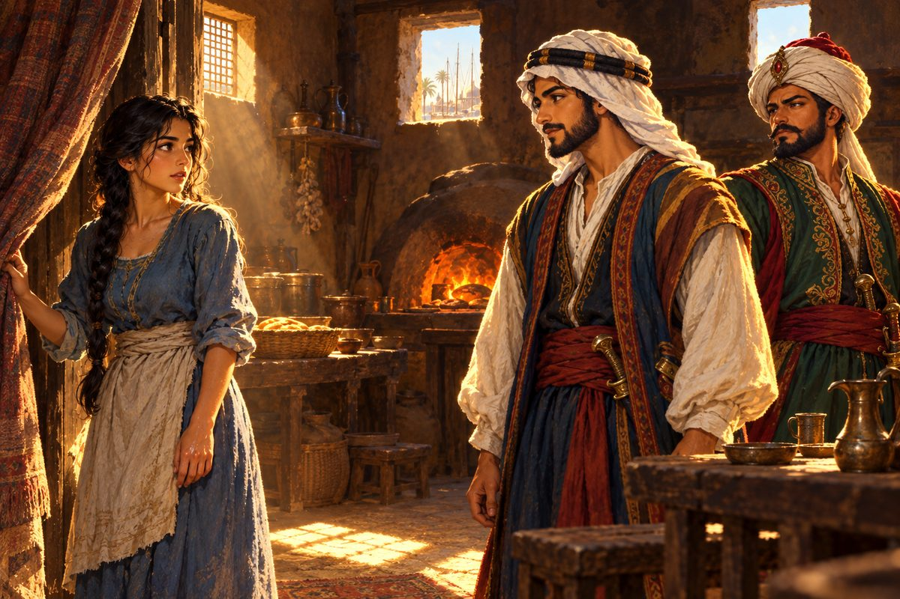

## 20. 아프리카를 돌아

이스탄불에서 바스라까지, 땅 위로는 낙타로 몇 달이면 닿는 거리였다. 그러나 바다로 가려면 세상을 반 바퀴 돌아야 했다.

사바니는 지중해를 서쪽으로 가로질렀다. 지브롤터 해협을 빠져나오자 바다의 색이 바뀌었다. 지중해의 맑은 남빛이 아니라 깊고 무거운 잿빛 녹색이었다. 대서양의 너울은 길고 느렸다. 배가 한 번 들렸다가 내려앉는 데 숨을 열 번은 쉬어야 했다.

세우타에서 물을 채우고 아프리카 서쪽 해안을 따라 내려갔다. 날이 갈수록 해가 높아졌다. 적도 근처에서는 바람이 죽었다. 돛이 축 늘어진 채 며칠을 떠 있었다. 바다는 기름을 부은 듯 매끄러웠고, 하늘에서 쏟아지는 열기에 갑판의 송진이 녹아 발바닥에 달라붙었다. 선원들은 말이 없어졌다. 물통의 물이 줄어드는 것을 모두가 곁눈질로 셌다.

"바람이 영영 안 불면 어떡하지." 젊은 선원 하나가 중얼거렸다.

"불어." 살림이 말했다. "바다는 숨을 참을 뿐이지, 숨을 안 쉬는 법은 없어."

알리는 선실에서 조안의 편지를 꺼내 보았다. 눈매가 알리와 꼭 닮아 보였소. 그 한 줄을 몇 번이나 읽었는지 몰랐다. 사파의 얼굴을 떠올려 보려 했다. 떠오르는 것은 여섯 살 아이의 얼굴뿐이었다. 그것도 흐릿했다. 열일곱 살의 사파는 어떤 얼굴일까. 알리를 알아볼까. 알리는 그녀를 알아볼 수 있을까.

나흘째 밤, 바람이 돌아왔다.

희망봉은 이름과 달리 사나운 곳이었다. 두 바다가 만나는 곶 앞에서 파도가 산처럼 일어섰다. 사바니는 사흘 동안 그 파도와 씨름했다. 돛 하나가 찢어졌고, 물통 두 개가 바다로 쓸려 갔다. 고양이는 선실 침상 밑에 숨어 사흘 동안 나오지 않았다.

곶을 돌자 바다가 거짓말처럼 순해졌다. 인도양이었다. 물빛이 다시 맑아졌고, 바람은 따뜻하고 한결같았다. 모잠비크와 몸바사의 항구에서 상인들은 아랍 말을 썼다. 알리는 오랜만에 통역 없이 흥정을 했다. 상아와 금가루, 향신료의 값을 수첩에 적었다. 손이 저절로 움직였다. 그러나 마음은 이미 북쪽에 가 있었다.

호르무즈 해협을 지나 페르시아만으로 들어서자 공기가 달라졌다. 뜨겁고 무겁고, 대추야자와 갯벌 냄새가 섞여 있었다. 만의 끝에서 두 강이 하나로 합쳐져 바다로 흘러드는 물길이 나타났다. 물길 양쪽으로 대추야자 숲이 끝없이 이어졌다.

"이 항구야." 알리가 말했다. 목소리가 생각보다 작게 나왔다. "사파가 있다는 곳이."

"빨리 주점으로 가 보자." 살림이 알리의 등을 밀었다. 그 손에 힘이 너무 들어가 있었다. 살림도 떨고 있었다.

## 21. 사파

바스라의 주점은 낮고 어두웠다. 흙벽에 작은 창이 두 개 뚫려 있었고, 그 창으로 들어온 햇빛이 바닥에 하얀 네모를 두 개 그려 놓았다. 진흙 화덕에서 빵 굽는 냄새가 났다.

"주인장. 여기서 사파라는 아가씨가 일한다던데. 좀 만나고 싶소."

"사파 말이오? 잠깐만. 어이, 사파! 손님이다."

안쪽 휘장이 젖혀졌다.

처녀 하나가 걸어 나왔다. 열일곱쯤. 검은 머리를 길게 땋아 한쪽 어깨로 넘겼고, 빛바랜 푸른 옷에 앞치마를 둘렀다. 손에 물기가 남아 있었다. 그녀가 창으로 든 햇빛 속으로 들어섰다.

알리는 숨을 멈추었다.

눈매였다. 조안의 말이 맞았다. 저 눈은 알리가 금각만 물에 비친 자기 얼굴에서 수없이 본 눈이었다. 그리고 그보다 오래전, 어머니의 얼굴에 있던 눈이었다.

"안녕하세요. 저를 찾으셨다고요? 누구시죠?"

"당신이…… 사파 양이오?"

"네. 무슨 일로 저를 찾으셨어요?"

알리는 무엇부터 말해야 할지 몰랐다. 수천 번 상상한 순간이었다. 상상 속에서 그는 늘 할 말을 알고 있었다. 지금은 아무것도 떠오르지 않았다.

"……사파. 가족은 없니?"

사파의 얼굴에 그늘이 졌다. "저번에 왔던 분과 똑같은 걸 물으시네요."

알리는 기다렸다. 사파가 한참 만에 입을 열었다.

"있었죠. 아주 어릴 때는요. 그러다 다 흩어졌어요. 그다음부터는 쭉 저 혼자였고요."

"오빠는? 오빠에 대해서는 아무것도 기억 안 나?"

"그 포르투갈 사람도 똑같이 캐물었어요. 하지만 생각나는 게 없어요."

알리는 그녀의 얼굴을 보았다. 흥정 상대의 눈을 읽듯이. 사파의 눈은 대답하는 동안 한 번도 알리를 똑바로 보지 않았다. 무언가를 감추는 사람의 눈이었다. 그러나 속이려는 눈은 아니었다. 다칠까 봐 겁내는 눈이었다.

"생각나는 게 없다는 말은 사실이 아니지요, 사파 양." 알리는 목소리를 낮추었다. "낯선 사내 둘을 어떻게 믿겠어요. 그 마음은 압니다. 그래도 당신, 오빠 이름만은 잊은 적이 없을 겁니다."

사파의 입술이 떨렸다. 그녀는 무언가를 오래 참아 온 사람처럼, 그것을 꺼내도 되는지 망설이는 사람처럼 손을 앞치마에 문질렀다. 그리고 아주 작게, 아이가 외워 둔 주문을 읊듯 입을 열었다.

"오빠 이름은……."

거기서 목소리가 끊겼다. 알리는 그 뒤를 기다리지 않았다. 열 해가 넘도록 그 아이 혼자 지고 온 이름이었다. 이제는 그가 받아 들 차례였다.

"알리 베자스."

사파가 눈을 크게 떴다. "어머……? 그 이름을, 어떻게……?"

길을 잃으면 오빠 이름을 대라. 어머니가 가르쳐 준 그 말을, 이 아이는 끝내 놓지 않고 있었다. 알리는 목이 막혀 한참 만에야 말을 이었다.

"사파." 목소리가 떨렸다. "너구나. 정말 너였구나. 그 이름의 주인이 여기 서 있어. 내가 알리 베자스야."

"네? 그, 그런 말을 갑자기 들으면…… 저는 뭐라고 해야 할지……."

"알아. 하루아침에 믿어지지 않겠지. 그래도 거짓말은 아니야. 너를 잃은 날부터 하루도 안 빼고 찾았어."

"정말로…… 오빠라고요?"

"너도 나도 기억이 다 지워졌지. 그래도 그 이름 하나면 증거로 충분하지 않을까."

살림이 헛기침을 했다. "저, 끼어들어서 죄송한데요. 옆에서 보는 사람이 제일 정확하거든요. 두 분, 판에 박은 듯 닮았어요."

"그래요?" "그래?"

두 사람이 동시에 살림을 보았다. 똑같이 고개를 갸웃하는 모습에 살림이 웃음을 터뜨렸다.

"아, 근데 다시 보니까 사파 양이 훨씬…… 아니, 비교가 안 되게 고우시네. 이 녀석 얼굴은 부두 바람에 다 삭아서 그래요."

"살림. 제발 부탁이니 방해하지 말고 저리 좀 가 있어."

"재미있는 분이시네요." 사파가 처음으로 웃었다. 입을 가리고, 작게. 그 웃음에서 알리는 여섯 살 아이를 보았다.

"나, 아니 저는, 자한 살림이라고 합니다. 알리 친구죠. 잘 부탁드립니다."

"반가워요, 살림 씨."

알리는 숨을 고르고 사파 앞에 섰다.

"사파. 같이 이스탄불로 가자. 지난 일은 다 잊고, 이제부터 같이 살자."

"그건…… 조금만 기다려 주세요. 오늘 하루에 너무 많은 일이 생겼어요. 그리고 아직은, 정말 그런지 제 마음이 다 믿지를 못해요."

알리는 고개를 끄덕였다. 열 해가 넘는 세월이었다. 그 세월을 혼자 건너온 사람에게, 하루아침에 모든 걸 내려놓으라고 할 수는 없었다.

"그래. 혼자 버텨 온 세월이 있으니 네 마음이 정할 일이야. 다만 하나만 기억해 줘. 나는 네 오빠고, 기다릴 거라는 거."

사파가 알리의 눈을 오래 보았다.

"……생각해 볼게요. 적어도 당신 눈은 사람을 속이는 눈이 아니에요. 그건 알아요."

"고마워. 또 올게."

## 22. 생각할 시간

주점을 나서자 살림이 알리의 어깨를 감쌌다.

"축하한다, 알리. 드디어 찾았구나."

"아직은 반쯤만 믿는 눈치야."

"내 눈은 못 속여. 둘은 오누이야. 사파 양도 곧 알게 될 거야." 살림은 그렇게 말하고, 주점 쪽을 한 번 돌아보았다. "그런데 사파 양, 정말 예쁘더라."

"이봐, 살림. 너 지금 무슨 엉뚱한 생각을 하는 거야?"

"응? 뭐라고?"

"……아냐, 됐다." 알리는 고개를 저었다. "앞일은 모르는 거지."

이스탄불로 돌아가는 길은 멀었다. 아프리카를 다시 돌아야 했다. 그러나 알리는 처음으로 그 먼 길이 아깝지 않았다.

라디아는 알리가 주점 문을 들어서기도 전에 달려 나왔다.

"알리 님! 사파 님은 만났어요? 만났군요! 그 얼굴 보니 알겠어요. 정말 잘됐다. 꿈같은 상봉이네요."

"그런데 아직 나를 오빠라고 부르지는 않아. 마음을 정할 시간이 필요하대."

"당연하죠. 하늘에서 오빠가 뚝 떨어졌는데 놀라지 않을 사람이 어디 있어요. 기다려 줘요. 피는 못 속이니까." 라디아가 눈을 반짝였다. "그런데 어떤 분이었어요?"

"그, 그게, 눈이 부신 아가씨였어요." 살림이 끼어들었다. "이 녀석하고 남매라곤 도무지 믿기지 않는……."

"너 아까는 빼닮았다며! 라디아, 이놈하고는 좀 거리를 둬."

"살림 씨 얼굴 빨개진 것 좀 봐. 어떤 분인지 나도 너무 궁금하다."

"언젠가 꼭 데려올게."

그 뒤로 알리는 항로를 짤 때마다 바스라를 끼워 넣었다. 인도양의 향신료를 싣고 바스라에 들렀고, 페르시아만의 진주를 사러 간다며 바스라에 들렀다. 사바니가 대추야자 숲 사이 물길로 들어설 때마다 살림은 먼저 수염을 다듬었다.

"사파. 또 보러 왔어."

"또 와 주셨네요. 미안해요. 마음은 당신이 오빠였으면 해요. 그런데 아직은 그 말이 입 밖으로 안 나와요."

"서두를 것 없어. 백 번이라도 다시 올게."

돌아서는 알리 뒤에서 살림은 매번 똑같이 말을 더듬었다.

"그, 그럼 또 뵈, 뵐게요. 사파 양, 그, 그럼, 잘……."

"살림 씨도 조심히 가세요."

여관 아주머니도 소식을 들었다.

"베자스 나리, 바스라 소식 들었어요. 동생을 찾았다면서요."

"찾기는 찾았습니다. 그런데 아직 제가 오빠라는 걸 마음으로 받아들이지는 못한 것 같아요."

"하긴, 그 오랜 세월 끝에 갑자기 만났으니 그럴 만도 하지요. 그래도 애써 보세요. 결국엔 다들 행복해지는 날이 올 거예요."

## 23. 라디노의 영전

동맹항이 서른 곳을 넘어선 해의 어느 날이었다. 라디아가 알리를 붙잡았다.

"참, 은행의 라디노 씨가 알리 님을 뵙고 싶어 하셨어요."

여관 아주머니도, 잡화점 주인도 같은 말을 했다. 라디노 씨가 다른 곳으로 가신대요. 그 전에 꼭 만나고 싶으시대요. 그분한테 받은 도움이 많지 않습니까.

은행에 들어서자 라디노가 반색을 했다.

"알리 님. 떠나기 전에 뵙지 못할까 봐 조마조마했습니다. 이번에 베네치아의 본점에서 일하게 되었습니다. 떠나기 전에 인사만은 드려야지 했지요."

"본점이라니, 크게 오르신 거군요. 경사입니다."

"하하, 고맙습니다. 그래서 염치없지만 청이 하나 있습니다." 라디노가 두 손을 비볐다. "베네치아까지 가는 길에, 저를 당신 배에 실어 주시겠습니까? 사바니 이야기를 들을 때마다 언젠가 그 갑판을 밟아 보고 싶었습니다."

"라디노 씨라면 선실 제일 좋은 자리를 비워 두겠습니다. 짐 꾸리시면 말씀만 하세요."

"이런 영광이……. 꿈이 이루어지는군요. 배를 타고, 넓은 세상을 내 눈으로 보다니."

평생 장부 속 숫자로만 바다를 보아 온 사람이었다. 라디노는 출항하는 날 아침 일찍 부두에 나왔다. 작은 가죽 가방 하나와 커다란 장부 꾸러미 셋을 들고서.

배 위의 라디노는 아이 같았다. 돌고래가 뱃전을 따라 뛰어오르자 소리를 질렀고, 해 질 녘 바다가 붉게 물들면 장부를 펼친 채 넋을 놓고 바라보았다. 사흘째에 그는 멀미로 뱃전에 매달렸다. 알리는 그의 등을 두드려 주었다.

"사흘만 버티세요. 사흘이면 몸이 바다를 압니다."

"누가 그러던가요?"

"해군 출신 친구가요." 알리가 살림 쪽을 보았다. 키를 잡은 살림이 손을 흔들었다.

밤이면 라디노는 알리의 수첩을 빌려 보았다. 항구마다 적힌 물건 값을 손가락으로 짚어 가며, 그는 은행원다운 질문을 쏟아 냈다. 이 값은 왜 이 달에 올랐습니까. 이 항구의 설탕은 왜 저 항구보다 쌉니까. 알리가 대답할 때마다 그는 고개를 끄덕이며 자기 장부에 무언가를 적었다.

"저는 평생 숫자만 봤습니다." 어느 밤 라디노가 말했다. "그런데 숫자 뒤에 이런 바다가 있었군요. 바람이 있고, 폭풍이 있고, 사람이 있고."

"숫자를 보는 눈이 있으셨으니 저한테 투자하신 거지요."

"아니요." 라디노가 고개를 저었다. "그때 저는 숫자를 본 게 아닙니다. 동전 하나를 맡기러 오는 당신 손을 봤지요."

## 24. 베네치아의 부탁

베네치아는 물 위에 지은 도시였다. 사바니가 석호로 들어서자 물 위로 솟은 종탑과 둥근 지붕들이 아침 안개 속에서 천천히 모습을 드러냈다. 운하마다 곤돌라가 미끄러졌고, 부두는 온갖 나라 말로 시끄러웠다.

라디노는 은행 본점 계단 앞에서 알리의 손을 오래 잡았다.

"알리 님. 이 항해는 제 평생의 보물입니다. 그리고 여기까지 오셨는데 은행장님께 인사는 하고 가셔야지요. 제가 말씀드리고 오겠습니다."

셜록은 이스탄불에서 본 그대로였다. 검은 옷, 맨손가락, 조용한 눈.

"알리 씨. 소문으로만 듣다가 이렇게 다시 보는군." 셜록이 의자를 권했다. "때맞춰 잘 왔소. 청할 일이 하나 있소. 내 은행이 목돈을 대 준 사람이 있는데, 그자가 크게 한몫 잡았다는 얘기가 들려오오. 문제는 그자가 바다 어디에 있는지 모른다는 거요. 이름은 피에트로 콘티. 모험가지. 그에게서 우리 돈을 거두어 와 주시겠소?"

"피에트로 콘티라면 아는 사람입니다. 저도 그 사람한테 돈을 좀 댔지요. 그 사내가 정말 한몫 잡았다고요?"

"흠, 역시." 셜록의 눈가에 주름이 잡혔다. "당신도 사람 보는 눈이 있군. 어떻소, 맡아 주겠소?"

"예, 맡겠습니다."

"잘 부탁하오. 그자에게 빌려준 것은 금괴 스무 개. 두 배로 갚는 조건이니 금괴 마흔 개를 받아 오면 되오."

은행을 나서자 살림이 물었다.

"그런데 알리. 바다가 이렇게 넓은데 그 사람을 어디서 찾지?"

"그 사람, 포르투갈 페레로 공작가의 후원을 받는다고 했잖아. 거기 가서 물어보면 되겠지."

"아, 그렇지! 넌 어떻게 그런 게 바로바로 떠오르냐. 그런데 페레로라면…… 조안의 집이잖아?"

"그래." 알리가 말했다. "어차피 인사드릴 일도 있었어."

## 25. 리스본의 공작 부인

리스본은 테주강 어귀의 언덕들 위에 층층이 쌓인 도시였다. 하얀 벽과 붉은 지붕이 햇빛에 눈부셨다. 부두에는 인도에서 돌아온 큰 배들이 줄지어 서 있었고, 향신료 냄새가 강바람에 실려 왔다.

페레로 공작 저택은 언덕 꼭대기에 있었다. 문을 연 집사는 오스만 옷을 입은 손님을 보고 눈썹 하나 움직이지 않았다. 좋은 집안의 집사였다.

"어서 오십시오. 어떤 용무로 오셨는지요."

"이스탄불에서 온 상인 알리 베자스라고 합니다. 피에트로 콘티라는 분의 행방을 여쭈러 왔습니다. 이 댁과 인연이 있다고 들어서요."

"콘티 씨 말씀이시군요. 얼마 전까지 손님으로 계셨는데, 며칠 전에 또 배를 타고 떠나셨습니다."

"한발 늦었군요. 그렇다면 부인께 잠시 인사를 여쭐 수 있겠습니까. 조안 씨에 관해 전할 말이 있습니다."

"도련님 일이라면 마님께서 반가워하실 겁니다. 이리 오십시오."

응접실의 창으로 테주강이 내려다보였다. 잠시 후 문이 열리고 귀부인 하나가 들어왔다. 쉰 가까운 나이였다. 은빛이 섞인 갈색 머리를 단정히 틀어 올렸고, 짙은 녹색 비단 옷을 입었다. 눈매가 조안과 닮아 있었다.

"먼 데서 오셨군요. 이 집 안주인이에요. 우리 조안 소식을 가져오셨다고요?"

"예. 본래는 다른 일로 왔습니다만, 아드님께 받은 은혜를 그냥 지나칠 수 없었습니다. 저는 어릴 때 누이를 잃었습니다. 그 아이가 어디 있는지 알려 준 사람이 바로 조안 씨였습니다."

"어머, 그랬어요? 그 아이가 그런 기특한 일을……."

"동생도 무척 고마워하고 있습니다. 다만……."

"다만?"

알리는 잠깐 망설였다. 그러나 이 사람은 알아야 했다. 아들의 소식을 듣기 위해 남의 모험에 돈을 대는 어머니라면.

"카탈리나라는 여해적이 조안 씨 뒤를 쫓고 있습니다. 무슨 까닭인지, 자기 오빠와 약혼자를 해친 사람이 조안 씨라고 굳게 믿고 있더군요."

부인의 얼굴에서 핏기가 가셨다. "그, 그래요? 조안은요? 그 아이는 무사한가요?"

"지금은 무사합니다. 한 번은 꾀를 써서 그 여자를 따돌렸지요. 하지만 그 여자는 쉽게 단념할 사람이 아니었습니다."

부인은 한동안 창밖의 강을 보았다. 손수건을 쥔 손이 하얗게 질려 있었다.

"이렇게 와서 말해 줘서 고마워요. 사실 내가 콘티 씨의 항해에 돈을 댄 것도, 바다를 떠도는 사람한테서 그 아이 소식을 한 줄이라도 듣고 싶어서였어요." 그녀가 알리를 돌아보았다. "이대로 보낼 수는 없지요. 내 성의를 받아 줘요."

"예? 아닙니다. 답례라니요. 오히려 제가 드려야 할 처지입니다."

"어머니가 아들 소식에 값을 치르는 거예요. 거절하지 말아요."

시종이 들고 온 함에는 금괴가 가득 들어 있었다. 알리는 그것을 오래 내려다보았다. 공작가의 호의를 물리는 것도 예가 아니라고 그는 들었다.

"그럼 사양하지 않겠습니다. 이토록 큰 정을……. 잊지 않겠습니다."

"참, 콘티 씨가 어디로 갔는지 물었지요. 동쪽 끝, 황금이 난다는 섬나라 지팡구로 간다더군요."

"황금의 나라, 지팡구요?"

"네. 젊을 때 남편 레온과 함께 그 바다까지 가 본 적이 있어요. 북위 35도, 동경 135도. 그 근처를 찾으면 돼요." 부인의 눈이 잠깐 먼 곳을 보았다. 젊은 날의 바다를 보는 눈이었다.

"북위 35도, 동경 135도. 좋은 말씀 감사합니다. 그럼 이만 물러가겠습니다. 페레로 가에 축복이 있기를."

저택을 나서자 살림이 지도를 펼쳤다. 그리고 손가락으로 리스본에서부터 동쪽으로, 아프리카를 돌고, 인도를 지나고, 계속 동쪽으로 짚어 나갔다. 손가락이 지도 끝에 닿았다.

"황금의 나라! 듣기만 해도 심장이 쿵쾅거리네. 그런데 이거 봐. 지도 끝에서 떨어지기 직전이야."

"모험가다운 사람이군. 덕분에 우리까지 모험을 하게 됐어."

"은행장 심부름도 하고 구경도 하고. 일석이조 아니냐. 헤헤."

"내가 꿔 준 만 닢도 거기 있고." 알리가 지도를 접었다. "가야 할 이유가 두 개나 되는군."
