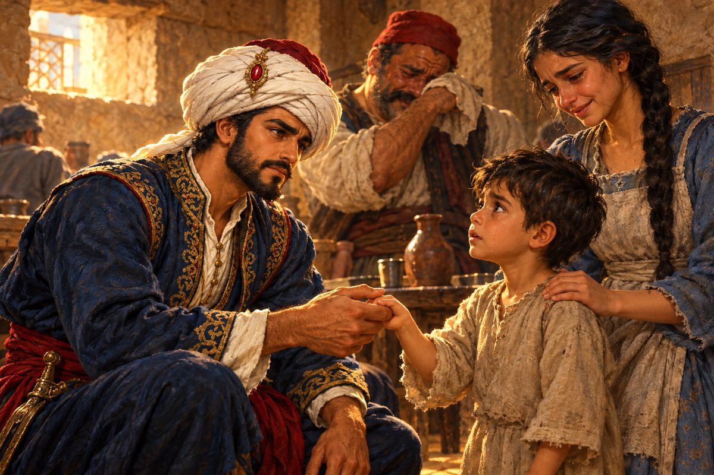

## 26. 동쪽 끝 바다

지팡구까지의 항해는 여섯 달이 걸렸다.

다시 아프리카를 돌았다. 이번에는 희망봉이 조금 덜 사나웠다. 인도 서해안의 캘리컷에서는 후추가 산더미처럼 쌓여 있었다. 포르투갈 배들이 항구를 차지하고 있었고, 아랍 상인들은 그 틈에서 눈치를 보며 장사를 했다. 알리는 수첩에 후추 값을 적다가, 그것이 이스탄불 값의 몇 분의 일인지 셈해 보고 한동안 펜을 멈추었다.

"여기서 사서 이스탄불에 팔면……."

"알리. 우린 지금 빚 받으러 가는 길이야." 살림이 말했다.

"알아. 적어만 둘게."

말라카 해협을 지나자 바다의 냄새가 또 바뀌었다. 습하고 달큼한, 썩은 과일과 꽃이 뒤섞인 냄새였다. 하늘은 날마다 오후가 되면 무너지듯 비를 쏟았다. 마카오의 부두에서는 처음 보는 배들을 만났다. 대나무 살을 댄 돛을 단 커다란 정크였다. 그 돛이 펼쳐지는 모습은 박쥐의 날개 같았다.

고양이는 이 긴 항해에도 끄떡없었다. 낮에는 햇볕 드는 갑판에 길게 누워 있다가, 밤이면 창고를 돌며 쥐를 잡고, 새벽이면 어김없이 알리의 침상 발치에 와서 몸을 말았다.

동쪽으로, 더 동쪽으로. 마침내 수평선 위에 푸른 산들이 겹겹이 솟아올랐다. 산자락까지 짙은 숲이 덮여 있었고, 그 아래 좁은 만 안쪽에 항구가 있었다.

"여기가 지팡구인가 봐." 살림이 뱃머리에서 말했다. "그런데 황금 지붕 같은 건 안 보이는데."

## 27. 나가사키

나가사키의 주점은 신기한 곳이었다. 바닥보다 한 단 높게 짠 마루에 사람들이 신을 벗고 앉아 있었다. 낯선 말들이 오갔고, 술은 맑고 미지근했다. 그러나 포르투갈 뱃사람들이 드나드는 곳이라 몇 마디 말은 통했다.

"혹시 피에트로 콘티라는 이탈리아 사람을 본 적 있소?"

주인 여자가 고개를 끄덕였다.

"그 수염 난 서양 손님 말이군요. 한동안 거의 날마다 오셨는데, 요 며칠은 발길이 끊겼어요. 아마 사카이로 가셨을 거예요. 바닷길로 동쪽으로 조금 더 가면 나와요."

알리는 나가사키 시장도 둘러보았다. 은이 놀랄 만큼 쌌다. 알리는 은 한 덩이를 손에 올려 무게를 가늠해 보고, 수첩에 적었다. 적으면서 고개를 저었다. 황금의 나라가 아니라 은의 나라였다.

사카이는 나가사키보다 크고 시끄러웠다. 상인들의 도시였다. 담장 대신 해자를 두르고, 무사 대신 상인들이 모여 도시를 다스린다고 했다. 알리는 그 말을 듣고 오래 부두에 서 있었다. 상인이 다스리는 도시. 이스탄불에서는 상상할 수 없는 말이었다.

"피에트로 콘티라는 서양 모험가가 여기 드나들지 않소?"

세 번째로 들어간 주점에서 주인이 고개를 돌려 안쪽에 소리쳤다.

"피에트로 씨! 손님이오."

## 28. 사카이의 모험가

"이 세상 끝에서 날 찾는 사람이 다 있어?" 마루 끝에 비스듬히 누워 있던 사내가 몸을 일으켰다. 피에트로 콘티였다. 이스탄불에서 봤을 때보다 얼굴이 더 그을렸고, 수염이 길었다. "알리! 맙소사. 만 닢 받겠다고 세상 반 바퀴를 돌아온 거야?"

"그렇소."

"이런 독한 장사꾼 같으니." 피에트로가 웃음을 터뜨렸다. "다행히 요즘 내 궤짝이 무겁거든. 받아. 금괴 열 개. 당신이 준 돈을 열 배로 불려 돌려주는 거야. 이자 따질 생각은 하지도 마."

금괴 열 개가 마루 위에 놓였다. 금화로 십만 닢. 잡화점 주인이 미쳤냐고 했던 그 만 닢이 열 배가 되어 돌아온 것이었다.

"금괴를 대추 한 줌 내놓듯 하는군. 크게 벌긴 벌었나 보오. 그런데 미안하지만 볼일이 하나 더 있소. 셜록 은행이 내게 당신 빚 받는 일을 맡겼소."

"은행 영감도 어지간하군. 이 먼 데까지 사람을 보내다니. 좋아, 좋아." 피에트로가 다른 궤짝을 열었다. "금괴 이백 개. 가져가."

살림이 침을 꼴깍 삼켰다. 알리도 눈이 커졌다.

"이백 개라니. 은행에서 그렇게나 꾸었소?"

"아니, 스무 개. 거기도 똑같이 열 배야."

"은행과의 계약은 두 배요. 마흔 개면 되오."

"그건 은행 계약이고, 이건 내 원칙이야." 피에트로가 손을 내저었다. "나는 나를 믿어 준 사람한테는 열 배로 갚아. 남는 건 여기까지 온 뱃삯이라 치고 가져가. 거절하면 내가 섭섭하지."

알리는 금괴 더미를 오래 보았다. 그러다 고개를 끄덕였다.

"고맙게 받겠소. 그런데 이 큰돈은 어디서 났소? 정말 황금이 길에 굴러다니는 나라였소?"

"황금 지붕은 무슨. 소문이 바다를 건너면서 부풀었지. 대신 다른 보물이 있어. 나가사키에선 은이 헐값이고, 사카이에선 비단이 헐값이야. 그걸 서쪽으로 가져가면 금이 되지." 피에트로가 눈을 찡긋했다. "당신 같은 장사꾼한테는 여기가 진짜 황금의 나라일걸."

"당신은 아니고?"

"나는 진짜 황금의 도시를 찾고 있어. 엘도라도."

"엘도라도?"

"눈부신 황금으로 지은 전설의 도시. 집도, 그릇도, 길바닥까지 전부 황금이라더군." 피에트로가 품에서 무언가를 꺼냈다. 손바닥만 한 황금 메달이었다. 낯선 문양이 새겨져 있었다. 사람 얼굴 같기도 하고 해 같기도 한 문양. "이걸 봐. 그 도시에서 흘러나왔다는 물건이야."

알리는 메달을 받아 들었다. 묵직했다. 수첩에 적힌 어느 금보다 순도가 높아 보였다.

"놀랍군. 이런 걸 만든 도시가 정말 어딘가에 있단 말이오?"

"있어. 지팡구가 그곳이 아니었을 뿐이야. 바다는 아직 반도 안 그려졌다고. 다음엔 대서양 건너 남쪽 땅으로 가 볼 거야. 세계 지도를 그린다는 네덜란드 사람한테서 쓸 만한 단서를 얻었거든."

"당신 같은 사람이 찾지 못하면 아무도 못 찾겠지. 행운을 비오."

사카이를 떠나기 전, 알리는 피에트로의 말대로 비단을 샀다. 창고가 넘치도록. 살림이 혀를 찼다.

"빚 받으러 와서 장사까지 하냐."

"이게 일하면서 하는 여행이라며. 네가 그랬잖아."

그날 밤 알리는 갑판에서 바다를 보았다. 피에트로의 눈이 떠올랐다. 엘도라도를 말할 때의 그 눈. 돈 이야기를 할 때와는 전혀 다른 빛이었다. 저 사내는 금을 쫓는 게 아니었다. 금이 있다는 그 땅을 쫓고 있었다. 무엇을 위해 버는가. 셜록의 말이 문득 되살아났다. 알리는 아직 그 질문에 대답할 말이 없었다.

## 29. 쉰 개의 항구

베네치아 본점에서 라디노는 금괴 마흔 개를 하나하나 세어 장부에 적었다.

"정확합니다. 셜록 은행장님께서 무척 기뻐하실 겁니다." 그가 펜을 내려놓고 알리를 보았다. "그런데 알리 님, 얼굴이 더 그을리셨군요. 지팡구는 어땠습니까?"

"황금은 없었습니다. 은하고 비단이 있었지요. 그리고 상인들이 다스리는 도시가 있었습니다."

라디노는 그 말을 장부 귀퉁이에 적었다. 무엇이든 적어 두는 사람이었다.

알리는 다시 바다로 나갔다. 사카이의 비단은 지중해에서 금이 되었고, 그 금은 다시 항구로 들어갔다. 교역소에, 조선소에. 동맹항의 이름이 수첩의 한 장을 다 채우고 다음 장으로 넘어갔다. 마흔. 마흔다섯. 그리고 쉰.

이스탄불 부두에 닿자 잡화점 주인이 달려왔다.

"알리 나리. 방금 왕궁에서 사람이 와서 찾았습니다. 어서 가 보십시오."

알현실의 슐레이만 대제는 처음 보았을 때보다 조금 야위어 있었다. 그러나 눈은 더 날카로웠다.

"알리. 그대가 바다에서 거둔 일들이 제국의 이름을 사방에 떨치고 있다."

"황공하옵니다, 폐하."

"제국과 손잡은 항구가 마침내 쉰을 헤아리게 되었다. 그 대부분이 그대의 손에서 나왔지. 그 공을 갚고자 금괴 백 개를 내린다."

"성은이 망극하옵니다."

"그러나 바다는 넓고, 제국의 그늘이 닿지 않은 항구는 아직 많다. 멈추지 마라."

"예, 폐하."

알현실을 나오는 회랑에서 알리는 창밖을 보았다. 연병장에 병사들이 줄지어 서 있었다. 전에 보았을 때보다 줄이 훨씬 길었다. 대포를 실은 수레가 덜컹거리며 성문 쪽으로 나가고 있었다.

언덕 위 빈 저택 앞을 지날 때, 살림이 걸음을 멈추었다.

"알리. 말 나온 김에 우리 이 집 사 보는 게 어때? 이제 살 수 있잖아. 전망도 좋고, 정원도 넓고."

"그 돈이면 배를 한 척 더 띄우지. 집이 무슨 돈을 벌어 줘. 가자."

여관 아주머니가 알리를 맞으며 말했다.

"베자스 나리, 피곤하시지요. 그런데 가끔은 동생분이 어떻게 지내나 보러 가 보세요. 금괴가 백 개면 뭐 하겠어요. 가족이 제일 소중한 법이에요."

## 30. 세우타의 술잔

세우타는 아프리카의 북쪽 끝, 지브롤터 해협을 사이에 두고 유럽을 마주 보는 항구였다. 포르투갈 깃발이 걸려 있었지만 주점에는 온 지중해의 뱃사람이 다 모였다.

알리가 구석 자리에 앉자 누군가 반갑게 다가왔다.

"이거, 알리 나리 아니십니까? 세상 좁네요."

이스탄불 말씨였다. 알리는 그 얼굴을 기억해 냈다. 금각만 부두에서 함께 짐을 지던 사내였다. 이제는 남의 배에서 노를 젓는다고 했다.

"마침 잘 만났소. 고향 소식 좀 들려주시오. 전쟁 채비 때문에 다들 힘들다던데, 사실이오?"

"힘든 정도가 아닙니다요. 장정이란 장정은 죄다 군대로 끌려가고, 남은 사람은 성 쌓고 짐 나르는 데 불려 가고. 동네마다 밭 갈 사내가 없습니다." 사내가 목소리를 낮추었다. "세금은 또 어떻고요. 싸움에 쓴다고 세금을 몇 겹으로 매기고, 못 내면 살림살이를 몽땅 실어 갑니다. 나리는 대제께서 손수 일을 맡기실 만큼 믿으신다면서요. 어떻게 말씀이라도 좀 넣어 주실 수 없겠습니까?"

알리는 대답하지 못했다.

그때 옆 탁자에서 누군가 일어섰다. 마그레브풍의 헐렁한 옷을 입은, 바닷바람에 얼굴이 갈라진 늙은 뱃사람이었다.

"그 이름, 들은 적 있소. 오스만의 큰 장사꾼 알리."

"그렇소만."

"금화를 뿌려서 이 바다의 항구들을 하나씩 오스만 편으로 돌려세운다는 사람이 당신이구려."

"제국이 번영하고 바다가 평안하려면 필요한 일이오."

"평안이라." 노인의 목소리는 크지 않았다. 그래서 더 아프게 들렸다. "당신이 금화를 내려놓은 항구마다 우는 집이 생기고 있소. 그걸 알고나 하는 일이오?"

"……무슨 소리요?"

"오스만의 동맹항이 된 곳마다 대제의 욕심 때문에 젊은 사내들이 다 끌려가고 있소. 내 조카도 끌려갔소. 동맹항뿐만이 아니오. 다른 항구, 다른 나라 사람들까지 오스만의 압정을 욕하고 있소." 노인이 알리를 똑바로 보았다. "내 말이 거짓말 같소? 그럼 오스만 동맹항의 아무 술집에나 가 보시오. 거기 사람들 속마음을 들을 수 있을 테니."

노인은 술값을 탁자에 던지고 나갔다.

알리는 그날 밤 잠을 이루지 못했다. 이튿날부터 그는 동맹항에 들를 때마다 주점 구석에 앉아 귀를 기울였다. 노인의 말은 거짓이 아니었다. 튀니스에서, 알제에서, 아테네에서 사람들은 같은 말을 했다. 아들이 끌려갔다. 남편이 끌려갔다. 세금 때문에 배를 팔았다. 그리고 몇몇은 알리의 얼굴을 알아보고 입을 다물었다. 그 침묵이 욕설보다 무거웠다.

알리는 수첩을 펼쳤다. 동맹항의 이름이 두 장에 걸쳐 빽빽하게 적혀 있었다. 그는 그것을 자랑스럽게 여겼다. 항구 하나하나가 셈의 승리였다. 그런데 이제 그 이름들 뒤에서 다른 숫자가 보였다. 끌려간 사람의 수, 팔려 나간 배의 수. 그 숫자는 수첩 어디에도 적혀 있지 않았다.

군비도 함께 늘려야 한다. 대제의 목소리가 떠올랐다. 그때 그는 그 말을 털어 냈었다. 상인이 할 일은 셈이라고. 셈은 끝나 있었다. 아니, 끝났다고 믿었을 뿐이었다.

"살림. 바스라로 가자."

"갑자기? 왜?"

"아주머니 말이 맞아. 사파를 봐야겠어." 알리는 수첩을 덮었다. "지금은 그게 제일 하고 싶은 일이야."

## 31. 오빠

바스라의 주점은 여전히 낮고 어두웠다. 창으로 든 햇빛이 바닥에 하얀 네모를 그려 놓은 것도 그대로였다.

"사파. 나 또 왔다."

휘장이 젖혀지고 사파가 나왔다. 그녀는 혼자가 아니었다. 대여섯 살쯤 된 사내아이 하나가 그녀의 치맛자락을 붙잡고 반쯤 숨어 있었다. 까만 눈만 휘장 뒤에서 반짝였다.

사파가 알리 앞에 섰다. 그리고 한참 숨을 고른 뒤 말했다.

"어서 와요. ……오빠."

알리는 그 자리에 굳었다. 열 몇 해 동안 꿈속에서만 듣던 말이었다. 꿈속의 그 목소리는 여섯 살 아이의 것이었다. 지금 들은 목소리는 다 자란 여자의 것이었다. 그런데도 똑같았다.

"사파. 지금…… 뭐라고 했어? 오빠라고? 하하, 들었어, 살림? 처음이야. 처음으로 그렇게 불러 줬어."

"알리, 축하해." 살림의 목소리가 젖어 있었다. "사파 양, 드디어 오빠를 인정하기로 마음먹었군요."

"네. 언제까지나 문을 걸어 잠그고 있을 수는 없잖아요." 사파가 알리를 보았다. "그리고 오빠, 들어줬으면 하는 게 있어요. 이 아이 말이에요……."

"이 아이라니, 그게 무슨……." 알리는 사파의 치맛자락에 매달린 아이를 내려다보았다. "……설마, 이 아이가?"

살림이 얼굴이 하얗게 질려 비틀거렸다.

"사, 사파 양한테 아, 아들이? 그, 그럴 리가. 저는, 저는 그동안 사파 양을…… 아이고, 아이고!"

"살림 씨, 진정해요! 제 아이가 아니에요. 저 시집도 안 갔다고요!"

"그럼 이 아이는?"

사파의 얼굴이 어두워졌다. 그녀는 아이의 머리를 쓰다듬었다. 아이가 사파의 손을 꼭 붙잡았다.

"……고아예요. 이 아이 부모님이 전쟁에 반대했다는 죄로 재산을 다 빼앗기고, 며칠 전에…… 처형당했어요."

주점 안이 조용해졌다. 알리는 무언가가 가슴 한가운데를 치는 것을 느꼈다. 세우타의 노인이 했던 말이, 동맹항 주점 구석에서 들은 그 모든 목소리가 한꺼번에 몰려왔다. 수첩에 적히지 않은 숫자 하나가, 지금 사파의 치맛자락을 붙잡고 서 있었다.

"오빠. 이 아이, 제가 키우고 싶어요. 갑자기 이런 말을 해서 당황스럽겠죠." 사파의 목소리가 떨렸다. "하지만 이 아이를 보면 어린 저를 보는 것 같아요. 오빠라면…… 내 마음을 알 거예요."

알리는 무릎을 꿇었다. 아이와 눈높이가 맞았다. 아이는 알리를 겁먹은 눈으로 보았다. 그 눈을 알리는 알았다. 낯선 항구의 인파 속에서, 놓쳐 버린 손을 찾아 헤매던 눈. 그 자신의 눈이었고, 여섯 살 사파의 눈이었다.

"그래." 알리가 말했다. "세상 누가 모른대도 나는 알아. 뼛속까지 알아. 그렇게 하자."

살림이 소매로 얼굴을 훔쳤다. "얼굴만 고운 줄 알았더니 마음은 더, 더 고우시네……. 사파 양, 이스탄불로 가요. 거기서 우리 다 같이 오순도순 사는 거예요."

"그럴 수만 있다면 얼마나 좋을까요, 살림 씨."

알리가 고개를 들었다.

"살림. 방금 그 말, 다시 해 봐."

"으, 응? 내가 또 헛소리했냐?"

"아니. 네가 내 속을 읽은 것 같아서." 알리가 천천히 일어섰다. 머릿속에서 무언가가 제자리를 찾아 맞물리고 있었다. 언덕 위의 빈 저택. 정원의 무화과나무. 우리도 언젠가 저런 집에서 살아 봤으면. "헛소리가 아니라 정답이야. 큰 집을 하나 사자. 루스템 같은 아이들이 와서 살 수 있는 집. 사파, 네 생각은 어때?"

사파의 눈이 커졌다. 그리고 눈물이 맺혔다.

"오빠……! 그런 집이 생긴다면, 저 거기서 평생 아이들 밥을 지을래요. 고마워요. 정말 고마워요."

"그런데 이 녀석 이름이 뭐지?"

"루스템이요. 옛이야기 속 영웅 이름이래요."

알리는 아이에게 손을 내밀었다. 루스템은 사파를 한 번 올려다보았다. 사파가 고개를 끄덕였다. 작은 손이 알리의 손가락을 붙잡았다. 너무 작아서, 쥐고 있다는 것보다 매달려 있다는 쪽이 맞는 손이었다.

이번에는 놓치지 않을 것이다.

"루스템. 이제부터 너는 베자스 집안 식구다." 알리가 말했다. "우리 다 같이 이스탄불로 가자."
