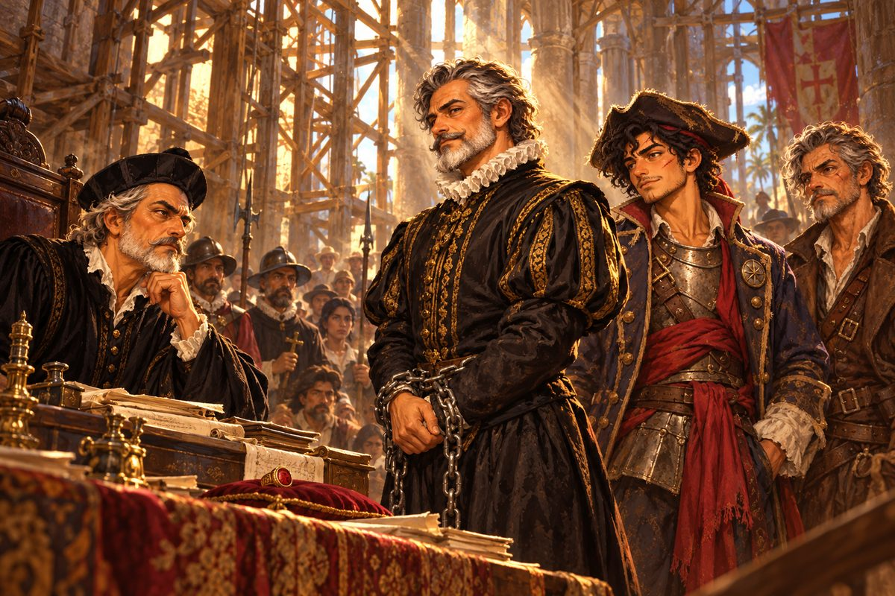

## 35. 산토도밍고 앞바다

해가 뜨기 전, 에스페란사호는 오사마강 어귀를 미끄러지듯 빠져나갔다.

뱃머리에는 야라가 서 있었다. 밤새 한숨도 자지 않았는데 눈은 맑았다. 물빛이 바뀌는 곳마다 그녀가 손을 들어 방향을 가리키면, 바르톨로메는 말없이 키를 돌렸다. 뒤로는 산타 루시아가 바짝 따라붙었다. 라파엘은 포문 앞을 오가며 포수들의 어깨를 하나씩 두드렸다.

부두에는 사람들이 나와 있었다. 짐꾼들, 조선소 노인, 마테오가 어릴 적 같이 짐을 지던 아이들. 아무도 소리를 내지 않았다. 총독의 항구에서 수배범을 배웅하는 일이었다. 다만 클라라의 술집 이 층 창이 활짝 열려 있었다. 그것으로 충분했다.

마테오는 고물에 서서 손을 허리로 가져갔다. 판금 갑옷 위에 허리띠처럼 동인 붉은 천이 손끝에 걸렸다. 소금기에 바랜 긴 선장 외투 자락에는 긁힌 놋쇠 패가 못처럼 박혀 있었다. 맨발로 이 부두를 뛰어다니던 소년이 처음 받은 사냥꾼 패였다. 오른 눈썹을 가로지른 흉터가 새벽바람에 당겼다.

"선장." 에스테반이 기름종이 꾸러미를 가슴에 안고 갑판으로 올라왔다. 얼굴이 하얬다. "고발장과 증인 명단, 측량 일지, 인장 세 장. 모두 여기 있습니다. 사본은 클라라 부인께 맡겼습니다."

"아저씨는 선실에 있어요. 포탄이 날아와도 그 꾸러미는 젖으면 안 되니까."

"선장, 저는 종이 앞에서만 용감합니다. 그러니 종이 곁에 있겠습니다."

에스테반이 계단 아래로 사라지자 항구 어귀가 열렸다. 그 너머에서 총독의 함대가 기다리고 있었다.

갤리온 넷과 카락 둘. 아침 햇살을 받은 높은 고물마다 에스파냐 깃발이 늘어져 있었다. 배들은 하나같이 물에 깊이 잠겨 있었다. 은을 가득 실은 배들이었다. 그 가운데 가장 큰 갤리온, 총독의 기함 고물 갑판에 검은 비로드 외투를 입은 사람이 서 있었다. 돈 알론소 데 바예호. 거리가 좁혀지자 그 목소리가 물 위로 건너왔다.

"레예스! 수배된 몸으로 내 항구에 오다니. 자네 아버지보다 배짱이 좋군."

마테오는 뱃전으로 걸어 나갔다. 목소리가 떨리지 않게 숨을 한 번 골랐다.

"각하. 제 아버지는 각하의 은을 나르기를 거절했어요. 그래서 수배되었죠."

"증거도 없이 그런 말을 하는 자를 이 섬에서는 해적이라 부르네."

"증거는 많아요. 백 사람의 이름, 세 장의 인장, 학자의 일지." 마테오는 기함의 고물을 똑바로 보았다. 난간을 쥔 총독의 손가락에서 무언가 붉게 빛났다. "그리고 각하 손가락의 반지."

바다가 잠깐 조용해졌다. 갈매기 울음만 돛대 사이를 지나갔다.

"……그렇다면 자네는 여기서 가라앉아야겠군."

총독이 손을 들었다. 갤리온들의 포문이 하나둘 열렸다. 그때 동쪽 곶 그늘에서 날렵한 브리간틴들이 돛을 올리며 미끄러져 나왔다. 뱃머리에 선 여자의 검은 옷자락이 바람에 날렸다. 비올레타였다.

"미안해서 어쩌나, 각하. 오늘은 저 꼬마 편이에요. 각하가 준 수배서는 다 바다에 버렸거든요."

산타 루시아에서 라파엘의 웃음소리가 터졌다. 야라는 뒤도 돌아보지 않고 손가락으로 물길을 짚었다. 키를 잡은 바르톨로메가 마테오를 불렀다.

"마테오. 조건을 읽어라. 이번 수배서는 네가 쓰는 거다."

마테오는 플람베르크를 뽑았다. 물결 모양 칼날이 아침 해를 받아 번쩍였다.

"다들 들어요. 저 기함, 가라앉히지 말고 붙어요. 각하는 산 채로 대성당까지 모셔야 하니까요!"

첫 포성이 바다를 갈랐다.

갤리온의 포탄은 무겁고 느렸다. 야라는 그 느림을 알고 있었다. 에스페란사호는 포연 사이로 몸을 비틀며 산호초 가장자리를 스치듯 지났고, 깊이 잠긴 갤리온들은 그 물길을 따라오지 못했다. 산타 루시아의 포는 돛대만 골라 울렸다. 사람 대신 돛을 쏘는 포수의 포였다. 카락 한 척의 큰 돛이 찢어져 내려앉았고, 다른 한 척은 비올레타의 브리간틴들에 둘러싸여 뱃머리를 돌렸다.

비올레타의 브리간틴들은 사냥개처럼 움직였다. 한 척이 카락의 뱃머리를 가로막으면 다른 한 척이 고물로 돌아 들어갔다. 늘 시체로만 표적을 데려오던 사냥꾼이, 오늘은 단 한 번도 사람 높이로 포를 쏘지 않았다. 마테오는 그것을 보았고, 아무 말도 하지 않았다.

"왼쪽! 바닥이 올라와!"

야라의 외침에 에스페란사호가 몸을 틀었다. 뒤쫓던 갤리온 한 척이 미처 따라 돌지 못하고 모래톱에 배를 걸었다. 높은 선체가 기우뚱 기울며 멈춰 서자 갑판의 병사들이 우르르 한쪽으로 쏠렸다. 부두 쪽에서 함성 같은 것이 터졌다가 금세 잦아들었다. 누군가 아이들의 입을 틀어막은 모양이었다.

기함의 포문이 다시 열렸다. 포탄 하나가 에스페란사호의 고물 난간을 부수고 지나갔다. 나무 조각이 비처럼 쏟아졌다. 마테오는 갑옷 어깨로 그것을 받아 내며 외쳤다.

"붙어요! 더 바짝! 저 덩치는 제 옆구리 밑으로는 못 쏴요!"

바르톨로메가 키를 끝까지 꺾었다. 작은 에스페란사호가 기함의 그늘 속으로 미끄러져 들어갔다. 머리 위로 성벽 같은 뱃전이 솟았다. 갈고리가 날았다. 밧줄이 팽팽히 당겨지고, 두 배가 삐걱이며 맞닿았다.

마테오는 밧줄을 움켜쥐었다. 아버지의 붉은 천이 허리에서 펄럭였다. 세 해 전, 맨발의 소년은 이 항구에서 첫 수배서를 떼었다. 빚을 갚으려고, 아버지의 배를 지키려고. 오늘 그는 자기가 쓴 수배서의 조건을 지키러 간다.

그는 기함의 뱃전을 넘었다.

뒤로 바르톨로메와 선원들이 줄줄이 넘어왔다. 총독의 병사들이 창을 겨누고 몰려들었다. 마테오는 칼등으로 첫 창대를 쳐 내고, 두 번째 병사를 갑옷 어깨로 밀어 은 상자 위로 넘어뜨렸다.

"죽이지 마요! 오늘은 아무도!"

바르톨로메가 늙은 팔로 창 두 자루를 한꺼번에 걷어 냈다. 병사들이 주춤 물러서며 길이 열렸다.

갑판 저편, 은 상자가 쌓인 큰 돛대 아래에서 돈 알론소 데 바예호가 천천히 칼을 뽑았다.

이 이야기는 여기서 두 갈래로 갈린다. 마테오가 총독을 칼로 사로잡았을 때와, 그렇지 않았을 때.

## 36. 재판의 길

총독의 칼은 나이를 먹지 않았다. 군더더기 없는 찌르기가 갑옷 이음매만 골라 들어왔다. 마테오는 물러서지 않았다. 처음 칼을 쥐던 날 바르톨로메가 해 준 말이 귀에 박혀 있었다. 상대의 칼보다 상대의 발을 봐라. 총독의 뒤꿈치가 은 상자 모서리에 걸리는 순간, 마테오는 플람베르크를 크게 휘둘러 상대의 칼을 쳐 냈다. 칼이 갑판을 미끄러져 굴렀다.

마테오의 칼끝이 총독의 목에서 멈췄다.

기함의 갑판이 조용해졌다. 총독의 병사들이 하나둘 칼을 내렸다. 총독은 목에 닿은 칼날을 내려다보지도 않고 마테오의 얼굴을 보았다.

"……죽이게. 레예스의 아들이라면 그럴 자격이 있지."

마테오는 칼끝을 거두지 않았다. 그렇다고 더 밀어 넣지도 않았다.

"아뇨. 각하는 산 채로 가셔야 해요. 감찰관 앞으로. 모두가 듣는 데로."

그해 봄, 은 함대와 함께 세비야의 배가 들어왔다.

그때까지 총독은 요새 맨 아래 방에 갇혀 있었다. 문 앞은 라파엘이 지켰다. 경비대 옷을 다시 입지는 않았지만, 경비대 병사들은 아무도 그를 막지 않았다. 에스테반은 밤마다 기름종이 꾸러미를 풀어 서류를 한 장씩 세었다. 하나도 빠지지 않았다는 것을 확인한 뒤에야 잠자리에 들었다. 마테오는 그런 그를 놀리지 않았다. 종이는 언제나 두 장이어야 했고, 두 장 모두 감찰관 앞에 닿아야 했다.

1526년 봄. 공사가 반쯤 끝난 대성당 안에 처음으로 사람이 가득 찼다. 아직 지붕이 다 덮이지 않은 회랑으로 햇빛이 비스듬히 들었다. 세비야에서 온 왕실 감찰관 후안 데 토레스가 제단 앞 탁자에 앉았고, 그 앞에 쇠사슬을 찬 총독이 섰다. 쇠사슬을 차고도 총독은 허리를 곧게 폈다. 그는 몇 번 웃었다. 공증인의 떨리는 목소리에, 맨발의 원주민 소년들에게, 학자의 그림에. 그러나 웃음은 매번 조금씩 짧아졌다. 부두 사람들은 문밖까지 늘어섰다. 클라라는 맨 앞줄에 앉아 앞치마 자락을 두 손으로 꼭 쥐고 있었다.

에스테반이 일어나 고발장을 한 줄씩 읽었다. 목소리는 처음에 조금 떨렸지만 세 번째 줄부터는 떨리지 않았다. 마르가리타에서 풀려난 잠수부들이 차례로 일어나 이름을 댔다. 어디서, 언제, 누구의 배에 실려 왔는지. 아로가 일어났을 때 야라는 고개를 숙이지 않았다. 라파엘이 검은 십자가의 통행증을 탁자에 올렸다. 측량 일지가 보름달 밤의 날짜를 말했고, 회계관 우르키사가 남긴 보고서 사본이 은 상자의 수를 말했다.

감찰관이 총독의 손을 들어 반지를 뺐다. 그리고 탁자 위, 빚 문서의 영수증과 해적의 통행증과 특별 의뢰장 옆에 내려놓았다. 붉은 매 네 마리가 나란히 엎드렸다. 깃털 하나까지 같았다. 총독은 더는 웃지 않았다.

마지막으로 바르톨로메가 일어났다.

"여덟 해 전, 나는 디에고 레예스를 산 채로 잡아 이 사람에게 넘겼습니다. 그는 포박된 채로 은을 나르지 않겠다고 했을 뿐이라고 말했습니다. 나는 믿지 않았습니다. 사흘 뒤, 그가 총독 감옥에서 열병으로 죽었다고 들었습니다." 늙은 사냥꾼은 잠깐 숨을 골랐다. "그 수배서의 조건을, 나는 읽지 않았습니다."

대성당은 오래 조용했다. 공사장 비계 위에서 비둘기 한 마리가 날개를 털었다.

감찰관이 마테오를 불렀다.

"레예스 군. 왕실은 자네에게 큰 빚을 졌네. 원하는 것이 있으면 말해 보게."

"하나만요. 제 아버지 이름이요. 그 수배서를 태워 주세요."

누렇게 바랜 종이 한 장이 탁자 위에 펼쳐졌다. 디에고 레예스. 해적과 내통한 자. 산 채로. 그 아래에도 붉은 매가 앉아 있었다. 감찰관은 그것을 촛불에 댔다.

"디에고 레예스는 죄가 없다. 이 자리에서 그렇게 기록하겠네."

불꽃이 종이 끝을 핥고 올라갔다. 아버지의 이름이 검게 오그라들었다가 재가 되어 흩어졌다. 마테오는 그것을 오래 보았다. 여덟 해 전 그 밤, 아버지가 손목에 감아 주던 붉은 천의 감촉이 떠올랐다.

"……고맙습니다."

대성당 문밖에서 누군가 먼저 모자를 벗었다. 짐꾼 하나, 조선소 노인, 그리고 아이들. 소리는 없었다. 클라라만 앞치마에 얼굴을 묻고 어깨를 들썩였다.

뒤에서 낮은 목소리가 들렸다.

"디에고. 네 아들이 조건을 끝까지 읽었다."

총독은 쇠사슬을 찬 채 세비야로 가는 배에 올랐다. 그날 오후 마테오의 수배서도 조합 벽에서 내려졌다.

조합장 니뇨는 마테오를 보자마자 두 손을 비볐다.

"레예스! 아니, 레예스 선장. 조합을 맡아 주게. 자네라면 모두가 따를 걸세."

마테오는 고개를 저었다. "대신 하나만 붙일게요."

그는 조합 벽 맨 위에 종이 한 장을 붙였다. 니뇨가 눈을 가늘게 뜨고 소리 내어 읽었다.

「이 조합의 수배서에는 앞으로 현상금을 대는 사람의 이름을 함께 적는다.」

니뇨는 한참 그 종이를 올려다보다가, 어깨를 으쓱하며 웃었다. 붙이라는 걸 붙일 뿐인 사람에게도 이번 종이는 마음에 드는 모양이었다.

동료들이 하나씩 제 길을 말했다. 바르톨로메는 놋쇠 사냥꾼 패를 탁자에 내려놓았다.

"나는 이걸 반납하마. 클라라네 구석 자리에서 우유나 마시련다."

그 말대로 되었다. 며칠 뒤부터 클라라의 술집 구석, 바르톨로메가 여러 해 동안 술잔을 돌리던 자리에 처음으로 술 대신 따뜻한 우유가 놓였다. 클라라는 잔을 내려놓을 때마다 다 큰 어른이 그 밍밍한 걸 왜 마시냐고 투덜댔지만, 아침마다 같은 잔을 먼저 데워 두었다.

"아로랑 산티아고로 갈 거야." 야라가 말했다. "길잡이 학교를 열래. 들를 때마다 산호초 길을 새로 알려 줄게."

그러고는 마테오의 어깨를 주먹으로 한 대 쳤다.

"땅에서 지킨다며. 이번엔 진짜 땅이야, 바보."

마테오는 어깨를 문지르며 웃었다. 야라도 아주 조금 웃었다. 그녀가 웃는 얼굴을 마테오가 본 것은 몇 번 되지 않았다.

"저는 카르타헤나의 공증인으로 돌아갑니다." 에스테반이 벽의 새 종이를 가리켰다. "이 새 규칙은 제가 맡지요. 이름이 빠진 수배서는 한 장도 그냥 넘기지 않겠습니다."

"경비대장 자리를 다시 맡으라더군." 라파엘이 모자를 고쳐 썼다. "루시아가 배웅해 주겠대."

비올레타는 문간에 기대어 있었다. 그녀도 패를 풀어 니뇨의 탁자에 올렸다.

"나도 패를 반납하고 남편 고향으로 갈 거야." 문을 나서다 말고 그녀가 돌아보았다. "……다음엔 산 채로 잡아 봐야지."

니뇨가 묵직한 자루 하나를 내밀었다. "감찰관께서 맡기신 포상금이네. 받게."

마테오는 자루를 받아 들고 벽을 올려다보았다. 새 규칙이 붙은 종이 아래로 수배서들이 빼곡했다. 그는 그 가운데 한 장을 떼어 조건을 읽었다. 현상금을 대는 사람의 이름이 맨 아래에 또박또박 적혀 있었다.

"조건은…… 좋아. 살려서 데려오면 된대."

그는 수배서를 접어 외투 품에 넣고 부두로 걸었다. 에스페란사호 갑판에서 부두 아이들 몇이 그를 보고 손을 흔들었다. 어릴 적 같이 짐을 지던 아이들이 이제 그의 선원이었다.

"가자!"

## 37. 바다의 길

총독의 칼은 나이를 먹지 않았다. 두 번, 세 번 칼이 부딪쳤다. 그러다 총독이 한 걸음 물러서며 칼끝을 내렸다. 그리고 마테오가 아니라 자기 병사들을 향해 소리쳤다.

"불을 놓아라! 은도, 종이도, 아무것도 넘기지 마라!"

누군가 등불을 기름통 위로 던졌다. 불길이 순식간에 돛줄을 타고 올랐다. 연기가 갑판을 덮었다. 마테오는 연기 속으로 총독의 그림자를 쫓았다. 그때 억센 손이 그의 외투 깃을 잡아챘다.

"화약고다! 넘어와, 마테오!"

바르톨로메였다. 두 사람이 뱃전을 넘어 에스페란사호 갑판으로 굴러떨어지자 선원들이 갈고리 밧줄을 도끼로 끊었다. 에스페란사호가 기함에서 떨어져 나간 바로 그때, 기함의 배 속에서 둔한 울림이 올라왔다.

총독의 기함은 은을 실은 채 불타며 산토도밍고 앞바다에 가라앉았다. 은도, 반지도, 총독도 함께.

마테오는 물 위에 떠도는 검은 나뭇조각들을 오래 바라보았다. 누구도 그에게 이겼다고 말하지 않았다.

에스페란사호와 산타 루시아는 해가 질 때까지 그 바다를 돌며 물에 뜬 사람들을 건져 올렸다. 총독의 수병들이었다. 그들은 젖은 몸을 떨며 고개를 숙였다. 누구도 총독이 어디로 갔는지 보지 못했다고 했다. 마지막으로 건져 올린 소년 수병은 마테오가 처음 수배서를 떼던 해의 나이쯤 되어 보였다.

"산 채로 데려오면 진실이 남는다." 그날 밤, 마테오는 고물에 앉아 혼잣말처럼 말했다. "그런데 들어 줄 사람이 있어야 하네요."

바르톨로메는 대답하지 않았다. 그저 마테오 곁에 앉아 날이 밝을 때까지 함께 바다를 보았다.

며칠 뒤, 대성당에서는 총독의 장례 미사가 열렸다. 수배범 마테오는 종탑 그늘에서 그 종소리를 들었다. 반쯤 지어진 종탑 아래로 검은 옷을 입은 관리들이 줄지어 들어갔다.

세비야로 가는 보고서에는 이렇게 적혔다.

「총독 돈 알론소 데 바예호, 해적 마테오 레예스와 싸우다 순직.」

"증인의 이름도, 고발장도 남았습니다." 에스테반이 기름종이 꾸러미를 안고 말했다. "다만 그것을 들어 줄 사람이…… 바다 밑에 있군요."

"내 고백도 이제 늙은 사냥꾼의 넋두리가 됐다." 바르톨로메가 말했다.

마테오는 종소리가 그칠 때까지 기다렸다가 입을 열었다.

"괜찮아요. 우리가 기억하면 돼요."

그날 밤, 조합의 뒷문은 잠겨 있지 않았다. 니뇨는 벽에 새 수배서를 붙이고 있었다. 풀칠한 붓을 든 손이 조금 떨렸다.

"레예스…… 30,000이네. 아바나의 그 붉은 머리 여인과 같은 값이야."

마테오는 외투 품에 손을 넣었다. 오래전 아바나 조합 벽에서 떼어 접어 둔 종이가 아직 거기 있었다. 카리브에서 가장 비싼 수배서. 이제 그 옆에 자기 이름이 나란히 서게 되었다.

"붙이라는 걸 붙일 뿐이지만……." 니뇨는 붓을 내려놓고 작은 자루 하나를 탁자 위로 밀었다. "오늘 밤엔 아무도 못 봤다고 하겠네. 이건 클라라가 맡긴 돈이고."

동료들은 아무도 짐을 싸지 않았다.

"나는 배에 남는다. 키는 내가 잡지." 바르톨로메가 말했다.

"아로는 산티아고에 맡겼어. 뱃머리는 내 자리야." 야라가 말했다.

"고발장은 기름종이에 싸서 궤짝 깊숙이 넣었습니다. 언젠가 쓸 날을 위해." 에스테반이 말했다. "그동안은 배의 장부를 보겠습니다."

라파엘은 대답 대신 포구를 닦았다. "포수는 포를 떠나지 않는다."

비올레타는 조합 벽 앞에 서 있었다. 그녀는 갓 붙은 마테오의 수배서를 떼어 반으로 접고 품에 넣었다.

"이건 내가 가져갈게. 언젠가 아바나에서 어떤 꼬마가 그랬던 것처럼."

떠나기 전날 밤, 클라라는 술집 뒷문으로 빵 자루와 말린 고기와 물통을 내왔다. 처음 마테오가 수배범이 되어 돌아온 밤처럼, 아무것도 묻지 않았다.

"배는 고프지?"

그 말뿐이었다. 마테오는 자루를 받아 들고 한참 그 자리에 서 있었다. 클라라가 먼저 문을 닫았다.

떠나는 날 새벽, 클라라는 부두 끝에서 손을 흔들지 않았다. 대신 술집 문에 붙은 마테오의 수배서를 떼지 않고 그대로 두었다. 생사 불문, 30,000. 아침 바람에 종이 귀퉁이가 팔락였다.

부두의 아이들이 노래를 불렀다. 목에 30,000이 걸린 사냥꾼, 그러나 틀린 수배서는 한 장도 떼지 않은 사냥꾼의 노래.

마테오는 수배서 한 장을 들고 에스페란사호 돛대 앞에 섰다. 망치와 못을 든 그를 보고 에스테반이 기겁했다.

"선장, 정말 그걸 돛대에 박을 겁니까? 30,000짜리 광고를?"

"숨길 이유가 없잖아요. 조건도 마음에 들고요." 마테오가 못을 내리쳤다. "'생사 불문.' 잡으러 오라고 해요."

"다들 올 거야." 야라가 뱃머리에서 말했다.

"그럼 다들 만나게 되겠네. 하나씩, 산 채로."

바르톨로메가 키를 잡았다. "어디로 가냐, 전설 나리."

"아직 조건이 안 맞는 수배서가 많아요. 가요. 바다로."

## 38. 붉은 천

어느 길로 왔든, 그날 새벽 에스페란사호는 같은 물길을 따라 오사마강 어귀를 빠져나갔다.

강가의 대성당은 여전히 비계를 두르고 있었다. 지붕이 다 덮이려면 몇 해가 더 걸릴 것이다. 요새의 성벽 위로 아침 해가 걸렸고, 총독부 지붕 위에는 새 깃발이 오르기를 기다리는 빈 깃대가 서 있었다. 항구 관리소 앞 부두가 고물 쪽으로 멀어졌다. 세 해 전 봄, 마테오가 커틀라스 한 자루를 쥐고 첫 결투를 벌였던 자리였다. 그 옆 클라라의 술집 굴뚝에서 아침 연기가 가늘게 올랐다.

마테오는 고물 난간에 기대어 허리에 동인 붉은 천을 풀었다. 바닷바람과 소금에 바래 이제는 붉다기보다 녹슨 빛이었다. 올이 풀린 귀퉁이도 있었다. 여덟 해 전 그 밤, 아버지는 끌려가기 전에 이 천을 열두 살 아들의 손목에 감아 주었다. 그때 아버지는 아무 말도 하지 않았다. 마테오는 오랫동안 그 침묵이 무슨 뜻이었는지 몰랐다.

이제는 알 것 같았다. 누가 무엇이라고 써 붙이든, 너는 네 조건을 읽으라는 것. 끌려가는 사람의 다음을 생각하라는 것.

그는 천을 오른 손목에 감았다. 처음 그랬던 것처럼. 매듭을 이로 물어 당기자 손목이 조금 따끔했다. 맨발의 소년이 기운 리넨 셔츠 소매 밑에 감고 다니던 바로 그 자리였다.

그는 외투에 박힌 놋쇠 패를 손끝으로 쓸었다. 긁히고 패고, 한 번은 칼끝에 맞아 귀퉁이가 휘었다. 견습 사냥꾼, 사냥꾼, 이름난 사냥꾼, 수배 전문가, 카리브의 전설. 그 이름들은 모두 남들이 붙여 준 것이었다. 술집이 붙이고, 조합이 붙이고, 노래가 붙였다. 마테오는 그 가운데 어느 것도 제 입으로 불러 본 적이 없었다. 그에게는 클라라가 붙여 준 이름 하나면 충분했다. 디에고네 꼬마.

외투 품에서 종이가 바스락거렸다. 아바나에서 떼어 온 붉은 머리 여인의 수배서가 아직 거기 있었다. 카리브의 술집 벽마다 오늘도 누군가 새 수배서를 붙이고 있을 것이다. 생사 불문. 산 채로. 값은 저마다 다르고 조건도 저마다 다르다.

그 조건을 먼저 읽는 사냥꾼이, 이 바다에 하나 있었다.

에스페란사호의 돛이 바람을 받아 부풀었다. 손목에 묶은 붉은 천의 끝자락이 깃발처럼 펄럭였다. 마테오는 뒤를 돌아보지 않았다. 앞에는 아직 아무도 지도에 다 그리지 못한 바다가 아침 햇빛을 받아 반짝이고 있었다.
