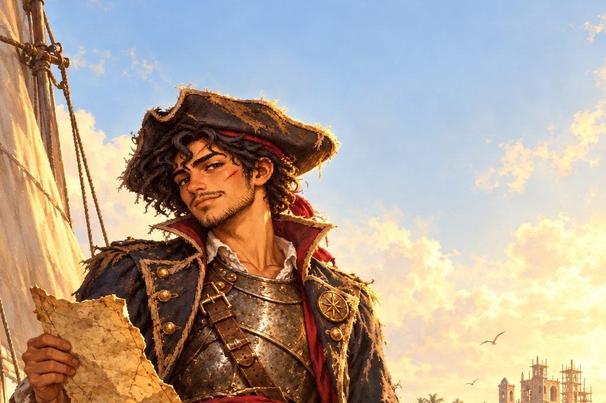

1523년 봄, 에스파냐령 산토도밍고. 빚 때문에 아버지의 배 에스페란사호를 빼앗길 처지가 된 열일곱 살 부두 소년 마테오 레예스는 사냥꾼 조합 벽에서 가장 작은 수배서 한 장을 뜯어냅니다. 은퇴한 사냥꾼 바르톨로메, 산호초 길잡이 야라, 쫓겨난 공증인 에스테반, 누명 쓴 포수 라파엘과 함께 카리브를 누비며 견습에서 '카리브의 전설'이 되기까지, 마테오는 수배서마다 찍힌 붉은 매 인장의 주인과 마주하게 됩니다.

:::caution[줄거리 공개]
이 소설에는 마테오 레예스 이야기의 처음부터 마지막 결말까지 모든 줄거리가 들어 있습니다. 게임을 먼저 즐기고 싶다면 다 끝낸 뒤에 읽으세요.
:::

## 차례

| 차례 | 내용 |
| --- | --- |
| [서장 ― 붉은 천](/novel/bounty/prologue/) | 1518년 여름, 아버지가 수배서 한 장에 끌려가던 밤 |
| [1부 ― 첫 수배서](/novel/bounty/part1/) | 뱃전의 종이, 붉은 매, 수배서의 벽, 첫 바다 |
| [2부 ― 산 채로 데려와라](/novel/bounty/part2/) | 주인 없는 교수대, 붉은 머리 여인, 늑대의 눈, 사냥꾼은 안 태워 |
| [3부 ― 인질의 배](/novel/bounty/part3/) | 늑대 사냥꾼, 과부의 잔, 종이의 용기, 경주 |
| [4부 ― 검은 돛을 쫓아](/novel/bounty/part4/) | 검은 띠를 두른 수배서, 사흘을 넘기지 않는 배, 연기 속의 검은 돛, 수배서 두 장 |
| [5부 ― 수배서의 주인](/novel/bounty/part5/) | 배보다 먼저 닿은 이름, 신부의 명단, 선창 문, 지도는 거짓말을 하지 않는다 |
| [결말 ― 두 갈래 길](/novel/bounty/ending/) | 산토도밍고 앞바다, 재판의 길, 바다의 길, 붉은 천 |
