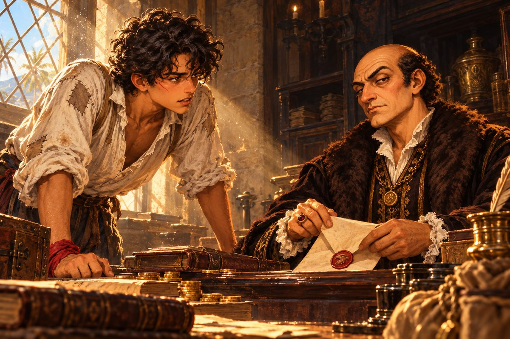

## 1. 뱃전의 종이

1523년 봄, 에스파냐령 산토도밍고.

공사 중인 대성당의 망치 소리가 부두까지 내려오는 아침이었다. 땅, 땅, 땅. 돌 깎는 소리는 해가 뜨기 무섭게 시작해서 해가 져야 그쳤다. 석공들은 그 성당을 다 짓는 데 스무 해는 걸릴 거라고 했다. 부두 사람들은 그 말을 들으면 웃었다. 스무 해 뒤에 이 섬에 누가 남아 있을지 아무도 몰랐다.

마테오 레예스는 그 소리를 들으며 부두 널판을 맨발로 탁탁 밟고 걸었다. 열일곱 살. 마른 몸에 덥수룩한 검은 곱슬머리가 바닷바람에 제멋대로 뻗쳤다. 몇 번이나 기운 흰 리넨 셔츠는 소매를 걷어붙였고, 바지는 무릎까지 접어 올렸다. 낡은 가죽 허리띠에는 아버지가 남긴 단검이 매달려 있었다. 오른손목에는 빛바랜 붉은 천이 감겨 있었다. 어제 밧줄에 긁힌 뺨이 아직 따끔거렸다.

"오늘도 짐 나르기 시작이다. 어디 보자, 오늘은 어느 배가……."

부두에는 밤새 들어온 배들이 줄지어 있었다. 세비야에서 온 큰 나오 한 척이 포도주 통과 밀가루 포대를 토해 내고 있었고, 그 옆 연안선에서는 가죽 꾸러미가 내려오고 있었다. 마테오는 머릿속으로 셈을 했다. 포도주 통 하나에 동전 둘, 밀가루 포대 셋에 동전 하나. 점심 전까지 나오 짐을 다 나르면 빵 두 덩이와 생선 한 마리 값은 된다. 셈은 언제나 빨랐다. 셈이 빨라야 부두에서 덜 속았다.

"마테오! 오늘은 세비야 배다, 허리 조심해라!"

짐꾼 반장이 소리쳤다. 마테오는 손을 흔들며 맞받았다.

"반장님 허리나 조심하세요! 어제 그 통 떨어뜨린 거 다 봤어요!"

웃음이 터졌다. 마테오는 히죽 웃으며 부두 끝으로 걸어갔다. 짐을 지기 전에 늘 들르는 곳이 있었다. 부두가 끝나고 조선소가 시작되는 모퉁이. 거기서 고개만 빼면 조선소 구석이 보였다.

조선소 맨 구석, 버팀목 위에 낡은 카라벨라티나 한 척이 올라앉아 있었다. 삼각돛은 걷어 내려 덮개로 싸 두었고, 뱃전의 칠은 군데군데 벗겨졌다. 뱃머리에 새긴 이름만은 마테오가 해마다 손수 덧칠해서 또렷했다. 에스페란사. 희망.

아버지의 배였다.

마테오는 아침마다 그 배를 보았다. 그냥 보기만 했다. 언젠가 저 배를 다시 물에 띄울 거라고, 그날까지는 보기만 하겠다고 혼자 정해 두었다.

그런데 오늘은 무언가 달랐다.

"……어? 저건 우리 배잖아."

뱃전 한가운데, 마테오가 덧칠한 이름 바로 아래에 하얀 것이 붙어 있었다. 종이였다. 바람에 귀퉁이가 팔락거렸다. 마테오는 짐꾼 반장이 부르는 소리도 듣지 못하고 조선소 마당을 가로질러 뛰었다. 대팻밥이 맨발에 달라붙었다.

종이는 못 네 개로 뱃전에 박혀 있었다. 마테오는 숨을 고르고 글자를 읽었다. 클라라 아줌마의 술집 장부로 깨친 글이었다.

「압류 통지. 서른 날 안에 금화 3,000을 갚지 않으면 이 배는 산토도밍고 은행의 것이 된다.」

마테오는 한 번 더 읽었다. 숫자는 바뀌지 않았다.

"서른 날…… 3,000? 말도 안 돼!"

머릿속에서 셈이 저절로 돌았다. 짐을 날라 하루에 버는 돈. 그 돈을 한 푼도 쓰지 않고 모아서 3,000이 되기까지 걸리는 날수. 답은 금방 나왔다. 서른 날이 아니라 서른 해쯤이었다.

멀리서 대성당의 망치 소리가 계속 울렸다. 땅, 땅, 땅. 마테오는 못 하나를 손가락으로 건드려 보았다. 단단히 박혀 있었다.

## 2. 붉은 매

산토도밍고 은행은 총독 관저에서 멀지 않은 돌집이었다. 두꺼운 문을 밀자 서늘한 그늘과 함께 잉크와 밀랍 냄새가 났다. 창구 너머 높은 책상에서 대금업자 오르다스가 장부를 펼쳐 놓고 있었다. 머리카락이 한 올도 없는 둥근 머리가 창으로 든 햇빛에 번들거렸다. 그 아래 작은 눈이 마테오의 맨발에서부터 천천히 올라왔다.

"레예스 집 아들이로군. 아버지를 꼭 닮았어. 고집 센 눈이."

마테오는 손에 쥐고 온 종이를 책상 위에 내려놓았다. 뱃전에서 못째 뜯어 온 것이었다. 귀퉁이마다 못 구멍이 뚫려 있었다.

"딱지를 붙이셨더라고요. 우리 배에."

"'우리' 배라." 오르다스는 종이를 손끝으로 밀어 냈다. 더러운 것을 만지는 손짓이었다. 그는 장부 사이에서 두툼한 문서 한 장을 꺼내 펼쳤다. "정박료 5년 치, 수리비, 벌금. 합쳐서 금화 3,000일세. 서른 날 주지."

마테오는 문서 쪽으로 고개를 내밀었다. 숫자가 빼곡했다. 정박료는 알았다. 배를 조선소 땅에 올려 두면 다달이 돈이 붙는다. 수리비는 몰랐다. 5년 동안 누가 그 배를 고쳤단 말인가. 그리고 마지막 줄.

"벌금이요? 아버지는 재판도 안 받았어요."

"재판을 받았든 안 받았든, 수배서가 붙었던 사람은 벌금을 내는 걸세. 그게 이 섬의 규칙이야."

"그런 규칙이 어디 있어요! 죄가 있는지 없는지도 모르는데 벌금부터……"

"있는 걸세. 바로 여기." 오르다스가 문서를 손톱으로 톡톡 두드렸다. "규칙이란 건 종이에 적히는 순간 생기는 거야, 젊은이."

마테오는 입술을 깨물었다. 부두에서 배운 것이 하나 있었다. 말로 이길 수 없는 상대 앞에서는 셈이라도 정확히 해 두라. 그는 문서를 한 줄씩 다시 읽어 내려갔다. 정박료, 수리비, 벌금. 맨 아래의 금액. 그리고 그 밑에 찍힌 것.

문서 끝에 손톱만 한 붉은 밀랍 인장이 찍혀 있었다. 매 머리 모양이었다. 굽은 부리와 날카로운 눈매까지 새겨져 있었다. 대금업자의 문서에는 어울리지 않게, 이상할 만큼 공들인 인장이었다.

"이 빨간 건 뭐예요? 새 대가리 같은데."

오르다스는 대답 대신 문서를 접었다. 접는 손길이 아까보다 조금 빨랐다.

"자네가 신경 쓸 건 숫자뿐일세. 3,000. 서른 날."

문서는 장부 사이로 사라졌다. 오르다스는 펜을 들어 무언가를 적기 시작했다. 이야기는 끝났다는 뜻이었다.

은행 문을 나서자 햇볕이 눈을 찔렀다. 마테오는 돌계단에 서서 오른손목의 붉은 천을 내려다보았다. 아버지는 재판을 받지 못했다. 그런데 벌금은 남았다. 죽은 사람에게 벌금을 물리고, 그 벌금을 살아 있는 아들에게서 받아 낸다. 그게 이 섬의 규칙이라고 했다.

이상하게도 그 붉은 새 대가리가 눈앞에서 지워지지 않았다.

## 3. 수배서의 벽

클라라의 술집은 부두 바로 위 비탈에 있었다. 낮에는 짐꾼들이 싼 포도주로 목을 축이고, 밤에는 뱃사람들이 노래를 부르는 곳이었다. 마테오는 거기서 자랐다. 탁자 밑을 기어다니던 때부터 술통을 굴릴 만큼 컸을 때까지.

문을 밀고 들어서자 탁자를 훔치던 클라라가 행주를 든 채 허리를 폈다. 둥근 얼굴에 앞치마를 두른 쉰 줄의 여주인은 마테오의 얼굴을 한 번 보더니 팔짱을 꼈다. 잔소리가 나오기 직전의 얼굴이었다.

"마테오! 얼굴이 왜 그 모양이니. 은행에 다녀왔구나."

"어떻게 알았어요?"

"네가 그런 얼굴로 오는 데가 거기 말고 또 있니?"

마테오는 의자에 털썩 주저앉았다.

"클라라 아줌마…… 서른 날 안에 3,000이래요. 못 갚으면 에스페란사호를 가져간대요."

클라라의 팔짱이 풀렸다. 그녀는 마테오 맞은편에 앉아 한참 아무 말도 하지 않았다. 그러다 낮게 말했다.

"그 배 때문에 네 아버지가 어떻게 됐는지 잊었니? 수배서 한 장에 끌려가서, 재판도 못 받고 감옥에서……."

클라라는 말을 맺지 않았다. 대신 일어나 부엌으로 들어갔다. 달그락거리는 소리가 나더니, 그녀는 묵직한 가죽 자루를 들고 나와 탁자에 탁 내려놓았다. 동전끼리 부딪는 둔한 소리가 났다.

"내가 모아 둔 거다. 이걸로 배는 놓아주고, 땅에서 살아라."

"아줌마……."

"금화 1,000이다. 3,000에는 못 미치지만, 부두 위에 작은 가게 하나는 얻는다. 너는 셈이 빠르니까 장사를 해라. 바다는 안 된다. 바다는 사람을 데려가기만 하지, 돌려주지는 않아."

마테오는 자루를 내려다보았다. 클라라가 몇 해 동안 새 앞치마 하나 사지 않고 모은 돈이라는 걸 알았다. 그는 자루를 끌어당겨 품에 안았다. 고맙다는 말이 목에 걸려 나오지 않았다.

그런데 그의 눈은 자루에 있지 않았다. 술집 창 너머, 비탈길 건너편의 낡은 이층집에 가 있었다. 사냥꾼 조합. 그 집 벽에서는 늘 종이가 펄럭였다.

술집 구석에는 늙은 사내 하나가 말없이 술잔을 비우고 있었다. 반백의 짧은 머리, 콧등을 가로지르는 오래된 흉터, 해진 외투. 마테오가 기억하는 한 그 사내는 언제나 그 자리에 있었다. 누구와도 말을 섞지 않았고, 술값은 꼬박꼬박 냈다. 사내가 고개를 들어, 창밖을 내다보는 마테오를 잠깐 보았다. 그리고 다시 술잔으로 눈을 내렸다.

사냥꾼 조합은 안이 더 어두웠다. 들어서자마자 마테오는 걸음을 멈추었다.

벽에는 수배서가 비늘처럼 겹쳐 붙어 있었다. 새것 위에 헌것, 헌것 위에 더 헌것. 살인자, 탈주범, 밀수꾼, 해적. 거친 솜씨로 그린 얼굴들이 마테오를 내려다보았다. 종이마다 이름이 있고, 죄가 있고, 그리고 숫자가 있었다. 500. 1,500. 4,000. 숫자가 클수록 종이도 컸다.

마테오는 셈을 하지 않으려고 했다. 그래도 셈은 저절로 돌았다. 저 큰 종이 하나면 빚을 갚고도 남는다. 그는 고개를 저었다. 저런 걸 혼자 잡을 수는 없었다. 그의 눈이 벽 아래쪽, 다른 종이들에 깔려 반쯤 가려진 작은 종이 하나에서 멈추었다.

마테오는 그 종이를 뜯어냈다.

"'뱀장어 고메스의 밀수선. 격파하면 1,200.' 이거요!"

계산대 뒤에서 수배서 뭉치를 넘기던 사내가 고개를 들었다. 조합장 니뇨였다. 몸집이 뚱뚱하고, 이마에는 늘 땀이 맺혀 있었다. 그는 마테오를 위아래로 훑더니 배를 잡고 웃었다.

"하하, 애송이가 무슨. 보증인은 있냐?"

"보증인이요?"

"보증인 없는 녀석에겐 견습 증서도 없다. 잡아 와도 현상금은 반만 준다. 그게 조합 규칙이야."

또 규칙이었다. 오늘 하루에 규칙을 몇 개나 듣는지 모르겠다고 마테오는 생각했다. 그는 종이를 반으로 접어 셔츠 안에 넣었다.

"반이라도 좋아요. 이 종이, 제가 가져갈게요."

니뇨가 웃음을 거두고 이마의 땀을 훔쳤다. "……바다에 빠져 죽어도 조합은 모른다."

"알아요."

## 4. 첫 바다

조선소 노인은 대팻밥 더미 위에 앉아 마른 풀줄기를 씹고 있었다. 마테오가 말을 꺼내기도 전에 그가 먼저 입을 열었다.

"디에고네 꼬마로구나. 에스페란사호를 띄워 달라고?"

"압류 딱지가 붙었다는 건 알아요. 그래도 서른 날 안에 돈을 벌려면 배가 있어야 해요."

노인은 풀줄기를 퉤 뱉고 조선소 구석을 바라보았다. 못 구멍 네 개만 남은 뱃전을 한참 보았다.

"……나는 오늘 눈이 침침해서 딱지 같은 건 안 보인다. 네 아버지한테 진 술값도 있고."

그날 오후, 에스페란사호는 다섯 해 만에 물에 내려갔다. 버팀목을 걷어 내고 굴림대를 밀자 배는 신음 소리를 내며 비탈을 미끄러졌다. 뱃머리가 물에 닿는 순간 하얀 물보라가 일었다. 마테오는 저도 모르게 소리를 질렀다. 조선소 일꾼들이 손뼉을 쳤다. 노인은 손뼉을 치지 않았다. 침침하다던 눈을 가늘게 뜨고, 물 위에서 흔들리는 배를 오래 보았다.

항구 관리소의 관리는 마테오를 보자마자 혀를 찼다.

"첫 출항이냐? 배에 사람이 없으면 한 치도 못 나간다."

그러고는 귀찮다는 듯 손가락을 꼽았다.

"선원은 술집에서 모으고, 물과 식량은 넉넉히 실어라. 자메이카까지는 이틀이면 간다."

선원은 술집에서. 마테오는 클라라의 술집 문 앞에서 한참 서성였다. 품 안의 가죽 자루가 무거웠다. 결국 문을 밀었다. 클라라는 그의 얼굴만 보고도 다 알았다.

"……그 돈을 그렇게 쓰라고 준 줄 아니?"

"갚을게요. 배 지키고, 빚 갚고, 이것도 갚을게요."

클라라는 오래 마테오를 노려보았다. 그러다 행주를 탁자에 내던지고 술집 안을 향해 소리쳤다.

"거기 놀고 있는 양반들! 이 애가 품삯을 준단다. 뱃일 잊어버린 사람은 손 들지 마!"

부두에서 일거리를 잃은 늙은 뱃사람 넷과 고기잡이배에서 쫓겨난 젊은 녀석 둘이 손을 들었다. 마테오는 그들에게 품삯을 미리 쳐주고, 물통과 비스킷과 소금에 절인 고기를 샀다. 셈을 할 때마다 자루가 가벼워졌다. 구석의 늙은 사내는 손을 들지 않았다. 고개도 들지 않았다.

"밀수선은 자메이카 쪽 바다에 자주 나타난대. 가 보자!"

자메이카 쪽 바다, 이틀째 아침이었다.

에스페란사호는 생각보다 잘 달렸다. 삼각돛이 바람을 받아 팽팽해지면 뱃머리가 파도를 가르며 가볍게 들렸다. 마테오는 돛대 밧줄에 매달려 오른손목의 붉은 천을 바람에 내밀었다. 천은 동쪽에서 서쪽으로 나부꼈다. 등 뒤에서 부는 바람이었다.

"저기, 돛 그림자! 깃발도 안 단 작은 배 두 척…… 밀수선이다!"

수평선 가까이 낮은 돛 둘이 떠 있었다. 핀네스였다. 몸집이 작고 빠른 배. 짐을 숨기기 좋고 순찰선을 따돌리기 좋은 배. 마테오가 키를 꺾자 늙은 뱃사람 하나가 투덜거리며 돛줄을 당겼다.

가까이 다가가자 앞선 핀네스의 뱃머리에서 사내 하나가 몸을 내밀었다. 수염이 덥수룩한 서른 남짓한 사내였다. 밀수선 선장 페냐였다. 그는 에스페란사호 갑판을 훑어보더니 어이없다는 듯 웃음을 터뜨렸다.

"뭐야, 꼬맹이 혼자 탄 배잖아? 고메스 형님 물건에 손대면 바다에 던져 버린다!"

마테오는 셔츠 안에서 접어 둔 수배서를 꺼내 펼쳐 들었다. 바람에 종이가 팔락거렸다.

"수배서에 적힌 배가 맞네. 1,200, 받아 가겠어요!"

그다음은 엉망진창이었다. 에스페란사호에 실린 작은 대포 두 문 가운데 하나는 첫 발부터 불발이었다. 다른 하나는 엉뚱한 바다에 물기둥을 세웠다. 핀네스가 쏜 포탄이 돛대를 스쳐 가자 젊은 녀석 하나가 갑판에 엎드려 기도를 올렸다. 마테오는 키를 붙들고 고함을 질렀다.

"부딪쳐! 저 배 옆구리에 그냥 부딪쳐!"

에스페란사호가 핀네스 옆구리를 들이받았다. 나무가 쪼개지는 소리가 났다. 밀수꾼들이 비틀거리는 사이 늙은 뱃사람들이 갈고리를 던졌다. 오랫동안 잊고 지낸 손놀림이 그들의 팔에 되살아났다. 마테오는 아버지의 단검을 뽑아 들고 뱃전을 넘었다. 무엇을 어떻게 했는지 나중에는 잘 기억나지 않았다. 고함과 화약 연기와 미끄러운 갑판, 그리고 비릿한 바닷물 냄새뿐이었다.

정신을 차렸을 때 핀네스 한 척은 돛대가 부러진 채 기울어 있었고, 다른 한 척도 키가 부서져 제자리를 맴돌고 있었다. 부서진 배의 뱃머리에 매달린 페냐가 이를 갈았다.

"크윽…… 고메스 형님이 가만있지 않을 거다!"

페냐는 그 말을 남기고 바다로 뛰어들어 육지 쪽으로 헤엄쳐 갔다. 마테오는 쫓지 않았다. 수배서에 적힌 것은 배였지, 사람이 아니었다.

자메이카 조합은 산토도밍고 조합보다 작고 더 시끄러웠다. 조합 주인은 마테오가 내민 수배서와, 부서진 핀네스에서 뜯어 온 돛 조각을 번갈아 보더니 눈썹을 치켜올렸다.

"고메스 밀수선을 잡았다고? 보증인은?"

"……없어요."

"그럼 반이다. 600. 규칙은 규칙이니까."

동전 자루가 계산대 위로 미끄러져 왔다. 주인은 턱으로 벽을 가리켰다.

"진짜 큰 건 이거지. '뱀장어' 고메스 본인. 2,500."

벽 한가운데 큼직한 종이가 붙어 있었다. 기름진 머리를 뒤로 넘기고 이를 드러낸 사내의 얼굴이었다. 그림 속 웃음은 얇았다.

마테오는 600을 손에 쥐었다. 빚의 다섯 분의 일밖에 되지 않는 돈이었다. 그래도 손바닥에 느껴지는 무게가 달랐다. 짐을 지고 받은 동전과도, 클라라가 내준 자루와도 달랐다. 처음으로 자기 손으로 번 돈이었다. 그는 그 무게를 오래 기억했다.

## 5. 레예스라는 이름

자메이카 술집 주인은 술잔을 닦다가 고메스라는 이름에 콧방귀를 뀌었다.

"고메스를 쫓는다고? 그 녀석 소굴은 섬 북쪽 만이야. 물길이 좁고 암초투성이지."

주인은 마테오의 마른 팔과 허리의 단검을 차례로 보았다.

"혼자 들어가면 죽는다, 꼬마. 칼 쓸 줄 아는 어른을 하나 데려가."

"칼 쓰는 어른이라……."

자메이카의 교회는 바닷가 언덕 위에 앉은 작은 돌집이었다. 마테오는 원래 들를 생각이 없었다. 지나가다 문 앞 돌계단에 앉아 우는 여자를 보았을 뿐이었다. 안에서 늙은 신부가 나왔다. 신부는 마테오의 허리춤에 꽂힌 수배서를 보더니 걸음을 멈추었다.

"고메스를 잡으려는 사냥꾼이라니, 하느님이 보내셨나 보군."

"사냥꾼까지는 아니고요. 아직 견습도 못 됐어요."

신부는 그 말을 듣지 못한 사람처럼 마테오의 손을 잡았다.

"그자는 밀수만 하는 게 아니라네. 바닷가 마을 아이들을 배에 실어 진주 채취장에 팔아넘기지."

"아이들을요?"

"진주 채취장에서는 물에 들어갈 사람이 늘 모자라거든." 신부의 목소리는 담담했다. "부모들이 날마다 여기 와서 운다네. 돈 때문에 시작한 일이겠지만…… 부디."

돌계단의 여자가 고개를 들었다. 마테오 또래의 아들이 있을 법한 나이였다. 마테오는 셔츠 안에 넣어 둔 수배서를 생각했다. 고메스, 2,500. 아까까지 그 숫자는 에스페란사호의 빚을 갚을 돈이었다. 지금은 숫자 뒤로 다른 얼굴들이 겹쳐 보였다.

"……돈 때문만은 아니게 됐네."

칼 쓰는 어른. 마테오가 아는 어른 가운데 칼을 찬 사람은 많았다. 경비병, 뱃사람, 부두 건달. 하지만 보증을 서 줄 만한 사람, 고메스의 소굴까지 같이 가 줄 만한 사람은 하나도 떠오르지 않았다. 산토도밍고로 돌아오는 뱃길 내내 그 생각을 하다가, 클라라의 술집 문을 여는 순간 답이 보였다.

술집 구석. 늘 같은 자리에 앉아 있는 늙은 사내.

부두 사람들은 그 사내를 두고 이런저런 말을 했다. 한때 카리브에서 가장 비싼 사냥꾼이었다고. 그가 떼어 간 수배서의 주인은 하나도 빠짐없이 잡혀 왔다고. 그러다 다섯 해 전 어느 날 갑자기 사냥을 그만두었다고. 이유는 아무도 몰랐다. 바르톨로메 크루스. 그게 사내의 이름이었다.

마테오는 그 탁자 앞에 섰다.

"아저씨가 바르톨로메 크루스 맞죠? 카리브에서 제일 비쌌다는."

사내는 고개도 들지 않았다.

"제일 비싼 건 이 술이다. 꺼져라."

"보증인이 필요해요. 저 마테오 레예스예요. 고메스 부하 배 두 척을 벌써 잡았……"

"……레예스?"

술잔이 탁자 위에서 멈추었다. 바르톨로메가 처음으로 고개를 들었다. 술에 지친 눈이었다. 그 눈이 마테오의 얼굴을 지나 오른손목의 붉은 천에 가서 멎었다.

"네. 레예스요. 디에고 레예스 아들."

바르톨로메는 술잔을 내려놓았다. 그리고 마테오를 오래 보았다. 너무 오래 보아서 마테오가 먼저 눈을 피하고 싶어질 만큼. 술집 안이 조용해졌다. 클라라가 계산대 뒤에서 행주질을 멈추었다.

"……부두로 나와라. 칼 들고."

부두 끝, 항구 관리소 앞 공터였다. 해가 기울어 바다가 붉었다. 소문은 빨라서 짐꾼들과 뱃사람들이 벌써 빙 둘러서 있었다. 항구 관리소 관리도 창문 밖으로 고개를 내밀었다.

바르톨로메가 칼을 뽑았다. 다섯 해 동안 쓰지 않은 칼 같지 않았다. 날이 깨끗했다.

"내 칼을 세 번 막으면 보증을 서 주지. 못 막으면 그 배는 오르다스 줘라. 바다에서 죽는 것보단 그게 낫다."

마테오는 아버지의 단검을 뽑았다. 바르톨로메의 칼 앞에서 단검은 장난감처럼 보였다. 구경꾼 사이에서 웃음이 새어 나왔다.

첫 번째 칼은 보이지도 않았다. 바르톨로메의 어깨가 조금 움직였다 싶더니 은빛이 마테오의 얼굴로 날아들었다. 생각보다 몸이 먼저 움직였다. 단검을 치켜들었고, 쇠와 쇠가 부딪쳤다. 팔이 얼얼했다. 막았다기보다 칼이 단검에 걸린 것에 가까웠다. 그래도 막았다.

두 번째 칼은 아래에서 올라왔다. 마테오는 뒤로 물러서다 널판 틈에 발뒤꿈치가 걸렸다. 엉덩방아를 찧으며 단검을 휘둘렀다. 칼끝이 단검 날을 긁고 지나갔다. 구경꾼들이 폭소를 터뜨렸다.

마테오는 벌떡 일어났다. 얼굴이 화끈거렸다. 부두 말씨가 튀어나왔다.

"이번엔 안 자빠질 테니께, 한 번 더 덤벼 보쇼, 영감!"

바르톨로메의 입가가 아주 조금 움직였다. 웃음인지 아닌지 알 수 없었다. 세 번째 칼이 왔다. 이번에는 빠르지 않았다. 대신 무거웠다. 위에서 내리꽂히는 칼을 마테오는 두 손으로 단검을 받쳐 들고 받았다. 무릎이 꺾였다. 다시 엉덩이가 널판에 닿았다. 그래도 단검은 놓지 않았다. 칼날은 마테오의 머리 위 한 뼘 거리에서 멈춰 있었다.

바르톨로메가 칼을 거두었다.

마테오는 숨을 몰아쉬며 일어섰다.

"세 번…… 막았어요. 두 번은 엉덩방아였지만."

"엉덩방아도 막은 거다. 바다에선 넘어져도 살아 있으면 이긴 거야."

구경꾼들의 웃음은 어느새 그쳐 있었다. 바르톨로메는 칼을 칼집에 넣고 돌아섰다. 마테오는 그 등을 보다가 단검을 쥔 손을 내려다보았다. 손바닥이 찢어져 피가 배어 나왔다. 손목의 붉은 천도 조금 풀려 있었다. 그는 이로 매듭을 물어 다시 조였다.

## 6. 조건을 먼저 읽어라

"바, 바르톨로메 크루스가 보증을 선다고? 5년 동안 수배서 한 장 안 떼던 양반이?"

니뇨는 깃펜을 든 채 입을 다물지 못했다. 이마의 땀이 턱까지 흘러내렸다. 바르톨로메는 계산대에 한 손을 짚었다.

"서명할 곳이나 대라."

"여, 여기요."

니뇨가 서랍에서 종이를 꺼내 허둥지둥 펼쳤다. 바르톨로메가 굵은 글씨로 이름을 적었다. 니뇨는 그 아래 조합 도장을 찍고, 종이를 마테오에게 내밀었다.

"……마테오 레예스, 견습 증서다. 이제 현상금은 다 받는다."

마테오는 증서를 두 손으로 받았다. 종이 한 장이었다. 압류 통지도 종이 한 장, 수배서도 종이 한 장, 이것도 종이 한 장. 그런데 이 종이는 따뜻했다.

"하나만 약속해라."

바르톨로메가 벽을 보며 말했다. 비늘처럼 겹친 수배서들을.

"수배서를 뗄 때, 현상금보다 조건을 먼저 읽어."

"조건이요?"

"죽여서 오라는지, 살려서 오라는지. 그리고 그 돈을 누가 대는지."

마테오는 고개를 갸웃했다. 돈을 대는 건 조합이고, 조합 뒤에는 총독부가 있을 터였다. 그게 왜 중요한지 알 수 없었다. 하지만 바르톨로메의 얼굴이 너무 진지해서, 그는 그냥 고개를 끄덕였다.

"약속할게요."

그날부터 바르톨로메 크루스는 에스페란사호의 부선장이 되었다. 늙은 뱃사람들은 처음에 그를 어려워했다. 하지만 이틀도 지나지 않아 돛줄 매는 법부터 물통 쌓는 법까지 모두 그에게 묻게 되었다.

산토도밍고 상점에서 바르톨로메는 마테오의 허리에서 단검을 뽑아 들고 날을 손가락으로 쓸어 보았다.

"그 단검으로 고메스를 잡겠다고? 빵이나 썰어라."

"아버지 거예요."

"그러니까 아껴라. 빵 썰 때만 써."

바르톨로메는 단검을 돌려주고 벽에 걸린 칼들을 훑었다. 장검, 레이피어, 손도끼. 그의 손이 짧고 넓적한 칼 하나에서 멈추었다. 그는 그것을 내려 마테오의 손에 쥐여 주었다.

"커틀라스다. 갑판 위에선 짧고 무거운 게 낫다. 돛줄에도 돛대에도 걸리지 않지. 칼은 팔 길이에 맞춰라. 남의 칼 길이를 부러워하지 말고."

마테오는 칼을 쥐고 휘둘러 보았다. 묵직한 날이 손목을 끌어당겼다가 제자리로 돌아왔다. 둥근 쇠 손잡이 덮개가 손등을 감쌌다.

"와…… 손에 착 감겨요!"

"500이다."

마테오는 셈을 했다. 그리고 한숨을 쉬며 자루를 풀었다. 빚을 갚을 날까지는 스무 날 남짓 남아 있었다.

시장 뒷골목의 점술가 집에는 마테오 혼자 들어갔다. 바르톨로메는 그런 데 갈 시간이 있으면 칼이나 휘두르라며 문밖 벽에 등을 기댔다. 안은 어둡고 향 냄새가 났다. 등잔 하나 아래 노파가 앉아 있었다.

"어서 오게, 젊은이. 손바닥을 보여 주게."

노파는 마테오의 손바닥을 등잔 가까이 끌어당겼다. 결투 때 찢어진 상처가 아직 아물지 않았다. 노파는 상처는 보지 않고 손금만 따라 손톱을 움직였다.

"흠…… 붉은 새가 자네 길을 두 번 막는구먼. 한 번은 종이 위에서, 한 번은 바다 위에서."

"붉은 새요?"

마테오는 저도 모르게 은행의 문서를 떠올렸다. 새 대가리 같던 붉은 밀랍.

"그 새를 보거든, 누가 그 새를 기르는지 보게."

노파는 손을 놓았다. 마테오가 더 묻기도 전에 등잔을 불어 꺼 버렸다.

점술가의 집을 나서자 부두에서 소문이 들려왔다. '뱀장어' 고메스가 자메이카 북쪽 만에서 배를 띄웠다. 밀수선이 부서진 데 화가 나서 이번에는 자기가 직접 나섰다는 것이었다.

바르톨로메가 벽에서 등을 뗐다.

"닻 올려라."

자메이카 북쪽 앞바다는 물빛이 고르지 않았다. 짙푸르다가 갑자기 옅어지는 자리마다 암초가 숨어 있었다. 그 사이로 배 세 척이 미끄러져 나왔다. 핀네스 두 척과, 그 뒤를 따르는 카라벨라티나 한 척. 에스페란사호와 같은 배였다. 다만 그 배의 뱃전은 새로 칠한 듯 번들거렸다.

카라벨라티나의 뱃머리에 사내가 섰다. 기름진 머리를 뒤로 넘겼고, 웃을 때마다 금니가 번쩍였다. 수배서 그림보다 웃음이 더 얇았다.

"내 밀수선을 건드린 꼬맹이가 너냐? 아이들 팔아 번 돈으로 네 관이나 짜 주마."

마테오는 커틀라스 자루를 움켜쥐었다.

"그 아이들, 오늘 집에 돌아갈 거예요!"

"말은 됐다. 붙어라!"

바르톨로메의 목소리가 갑판을 갈랐다. 핀네스 두 척이 좌우로 갈라지며 에스페란사호를 암초 쪽으로 몰았다. 뱀장어라는 이름이 괜히 붙은 게 아니었다. 고메스의 배들은 물빛이 옅은 곳을 귀신같이 피해 다니며, 쫓아오는 배만 바위에 걸리게 만들었다.

"따라가지 마라." 바르톨로메가 키 옆에서 낮게 말했다. "저놈들이 가는 물길로 가면 저놈들 바다다. 바람이 바뀌길 기다려."

마테오는 오른손을 들었다. 손목의 붉은 천이 바람에 흔들렸다. 천은 한동안 서쪽으로 나부끼다가, 어느 순간 끝이 조금씩 북쪽으로 꺾이기 시작했다. 육지에서 불어 내리는 저녁 바람이었다.

"아저씨, 바람이 돌아요. 저쪽 배들, 이제 바람을 안고 나와야 해요."

바르톨로메가 마테오를 흘깃 보았다. "그럼 키는 네가 잡아라."

에스페란사호가 돛을 틀어 바람을 받았다. 바람을 안게 된 핀네스 한 척이 비틀거리는 사이 에스페란사호의 대포가 연달아 불을 뿜었다. 이번에는 바르톨로메가 직접 포구를 맞추었다. 핀네스의 돛대가 꺾여 물에 처박혔다. 다른 한 척은 급히 방향을 틀다가 제 편이 피해 다니던 암초에 옆구리를 긁혔다.

남은 것은 고메스의 카라벨라티나였다. 금니의 사내는 더 이상 웃지 않았다. 그는 돛을 다 펴고 만 안쪽으로 달아나려 했다. 마테오는 키를 꺾어 그 뱃머리를 가로막았다. 두 배가 부딪쳤다. 갈고리가 날아가 걸렸다.

마테오는 커틀라스를 쥐고 뱃전을 넘었다. 이번에는 무엇을 하는지 알았다. 짧고 무거운 칼은 돛줄에 걸리지 않았다. 밀수꾼 하나가 휘두른 몽둥이를 쳐 내고, 또 하나를 뱃전 밖으로 밀어냈다. 바르톨로메가 그 뒤를 따라 넘어와 마테오의 등을 지켰다. 늙은 사냥꾼의 칼은 소리 없이 움직였다.

고메스는 고물에 매단 작은 보트로 뛰어내리려 했다. 그 뒷덜미를 바르톨로메의 손이 낚아챘다.

"뱀장어도 꼬리를 잡히면 끝이다."

'뱀장어' 고메스는 그렇게 사로잡혔다. 그날 밤 에스페란사호는 고메스의 배를 끌고 북쪽 만 안쪽의 소굴로 들어갔다. 바닷가 창고 문을 열자 어둠 속에서 여러 쌍의 눈이 반짝였다. 아이들이었다. 마테오는 횃불을 내리고 무릎을 꿇었다. 그리고 할 수 있는 한 가장 부드러운 목소리로 말했다.

"집에 가자."

## 7. 붉은 매 인장

자메이카 조합 주인은 이번에는 눈썹만 치켜올리지 않았다. 계산대 밖으로 나와 마테오의 어깨를 두드렸다.

"고메스를 잡았다고! 보증인도 생겼다니, 이번엔 다 주지. 미뤄 둔 반값까지."

고메스의 현상금 2,500에 처음 받지 못한 반값 600이 얹혀, 금화 3,100이 계산대 위에 쌓였다. 마테오는 그 금화를 오래 내려다보았다. 셈은 금방 끝났다. 빚을 갚고도 남았다. 그런데 이상하게 소리를 지르고 싶지 않았다. 아이들을 언덕 위 교회에 데려다준 그날 아침의 얼굴이 먼저 떠올랐다. 돌계단에서 울던 그 여자가 이번에는 아이 하나를 끌어안고 울고 있었다.

바르톨로메가 탁자 위에 가죽 장정의 공책 한 권을 던졌다. 고메스의 배에서 나온 것이었다.

"고메스 장부다. 한번 읽어 봐라."

마테오는 장부를 넘겼다. 날짜와 물건과 숫자가 빼곡했다. 소금, 가죽, 포도주, 세금을 물지 않은 물건들. 그리고 다달이 같은 자리에 같은 줄이 적혀 있었다.

"'검은 십자가에게, 이달 몫.' ……이게 뭐예요?"

"카리브의 밀수꾼들이 누군가에게 통행료를 바친다는 소리지."

"누군가가 누군데요?"

바르톨로메는 대답하지 않았다. 마테오는 그 줄을 손가락으로 따라 짚었다. 다달이 꼬박꼬박. 고메스 같은 자가 고개를 숙이고 돈을 바치는 상대라면, 고메스보다 훨씬 큰 무언가였다.

"검은 십자가……."

산토도밍고 은행의 서늘한 그늘은 그대로였다. 오르다스도 그대로 높은 책상 뒤에 앉아 있었다. 마테오는 금화 자루를 책상 위에 내려놓았다. 이번에는 조금도 떨리지 않았다.

"3,000이에요. 하나도 안 빠지고."

오르다스의 작은 눈이 자루와 마테오를 번갈아 보았다. 그는 금화를 하나하나 세었다. 세는 데 한참 걸렸다. 다 세고 나서도 한 번 더 세었다.

"……허, 정말 갚을 줄이야. 영수증일세."

오르다스가 종이 한 장을 써서 내밀었다. 마테오는 그것을 받아 들고 읽었다. 금화 3,000, 받았음. 에스페란사호의 빚은 없음. 그리고 그 아래.

영수증에도 붉은 매 인장이 찍혀 있었다.

굽은 부리, 날카로운 눈. 지난번 문서에서 본 것과 똑같았다. 마테오가 뒤를 돌아보았을 때, 바르톨로메는 그 인장을 보고 있었다. 마테오의 어깨 너머로, 오래, 아주 오래.

"아저씨? 뭐 보세요?"

바르톨로메는 눈을 떼지 않은 채 잠시 가만히 있었다. 그러고는 몸을 돌렸다.

"……아무것도 아니다."

그날 저녁, 산토도밍고 조합에는 사람이 많았다. 고메스를 잡은 견습이 왔다는 소문이 부두를 한 바퀴 돌고 난 뒤였다. 니뇨는 계산대 뒤에서 손바닥만 한 놋쇠 패를 소매로 문지르고 있었다. 사냥꾼 패였다. 견습 증서를 받은 지 한 달도 안 된 녀석이 그 패를 받는 건 처음이라고 니뇨는 몇 번이나 떠들었다.

그때 문이 열렸다. 니뇨가 펄쩍 뛰어올랐다.

"총독 각하께서 오셨습니다! 모두 모자 벗어!"

조합 안의 사내들이 일제히 모자를 벗었다. 마테오는 벗을 모자가 없어서 그냥 허리를 폈다. 바르톨로메는 벽에 기댄 채 움직이지 않았다.

들어온 사람은 쉰 줄의 신사였다. 은빛 수염을 단정하게 다듬었고, 검은 비단 옷에 흰 주름 깃을 둘렀다. 손에는 얇은 가죽 장갑을 끼고 있었다. 산토도밍고 총독, 돈 알론소 데 바예호. 마테오는 그 얼굴을 멀리서 몇 번 본 적이 있었다. 대성당 공사장 앞에서, 부두의 행렬 속에서. 이렇게 가까이서 보기는 처음이었다. 총독은 부드럽게 웃고 있었다.

"편히들 있게. 새 수배서에 인장만 찍고 가겠네."

서기가 새 수배서 뭉치를 계산대에 펼쳤다. 총독은 녹인 밀랍이 떨어진 자리마다 차례로 인장을 눌렀다. 익숙한 손길이었다. 그러다 손을 멈추고 고개를 들었다.

"저 아이가 고메스를 잡았다는 그 견습인가?"

"예, 각하. 이번에 '사냥꾼' 패를 받습니다. 마테오 레예스라고……"

"레예스."

총독이 잠깐 멈추었다. 아주 잠깐이었다. 숨 한 번 쉴 만큼. 그러고는 다시 부드럽게 웃었다.

"좋은 이름이지. 바다에는 늘 정직한 사냥꾼이 모자라네. 잘해 보게, 젊은이."

"가, 감사합니다, 각하!"

니뇨가 놋쇠 패를 마테오의 셔츠 가슴에 달아 주었다. 사냥꾼 패는 생각보다 무거웠다. 마테오는 그것을 내려다보느라 다른 것은 보지 못했다.

총독이 장갑을 벗자 반지가 빛났다. 등잔 불빛 아래, 붉은 것이 한 번 번쩍였다.

바르톨로메가 말없이 조합을 나갔다. 벽에서 등을 떼는 소리도, 문을 여는 소리도 거의 나지 않았다.

마테오가 고개를 들었을 때는 문만 흔들리고 있었다.

"아저씨? 어디 가요, 오늘 제가 한턱…… 아저씨!"

대답은 없었다. 총독은 서기에게 무언가를 일러 두고 조합을 나섰다. 사내들이 다시 모자를 썼다. 조합 안이 시끌벅적해졌다. 마테오는 바르톨로메가 나간 문을 멍하니 바라보았다.

니뇨가 그의 어깨를 툭 쳤다. 손에는 방금 인장이 찍힌 수배서 한 장이 들려 있었다. 밀랍이 아직 덜 굳어 번들거렸다.

"아, 그리고 새 수배서다. 아바나에서 왔지. 이번 건 크다."

마테오는 종이를 받아 들었다. 가슴의 놋쇠 패가 등잔 불빛에 반짝였고, 오른손목의 붉은 천이 종이 귀퉁이에 닿았다. 종이 아래쪽의 붉은 밀랍을, 마테오는 그날 끝내 자세히 들여다보지 않았다.
