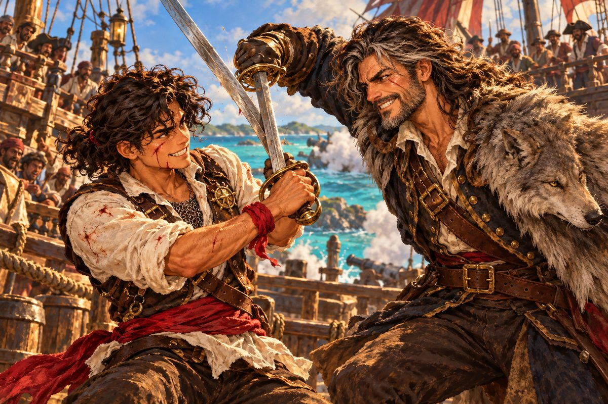

## 8. 주인 없는 교수대

1523년 가을, 에스파냐령 아바나.

에스페란사호가 만 안쪽으로 미끄러져 들어갈 때부터 망치 소리가 들렸다. 탕, 탕, 탕. 부두의 짐꾼들이 내는 소리와는 결이 달랐다. 마른 나무에 굵은 못을 박는 소리, 박고 나서 한 번 더 확인하듯 내리치는 소리였다.

뱃머리에 서 있던 마테오가 손으로 햇빛을 가렸다. 항구 관리소 뒤쪽, 성당 앞 광장에 목수 서넛이 붙어 무언가를 세우고 있었다. 기둥 두 개, 그 위에 가로지른 들보 하나, 들보 아래로 늘어뜨릴 밧줄을 감아 둔 사다리.

"교수대네요."

"새 거다." 바르톨로메가 키 옆에서 짧게 말했다. "나무가 아직 하얗다."

반년 사이 마테오는 조금 달라져 있었다. 덥수룩하던 곱슬머리는 가죽끈으로 뒤로 묶었고, 기운 리넨 셔츠 위에는 자메이카에서 산 가죽 조끼를 걸쳤다. 맨발로 부두를 뛰어다니던 발에는 이제 목 긴 장화가 신겨 있었다. 장화는 아직 발에 덜 맞아서 걸을 때마다 뒤꿈치가 쓸렸지만, 마테오는 그 얘기를 한 번도 하지 않았다. 조끼 왼쪽 가슴에는 손바닥만 한 놋쇠 패가 달려 있었다. 산토도밍고 조합에서 받은 사냥꾼 패였다. 그는 하루에도 몇 번씩 소매로 그것을 문질렀다. 오른손목에는 여전히 아버지의 붉은 천이 감겨 있었다.

배를 대고 항구 관리소에 정박 신고를 하는 동안에도 망치 소리는 그치지 않았다. 관리소 창으로 광장이 훤히 보였다. 교수대 아래에는 벌써 구경꾼이 몇 모여 있었다. 아무도 매달려 있지 않은데도 사람들은 무언가 볼 것이 있다는 듯 그 앞을 떠나지 않았다.

"아직 목을 걸 사람이 없는 교수대예요." 마테오가 말했다. "그런데 왜 벌써 세워요?"

"주인 없는 교수대라." 바르톨로메가 수염을 쓸었다. "누가 올라갈지는 조합 벽에 적혀 있겠지."

마테오의 눈이 반짝 빛났다. "조합부터 가 봐요, 아저씨!"

아바나 사냥꾼 조합은 산토도밍고 조합보다 컸다. 천장이 높고, 창이 넓고, 벽도 길었다. 그 긴 벽이 수배서로 빈틈없이 덮여 있었다. 살인자, 탈주범, 왕실 세금을 떼먹은 상인, 이름 모를 해적선. 그런데 벽 한가운데만은 비어 있었다. 다른 종이들이 그 자리를 피해 붙어 있었다. 빈 자리 한복판에 큼직한 수배서 한 장이 네 귀퉁이 모두 못에 박혀 있었다.

조합장은 배가 불룩하고 목소리가 컸다. 그는 마테오의 가슴에 달린 패를 한 번 보고는 손짓으로 불렀다.

"산토도밍고의 사냥꾼이로군. 마침 잘 왔다. 이걸 봐라."

마테오는 벽 앞으로 다가가 소리 내어 읽었다.

"'회색 늑대' 장 브로살. 은을 실은 배 세 척을 털고 선원들을 산 채로 바다에 던진 프랑스 사략선장. 현상금 6,000."

육천. 마테오는 숫자를 한 번 더 읽었다. 에스페란사호의 빚 두 배였다. 산토도밍고 부두에서 짐을 지고 평생을 날라도 만져 보지 못할 돈이었다. 그런데 그 아래, 굵은 글씨로 한 줄이 더 있었다.

"'산 채로 데려올 것. 죽으면 한 푼도 없음.'"

마테오가 고개를 돌렸다. "산 채로요? 해적을 어떻게 산 채로 잡아요?"

"늑대의 기함에 뛰어올라 칼로 그를 꺾어야지." 조합장은 대수롭지 않다는 듯 말했다. "대포로 배를 가라앉히면 늑대도 바다 밑으로 가고, 현상금도 같이 간다. 지금까지 셋이 이걸 떼 갔다. 둘은 돌아오지 않았고, 하나는 늑대의 배를 불태워 놓고 빈손으로 왔지. 불탄 배에서 시체 하나 못 건졌으니 늑대가 죽었는지 살았는지도 몰라. 그 뒤로 늑대는 배를 바꿔 타고 또 은을 털었고."

바르톨로메가 마테오 뒤에 와 섰다.

"조건을 먼저 읽으라고 했지. 이게 그 조건이다."

마테오는 대답하지 않고 수배서를 오래 보았다. 산 채로. 그 세 글자는 대포를 쓰지 말라는 뜻이었고, 칼로 맞서라는 뜻이었고, 사람을 죽이지 말라는 뜻이었다. 고메스를 잡을 때는 부딪치고 쏘고 밀어붙이면 됐다. 이번에는 그럴 수 없었다.

그는 못을 하나씩 뽑아 수배서를 벽에서 떼어 냈다. 조합장이 휘파람을 불었다.

## 9. 붉은 머리 여인

그날 밤 아바나 부두 술집은 빈자리가 없었다. 은 함대가 들어오기 전이라 선원들은 할 일이 없었고, 할 일 없는 선원들은 술집에 모였다. 화덕 위에서 돼지기름이 튀었고, 누군가 낡은 비우엘라를 퉁기며 엉터리 노래를 불렀다.

바르톨로메는 들어서자마자 카운터 끝자리를 차지했다. 마테오는 잔을 들고 한참을 두리번거렸다. 앉을 데가 없었다. 구석 탁자 하나만 의자가 비어 있었다. 그 탁자에는 여인 하나가 혼자 앉아 있었다.

붉은 머리였다. 촛불 아래서 구리처럼 빛나는 머리를 아무렇게나 틀어 올리고, 소매를 걷은 남자 셔츠에 가죽 조끼를 입었다. 허리에 찬 칼은 사냥꾼들이 차는 커틀라스가 아니라 길고 가는 군용 장검이었다. 여인은 벽에 등을 기대고 앉아 문과 창을 한꺼번에 보고 있었다.

마테오가 빈 의자에 엉덩이를 걸치자 여인이 눈만 들었다.

"그 자리, 내가 먼저 앉았는데."

"아, 죄송해요. 다른 데가 다 차서…… 같이 앉아도 돼요?"

여인은 대답 대신 마테오가 탁자 위에 펼쳐 놓은 종이를 흘끗 보았다. 낮에 떼어 온 수배서였다. 마테오는 그것을 저녁 내내 품에서 꺼냈다 넣었다 하고 있었다.

"회색 늑대라." 여인의 입꼬리가 올라갔다. "꼬마가 큰 거 물었네."

"꼬마 아니에요." 마테오가 조끼 가슴을 쭉 내밀었다. "사냥꾼 패도 있다고요. 보세요, 놋쇠."

"그래, 반짝이네."

여인은 정말로 그 패를 잠시 들여다보았다. 놀리는 눈빛이었지만, 비웃는 눈빛은 아니었다. 그러고는 잔을 내려놓고 팔꿈치를 탁자에 괴었다.

"하나만 알려 줄까, 사냥꾼 나리? '산 채로'라고 적힌 수배서는 둘 중 하나야."

"둘 중 하나요?"

"누가 그 입에서 나올 말을 꼭 듣고 싶거나. 아니면 그 입을 자기 손으로 닫고 싶거나."

마테오는 그 말을 곱씹었다. 술집의 소음이 잠깐 멀어진 것 같았다. 해적을 산 채로 데려오라는 말을 그는 지금껏 한 가지 뜻으로만 읽었다. 교수대에 세우라는 뜻. 광장의 망치 소리가 귓가에 다시 울렸다.

"……그걸 어떻게 구별해요?"

"수배서를 누가 썼는지부터 봐."

여인은 일어서며 동전 몇 닢을 탁자에 놓았다. 은화가 촛불을 받아 반짝였다.

"내 술값이랑 네 우유값."

"우유 아니고 럼인데요!" 마테오가 벌떡 일어났다. 의자가 뒤로 넘어갔다. "저기, 이름이라도……"

여인은 이미 문밖이었다. 문이 닫히기 직전, 붉은 머리가 밤바람에 한 번 흔들리는 것이 보였을 뿐이었다.

마테오는 넘어진 의자를 세우고 다시 앉았다. 수배서를 뒤집어 보았다. 뒷면은 비어 있었다. 앞면의 맨 아래, 조합 도장 옆에 아바나 총독부의 관인이 찍혀 있었다. 누가 썼는지. 그는 그 관인을 한참 들여다보다가 종이를 접었다. 지금은 알 수 없는 일이었다.

이튿날 아침, 마테오는 아바나 은행을 찾았다. 은을 훔친 해적이라면 언젠가는 은을 바꾸러 올 테고, 은을 바꾸는 곳의 사람은 무언가 알 것이었다. 부두에서 자란 아이다운 셈이었다.

환전상은 깃펜을 귀에 꽂은 깡마른 사내였다. 그는 마테오의 질문을 끝까지 듣고는 손가락으로 탁자를 톡톡 두드렸다.

"늑대 이야기라면 돈이 좀 듭니다. 이 바닥 소문은 공짜가 없어서요."

"얼마요?"

"오백."

마테오는 입술을 깨물었다. 빚을 갚고 남은 돈은 많지 않았다. 오백이면 선원들 한 달 급료였다. 그는 바르톨로메를 돌아보았다. 바르톨로메는 창밖만 보고 있었다. 네 돈이니 네가 정하라는 뜻이었다. 마테오는 주머니를 풀어 금화를 세어 놓았다. 하나, 둘, 셋…… 한 닢 한 닢이 손을 떠날 때마다 아까웠다.

환전상은 금화를 저울에 올려 무게까지 확인하고서야 입을 열었다.

"늑대가 훔친 은을 바꾸러 가끔 사람을 보냅니다. 늘 다른 사람이지만, 은괴에 남은 흠집은 같지요. 그리고 그 사람들 말로는, 물과 식량은 쿠바 남쪽에서 구한다더군요."

"쿠바 남쪽……." 마테오는 금화 오백을 잃은 얼굴에서 금세 다른 얼굴이 되었다. "바다로 가 보자!"

## 10. 늑대의 눈

쿠바 남쪽 바다는 아바나 앞바다와 빛깔이 달랐다. 물이 얕아지는 곳마다 짙은 남색이 초록으로 풀렸고, 수평선 가까이에는 낮은 섬들이 납작 엎드려 있었다. 에스페란사호는 그 섬들을 멀찍이 두고 이틀째 바람을 거슬러 동쪽으로 올라갔다.

둘째 날 오후, 돛대 위 망꾼이 소리쳤다. 마테오는 밧줄을 타고 반쯤 올라가 눈을 가늘게 떴다. 섬 그림자에서 돛 두 개가 빠져나오고 있었다. 사각돛을 단 날렵한 배였다. 이쪽을 향해 오다가 문득 방향을 틀어, 거리를 재듯 나란히 달리기 시작했다.

바르톨로메가 갑판에서 말했다. "돛 두 개. 저 빠른 배는 척후다. 늑대의 눈이지."

"우리를 보러 온 거예요?"

"우리가 누군지 보러 온 거다. 보고 나면 돌아가서 늑대한테 일러바치겠지."

마테오는 밧줄에서 뛰어내렸다. 장화 굽이 갑판을 쿵 울렸다.

"눈부터 가려 놓자고요!"

척후선의 선장은 이쪽 배가 방향을 바꾸자 오히려 반갑다는 듯 뱃머리를 돌렸다. 두 척이 양쪽으로 갈라져 에스페란사호를 끼고 들어왔다. 가까워지자 상대 갑판에서 누군가 손나팔을 하고 외쳤다. 프랑스 말씨가 섞인 에스파냐 말이었다.

"산토도밍고의 애송이로군! 늑대가 네 소식을 듣고 웃더라!"

마테오도 뱃전에 한 발을 올리고 외쳤다.

"웃게 놔둬요! 곧 못 웃을 테니까!"

이번 의뢰는 늑대를 산 채로 잡는 것이었지만, 늑대의 척후까지 산 채로 잡으라는 조건은 없었다. 바르톨로메가 대포 쪽에 대고 짧게 명령했다. 첫 포성이 울리자 갑판 아래에서 화약 냄새가 훅 올라왔다. 고메스의 밀수선과 싸울 때 마테오는 대포를 쏘는 순서도 헷갈렸다. 지금은 달랐다. 그는 바람을 읽고 키를 넘겼고, 척후선 한 척이 돛을 바꾸느라 주춤하는 사이 옆구리를 내주지 않고 앞으로 빠져나갔다. 두 번째 일제 사격이 상대의 앞돛대를 꺾었다.

척후선은 빨랐지만 단단하지 않았다. 돛대 하나를 잃자 금세 기우뚱했고, 다른 한 척은 동료를 버리고 달아나려다 바르톨로메가 걸어 놓은 갈고리에 붙들렸다. 해가 기울기 전에 싸움은 끝났다.

뒤발이라는 이름의 척후 선장은 갑판에 무릎을 꿇은 채 끌려 나왔다. 서른 남짓, 콧수염을 기른 사내였다. 아까 손나팔을 하고 웃던 얼굴은 온데간데없었다. 그는 마테오가 다가오자 움찔 몸을 움츠렸다.

"늑대는 어디 있어요?"

뒤발은 입술을 달싹였다. 바르톨로메가 칼집 끝으로 그의 어깨를 가볍게 눌렀다. 그것으로 충분했다.

"늑대는…… 쿠바 남쪽 산호초 사이에 숨는다." 뒤발의 목소리가 떨렸다. "원주민 길잡이가 아니면 들어가는 배마다 바닥이 찢긴다! 거짓말이 아니다. 늑대를 쫓아 들어갔던 배를 내 눈으로 봤어. 산호에 걸려서 하룻밤 사이에 반으로 갈라졌지."

마테오는 바르톨로메를 보았다. 바르톨로메는 남쪽 수평선을 보고 있었다. 그쪽 바다는 군데군데 하얗게 부서지고 있었다. 물밑에 무언가가 숨어 있다는 표시였다.

"길잡이라." 바르톨로메가 말했다. "산티아고에 쓸 만한 길잡이가 있다는 말을 들은 적이 있다."

## 11. 사냥꾼은 안 태워

산티아고는 아바나보다 작고 조용했다. 산이 바다 바로 뒤에서 솟아 있어 항구는 늘 그늘이 졌다. 술집도 작았다. 낮인데도 창가 자리 하나만 볕이 들었다.

"산호초 길잡이요?" 술집 주인이 행주로 잔을 닦으며 턱짓을 했다. "야라라는 아가씨가 있죠. 저기 창가에."

창가에 앉은 사람은 마테오가 생각한 길잡이와 달랐다. 늙은 뱃사람이 아니라 마테오보다 조금 나이가 많아 보이는 아가씨였다. 검은 머리를 하나로 땋아 어깨 앞으로 늘어뜨렸고, 볕에 탄 팔에는 흰 줄이 몇 가닥 나 있었다. 밧줄에 쓸린 자국이었다. 탁자 위에 조개껍데기 몇 개와 숯 조각이 놓여 있었다. 그녀는 숯으로 탁자 귀퉁이에 짧은 금을 긋고 있었다. 셈을 하는 것이었다.

마테오가 맞은편에 섰다. 인사를 하려고 입을 여는데 야라가 먼저 말했다. 고개도 들지 않았다.

"사냥꾼은 안 태워."

마테오는 가슴의 패를 내려다보았다. 문을 들어설 때부터 그것을 보았구나 싶었다.

"태워 달라는 게 아니라, 우리 배를 몰아 달라는 거예요. 돈은 넉넉히……"

"사냥꾼은 사람을 팔아서 돈을 벌어." 야라가 숯을 내려놓고서야 마테오를 보았다. 눈이 검고 차가웠다. "노예 사냥꾼이랑 뭐가 달라."

마테오가 대답을 찾기도 전에 뒤에서 바르톨로메가 말했다.

"다르지. 우리는 수배서에 적힌 놈만 잡는다."

"수배서는 누가 쓰는데?"

"……."

마테오는 입을 열었다가 닫았다. 아바나 술집에서 붉은 머리 여인이 한 말이 떠올랐다. 수배서를 누가 썼는지부터 봐. 그는 아직 그 물음에 대답할 수 없었다. 야라는 대답을 기다리지 않았다. 숯을 다시 집어 들고 탁자에 금을 하나 더 그었다.

술집을 나와서 마테오는 한동안 말이 없었다. 바르톨로메도 묻지 않았다. 둘은 산비탈을 따라 올라가다 작은 교회 앞에 이르렀다. 회칠이 벗겨진 벽에 종 하나가 매달려 있었다. 길잡이에 대해 물을 데가 더는 생각나지 않아서 들어간 곳이었다.

늙은 수도사는 정원에서 콩을 따고 있었다. 마테오가 야라의 이름을 꺼내자 그는 바구니를 내려놓았다.

"야라 말인가. 내가 키운 아이라네. 말은 짧아도 셈은 누구보다 정확하지."

수도사는 두 사람을 그늘 밑 돌 의자에 앉히고 물 한 잔씩을 내왔다. 그러고는 한참 정원의 콩 줄기를 보다가 입을 열었다.

"2년 전, 검은 십자가 깃발을 단 배가 바닷가 마을에 와서 아이들을 실어 갔다네. 고기잡이 나간 어른들이 돌아와 보니 마을에 아이들만 없더라고 하더군. 야라의 동생 아로도 그 안에 있었지. 열세 살이었어. 진주 채취장으로 갔다는 소문만 남았어."

마테오의 손에서 물잔이 멈췄다.

"검은 십자가……." 그는 낮게 되뇌었다. 자메이카 조합에서 바르톨로메가 펼쳐 보인 고메스의 장부. 줄마다 숫자가 빼곡하던 장부의 한 줄. 검은 십자가에게, 이달 몫. "고메스 장부에 있던 그 이름이에요."

수도사가 마테오를 보았다. 바르톨로메는 아무 말도 하지 않았다. 다만 그의 손가락이 칼자루를 한 번 쓸었다.

"그 아이가 왜 사냥꾼을 미워하는지 이제 알겠지." 수도사가 말했다. "그 배에도 수배서를 들고 다니는 자들이 타고 있었다네. 도망친 노예를 잡는다는 명목으로."

다음 날 아침, 산티아고 조합 앞에서 마테오는 뜻밖의 사람과 마주쳤다. 야라가 조합 문 옆 벽에 기대 서 있었다. 그를 기다린 것이 분명했다.

"조건이 있어."

인사도 없었다. 마테오는 걸음을 멈추고 그녀 앞에 섰다.

"들을게요."

"언젠가 나를 마르가리타에 데려다줘. 진주 채취장. 동생이 거기 있을지도 몰라."

마테오는 곧바로 대답하지 않았다. 마르가리타는 멀었다. 카리브의 동쪽 끝, 남쪽 대륙에 붙은 섬이었다. 늑대를 잡으러 가는 길과는 반대였다. 하지만 그가 먼저 물은 것은 그 거리가 아니었다.

"동생을 데려간 배, 깃발이 검은 십자가였죠?"

야라가 처음으로 마테오를 똑바로 보았다. 어제 술집에서처럼 스쳐 보는 눈이 아니었다.

"어떻게 알아."

"자메이카에서 잡은 놈 장부에 그 이름이 있었어요. 아이들을 진주 채취장에 팔아넘기던 밀수꾼이었어요. 그놈이 매달 검은 십자가한테 돈을 바쳤어요." 마테오는 손목의 붉은 천을 한 번 쥐었다가 놓았다. "약속할게요. 마르가리타. 꼭."

야라는 한참 그를 보았다. 그러고는 벽에서 등을 뗐다.

"약속은 바다에서 하는 거 아니야. 땅에서 지켜."

그것이 대답이었다. 그날 오후 야라는 작은 보따리 하나와 둘둘 만 해도 한 장을 들고 에스페란사호에 올랐다. 그녀는 갑판을 한 바퀴 돌며 돛줄과 닻줄을 하나하나 만져 보고, 키를 한 번 잡아 보더니 말했다.

"키가 왼쪽으로 쏠려. 고쳐."

"아버지 때부터 그랬어요. 다들 그냥 몰았는데……"

"그래서 바닥이 찢기는 거야."

바르톨로메가 키 옆에서 소리 없이 웃었다. 마테오가 그 웃음을 본 것은 처음이었다.

## 12. 무거운 것이 낫다

출항하기 전에 바르톨로메는 마테오를 산티아고 상점으로 데려갔다. 칼과 갑옷을 파는 가게였다. 주인이 진열대에 늘어놓은 것들을 바르톨로메는 하나도 보지 않고 곧장 안쪽 벽으로 갔다. 벽에 사슬 갑옷 몇 벌이 걸려 있었다.

"산 채로 잡으려면 늑대의 기함에 올라야 한다." 바르톨로메가 말했다. "대포는 배를 상대하지만, 갑판 위에선 대포가 아니라 칼이 말한다. 늑대 혼자 너를 기다려 주지도 않는다. 그 배엔 늑대의 부하가 백은 탔을 거다."

그는 마테오의 가슴을 손가락으로 툭 쳤다. 가죽 조끼 아래 리넨 셔츠가 얇게 접혔다.

"그 셔츠 한 장으로 늑대 앞에 설 거냐? 이걸 입어라."

바르톨로메가 고른 것은 쇠고리를 촘촘히 엮은 사슬 갑옷이었다. 무릎 위까지 내려오는 길이에 소매가 팔꿈치까지 있었다. 값은 금화 천. 아바나 은행에서 오백을 내고 남은 돈의 절반이 넘었다. 마테오는 이번에는 오래 망설이지 않았다. 늑대를 잡지 못하면 그 돈도 다 소용없었다.

갑옷을 머리 위로 뒤집어쓰자 어깨가 아래로 쑥 꺼졌다. 쇠고리들이 서로 비벼지는 소리가 났다. 그 위에 가죽 조끼를 다시 걸치니 조끼 아래로 사슬 끝이 은빛으로 비죽 나왔다.

"무거워요……."

"무거운 게 낫다. 가벼운 건 관뚜껑뿐이다."

그날 저녁부터 바르톨로메는 부두에서 마테오를 가르쳤다. 사슬 갑옷을 입은 채로 칼을 휘두르는 법, 흔들리는 갑판에서 발을 놓는 법, 밧줄을 타고 남의 배로 건너가는 법. 마테오는 세 번 넘어졌고, 한 번은 물에 빠질 뻔했다. 바르톨로메는 그때마다 같은 말을 했다.

"일어나. 늑대는 네가 일어날 때까지 기다리지 않는다."

떠나기 전날 밤, 마테오는 산티아고 점술가의 집을 찾았다. 산토도밍고의 점술가가 붉은 새 이야기를 한 뒤로, 그는 항구마다 점집 문을 그냥 지나치지 못했다. 바르톨로메는 투덜대면서도 문 밖까지 따라왔다.

점술가는 눈이 흐린 늙은 여자였다. 마테오가 늑대를 잡으러 간다고 하자 그녀는 탁자 위에 마른 콩 한 줌을 흩뿌리고 오래 들여다보았다.

"늑대라…… 늑대는 산 채로 잡혀도 오래 살지 못한다고 나오는구먼."

"잡히고 나서요? 그게 무슨……"

마테오가 몸을 내미는 순간, 문밖에서 무언가 넘어지는 소리가 났다. 이어 누군가 황급히 달아나는 발소리가 골목을 울렸다.

바르톨로메가 이미 문을 박차고 나가 있었다. "엿듣던 놈이 있었다. 술집 쪽으로 갔어!"

마테오는 콩이 흩어진 탁자를 뒤로하고 뛰었다. 장화가 돌길에서 미끄러졌다. 사슬 갑옷이 무거워 숨이 금세 찼다. 술집 불빛이 보이는 곳에서 그림자 하나가 뒷골목으로 꺾어 들어갔다. 마테오는 따라 꺾었다.

막다른 골목이었다. 술통이 쌓인 벽 앞에서 마른 사내가 돌아섰다. 뺨이 홀쭉하고 눈이 번들거렸다. 사내는 도망치기를 그만두고 칼을 뽑았다. 가늘고 긴 칼이 달빛에 하얗게 빛났다.

"늑대 대장의 이야기를 함부로 하는 놈들이 너희냐?" 사내가 이를 드러냈다. "혀를 잘라 주지."

마테오도 커틀라스를 뽑았다. 뒤에서 바르톨로메의 발소리가 멈추었다. 바르톨로메는 칼을 뽑지 않았다. 골목 입구를 막고 섰을 뿐이었다. 이번에는 네 차례라는 뜻이었다.

사내의 칼은 빨랐다. 처음 두 번을 마테오는 거의 보지도 못하고 막았다. 쇠가 쇠를 긁는 소리가 귀를 찢었다. 세 번째 찌르기가 옆구리로 들어왔다. 피할 틈이 없었다. 칼끝이 조끼를 뚫고 들어오다가 사슬에 걸려 미끄러졌다. 마테오는 비틀거렸지만 쓰러지지 않았다. 무거운 게 낫다. 바르톨로메의 말이 갈비뼈 언저리에서 얼얼하게 울렸다.

사내의 눈에 당황한 빛이 스쳤다. 그 틈에 마테오가 파고들었다. 부두에서 배운 대로였다. 짧고 무거운 칼로 상대 칼의 뿌리를 치고, 몸으로 밀어붙였다. 사내가 술통에 등을 부딪치며 칼을 놓쳤다. 마테오의 커틀라스가 사내의 목 앞에서 멈추었다.

"크, 크윽…… 살려 줘." 사내가 두 손을 들었다. "말할게. 마르셀이다, 내 이름은. 늑대 대장 밑에 있어. 대장이 산티아고에 사냥꾼이 왔다고 알아 오라고 해서……"

"늑대는 지금 어디 있어요?"

"산호초 안쪽이다. 늑대 대장은 사흘 뒤에 산호초를 떠난다! 은을 팔러 남쪽으로 간다고 했어."

마테오는 칼을 거두었다. 숨이 아직 고르지 않았다. 옆구리를 만져 보니 조끼에 손가락 하나 들어갈 구멍이 나 있었다. 그 아래 사슬은 고리 두어 개가 벌어졌을 뿐이었다.

"사흘 뒤……." 그는 바르톨로메를 돌아보았다. "그 전에 들어가야 해요."

## 13. 늑대의 갑판

산호초 바다에 들어선 지 사흘째, 야라는 해가 뜨기 전부터 뱃머리에 서 있었다.

그녀는 해도를 펴지 않았다. 측심줄도 던지지 않았다. 물빛만 보았다. 초록에서 하늘색으로, 하늘색에서 흰색으로. 짙은 물은 깊고, 옅은 물은 얕고, 하얗게 빛나는 물 아래에는 산호가 이를 드러내고 있었다. 그 사이로 뱀처럼 휘어진 짙은 물길 하나가 나 있었다. 에스페란사호는 그 물길을 따라 소리 없이 미끄러졌다. 마테오가 뱃전 너머를 내려다보니 손을 뻗으면 닿을 것 같은 깊이에서 분홍빛 산호가 지나갔다.

"왼쪽 키, 반만."

키를 잡은 바르톨로메가 손잡이를 조금 밀었다. 뱃머리가 손가락 한 마디만큼 틀어졌다. 오른쪽 뱃전 바로 아래로 산호 덩어리 하나가 스쳐 갔다. 마테오는 숨을 멈췄다.

"……됐어. 이제 곧장."

해가 수평선을 넘을 무렵, 물길이 넓어지며 둥근 호수 같은 바다가 나타났다. 사방이 산호초로 둘러싸인 고요한 물이었다. 그 한가운데 배 세 척이 닻을 내리고 있었다. 사각돛을 단 카라벨 두 척과, 그 사이에 몸집 큰 나오 한 척. 나오의 돛대 꼭대기에 회색 깃발이 늘어져 있었다.

"산호초 안쪽이다." 바르톨로메가 낮게 말했다. "늑대의 배들이 쉬고 있군."

갑판의 선원들이 하나둘 대포 곁으로 갔다. 마테오가 돌아섰다. 사슬 갑옷이 쩔그렁 울렸다.

"기억해요. 가라앉히면 안 돼요. 대포는 저 작은 배들한테만 쏘고, 기함은 돛만 노려요. 기함에 올라서, 칼로!"

늑대의 배들이 깨어났다. 나오의 갑판에서 사람들이 우르르 쏟아져 나왔고, 카라벨 두 척이 닻을 끌어 올리며 앞으로 나섰다. 나오의 고물에 한 사내가 올라섰다. 마테오는 그가 늑대라는 것을 단번에 알았다. 마흔이 가까운 나이에 키가 크고 어깨가 넓었다. 짧게 깎은 머리와 턱수염이 잿빛으로 세어 있었다. 사내가 손나팔도 하지 않고 외쳤다. 목소리가 물 위를 건너왔다.

"산호초 안까지 들어오다니, 길잡이가 좋은가 보군. 꼬마, 이름이 뭐냐?"

마테오가 뱃머리로 나섰다.

"마테오 레예스. 당신을 산 채로 아바나에 데려갈 사람이에요."

잠깐 조용했다. 그러더니 늑대가 머리를 젖히고 웃었다.

"산 채로? 하하하! 늑대를 목줄에 매겠다고? 올라와 봐라!"

카라벨 두 척이 먼저 덤벼들었다. 산호초 안쪽은 좁았다. 피할 곳도 돌아 나갈 곳도 많지 않았다. 야라가 뱃머리에서 손을 들어 방향을 가리켰고, 바르톨로메가 그 손끝을 따라 키를 돌렸다. 에스페란사호가 하얀 물 바로 옆을 스치며 돌아 나가자, 뒤쫓던 카라벨 한 척이 미처 꺾지 못하고 산호 위로 올라앉았다. 바닥이 긁히는 끔찍한 소리가 났다. 다른 한 척에는 대포가 불을 뿜었다. 돛대가 꺾이고 뱃전이 터졌다.

늑대의 나오가 남았다. 나오는 크고 느렸지만, 뱃전마다 포문이 열려 있었다. 첫 일제 사격이 에스페란사호의 돛을 찢었다. 마테오는 이를 악물었다. 저 배에 맞서 대포를 다 쏟으면 이길 수 있을지도 몰랐다. 그러면 늑대도 바다 밑으로 가고, 현상금도 같이 간다.

"돛만!" 그가 외쳤다. "돛만 쏴요!"

사슬탄이 날아가 나오의 큰 돛을 갈가리 찢었다. 늑대의 배가 바람을 잃고 비스듬히 돌았다. 그 옆구리로 에스페란사호가 파고들었다. 뱃전과 뱃전이 부딪쳤다. 갈고리가 날아가 걸렸다. 마테오는 밧줄을 잡고 뛰었다.

늑대의 갑판은 에스페란사호보다 한 길은 높았다. 마테오는 밧줄을 타고 기어오르다시피 뱃전을 넘었다. 발이 갑판에 닿자마자 칼날이 날아왔다. 그는 굴러서 피했다. 뒤에서 바르톨로메가 뛰어올랐고, 선원들이 따라 넘어왔다. 갑판 곳곳에서 칼이 부딪쳤다. 화약 연기가 낮게 깔려 눈이 매웠다.

연기 너머 고물 쪽에 늑대가 서 있었다. 그는 서두르지 않았다. 부하들에게 손짓 하나 하지 않고, 마치 손님을 맞듯 계단을 천천히 내려왔다. 손에는 날이 넓은 사브르가 들려 있었다.

"정말 올라왔군."

"말했잖아요."

늑대가 먼저 들어왔다. 한 번, 두 번. 무거운 칼이 커틀라스를 내리칠 때마다 마테오의 팔이 어깨까지 저렸다. 마르셀의 칼과는 달랐다. 빠르기만 한 칼이 아니었다. 한 번 맞부딪칠 때마다 무게가 실려 마테오를 한 걸음씩 뒤로 밀어냈다. 등 뒤에 뱃전이 닿았다. 더는 물러설 곳이 없었다.

늑대의 칼끝이 아래에서 위로 솟구쳤다. 마테오는 고개를 젖혔다. 턱 아래로 뜨거운 줄 하나가 그어졌다. 아픔은 그다음에 왔다. 피가 목을 타고 흘러 사슬 갑옷 안으로 스며들었다.

"꼬마치고는 잘 버텼다." 늑대가 숨도 고르지 않고 말했다. "이제 그만 내려가라. 물고기들이 기다린다."

마테오는 뱃전을 짚고 섰다. 다리가 후들거렸다. 갑판 저쪽에서 바르톨로메가 늑대의 부하 둘을 상대하며 이쪽을 보고 있었다. 오지 않았다. 올 수 없는 것인지, 오지 않는 것인지 마테오는 알 수 없었다. 다만 그 눈이 말하고 있었다. 일어나. 늑대는 네가 일어날 때까지 기다리지 않는다.

늑대가 마지막으로 칼을 크게 치켜들었다. 내리치면 끝나는 칼이었다. 그 순간 마테오는 물러서지 않고 앞으로 뛰어들었다. 큰 칼은 크게 휘둘러야 하고, 크게 휘두르는 칼은 안쪽이 빈다. 바르톨로메가 부두에서 열 번도 넘게 그를 넘어뜨리며 가르쳐 준 것이었다. 마테오의 어깨가 늑대의 가슴팍에 부딪쳤다. 커틀라스 자루 끝이 늑대의 손목을 쳤다. 사브르가 손에서 빠져 갑판 위를 미끄러졌다.

늑대가 한 발 물러서며 손을 뻗었다. 마테오의 칼끝이 그보다 먼저 그의 목 앞에 와 있었다.

갑판이 조용해졌다. 칼을 맞대던 늑대의 부하들이 하나둘 손을 멈추었다. 늑대는 목 앞의 칼끝을 내려다보았다. 그러고는 천천히 무릎을 꿇었다.

그날 마테오는 턱에 평생 갈 흉터를 얻었다. 그리고 늑대를 꿇렸다.

해가 중천에 떴을 때 늑대는 에스페란사호의 돛대에 묶여 있었다. 손목과 발목에 밧줄을 겹겹이 감았다. 바르톨로메가 직접 매듭을 지었다. 늑대를 묶기 전에 몸을 뒤졌더니, 외투 안쪽에서 기름종이로 싼 납작한 꾸러미가 나왔다. 바르톨로메는 그것을 펴 보지도 않고 그대로 자물쇠 달린 상자에 넣었다. 증거품은 조합에 넘길 때까지 손대지 않는 것이 규칙이었다.

야라가 마테오의 턱에 럼을 부었다. 마테오는 비명을 삼켰다. 그녀는 아무 말 없이 깨끗한 천을 대고 꾹 눌렀다.

"꿰매야 돼." 야라가 말했다. "흉 진다."

"괜찮아. 사냥꾼은 흉이 있어야 멋있어."

야라는 대답 대신 천을 조금 더 세게 눌렀다. 마테오는 이번에는 비명을 삼키지 못했다.

돛대에 묶인 늑대가 그 모습을 보며 웃었다. 처음에는 낮게, 나중에는 어깨를 들썩이며.

"꼬마한테 잡히다니. 늑대도 늙었군."

마테오는 턱에 천을 댄 채 그 앞으로 갔다.

"아바나 광장에 당신 자리가 있어요. 교수대요. 새 나무로 짰더라고요."

"그래? 나를 거기 세우면 뭐가 달라질 것 같나?" 늑대가 고개를 비스듬히 기울였다. 잿빛 수염에 마른 피가 엉겨 있었다. "나는 통행료를 냈어. 이 바다를 다니는 놈들은 다 내지. 밀수꾼도, 해적도, 은을 실은 상인도. 내가 없어지면 다른 늑대가 그 돈을 낼 거다. 받는 놈은 그대로고."

"누구한테요?"

늑대의 웃음이 멎었다. 그는 마테오를 똑바로 보았다. 처음으로 진지한 눈이었다.

"그건 재판정에서. 세비야에서 온 감찰관 나리 앞에서 말하지." 그는 고갯짓으로 북쪽, 아바나 쪽 바다를 가리켰다. "여기 사람들 앞에선 안 돼. 내 목이 하루라도 더 붙어 있으려면."

마테오는 무슨 말인가 하려다 그만두었다. 바르톨로메가 그의 팔을 잡아끌었다. 늑대에게서 몇 걸음 떨어진 곳에서, 바르톨로메는 거의 들리지 않을 만큼 낮게 말했다.

"마테오, 저놈 감시를 두 배로 붙여 달라고 해라."

"왜요? 저렇게 묶어 놨는데."

바르톨로메는 대답하지 않았다. 그는 늑대가 아니라 아바나 쪽 수평선을 보고 있었다.

## 14. 쓰이지 않은 교수대

아바나 조합의 문이 열리자 안에 있던 사람들이 모두 돌아보았다. 그다음엔 모두 일어섰다. 쇠사슬에 묶인 회색 늑대가 마테오와 바르톨로메 사이에 끼어 걸어 들어왔다. 늑대는 끌려오는 사람답지 않게 고개를 들고 있었다.

조합장의 큰 배가 탁자에 부딪쳤다. 그는 서류를 쏟으며 일어났다.

"늑대를 산 채로! 정말 해냈구나."

그는 늑대의 얼굴을 한참 들여다보고, 벽에서 떼어 간 수배서의 그림과 맞춰 보고, 그러고서야 손뼉을 쳤다. 총독부에서 관리가 달려왔고, 병사들이 늑대를 넘겨받았다. 바르톨로메가 자물쇠 달린 상자를 관리에게 건넸다. 관리는 상자를 열어 기름종이 꾸러미를 확인하고는 증거품 장부에 무언가를 적었다.

"재판 날짜가 잡혔다. 6,000, 약속대로다."

금화 자루가 탁자 위에 놓였다. 마테오는 그것을 들어 보았다. 고메스를 잡았을 때의 자루보다 두 배는 무거웠다. 그런데 이상하게 생각보다 가벼웠다. 그는 자루를 내려놓고 조합장에게 몸을 기울였다.

"감시는 두 배로 붙여 주세요. 늑대가 재판정에서 할 말이 있대요."

"걱정 마라." 조합장이 껄껄 웃었다. "총독부 감옥이다. 쥐 한 마리도 못 드나들어."

아바나는 사흘 동안 마테오의 이름을 불렀다.

부두를 걸으면 짐꾼들이 짐을 내려놓고 손을 흔들었다. 생선 장수가 공짜로 생선을 쥐여 주었다. 술집에 가면 모르는 선원들이 잔을 들고 왔다. 산토도밍고의 레예스, 늑대를 꿇린 꼬마. 마테오의 턱에는 야라가 서툴게 꿰맨 실밥이 그대로 붙어 있었다. 사람들은 그 실밥을 손가락으로 가리키며 늑대의 칼자국이라고 수군거렸다. 마테오는 처음 하루는 쑥스러워했고, 이튿날부터는 일부러 턱을 들고 다녔다.

사흘째 밤, 술집 구석 탁자에서 야라가 잔을 들었다.

"축하해. 사냥꾼 나리."

마테오가 잔을 든 채 굳었다. 그러고는 벌떡 일어나 카운터 쪽을 돌아보았다.

"야라가 '축하해'라고 했어! 아저씨, 들었어요?"

야라는 잔을 내려놓고 혀를 찼다. "시끄러워. 동네방네 다 듣겠다." 철없는 동생을 나무라는 누나 같은 말투였다.

바르톨로메는 대답하지 않았다. 그는 평소보다 많이 마시고 있었다. 마테오가 그를 처음 만난 산토도밍고 술집에서처럼, 늘 같은 속도로 잔을 비우고 있었다. 마테오가 그 옆에 가서 앉자 바르톨로메가 빈 잔을 내려다보며 말했다.

"……산 채로 넘겼는데 죽은 사람을, 나도 하나 안다."

"네?"

마테오가 그의 얼굴을 보았다. 바르톨로메의 눈은 잔이 아니라 그보다 훨씬 먼 곳에 가 있었다. 마테오는 그런 눈을 산토도밍고 은행에서 한 번 본 적이 있었다. 영수증에 찍힌 붉은 인장을 오래, 아주 오래 보던 눈.

"……아무것도 아니다." 바르톨로메가 술병을 들어 마테오의 잔을 채웠다. "마셔라."

나흘째 아침, 감옥 문지기가 항구 관리소로 뛰어왔다.

마테오는 그때 관리소에서 출항 신고를 하고 있었다. 다음 수배서를 찾으러 산토도밍고로 돌아갈 참이었다. 문지기는 문턱에 걸려 넘어질 뻔하며 들어왔다. 얼굴이 하얗게 질려 있었다.

"사, 사냥꾼 나리! 늑대가…… 감방에서 죽었습니다! 입가가 새카맣게……"

마테오의 손에서 깃펜이 떨어졌다.

"뭐라고요? 어제까지 멀쩡했잖아요!"

어제 오후에 그는 감옥에 다녀왔다. 감시가 두 배로 붙었는지 확인하러 간 것이었다. 철창 너머의 늑대는 빵을 씹으며 그를 보고 웃었다. 재판정에서 보자, 꼬마. 그것이 마지막으로 들은 말이었다.

"저녁밥을 넣어 줄 때까진 괜찮았습니다. 아침에 가 보니 벽에 기대 앉은 채로……." 문지기가 침을 삼켰다. "그리고 늑대 품에서 나온 종이 말입니다. 증거품 상자에 넣어 뒀는데, 아침에 보니 없어졌습니다. 자물쇠는 멀쩡한데 안이 비었어요."

마테오는 아무 말도 하지 못했다. 손이 저절로 주먹이 되었다. 손톱이 손바닥을 파고들었다.

쿠바 남쪽 산호초를 사흘 동안 헤집고 다닌 일. 오백을 내고 산 소문. 사슬 갑옷의 무게. 늑대의 갑판. 대포를 아끼며 돛만 쏘라고 외치던 목소리. 턱 아래로 그어진 뜨거운 줄. 그 모든 것이 한 가지를 위해서였다. 산 채로.

"산 채로 데려왔는데……." 목소리가 갈라졌다. "산 채로 데려왔는데!"

바르톨로메가 언제 왔는지 문가에 서 있었다. 그는 마테오의 어깨에 손을 얹지 않았다. 다만 오래 그를 보다가 말했다.

"……그래. 산 채로 데려오는 것만으론 모자랄 때가 있다."

그날 정오에 목수들이 광장으로 다시 왔다. 이번에는 못을 뽑으러 온 것이었다. 하얀 나무 기둥이 하나씩 쓰러졌다. 교수대는 끝내 쓰이지 않았다.

떠나기 전, 마테오는 아바나 조합에 한 번 더 들렀다. 출항 신고를 마치고, 배에 물과 식량을 다 실은 뒤였다. 무엇을 하러 간 것인지 자기도 몰랐다. 다만 그 긴 벽을 한 번 더 보고 싶었다.

늑대의 수배서가 붙어 있던 벽 한가운데는 이제 비어 있지 않았다. 다른 종이들이 그 자리를 채우고 있었다. 그중 한 장에서 마테오는 낯익은 얼굴을 보았다.

붉은 머리였다. 그림은 서툴렀지만, 벽에 등을 기대고 문과 창을 한꺼번에 보던 그 눈매는 그대로였다.

「카탈리나 에란초. 에스파냐 해군 반역자. 생사 불문. 30,000.」

삼만. 카리브에서 가장 비싼 수배서였다. 늑대의 다섯 배였다. 수배서 맨 아래에는 굵은 관인이 찍혀 있었다.

"그 붉은 머리 여인……."

마테오는 그 앞에 오래 서 있었다. 내 술값이랑 네 우유값. 수배서를 누가 썼는지부터 봐. 그는 손을 뻗어 못을 하나씩 뽑았다. 그러고는 수배서를 두 번 접어 조끼 안쪽, 가슴 패 바로 뒤에 넣었다.

바르톨로메가 눈썹을 올렸다.

"왜 떼냐? 잡을 생각이냐?"

"아뇨." 마테오가 어깨를 으쓱했다. 턱의 실밥이 당겼다. "조건이 마음에 안 들어서요."

생사 불문. 죽여도 좋고 살려도 좋다는 말. 누가 그 입에서 나올 말을 듣고 싶은 것도, 그 입을 닫고 싶은 것도 아니라는 말. 아니면 둘 다 상관없다는 말. 마테오는 아직 그 차이를 다 알지 못했다. 다만 이제는 수배서의 숫자보다 그 아래 한 줄을 먼저 읽게 되었다.

조합장이 카운터 뒤에서 그를 불렀다. 늑대 일 이후로 그는 마테오에게 유난히 친절했다.

"그 옆에 새로 붙은 거 봤나? 카르타헤나에서 왔다. 은 함대 회계관이 납치됐다는군."

마테오는 고개를 돌렸다. 카탈리나의 수배서를 뗀 자리 바로 옆에 아직 잉크 냄새가 나는 종이 한 장이 붙어 있었다. 이번에는 잡아 올 사람이 아니라 찾아올 사람의 이름이 적혀 있었다.

카르타헤나. 은 함대가 들르는 신대륙의 관문. 부두에는 은 상자를 지키는 병사들이 늘어서 있었고, 성벽 위로 총독부의 깃발이 펄럭였다.

마테오는 뱃머리에 서서 손목의 붉은 천을 고쳐 감았다. 턱의 실밥은 이미 뽑았다. 그 자리에 분홍빛 새살이 가늘게 돋아 있었다.

"이번엔 사람을 찾아오는 의뢰야." 그가 말했다. 야라에게 하는 말인지, 바르톨로메에게 하는 말인지, 아니면 자기 자신에게 하는 말인지 알 수 없는 목소리였다. "이번엔…… 끝까지 살려서."
