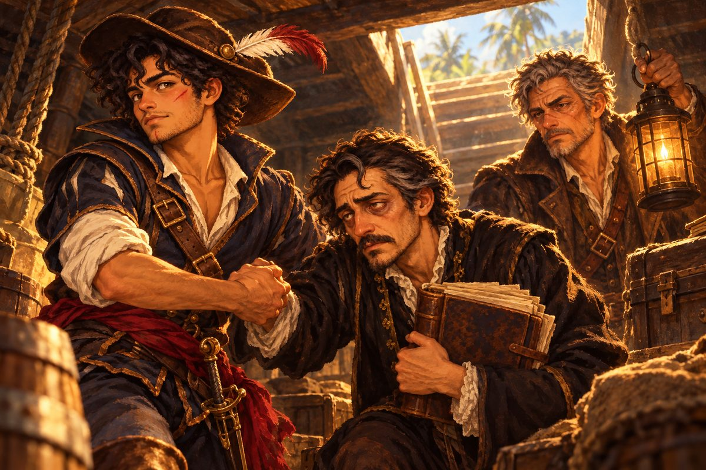

## 15. 늑대 사냥꾼

1524년 봄, 에스페란사호는 카르타헤나 만으로 들어섰다.

은 함대가 들르는 신대륙의 관문이었다. 돌로 쌓은 방파제 안쪽에 큰 배들이 줄지어 닻을 내렸고, 부두에는 짐꾼들이 궤짝을 어깨에 메고 개미처럼 오갔다. 해가 높지도 않았는데 돌바닥에서 열기가 올라왔다. 산토도밍고의 바람보다 무겁고 눅눅한 바람이었다.

마테오는 뱃머리에 서서 모자 챙을 손가락으로 밀어 올렸다. 챙이 넓은 모자였고, 띠에 회색 깃털 하나가 꽂혀 있었다. 아바나에서 받은 돈으로 처음 산 물건이었다. 짙은 남색 더블릿도 그때 맞췄다. 야라는 그 모자를 처음 보았을 때 "새가 머리에 앉았어"라고 한마디 했을 뿐이다. 바르톨로메는 아무 말도 하지 않았지만, 바람이 불 때마다 깃털이 마테오의 귀를 간질이는 것을 보고 입꼬리를 아주 조금 비틀었다.

겨울을 쿠바 바다에서 나는 동안 마테오는 달라져 있었다. 어깨가 넓어졌고, 턱에는 아침마다 칼로 긁어야 하는 수염 자국이 돋았다. 그 턱 끝에는 늑대의 칼이 남긴 흉터가 하얗게 아물어 있었다. 열여덟 살이었다. 가슴에는 놋쇠 사냥꾼 패가, 허리에는 바르톨로메가 골라 준 커틀라스가 있었다. 아버지의 붉은 천은 이제 손목이 아니라 그 칼자루에 감겨 있었다. 칼을 쥘 때마다 손바닥에 닿게 하려고 그렇게 했다.

항구 관리소의 서기는 배 이름과 선적 목록을 받아 적다가 펜을 멈추었다.

"산토도밍고 배로군. 선장 이름이…… 마테오 레예스?" 서기가 고개를 들어 마테오의 얼굴과 가슴의 패를 번갈아 보았다. "혹시 아바나의 늑대 사냥꾼?"

마테오는 바로 대답하지 못했다.

"……네. 그 사냥꾼이에요."

"이야, 이거 영광인데. 회색 늑대를 산 채로 끌고 갔다면서? 여기서도 다들 그 이야기요." 서기는 신이 나서 장부에 이름을 크게 적었다.

소문은 배보다 빨랐다. 하지만 마테오의 귀에는 그 말이 칭찬보다 늑대의 검은 입가로 먼저 들렸다.

나흘째 아침, 감옥 문지기가 뛰어오던 발소리. 새카맣게 변한 입술. 증거품 상자에서 사라진 종이 한 장. 늑대는 세비야에서 온 감찰관 앞에서 누구에게 통행료를 냈는지 말하겠다고 했다. 그 말을 할 날은 오지 않았다. 아바나의 교수대는 끝내 쓰이지 않았고, 사람들은 그래도 마테오를 늑대 사냥꾼이라고 불렀다.

"표정 풀어라." 뒤에서 바르톨로메가 말했다. "이름은 네가 고르는 게 아니다. 남이 붙이지."

"알아요." 마테오는 모자를 고쳐 썼다. "그냥…… 좀 다른 이름이었으면 좋겠어요."

품 안에서 종이 한 장이 바스락거렸다. 아바나 조합 벽에서 떼어 온 붉은 머리 여인의 수배서였다. 생사 불문, 30,000. 마테오는 그 여인이 술값을 놓고 나가며 남긴 말을 아직 기억했다. 수배서를 누가 썼는지부터 보라는 말이었다.

카르타헤나 사냥꾼 조합은 항구에서 두 골목 안쪽에 있었다. 벽을 덮은 수배서들 한가운데에, 다른 것보다 두 배는 큰 종이가 붙어 있었다. 조합장이 그 앞으로 마테오를 데려갔다.

"늑대 사냥꾼이라면 이걸 맡아 주게. 사람을 잡는 게 아니라 찾아오는 의뢰야."

마테오는 수배서를 소리 내어 읽었다.

"은 함대 회계관 마르틴 데 우르키사가 '외팔이' 카스트로에게 납치되었다. 회계관을 산 채로 데려오면 8,000."

그는 먼저 종이 아래쪽을 보았다. 누가 썼는지. 은 함대 사무소의 도장과 카르타헤나 조합의 서명이 있었다. 붉은 매는 아니었다. 마테오는 저도 모르게 숨을 내쉬었다.

"카스트로는 탈영병이야. 왼팔을 잃고 쇠갈고리를 달았지." 조합장이 말했다. "그놈은 회계관을 기함에 가두고 다닌다. 기함이 가라앉으면 회계관도 가라앉지."

바르톨로메가 팔짱을 낀 채 수배서를 훑었다.

"이번 조건은 기함을 가라앉히지 말 것. 늑대 때보다 까다롭군."

"늑대 때는 갑판에 오르기만 하면 됐잖아요." 마테오가 손가락을 꼽았다. "이번엔 갑판에 오르기 전에 배가 가라앉아도 안 되고, 불이 나도 안 되고……."

"셈이 빨라서 좋군." 조합장이 웃다가 문득 생각났다는 듯 덧붙였다. "아, 그리고 같은 수배서를 뗀 사람이 하나 더 있다. 술집에 가 보면 알 거야."

## 16. 과부의 잔

카르타헤나의 술집은 항구 쪽으로 창이 크게 나 있었다. 오후 햇빛이 비스듬히 들어와 탁자마다 먼지를 띄웠다. 뱃사람들이 떠들던 소리가 마테오가 들어서자 한 박자 낮아졌다. 사람들의 눈이 그의 가슴에 달린 패로 갔다가 턱의 흉터로 갔다.

구석 자리에 한 여자가 앉아 있었다.

검은 옷이었다. 소매 끝까지 검었고, 짧게 자른 머리를 검은 리본으로 묶었다. 목에는 가는 줄이 걸려 있었는데, 그 끝에 작은 금반지 하나가 매달려 있었다. 손가락에 끼는 대신 목에 건 반지였다. 탁자 위에는 반쯤 빈 잔과 접은 종이 한 장. 마테오는 그 종이의 크기를 알아보았다. 조합 벽의 그 수배서와 똑같았다.

여자가 고개를 들었다. 눈이 차가웠다. 겨울 바다 같았다.

"네가 아바나의 늑대 사냥꾼? 생각보다 어리네."

"생각보다 키도 커요." 마테오는 맞은편 의자를 끌어당겨 앉았다. "누구세요?"

"비올레타. 다들 과부라고 부르지." 여자가 손가락으로 수배서를 톡 쳤다. "네가 뗀 수배서, 나도 뗐어."

"그건 회계관을 살려서 데려오는 의뢰예요."

"수배서엔 카스트로의 목값도 적혀 있어. 나는 그쪽만 받으면 돼."

마테오는 그 종이를 끝까지 읽지 않았다는 것을 그제야 알았다. 맨 아래 작은 글씨로, 카스트로의 목에도 따로 값이 붙어 있었다.

"회계관은요?"

"운이 좋으면 살겠지." 비올레타는 자기 잔을 마테오 쪽으로 밀어 주었다. "마셔. 하나 가르쳐 줄게, 꼬마 사냥꾼. 죽은 놈은 거짓말을 안 해."

"산 놈은 진실을 말하기도 해요."

비올레타의 입꼬리가 올라갔다. 웃음이라기보다는 칼날이 조금 기울어진 것 같았다.

"늑대도 그랬니? 감방에서 진실을 말했어?"

마테오는 입을 열었다가 닫았다.

"……."

"그래." 비올레타가 일어섰다. 수배서를 품에 넣고 동전 몇 닢을 탁자에 떨어뜨렸다. "그게 이 바다야."

그녀가 나간 뒤에도 문은 한동안 흔들렸다. 마테오는 밀려온 잔을 내려다보았다. 바닥에 남은 럼이 햇빛을 받아 갈색으로 빛났다. 그는 잔을 들어 한 번에 비웠다. 목구멍이 타는 것 같았다.

창가에 서 있던 야라가 다가왔다. "저 여자, 반지를 목에 걸었어."

"과부라잖아." 바르톨로메가 카운터에서 잔을 들고 왔다. "비올레타 산체스. 몇 해 전에 해적한테 남편을 잃었다지. 그 뒤로 해적만 잡는다. 조합에 데려온 놈이 열이 넘는데, 숨이 붙은 놈은 하나도 없었다고 하더군."

"하나도요?"

"하나도."

마테오는 빈 잔을 손바닥 사이에서 굴렸다. 늑대의 검은 입가가 또 떠올랐다. 비올레타의 말이 틀렸다고 말할 수 없었다. 그게 분했다.

"그래도 이번엔 달라요." 그는 잔을 내려놓았다. "이번엔 잡는 게 아니라 찾아오는 거니까. 회계관님은 해적이 아니잖아요."

"그 말을 저 여자한테 해 봐라." 바르톨로메가 술을 마셨다. "불 붙은 배 위에서 해적과 회계관을 가려서 태우는 재주가 있는지."

## 17. 종이의 용기

카스트로의 이야기를 아는 사람이 있다는 말은 교회 문지기에게서 나왔다. 그 사람을 만나려면 신부님께 여쭈라고 했다. 늙은 신부는 마테오의 사냥꾼 패를 오래 바라본 뒤에야 고해실 뒤쪽 좁은 문을 가리켰다.

교회 고해실 뒤, 촛불 하나 켜 둔 작은 방이었다. 창도 없었다. 탁자 하나와 의자 하나, 벽을 따라 쌓인 종이 묶음들. 촛농이 탁자 모서리에 하얗게 흘러내려 굳어 있었다.

문을 열자마자 안에서 날카로운 목소리가 튀어나왔다.

"들어오지 마십시오! 저는 여기 없습니다. 신부님이 그렇게 말씀하셨을 텐데요."

탁자 너머에 서른 남짓 된 사내가 서 있었다. 마른 몸에 검은 옷을 입었고, 손가락마다 잉크가 배어 있었다. 귀에는 깃펜 한 자루가 꽂혀 있었다. 촛불 쪽으로 눈을 찌푸리고 있었는데, 오래 어두운 데서 글자를 읽은 사람의 눈이었다.

"신부님이 그러셨어요." 마테오가 모자를 벗었다. "여기 없는 사람이 카스트로 이야기를 제일 잘 안다고."

사내는 한참 마테오를 노려보았다. 그러다 바르톨로메의 칼과 야라의 맨팔을 차례로 보더니, 체념한 듯 의자에 주저앉았다.

"……에스테반 오소리오입니다. 이 도시에서 공증인이었지요. 지금은 아무것도 아닙니다." 그는 손가락으로 탁자를 두드렸다. "카스트로가 노리는 건 회계관이 아닙니다. 회계관이 든 장부입니다."

"장부 따위를 왜?" 바르톨로메가 물었다.

"장부는 거짓말을 못 하니까요." 에스테반의 목소리가 달라졌다. 겁이 빠지고 단단한 것이 들어섰다. "파나마에서 떠난 은 상자 수와 세비야에 닿은 은 상자 수. 그 사이가 비어 있습니다. 해마다."

"그걸 어떻게 알아요?"

"제가 그 숫자에 서명을 거부했으니까요." 에스테반이 깃펜을 귀에서 뽑아 손가락 사이에서 돌렸다. "공증인은 숫자가 맞는다고 이름을 적는 사람입니다. 맞지 않는 숫자에 이름을 적을 수는 없었습니다. 그 대가로 여기 숨어 있는 겁니다."

마테오는 그 말을 오래 곱씹었다. 숫자 하나에 이름을 적지 않았다고 사람이 촛불 하나 켠 방에 갇혀 산다. 아버지도 종이 한 장 때문에 끌려갔다. 종이는 칼보다 가벼운데, 사람을 더 깊이 가라앉혔다.

그들이 교회를 나섰을 때, 에스테반은 문간에서 한참 망설이다가 따라 나왔다. 그는 햇빛에 눈을 가늘게 뜨고 거리 이쪽저쪽을 살폈다. 그러고는 마테오의 소매를 붙잡고 교역소 쪽 그늘로 끌고 갔다.

"은 함대의 장부 사본이 포르토벨로 교역소에 있습니다. 은 시장이 서는 곳이니까요. 산을 넘어온 은이 거기서 상자에 담기고, 상자마다 번호가 매겨집니다. 그 번호를 보면……."

"그럼 같이 가요."

에스테반이 입을 벌린 채 굳었다.

"저, 저는 칼도 못 씁니다. 배멀미도 합니다."

"칼은 우리가 쓸게요. 아저씨는 종이를 읽어 줘요."

교역소 처마 밑으로 짐을 실은 노새가 지나갔다. 방울 소리가 멀어질 때까지 에스테반은 아무 말도 하지 않았다. 그의 손가락이 귀에 꽂힌 깃펜을 만지작거렸다.

"……깃펜과 잉크는 제 것으로 가져가겠습니다. 남의 펜은 손에 안 맞습니다."

마테오가 활짝 웃었다. 에스테반은 그 웃음을 보지 못한 척하며 교역소 안의 물건 더미로 눈을 돌렸다. 그의 눈이 갑자기 빛나기 시작했다.

"아, 그리고 빈 짐칸으로 가는 건 낭비입니다. 포르토벨로에선 이곳 물건이 잘 팔립니다. 저 천은 저기 가면 값이 반은 더 붙고, 저 기름은……."

"아저씨, 아까는 배멀미 한다면서요."

"배멀미와 셈은 별개입니다."

그렇게 에스테반 오소리오가 에스페란사호의 회계를 맡았다. 그는 배에 오르자마자 짐칸의 궤짝 수를 세고, 물통 수를 세고, 선원들의 급료 장부를 달라고 했다. 바르톨로메는 그 장부를 처음 보았다고 말했고, 에스테반은 그 말을 듣고 진심으로 괴로운 얼굴을 했다.

포르토벨로로 가는 바다, 이틀째.

에스테반은 뱃전에 매달려 있었다. 얼굴이 종이처럼 하얬다.

"우욱…… 장부를…… 읽을 수만 있다면…… 이까짓 멀미……."

야라가 키를 잡은 채 한 손으로 앞쪽을 가리켰다.

"앞만 봐. 수평선을."

에스테반은 시키는 대로 고개를 들었다. 멀리 하늘과 바다가 맞닿은 선이 흔들림 없이 누워 있었다. 그는 그 선을 장부의 맨 아랫줄처럼 노려보았다. 그러자 정말로 속이 조금 가라앉았다.

"……고맙습니다, 야라 양."

"양은 빼."

## 18. 경주

포르토벨로는 은 냄새가 나는 항구였다.

산을 넘어온 노새 행렬이 날마다 마을로 들어왔다. 노새 등에는 은을 담은 자루가 실려 있었고, 행렬 앞뒤로는 창을 든 병사들이 걸었다. 은 시장이 서는 날이면 광장에 천막이 빽빽하게 들어섰고, 저울 접시가 쉬지 않고 오르내렸다. 밀림이 바로 마을 뒤까지 내려와 있었다. 공기는 카르타헤나보다 더 무거웠다. 숨을 쉴 때마다 물을 마시는 것 같았다.

술집 주인은 마테오가 카스트로라는 이름을 꺼내자 턱으로 구석을 가리켰다.

"카스트로네 놈들? 저 구석에서 떠드는 녀석들이 그쪽 사람들이오."

구석 탁자에 사내 넷이 둘러앉아 있었다. 술병이 이미 여러 개 비어 있었다. 마테오 일행은 그들과 등을 맞댄 탁자에 자리를 잡았다. 바르톨로메는 모자를 눌러쓰고 잔을 들었고, 야라는 창밖을 보는 척했다. 수다가 저절로 귀에 들어왔다.

"몸값 편지는 아직 아무 데도 안 보냈다며?"

"대장이 기다리라잖아. 누가 데리러 온다고."

"누가?"

"내가 알면 여기서 이러고 있겠냐. 대장이 그 손님 이야기만 나오면 입을 다물어."

사내들이 웃음을 터뜨리며 다음 병을 땄다. 바르톨로메가 잔을 내려놓았다.

"몸값을 바라는 납치가 아니군."

"그럼 회계관을 누구한테 넘기려는 거죠?" 마테오가 목소리를 낮췄다.

"장부를 원하는 사람이겠지요." 에스테반이 속삭였다. "몸값은 회계관의 목숨값입니다. 장부값은…… 그보다 훨씬 비쌉니다."

시장 뒷골목에는 점술가 노파가 있었다. 마테오는 들어갈 생각이 없었는데, 노파가 먼저 문간에서 손짓했다. 천막 안은 향 냄새로 가득했다. 노파는 물을 채운 놋대야를 들여다보다가 천천히 고개를 저었다.

"물이 보이는구먼. 깊고 검은 물."

마테오는 대야를 들여다보았다. 자기 얼굴과 모자 깃털이 비칠 뿐이었다.

"물에 가라앉는 것은 배만이 아니다." 노파가 손가락으로 물을 휘저었다. 마테오의 얼굴이 흩어졌다. "사람도, 종이도, 진실도 가라앉지."

"그러니까 가라앉히지 말라는 거죠. 알아요."

마테오가 동전을 놓고 일어서자 노파가 낄낄 웃었다. 알면서도 가라앉히는 게 사람이라고, 그 웃음이 말하는 것 같았다.

그날 밤, 부두.

배로 돌아가는 길에 비올레타가 길을 막아섰다. 등불 하나 없는 잔교 위였다. 달빛에 그녀의 검은 옷은 거의 보이지 않았고, 목에 건 반지만 희미하게 빛났다.

"손 떼, 꼬마. 이번 건 내 거야."

"회계관을 살려서 데려올 거예요." 마테오가 앞으로 나섰다. "비켜요."

"말로 해서 안 비키면?"

비올레타의 칼이 칼집에서 미끄러져 나왔다. 가늘고 곧은 칼이었다. 바르톨로메가 한 걸음 나서려 하자 마테오가 손을 들어 막았다.

"제 일이에요, 아저씨."

마테오도 커틀라스를 뽑았다. 칼자루에 감긴 붉은 천이 손바닥에 닿았다.

첫 칼은 생각보다 빨랐다. 마테오는 겨우 받아냈다. 두 번째 칼은 받지 못하고 몸을 비틀어 피했다. 더블릿 소매가 갈라졌다. 비올레타는 소리를 내지 않았다. 숨소리조차 들리지 않았다. 늑대는 웃으며 싸웠는데, 이 여자는 셈하듯이 싸웠다. 어디를 찌르면 끝나는지 이미 알고, 그 자리만 노렸다.

그래서 읽을 수 있었다.

세 번째 칼이 옆구리를 노리고 들어왔을 때, 마테오는 피하지 않고 안으로 파고들었다. 칼날끼리 부딪쳐 불꽃이 튀었다. 그는 커틀라스의 넓은 날로 그녀의 가는 칼을 눌러 잔교 난간까지 밀어붙였다. 두 사람의 얼굴이 손 한 뼘 거리로 가까워졌다. 비올레타의 차가운 눈 속에서 무엇인가가 아주 잠깐 흔들렸다.

그녀가 먼저 뒤로 물러섰다.

"……."

비올레타는 칼을 거두며 웃었다. 이번에는 진짜 웃음이었다.

"좋아. 그럼 경주다."

그녀는 등을 돌려 어둠 속으로 걸어갔다. 발소리가 잔교 끝에서 사라질 때까지 마테오는 칼을 내리지 못했다. 팔이 저렸다.

"셈하듯 싸우는 칼이다." 바르톨로메가 말했다. "다음엔 저 여자도 너를 셈에 넣을 거다."

"다음에도 막을게요."

비올레타가 사라진 뒤, 항구 관리소에 소식이 들어왔다. 늦게 들어온 어선 선장이 숨을 몰아쉬며 전했다. 카스트로의 호위선 두 척이 다리엔 만 쪽으로 나갔다고.

마테오는 모자를 눌러쓰고 배로 뛰었다.

"닻 올려! 지금 나가요!"

## 19. 서른 개의 은 상자

포르토벨로 앞바다에서 동쪽으로 반나절. 날렵한 브리간틴 두 척이 노를 내리고 다가왔다. 바람이 약한 날이라 노를 저을 수 있는 배가 빨랐다.

앞선 배의 뱃전에 사내 하나가 올라서서 소리쳤다. 바카라는 호위선 선장이었다.

"카스트로 대장이 기다리는 손님이 너희냐? 아니라면 바다 밑에서 기다려라!"

"손님은 아니고, 마중이에요!" 마테오가 맞받아쳤다. "포문 열어요!"

이번 배들은 가라앉혀도 되는 배였다. 마테오는 망설이지 않았다. 에스페란사호가 바람을 받아 비스듬히 미끄러졌고, 대포가 차례로 불을 뿜었다. 첫 포탄이 앞선 브리간틴의 노를 한 줄 부러뜨렸다. 노가 꺾이자 배가 제자리에서 빙글 돌았다. 그 옆구리에 두 번째 포탄이 들어갔다.

에스테반은 화약 연기 속에서 선창 계단에 웅크린 채 무언가를 중얼거렸다. 나중에 들어 보니 쏜 포탄 수를 세고 있었다고 했다. 화약값이 얼마인지 알아야 했다고.

두 번째 배는 오래 버티지 못했다. 바카는 기울어진 갑판에서 칼을 버리고 두 손을 들었다. 선원들이 그를 밧줄로 끌어 올렸다. 물에 흠뻑 젖은 바카는 갑판에 주저앉아 한참 숨만 몰아쉬었다.

"카스트로는 어디 있어요?"

"대장의 기함은 다리엔 만에서……." 바카가 이를 딱딱 부딪쳤다. "누군가를 기다린다. 장부를 받으러 올 사람을."

에스테반이 계단에서 고개를 내밀었다. 화약 연기에 그을린 얼굴이었다.

"장부를 받으러…… 역시 노리는 건 장부였군요."

포르토벨로로 돌아온 날 밤, 에스테반은 교역소 장부실에 틀어박혔다. 은 시장의 장부 사본이 선반 하나를 다 채우고 있었다. 교역소 서기는 처음엔 그를 들이지 않으려 했다. 에스테반은 아무렇지 않게 카르타헤나 공증인의 옛 직인을 내밀었다. 서기는 그 직인이 이미 쓸모없어졌다는 것을 몰랐다.

에스테반은 밤새 장부를 넘겼다. 마테오는 처음 한 시간은 옆에서 같이 숫자를 들여다보았고, 다음 한 시간은 꾸벅꾸벅 졸았고, 그다음에는 바닥에서 잤다. 야라만 끝까지 깨어 있었다. 그녀는 에스테반이 불러 주는 숫자를 들으며 해도 위에 작은 점을 찍었다.

새벽빛이 창으로 들어왔을 때 에스테반이 마테오를 흔들어 깨웠다. 눈이 벌겋게 충혈되어 있었지만, 목소리는 이상할 만큼 맑았다.

"보십시오."

그가 장부 여러 권을 나란히 펼쳤다. 해마다 한 권씩이었다.

"해마다 같은 암초 근처에서 은 상자가 서른 개씩 '해적에게 잃음'으로 지워져 있습니다."

"해마다 같은 곳에서요?"

"한 해도 빠지지 않고, 같은 암초, 서른 개." 에스테반이 손가락으로 줄을 짚어 내려갔다. "야라 양, 아니, 야라가 해도에 찍어 준 점이 전부 한자리에 모입니다. 해적이 우연히 거기 있는 게 아닙니다. 누군가 은 함대의 길을 알려 주고 있습니다."

해도 위의 점들은 정말로 하나로 겹쳐 있었다. 마치 누가 같은 자리를 펜으로 몇 번이고 눌러 찍은 것 같았다.

바르톨로메가 문가에 기대 그 점을 내려다보았다.

"길을 아는 놈은 많지 않지."

그 말이 방 안에 오래 남았다.

아침이 되자 조합에서 소문 하나가 굴러왔다. 조합장이 마테오를 보자마자 목소리를 낮췄다.

"과부가 불 붙일 배를 구한다는 소문이오. 기름이랑 화약을 잔뜩 샀다던데."

"불 붙일 배? 설마……."

"회계관째로 카스트로의 기함을 태울 셈이다." 바르톨로메가 말했다. "시체로 데려가면 그만이니까. 저 여자 수배서엔 카스트로 목값이 붙어 있지. 회계관은 덤이고."

마테오의 얼굴이 굳었다. 노파의 놋대야가 떠올랐다. 사람도, 종이도, 진실도 가라앉는다. 불에 타면 가라앉을 것조차 남지 않는다.

"그 전에 우리가 먼저 붙어야 해요!"

그날 저녁, 여관 방에서 바르톨로메가 긴 꾸러미 하나를 탁자에 내려놓았다. 기름 먹인 천을 벗기자 칼집에 든 장검이 나왔다. 커틀라스보다 한 뼘 반은 길었고, 날이 곧았다. 손잡이 끝에 무거운 쇠구슬이 달려 있었다.

"네 몫에서 칼값은 뺐다." 바르톨로메가 말했다. "커틀라스로는 카스트로의 갈고리를 못 받는다. 갈고리에 날이 걸리면 짧은 칼은 그대로 비틀려 빠진다."

마테오는 칼을 뽑아 보았다. 무거웠다. 하지만 사슬 갑옷을 처음 입었을 때만큼 무겁지는 않았다. 그사이 팔이 자란 것이었다.

에스테반이 장부에 무언가를 적었다. "금화 1,000. 선장님 몫에서 공제."

"아저씨는 그것까지 적어요?"

"적지 않은 돈은 사라진 돈입니다."

마테오는 커틀라스를 들어 칼자루에 감긴 붉은 천을 천천히 풀었다. 천은 빛이 바래 있었지만, 아직 붉었다. 그는 그 천을 장검의 손잡이에 다시 감았다. 끝을 단단히 매듭지었다.

"잘 들어라." 바르톨로메가 탁자를 손가락으로 짚었다. "대포는 돛대와 노를 노려라. 배를 멈추게만 하고, 마지막은 갑판에서 끝낸다."

"기함은 가라앉히지 않고, 갑판에서. 알았어요."

바르톨로메는 고개를 끄덕이고 일어섰다. 문을 나서기 전에 한 번 돌아보았다.

"그리고 회계관을 꺼내면, 그다음까지 생각해 둬라. 늑대 때처럼."

마테오는 대답하지 않았다. 대답할 말이 아직 없었다.

## 20. 다리엔 만의 카락

다리엔 만은 물빛부터 달랐다.

큰 강들이 흘러드는 만이라 바닷물이 흙빛을 띤 초록이었다. 기슭은 맹그로브 숲이 빽빽하게 덮고 있었고, 뿌리가 물속까지 다리처럼 내려와 있었다. 새들이 숲 위로 날아올랐다가 다시 내려앉았다. 바람이 거의 없었다. 돛이 축 늘어진 채 펄럭이지도 않았다.

그 초록 물 위에 낡은 카락 한 척이 닻을 내리고 있었다.

높은 선루가 앞뒤로 솟은 배였다. 칠이 벗겨진 뱃전에 따개비가 하얗게 붙어 있었고, 돛은 반쯤 접혀 있었다. 그 양옆으로 브리간틴 두 척이 개처럼 엎드려 있었다. 선창 어딘가에 회계관이 있었다.

야라가 뱃머리에서 눈을 가늘게 떴다.

"저 배야. 흘수가 깊어. 짐보다 사람이 더 실렸어."

"사람이 짐보다 무거워?" 에스테반이 물었다.

"짐은 가만히 있어. 사람은 안 그래. 묶어 두려면 지키는 사람이 더 필요해."

마테오는 갑판 한가운데로 걸어 나갔다. 선원들이 일손을 멈추고 그를 보았다. 그는 모자를 벗어 손에 들었다.

"모두 들어요. 기함은 절대 가라앉히지 마요!"

포수들이 고개를 끄덕였다. 사슬로 이은 포탄이 포문 옆에 쌓여 있었다. 배를 가르지 않고 돛대와 밧줄만 찢는 포탄이었다. 에스테반이 전날 밤 포르토벨로 대장간에서 값을 깎아 사 온 것이었다.

카락의 선루 위에 사내 하나가 나타났다. 낡은 에스파냐 군 흉갑을 입었고, 얼굴은 바위처럼 거칠었다. 왼팔 소매 끝에서 쇠갈고리가 햇빛을 받아 번쩍였다.

"늑대 사냥꾼이라." 카스트로의 목소리가 물 위로 굴러왔다. "회계관을 찾으러 왔나? 선창 문을 열기 전에 내 갈고리부터 받아라!"

"회계관님은 살려서 데려갈 거예요." 마테오가 소리쳤다. "당신도요!"

카스트로가 웃음을 터뜨렸다. 그 웃음이 끝나기도 전에 브리간틴 두 척이 노를 내렸다.

호위선들은 망설일 이유가 없는 상대였다. 에스페란사호의 대포가 왼쪽 브리간틴의 노 줄을 쓸어 버렸다. 노가 부러지며 물보라가 일었다. 오른쪽 브리간틴이 옆구리로 파고들려 했지만, 야라가 키를 반만 꺾어 비켜 냈다. 맹그로브 뿌리가 얕게 깔린 물목으로 그 배를 몰아넣은 것도 야라였다. 브리간틴은 뿌리에 바닥이 걸려 우뚝 멈췄다.

이제 카락만 남았다.

"사슬탄!" 마테오가 외쳤다. "돛대만 노려요! 뱃전 아래로는 한 발도 쏘지 마요!"

사슬탄이 윙윙 소리를 내며 날아갔다. 카락의 앞돛대 밧줄이 끊어지며 돛이 찢겨 내려앉았다. 두 번째 사슬탄이 큰돛대의 활대를 부러뜨렸다. 카락은 닻을 끊고 달아나려 했지만, 돛 없는 배는 흙빛 물 위에서 느릿느릿 돌기만 했다.

카락의 포문에서도 불이 뿜어져 나왔다. 포탄 하나가 에스페란사호의 뱃전을 긁고 지나갔다. 나무 조각이 비처럼 쏟아졌다. 마테오는 이를 악물었다. 대포로 맞받아치면 끝날 싸움이었다. 하지만 저 배의 뱃전 아래 어딘가에 사람이 묶여 있었다.

"붙여요!"

갈고리 밧줄이 날아가 카락의 뱃전에 걸렸다. 두 배가 삐걱거리며 맞붙었다. 마테오는 장검을 뽑아 들고 맨 먼저 건너뛰었다. 바르톨로메가 바로 뒤를 따랐다.

카락의 갑판은 아수라장이었다. 칼과 칼이 부딪쳤고, 누군가 비명을 질렀고, 누군가 바다로 떨어졌다. 마테오는 그 사이를 뚫고 선루로 올라가는 계단으로 달렸다. 계단 위에 카스트로가 서 있었다.

쇠갈고리가 내리꽂혔다.

마테오는 장검을 가로로 들어 받았다. 쇳소리가 귀를 찢었다. 갈고리가 칼날에 걸렸고, 카스트로가 팔을 비틀었다. 커틀라스였다면 그 자리에서 손아귀를 빠져나갔을 것이다. 장검은 길었다. 마테오는 비틀리는 힘을 따라 칼을 함께 돌렸고, 긴 날의 끝이 카스트로의 흉갑 어깨끈을 끊었다.

"제법이군, 꼬마!"

카스트로의 오른손에서 짧은 칼이 튀어나왔다. 마테오는 한 걸음 물러섰다가 다시 들어갔다. 바르톨로메가 몇 달 동안 갑판 위에서 가르친 걸음이었다. 물러서는 척하고, 들어간다. 갈고리가 다시 내려왔을 때 마테오는 이번에는 받지 않고 칼등으로 흘려 냈다. 갈고리가 계단 난간에 깊숙이 박혔다. 카스트로가 그것을 뽑으려고 몸을 숙인 순간, 장검의 끝이 그의 목 앞에서 멈췄다.

칼자루에 감긴 붉은 천이 바람도 없는데 흔들렸다. 마테오의 손이 떨리고 있었다.

카스트로는 장검 끝을 내려다보다가, 천천히 짧은 칼을 놓았다. 칼이 계단을 굴러 내려갔다. 그는 무릎을 꿇었다.

갑판의 싸움이 하나둘 멎었다. 대장이 꿇은 것을 본 선원들이 칼을 버렸다.

카스트로의 기함은 가라앉지 않았다. 돛은 찢기고 활대는 부러졌지만, 배는 흙빛 물 위에 그대로 떠 있었다.

선창 문은 쇠사슬과 자물쇠로 잠겨 있었다. 바르톨로메가 도끼로 자물쇠를 내려쳤다. 문이 열리자 쉰 공기가 밀려 나왔다. 땀과 곰팡이와 바닷물 냄새였다. 마테오는 등불을 들고 계단을 내려갔다.

선창 깊은 곳, 물통들 사이에 수척한 사내가 웅크리고 있었다. 수염이 덥수룩하게 자랐고, 옷은 해져 있었다. 그런데도 그는 가죽 표지의 두꺼운 장부를 두 팔로 꼭 끌어안고 있었다. 갓난아이를 안듯이.

사내가 등불에 눈을 찡그렸다.

"누, 누구시오…… 카스트로의 손님이오?"

"아뇨." 마테오가 무릎을 꿇어 눈높이를 맞췄다. "카르타헤나 조합의 사냥꾼이에요. 회계관님을 모시러 왔어요."

마르틴 데 우르키사는 한참 마테오의 얼굴을 보았다. 그리고 장부를 안은 채로 울기 시작했다. 소리 없이, 어깨만 떨면서.

마테오가 회계관을 부축해 갑판으로 올라왔을 때, 카스트로는 아직 계단 아래 무릎을 꿇고 있었다. 바르톨로메가 그의 손을 등 뒤로 묶고 있었다. 카스트로는 회계관을 보더니 비웃었다.

"회계관과 장부를 데려오라고 돈을 받았지. 검은 십자가 쪽 사람한테서."

마테오의 몸이 굳었다. 고메스의 장부에서 처음 본 이름이었다. 야라의 동생을 실어 간 깃발이었다.

"오늘이 장부를 넘기기로 한 날이었다." 카스트로가 침을 뱉었다. "너희가 망쳤지만."

에스테반이 회계관 곁에 서서 그가 안은 장부를 내려다보았다. 그는 손을 뻗지 않았다. 다만 오래 바라보았다.

"검은 십자가가 은 함대의 장부를 사려고 했다……."

그날 오후, 에스페란사호는 부서진 카락을 끌고 다리엔 만을 빠져나왔다. 만 어귀를 지날 때 야라가 먼 수평선을 가리켰다. 돛을 반쯤 접은 브리간틴 한 척이 그쪽에 떠 있었다. 갑판에 통 같은 것이 잔뜩 쌓여 있었다. 그 배는 한동안 이쪽을 바라보는 듯하더니, 천천히 뱃머리를 돌려 사라졌다.

마테오는 모자를 벗어 그쪽으로 한 번 흔들었다.

## 21. 비계 아래의 반지

포르토벨로의 술집에서 우르키사는 사흘 만에 처음으로 따뜻한 수프를 먹었다. 그는 숟가락을 든 손을 계속 떨었다. 그러면서도 장부는 무릎 위에서 내려놓지 않았다.

카스트로는 항구 관리소 감옥으로 넘겨졌다. 마테오는 감시를 두 배로 붙여 달라고 했다. 관리소 사람은 귀찮다는 얼굴을 했지만, 마테오가 동전 주머니를 내밀자 군말 없이 고개를 끄덕였다. 바르톨로메는 그 장면을 말없이 지켜보았다.

수프 그릇이 비자 우르키사가 입을 열었다. 목소리는 떨렸지만, 말은 또렷했다.

"은 함대의 길을 아는 사람은 총독부 안에 몇 되지 않습니다."

에스테반이 깃펜을 귀에서 뽑았다.

"어느 해 어느 날, 어떤 배가 몇 개의 상자를 싣고 어느 물길로 가는지. 그건 출항 열흘 전에 정해지고, 총독부의 몇 사람만 압니다. 해적이 같은 암초에서 해마다 기다린다면……." 우르키사가 숨을 골랐다. "그러니 이 일은 총독 각하께 직접 올려야 합니다. 각하는 정직한 분이시니까요."

마테오가 고개를 끄덕였다. 산토도밍고 조합에서 장갑을 벗던 손, 좋은 이름이라고 말해 주던 목소리가 떠올랐다. 바다에는 늘 정직한 사냥꾼이 모자라다고 했던 사람이었다.

"낱낱이 적겠습니다." 우르키사가 말했다. "레예스 군, 이 보고서를 각하께 전해 주시겠소?"

"물론이죠!"

우르키사는 그날 밤 내내 보고서를 썼다. 에스테반이 옆에서 숫자를 불러 주었고, 날짜를 맞추었고, 틀린 철자를 고쳤다. 보고서가 끝나자 우르키사는 서명하고 봉했다. 마테오는 그것을 받아 품속, 붉은 머리 여인의 수배서 옆에 넣었다.

에스테반은 아무 말 없이 그 보고서의 사본을 한 장 더 만들었다. 우르키사가 쓰는 동안 한 줄 한 줄 따라 적은 것이었다. 그는 사본을 기름 먹인 천에 싸서 자기 짐 맨 밑바닥에 넣었다.

"그건 왜요?" 마테오가 물었다.

"종이는 언제나 두 장이 안전합니다."

에스테반은 그 말만 하고 깃펜의 잉크를 닦았다. 바르톨로메가 술잔 너머로 에스테반을 보았다. 처음으로 그를 제대로 보는 눈이었다.

카르타헤나 조합에 들어서자 조합장이 의자에서 벌떡 일어났다.

"회계관을 산 채로! 8,000이다. 그리고 회계관 나리가 따로 사례를 맡기셨네."

탁자 위에 금화 자루 두 개가 놓였다. 하나는 조합의 것, 하나는 우르키사가 자기 돈으로 마련한 2,000이었다. 합쳐서 10,000. 에스테반이 자루를 하나하나 풀어 세기 시작했다. 조합장이 기분이 상한 얼굴을 했지만 에스테반은 끝까지 셌다.

조합 문이 열리고 검은 옷의 여자가 들어왔다. 비올레타였다. 그녀는 벽의 수배서가 떼어진 자리를 보고, 탁자 위의 금화를 보고, 마테오를 보았다. 그리고 빈손으로 돌아섰다.

"불 붙일 배를 다 사 놨는데." 그녀가 어깨 너머로 말했다. "다음엔 네 몫까지 가져갈 거야, 꼬마."

"다음에도 살려서 데려갈 거예요."

비올레타는 대답 대신 손을 한 번 들어 보였다. 문이 닫혔다. 목에 건 반지가 문틈으로 한 번 반짝이고 사라졌다.

우르키사는 카르타헤나 교회에 몸을 숨기기로 했다. 에스테반이 숨어 지내던 고해실 뒤 그 작은 방이었다. 에스테반은 방을 넘겨주며 촛불을 어디에 두면 덜 그을리는지, 어느 벽 틈으로 바람이 드는지를 일러 주었다.

"보고서가 각하께 닿을 때까지 나는 여기 숨어 있겠소." 우르키사가 마테오의 손을 잡았다. 그 손은 아직 차가웠다. "레예스 군, 부탁하오. 이건 은 함대의 일이 아니라 이 바다의 일이오."

"산토도밍고로 바로 갈게요."

에스페란사호는 그날 저녁 물때에 맞춰 카르타헤나를 떠났다.

산토도밍고는 여전히 망치 소리로 아침을 열었다. 대성당 공사는 마테오가 떠날 때보다 한참 높아져 있었다. 돌벽 위로 나무 비계가 거미줄처럼 얽혀 있었고, 석공들이 그 위를 오가며 돌을 올렸다. 마테오가 맨발로 부두를 뛰어다니던 때부터 짓던 성당이었다. 지금도 다 짓지 못했다.

총독은 그 비계 아래에서 마테오를 맞았다. 공사를 살피러 나왔다가 보고서를 들고 왔다는 말을 듣고 그 자리에서 기다린 것이었다. 은빛 수염을 단정히 다듬었고, 검은 비단 옷에 흰 주름 깃을 둘렀다. 그는 보고서의 봉인을 뜯어 천천히 읽었다. 한 장을 다 읽고 다음 장으로 넘길 때마다 고개를 조금씩 끄덕였다. 석공들의 망치 소리가 멀리서 울렸다.

마지막 장을 읽은 총독이 보고서를 덮었다.

"우르키사는 정직한 사람이지. 이런 일을 겪게 해서 면목이 없군."

"회계관님은 은 함대의 길을 아는 사람이 총독부 안에 있다고 하셨어요."

"그렇다면 내가 직접 찾아내야겠지." 총독이 부드럽게 웃으며 마테오의 어깨에 손을 얹었다. "걱정 말게. 자네는 늑대를 산 채로 잡았고, 이번엔 사람을 살려 왔네. 이름난 사냥꾼이야."

이름난 사냥꾼. 카르타헤나 서기가 늑대 사냥꾼이라고 불렀을 때와는 달랐다. 이번에는 그 이름이 가슴 한가운데로 곧장 내려앉았다. 마테오는 숨을 들이켰다. 얼굴이 뜨거워졌다.

"앞으로 내가 특별히 부탁할 일이 생길 걸세." 총독이 말을 이었다. "아무에게나 맡길 수 없는 일이지. 그때 와 주겠나?"

"언제든지요, 각하!"

총독의 반지가 비계 사이로 들어온 햇빛에 붉게 빛났다. 매 머리 모양의 붉은 인장이 박힌 반지였다. 마테오는 그 빛을 보았다. 빚 문서 끝에서도, 영수증 끝에서도 본 빛이었다. 하지만 그날 그의 눈에 그것은 그저 높은 사람의 반지일 뿐이었다.

총독은 보고서를 시종에게 건네고 다시 공사를 살피러 비계 쪽으로 걸어갔다. 마테오는 모자를 가슴에 대고 한참 그 뒷모습에 고개를 숙였다.

대성당 밖으로 나오자 바르톨로메가 계단에 앉아 있었다. 그는 처음부터 끝까지 안으로 들어오지 않았다. 마테오가 들어가자고 해도 고개만 저었다.

"아저씨! 왜 안 들어왔어요? 각하가 저더러……."

"들었다." 바르톨로메는 계단 아래 돌바닥만 보고 있었다. "다 들렸어."

그는 무릎을 짚고 천천히 일어섰다. 해가 그의 반백 머리와 코의 오래된 흉터를 비췄다. 마테오는 그 얼굴에서 무언가를 읽으려 했지만, 아무것도 읽을 수 없었다. 바르톨로메는 언제나처럼 무뚝뚝했다. 다만 평소보다 조금 늙어 보였다.

"……가자. 배로."

그는 먼저 계단을 내려갔다. 마테오는 한 번 대성당을 돌아보았다. 비계 사이로 붉은빛이 한 번 더 반짝였다. 그는 장검 손잡이에 감긴 붉은 천을 손바닥으로 감싸 쥐고, 바르톨로메의 뒤를 따라 부두로 내려갔다.
