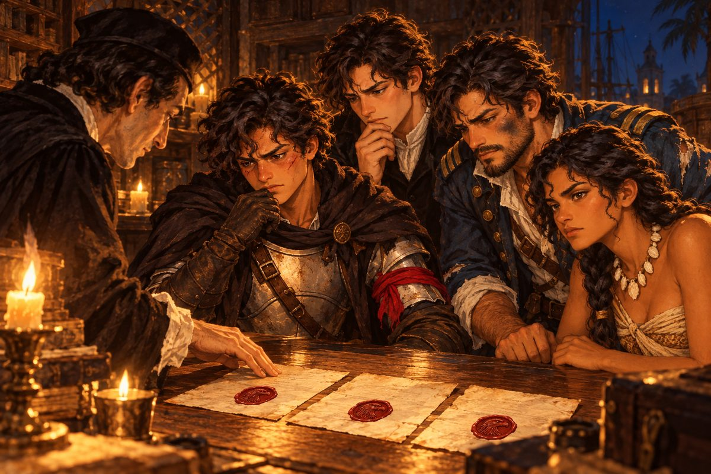

## 22. 검은 띠를 두른 수배서

1525년 봄, 산토도밍고 사냥꾼 조합의 벽에 검은 띠를 두른 수배서가 붙었다.

검은 띠는 사람이 죽었다는 표시였다. 그것도 아무나가 아니라 왕실의 녹을 먹던 사람이. 아침부터 조합 안이 술렁였다. 사냥꾼들은 서로 어깨를 밀치며 벽 앞으로 몰려들었고, 글을 못 읽는 자들은 읽는 자의 입만 쳐다보았다.

「회계관 마르틴 데 우르키사, 카르타헤나 교회에서 피살. 범인 '검은 돛' 라파엘 데 소토. 산 채로 12,000.」

마테오는 사람들 어깨 너머로 그 글자를 두 번 읽었다. 세 번째에는 눈이 글자를 따라가지 않았다.

"우르키사 님이…… 돌아가셨다고요?"

한 해 전 다리엔 만의 낡은 카락에서, 장부를 끌어안고 선창을 기어 나오던 수척한 얼굴이 떠올랐다. 떨면서도 또렷하던 목소리도. 이건 은 함대의 일이 아니라 이 바다의 일이오. 그분이 밤새 적은 보고서를 산토도밍고까지 품에 안고 온 사람은 마테오 자신이었다.

열아홉 살의 마테오는 두 해 전 이 벽 앞에서 맨발로 서 있던 소년과 많이 달랐다. 볕에 더 그을린 얼굴에는 아바나에서 얻은 흉터가 턱을 따라 하얗게 남아 있었고, 어깨에는 지난겨울 바닷바람에 질려 장만한 어두운 두건 망토가 걸려 있었다. 다만 셈 빠른 눈은 그대로였다. 그 눈이 지금은 숫자 대신 이름 하나에 붙박여 있었다.

조합장 니뇨가 땀을 닦으며 뛰어 들어왔다.

"총독 각하께서 오셨습니다! 모두 모자 벗어!"

사냥꾼들이 우르르 길을 텄다. 돈 알론소 데 바예호 총독은 언제나처럼 검은 비단 옷에 흰 주름 깃을 달고 있었다. 은빛 수염 아래 입가에 부드러운 웃음이 걸려 있었다. 그는 곧장 마테오 앞으로 걸어왔다.

"슬픈 일이지." 총독이 벽의 수배서를 올려다보았다. "범인은 반년 전 내 연안 경비대에서 탈영한 장교일세. 나는 그의 자백을 직접 듣고 싶네."

"자백을요."

"그래서 자네에게 맡기려는 걸세. 아무에게나 맡길 수 없는 일이라고 했지? 오늘부터 자네는 수배 전문가일세."

뒤에서 누군가 휘파람을 불었다가 니뇨의 눈총을 받고 입을 다물었다. 총독은 시종이 내미는 양피지를 받아 탁자에 펼쳤다. 녹인 붉은 밀랍이 한 방울 떨어졌다. 총독은 장갑을 벗고, 손가락의 반지를 그 위에 꾹 눌렀다. 반지를 떼자 밀랍 위에 매 한 마리가 고개를 쳐들고 있었다.

"특별 의뢰장일세. 어느 항구의 관리든 이걸 보면 자네를 도울 걸세. 그리고," 총독이 손짓하자 시종이 천에 싼 묵직한 것을 내려놓았다. "이건 내 경비대에서 쓰는 흉갑이네. 받아 두게."

천을 걷자 반들반들 닦인 쇠가 창으로 든 빛을 받아 번쩍였다. 사냥꾼들 사이에서 낮은 탄성이 새어 나왔다. 마테오는 흉갑을 가슴에 대고 가죽끈을 맸다. 생각보다 가벼웠고, 생각보다 차가웠다. 그는 칼자루에 감아 두었던 아버지의 붉은 천을 풀어 왼팔에 단단히 묶었다. 번쩍이는 쇠 옆에서 바랜 천 조각이 유난히 붉었다.

"감사합니다, 각하! 꼭 산 채로 잡아 오겠습니다!"

총독은 그의 어깨를 두어 번 두드리고 조합을 나갔다. 마테오는 의뢰장을 둘둘 말아 손에 쥐었다. 손바닥에 밀랍의 온기가 아직 남아 있었다.

부두 술집 문을 열자 클라라가 행주를 든 채 팔짱을 꼈다. 마테오의 가슴께를 위아래로 훑더니 혀를 찼다.

"총독 각하가 직접? 출세했구나, 우리 마테오."

"소문 빠르네요, 아줌마."

"이 부두에서 내 귀보다 빠른 건 없다." 클라라는 그의 흉갑을 손가락으로 톡톡 두드렸다. "녹슬지 않게 기름이나 잘 먹여라. 쇠가 비싸면 사람 목숨은 싸지는 법이야."

구석 탁자에는 바르톨로메가 앉아 있었다. 반백의 짧은 머리, 코에 남은 오래된 흉터, 술에 지친 눈. 그는 마테오가 들어와도 고개를 들지 않았다. 잔만 천천히 손안에서 돌렸다.

"……총독이 직접 산 채로 원하는 놈은 대개 오래 못 산다."

마테오의 발이 멈추었다. 아바나의 감방이 떠올랐다. 입가가 새카맣게 변한 채 죽어 있던 회색 늑대. 그는 그 기억을 고개를 저어 털어 냈다.

맞은편에 앉은 에스테반이 깃펜을 귀에 꽂은 채 잉크 묻은 손가락으로 탁자를 짚었다. 목소리가 바르톨로메보다 더 낮았다.

"우르키사 님이 돌아가신 건, 그분의 보고서가 총독께 올라간 지 열흘 뒤였습니다."

탁자 위에 잠깐 아무 소리도 없었다. 야라가 조개 목걸이를 만지작거리다 손을 멈추었다.

"……두 사람 다 왜 그래요." 마테오가 의뢰장을 탁자에 툭 내려놓았다. "검은 돛부터 잡고 나서 이야기해요."

그는 클라라에게 물을 한 잔 달라고 하고, 지도를 펼치고, 베라크루즈까지 며칠이 걸릴지를 큰 소리로 셈했다. 바르톨로메의 말도 에스테반의 말도 듣지 않은 척했다. 듣지 않은 척하는 데에는 생각보다 힘이 많이 들었다.

## 23. 사흘을 넘기지 않는 배

에스페란사호는 서쪽으로 달렸다. 베라크루즈를 향해 닷새째였다.

야라는 뱃머리에 걸터앉아 바람을 읽고 있었다. 길게 땋은 검은 머리가 바람에 날려 등 뒤로 넘어갔다. 그녀는 지난 항구에서 주워들은 이야기를 짧게 전했다.

"검은 돛은 바다 위에 오래 머물지 않는대. 항구에서 항구로, 사흘을 넘기지 않고."

"사흘." 마테오는 키를 잡은 채 입속으로 날짜를 셈했다. "우리가 닿을 때쯤이면 벌써 떠났겠네. 그럼 우리도 항구마다 단서를 사야겠네."

"사야 한다고요?" 선창 입구에서 에스테반이 창백한 얼굴을 내밀었다. 바다에 나온 지 한 해가 넘었는데도 그의 멀미는 나을 기미가 없었다. "단서에도 값이 붙는다는 말씀입니까. 장부에 적을 칸을 하나 더 만들어야겠군요."

베라크루즈는 아스테카의 금이 바다로 나가는 문이었다. 부두에는 은괴를 실은 수레가 줄지어 있었고, 창을 든 병사들이 수레마다 붙어 섰다. 술집은 부두에서 두 골목 안쪽에 있었다. 주인은 마테오가 검은 돛의 이름을 꺼내자 걸레질하던 손을 멈추고 씩 웃었다.

"검은 돛? 그 이름엔 값이 붙어 있소."

에스테반이 한숨을 쉬며 돈주머니를 열었다. 그는 금화를 한 닢씩 세어 탁자에 쌓았다. 팔백 닢째에서 손을 떼더니, 장부에 무언가를 적었다. 주인은 금화를 쓸어 담고 목소리를 낮추었다.

"사흘 전 여기서 대포 두 문을 팔고 동쪽으로 갔소. 자메이카 쪽이라더군."

"대포를 팔았다고요?" 바르톨로메가 눈썹을 올렸다. "쫓기는 놈이 무기를 내다 판다."

"배를 가볍게 하려는 거겠지. 아니면 돈이 급했거나." 주인이 어깨를 으쓱했다. "떠나면서 이런 말을 남겼다더군. '나는 아무도 죽이지 않았다. 누이를 만나기 전에는 잡히지 않는다.'"

"누이……?" 마테오가 의자를 박차고 일어났다. "자메이카로 가요!"

그들이 부두로 돌아왔을 때, 자메이카에서 막 들어온 상선의 선원이 소식 하나를 더 보태 주었다. 검은 돛을 단 나오 한 척이 자메이카 항구 옆에 닻을 내렸다고. 쫓을 길이 생겼다. 마테오의 가슴이 뛰었다. 쫓는 일은 언제나 그를 들뜨게 했다.

떠나기 전에 바르톨로메가 부두 위쪽의 작은 교회를 턱으로 가리켰다. 사냥꾼은 술집 다음에 교회를 들른다. 쫓기는 자는 술집에서 배를 팔고 교회에서 마음을 판다고, 그는 언젠가 그렇게 말한 적이 있었다.

늙은 신부는 고해실 앞의 촛불을 갈고 있었다. 사냥꾼이라는 말을 듣자 그는 촛대를 내려놓고 오래 마테오의 얼굴을 보았다.

"고해 내용은 말할 수 없다네. 다만 한마디만 하지."

신부는 흰 눈썹 아래로 눈을 가늘게 떴다.

"그 사람은 사람을 죽인 눈이 아니었어. 쫓기는 눈이었지. 죽이는 쪽이 아니라."

교회를 나오며 바르톨로메가 중얼거렸다.

"신부님이 그렇게 말하는 놈은 처음 본다."

"신부님들은 다 착하게 말하잖아요."

"아니. 신부들은 대개 아무 말도 안 한다." 바르톨로메는 그 이상 말하지 않았다.

자메이카로 가는 바다는 잔잔했다. 나흘째 되던 밤, 선실의 등잔 아래서 에스테반이 수배서를 펼쳐 놓고 깃펜 끝으로 날짜를 짚었다.

"수배서에는 범행 날짜가 우르키사 님 피살일로 적혀 있습니다. 그런데 그날 검은 돛은 베라크루즈에 있었다는 소문도 있고……."

"카르타헤나와 베라크루즈는 같은 날 한 사람이 있을 수 있는 거리가 아니야." 야라가 해도를 보지도 않고 말했다.

마테오는 등잔 심지를 손끝으로 눌러 낮추었다.

"소문은 소문이에요. 잡아서 직접 물어보면 돼요."

그 말은 단단하게 나왔다. 하지만 그날 밤 해먹에 누워서도 마테오는 오래 눈을 감지 못했다. 사흘을 넘기지 않는 배. 누이를 만나기 전에는 잡히지 않겠다는 사내. 쫓기는 눈. 그는 의뢰장을 품에서 꺼내 어둠 속에서 만져 보았다. 밀랍의 매가 손끝에 오돌토돌 걸렸다.

## 24. 연기 속의 검은 돛

자메이카 술집 주인은 말을 아끼지 않았다. 값을 부르기도 전에 먼저 손가락으로 창밖을 가리켰다.

"검은 돛 말이오? 항구 옆에 닻을 내렸소. 오늘 밤 떠날 채비를 하더군."

창 너머, 만 어귀의 곶 그늘에 나오 한 척이 보였다. 돛을 접고 있었지만 둘둘 감아 둔 돛천이 숯처럼 검었다.

"그런데 그 앞을 작은 배 두 척이 지키고 있소. 다가가는 배마다 막아선다오."

과연 나오와 만 사이에 날렵한 카라벨라티나 두 척이 가로누워 있었다. 삼각돛을 반쯤 올린 채, 언제든 미끄러져 나올 자세였다.

"후위부터 뚫어야겠네." 마테오는 망토 자락을 걷어붙였다. "가요!"

에스페란사호가 만을 벗어나자 두 척의 카라벨라티나가 곧장 길을 막아섰다. 앞선 배의 뱃전에 서른 남짓한 사내가 한 발을 올리고 섰다. 검은 돛의 후위를 맡은 리베라였다.

"검은 돛 대장님께 가려면 우리 배를 넘어야 할 거다!"

"넘어 줄게요!"

이번 싸움에는 까다로운 조건이 없었다. 산 채로 데려올 사람도, 가라앉히면 안 될 선창도 없었다. 저 두 척을 깨뜨리기만 하면 됐다. 다만 시간이 없었다. 리베라의 배가 버티는 동안 저 뒤의 나오는 닻을 올릴 것이다.

"좌현 포, 앞엣놈 뱃머리!" 마테오가 외쳤다. "야라, 바람 위로 붙여!"

야라가 키를 꺾었다. 에스페란사호가 바람을 안고 기울었다. 첫 포성이 만에 울렸다. 리베라의 배도 지지 않고 응사했다. 포탄이 물을 때리며 하얀 기둥을 세웠고, 화약 연기가 바다 위에 낮게 깔렸다. 두 번째 배가 옆구리로 파고들려 하자 바르톨로메가 고물에서 갈고리를 든 선원들을 다그쳐 막았다.

후위는 끈질겼다. 리베라는 이길 생각이 없는 사람처럼 싸웠다. 지지 않고 오래 버티는 것만이 목적인 싸움이었다. 마테오는 이를 악물고 다시 포를 불렀다. 세 번째 일제 사격에 앞선 배의 돛대가 꺾여 물로 쓰러졌다. 뒤의 배는 동료를 끌고 물러나려다 에스페란사호의 뱃머리에 옆구리를 받혔다.

리베라가 칼을 던지고 두 손을 들었을 때, 만 어귀는 온통 회색 연기로 덮여 있었다.

그리고 연기가 걷혔을 때, 곶 그늘에는 아무것도 없었다.

"……없어."

마테오는 뱃전을 움켜쥐었다. 검은 돛은 포성이 오가는 사이 닻을 올리고 연기 속으로 빠져나간 것이었다. 리베라의 배가 버틴 것은 바로 그 짧은 틈을 벌기 위해서였다.

포승에 묶인 리베라가 갑판에 앉은 채 웃었다. 피 묻은 입가로, 이상하게 홀가분한 웃음이었다.

"대장은 잡히기 전에 꼭 만날 사람이 있다. 너희 같은 사냥개한텐 안 잡혀."

"사냥개라니요!" 마테오가 돌아섰다가, 그만두었다. 지금은 말싸움을 할 때가 아니었다.

야라는 돛대 꼭대기에 올라가 있었다. 그녀는 손바닥을 눈 위에 대고 바다를 오래 보다가, 짧게 외쳤다.

"동쪽이야. 연기가 동쪽으로 흘렀어."

"동쪽이면……."

"마라카이보 쪽이겠지." 바르톨로메가 해도를 펼쳤다. "아니면 그보다 더 동쪽이거나."

그날 저녁, 바르톨로메는 다시 교회로 그들을 데려갔다. 이번에는 그럴 까닭이 있었다. 신부가 그들을 먼저 알아보았기 때문이다.

"검은 돛을 쫓는 사냥꾼이오?" 젊은 신부는 망설이다 제단 옆 서랍을 열었다. "……그 사람이 맡기고 간 편지가 있소. 부치지 못했다더군. 오늘 밤 떠날 줄 알았다면 직접 들고 갔을 텐데."

접은 종이 한 장이었다. 봉하지도 않았다. 짧은 글씨가 비뚤배뚤 적혀 있었다. 흔들리는 배 위에서 쓴 글씨였다.

「카라카스의 루시아에게. 곧 간다. 나는 아무도 죽이지 않았다. 라파엘.」

에스테반이 편지를 받아 등잔 쪽으로 기울였다. 그는 종이의 이름을 오래 들여다보더니 기억을 더듬듯 말했다.

"카라카스의 재봉사 루시아 데 소토. 그의 누이입니다. 경비대 장교 명부에 가족으로 적혀 있던 이름입니다. 공증인 시절에 한 번 본 적이 있습니다."

"누이를 만나러 간다는 거였구나." 마테오는 편지를 다시 접어 신부에게 돌려주었다. 신부가 눈을 크게 떴다. "제가 들고 가면 안 되죠. 받을 사람이 따로 있잖아요."

교회를 나오는 길에 광장 모퉁이의 점술가가 마테오의 손목을 붙잡았다. 늙은 여자였다. 그녀는 마테오가 뿌리치기 전에 그의 손바닥을 펴서 들여다보았다.

"쫓는 자의 손금이로구먼. 그런데…… 이상하군."

"뭐가요?"

"쫓는 자도 쫓기고 있다." 점술가가 고개를 들었다. 흐린 눈이 마테오의 어깨 너머를 보고 있었다. "자네 등 뒤에도 수배서가 한 장 붙어 있어."

마테오는 저도 모르게 등 뒤를 돌아보았다. 텅 빈 광장에 저녁 바람만 지나갔다.

"제 등 뒤에요? 농담이시죠?"

점술가는 대답 대신 손을 내밀었다. 마테오는 동전 한 닢을 놓고 걸음을 서둘렀다. 망토 두건이 바람에 펄럭이며 뒷목을 쳤다. 그 감촉이 이상하게 오래 남았다.

## 25. 수배서 두 장

동쪽으로, 마라카이보를 향해 닷새째였다.

밤바다는 검었고 별이 낮았다. 마테오는 고물 난간에 기대어 항적을 보고 있었다. 바르톨로메가 언제 왔는지 옆에 섰다. 그는 한참 아무 말이 없다가, 바다를 본 채로 물었다.

"마테오. 검은 돛을 잡으면, 바로 넘길 거냐?"

마테오는 대답하지 않았다. 아바나에서는 바로 넘겼다. 늑대를 총독부 감옥에 넣고, 문지기에게 쥐 한 마리도 못 드나든다는 말을 듣고, 안심하고 술을 마셨다. 사흘 뒤 늑대는 입가가 새카매진 채 죽었다. 품에서 나온 종이도 사라졌다.

"……먼저 물어볼 거예요." 한참 만에 그가 말했다. "왜 죽였는지. 정말 죽였는지."

바르톨로메는 고개를 끄덕였다. 그것으로 됐다는 듯이, 혹은 그것으로는 모자라다는 듯이. 그는 난간을 한 번 두드리고 선실로 내려갔다.

마라카이보는 큰 호수가 바다로 열리는 목에 자리 잡은 항구였다. 호수 어귀에 배 한 척이 떠 있다는 소문이 부두에 돌았다. 마테오는 곧장 술집으로 향했다. 주인은 그 이야기가 나오자 코웃음을 쳤다.

"호수 어귀의 그 배? 가 보시오. 빈 배요. 사람은 하나도 없지."

"빈 배라고요?"

주인은 손바닥을 펴 탁자 위에 올렸다. 에스테반이 이번에는 한숨도 쉬지 않고 금화를 세었다. 천 닢. 장부에 적는 그의 깃펜이 종이를 거의 찢을 듯했다.

"미끼였소. 검은 돛은 이미 동쪽 카라카스로 떠났다오."

그래도 마테오는 직접 가 보았다. 호수 어귀의 배는 정말로 비어 있었다. 낡은 카라벨라티나에 검게 물들인 돛 한 폭만 걸쳐 놓은, 멀리서 보면 검은 돛처럼 보이게 꾸민 빈 껍데기였다. 갑판에는 쥐 한 마리 없었다. 야라가 고물로 가서 키를 살피다 마테오를 불렀다.

키 손잡이에 쪽지 한 장이 끈으로 묶여 있었다.

「쫓아오는 사냥꾼에게. 나를 잡고 싶으면 수배서를 쓴 손부터 봐라.」

마테오는 쪽지를 두 번 읽었다.

"……수배서를 쓴 손."

두 해 전, 아바나 술집 구석 자리의 붉은 머리 여인이 동전을 탁자에 놓으며 한 말이 있었다. 수배서를 누가 썼는지부터 봐. 그때 마테오는 놋쇠 사냥꾼 패를 자랑하느라 그 말을 귓등으로 들었다.

쪽지를 접어 품에 넣으며 그는 망토 안쪽의 의뢰장에 손이 닿는 것을 느꼈다. 그는 손을 거두었다.

마라카이보 사냥꾼 조합에 들어서자, 창가 자리에서 낯익은 목소리가 들렸다.

"또 너야? 이번엔 경주가 좀 길겠네."

비올레타 산체스가 다리를 꼬고 앉아 있었다. 짧게 자른 머리, 검은 옷, 검은 리본. 목에 건 가는 줄 끝에서 결혼반지가 흔들렸다. 포르토벨로 부두에서 칼을 맞댄 지 한 해였다. 그녀는 변한 데가 없었다. 웃지 않는 눈으로 웃는 법도 그대로였다.

"검은 돛은 내 표적이에요. 총독 각하가 직접 맡기셨어요."

"나도 직접 받았는데." 비올레타가 품에서 수배서를 꺼내 탁자에 펼쳤다. "보이니? 같은 이름, 같은 인장."

라파엘 데 소토. 그리고 그 아래, 붉은 밀랍의 매. 마테오는 허리를 굽혀 글자를 읽었다. 그리고 한 줄에서 눈이 멈추었다.

"'생사 불문'……? 제 건 '산 채로'인데요."

"그러네." 비올레타가 턱을 괴었다. "너한텐 살려 오라고 하고, 나한텐 죽여도 된다고 하고. 둘 중 누가 먼저 잡든 상관없다는 거겠지. 그 남자가 입만 다물면."

그 남자가 입만 다물면.

마테오의 귓가에서 아바나 술집의 소란이 되살아났다. 술잔 부딪는 소리, 비린 바닷바람, 그리고 붉은 머리 여인의 낮은 목소리. '산 채로'라고 적힌 수배서는 둘 중 하나야. 누가 그 입에서 나올 말을 꼭 듣고 싶거나. 아니면.

"……'누가 그 입을 제 손으로 닫고 싶거나.'"

"뭐?"

"아바나에서 누가 해 준 말이에요. 그땐 무슨 소린지 몰랐어요."

비올레타는 잠깐 그를 보았다. 처음으로 비웃음이 섞이지 않은 눈이었다. 그러다 그녀는 수배서를 접어 품에 넣고 일어섰다.

"뭐가 됐든, 나는 시체로 데려갈 거야. 시체는 적어도 감방에서 독을 먹지는 않으니까."

그녀가 나간 뒤에도 마테오는 탁자 앞에 서 있었다. 같은 사람에게 수배서가 두 장. 같은 손이 쓴 두 장이었다. 하나는 살려 오라 하고, 하나는 죽여도 좋다고 했다. 어느 쪽이 먼저 닿든, 그 손은 원하는 것을 얻는다.

마테오는 처음으로 자기가 쥔 종이를 의심했다.

## 26. 누이의 항구

카라카스는 산이 바다로 바짝 내려선 항구였다. 초록 비탈 아래로 하얀 집들이 층층이 붙어 있었고, 부두의 술집은 저녁마다 그물 손질을 마친 어부들로 붐볐다.

마테오가 술집 문을 열고 들어서기가 무섭게, 누군가 그의 소매를 붙잡았다.

머릿수건을 쓴 젊은 여자였다. 손가락 끝마다 바늘에 찔린 자국이 있었다. 걱정에 지친 눈이 마테오의 흉갑과 손에 든 수배서 뭉치를 번갈아 보았다.

"사냥꾼이시죠? 오빠를 잡으러 오셨죠?"

야라가 한 걸음 다가섰지만 마테오는 손을 들어 막았다. 여자는 소매를 놓지 않았다.

"루시아 데 소토 씨죠."

"오빠는 사람을 죽이지 않았어요." 루시아의 목소리가 떨리다가 높아졌다. 술집 안의 어부들이 하나둘 고개를 돌렸다. "죽이지 않으려고 경비대를 떠난 거예요!"

마테오는 그녀의 손을 내려다보았다. 바늘 자국투성이의 손이 그의 소매를 꼭 쥐고 있었다. 자메이카 교회에 남아 있던 편지의 비뚤배뚤한 글씨가 생각났다. 곧 간다. 나는 아무도 죽이지 않았다.

"……그 말, 오빠한테 직접 들을게요." 그가 천천히 말했다. "산 채로 데려와서."

루시아의 손이 소매에서 풀렸다. 그녀는 무어라 더 말하려다 입술을 깨물고 돌아섰다.

그날 저녁, 해가 산 너머로 넘어갈 무렵이었다. 부두의 아이들이 바다를 가리키며 소리쳤다. 카라카스 앞바다에 검은 돛이 나타났다. 나오 한 척과 카라벨라티나 두 척. 그들은 항구로 들어오지 않고, 붉게 물든 바다 위에 조용히 떠 있었다. 누이를 만나러 온 것이었다.

"사흘을 넘기지 않는 배가," 바르톨로메가 중얼거렸다. "누이 때문에 발이 묶였군."

에스페란사호가 항구를 나섰다. 이번에는 리베라 같은 후위가 길을 막지 않았다. 검은 돛의 나오가 천천히 뱃머리를 돌려 그들을 마주했다. 고물에 선 사내가 보였다. 경비대 군복의 소매를 뜯어낸 차림, 화약 그을음이 묻은 얼굴, 짙은 눈썹, 단정하게 다듬은 수염. 그가 목소리를 높였다.

"결국 여기까지 왔군, 사냥꾼. 누이 앞에서만은 잡히고 싶지 않았는데."

"산 채로 잡을 거예요." 마테오가 마주 외쳤다. "할 말이 있으면 갑판에서 해요!"

이번 의뢰의 조건은 하나였다. 산 채로. 배를 깨뜨리는 것만으로는 모자랐다. 저 나오의 갑판에 올라, 저 사내를 칼로 꺾어야 했다. 마테오는 포수들에게 돛대와 돛만 노리라고 일렀다. 바르톨로메가 가르쳐 준 대로였다. 배를 멈추게만 하고, 마지막은 갑판에서 끝낸다.

검은 돛의 포가 먼저 울렸다. 포탄이 머리 위를 지나며 에스페란사호의 삼각돛을 찢었다. 두 번째도, 세 번째도 돛이었다. 갑판에 선 선원들은 아무도 다치지 않았다. 야라가 찢어진 돛을 올려다보며 짧게 말했다.

"사람은 안 쏴. 일부러."

마테오도 그것을 보았다. 저쪽 포수는 쏘려고만 하면 갑판을 쓸어버릴 수 있는 거리에서 끈질기게 돛만 찢고 있었다. 사람 대신 돛을 쏘는 포수. 그는 가슴 한구석이 이상하게 서늘해지는 것을 느꼈다.

두 척의 카라벨라티나가 에스페란사호를 막아서려 했지만, 바르톨로메가 이끄는 선원들의 포에 하나씩 뒤로 밀려났다. 해가 바다에 반쯤 잠겼을 때, 에스페란사호의 뱃머리가 마침내 나오의 옆구리에 닿았다. 갈고리가 날아가 뱃전에 걸렸다.

마테오는 장검을 뽑아 들고 검은 돛의 갑판으로 뛰어올랐다.

라파엘이 기다리고 있었다. 그는 칼을 낮게 겨누고 있었다. 경비대식 자세였다. 군더더기가 없고 빈틈도 없었다. 첫 칼이 부딪치는 순간 마테오는 알았다. 이 사람은 늑대보다 빠르다.

칼날이 노을빛을 받아 번쩍였다. 라파엘은 물러서지 않았고 서두르지도 않았다. 마테오가 들어오면 흘리고, 물러나면 따라왔다. 세 번, 네 번 칼이 맞물렸다 떨어졌다. 다섯 번째에 라파엘의 칼끝이 마테오의 얼굴 쪽으로 솟구쳤다. 오른 눈썹 위가 뜨거웠다. 피가 눈으로 흘러들어 세상이 반쯤 붉어졌다.

"물러나라, 사냥꾼." 라파엘이 숨을 고르며 말했다. "다음엔 눈이다."

마테오는 피를 손등으로 훔쳤다. 왼팔에 묶은 붉은 천이 눈 끝에 걸렸다. 두 해 전 산토도밍고 부두 끝에서 바르톨로메의 칼을 세 번 막던 날이 떠올랐다. 두 번은 엉덩방아였다. 그 뒤로 배 위에서 날마다 들은 말이 있었다. 칼을 보지 말고 어깨를 봐라.

"눈은 하나 남았잖아요."

마테오가 다시 들어갔다. 이번에는 칼끝이 아니라 라파엘의 어깨를 보았다. 왼쪽 어깨가 먼저 움직였다. 마테오는 그 쪽으로 몸을 비틀어 칼을 흘리고, 손잡이로 라파엘의 손목을 쳤다. 라파엘의 칼이 갑판을 미끄러져 뱃전 밑으로 굴렀다.

마테오의 칼끝이 라파엘의 목 앞에 멈추었다.

검은 돛의 선원들이 하나둘 칼을 내려놓았다. 산 너머로 해가 졌다. 항구 쪽 부두에서, 누군가 등불을 들고 서 있는 것이 작게 보였다.

라파엘은 갑판에 무릎을 꿇었다. 그는 살려 달라고 하지 않았다. 대신 품으로 손을 넣었다. 마테오의 칼끝이 따라 움직였지만, 라파엘이 꺼낸 것은 칼이 아니었다. 기름종이로 여러 겹 싸서 끈으로 묶은 납작한 꾸러미였다.

"사냥꾼, 목을 가져가기 전에 이걸 봐 줘. 내가 반년 동안 목숨 걸고 지킨 거다."

마테오는 칼을 거두지 않은 채 한 손으로 꾸러미를 받았다. 끈을 풀고 기름종이를 걷어 냈다. 두꺼운 종이가 한 묶음 나왔다. 장마다 맨 위에 검은 십자가가 그려져 있었다.

"통행증……? 검은 십자가."

뒤에서 야라가 숨을 들이켜는 소리가 들렸다. 두 해 전 그녀의 동생을 실어 간 배가 바로 그 깃발을 달고 있었다. 야라는 아무 말도 하지 않았다. 다만 주먹을 꽉 쥐었다.

"루고 대장이 해적들한테 파는 종이다." 라파엘이 말했다. "이걸 단 배는 경비대가 건드리지 않아. 낮엔 경비대장, 밤엔 검은 십자가. 나는 그 배의 포수였다."

"연안 경비대장 에르난도 루고 말입니까." 뒤따라 건너온 에스테반이 낮게 물었다. 라파엘이 고개를 끄덕였다.

마테오는 통행증 한 장을 등불 쪽으로 기울였다. 손이 떨리지 않게 애를 썼다.

"회계관님은요? 정말 안 죽였어요?"

"나는 사람 대신 돛을 쏘는 포수다." 라파엘이 마테오의 찢어진 돛을 턱으로 가리켰다. "회계관을 죽인 건 루고의 사람들이다. 장부로 은 길이 드러날 테니까. 그 죄를 마침 달아난 나한테 씌웠지."

마테오는 대답하지 않았다. 그의 눈은 통행증 맨 아래에 가 있었다. 손톱만 한 붉은 밀랍 인장. 고개를 쳐든 새 한 마리.

"이 빨간 인장……." 그의 목소리가 갈라졌다. "매 대가리."

## 27. 세 장의 붉은 매

다음 날 아침, 그들은 카라카스 은행을 찾았다. 에스테반이 고집한 일이었다. 인장은 등불 아래서 보면 안 된다고 했다. 밝은 창가에서, 은행의 인장 대장과 나란히 놓고 보아야 한다고.

은행 주인은 포승에 묶인 라파엘을 보고 질색했지만, 에스테반이 공증인 시절의 말투로 몇 마디 하자 이층의 밝은 방을 내주었다. 창으로 바다 빛이 가득 들어왔다. 에스테반은 소매를 걷고 탁자를 손수건으로 닦은 다음, 종이 세 장을 하나씩 나란히 놓았다.

"이것이 레예스 군이 빚을 갚고 받은 영수증."

두 해 전 오르다스가 혀를 차며 내밀었던 종이였다. 마테오는 그것을 아버지의 배를 지켜 낸 증표로 여겨 늘 상자 깊이 넣어 두었고, 에스테반은 그 상자의 종이들을 한 장도 빠짐없이 장부에 옮겨 두었다.

"이것이 해적의 통행증."

검은 십자가가 그려진 종이.

"그리고 이것이 총독 각하가 레예스 군에게 내린 특별 의뢰장입니다."

산토도밍고 조합에서 총독이 장갑을 벗고 반지를 눌러 찍던, 아직 한 달도 안 된 종이.

세 장의 끝에 붉은 밀랍이 하나씩 앉아 있었다. 야라가 몸을 숙여 오래 들여다보았다. 길잡이의 눈은 산호초의 결 하나도 놓치지 않는 눈이었다.

"똑같아. 깃털 하나까지."

에스테반은 은행의 인장 대장을 펼쳐 손가락으로 한 장씩 넘겼다. 대금업자들의 인장, 상회의 인장, 총독부의 공식 문장. 그는 마지막 장까지 넘기고 대장을 덮었다.

"대금업자의 인장이 아닙니다. 공식 문장도 아닙니다. 이건 반지 인장입니다." 그가 찌푸린 눈을 들었다. "한 사람만 끼는 반지."

방 안이 고요했다. 창밖에서 갈매기가 울었다.

마테오는 세 장의 종이를 내려다보았다. 산토도밍고 은행에서 처음 그 매를 보던 날이 생각났다. 이 빨간 건 뭐예요, 새 대가리 같은데. 자네가 신경 쓸 건 숫자뿐일세. 조합에서 총독이 장갑을 벗던 순간 반지가 빛나던 것도, 대성당 비계 사이로 든 햇빛에 그 반지가 붉게 빛나던 것도. 그때마다 바르톨로메는 말없이 자리를 떴다.

"제 빚 문서에도," 마테오의 목소리는 낮았다. "해적 통행증에도, 제 의뢰장에도."

포승에 묶인 채 벽에 기대 서 있던 라파엘이 입을 열었다.

"이제 알겠나. 네 수배서를 쓴 손이 해적의 길도 열어 준다."

마테오는 대답하지 않았다. 그는 의뢰장을 집어 들었다. 산 채로, 라고 적힌 글자가 보였다. 그 옆, 비올레타의 수배서에는 생사 불문이라고 적혀 있었다. 회색 늑대도 산 채로 데려갔다. 그리고 회색 늑대는 감방에서 입가가 새카매진 채 죽었다. 우르키사 님의 보고서도 그가 직접 들고 갔다. 열흘 뒤 우르키사 님은 칼에 찔려 죽었다.

자기가 산 채로 데려간 것들이 어디로 갔는지, 마테오는 그제야 보았다.

그날 밤 카라카스 여관의 방은 좁았다. 등잔 하나, 의자 둘. 바르톨로메는 술병을 탁자 밑으로 밀어 넣었다.

"마테오. 앉아라. 오늘은 술 없이 말하마."

마테오는 앉았다. 바르톨로메는 한동안 자기 손을 내려다보았다. 굵은 마디마다 오래된 칼자국이 있는 손이었다.

"일곱 해 전, 총독이 수배서를 걸었다. 디에고 레예스, 산 채로." 그가 고개를 들었다. "그를 잡은 게 나다."

"……."

마테오의 얼굴에서 핏기가 빠져나갔다. 등잔불이 흔들렸다. 그는 아무 말도 하지 못했다. 일곱 해 전 그 밤의 일이 한꺼번에 밀려왔다. 문을 두드리던 소리, 횃불, 아버지가 손목에서 풀어 그의 손목에 감아 주던 붉은 천. 그 문 밖에 서 있던 그림자들 가운데 하나가, 지금 이 탁자 건너편에 앉아 있었다.

"네 아버지는 포박된 채로 말했다. 총독의 은을 실어 나르란 걸 거절했을 뿐이라고." 바르톨로메의 목소리는 갈라졌지만 멈추지 않았다. "나는 안 믿었다. 다들 그렇게 말하니까. 사흘 뒤에 열병으로 죽었다더군."

사흘 뒤. 회색 늑대도 사흘이었다.

"그래서……" 마테오의 입술이 떨렸다. "보증을 서 줬어요? 미안해서?"

"미안하다는 말로는 모자라지." 바르톨로메는 눈을 피하지 않았다. "그날 이후로 수배서는 한 장도 안 뗐다. 네가 레예스라고 이름을 대던 날, 술잔을 내려놨다. 네가 조건을 먼저 읽는 사냥꾼이 되길 바랐다. 나처럼 되지 말라고."

마테오가 의자를 밀치며 일어섰다. 의자가 바닥에 쓰러졌다.

"아저씨는……" 목이 메어 말이 끊겼다. 부두에서 자란 아이의 거친 말씨가 터져 나왔다. "아저씨는 제일 먼저 조건을 읽으라고 했잖아요!"

죽여서 오라는지, 살려서 오라는지. 그리고 그 돈을 누가 대는지. 부두 끝에서 처음 보증을 서던 날 이 사람이 한 말이었다. 그 돈을 대는 손이 아버지를 죽였고, 이 사람은 그것을 알면서 두 해 동안 입을 다물었다.

바르톨로메는 대답하지 않았다. 할 대답이 없었다.

문이 닫혔다.

## 28. 사냥꾼의 수배서

마테오는 밤새 부두를 걸었다. 어디로 가는지도 모르고 걸었다. 날이 희붐하게 밝을 무렵에야 그의 발은 저도 모르게 사냥꾼 조합 앞에 와 있었다. 두 해 동안 그의 발은 늘 아침이면 그곳으로 갔다.

조합 벽에 새 수배서가 붙어 있었다. 아직 풀이 마르지 않은 종이였다.

「마테오 레예스. 반역자 라파엘 데 소토와 한패. 생사 불문. 15,000.」

그 아래, 붉은 밀랍의 매가 고개를 쳐들고 있었다.

마테오는 그 글자를 한 번 읽었다. 두 번 읽을 필요가 없었다. 조합장이 문간에서 눈을 피하며 다가왔다. 그는 손에 든 풀 그릇을 어디 둘지 몰라 했다.

"산토도밍고에서 밤새 달려온 전령이 붙이고 갔소. 총독 각하의 인장이 찍혀 있지." 조합장이 목소리를 낮추었다. "……미안하오, 나는 붙이라는 걸 붙일 뿐이오."

조합 안에 있던 사냥꾼 몇이 마테오를 알아보고 슬금슬금 칼자루로 손을 가져갔다. 아무도 먼저 움직이지 않았다. 아바나의 늑대를 산 채로 꿇린 사냥꾼이었다.

"……사냥꾼이 사냥감이 되는 데는 하룻밤이면 충분하네요."

그가 수배서에서 눈을 떼지 않은 채 말했다. 웃음이 섞였는지 울음이 섞였는지 자기도 알 수 없는 목소리였다. 점술가의 말이 생각났다. 자네 등 뒤에도 수배서가 한 장 붙어 있어. 그녀는 등 뒤라고 했다. 그는 이제 그것을 정면에서 보고 있었다.

마테오는 수배서를 떼지 않았다. 대신 망토 두건을 머리 위로 끌어올렸다. 바닷바람을 막으려고 산 두건이었다. 이제는 얼굴을 가리는 데 쓰였다.

에스페란사호의 선창 기둥에 라파엘이 묶여 있었다. 그는 마테오가 내려오는 발소리에 고개를 들었다. 마테오는 말없이 단검을 뽑았다. 아버지가 남긴 단검이었다. 라파엘의 눈이 잠깐 칼날을 따라갔다가, 마테오의 얼굴로 돌아왔다.

마테오는 포승을 끊었다. 손목의 매듭 하나, 허리의 매듭 하나. 12,000짜리 표적의 포승을, 그는 직접 풀었다.

라파엘은 저린 손목을 주무르며 그를 올려다보았다.

"현상금을 버리는 거냐, 사냥꾼."

"이제 같은 수배서에 이름이 올랐잖아요." 마테오가 단검을 칼집에 꽂았다. "같이 가요."

라파엘은 한참 그를 보다가 웃었다. 갑판에서 칼을 맞대던 때와는 다른, 처음 보는 웃음이었다.

"포는 내가 맡지. 돛만 쏘는 포수라도 괜찮다면."

"돛만 쏘는 포수가 제일 필요해요. 우리는 산 채로 잡거든요."

그날 오후, 검은 돛의 나오 고물에서 선원들이 끌로 검은 칠을 긁어냈다. 라파엘이 쫓기던 반년 동안 덮어 두었던 칠이었다. 그 아래에서 하얀 글씨가 드러났다. 산타 루시아. 부두에서 그 글씨를 올려다보던 루시아가 머릿수건으로 입을 막았다. 오빠는 누이의 손을 한 번 꼭 잡았다가 놓았다. 다음에 올 때는 문으로 들어오겠다고, 그렇게만 말했다.

라파엘 데 소토가 포술을 맡아 일행이 되었다. 누이의 이름을 딴 배 산타 루시아가 에스페란사호 뒤에 섰다.

이틀 뒤 새벽, 항구 관리소 앞 부두였다.

바르톨로메가 짐 보따리 하나를 발치에 내려놓고 서 있었다. 낡은 사냥꾼 외투에 이슬이 맺혀 있었다. 밤새 거기 서 있었던 모양이었다. 마테오는 이틀 동안 그와 한마디도 하지 않았다.

"배에서 내리라면 내리마." 바르톨로메가 말했다. "여기서 끝내도 된다."

마테오는 그를 오래 보았다. 반백의 머리, 코의 흉터, 칼자국투성이의 손. 일곱 해 전 아버지를 묶은 손이었다. 두 해 전 산토도밍고 조합에서 그의 이름 옆에 보증인으로 서명한 손이기도 했다. 그 손이 그에게 칼을 쥐는 법을 가르쳤고, 다리엔 만으로 가기 전 장검을 탁자에 내려놓았다.

"……타요."

"마테오."

"아저씨가 할 말은 저한테 할 게 아니에요." 마테오의 목소리는 떨리지 않았다. "재판정에서 하세요. 감찰관 앞에서, 모두가 듣는 데서."

바르톨로메의 눈가가 움찔했다. 그는 오래 대답하지 않다가, 짐 보따리를 집어 들었다.

"……그래. 그러마."

그가 에스페란사호의 사다리를 올랐다. 야라가 말없이 손을 내밀어 그의 보따리를 받아 주었다. 에스테반은 장부를 펼쳐 놓고, 오늘 날짜 아래에 무언가를 오래 적었다. 아마 같은 것을 두 장 적고 있을 것이었다.

산타 루시아의 갑판에서 라파엘이 돛줄을 당겼다. 아침 바람이 새로 단 흰 돛을 불룩하게 부풀렸다.

"수배된 사냥꾼에, 탈영한 포수에, 쫓겨난 공증인이라." 그가 소리 내어 웃었다. "이 배, 카리브에서 제일 비싼 배가 됐군."

마테오는 키를 잡았다. 오른 눈썹 위의 새 상처가 바닷바람에 쓰라렸다. 왼팔의 붉은 천이 바람에 풀려 흔들렸다. 그는 그것을 다시 단단히 묶었다.

품 안에는 아직 그 의뢰장이 있었다. 버리지 않았다. 산 채로, 라고 적힌 그 종이는 이제 그가 들고 갈 증거였다. 수배서를 쓴 손을 보라고 했다. 그는 이제 그 손을 보았다. 남은 것은 그 손을, 모두가 보는 데로 끌어내는 일이었다.

에스페란사호와 산타 루시아가 나란히 카라카스 항을 빠져나갔다. 뒤에서 조합의 벽이, 그 벽에 붙은 그의 이름이 점점 작아졌다.
