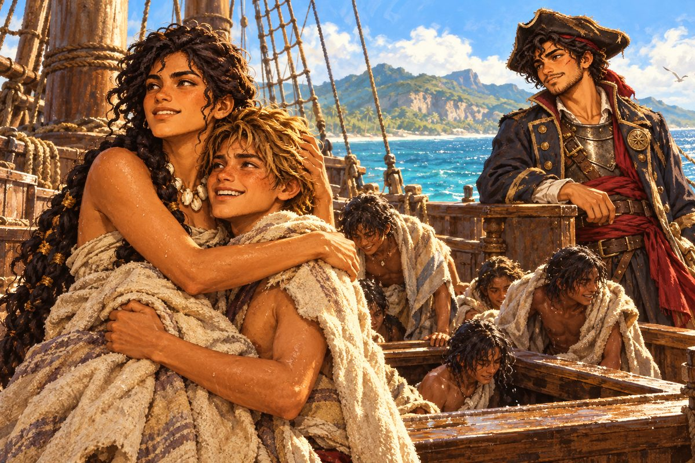

## 29. 배보다 먼저 닿은 이름

1525년 가을, 진주의 섬 마르가리타.

에스페란사호가 부두에 닿기 전부터 마테오는 그것이 와 있으리라는 걸 알았다. 항구 관리소 문설주에 박힌 못 하나에 종이 한 장이 펄럭이고 있었다. 바닷바람에 귀퉁이가 말려 올라갔지만 굵은 글씨는 갑판에서도 읽혔다.

「마테오 레예스. 반역자 라파엘 데 소토와 한패. 생사 불문. 15,000.」

글씨 아래에서 붉은 매 한 마리가 날개를 접고 있었다.

"배보다 빠르네." 마테오가 중얼거렸다. "총독 각하 전령은 노를 몇 개나 젓는 거지."

카라카스 조합 벽에서 그 종이를 처음 본 지 반년이 지났다. 그사이 마테오의 얼굴도 조금 달라졌다. 턱에는 짧게 다듬은 수염이 자랐고, 오른 눈썹을 가로질러 가는 흉터가 하나 새로 생겼다. 카라카스 앞바다, 검은 돛의 갑판에서 라파엘의 칼끝이 남긴 자국이었다. 쿠바 남쪽 산호초에서 늑대에게 얻은 턱의 흉터는 이제 수염에 반쯤 가려 있었다. 쫓기는 몸을 감추던 두건 망토는 벗었다. 대신 소금기에 하얗게 바랜 긴 선장 외투를 걸치고 챙이 처진 모자를 눌러썼다. 외투 가슴께에는 긁힌 놋쇠 패가 못처럼 박혀 있었다. 조합이 그의 이름을 지운 날에도 그는 그 패를 떼지 않았다. 허리에는 아버지의 붉은 천을 띠처럼 둘렀다.

관리소 서기는 마테오의 얼굴과 벽의 종이를 번갈아 보더니, 아무것도 못 본 사람처럼 장부에 배 이름만 적었다. 에스페란사호. 산타 루시아.

"보셨죠?" 마테오가 웃었다. "이 바다엔 아직 수배서보다 배 이름을 먼저 보는 사람도 있다니까요."

에스테반은 웃지 않았다. 그는 관리소 처마 밑 그늘로 일행을 불러 모으더니 품에서 기름종이 꾸러미를 꺼내 무릎에 얹었다. 잉크 묻은 손가락이 매듭을 쓰다듬었다. 카라카스를 떠난 뒤로 그는 그 꾸러미를 잘 때도 끌어안고 잤다. 해적의 통행증, 빚 영수증, 총독의 의뢰장, 회계관 보고서의 사본. 세 장에 찍힌 붉은 매가 그 안에서 같은 모양으로 날개를 접고 있었다.

"계획을 말씀드리겠습니다." 에스테반이 목소리를 낮추었다. "한 사람의 입은 막을 수 있어도 백 사람의 입은 막을 수 없습니다."

"우르키사 님의 입은 막았지." 바르톨로메가 낮게 말했다.

"그렇습니다. 그래서 백 사람이 필요합니다." 에스테반은 손가락을 하나씩 접었다. "그리고 총독의 손이 닿지 않는 곳에서 나온 증거가 필요합니다. 산토도밍고에서 나온 종이는 산토도밍고에서 태울 수 있으니까요. 마지막으로, 봄 은 함대와 함께 세비야에서 왕실 감찰관이 옵니다."

"감찰관?" 야라가 물었다.

"폐하의 눈과 귀입니다. 총독도 그 앞에서는 한 사람의 신하일 뿐이지요." 에스테반이 꾸러미를 꼭 쥐었다. "그때 총독을 산 채로 감찰관 앞에 세워야 합니다."

라파엘이 웃음을 터뜨렸다. 화약 그을음이 밴 손으로 단정한 수염을 쓸어내리며 그는 고개를 저었다.

"그 말은 총독 함대와 정면으로 붙어서, 기함에 올라, 총독을 칼로 꺾어야 한다는 뜻이군."

"할 수 있어요." 마테오가 말했다. 목소리가 크지 않았다. "늑대도, 검은 돛도 그렇게 잡았잖아요."

라파엘이 웃음을 거두고 마테오를 보았다. 반년 전 자기를 갑판에 무릎 꿇린 사냥꾼의 얼굴이었다. 그는 더 말하지 않았다.

마르가리타의 술집은 진주 상인과 채취장 감독관과 뱃사람들로 북적였다. 마테오가 모자를 눌러쓰고 구석 자리에 앉았을 때, 탁자 몇 개 건너에서 노래가 시작되었다. 누군가 벽에서 떼어 온 수배서를 탁자 한가운데 펼쳐 놓고 술잔으로 장단을 맞추며 부르는 노래였다.

늑대를 산 채로 잡은 사냥꾼. 회계관을 살려 온 사냥꾼. 총독의 표적을 풀어 준 사냥꾼. 노래는 서툴렀고 가사는 절마다 조금씩 달랐지만, 후렴만은 다들 한목소리로 불렀다. 생사 불문 만오천, 그래도 그는 산 채로 데려온다네.

야라가 마테오의 옆구리를 팔꿈치로 찔렀다. 마테오는 모자챙을 더 깊이 내렸다.

술집 주인이 술잔 대신 물 한 잔을 내려놓았다. 그는 마테오의 얼굴을 한참 들여다보더니 탁자 위 수배서를 턱으로 가리켰다.

"조합이 당신 이름을 지운 날, 술집들이 새 이름을 붙였소. 카리브의 전설."

"전설은 무슨……." 마테오가 쓴웃음을 지었다. "수배범이죠."

"그게 그거요. 이 바다에선 둘 다 술집에서 만들어지니까." 주인은 앞치마에 손을 닦고 목소리를 낮추었다. "그런데 전설 나리, 앞바다에 루고 대장의 진주 수송선들이 와 있소. 잠수부들을 기함 선창에 가둬 놓고 낮에만 바다에 밀어 넣는다오."

노래가 이어지는 술집 안에서 그 말만 차갑게 가라앉았다.

"……잠수부." 야라가 말했다.

그녀는 그 한마디만 하고 입을 다물었다. 조개 목걸이를 쥔 손가락 마디가 하얗게 질려 있었다. 마테오는 그 손을 보았다. 산티아고 조합에서 처음 만난 날 야라가 내건 조건이 귓가에 다시 울렸다. 언젠가 나를 마르가리타에 데려다줘. 진주 채취장. 동생이 거기 있을지도 몰라.

여기가 마르가리타였다.

## 30. 신부의 명단

마르가리타의 교회는 항구가 내려다보이는 언덕 위에 있었다. 회벽은 소금바람에 군데군데 벗겨졌고, 종탑의 종은 금이 가서 울릴 때마다 둔한 소리를 냈다. 늙은 신부는 제의실 문을 걸어 잠근 뒤에야 마룻널 한 장을 들어 올리고 작은 나무 상자를 꺼냈다.

"잠수부들의 이름을 몰래 적어 두었다네. 언젠가 누군가 물어볼 날을 위해."

상자 안에는 낡은 미사 경본 낱장들이 실로 묶여 있었다. 뒷면마다 이름이 빼곡했다. 잉크가 귀했던지 어떤 장은 숯으로 적혀 있었다. 이름 옆에는 고향 마을과 실려 온 해와 나이가 짧게 붙어 있었다. 신부는 고해를 들으러 수송선에 오를 때마다 소년들에게 이름을 물었고, 뭍에 돌아와 잊기 전에 적었다고 했다.

에스테반이 숨을 들이켰다. "신부님, 이건…… 이건 증거입니다. 날짜와 이름과 고향이 함께 적힌 증거요."

"나는 증거를 적은 게 아닐세. 이름을 적었지." 신부가 지친 얼굴로 웃었다. "이름이 없으면 사람은 바다에서 그냥 없어지니까."

야라가 묶음을 받아 들었다. 한 장, 또 한 장. 그녀는 셈을 할 때처럼 빠르고 정확하게 넘겼다. 아무도 말을 걸지 못했다. 그러다 손이 멈추었다.

"……아로." 야라의 목소리가 처음으로 갈라졌다. "아로가 있어."

숯으로 적은 짧은 이름이었다. 산티아고 바닷가 마을. 두 해 전. 열세 살. 이제 열다섯이 되었을 것이다.

마테오는 야라 곁에 섰다. 위로할 말을 찾았지만 마땅한 말이 떠오르지 않았다. 대신 그는 산티아고 조합에서 한 말을 다시 했다.

"약속했죠. 마르가리타. 땅에서 지킬게요."

야라는 묶음을 가슴에 대고 고개를 들었다. 눈은 말라 있었다.

"그러니까 지금은 바다야, 바보."

동생은 땅에 있지 않았다. 앞바다에 떠 있는 배의 선창 바닥에 있었다.

마르가리타의 상점은 진주 상인들을 상대하는 가게라 값이 사나웠다. 라파엘은 가게 앞 그늘에서 팔짱을 끼고 앞바다를 내다보았다. 수평선 가까이 돛 몇 개가 하얗게 떠 있었다.

"수송선단 기함에 잠수부들이 갇혀 있다." 그가 말했다. 경비대 시절 그 배들의 항로를 누구보다 잘 알던 사람의 목소리였다. "가라앉히면 다 같이 가라앉는다. 오늘 포는 돛대와 돛만 노린다. 기함 옆구리에는 한 발도 안 쏜다."

"루고도 그걸 알아." 바르톨로메가 말했다. "그러니 기함을 방패로 쓸 거다. 우리가 쏘지 못하는 배를 맨 앞에 세우고."

"그럼 붙어야겠네요." 마테오가 말했다.

"그래. 붙어서, 넘어가서, 칼로." 바르톨로메는 가게 안으로 들어가 주인 앞에 금화 주머니를 내려놓았다. 금화 이천 닢. 반년 동안 쫓기며 모은 돈의 큰 몫이었다. "마지막 채비를 하자. 이제부턴 늑대보다 무거운 놈들이다."

주인이 안쪽 창고에서 꺼내 온 것은 온몸을 덮는 판금 갑옷 한 벌과, 날이 물결처럼 굽이치는 긴 칼 한 자루였다. 플람베르크. 불꽃 모양의 칼날이 등잔 불빛을 받아 일렁였다.

바르톨로메가 직접 갑옷 끈을 조여 주었다. 가슴판, 등판, 어깨받이, 팔뚝 가리개. 판 하나가 몸에 붙을 때마다 마테오는 숨을 고쳐 쉬었다. 무거웠다. 총독이 준 경장 흉갑과는 무게가 달랐다. 그는 벗어 둔 흉갑을 탁자 위에 내려놓았다. 경비대에서 쓰는 흉갑이었다. 그 흉갑을 받던 날 감사하다고 고개를 숙이던 자기 모습이 떠올랐다. 다시 입을 일은 없을 것이다.

갑옷 위에 외투를 다시 걸치고, 붉은 천을 허리에 둘러 매고, 플람베르크를 칼띠에 꽂은 뒤 마테오는 가게 벽에 걸린 흐린 거울을 보았다.

"판금 갑옷이라니. 처음엔 리넨 셔츠 한 장이었는데."

"그땐 맨발이었지." 바르톨로메가 장갑을 끼며 말했다. 그 말에는 웃음기가 없었는데도 어딘가 웃는 것처럼 들렸다. "가자."

가게를 나서자 항구 쪽이 소란스러웠다. 앞바다에서 루고의 진주 수송선단이 돛을 올리고 있었다. 가운데 몸집 큰 카락 한 척, 그 둘레를 날렵한 브리간틴들이 에워쌌다. 카락의 돛대 꼭대기에는 에스파냐 왕실 깃발과 연안 경비대 깃발이 나란히 걸려 있었다.

해는 아직 중천이었다.

## 31. 선창 문

수송선단의 기함은 마르가리타 남쪽 얕은 바다에서 에스페란사호를 맞았다. 루고는 카락의 고물 갑판에 서 있었다. 반듯하게 다린 경비대 군복에 짧게 깎은 머리, 웃음이라고는 한 번도 지어 본 적 없는 듯한 입. 목깃 안쪽에 무언가 검은 것이 가는 사슬에 걸려 비쳤다가 사라졌다. 루고는 진주를 나르는 일 따위는 부하에게 맡기는 사람이라고들 했다. 그런 그가 오늘은 직접 키 옆에 서 있었다. 배보다 먼저 닿은 수배서를 그도 읽었을 것이다.

"수배범 레예스로군." 루고의 목소리는 바람을 가르고 또렷하게 건너왔다. "경비대장으로서 체포하겠다." 그는 잠깐 말을 끊고 발밑 갑판을 내려다보았다. 그 아래가 선창이었다. "아니, 여기선 그냥 가라앉혀도 되겠지."

카락의 포문이 일제히 열렸다.

마테오는 뱃머리에서 돌아섰다. 갑판 위의 모든 얼굴이 그를 보고 있었다.

"선창에 사람들이 있어요. 기함은 가라앉히지 마요. 붙어요!"

첫 포성이 바다를 갈랐다. 카락의 포탄이 에스페란사호 뱃전을 스치고 물기둥을 세웠다. 브리간틴 두 척이 양옆에서 다가와 사냥개처럼 물고 늘어졌다. 라파엘의 산타 루시아가 그쪽으로 뱃머리를 돌렸다. 브리간틴에는 사정을 둘 까닭이 없었다. 산타 루시아의 포가 연달아 불을 뿜자 한 척의 돛대가 꺾여 넘어갔고, 다른 한 척은 키를 잃고 빙글빙글 돌았다.

기함을 향해서는 달랐다. 산타 루시아의 젊은 포수 하나가 포구를 낮추려 하자 라파엘이 그 손목을 움켜쥐었다.

"위다. 돛을 쏴라. 저 배 옆구리 밑에는 사람이 있다."

사슬탄이 날아가 카락의 큰돛을 찢었다. 활대가 부러져 늘어졌고, 카락은 바람을 잃고 느려졌다. 루고가 노리던 것도 그것이었다는 듯, 카락은 몸을 비틀어 옆구리를 에스페란사호 쪽으로 돌렸다. 우리가 쏘지 못하는 배를 맨 앞에 세운다. 바르톨로메의 말 그대로였다.

"야라! 저 배 고물 쪽으로 붙여!"

"얕아. 산호가 있어." 키를 잡은 야라가 이를 악물었다. "……그래도 지나가."

에스페란사호가 산호초 가장자리를 스치듯 돌아 카락의 고물 쪽 그늘로 파고들었다. 카락의 포는 그 각도까지 고개를 돌리지 못했다. 갈고리 밧줄이 날아가 뱃전에 걸렸다. 두 배가 맞부딪치는 충격에 갑판이 크게 흔들렸다.

마테오가 가장 먼저 건너갔다. 판금 갑옷의 무게 때문에 뛰어오를 때 무릎이 꺾일 뻔했지만, 발이 카락의 갑판에 닿는 순간 그 무게가 오히려 그를 단단히 붙잡아 주었다. 경비대 군복을 입은 선원 셋이 칼을 들고 달려들었다. 첫 칼이 어깨받이에 맞아 미끄러졌다. 마테오는 플람베르크를 크게 휘둘렀다. 굽이치는 칼날이 상대의 칼을 물고 비틀어 손에서 떨어뜨렸다. 바르톨로메가 그 뒤를 따라 건너와 옆을 지켰다. 마테오는 베지 않았다. 칼을 쳐 내고, 밀어 넘기고, 다음 사람에게 갔다. 그 사이로 에스페란사호 선원들이 밧줄을 타고 쏟아져 들어왔다.

고물 갑판에 닿았을 때 루고는 거기 없었다. 반대편 뱃전 아래, 작은 배 한 척이 이미 물에 내려져 있었다. 경비대 군복 몇이 노를 잡았고, 루고는 고물에 꼿꼿이 앉아 이쪽을 올려다보았다. 작은 배는 남쪽으로 빠르게 멀어졌다.

마테오가 뱃전을 짚고 몸을 내밀었다. 바르톨로메가 그 어깨를 잡았다.

"놔둬라. 오늘 조건은 저놈이 아니다."

마테오는 숨을 몰아쉬며 멀어지는 작은 배를 보다가 고개를 끄덕였다. 발밑에서 무언가 두드리는 소리가 났다. 나무 바닥을 주먹으로 치는 소리였다. 하나가 아니었다.

선창으로 내려가는 승강구는 쇠 빗장과 커다란 자물쇠로 잠겨 있었다. 라파엘이 산타 루시아에서 건너와 도끼를 받아 들었다.

"선창 자물쇠, 부순다!"

도끼가 세 번 내려쳐졌다. 네 번째에 자물쇠가 튀어 나갔다. 바르톨로메와 라파엘이 빗장을 뽑고 무거운 문을 들어 올렸다.

문이 열렸다. 어둠 속으로 한낮의 햇빛이 기울어 쏟아졌다. 그 빛 속에서 무언가 움직였다. 햇빛에 눈을 가린 소년들이 하나둘 기어 나왔다. 바닷물에 바랜 머리, 앙상한 어깨, 소금에 튼 손. 그들은 갑판에 올라서도 바로 일어서지 못했다. 어떤 아이는 눈을 가린 채 그 자리에 주저앉았고, 어떤 아이는 낯선 갑옷을 보고 뒷걸음질 쳤다.

야라가 사람들 사이를 헤치고 들어왔다.

"아로! 아로!"

소년들의 얼굴을 하나씩 붙잡아 들여다보며 야라는 이름을 불렀다. 대답이 없었다. 다시 불렀다. 그때 승강구 가까이 쭈그려 앉아 있던 마른 소년 하나가 고개를 들었다.

"……누나?" 갈라진 목소리였다. "야라 누나?"

야라가 동생을 끌어안았다. 한참 말이 없었다. 갑판 위의 누구도 움직이지 않았다. 바람이 찢어진 돛을 펄럭이는 소리만 들렸다. 야라의 어깨가 떨렸다. 산호초 사이를 눈 감고도 지나던 사람, 말이 짧고 셈이 정확한 사람. 야라가 운 것은 그때가 처음이었다.

마테오는 조금 떨어져 서 있었다. 플람베르크를 칼집에 넣고 나서야 그는 입을 열었다.

"약속, 지켰어요." 조용한 목소리였다.

야라가 동생의 머리를 가슴에 묻은 채 고개를 들었다. 눈물을 닦지도 않았다.

"여긴 바다야, 바보."

"그럼 땅에 내리면 다시 지킬게요."

야라가 웃었다. 울면서 웃었다. 마테오는 그 얼굴을 처음 보았다.

에스테반이 승강구 옆 나무통 위에 신부의 명단을 펼쳤다. 갑판에 주저앉은 소년들 앞에서 그는 공증인이 증서를 읽을 때처럼 허리를 펴고 목소리를 가다듬었다.

"여러분, 이름을 말씀해 주십시오. 어디서, 언제, 누구의 배에 실려 왔는지. 여러분의 이름이 곧 증거입니다."

소년들은 서로를 쳐다보았다. 이름을 묻는 사람은 오랜만이었을 것이다. 맨 먼저 입을 연 것은 아로였다. 누나의 팔을 꼭 붙든 채였다.

"검은 십자가 배였어요." 아로가 말했다. "그런데 낮에는…… 낮에는 에스파냐 깃발을 달았어요."

라파엘이 눈을 감았다. 에스테반의 깃펜이 그 말을 한 글자도 빠뜨리지 않고 받아 적었다.

그날 저녁, 마르가리타 교회의 금 간 종이 울렸다. 풀려난 잠수부들은 신부 앞에 줄을 서서 저마다 이름을 대고 증언했다. 고향과 실려 온 해와 배의 깃발. 신부가 숯으로 적어 두었던 이름 옆에 에스테반이 잉크로 날짜를 더했다. 줄은 밤이 깊도록 줄지 않았다. 백 사람의 입이 생겼다.

카락의 선창 안쪽에서 나온 진주 자루는 에스테반이 하나하나 달아 장부에 올렸다. 잠수부들의 몫을 먼저 떼어 신부에게 맡겼다. 고향으로 돌아갈 뱃삯이었다. 남은 것은 배의 자금으로 삼았다. 금화 삼천 닢어치였다.

"제 손으로 캔 진주를 처음 만져 봐요." 아로가 신부에게서 받은 작은 주머니를 쥐고 말했다.

야라는 그날 밤 동생 옆에서 잤다. 마테오가 갑판 순찰을 돌다 보니, 그녀는 잠든 동생의 손목에 자기 조개 목걸이를 감아 놓고 있었다.

## 32. 지도는 거짓말을 하지 않는다

동쪽으로, 지도 끝 해안 카옌을 향해 엿새째.

바다는 마르가리타를 떠나면서 빛깔이 달라졌다. 푸르던 물이 점점 흐려지더니 나흘째부터는 큰 강들이 토해 낸 흙탕물이 섞여 누런 띠를 이루었다. 해도의 선도 점점 성글어졌다. 에스파냐 사람들이 그린 지도는 이쯤에서 해안선을 대충 긋다가 끝나 버렸다.

"카옌은 에스파냐의 손이 닿지 않는 곳이다." 라파엘이 뱃전에 기대 누런 물을 내려다보며 말했다. "그래서 루고가 거기서 은을 넘기지."

"경비대에 있을 때 가 봤어요?"

"딱 한 번. 밤에, 등불을 다 끄고." 라파엘은 짧게 웃었다. "그때는 그게 무슨 일인지 몰랐다. 대장이 비밀 순찰이라고 했으니까."

마테오는 에스테반의 꾸러미를 떠올렸다. 산토도밍고에서 나온 종이는 산토도밍고에서 태울 수 있다.

"손이 닿지 않는 곳의 증거. 에스테반 아저씨가 말한 거네요."

아로는 그 엿새 동안 갑판 위에서 거의 내려가지 않았다. 선창에는 한 발짝도 들어가려 하지 않았다. 밤에도 돛대 밑에 웅크리고 별을 보며 잤다. 야라는 아무 말 없이 그 옆에 담요를 깔았다.

카옌 해안은 맹그로브 숲이 바다까지 뻗어 나와 있었다. 붉은 흙의 둔덕 위에 오두막 몇 채, 강어귀에 박힌 말뚝 부두, 어느 나라 깃발도 걸리지 않은 장대 하나. 그래도 술집은 있었다. 이 바다에 술집 없는 곳은 없었다. 갈대 지붕 아래 탁자 서너 개, 밀수꾼과 사냥꾼과 길 잃은 뱃사람들이 서로 눈을 마주치지 않고 술을 마셨다.

마테오가 빈 탁자에 물 잔을 내려놓으려는데 옆자리에서 목소리가 날아왔다.

"실례지만 그 탁자에 물 잔을 놓지 말아 주시겠소? 해도가 젖으면 반년이 날아가오."

마테오가 손을 멈추었다. 빈 탁자인 줄 알았던 곳에 커다란 종이가 펼쳐져 있었다. 돌멩이로 네 귀퉁이를 눌러 둔 해도였다. 그 옆 의자에 키가 크고 마른 남자가 앉아 있었다. 볕에 그을린 얼굴에 덥수룩한 턱수염, 이 더위에도 단추를 끝까지 채운 낡은 외투. 무릎에는 가죽 표지의 두꺼운 일지가 놓여 있었고, 손가락 끝은 에스테반만큼이나 잉크에 물들어 있었다.

"아, 죄송해요." 마테오는 물 잔을 들어 올렸다. 해도에는 해안선이 아주 촘촘하게 그려져 있었다. 강어귀 하나, 모래톱 하나까지. "해안을 재고 계세요?"

"아마존으로 가는 길이오. 이 해안은 어느 나라 지도에도 제대로 그려져 있지 않아서 말이오." 남자는 일지를 펼쳐 손가락으로 넘겼다. "에르네스트 폰 보어라고 하오. 학자요. 덕분에 이상한 것도 많이 보았소."

"이상한 것이라면……?" 에스테반이 저도 모르게 한 걸음 다가섰다.

학자는 창밖, 맹그로브 너머의 작은 만을 가리켰다.

"보름달 밤마다 저 만에 갤리온이 들어왔소. 검은 십자가 깃발을 달고. 낯선 상선에 상자를 옮겨 싣고 새벽 전에 나갔지."

술집 안이 조용해졌다. 에르네스트는 그 침묵을 개의치 않는 듯 일지를 넘겼다.

"날짜, 물때, 상자 수까지 측량 일지에 적어 두었소. 별을 재다 보면 밤에 할 일이 없어서 말이오. 고물에 그려진 깃발도 그려 두었고."

그가 펼쳐 보인 장에는 펜으로 그린 갤리온이 있었다. 돛의 수, 포문의 수, 고물의 높이까지 꼼꼼했다. 그리고 고물 난간 아래에 그려진 작은 문장 하나.

라파엘이 그림을 보고 굳었다. 그는 한참 동안 숨도 쉬지 않는 것 같았다.

"……경비대 깃발이다." 라파엘이 말했다. "우리 배였어."

밤에는 검은 십자가를 돛대 꼭대기에 달았다. 그러나 고물에 새긴 문장까지 지우지는 못했다. 아무도 보지 않는 해안이라고 믿었으니까. 지도에도 제대로 그려지지 않은 곳에서 누가 별을 재고 있으리라고는 생각하지 못했을 것이다.

에르네스트가 일지를 덮어 마테오 쪽으로 밀었다.

"필요하다면 가져가시오."

"이건 선생님 반년이잖아요."

"학자는 언제나 사본을 남기지." 학자는 외투 안주머니를 가볍게 두드렸다. 같은 두께의 일지가 하나 더 들어 있었다.

에스테반이 두 손으로 일지를 받았다. 그는 깃펜을 귀에서 빼어 들고 있다가 그대로 멈추었다. 감동하면 말이 길어지는 사람이 이번에는 짧게 말했다.

"선생님, 저와 생각이 똑같으십니다."

에르네스트가 처음으로 웃었다. 그러고는 다시 해도 위로 몸을 숙이며 덧붙였다.

"지도는 거짓말을 하지 않소. 그리는 사람이 거짓말을 할 뿐이지."

## 33. 남의 수배서

이튿날 아침, 말뚝 부두에서 비올레타가 따라잡았다.

검은 옷에 검은 리본, 짧게 자른 머리. 목에 건 결혼반지가 아침 햇빛에 한 번 반짝였다. 그녀의 브리간틴들은 강어귀 바깥에 닻을 내리고 있었다. 마르가리타에서부터 따라왔다고 했다. 그녀의 품에는 접힌 종이 한 장이 있었다. 비올레타는 그것을 펼쳐 마테오 쪽으로 들어 보였다. 붉은 매 인장이 찍힌 마테오의 수배서였다.

"생사 불문 15,000. 이번엔 경주 아니야, 꼬마. 네가 표적이야."

카르타헤나 술집에서 처음 만났을 때 그녀는 잔을 밀어 주며 말했었다. 죽은 놈은 거짓말을 안 한다고. 마테오는 그 말을 기억했다. 그는 손을 외투 안에 넣었다가, 기름종이 꾸러미 대신 칼자루를 잡았다.

"……칼부터 받을게요. 그다음에 종이를 봐요."

비올레타가 웃었다. 그녀의 칼이 칼집에서 미끄러져 나왔다. 가늘고 곧은 레이피어였다.

부두 위에서 칼이 맞부딪쳤다. 비올레타는 빨랐다. 포르토벨로 부두에서보다 더 빨랐다. 칼끝이 판금의 이음매만 골라 찔러 들어왔다. 겨드랑이, 목깃, 팔꿈치 안쪽. 마테오는 무거운 갑옷을 입고서도 물러서지 않았다. 플람베르크의 굽은 날이 레이피어를 받을 때마다 쇳소리가 길게 울렸다. 세 번째 합에 비올레타의 칼끝이 마테오의 뺨을 스쳤다. 다섯 번째 합에 마테오의 칼이 레이피어를 물고 비틀었다. 비올레타의 칼이 손을 떠나 말뚝에 부딪히고 떨어졌다.

마테오는 칼끝을 내렸다. 그리고 칼을 칼집에 넣었다.

"이제 종이 볼 차례예요."

그는 칼 대신 종이를 내밀었다. 통행증, 장부, 측량 일지, 그리고 라파엘의 수배서 두 장. 하나는 산 채로, 하나는 생사 불문. 같은 이름, 같은 붉은 매.

비올레타는 칼을 줍지 않았다. 그녀는 말뚝에 기대 종이를 한 장씩 넘겼다. 통행증의 인장과 수배서의 인장을 나란히 대 보았다. 측량 일지의 갤리온 그림 앞에서 손이 오래 멈추었다. 아침 햇빛이 한 뼘쯤 기울 때까지 그녀는 아무 말도 하지 않았다.

"……내가 데려온 시체들 가운데 몇이 총독의 '생사 불문'이었는지, 세어 보는 중이야."

목소리에 날이 없었다. 마테오는 대답하지 않았다. 그 셈에는 대신 해 줄 수 있는 몫이 없었다.

비올레타는 종이를 마테오에게 돌려주었다. 그러고는 자기 품에서 꺼낸 마테오의 수배서를 다시 한 번 보았다. 그녀는 그것을 구겨 바다로 던졌다. 누런 강물이 종이를 받아 천천히 먼 바다 쪽으로 끌고 갔다. 붉은 매가 물에 젖어 번졌다.

"내가 쫓던 건 늘 남의 수배서였어." 비올레타가 레이피어를 주워 칼집에 꽂았다. 그리고 돌아섰다. "……산토도밍고에서 보자."

그날 밤, 보름달이 떴다.

망대에 올라가 있던 야라가 가장 먼저 보았다. 만 어귀에 큰 돛 넷이 들어서고 있었다. 갤리온 두 척, 카락 두 척. 맨 앞 갤리온의 돛대 꼭대기에서 검은 십자가 깃발이 달빛을 받아 펄럭였다. 에르네스트의 일지에 적힌 그대로였다. 낮의 경비대장이 밤의 해적으로 돌아온 것이다.

"마르가리타에서는 운이 좋았지, 레예스." 루고의 목소리가 어둠을 건너왔다. 낮과 같은 목소리였다. 군복도 같았다. 다만 목깃 밖으로 검은 십자가 하나가 꺼내져 있었다. "오늘 밤은 검은 십자가로 상대해 주마."

마테오는 뱃머리에 섰다. 외투 자락이 밤바람에 날렸다.

"그 깃발, 오늘 내릴 거예요."

이번에는 아무것도 아낄 필요가 없었다. 저 배들의 선창에는 잠수부가 아니라 은 상자가 실려 있을 것이다. 라파엘이 산타 루시아 갑판에서 포수들을 둘러보았다.

"오늘은 돛만 쏘지 않는다. 다 쏴라."

포성이 만 안에 메아리쳤다. 달빛 아래 포연이 하얗게 피어올랐다. 루고의 갤리온은 크고 단단했다. 그 옆구리에서 쏟아진 포탄이 에스페란사호의 앞 돛대를 부러뜨렸고, 산타 루시아의 뱃전에 구멍을 냈다. 그러나 루고는 이 만의 물길을 몰랐다. 에르네스트가 해도에 그려 둔 모래톱을 야라는 아침나절에 이미 외워 두었다. 에스페란사호가 모래톱 안쪽으로 미끄러져 들어가자 쫓아오던 카락 한 척이 바닥을 긁으며 멈춰 섰다. 산타 루시아가 그 배의 옆구리를 두들겼다. 두 번째 카락이 기울었다. 첫 번째 갤리온의 큰돛대가 불길에 휩싸였다.

마지막 남은 갤리온, 루고의 기함으로 에스페란사호가 다가갔다. 산타 루시아의 포탄이 기함의 고물을 꿰뚫었다. 경비대 문장이 새겨진 바로 그 고물이었다. 돛대가 기울었다. 꼭대기의 검은 십자가 깃발이 바람을 잃고 천천히, 아주 천천히 내려와 바다로 내려앉았다.

달빛 아래 깃발은 잠시 물 위에 펼쳐져 떠 있다가 가라앉았다.

루고는 부서진 돛대 조각을 붙들고 물 위에 떠 있었다. 에스페란사호 선원들이 갈고리 장대로 그를 끌어 올렸다. 젖은 군복이 몸에 달라붙었고, 짧게 깎은 머리에서 바닷물이 흘러내렸다. 그래도 그는 웃지 않는 입으로 갑판에 앉아 마테오를 올려다보았다.

"……총독 각하는 봄 은 함대에 빼돌린 은을 싣고 세비야로 떠나실 거다."

"알아요. 그래서 우리도 봄에 가요."

"감찰관이 닿기 전에 총독부 문서 창고를 태우고." 루고가 바닷물을 뱉었다. "너희가 모은 종이 쪼가리는 아무 데도 닿지 못해. 불 한 번이면 끝이다."

마테오는 에스테반을 돌아보았다. 에스테반은 기름종이 꾸러미를 안고 있었다. 그 안에는 그가 밤마다 베껴 둔 사본이 들어 있었다. 회계관의 보고서를 받던 날에도, 장부를 읽던 날에도 그는 아무 말 없이 한 장을 더 썼다. 에르네스트의 외투 안주머니에도 일지가 한 권 더 있었다. 그리고 마르가리타 교회의 마룻널 밑에도.

"닿을 거예요." 마테오가 말했다. "종이는 언제나 두 장이니까요."

## 34. 마지막 줄의 이름

에스테반은 카옌 조합의 빈 탁자에서 고발장을 썼다.

조합이라 해도 이름뿐이었다. 갈대 지붕의 오두막 한 채, 벽에 박힌 못 몇 개, 거기 매달린 빛바랜 수배서 서너 장. 조합장은 몇 달째 보이지 않았다고 했다. 에스테반은 그 빈 탁자를 깨끗이 닦고 그 위에 종이를 펼쳤다. 등잔 하나를 켜 놓고 그는 밤새 썼다.

증인의 이름. 날짜. 은 상자의 수. 인장의 모양.

백 명의 잠수부 이름이 한 줄씩 옮겨졌다. 회계관 보고서 사본의 숫자가 옮겨졌다. 측량 일지의 날짜와 물때가 옮겨졌다. 붉은 매가 날개를 접은 모양은 에스테반이 깃펜으로 직접 그려 넣었다. 깃털 하나까지 똑같이. 새벽녘에 그는 마지막 문장을 쓰고 깃펜을 내려놓았다. 손가락이 떨리고 있었다. 잉크 때문인지 밤샘 때문인지 알 수 없었다.

"모두 서명해 주십시오." 에스테반이 말했다. "한 사람의 이름이라도 더 있으면 더 무거워집니다."

라파엘이 먼저 썼다. 라파엘 데 소토, 전 연안 경비대 포수 장교. 야라가 이름을 쓰고, 그 아래 아로가 서툰 글씨로 이름을 썼다. 신부에게서 갓 배운 글자였다. 마테오가 썼다. 마테오 레예스, 디에고 레예스의 아들. 에스테반은 자기 이름 옆에 공증인의 서명을 덧붙였다. 카르타헤나에서 쫓겨나던 날 다시는 쓰지 못할 줄 알았던 서명이었다.

바르톨로메는 맨 마지막이었다. 그는 오래 펜을 쥐고 서 있었다. 그러다 맨 마지막 줄에 또박또박 이름을 적었다.

"바르톨로메 크루스." 그가 쓰는 대로 소리 내어 읽었다. "디에고 레예스를 잡아 넘긴 사냥꾼으로서."

등잔불이 흔들렸다. 아무도 말하지 않았다. 카라카스 여관에서 문을 닫고 나간 뒤로, 마테오는 그 일에 대해 바르톨로메에게 한 번도 묻지 않았다. 바르톨로메도 다시 꺼내지 않았다. 그 이야기는 재판정에서 하라고, 모두가 듣는 데서 하라고 마테오가 말했었다. 노인은 그 말을 먼저 종이에 썼다.

"……아저씨."

마테오는 그 한마디밖에 하지 못했다. 바르톨로메는 펜을 내려놓고 마테오의 어깨를 한 번 짚었다. 그것으로 끝이었다.

라파엘이 오두막 문을 걷어차듯 열고 들어왔다. 루고의 기함에서 건져 온 쇠 궤짝을 두 선원과 함께 들고 있었다.

"루고의 금고다. 경비대 이름으로 걷은 돈이니 경비대 일에 쓰자." 라파엘이 궤짝을 내려놓았다. 금화 오천 닢이 들어 있었다. "바다를 지키는 일 말이다. 원래 경비대가 해야 했던 일."

산토도밍고로, 이레째.

에스페란사호는 부러진 앞 돛대에 새 돛대를 세웠고, 산타 루시아는 뱃전의 구멍을 판자로 막았다. 동쪽에서 불어오는 바람이 두 배를 서쪽으로 밀었다. 아로는 이제 낮에는 선창에도 내려갔다. 누나의 측량 도구를 나르는 심부름을 하면서였다.

이레째 저녁, 수평선 위로 낯익은 산줄기가 보였다. 마테오는 뱃머리에서 오래 그 산을 보았다. 반년 전, 검은 띠를 두른 수배서를 받아 들고 떠난 섬이었다. 그때는 총독이 아끼는 사냥꾼이었고, 지금은 그 총독의 수배범이었다.

"산토도밍고 어귀는 내가 알아." 야라가 키를 잡은 채 말했다. "밤에 들어가."

"고향에 몰래 들어가게 될 줄은 몰랐네."

마테오가 웃었다. 웃음 끝이 조금 쓸쓸했다.

달 없는 밤이었다. 에스페란사호는 등불을 다 끄고 항구 동쪽 갯바위 그늘로 숨어들었다. 산타 루시아는 바깥 바다에 남았다. 마테오와 바르톨로메는 작은 배로 부두 뒤편 계단에 닿았다. 부두는 잠들어 있었다. 공사 중인 대성당의 비계가 어둠 속에 해골처럼 서 있었다. 조합 건물 벽에는 횃불 하나가 타고 있었고, 그 불빛 아래 마테오의 수배서가 붙어 있었다.

클라라의 술집 뒷문을 두드리자 안에서 발소리가 났다. 문이 열렸다. 앞치마를 두른 둥근 얼굴이 등잔을 들고 서 있었다. 클라라는 아무것도 묻지 않았다.

"들어와. 배는 고프지?"

마테오는 문턱에서 멈추었다. 판금 갑옷 위에 바랜 외투를 걸친 채, 얼굴에는 흉터 두 개를 달고서.

"아줌마…… 저 수배범이에요."

"내 술집에선 넌 디에고네 꼬마야. 그거면 됐어." 클라라가 등잔을 들어 그의 얼굴을 비췄다. 그러고는 혀를 찼다. "수염은 또 언제 길렀어. 어서 들어와."

부엌 화덕에는 콩 수프가 아직 따뜻하게 남아 있었다. 마테오가 그릇을 비우는 동안 클라라는 맞은편에 앉아 팔짱을 끼고 그를 보았다. 잔소리를 하기 직전의 얼굴이었다. 그러나 끝내 잔소리는 하지 않았다. 바르톨로메는 늘 앉던 구석 자리에 앉았다. 클라라가 그 앞에 술 대신 따뜻한 우유를 놓았다.

새벽이 되자 부두 사람들이 하나둘 모여들었다.

누가 소식을 퍼뜨렸는지는 아무도 몰랐다. 먼저 짐꾼들이 왔다. 마테오가 맨발로 짐을 지던 시절 그를 부려 먹던 사람들이었다. 다음에 조선소 노인이 왔다. 에스페란사호의 용골을 처음 깎았다는 노인이었다. 노인은 마테오의 갑옷을 손가락으로 두드려 보고는 고개를 끄덕였다. 그리고 아이들이 왔다. 마테오가 어릴 적 같이 짐을 지던 아이들은 이제 다들 마테오만 한 키가 되어 있었다. 그들은 술집 뒷마당에 서서 아무 말 없이 마테오를 보았다. 누구도 벽의 수배서 이야기를 꺼내지 않았다.

"총독 배들 말이야." 짐꾼 하나가 마침내 입을 열었다. "어제부터 밤새 은을 싣고 있어. 항구 어귀에서. 우리더러 짐을 지라더라. 상자가 얼마나 무거운지, 허리가 나갈 뻔했다."

"몇 상자요?"

짐꾼이 손가락을 꼽다가 그만두었다. "셀 수가 없었어."

동이 텄다. 마테오는 술집 지붕으로 올라갔다. 어릴 적 배들이 들어오는 걸 보려고 자주 올라가던 자리였다. 바르톨로메와 에스테반이 뒤따라 올라왔다.

항구 어귀에 총독의 함대가 떠 있었다. 갤리온 넷과 카락 둘. 아침 햇빛이 높은 고물들의 금박을 붉게 물들였다. 작은 배들이 부두와 함대 사이를 바쁘게 오가며 마지막 상자들을 실어 날랐다. 봄 은 함대를 기다리지 않고 먼저 떠나려는 것이었다. 감찰관이 닿기 전에.

맨 앞, 가장 큰 갤리온의 돛대 꼭대기에 총독의 깃발이 올라가 있었다. 붉은 매였다. 반지에 새겨진 것과 같은 매가 아침 바람에 날개를 펼쳤다.

마테오는 그 기함을 바라보았다.

저 배를 가라앉히면 모든 것이 바다 밑으로 간다. 은도, 인장 반지도, 총독도. 일곱 해 전의 거짓말도, 백 사람의 이름도 끝내 누구의 귀에도 닿지 못한 채.

저 갑판에 올라 총독을 칼로 꺾으면, 진실은 대성당까지 걸어갈 수 있다.

마테오는 허리에 두른 붉은 천을 한 번 고쳐 맸다. 동쪽 갯바위 그늘에서 에스페란사호가 소리 없이 돛을 펴고 있었다.
