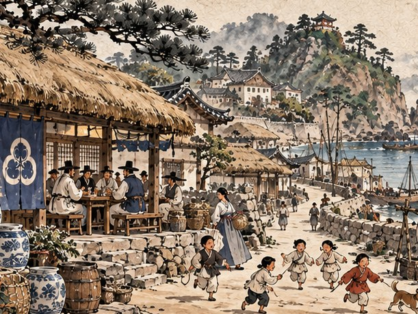
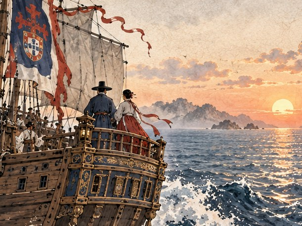

## 결말 하나 ― 다대포에

"남겠소."

만길이 말했다. 주막의 소란 속에서 그 말은 작았지만, 한 탁자에 둘러앉은 사람들에게는 또렷이 들렸다.

"다대포에 객주를 다시 세우겠소. 남쪽 바다의 물산이 이 포구를 지나가게."

연이가 웃었다. 그리고 품에서 장부 두 권을 꺼내 탁자에 나란히 놓았다. 하나는 리스본 서씨 상관의 장부였고, 하나는 아직 첫 장이 비어 있는 새 장부였다.

"어느 쪽을 고를지 몰라서 둘 다 만들어 뒀어요." 연이가 리스본 장부를 밀어 놓았다. "이건 루이스에게 보내요. 셈이 느려도 틀리지 않는 사람이니까. 이쪽 장부는 제가 맡을게요. 당신은 사고팔고, 저는 적고. 처음부터 그랬잖아요."

페드루가 사발을 들었다. "다대포 객주에. 그리고 그 장부에 적힐 첫 손님에게."

"첫 손님은 저예요." 베아트리스가 말했다. "마카오 환전소의 첫 어음을 다대포 객주 앞으로 끊을 테니까요."

이튿날, 그들은 고개를 넘어 다대포로 갔다.

만리호의 거룻배들이 포구에 닿자 부두가 사람으로 메워졌다. 부산포 수영에서 보낸 기별이 하룻밤 사이에 바닷가 마을들을 돌았던 것이다. 끌려간 사람들의 소식을 아홉 해 동안 기다려 온 얼굴들이 부두 끝까지 늘어섰다. 누군가는 이름을 부르며 물속까지 걸어 들어왔고, 누군가는 그 자리에 주저앉았다.

열 사람이 모두 내렸다. 막손이, 덕이가, 박 의원과 돌쇠가, 김 활잡이와 순덕이, 개동이와 최 서방이, 이 노인이, 그리고 옥이가. 한 사람이 거룻배에서 내릴 때마다 부두 어딘가에서 울음이 터졌고, 그 울음 곁에서 웃음이 터졌다.

부두가 울음과 웃음으로 가득 찼다.

만길은 거룻배 고물에 서서 그 모습을 오래 보았다. 리스본의 술집 지하 창고에서 장부에 적듯 외운 이름들이었다. 그 이름들이 이제 제 가족의 입에서 불리고 있었다. 만길은 장부를 펴지 않았다. 이 셈은 펴지 않아도 맞았다.

옛 객주 자리에는 풀이 자라 있었다. 그을린 주춧돌 몇 개만이 그곳에 집이 있었음을 알려 주었다. 만길은 주춧돌 하나에 손을 얹고 한동안 움직이지 않았다. 연이가 곁에 앉아 기다렸다. 무엇을 기다리는지 묻지 않았다.

이윽고 연이가 품에서 마른 뿌리 하나를 꺼냈다. 아홉 해 전 그 새벽, 어머님이 쥐여 주었다는 인삼이었다. 노예시장에서도, 폭풍 속에서도 연이는 그것을 놓지 않았다. 그녀는 그것을 주춧돌 위에 가만히 올려놓았다.

"뱃삯으로 쓰려고 했는데, 끝내 안 써도 됐네요."

그해 가을, 불탔던 다대포에 객주가 다시 섰다.

서까래는 돌쇠와 동포 장정들이 올렸다. 마당 한쪽에는 막손이 가마를 쌓고 불을 지폈다. 리스본 흙이 아니라 고향 흙으로 구운 첫 백자가 나오던 날, 막손은 그 항아리를 두 손으로 들어 올리고 한참을 들여다보았다. "흙이 손을 알아본다." 그가 말했다. 그 항아리는 마카오로 가는 첫 배에 실렸다. 피렌체의 은행가가 동방 도자기의 첫 선택권을 이자로 받기로 했던 약속을, 만길은 잊지 않았다.

처마 밑에는 조선 백자와 인삼, 그리고 남만의 후추 자루가 함께 쌓였다.

다대포 객주의 배는 남쪽으로 다녔다. 백자와 인삼을 싣고 마카오로 내려가 베아트리스의 환전소에 어음을 맡기고, 후추와 남만의 물산을 싣고 올라왔다. 최 서방이 물길을 잡았고, 김 활잡이가 뱃전을 지켰다. 박 의원은 객주 옆에 약방을 열고 인삼을 다루었다. 순덕은 객주 부엌을 맡아, 마르세유에서 배운 수프를 조선 장맛으로 끓였다. 옥이는 연이 곁에서 장부 적는 법을 배웠다.

덕이는 이듬해 봄 혼례를 올렸다. 개동이는 다대포 아이들에게 앤트워프 말을 가르쳤다. 아이들은 뜻도 모르는 플랑드르 말을 외치며 모래밭을 뛰어다녔다. 이 노인은 날마다 객주 툇마루에 앉아 그 아이들을 보았다. 그는 더는 고향 흙을 그리워하지 않았다. 날마다 밟고 있었으니까.

페드루가 떠나는 날, 부두에는 다대포 사람들이 나왔다. 콩고에서 온 사내를 처음 본 아이들이 그의 뒤를 졸졸 따라다녔다.

페드루가 만길 앞에 섰다. 그리고 콩고 말로 한 단어를 말했다. 오래전 리스본에서 만길에게 가르쳐 준 말, '집'이라는 말이었다.

만길이 조선말로 대답했다. "집."

"이제 셈이 맞는군." 페드루가 웃었다. "네 집은 보았다. 이제 내 집을 보러 간다."

그를 태운 배가 남쪽 수평선 너머로 사라질 때까지, 만길은 부두 끝에 서 있었다.

어느 겨울밤, 연이가 장부의 맨 뒤 장을 펼쳤다. 찾지 못한 이름을 적어 두려고 비워 둔 장이었다. 그 장은 끝내 비어 있었다.

만길은 그 빈 장을 오래 내려다보았다. 한 사람 몫의 금화가 모자랐다면, 한 항구를 그냥 지나쳤다면, 이 장에는 이름이 적혀 다른 배를 기다리고 있었을 것이다. 비어 있는 장은 저절로 비어 있는 것이 아니었다. 일곱 해 동안의 셈이 한 줄 한 줄 지운 자리였다.

연이가 장부를 앞으로 넘겼다. 맨 앞 장, 그 첫 줄에는 이렇게 적혀 있었다.

「서만길. 다대포 객주 집 아들. 팔렸고, 셈했고, 돌아왔다.」

"다음 줄은 뭐라고 적을까요?"

만길이 웃었다. 창밖으로 다대포 앞바다가 보였다. 불길이 아니라 밥 짓는 연기가 포구 위로 낮게 깔려 있었다.

"그건 바다에게 물어봅시다."

---

## 결말 둘 ― 리스본으로

"돌아가겠소."

만길이 말했다. 탁자가 잠시 조용해졌다.

"두 바다를 잇는 상인이 되겠소. 이 포구와 저 부두가 서로의 이름을 알게."

연이는 놀라지 않았다. 그녀는 사발을 내려놓고 만길을 보았다.

"그럴 것 같았어요. 사실은 저도 같은 셈을 했고요." 연이가 장부를 쓰다듬었다. "우리가 팔렸던 그 도시의 장부에, 이번엔 다대포 사람의 이름으로 적는 거예요. 물건을 사고파는 사람으로. 그 장부를 보는 사람이 많을수록, 그 광장에 서는 사람은 줄어들 거예요."

페드루가 크게 웃었다. "그럼 바다에서 또 보겠군. 마카오든, 희망봉이든."

"어음은 마카오에서 바꿔 드릴게요." 베아트리스가 말했다. "수수료는 깎아 드리죠. 조금만."

그러나 떠나기 전에, 그들은 먼저 다대포에 갔다.

부두가 사람으로 메워졌다. 열 사람이 모두 거룻배에서 내렸다. 이름이 불릴 때마다 울음이 터지고, 그 곁에서 웃음이 터졌다. 이 노인은 고향 흙에 무릎을 꿇었고, 덕이는 제 어머니의 품으로 뛰어들었다. 개동이는 세 나라 말을 섞어 가며 아홉 해 동안의 일을 한꺼번에 쏟아 냈다. 다대포 아이들이 그 낯선 말을 따라 하며 깔깔 웃었다.

열 사람 가운데 누구 하나라도 빠졌다면, 이 부두는 그만큼 조용했을 것이다. 만길은 그 생각을 하며 한 사람 한 사람의 얼굴을 눈에 담았다. 다시 떠날 사람의 눈으로.

그 겨울을 만길과 연이는 다대포에서 났다.

막손이 고향 흙으로 가마를 쌓았다. 그 가마에서 나온 첫 백자는 만리호의 짐칸에 실렸다. 피렌체의 은행가에게 이자로 주기로 한 동방 도자기의 첫 선택권이었다. 약속은 지켜야 했다. 연이는 다대포 사람들에게서 인삼을 모았다. 어머님이 쥐여 준 마른 뿌리 하나로 시작한 셈이, 이제 짐칸 한 칸을 채웠다.

다대포에는 작은 창고 하나를 세웠다. 최 서방이 그 열쇠를 받았다. 만리호가 리스본에서 실어 올 물건과 다대포에서 실어 갈 물건이 그 창고를 거칠 것이었다. 옥이는 연이에게 배운 셈으로 그 창고의 장부를 맡겠다고 나섰다.

"언니가 돌아올 때까지 한 줄도 틀리지 않을게요."

이듬해 봄, 만리호는 다시 서쪽으로 떠났다.

다대포 부두에 열 사람이 나와 섰다. 막손은 흙 묻은 손을 흔들었고, 돌쇠는 아무 말 없이 노를 들어 올렸다. 개동이가 포르투갈 말로 무언가를 외쳤다. 잘 다녀오라는 말이었다. 그 아이가 아는 가장 먼 나라의 말로.

만길과 연이는 고물에 나란히 서서 포구를 보았다. 다대포가 작아지고, 부산포의 산이 작아지고, 마침내 고향 바다의 섬들이 노을 속으로 가라앉았다.

고향을 보고도 떠나는 배. 그러나 이번에는 돌아올 길을 아는 배였다.

희망봉을 돌아 리스본에 닿은 것은 그해 가을이었다. 리베이라 부두에 루이스 페레이라가 나와 있었다. 그는 상관 장부를 내밀었다. 첫 장부터 마지막 장까지 한 줄도 비어 있지 않았다.

"느렸지만," 루이스가 말했다. "틀린 데는 없을 거다."

만길은 장부를 넘겨 보고 고개를 끄덕였다. 두아르트가 남긴 마지막 글씨가 옳았다.

그해 겨울, 서씨 상관의 간판 아래에 한 줄이 더 걸렸다. 포르투갈 글자 옆에 조선 글자로.

「다대포 ― 리스본」

부두를 지나는 사람들은 그 글자를 읽지 못했다. 그래도 괜찮았다. 언젠가 그 글자를 읽을 수 있는 사람이 이 부두에 내릴 것이다. 노예선 선창이 아니라 상선의 사다리를 밟고.

연이가 새 장부를 펼쳤다. 맨 앞 장, 그 첫 줄에는 이렇게 적혀 있었다.

「서만길. 다대포 객주 집 아들. 팔렸고, 셈했고, 돌아왔다.」

"다음 줄은 뭐라고 적을까요?"

만길이 웃었다. 상관의 창으로 테주 강이 보였다. 그 강은 바다로 흘렀고, 그 바다는 희망봉과 말라카를 돌아 다대포 앞바다에 닿아 있었다.

"그건 바다에게 물어봅시다."

---

*귀향 외전: 돌아갈 바다 ― 끝*
