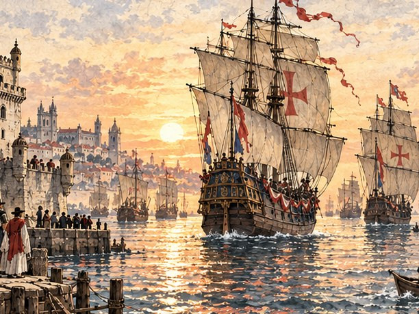

1522년 봄, 왜구의 배가 다대포 포구를 불태웁니다. 객주 집 아들 서만길과 아내 연이는 검은 학 깃발의 배에 실려 끌려갑니다. 여러 항구에서 팔려 간 끝에 이듬해 초 리스본 노예시장에 섭니다. 셈하는 손 하나로 향신료 상인 두아르트의 눈에 든 만길은 주인의 배를 맡은 대리인에서 허가받은 상인, 리스본의 거상이 되기까지 상납 장부와 주문서, 몸값과 신용을 하나씩 채워 갑니다. 흩어진 아내와 동포를 찾고, 세계를 돌아 고향 바다로 돌아가는 이야기입니다.

:::caution[줄거리 공개]
이 소설에는 서만길 이야기의 처음부터 마지막 결말까지 모든 줄거리가 들어 있습니다. 게임을 먼저 즐기고 싶다면 다 끝낸 뒤에 읽으세요.
:::

이 소설은 게임의 이야기를 바탕으로 장면과 대화를 덧붙인 각색입니다. 동포 열 명을 모두 구한 여정을 따라 두 결말을 소개하며, 실제 게임의 진행 시기와 선택에 따라 만나는 장면은 달라질 수 있습니다.

## 차례

| 차례 | 내용 |
| --- | --- |
| [서장 ― 불타는 포구](/novel/captive/prologue/) | 1522년 봄 다대포, 검은 학의 배와 노예선 선창의 나날 |
| [1부 ― 셈하는 손](/novel/captive/part1/) | 리스본 노예시장, 두아르트의 장부, 산타 루치아호 |
| [2부 ― 상납 장부](/novel/captive/part2/) | 주인의 대리인, 첫 상납, 앤트워프의 주문서, 부두의 이별 |
| [3부 ― 해방 문서](/novel/captive/part3/) | 지중해의 상인, 연이의 몸값, 동포 찾기, 곤살루 |
| [4부 ― 향신료 독점권](/novel/captive/part4/) | 두아르트의 죽음, 루이스와의 입찰, 종교재판의 밤, 서씨 상관 |
| [5부 ― 돌아갈 바다](/novel/captive/part5/) | 만리호, 희망봉의 폭풍, 대마도 앞바다, 부산포의 무관 |
| [결말 ― 두 바다](/novel/captive/ending/) | 다대포에 남는 길, 리스본으로 돌아가는 길 |
