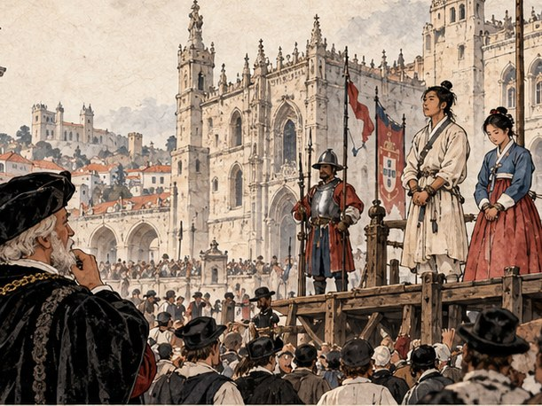

## 1. 틀린 합계

리스본 부두의 널판은 반년 동안 흔들리는 바닥만 디딘 발에 낯설게 단단했다.

사람들은 줄지어 배다리를 내려왔다. 쇠고랑을 찬 발이 널판을 밟을 때마다 둔한 소리가 났다. 부두에는 짐꾼과 뱃사람과 구경꾼이 뒤섞여 있었다. 누구도 오래 쳐다보지 않았다. 이 도시에서는 흔한 광경이라는 뜻이었다. 그 무심함이 만길에게는 채찍보다 먼저 와 닿았다.

"하선! 줄 맞춰서! 숫자 세는 동안 입 다물어!"

곤살루 바스의 목소리가 부두에 울렸다. 선장은 배다리 끝에 버티고 서서 내려오는 사람들의 등을 손바닥으로 하나씩 쳤다. 셈을 하는 손짓이었다. 짐 부리는 인부들이 자루를 셀 때 하는 것과 똑같은 손짓.

만길은 저도 모르게 따라 셌다. 앞에서 내려간 사람, 뒤에서 내려오는 사람. 반년 동안 선창에서 한 사슬에 묶여 있던 얼굴들이었다. 고아에서 탄 늙은 직공, 아프리카 해안에서 탄 젊은 어부, 말라카에서 탄 쌍둥이 형제. 얼굴을 하나씩 짚으면 숫자는 저절로 나왔다. 서른둘.

항구 관리소는 부두 바로 옆 돌집이었다. 열린 문 앞에 탁자가 나와 있었고, 검은 옷을 입은 관리인이 깃펜을 들고 앉아 있었다. 곤살루가 가죽 표지의 장부를 탁자에 내려놓았다. 관리인이 펼친 장의 숫자가 만길의 자리에서도 보였다. 반년 동안 물통에 그어진 분필 숫자를 훔쳐보며 익힌 그 글자들이었다.

「아시아 노예 서른넷. 병사 셋. 합계 서른하나.」

만길은 그 줄을 다시 읽었다. 서른넷에서 셋을 빼면 서른하나. 셈은 맞았다. 그런데 갑판으로 끌려 올라가 다시 내려오지 않은 사람은 칠복 아재와 분이 할매, 둘뿐이었다. 만길은 그 두 이름을 머릿속 장부 맨 앞 장에 적어 두었다. 셋째 이름은 없었다.

"……서른넷에서 셋을 빼면 서른하나가 아니라 서른하나…… 아니, 저 장부엔 둘을 빼고 셋을 적었소."

반년 동안 주워 담은 포르투갈 말 숫자가 조선말 사이사이에 섞여 새어 나왔다. 입 밖에 낸 줄도 몰랐다. 곤살루의 고개가 홱 돌아갔다.

"뭐라고 지껄이는 거냐, 원숭이 놈이!"

채찍이 날아왔다. 어깨에 불이 붙은 것 같았다. 만길은 비틀거렸고, 연이가 묶인 손으로 그의 팔을 붙들었다. 그는 쓰러지지 않았다.

그런데 관리인의 깃펜이 멈춰 있었다. 관리인은 만길을 한 번 보고, 장부를 다시 내려다보고, 손가락으로 줄 선 사람들을 짚어 나가기 시작했다. 하나, 둘, 셋. 부두의 소음 속에서 그 손가락만 천천히 움직였다. 서른둘에서 손가락이 멈췄다.

노예 한 명 몫의 세금이 거기서 새고 있었다. 죽지 않은 사람 하나를 장부에서 죽은 사람으로 만들면, 그 사람 몫의 세금은 내지 않아도 된다. 그리고 장부에 없는 사람은 선장 마음대로 어디에든 팔 수 있다.

"다시 세시오, 선장. 세금은 머릿수대로요."

관리인의 목소리는 크지 않았다. 세금을 걷는 사람의 목소리였다. 곤살루는 이를 갈며 장부를 고쳐 적었다. 깃펜이 종이를 긁는 소리가 유난히 컸다. 다 적고 나서 그는 만길 앞으로 와 섰다. 술과 소금에 전 숨결이 얼굴에 닿았다.

"……두고 보자."

만길은 눈을 내리깔았다. 고분고분해 보이는 눈이었다. 그러나 속으로는 셈이 하나 더 맞아떨어지고 있었다. 저 장부의 서른둘째 줄에 누군가가 다시 살아났다. 이름은 몰랐다. 쌍둥이 형제 중 하나일 수도, 늙은 직공일 수도 있었다. 누구든 오늘 그 사람은 장부 밖으로 사라지지 않았다.

연이가 아주 작게 말했다.

"아프지요?"

"아프오." 만길이 말했다. "그래도 셈은 맞았소."

## 2. 열 사람의 이름

부두 뒤 술집에는 지하 창고가 있었다. 포도주 통을 쌓아 두던 곳을 비우고 사람을 넣었다. 시큼한 술 냄새가 벽에 배어 있었고, 길 쪽으로 난 쇠창살 틈으로 행인들의 발이 지나갔다. 위층에서는 밤마다 뱃사람들이 노래를 불렀다. 팔릴 날을 기다리는 사람들은 그 노래를 들으며 잠들었다.

조선 사람들은 창고 한구석에 모여 앉았다. 반년 만에 처음으로 사슬이 풀린 밤이었다. 손목에 남은 자국을 문지르며, 아무도 먼저 입을 열지 못했다. 내일이면 광장에 선다. 그다음은 아무도 몰랐다.

침묵을 깬 것은 연이였다.

"우리 이름을 서로 외워 둬요. 어디로 흩어지든, 누구 하나라도 잊지 않게."

그녀는 무릎을 꿇고 앉아 한 사람씩 손을 잡았다. 선창에서 다른 나라 사람들에게 하던 것처럼. 다만 이번에는 손짓이 필요 없었다. 모두 같은 말을 썼다.

"막손이오. 다대포 사기막에서 그릇을 구웠소."

마흔을 넘긴 사기장은 손톱 밑에 아직도 흙빛이 남아 있었다. 반년 동안 흙 한 줌 만지지 못했는데도 그랬다. 그는 만길을 보고 쓴웃음을 지었다. "객주 집 만길이가 우리 셈을 다 맡겠구먼. 너희 아버지는 내 그릇값을 한 번도 깎지 않았다."

"덕이예요. 연이 동무."

덕이는 연이의 어깨에 기대어 이름만 말하고 울었다. 연이는 그 등을 쓸어 주었다.

"박가요. 의원이라고들 부르지." 선창에서 맨손으로 열병 든 이마를 짚고 다니던 사람이었다. "약 한 첩 없이 의원 노릇을 했으니, 이제 의원이라 부르지 마시오."

"그래도 의원님이에요." 연이가 말했다. "열둘 중에 열이 살았어요. 의원님 손 덕분이에요."

박 의원은 대답하지 않았다. 다만 고개를 돌려 오래 벽을 보았다.

격군 돌쇠는 덩치가 커서 창고 천장에 머리가 닿을 듯했다. 활잡이 김씨는 시위를 당기던 손가락을 버릇처럼 구부렸다 폈다 했다. 순덕은 덕이보다 두 살 어렸고, 말끝마다 "그런데요" 하고 되물었다. 뱃사공 최 서방은 이 바다가 어떻게 생겼는지 알고 싶어 했다. 이 노인은 이 나라 사람들도 제사를 지내느냐고 물었다. 옥이는 열넷이었고, 연이의 치마꼬리를 놓지 않았다.

막내 개동이는 아홉 살이었다. 제 이름을 말하고 나서 갑자기 물었다.

"아저씨, 여기서 다대포까지 몇 리예요?"

만길은 셈해 보았다. 선창에서 센 날수와 하루에 가는 마장을 곱했다. 숫자가 너무 커서 말하지 않았다.

"많이 머오. 그래도 셀 수는 있소. 셀 수 있으면 갈 수도 있는 거요."

개동이는 그 말을 오래 생각하는 얼굴을 했다. 그러다 연이의 무릎을 베고 잠들었다.

연이가 다시 처음부터 이름을 불렀다. "사기장 막손, 덕이, 의원 박씨, 격군 돌쇠, 활잡이 김씨, 순덕, 개동이, 뱃사공 최 서방, 이 노인, 그리고 옥이." 한 번 부르고, 또 한 번 불렀다. 세 번째에는 모두가 따라 불렀다. 창고 안에서 열 사람의 이름이 낮게 울렸다. 위층의 노랫소리보다 작았지만, 끊기지 않았다.

"열 사람." 만길이 말했다. "장부에 적듯 외우겠소. 잊으면 셈이 틀린 거요."

"셈이 틀리면 당신은 잠을 못 자지요." 연이가 개동이의 머리를 쓰다듬으며 웃었다. "그러니 아무도 잊지 않을 거예요."

그날 밤 만길은 정말로 잠을 자지 못했다. 열 사람의 이름을 머릿속 장부에 한 줄씩 적었다. 이름 옆에 고향 집이 포구 어디쯤이었는지, 누구의 자식이고 누구의 부모인지 적었다. 맨 앞 장의 칠복 아재와 분이 할매 아래에. 다 적고 나서 장부 맨 끝에 한 줄을 더 적었다.

갚을 것. 이 모든 이름.

## 3. 광장의 셈

광장은 교역소 앞, 강을 등진 돌바닥이었다. 평소에는 후추 자루와 포도주 통이 오가는 곳이라고 했다. 그날 아침에는 나무로 짠 단이 세워졌고, 그 둘레로 모자 쓴 사람들이 모여들었다. 성당 종소리가 아홉 번 울렸다.

사람들이 하나둘 단 위에 올랐다가 내려갔다. 값을 부르는 소리, 손을 드는 사람, 은화가 오가는 소리. 만길은 그 소리를 듣지 않으려 애쓰다가 그만두었다. 듣지 않는다고 일어나지 않는 일이 아니었다.

막손이 먼저 불려 나갔다. 세비야에서 왔다는 상인이 그의 손을 뒤집어 보았다. 흙을 만지던 손이라는 것을 알아본 듯했다. 막손은 단을 내려가며 만길 쪽을 보지 않았다. 대신 연이 쪽으로 고개를 한 번 끄덕였다. 내 이름 잊지 마라, 하는 끄덕임이었다.

덕이는 부두 여관 주인에게 갔다. 연이가 손을 뻗었지만 닿지 않았다. 개동이는 앤트워프로 간다는 상인에게 갔다. 아이는 끌려가면서 뒤를 돌아보고 소리쳤다. "아저씨, 셀 수 있으면 갈 수 있다면서요!" 만길은 대답하지 못했다. 입술을 깨물었다. 피 맛이 났다.

연이는 울지 않았다. 대신 사람이 하나 불려 나갈 때마다 입술을 달싹였다. 누가, 어느 나라 상인에게, 어디로. 그녀는 이름 옆에 갈 곳을 외워 적고 있었다.

만길도 제 방식으로 적었다. 쭈그려 앉아, 광장 돌바닥에 쌓인 먼지 위에 손가락으로 숫자를 썼다. 값이 불릴 때마다 한 줄. 선창에서 훔쳐 익힌 동그라미와 갈고리 같은 숫자로. 앞줄 숫자에 새 숫자를 얹고, 다시 얹었다. 그렇게 하지 않으면 머리가 터질 것 같았다. 사람의 값을 셈하는 것은 견딜 수 없는 일이었다. 그러나 셈하지 않으면 그 값은 저들만 알고 끝날 것이었다. 언젠가 되찾으려면 얼마인지부터 알아야 했다.

그림자 하나가 숫자 위에 드리웠다.

늙은 상인이었다. 흰 수염이 가슴께까지 내려왔고, 검은 벨벳 모자 아래 눈매가 날카로웠다. 가슴에 늘어뜨린 금사슬이 햇빛을 받았다. 옷에서 후추와 정향 냄새가 났다. 그는 지팡이 끝으로 먼지 위의 숫자를 가리켰다.

"그게 뭔가? 아라비아 숫자로군. 무엇을 셈하고 있었나?"

만길은 고개를 들었다. 주워 담은 포르투갈 말을 하나씩 골라 이었다.

"저 사람들이 낸 값입니다. 오늘 이 광장의 거래는 모두 금화 2,340."

상인의 눈썹이 올라갔다. 그는 뒤에 선 하인에게 무언가를 물었다. 하인이 손가락을 꼽다가 어깨를 으쓱했다. 상인이 다시 만길을 내려다보았다.

"허, 장부도 없이? 그럼 시험해 보세. 후추 한 자루가 18이고, 세금이 2할이면 마흔 자루에 얼마인가?"

만길은 먼지 위의 숫자를 손바닥으로 쓸어 지웠다. 새로 쓰지 않았다. 셈은 이미 머릿속에서 돌고 있었다. 18에 40을 곱하면 720. 그러나 그건 상인이 내는 값이 아니었다.

"세금은 값에 얹어 냅니까, 값에서 뗍니까?"

"얹어 내지. 왕실은 늘 위에 얹는다."

"그럼 864입니다."

상인은 잠시 말이 없었다. 그러다 웃었다. 수염이 흔들렸다.

"864. 내 회계원보다 빠르군. 게다가 세금을 어디에 붙이는지 묻는 놈은 처음 봤다. 장사꾼 집에서 컸나?"

"객주 집 아들입니다. 포구에서 남의 물건을 맡아 팔아 주는 집이었습니다."

"이름이 무엇인가?"

만길은 일어섰다. 쇠고랑이 쩔렁였다. 그는 연이 쪽을 보았다. 연이는 그를 보고 있었다.

"서만길. 그리고 이 사람은 제 아내 연이입니다. 둘은 떨어지지 않습니다."

그 말을 하면서 만길은 알았다. 노예에게는 그런 말을 할 자격이 없었다. 상인이 고개를 돌리면 그것으로 끝이었다. 그래도 말했다. 말하지 않으면 그 셈은 처음부터 없었던 것이 될 것이었다.

상인은 연이를 오래 보았다. 연이는 눈을 내리깔지 않았다. 상인은 그 눈을 보고, 다시 만길의 손가락에 묻은 먼지를 보았다.

"……둘 다 사겠네. 셈하는 손을 떼어 놓으면 셈이 틀어지는 법이지."

상인의 이름은 두아르트 페레이라였다. 리스본에서 향신료를 다룬 지 서른 해가 넘었다고 했다. 광장을 떠나며 연이는 남은 사람들을 한 명씩 돌아보았다. 순덕, 김씨, 최 서방, 이 노인, 옥이. 박 의원과 돌쇠는 이미 단을 내려간 뒤였다. 연이는 그 얼굴들을 끝까지 눈에 담았다. 만길은 광장 돌바닥에 손가락으로 쓴 숫자가 사람들 발에 지워지는 것을 보았다.

지워져도 상관없었다. 숫자는 이미 머릿속에 있었다.

## 4. 도밍구스

두아르트의 집은 강을 내려다보는 언덕 중턱에 있었다. 아래층은 창고였다. 문을 열면 후추와 계피와 정향 냄새가 한꺼번에 쏟아졌다. 마대 자루가 천장까지 쌓여 있었고, 인부들이 저울 앞에서 자루를 달았다. 위층에는 식구들이 살았다. 그 사이, 계단참에 붙은 좁은 방이 장부실이었다.

장부실에는 창이 하나 있었다. 창 아래 높은 책상 위에 장부가 산처럼 쌓여 있었다. 어떤 것은 표지가 떨어졌고, 어떤 것은 물에 젖었다 마른 자국이 있었다. 먼지가 손가락 한 마디는 앉아 있었다.

"오늘부터 너는 도밍구스다."

두아르트는 그 이름을 마치 장부에 새 항목을 적듯 말했다. 세례를 받으면 그 이름이 될 거라고 했다. 이 나라에서는 이름 없는 사람을 장부에 올릴 수 없다고. 그는 장부 더미에서 가장 두껍고 가장 더러운 것을 뽑아 만길 앞에 놓았다.

"이 집에서 가장 지저분한 장부부터 맡게. 십 년 전 것이다. 그때 회계원이 술을 좋아했지."

문간에서 웃음소리가 났다.

서른 줄의 사내가 기대 서 있었다. 비단 더블릿 소매에 레이스가 달려 있었고, 손가락에 인장 반지가 끼워져 있었다. 두아르트를 닮은 얼굴이었지만, 눈매의 날카로움이 다른 쪽을 향해 있었다.

"아버지는 이제 노예에게 장부를 맡기시는군요. 그러다 금고 열쇠까지 맡기시겠어요."

"루이스, 장부는 정직한 손이 맡는 거다. 피부색이 맡는 게 아니라."

루이스는 대꾸하는 대신 장부실 안으로 한 걸음 들어왔다. 그는 만길을 머리부터 맨발까지 천천히 훑었다. 해진 저고리, 손목의 쇠고랑 자국. 시장에서 물건을 고르는 눈길이었다.

"정직한 손이라. 두고 보지요."

루이스가 나간 뒤에도 문간에 그 말이 남아 있었다. 두아르트는 한숨을 쉬고 만길의 어깨를 한 번 두드렸다. 채찍 맞은 자리였다. 만길은 움찔했지만 소리를 내지 않았다.

그날 오후 만길은 십 년 묵은 장부의 첫 장을 폈다. 포르투갈 글자는 아직 반도 읽지 못했다. 그러나 숫자는 읽을 수 있었다. 숫자는 어느 나라 말로 적혀도 숫자였다. 들어온 것, 나간 것, 남은 것. 줄과 줄 사이에 빈 데가 있으면 그 자리가 먼저 눈에 들어왔다. 다대포 객주 집 장부실에서 아버지 어깨 너머로 배운 버릇이었다.

밤이 되자 만길과 연이는 하인 방으로 돌아갔다. 부엌 뒤 작은 방이었다. 짚을 채운 요 두 개와 나무 궤짝 하나. 손바닥만 한 창으로 테주 강이 보였다. 강 위에 정박한 배들의 등불이 물에 비쳐 흔들렸다.

연이는 창가에 앉아 있다가 품에서 무언가를 꺼냈다. 무명 보자기였다. 반년 동안 선창의 어둠과 바닷물과 열병을 지나오며 한 번도 꺼내 보이지 않던 것. 보자기를 풀자 마른 뿌리 하나가 나왔다. 사람 모양으로 갈라진, 손가락 두 마디만 한 뿌리였다.

"다대포에서 가져온 인삼이에요. 어머님이 꼭 쥐여 주셨지요."

만길은 그 뿌리를 한참 보았다. 어머니가 연이의 두 손을 감싸 쥐던 모습이 떠올랐다. 연기 속의 마당. 그다음은 떠올리지 않았다.

"그 와중에 그걸 챙겼소?"

"챙긴 게 아니라 놓지 않은 거예요. 당신이 장부를 놓지 않은 것처럼."

연이는 뿌리를 다시 싸서 품에 넣었다.

"이 나라 사람들은 이게 무엇인지 몰라요. 오늘 부엌에서 물어봤어요. 하녀들은 마른 나무뿌리인 줄 알더라고요. 언젠가 이걸 팔아서, 돌아갈 뱃삯을 마련해요."

"뿌리 하나로는 모자라오." 만길은 창밖의 등불을 셌다. 서른일곱 척. 저 배들은 모두 어딘가로 간다. "장부 한 권으로 벌겠소. 반드시."

연이가 웃었다. 리스본에 와서 처음 보는 웃음이었다.

"그럼 장부는 당신이 쓰고, 뿌리는 내가 지킬게요."

## 5. 네 개의 구멍

두아르트는 셈하는 손을 장부실에만 두지 않았다.

어느 아침 그는 만길에게 가죽 주머니 하나를 쥐여 주고 환전상에게 보냈다. 리스본 은행이라고 부르는 곳이었지만, 실은 큰길가 돌집 아래층에 긴 탁자 하나를 놓은 가게였다. 탁자 위에 저울과 주판과 온갖 나라의 동전이 뒤섞여 있었다. 피렌체 플로린, 베네치아 두카트, 포르투갈 크루자도. 금빛도 무게도 조금씩 달랐다.

환전상은 안경을 코끝에 걸친 중년 사내였다. 그는 두아르트의 심부름꾼이 맨발의 동쪽 사내라는 것을 보고도 표정을 바꾸지 않았다. 대신 주판을 끌어당겼다.

"포르투갈 크루자도 120을 베네치아 두카트로 바꾸면…… 어디 보자, 주판이……"

만길은 탁자 옆에 붙은 시세표를 이미 읽은 뒤였다. 크루자도와 두카트의 무게 비율, 환전 수수료. 숫자 세 개를 곱하고 나누는 데 숨 한 번이면 충분했다.

"104 두카트에 은화 일곱 닢입니다."

만길은 작게 말했다. 시끄럽게 말할 생각은 없었다. 그러나 환전상의 손가락이 주판 위에서 멈췄다. 그는 주판알을 끝까지 튕기고 나서야 고개를 들었다.

"……맞네." 안경 너머 눈이 커졌다. "자네 주인에게 전하게. 이 집 딸보다 셈이 빠른 자는 처음 봤다고."

탁자 뒤 휘장이 조금 걷혀 있었다. 그 틈으로 검은 레이스 모자를 쓴 젊은 여인이 장부를 들고 서 있었다. 여인은 만길을 흘끗 보았다. 오래 보지는 않았다. 그러나 그 눈길은 시장에서 물건을 보는 눈이 아니라, 숫자를 맞춰 보는 눈이었다. 휘장이 다시 내려갔다.

세례를 받은 날은 비가 내렸다.

언덕 위 성당은 돌로 지은 숲 같았다. 기둥이 하늘로 뻗었고, 색유리 창으로 들어온 빛이 바닥에 물감처럼 고였다. 만길은 흰 옷을 입고 세례반 앞에 섰다. 사제가 이마에 물을 붓고 라틴 말로 무언가를 외웠다. 그리고 이름을 불렀다. 도밍구스. 한 번, 두 번, 세 번.

세 번째에 만길은 대답하지 않았다. 대답해야 하는 자리였는지도 몰랐다. 사제는 개의치 않고 다음 순서로 넘어갔다.

성당을 나서며 연이가 그의 소매 끝을 잡았다. 그녀도 같은 날 세례를 받았다. 사제가 붙인 이름이 있었지만, 연이는 그것을 입에 올리지 않았다.

"이 나라 이름이 생겨도, 저는 당신을 만길이라고 불러요."

"이름은 장부의 첫 줄이오." 만길은 빗물에 젖은 돌계단을 내려다보았다. "첫 줄을 남이 쓰게 둘 수는 없지."

"그럼 언젠가 첫 줄을 다시 쓰러 와요. 우리 손으로."

비가 그치지 않았다. 둘은 처마 밑을 골라 걸으며 언덕을 내려갔다.

그 뒤로 석 달, 만길은 장부실에서 살다시피 했다.

밤에는 연이가 등잔을 들고 와 곁에 앉았다. 연이는 낮에는 부엌일을 하고 밤에는 만길에게서 포르투갈 글자를 배웠다. 아니, 배운다기보다 둘이 함께 깨쳤다. 연이가 하녀들에게서 낱말을 물어 오면 만길이 장부에서 그 낱말을 찾았다. 후추, 계피, 무게, 외상, 이자. 한 달이 지나자 두 사람은 장부를 막힘없이 읽었다.

두아르트는 가끔 밤늦게 장부실에 들렀다. 말없이 의자를 끌어다 앉아 만길이 깃펜을 놀리는 것을 보았다. 만길은 숫자를 세로로 내려 적었다. 다대포에서 쓰던 방식이었다. 두아르트는 처음에는 이상한 눈으로 보다가, 나중에는 그 세로줄을 손가락으로 따라 읽었다.

석 달 동안 만길은 구멍 네 개를 찾았다.

첫째는 저울이었다. 비 오는 철에 들어온 후추 자루는 물을 먹어 무거웠다. 창고에서는 젖은 무게로 사들이고 마른 무게로 팔았다. 해마다 자루 백 개에 다섯 개꼴로 후추가 증발하고 있었다. 증발한 것은 후추가 아니라 금화였다.

둘째는 뱃삯이었다. 같은 선장에게 같은 항차의 뱃삯을 두 번 치른 기록이 세 해 동안 일곱 번 있었다. 한 번은 창고 장부에, 한 번은 상관 장부에. 두 장부를 나란히 펴 본 사람이 이십 년 동안 없었다.

셋째는 세비야의 한 상인이었다. 열한 해 전에 금화 400을 빌려 갔고, 이자를 붙여 갚겠다는 문서가 장부 사이에 끼워져 있었다. 갚았다는 기록은 없었다. 술 좋아하던 회계원은 그 문서를 읽고도 다음 장으로 넘겼다.

넷째는 환전이었다. 두아르트의 회계원들은 십 년 넘게 한 환전상에게만 동전을 바꿨고, 그 환전상은 시세보다 조금씩 박하게 쳐 주었다. 한 번에는 표가 나지 않을 만큼. 쌓이면 배 한 척 값이었다.

만길은 네 구멍을 종이 한 장에 적어 두아르트의 책상에 올려 두었다. 세 번째 구멍 아래에는 한 줄을 덧붙였다. 세비야 상인에게 보낼 독촉장의 초안이었다. 원금과 열한 해 치 이자, 그리고 갚을 날짜.

두아르트는 그 종이를 오래 들고 있었다.

"열한 해 묵은 빚을 받아 내겠다고?"

"빚은 묵어도 빚입니다. 장부에 적힌 이상, 갚을 것은 갚고 받을 것은 받아야 합니다."

"자네가 그 상인을 모르니 하는 소리다. 그자는 세비야에서 이름 있는 집안이야."

"이름이 있으면 더 잘 갚을 겁니다. 이름에 붙은 빚은 이름을 갉아먹으니까요."

두아르트는 웃지 않았다. 대신 깃펜을 들어 독촉장 초안 아래에 서명했다.

## 6. 산타 루치아호

석 달이 다 된 날, 두아르트는 만길을 교역소로 불렀다.

광장의 단은 치워져 있었다. 그 자리에 후추 자루와 포도주 통이 다시 쌓였다. 만길은 그 돌바닥을 밟을 때마다 발밑이 조금씩 기울었다. 그러나 표정에는 드러내지 않았다. 두아르트는 교역소 안쪽 탁자에 앉아 있었다. 탁자 위에 만길이 정리한 장부가 쌓여 있었다.

"석 달 치 장부를 봤네." 두아르트가 맨 위의 장부를 손바닥으로 덮었다. "내가 이십 년 동안 놓친 구멍을 넷이나 찾았더군."

"세비야에서 답이 왔습니까?"

"왔다. 이자는 깎아 달라더군. 원금은 다음 달에 보내겠다고." 두아르트가 만길을 똑바로 보았다. "열한 해 동안 아무도 받지 못한 돈이다."

만길은 고개를 숙였다. 기쁜 얼굴을 하지 않았다. 받을 것을 받았을 뿐이었다.

두아르트는 한동안 말없이 장부 모서리를 손가락으로 두드렸다. 무언가를 셈하는 손짓이었다. 이윽고 그가 입을 열었다.

"제안을 하지. 너에게 낡은 배 한 척과 밑천을 맡기겠다. 장사를 해서 정한 날마다 이익을 바쳐라."

만길은 그 말을 머릿속에서 한 번 펼쳐 보았다. 배, 밑천, 이익, 정한 날. 거기 빠진 것이 하나 있었다.

"바치고 남는 것은요?"

두아르트가 웃었다. 광장에서 처음 만났을 때와 같은 웃음이었다.

"장사꾼의 질문이군. 남는 건 네 것이다. 모아서 무엇을 하든."

만길은 숨을 골랐다. 노예가 자기 것을 갖는다. 그것이 이 나라에서 얼마나 위태로운 약속인지 그는 알았다. 주인의 말 한마디로 생기고, 주인의 말 한마디로 사라질 것이었다. 그래도 말이 나온 이상 장부에 적을 수는 있었다. 적힌 약속은 적히지 않은 약속보다 무거웠다.

"그럼 하겠습니다. 언젠가 저와 아내의 몸값을 치르겠습니다."

두아르트의 손가락이 멈췄다. 그는 만길을 오래 보았다. 노예가 제 값을 제 손으로 치르겠다고 말하는 것을, 이 늙은 상인은 처음 들었을 것이다.

"……그래, 그게 정직한 셈이지."

조선소는 강 하류 쪽, 모래톱이 넓게 펼쳐진 곳에 있었다. 대팻밥과 송진 냄새가 바람에 실려 왔다. 버팀목 위에 크고 작은 배가 올라앉아 있었다. 망치 소리, 톱 소리, 목수들이 서로 부르는 소리.

조선소 주인은 팔뚝에 붕대를 감은 뚱뚱한 사내였다. 그는 만길을 보자 눈을 가늘게 떴다가, 두아르트의 서찰을 읽고 어깨를 으쓱했다.

"두아르트 영감이 맡긴 배라고? 산타 루치아호. 늙었지만 바람은 잘 받는다."

맨 구석 버팀목 위에 작은 배 한 척이 있었다. 삼각돛 두 장을 다는 카라벨이었다. 뱃전의 칠은 군데군데 벗겨졌고, 고물에 새긴 성녀의 얼굴은 비바람에 닳아 이목구비가 흐릿했다. 그러나 용골은 곧았다. 만길은 뱃전에 손을 얹었다. 나무가 바닷물을 오래 먹어 서늘했다.

"이 배로 아프리카 해안을 열두 번 다녀왔소." 조선소 주인이 말했다. "영감이 젊을 때 탔던 배지. 바닥은 내가 지난겨울에 갈았으니 물은 안 샐 거요. 삼각돛이라 맞바람에도 비스듬히 치고 올라가오. 대신 짐칸이 작으니 욕심부리지 마시오."

산타 루치아호가 물에 내려지던 날, 부두에 사람들이 모였다. 구경거리가 났다는 소문이 돌았기 때문이다. 노예가 선장이 되는 배. 사람들은 손가락으로 만길을 가리켰다. 웃는 사람도 있었고, 침을 뱉는 사람도 있었다. 누군가 "원숭이 선장"이라고 외쳤다. 곤살루가 부두에서 했던 말이 벌써 돌고 있었다.

만길은 그 손가락들을 하나씩 보았다. 얼굴을 기억했다. 셈을 하듯.

"손가락질도 셈해 두지." 그가 혼잣말처럼 말했다. "언젠가 다른 손짓으로 갚게 될 테니."

부두 끝에 연이가 서 있었다. 부엌일을 빠져나온 차림 그대로였다. 연이는 손가락질하는 사람들 사이에서 혼자 손을 흔들고 있었다.

만길은 배 위에서 손을 들어 답했다. 반년 동안 선창 밑에서 올려다보기만 하던 갑판이었다. 이제 그는 그 위에 서 있었다. 발밑의 나무가 물결을 따라 천천히 흔들렸다. 배는 아직 주인의 것이었다. 자신도 아직 주인의 것이었다. 그래도 바람은 누구의 것도 아니었다.

묶어 둔 산타 루치아호의 삼각돛 자락이 테주 강의 바람에 처음으로 펄럭였다.
