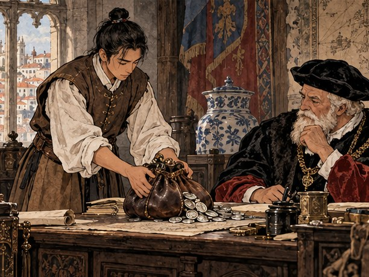
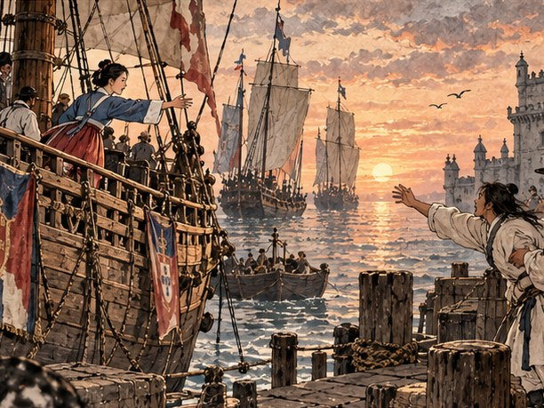

## 7. 두아르트의 해도

교역소 안쪽 탁자 위에 가죽 자루 세 개가 놓여 있었다. 두아르트가 자루 하나의 끈을 풀자 금화가 탁자 위로 반쯤 쏟아졌다. 만길은 그 소리로 먼저 셈했다. 묵직하고 둔한 소리. 천 닢씩 세 자루.

"약속대로 밑천이다. 금화 3,000. 선원 품삯과 물값도 여기서 치러라. 석 달 안에 5,000을 가져와라. 그게 첫 상납이다."

만길은 해진 저고리 대신 포르투갈 하인 옷을 입고 있었다. 두아르트가 준 옷이었다. 어깨에는 장부 가방이 걸려 있었다. 가방 안에는 새 장부 한 권과 깃펜 두 자루, 잉크병 하나가 들어 있었다. 그는 금화 자루를 보면서 머릿속 장부를 펼쳤다.

카라벨 한 척에 선원 스물. 한 사람 품삯이 한 달에 금화 열 남짓. 석 달이면 육백. 물과 식량, 돛 수선, 항구마다 내는 정박료. 그것을 빼면 장사에 쓸 수 있는 돈은 이천을 조금 넘었다. 그 이천으로 석 달 만에 오천을 만들어야 했다. 바치고 나서도 다음 장사를 할 밑천은 남겨야 했다.

"3,000으로 선원을 태우고 석 달에 5,000이라…… 쉬운 셈은 아니군요."

"쉬운 셈이면 노예에게 맡기겠나?" 두아르트가 웃었다. "거래는 내 이름으로 해라. 아직 네 이름을 믿어 줄 상인은 없으니."

두아르트는 탁자 밑에서 둥글게 만 가죽 두루마리를 꺼냈다. 끈을 풀자 해도가 펼쳐졌다. 손때가 묻어 모서리가 반들반들했다. 해안선이 가는 먹줄로 그려져 있었고, 항구마다 작은 글씨가 빼곡했다. 세비야, 세우타, 바르셀로나, 마르세유, 제노바, 피사, 나폴리, 베네치아. 북쪽으로는 보르도, 낭트, 런던, 암스테르담, 앤트워프.

"이것. 내 해도다. 세비야에서 앤트워프, 베네치아까지 내가 다니던 항구가 다 적혀 있다."

만길은 해도 위에 손을 얹지 않았다. 대신 눈으로 항구 이름 옆의 작은 글씨를 읽었다. 포도주, 올리브유, 모직물, 설탕. 그리고 숫자. 어느 항구에서 무엇이 얼마였는지, 두아르트가 젊어서부터 적어 온 값이었다. 해도는 바다의 그림이자 장부였다.

"이걸 제게 주시면, 영감님은 무엇으로 다니십니까?"

"나는 이제 다니지 않는다." 두아르트가 해도를 다시 말아 만길의 손에 쥐여 주었다. "다리가 바다를 견디지 못해. 그래서 너를 보내는 거다."

부두의 항구 관리소 앞에서, 키가 큰 사내 하나가 산타 루치아호의 밧줄을 살피고 있었다. 서른쯤 되어 보였다. 짙은 피부에 짧게 깎은 머리, 맨발로 뱃전을 딛고 서서 밧줄 매듭을 손끝으로 하나씩 눌러 보았다. 오래 바다를 탄 사람의 손길이었다. 만길이 다가가자 그가 먼저 돌아보았다.

"네가 영감님이 말한 도밍구스냐? 나는 페드루. 이 배의 키는 내가 잡는다."

"만길이오. 서만길. 당신도……"

만길은 말끝을 흐렸다. 묻지 않아도 아는 것이 있었다. 사내의 목에도 손목에도 쇠고랑 자국은 없었다. 그러나 오래 차 본 사람만 아는 버릇이 있었다. 손목을 무심코 문지르는 버릇. 만길에게도 같은 버릇이 생겨 있었다.

"그래, 나도 영감님 장부에 적힌 사람이다." 페드루가 말했다. "콩고에서 왔지. 바다는 내가 알고, 셈은 네가 알고."

페드루 은감바. 두아르트의 배를 십 년 가까이 몰았다고 했다. 아프리카 해안과 지브롤터, 비스케이 만의 성질을 손바닥처럼 안다고. 항구 관리소의 서리가 두 사람을 번갈아 보더니 혀를 차고 일러 주었다.

"선원은 술집에서 모으고, 물과 식량은 넉넉히 실으시오. 세비야까지는 이틀이면 가오."

그날 밤 부두 술집에서 두 사람은 처음으로 마주 앉았다. 만길이 리스본에 처음 왔을 때 갇혀 있던 그 술집이었다. 발밑 어딘가에 그 창고가 있었다. 만길은 그 생각을 하지 않으려 했다. 페드루는 묻지 않고 잔을 채웠다.

"우리 아버지는 콩고 왕의 신하였다." 페드루가 말했다. "왕은 포르투갈 신부들과 사이가 좋았지. 아버지는 나를 신부에게 보냈다. 글을 배우라고. 배에 오르고 보니 학교가 아니라 장터였다."

그는 담담하게 말했다. 수십 번 혼자 되뇌어 모서리가 다 닳은 말 같았다.

"……우리는 왜구에게 잡혀 팔렸소." 만길도 말했다. "팔고 산 사람 중에 우리 이름을 아는 이는 없었지."

"그러니 서로의 말을 가르치자." 페드루가 잔을 내려놓았다. "나는 네 말로 '바다'를 배우고, 너는 내 말로 '집'을 배우고."

"좋소." 만길은 잠깐 생각했다. 바다, 집. 그 사이에 있어야 할 낱말이 하나 있었다. "그럼 오늘 첫 낱말은…… '돌아간다'로 합시다."

페드루가 웃었다. 처음으로 이를 드러내고 웃었다. 그리고 제 나라 말로 그 낱말을 말해 주었다. 만길은 세 번 따라 했다. 페드루는 만길의 말로 그 낱말을 세 번 따라 했다. 발음이 서로 엉망이었다. 둘 다 고치지 않았다.

이튿날 아침 만길은 상인 조합을 찾았다. 조합 회관의 벽에는 주문서가 비늘처럼 겹쳐 붙어 있었다. 무엇을, 얼마나, 언제까지, 어디로. 종이마다 그 네 가지가 적혀 있었다. 조합의 서기가 만길의 차림과 얼굴을 훑어보더니, 벽에서 가장 작은 종이 한 장을 떼어 냈다.

"주인 이름으로 일한다는 대리인이로군. 작은 것부터 해 봐. '와인 20, 넉 달 안에 앤트워프 교역소로.'"

와인 스무 통. 리스본에서 앤트워프까지. 작은 일이었다. 그러나 장부에 처음 적히는 약속이었다.

"약속한 날에 약속한 물건. 그것부터 쌓겠습니다."

만길은 새 장부의 첫 장에 주문서를 옮겨 적었다. 와인 20, 앤트워프, 넉 달. 그 옆에 또 한 줄. 상납 5,000, 리스본, 석 달.

## 8. 얼굴 값

선원을 모으는 데 이틀이 걸렸다.

술집에서 만길이 품삯을 부르자 뱃사람들이 웃었다. 노예 선장의 배를 탈 바보가 어디 있느냐고. 그러다 페드루가 뒤에서 이름을 부르자 몇이 웃음을 거뒀다. 리스본 부두에서 페드루 은감바라는 이름은 폭풍에도 배를 버리지 않은 키잡이라는 뜻이었다. 첫날 일곱이 손을 들었고, 이튿날 열셋이 더 들었다. 스물. 산타 루치아호에 꼭 맞는 수였다.

만길은 첫 짐으로 설탕을 골랐다. 마데이라 섬에서 리스본으로 들어오는 설탕은 부두에서 바로 팔렸다. 리스본 교역소에서 한 상자에 금화 열넷. 두아르트의 해도에는 세비야 값이 스물둘로 적혀 있었다. 열 해 전의 값이었지만, 세비야는 설탕을 만들지 않는 도시였다. 값이 크게 달라졌을 리 없었다. 짐칸이 허락하는 만큼 실었다.

세비야까지는 정말로 이틀이었다. 과달키비르 강을 거슬러 오르자 금빛 탑이 보였다. 신대륙에서 돌아온 배들이 강을 메우고 있었다. 리스본이 인도의 도시라면 세비야는 서쪽 바다의 도시였다.

교역소 주인은 설탕 상자를 보고 반가워하다가 만길의 얼굴을 보고 표정을 바꿨다. 그는 두아르트의 서찰을 읽고, 다시 만길을 보았다.

"포르투갈 상인의 노예 대리인이라고? 그럼 값은 두 배다. 노예는 흥정하는 법을 모르잖나."

두 배라는 말은 만길이 다음 짐으로 사 갈 올리브유를 두고 한 말이었다. 설탕은 반값에 넘기라고 했다. 사는 값은 깎고 파는 값은 올리겠다는 뜻이었다. 교역소 안의 다른 상인들이 낄낄거렸다.

만길은 화가 났다. 귀 끝이 뜨거워졌다. 그러나 얼굴에는 아무것도 내보이지 않았다. 대신 셈을 했다. 이 교역소가 아니면 세비야에 다른 교역소는 없었다. 그러나 세비야만 항구는 아니었다. 설탕은 리스본 사람들도 먹는다. 사흘 뒤면 리스본으로 들어오는 마데이라 배가 끊기는 철이었다. 그때까지 설탕을 들고 있으면 리스본에서도 제값은 받는다. 손해는 품삯 사흘 치. 저 사내의 손해는 설탕 한 배 치였다.

"그럼 두 배로 사 가는 노예도 처음 보시겠군요."

만길은 돌아섰다.

"다른 교역소로 가겠습니다."

세 걸음째에 뒤에서 의자 끄는 소리가 났다.

"자, 잠깐!" 교역소 주인이 일어서 있었다. 얼굴이 벌겠다. "……보통 값에 주지. 주인한테 내가 바가지 씌웠다고 이르진 말게."

설탕은 한 상자에 스물하나에 팔렸다. 해도의 값보다 하나 모자랐다. 올리브유는 보통 값에 샀다. 만길은 교역소를 나와 부두 계단에 앉아 장부를 펼쳤다. 그날의 거래를 적고 나서, 장부의 맨 앞 장으로 돌아갔다. 비워 두었던 장이었다.

거기에 이렇게 적었다.

「신용이 없으면 값도 사람을 보고 매긴다.」

그날 밤 세비야 술집에서 페드루가 물었다.

"오늘 그 상인, 네 얼굴을 보고 값을 매겼지. 화나지 않나?"

"화는 났소." 만길은 잔을 손바닥으로 감쌌다. "하지만 장부엔 화를 적을 칸이 없지."

"그럼 무엇을 적지?"

"약속. 약속한 날, 약속한 물건, 약속한 값. 그게 쌓이면 사람들은 얼굴이 아니라 장부를 보게 될 거요."

페드루는 한동안 그 말을 곱씹었다. 그러다 고개를 끄덕였다.

"바다도 그렇다. 처음 보는 배는 다들 의심하지. 같은 깃발로 열 번 들어오면 그때부터는 깃발만 보고 문을 열어 준다."

술집 주인이 빈 잔을 거두며 지나가다 멈췄다. 그는 만길의 얼굴을 한 번 더 보았다. 아까 교역소 주인처럼 값을 매기는 눈은 아니었다. 무언가를 떠올리는 눈이었다.

"도자기 공방에 너희처럼 생긴 사내가 하나 있던데. 흙만 만지며 말이 없더군."

만길의 손에서 잔이 기울었다. 술이 탁자에 쏟아졌다. 그는 닦지 않았다. 숨을 멈춘 채로 술집 주인을 올려다보았다.

"……막손이."

손톱 밑의 흙빛. 그릇값을 한 번도 깎지 않았다던 아버지. 광장을 내려가며 연이에게 끄덕이던 고개.

만길은 의자를 밀고 일어섰다. 페드루가 그 팔을 붙잡았다.

"어디 가려고?"

"공방이 어디냐고 묻겠소."

"물어서 찾았다 치자. 그다음은?" 페드루의 목소리는 낮았다. "네 몸도 네 것이 아니다. 노예가 노예를 데려올 수는 없어. 지금 가면 그 사람 주인한테 의심만 산다. 그 사람이 더 단단히 묶일 뿐이야."

만길은 서 있었다. 오래 서 있었다. 이윽고 다시 앉았다. 장부를 펴서 맨 끝 장, 갚을 것들을 적어 두는 장을 펼쳤다. 막손의 이름 옆에 한 줄을 더했다.

「세비야. 도자기 공방.」

"지금은 못 받는 빚이오." 그가 말했다. "그래도 어디 있는지는 적어 두겠소."

## 9. 첫 상납

석 달은 바다 위에서 금방 갔다.

만길은 해도의 값을 하나씩 바다에 대어 보았다. 열 해 묵은 값 가운데 반은 아직 맞았고 반은 틀렸다. 틀린 값을 고쳐 적는 것이 첫 달의 일이었다. 리스본에서 설탕을 싣고 세비야로. 세비야에서 올리브유를 싣고 지브롤터 건너 세우타로. 세우타는 바다 건너 아프리카 땅에 박힌 포르투갈의 요새 도시였다. 성벽 안에 병사와 그 가족이 살았고, 먹고 쓰는 것을 모두 바다 건너에서 들여왔다. 올리브유는 거기서 세비야의 두 배 가까이 받았다.

장부는 매일 두꺼워졌다. 만길은 한 장을 세로로 둘로 나눴다. 왼쪽에는 주인의 금화, 오른쪽에는 남는 금화. 왼쪽 칸 맨 아래에는 늘 같은 숫자를 적어 두었다. 5,000. 거기까지 남은 거리를 매일 셈했다.

배운 것도 있었다. 둘째 달에 세우타에 올리브유를 싣고 갔을 때, 하루 먼저 들어온 제노바 배가 올리브유를 한가득 풀어 놓은 뒤였다. 값은 세비야와 다르지 않았다. 만길은 짐을 내리지 않고 다시 세비야로 돌렸다. 품삯 나흘 치를 잃었다.

그달 끝에 리스본에 들렀을 때 장부의 왼쪽 칸은 4,100이었다. 만길은 두아르트의 저택을 찾았다. 아직 모자란다고 아뢰려고. 두아르트는 장부를 한 번 훑어보고 덮었다.

"5,000이 아직 안 모였군. 서두르지 마라, 장사는 셈이 아니라 때다."

"때라면, 세우타에서 하루 늦은 것 말씀입니까?"

"하루 늦은 것도 때고, 하루 일찍 간 것도 때다." 두아르트가 창밖의 강을 가리켰다. "저 강에 배가 몇 척 떠 있는지 세어 봐라. 내일 어느 항구에 무엇이 넘칠지는 오늘 저 배들이 무엇을 싣고 있는지에 다 적혀 있다."

만길은 그날부터 셈을 하나 더 했다. 항구에 들어갈 때마다 정박한 배의 수와 그 배들이 부리는 짐을 적었다. 장부 한구석에 바다의 날씨를 적듯이. 무엇이 어디로 몰려가는지가 숫자로 보이기 시작했다.

기한을 열흘 남긴 날, 왼쪽 칸이 5,000을 넘었다.

두아르트의 서재는 저택 이층에 있었다. 커다란 창으로 리스본의 붉은 지붕들이 내려다보였다. 벽에는 문장을 수놓은 휘장이 걸려 있었고, 창가에 명나라에서 왔다는 푸른 무늬 항아리가 놓여 있었다. 만길은 그 항아리를 처음 보았을 때 오래 서 있었다. 그런 그릇을 굽는 사람을 하나 알았다.

그는 가죽 자루를 책상 위에 올리고 끈을 풀었다. 금화와 은화가 쏟아졌다. 서로 부딪는 소리가 서재를 채웠다. 두아르트는 턱을 괸 채 그 소리를 듣고 있었다. 소리만으로도 대충의 무게를 아는 사람이었다.

"세어 보십시오."

"네가 세었겠지."

"제가 세었습니다. 그래도 받는 분이 세셔야 합니다. 장부는 두 사람이 맞춰 봐야 장부입니다."

두아르트가 소리 내어 웃었다. 그는 정말로 금화를 셌다. 열 닢씩 쌓아 탑을 만들었다. 탑이 책상 위에 줄을 섰다. 마지막 탑을 쌓고 나서 그는 자루 바닥까지 뒤집어 보았다.

"정확히 5,000, 그것도 기한 안에." 그가 만길을 올려다보았다. "내 아들보다 낫구나."

만길은 대답하지 않았다. 문 너머 복도에서 발소리가 멈췄다가 멀어졌다. 누구의 발소리인지는 묻지 않아도 알았다.

"다음은 8,000. 석 달 안에." 두아르트가 금화 탑 하나를 손가락으로 쓰러뜨렸다. "이번엔 북해 길을 열어 주마. 앤트워프의 거래처에 보낼 소개장을 써 주지. 앤트워프는 신분보다 물건을 먼저 보는 곳이다."

5,000을 바치고 남은 것은 금화 천 남짓이었다. 그것이 다음 석 달의 밑천이었다. 만길은 그 돈으로 먼저 세비야 와인 스무 통을 샀다. 조합 벽에서 떼어 온 첫 주문서의 몫이었다. 스무 통은 짐칸 맨 안쪽에 따로 묶어 두었다. 어떤 값이 나와도 팔지 않을 짐이었다.

바다는 리스본을 떠난 지 사흘째부터 달라졌다.

비스케이 만을 지나 북쪽으로 오를수록 바람이 찼다. 물빛이 검었다. 남쪽 바다는 파도가 길고 느렸는데, 이 바다는 짧고 사나웠다. 산타 루치아호의 작은 몸이 파도마다 들렸다 떨어졌다. 선원 둘이 뱃전에 매달려 토했다.

"이 바다는 남쪽 바다처럼 너그럽지 않다. 돛을 줄여라!"

페드루가 키를 붙잡고 외쳤다. 만길은 돛줄에 매달려 선원들과 함께 삼각돛을 접었다. 손바닥이 밧줄에 쓸려 벗겨졌다. 장부를 쥐는 손이었다. 그는 상관하지 않았다.

"앤트워프까지만 버텨 주시오." 만길이 뱃전을 손바닥으로 두드리며 배에게 말했다. "그곳 장부는 얼굴을 안 본다 하니."

## 10. 서명란

앤트워프는 회색 도시였다. 하늘도 강물도 돌벽도 회색이었다. 그런데 그 회색 안에 세상의 모든 색이 들어 있었다. 스헬더 강가에 배가 수백 척 서 있었다. 포르투갈 배, 에스파냐 배, 한자 동맹의 배, 잉글랜드 배. 부두에서 들리는 말이 열 가지는 넘었다. 리스본의 후추가 여기서 독일과 북쪽 나라들로 흩어졌고, 잉글랜드의 양모가 여기서 천이 되었다.

교역소에는 두아르트의 거래처가 기다리고 있었다. 붉은 얼굴의 플랑드르 상인이었다. 그는 소개장을 대충 훑어보고 내려놓았다. 그리고 만길의 얼굴이 아니라 짐칸에서 내려지는 통을 보았다.

"주문서의 와인 20인가?"

"스무 통입니다. 세비야 와인. 넉 달 기한에서 한 달이 남았습니다."

상인은 통 하나의 마개를 따게 했다. 잔에 따라 빛에 비춰 보고, 냄새를 맡고, 한 모금 마셨다. 그리고 나머지 열아홉 통의 마개를 하나씩 손바닥으로 두드려 보았다. 소리로 양을 재는 손길이었다.

"와인 20, 기한 안에." 그가 말했다. "자네 주인이 누구든 상관없네. 다음에도 자네와 거래하지."

보수로 금화 1,000이 나왔다. 상인은 장부를 펼치고 깃펜을 들었다. 거래한 사람의 이름을 적는 칸이었다.

"이름이?"

만길은 잠깐 망설였다. 도밍구스. 그 이름이 혀끝까지 나왔다. 그 이름으로 세례를 받았고, 그 이름으로 두아르트의 서찰에 적혀 있었다. 그러나 상인은 소개장이 아니라 그를 보고 묻고 있었다.

"만길입니다. 서만길."

"만…… 길?" 상인이 글자를 더듬었다. "어떻게 쓰나?"

만길은 상인의 장부 귀퉁이에 직접 적었다. 먼저 한자로 徐萬吉. 그 옆에 라틴 글자로 소리 나는 대로. 상인은 그 두 줄을 신기한 듯 들여다보더니, 자기 장부의 이름 칸에 라틴 글자를 옮겨 적었다.

앤트워프의 상인은 처음으로 만길의 이름을 장부에 적었다. 도밍구스가 아니라 만길이라고.

만길은 그 칸을 오래 보았다. 리스본 광장의 먼지 위에 손가락으로 쓴 숫자들이 생각났다. 사람의 값을 셈하던 숫자. 이번에는 사람의 이름이 숫자 옆에 적혀 있었다.

교역소를 나서며 만길은 부두 거리의 아이들 얼굴을 하나하나 보았다. 앤트워프로 간다는 상인에게 끌려가던 개동이. 셀 수 있으면 갈 수 있다면서요. 아이의 목소리가 귀에 남아 있었다. 심부름하는 아이, 짐을 나르는 아이, 상점 문간에서 손님을 부르는 아이. 개동이는 보이지 않았다. 만길은 장부 맨 끝 장의 개동이 이름 옆에 「앤트워프」라고만 적었다.

상인 조합 회관은 리스본보다 컸다. 벽의 주문서도 더 많았다. 서기가 그중 한 장을 떼어 냈다.

"리스본에서 모직물을 기다리는 상인이 있네. '앤트워프 모직물 30, 석 달 안에 리스본 교역소로.'"

만길은 주문서 아래쪽을 보았다. 서명란이 비어 있었다. 리스본 조합에서는 서기가 두아르트의 이름을 대신 적었다.

"받겠습니다. 이번엔 제 이름으로 서명해도 되겠습니까?"

서기는 놀라지 않았다. 대신 깃펜과 함께 주문서를 내밀었다.

"여기선 서명한 사람이 책임지는 사람이야. 노예든 공작이든."

만길은 서명란에 이름을 적었다. 徐萬吉. 그 옆에 라틴 글자. 잉크가 마르는 동안 그는 손을 떼지 않았다. 처음으로 제 이름이 무언가를 책임지는 자리에 적혔다.

앤트워프 모직물은 두툼하고 촘촘했다. 리스본에서는 귀족들이 겨울 외투로 지어 입었고, 세비야 상인들은 그것을 다시 신대륙으로 실어 보냈다. 만길은 주문서의 서른 필에 더해 짐칸이 허락하는 만큼 더 실었다. 남는 칸에는 런던에서 넘어온 양모를 조금. 리스본에 돌아가는 길에 보르도에 들러 와인을 싣고, 그 와인을 세비야에 넘기고, 세비야에서 다시 올리브유를. 빈 짐칸으로 바다를 건너는 날이 하루도 없도록 셈을 짰다.

리스본 교역소 주인은 모직물 서른 필을 하나씩 펼쳐 보았다.

"기한 안에 왔군. 리스본에도 자네 이름을 아는 상인이 생겼어."

보수 1,500. 그리고 남은 모직물은 리스본의 다른 상인들이 앞다투어 사 갔다. 앤트워프 값의 거의 두 배였다.

이 주 뒤, 두아르트의 서재 책상 위에 금화 8,000이 쌓였다. 두아르트는 이번에는 금화를 세지 않았다. 대신 만길의 장부를 펴서 오래 보았다. 한 장 한 장 넘기면서, 세로로 내려 적은 숫자들을 손가락으로 짚었다. 해가 창을 건너 책상 끝으로 옮겨 갈 때까지.

"8,000, 기한 안에." 그가 마침내 장부를 덮었다. "……그래, 너는 약속을 지키는 사람이구나."

## 11. 열하나

그날 밤 연이는 하인 방에 늦게 돌아왔다.

연이는 그 무렵 저택 장부실의 일을 절반쯤 거들고 있었다. 만길이 바다에 나가 있는 동안 장부를 정리할 손이 필요했고, 두아르트는 그 손이 연이라는 것을 알면서도 모른 척했다. 연이는 문을 닫고 등잔 심지를 낮췄다. 얼굴이 하얬다.

"장부실에서 이상한 걸 봤어요."

그녀는 목소리를 낮췄다. 벽 너머 부엌에서 하녀들이 그릇을 씻는 소리가 들렸다.

"주인님이 제노바 은 상인에게 빌린 돈…… 금화 30,000이에요. 기한이 이번 달이고요."

만길은 셈을 했다. 하지 않으려 해도 머리가 먼저 돌았다. 창고의 후추, 저택, 배 세 척, 금고. 석 달마다 그 금고를 드나든 것이 자신이었다.

"30,000? 이 집 금고엔 그 반도 없소."

"그래서 무서워요." 연이가 무릎을 끌어안았다. "빚을 못 갚으면 가진 걸 내놓아야 하잖아요. 배든, 창고든…… 사람이든."

두 사람은 그 밤 서로의 손을 잡고 앉아 있었다. 만길의 장부 오른쪽 칸, 남는 금화의 칸에는 그때 금화 이천이 조금 넘게 적혀 있었다. 둘의 몸값을 위해 모으기 시작한 돈이었다. 30,000 앞에서는 아무것도 아니었다.

사흘 뒤 제노바 은 상인의 대리인들이 문을 두드렸다.

검은 옷을 입은 사내 셋이었다. 하나는 장부를 들었고, 하나는 저울을 들었고, 하나는 아무것도 들지 않았다. 아무것도 들지 않은 사내가 말을 했다. 두아르트는 서재 의자에 앉은 채 그들을 맞았다. 하룻밤 사이에 열 살은 더 늙어 보였다.

"창고의 후추로 대신하게." 두아르트가 지친 목소리로 말했다. "배도 한 척 주지."

대리인들은 창고의 자루를 달고 배의 값을 매겼다. 장부를 든 사내가 페레이라 집안의 재산 목록을 한 줄씩 넘겼다. 후추, 계피, 정향, 배, 은그릇. 그러다 한 줄에서 손가락을 멈췄다.

「글 읽고 셈하는 아시아 여자 노예 한 명.」

장부실에서 연이의 손으로 정리한 목록이었다. 연이는 자기 이름이 적힌 그 줄을 제 손으로 옮겨 적었다.

"안 됩니다! 연이는……"

만길이 앞으로 나섰다. 장부 가방이 어깨에서 미끄러져 바닥에 떨어졌다. 그는 줍지 않았다.

"제 몫으로 모은 돈이 있습니다. 이천 남짓. 다음 항차에서 더 벌어 오겠습니다. 그러니 연이 대신……"

아무것도 들지 않은 대리인이 고개를 저었다. 그리고 두아르트를 보았다. 노예가 모은 돈은 누구의 돈이냐고 묻는 눈이었다. 두아르트는 그 눈을 피했다.

"……미안하다, 도밍구스." 노인의 목소리가 갈라졌다. 그는 고개를 들고 다시 말했다. "아니, 만길. 이 빚은 사람 하나 값만큼 모자란다."

만길은 처음으로 두아르트가 자기 이름을 부르는 것을 들었다. 이런 자리에서 듣고 싶지 않았다.

연이가 만길의 손을 잡았다. 차가운 손이었다. 그러나 떨리지 않았다.

"울지 마요."

만길은 자기가 울고 있는 줄 몰랐다.

"셈이 틀리면 다시 하면 되잖아요." 연이가 말했다. 그리고 아주 작게, 대리인들이 알아듣지 못하는 말로 덧붙였다. "그 돈은 당신 몸값이에요. 내 값에 쓰면 우리 둘 다 묶여요. 먼저 당신이 풀려요. 그다음에 나를 풀러 와요."

제노바로 떠나는 배는 이튿날 저녁에 닻을 올렸다.

해가 테주 강 하구로 지고 있었다. 강물이 온통 주황빛이었다. 부두에 사람이 많았지만 만길에게는 아무도 보이지 않았다. 배의 난간에 연이가 서 있었다. 하녀 옷 그대로였다. 품에는 무명 보자기가 있을 것이었다. 어머니가 쥐여 준 뿌리 하나.

배가 부두에서 떨어지기 시작했다. 밧줄이 풀리고, 노꾼들이 노를 내렸다. 한 뼘, 두 뼘. 물이 그 사이를 채웠다.

연이가 난간 밖으로 손을 뻗었다.

"이름을 잊지 마요! 열 사람, 그리고 나까지 열하나!"

만길은 부두 끝까지 달려갔다. 더는 갈 데가 없는 곳까지. 그도 손을 뻗었다. 닿지 않았다. 처음부터 닿을 수 없는 거리였다.

"잊으면 셈이 틀린 거요! 반드시 다시 셈하러 가겠소!"

연이가 웃었다. 그 거리에서도 웃는 것이 보였다. 그녀는 손가락을 펴서 흔들었다. 하나씩 접었다. 열 개를 다 접고, 마지막으로 자기 가슴을 짚었다. 열하나.

배는 테주 강을 내려가 바다로 사라졌다. 만길은 돛이 수평선의 점이 되고, 그 점마저 노을에 녹을 때까지 부두 끝에 서 있었다. 누군가 어깨를 건드렸다. 페드루였다. 그는 아무 말도 하지 않았다. 만길이 돌아설 때까지 옆에 서 있었다.

부두 술집은 그날 밤에도 시끄러웠다. 위층에서 뱃사람들이 노래를 불렀다. 그 아래 어딘가에 창고가 있었다. 연이가 처음으로 열 사람의 이름을 불렀던 곳.

페드루가 술잔을 밀어 놓았다.

"마셔라. 그리고 내일 다시 장부를 펴라."

만길은 잔을 보았다. 손을 대지 않았다. 아무 말도 하지 않았다.

"네가 그랬지." 페드루가 말했다. "갚을 것은 반드시 받는다고. 너는 세비야 상인에게서 열한 해 묵은 빚도 받아 냈다. 영감님이 그 이야기를 부두 사람들한테 몇 번이나 자랑했는지 아나?" 그가 잔을 더 가까이 밀었다. "지금 받을 것은 슬픔이 아니라 연이다."

만길은 잔을 들었다. 단숨에 비웠다. 목이 탔다. 잔을 내려놓았을 때 눈이 달라져 있었다. 장부를 펼칠 때의 눈이었다.

"……제노바 은 상인이라 했소. 연이가 간 곳은 제노바요."

"그래. 그럼 지중해로 가야지." 페드루가 고개를 끄덕였다. "거긴 바르바리 해적이 들끓는다. 배부터 손보자."

이틀 뒤 두아르트가 만길을 교역소로 불렀다. 노인은 탁자 앞에 앉아 있었지만, 예전처럼 등을 펴지 못했다. 목소리도 작아져 있었다.

"마지막 상납이다. 넉 달 안에 12,000."

만길은 대답하지 않고 기다렸다. 노인에게 할 말이 더 있다는 것을 알았다.

"그걸 채우면……" 두아르트가 잠시 숨을 골랐다. "네 몸값을 정해 주마. 너를 자유롭게 할 값을. 그리고 내 이름이 아닌 네 이름으로 거래하게 해 주마."

"연이의 몸값도요?"

"그 아이는 이제 제노바 상인의 것이다. 그쪽 값은 그쪽에서 정하겠지." 두아르트는 만길의 눈을 마주 보지 못했다. "……미안하다."

만길은 장부를 펴서 새 줄을 적었다. 상납 12,000, 리스본, 넉 달. 그리고 그 아래 한 줄. 연이, 제노바, 값 모름.

모르는 값도 값이었다. 언젠가는 알게 될 것이었다.

## 12. 장부 첫 줄

산타 루치아호는 리스본 조선소에서 열흘을 보냈다. 뱃전에 판자를 덧대고, 작은 화포 두 문을 더 얹었다. 선원도 다섯을 더 태웠다. 남는 금화 칸이 그만큼 줄었다. 만길은 망설이지 않았다. 지중해의 짐은 비싼 만큼 노리는 눈도 많았다. 짐을 잃으면 상납도, 몸값도, 연이도 없었다.

셈은 이미 짜 두었다. 제노바로 곧장 가지 않는다. 지금 제노바에 가 봐야 그는 남의 이름으로 일하는 노예였다. 노예가 노예의 값을 물으면 값이 오를 뿐이었다. 먼저 12,000을 채운다. 제 이름을 받는다. 그다음에 제노바의 문을 두드린다. 그동안은 앤트워프 모직물과 리스본 설탕을 바르셀로나와 마르세유로 실어 나르고, 그곳의 비누와 포도주를 다시 서쪽으로.

지브롤터를 지나 지중해로 들어선 지 사흘째, 바람이 멎었다.

돛이 축 늘어졌다. 바다는 기름을 부은 듯 매끈했다. 햇볕이 갑판을 달궜다. 선원들이 그늘을 찾아 돛 밑으로 기어들었다. 만길은 장부를 펼쳐 놓고 있었다. 매일 같은 시각에 바람의 방향과 세기를 적어 온 칸이었다. 지난 이틀, 바람은 해가 기울기 시작할 무렵 바다 쪽에서 다시 일었다.

"저기!"

돛대 위의 망꾼이 아니라 페드루가 먼저 외쳤다. 그는 뱃머리에 서서 남쪽 수평선을 가리키고 있었다.

"노를 젓는 배 두 척, 초승달 깃발. 바르바리 해적이다!"

만길도 보았다. 길고 낮은 배 두 척이 매끈한 바다 위를 미끄러져 오고 있었다. 양옆으로 뻗은 노가 일제히 물을 쳤다. 바람이 없는 날이야말로 노 젓는 배의 날이었다. 알제 앞바다였다.

"짐을 지켜야 하오." 만길이 장부를 덮었다. "저 짐이 연이의 몸값이오!"

해적선 앞 배의 뱃머리에 사내 하나가 서 있었다. 머리에 흰 천을 감았고, 허리에 굽은 칼을 찼다. 그는 산타 루치아호의 포르투갈 깃발을 보고, 뱃전의 만길을 보고, 소리 내어 웃었다.

"포르투갈 깃발 아래 동쪽 얼굴의 선장이라? 재미있군. 짐도, 너도 알제 시장에서 비싸게 팔리겠어!"

만길은 뱃전을 붙잡았다. 리스본 광장의 단이 떠올랐다. 먼지 위의 숫자. 사람의 값.

"나는 이미 한 번 팔렸소." 그가 맞받았다. 목소리가 생각보다 크게 바다를 건너갔다. "두 번은 안 팔리오!"

"페드루." 만길이 낮게 말했다. "조금만 끌어 주시오. 해가 저 돛대 끝에 걸릴 때쯤 바람이 다시 오오. 이틀 내내 그랬소."

페드루가 만길의 장부를 한 번 보고, 해를 한 번 보았다. 그리고 웃었다.

"장부로 바람까지 셈하나?"

"바람도 들어오고 나가는 거요."

페드루가 선원들에게 소리쳤다. 노를 꺼내라. 카라벨에도 긴 노 몇 자루는 있었다. 산타 루치아호가 천천히 뱃머리를 돌렸다. 도망치는 것처럼, 그러나 너무 빠르지 않게. 해적선들이 거리를 좁혀 왔다. 화살 한 대가 돛에 꽂혔다. 또 한 대. 만길은 해를 보았다. 해가 돛대 끝으로 천천히 내려왔다.

그리고 바다 쪽에서 첫 바람이 불었다.

늘어져 있던 삼각돛이 한숨처럼 부풀었다. 페드루가 키를 꺾었다. 산타 루치아호가 바람을 비스듬히 안고 몸을 돌렸다. 맞바람에도 치고 올라가는 배라고 했던 조선소 주인의 말이 맞았다. 해적선들의 옆구리가 정면에 들어왔다.

"지금이오!"

새로 얹은 화포 두 문이 불을 뿜었다. 연기가 바람에 흩어졌을 때, 앞 배의 한쪽 노들이 부러져 물 위에 엉켜 있었다. 배가 제자리에서 맴돌았다. 뒤 배가 그 곁으로 붙어 밧줄을 던졌다. 바람은 점점 세졌다. 바람을 탄 카라벨과 노가 반쯤 꺾인 갤리. 셈은 이미 끝나 있었다.

해적선들이 노를 거두고 물러났다. 흰 천을 감은 사내가 멀어지는 뱃전에서 산타 루치아호를 오래 돌아보았다.

"보았나?" 페드루가 키를 놓고 만길의 어깨를 쳤다. "네 짐은 무사하다. 그리고 네 배짱도."

만길은 그제야 손이 떨린다는 것을 알았다. 그는 장부를 펴서 그날의 바람을 적었다. 해가 돛대 끝에 걸린 시각, 바다 쪽에서. 그 아래 한 줄을 더 적었다. 해적 두 척, 짐 손실 없음.

넉 달째 되는 달의 중순, 두아르트의 서재 책상 위에 금화 12,000이 쌓였다.

두아르트는 이번에도 세지 않았다. 금화 탑을 손바닥으로 한 번 쓸어 보았을 뿐이었다. 빚쟁이들이 다녀간 뒤로 서재는 휑했다. 창가의 푸른 항아리도 휘장도 없었다. 책상과 의자와 늙은 상인만 남아 있었다.

"12,000. 기한 안에." 두아르트가 말했다. "이걸로 세 번 모두 지켰구나."

그는 책상 서랍에서 종이 한 장을 꺼냈다. 미리 적어 둔 것이었다.

"약속대로 몸값을 정하마. 네 몸값은 금화 12,000. 이제부터 네 이름으로 거래해도 좋다."

만길은 종이를 받아 들었다. 포르투갈 글자로 적힌 문서였다. 몸값, 금액, 그리고 이름. 도밍구스가 아니었다.

"제 이름으로……"

"서만길." 두아르트가 그 이름을 또박또박 불렀다. 그의 발음은 앤트워프 상인보다 나았다. 연습한 소리였다. "장부 첫 줄에 그렇게 적어라. 몸값을 다 치르는 날, 해방 문서에 그 이름으로 서명하마."

문간에서 목소리가 났다.

"아버지, 노예에게 상관 이름을 빌려주시는 겁니까? 페레이라 가문의 이름을?"

루이스였다. 그는 문틀에 기대지 않고 꼿꼿이 서 있었다. 레이스 소매 아래 주먹이 쥐어져 있었다. 창고의 후추와 배 한 척이 빚쟁이에게 넘어간 지 넉 달. 그사이 노예는 아버지의 책상 위에 금화 탑을 쌓았다.

"빌려주는 게 아니다, 루이스." 두아르트는 아들을 보지 않고 만길을 보았다. "저 아이는 이제 자기 이름이 있다."

루이스는 아무 말 없이 돌아섰다. 복도의 발소리가 이번에는 멈추지 않고 멀어졌다.

만길은 리스본 부두의 항구 관리소 앞 돌계단에 앉았다. 해가 강 위로 기울고 있었다. 저녁 바람이 바다 쪽에서 불었다. 산타 루치아호가 부두에 매여 흔들렸다. 뱃전에 해적의 화살 자국이 아직 남아 있었다.

그는 장부 가방에서 새 장부를 꺼냈다. 앤트워프에서 산 두툼한 종이 묶음이었다. 첫 장을 펼쳤다. 깃펜에 잉크를 찍었다. 손이 잠깐 멈췄다. 리스본에 와서 쓴 모든 장부의 첫 줄은 남의 이름이었다. 페레이라, 그리고 도밍구스.

그는 천천히 적었다.

「서만길. 리스본. 신용 ― 아직 적을 것이 적다.」

잉크가 마르기를 기다리며 그는 그 줄을 오래 보았다. 신용 옆의 빈칸이 넓었다. 앤트워프 상인 하나, 리스본 교역소 주인 하나. 그리고 두아르트. 그것이 전부였다. 그래도 빈칸은 채우라고 있는 것이었다.

장부 맨 끝 장도 펼쳤다. 갚을 것들의 장. 맨 위에 칠복 아재와 분이 할매. 그 아래 열 사람의 이름. 막손 옆에는 세비야, 개동이 옆에는 앤트워프. 나머지 이름 옆은 아직 비어 있었다. 그리고 맨 아래, 열하나째 이름. 연이. 그 옆에 제노바.

그림자가 장부 위에 드리웠다. 페드루가 계단 위에 서 있었다. 그는 만길이 펼친 첫 장을 내려다보고, 거기 적힌 이름을 소리 내어 읽었다. 둘이 서로 가르친 말들처럼 발음이 엉망이었다. 만길은 고쳐 주지 않았다.

"어디로 가지, 서 선장?"

만길은 장부를 덮었다. 테주 강 하구 너머, 연이의 배가 사라진 쪽을 보았다.

"제노바요. 연이가 있는 곳."
