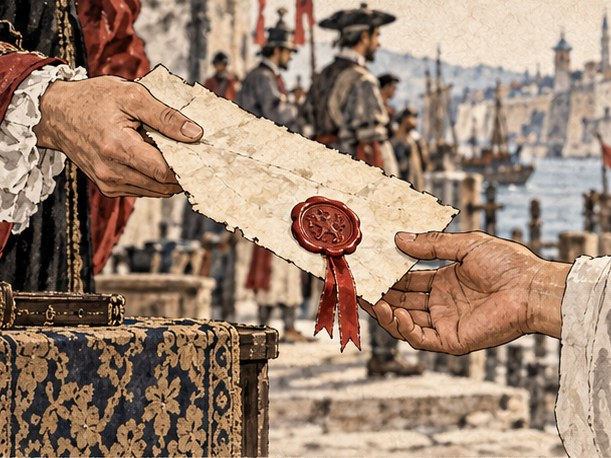
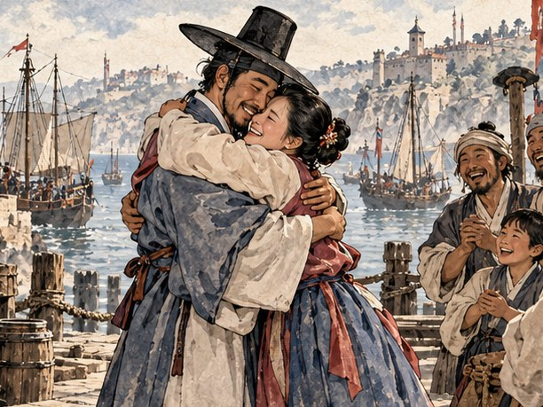
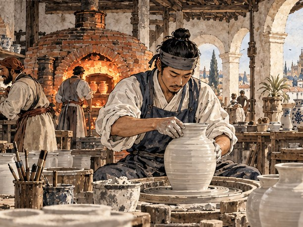

## 13. 환전상의 딸

리베이라 부두의 아침은 타르와 생선 비린내로 열렸다. 산타 루치아호는 물통을 다 싣고 썰물을 기다리고 있었다. 페드루가 돛줄을 하나씩 당겨 보는 동안 만길은 뱃전에 장부를 펴 놓고 마지막 셈을 했다.

장부 맨 앞 장에는 어제 항구 관리소 돌계단에서 적은 줄이 있었다. 「서만길. 리스본. 신용 ― 아직 적을 것이 적다.」 그 아래 새 칸에 숫자 하나가 적혀 있었다. 몸값 12,000. 두아르트가 정해 준 값이었다. 장부 맨 뒤 장에는 다른 목록이 있었다. 풀어 줄 이름들. 막손 ― 세비야 공방. 개동이 ― 앤트워프. 연이 ― 제노바. 연이의 이름 옆에는 값이 없었다. 아직 아무도 부르지 않은 몸값이었다.

짐칸에는 후추 마흔 자루가 실려 있었다. 한 자루에 22. 제노바에서 서른넷만 받아도 480이 남는다. 남은 금화는 제노바 돈으로 바꿔 두기로 했다.

상인 거리 끝의 환전소 탁자에는 여전히 플로린과 두카트와 크루자도가 쌓여 있었다. 두아르트의 심부름으로 왔던 날, 만길은 이 탁자 앞에서 주판 없이 크루자도를 두카트로 바꿔 불렀다. 그날 탁자 뒤에서 그를 흘끗 보던 여인이 있었다. 검은 레이스 모자를 쓴 여인이었다.

그 여인이 오늘은 탁자 앞에 앉아 있었다. 그녀는 만길이 내민 금화를 세지도 않고 저울에 올렸다.

"환전상 누녜스의 딸, 베아트리스예요. 아버지가 그러더군요. 동쪽에서 온 셈 빠른 노예가 이제 자기 이름으로 거래한다고."

"서만길이오. 아직은 몸값을 갚는 중이지만."

"금화를 들고 바다에 나가면 해적이 다 가져가요. 우리 집은 어음을 써요. 종이 한 장으로 금화를 옮기는 거죠."

만길은 저도 모르게 몸을 앞으로 기울였다. 다대포 객주에도 다른 고을 객주가 써 준 쪽지로 쌀을 내주는 일이 있었다. 그 쪽지가 통하는 것은 종이가 단단해서가 아니라, 쪽지에 이름을 적은 사람이 단단해서였다.

"그 종이, 나도 쓸 수 있소?"

"다만 어음은 믿을 만한 사람에게만 써 줘요." 베아트리스가 제노바 돈 꾸러미를 밀어 주었다. "신용이 더 쌓이면 다시 오세요. 아버지 장부에 당신 이름이 좋은 쪽으로 몇 번 더 적히면요."

만길은 꾸러미를 받아 품에 넣고 고개를 숙였다. 문을 나서며 장부에 한 줄을 적었다. 「누녜스 환전소. 어음 ― 신용이 쌓이면.」 갚을 것과 받을 것만 적던 장부에 처음으로 기다릴 것이 적혔다.

제노바는 산을 등지고 바다를 향해 층층이 쌓인 도시였다. 후추는 서른여섯에 팔렸다. 만길은 남은 돈을 셈하는 대신 항구 술집으로 갔다. 연이가 이 도시에 왔다. 그것만은 알고 있었다.

술집 주인은 술통을 굴리며 대답했다.

"동쪽에서 온 여자 노예? 아, 은 상인 도리아 댁에 있던 그 여자. 글을 읽는다고 비싸게 팔렸지. 베네치아 유리 상인에게."

글을 읽는다고. 비싸게. 만길의 가슴에 자랑스러움과 서러움이 한 숨에 함께 올라왔다.

"베네치아…… 또 한 걸음 멀어졌군."

페드루가 잔을 내려놓았다.

"한 걸음 멀어진 게 아니라, 한 걸음 따라잡은 거다. 어디 있는지 알았잖나."

페드루는 늘 장부를 얻은 것을 적는 칸에서부터 읽었다.

이튿날 상인 조합의 벽 앞에서 조합 서기가 주문서 한 장을 떼어 주었다.

"이스탄불에서 와인을 찾는 상인이 있소. 술탄의 나라에선 와인이 귀하거든. '와인 30, 석 달 안에 이스탄불 교역소로.'"

만길은 머릿속으로 바다를 펼쳤다.

"이스탄불까지 가면 베네치아는 돌아오는 길이군. 받겠소."

와인 서른 통은 한 통에 14였다. 짐칸 여든 칸의 나머지에는 물과 식량을 넉넉히 채웠다.

## 14. 세로로 적는 장부

에게 해는 섬이 많은 바다였다. 하얀 섬, 누런 섬, 돌만 남은 섬이 차례로 지나갔다. 다르다넬스 해협에 들어서자 물살이 거꾸로 밀려왔다. 동쪽으로 갈수록 바람에서 향신료 냄새가 났다.

"이 바다 끝에서 비단길이 시작된다더군." 페드루가 키를 잡은 채 말했다. "네 고향도 그 길 끝 어딘가겠지."

만길은 뱃머리 너머를 보았다. 해협 양쪽 언덕이 점점 좁아졌다.

"비단길로 가면 십 년이오. 바닷길로 가면…… 세계를 한 바퀴 돌아야 하지."

입 밖에 내고 나서야 만길은 그것이 처음 소리 내어 말한 귀향의 셈이라는 것을 알았다. 아프리카를 돌고, 인도를 지나, 말라카와 천주를 거쳐. 반년 동안 선창 바닥에서 손가락으로 날짜를 세며 끌려온 길을 거꾸로 되짚는 길이었다.

이스탄불은 바다 위에 지은 도시 같았다. 둥근 지붕과 뾰족한 탑들이 언덕마다 솟았고, 금각만에는 돛대가 숲처럼 서 있었다. 교역소 옆 술집에 보스포루스가 발아래로 내려다보이는 테라스가 있었다. 만길은 그곳에 앉아 장부를 폈다.

어깨가 넓은 상인 하나가 옆자리에 앉았다. 햇볕에 그을린 얼굴에 손마디가 굵었다. 비단 옷을 입었는데도 짐 지던 사람의 어깨였다. 그가 만길의 장부를 흘끗 보았다.

"숫자를 세로로 적는 장부는 처음 보는군. 어디 사람인가?"

"조선이라는 나라요. 명나라 동쪽 끝."

"알리 베자스다. 몇 해 전까지 저 아래 부두에서 남의 짐을 졌지." 그가 턱으로 금각만을 가리켰다. "하나만 일러 주지. 물건은 싸게 사는 게 아니라, 믿을 사람에게서 사는 거다."

만길은 붓을 내려놓았다. 세비야 교역소 주인이 그의 얼굴을 보고 값을 두 배로 불렀던 날이 떠올랐다. 그날 만길은 믿지 못할 사람으로 취급받았다. 이 사내는 믿을 사람이 되라고 말하고 있었다.

알리가 찻잔을 들어 바다 건너 아시아 쪽 언덕을 가리켰다.

"동쪽의 비단과 도자기는 이스탄불에서 값이 두 배, 베네치아에선 세 배가 된다. 그 길을 아는 자가 이 바다의 주인이 되지."

"그 길 끝에서 왔으니, 그 길을 되짚어 가겠소."

알리가 처음으로 웃었다. 소리 없이, 눈가로만.

"그럼 언젠가 그 길 끝에서 다시 보겠군. 그때는 내가 자네 장부를 배우러 가지."

그는 찻값을 두 사람 몫으로 놓고 일어섰다. 짐꾼에서 상인이 된 사람이 노예에서 상인이 되려는 사람의 장부를 한눈에 알아본 것이었다.

교역소 주인은 와인 통의 마개를 하나하나 열어 냄새를 맡았다.

"기한 안에 왔군. 이교도 상인이라도 약속은 지키는구려." 그는 껄껄 웃었다. "나도 마찬가지요."

금화 2,000이 탁자 위에 놓였다. 와인 서른 통에 들인 돈은 420. 만길은 차액보다 다른 것을 먼저 적었다. 「이스탄불 교역소. 기한 안에 납품. 다음 거래 가능.」 금화는 쓰면 줄지만 이 줄은 쓸수록 늘었다.

떠나기 전 그는 항구 관리소에 들렀다. 어느 항구에서나 동쪽 얼굴의 사람을 본 적이 있느냐고 물었고, 대개는 고개를 저었다. 이스탄불의 관리는 뜻밖에 고개를 끄덕였다.

"동쪽 얼굴의 노예? 봤지. 작년에 세비야, 나폴리, 마르세유로 가는 배마다 한둘씩 실려 있었소."

만길의 손이 탁자 모서리를 잡았다.

"알제 해적에게 붙잡힌 활 잘 쏘는 녀석도 있다더군. 다들 그쪽 말로 서로 이름을 부르더래."

그쪽 말. 조선말이었다. 그들은 서로의 이름을 부르고 있었다. 리스본 술집 지하 창고에서 연이가 하자고 했던 그대로. 어디로 흩어지든, 누구 하나라도 잊지 않게.

만길은 숨을 골랐다.

"……그 이름들, 내가 다 알고 있소."

배로 돌아온 그는 장부 맨 뒤 장을 폈다. 막손, 개동이, 연이. 세 줄뿐이던 목록 아래에 나머지 이름을 세로로 적었다. 덕이, 박 의원, 돌쇠, 김 활잡이, 순덕, 최 서방, 이 노인, 옥이. 이름마다 옆에 있는 곳과 몸값을 적을 빈칸을 긋고, 김 활잡이 옆에 「알제」라고 적었다.

나머지 빈칸은 이제부터 채울 것이었다.

## 15. 운하 건너의 창

베네치아에는 길 대신 물이 있었다. 운하 위로 곤돌라가 미끄러졌고, 물에 비친 붉은 벽과 하얀 창틀이 노에 부서졌다가 다시 모였다.

유리 상인 마르코 조르치의 상관은 리알토 다리 가까이에 있었다. 교역소 주인이 만길의 물음을 듣고 눈썹을 올렸다.

"조르치 댁 장부를 보는 동쪽 여자? 그 집 저택에 가 보시오. 요즘 그 집 장부가 아주 깔끔해졌다던데."

만길은 대답하지 못하고 웃었다. 웃음이 먼저 나왔고, 목이 그 뒤에 메었다.

"……연이 솜씨군."

조르치의 저택은 운하를 앞에 둔 삼 층 집이었다. 응접실 탁자에는 갖가지 빛깔의 유리잔이 늘어서 있었다. 마르코 조르치는 손가락마다 반지를 낀 사내였다. 그는 만길을 앉으라 하지도 않고 말을 꺼냈다.

"제노바에서 비싸게 산 여자요. 글을 읽고, 셈을 하고, 무엇보다 내 회계원이 빼돌린 돈을 찾아냈지."

"그 사람의 남편이오. 몸값을 치르러 왔소."

마르코가 잔 하나를 집어 들어 빛에 비춰 보다가 소리 내어 웃었다.

"노예가 노예의 몸값을? 좋소. 18,000. 그 이상도 이하도 아니오."

18,000. 만길의 몸값보다 6,000이 많았다. 만길은 그 숫자가 비웃음이라는 것을 알았다. 노예가 그만한 돈을 모을 리 없다는 셈에서 나온 값이었다. 그러나 셈에서 나온 값이라면 셈으로 갚을 수 있었다.

"약속하오. 18,000을 들고 다시 오겠소. 그때까지 그 사람을 팔지 마시오."

"약속이라." 마르코가 잔을 내려놓았다. "베네치아 상인은 약속을 금화로 바꾸는 사람들이오. 금화를 가져오면 약속도 지키지."

저택을 나온 만길은 연이를 보지 못했다. 집안 하인은 회계실이 뒤채에 있다고만 했다. 만길은 운하 건너편 술집에 자리를 잡았다. 창가 자리였다. 거기서 조르치 상관의 창들이 한눈에 보였다.

해가 기울 무렵이었다. 상관 이 층 창가에 등잔이 켜졌다. 한 여인이 장부를 넘기고 있었다. 머리를 이 나라 식으로 틀어 올렸고, 옷도 이 나라 하녀의 옷이었다. 그러나 장부를 넘기다 손끝으로 줄을 짚는 버릇. 다대포 객주 방에서 수천 번 본 손이었다.

연이가 고개를 들었다.

운하 하나를 사이에 두고 두 사람의 눈이 마주쳤다. 연이의 입술이 소리 없이 움직였다.

……만길.

만길은 의자에서 반쯤 일어섰다. 그러나 저 창은 남의 집 창이었다. 연이가 손을 들었다. 손가락을 하나씩 폈다. 열 개.

동포를 잊지 말라는 뜻이었다. 자기를 찾아온 사람에게, 자기보다 먼저 열 사람을 셈하라고 말하고 있었다.

만길은 고개를 끄덕였다. 들리지 않을 것을 알면서 낮게 말했다.

"열 사람. 그리고 당신. 잊지 않소."

연이가 창을 닫았다. 만길은 식은 잔을 앞에 두고 오래 앉아 있었다.

이튿날 그는 베네치아 상인 조합에 갔다. 서기가 주문서를 내밀었다.

"리스본의 직물 상인이 베네치아 양모를 원하오. '양모 30, 넉 달 안에 리스본 교역소로.'"

"어차피 리스본으로 가야 하오. 내 몸값을 치르러."

조르치 상관에 다시 간 것은 장사 때문이었다. 이번에는 마르코가 먼저 사람을 보냈다. 그는 응접실이 아니라 상관의 계산대 앞에서 만길을 맞았다.

"또 왔소? 이번엔 장사 얘기로군. 후추 도매 계약을 하려는데, 자네가 값을 불러 보시오."

알렉산드리아의 향신료 배가 늦어지고 있었다. 리스본 후추를 대 줄 사람이 필요했다. 만길은 그 사정을 술집 뱃사람과 조합 벽의 주문서에서 이미 주워 모아 두었다.

"기본 값보다 얼마를 더 받을지, 흥정으로 정합시다."

다대포 객주 방에서 아버지가 가르쳐 준 것이 있었다. 값을 부르고 상대의 얼굴을 보아라. 망설이면 조금 넘은 것이고, 얼굴을 붉히면 한참 넘은 것이다. 망설임은 기다리면 풀리지만 붉은 얼굴은 풀리지 않는다.

"리스본 시세에 삼 할 오 푼을 얹읍시다."

마르코의 눈썹이 올라갔다. 그러나 얼굴은 붉어지지 않았다. 그는 계산대 위의 주판을 끌어당겼다가, 그것이 쓸모없다는 듯 다시 밀었다.

"삼 할 오 푼이면 날강도요."

"알렉산드리아 배가 한 달 더 늦으면 이 상관 유리배는 빈 바닥으로 나가야 하오. 빈 바닥으로 나간 배는 파도에 흔들리고, 흔들린 유리는 깨지지. 깨진 유리 값을 셈해 보시오."

마르코는 셈해 보았다. 셈하는 동안 손가락이 계산대를 두드렸다. 한참 뒤 그가 이마를 짚었다.

"노예였다는 사람한테 베네치아 상인이 졌군. 소문내지 마시오."

선금 3,000이 계산대 위로 건너왔다. 연이의 몸값으로 돌아갈 돈이었다.

## 16. 곤살루의 선창

양모 서른 꾸러미와 베네치아 유리를 싣고 산타 루치아호는 서쪽으로 돌아갔다. 지브롤터를 지나 대서양의 긴 물결을 타자 페드루의 얼굴이 펴졌다. 그는 이 거친 바다를 지중해보다 좋아했다.

호카 곶이 보이기 시작한 날 아침이었다. 수평선에 돛 셋이 떠올랐다. 둘은 배가 불룩한 나오였고, 하나는 높은 고물을 가진 카락이었다. 페드루가 망원경을 내리고 오래 침묵했다.

"저 깃발…… 곤살루 바스다. 너를 리스본까지 실어 온 그 노예선."

만길은 망원경을 받지 않았다. 그 배의 선창을 그는 냄새로 기억했다. 열둘이 실렸고 열이 닿은 곳. 리스본 부두에서 곤살루가 내민 장부에는 죽은 사람이 셋이라고 적혀 있었다. 숨을 거둔 사람은 칠복 아재와 분이 할매, 둘이었다.

"저 배의 선창에도 누군가의 이름이 갇혀 있겠지."

곤살루의 배들이 방향을 틀었다. 산타 루치아호의 깃발을 알아본 것이다.

카락의 고물에 사내 하나가 나와 섰다. 붉은 얼굴에 수염이 덥수룩했다. 그는 손나팔을 하고 바다 건너로 소리쳤다.

"장부를 고쳐 쓰던 원숭이로군! 이제 선장 행세냐? 너도, 네 배도 다시 내 선창으로 들어간다!"

만길은 뱃전에 섰다. 바람이 그의 목소리를 실어 갔다.

"당신 장부는 처음부터 틀렸소. 오늘 그걸 바로잡겠소."

상대는 셋, 이쪽은 하나였다. 그러나 페드루는 이 바다를 알았다. 테주 강어귀에는 썰물 때 드러나는 모래톱이 있었다. 리스본 뱃사람들이 카쇼푸라고 부르는 곳이었다.

"짐이 무거운 배는 물을 깊게 먹는다." 페드루가 키를 꺾었다. "따라오게 해라."

산타 루치아호는 삼각돛을 바람 쪽으로 바짝 세우고 모래톱 가장자리를 스치듯 지났다. 앞서 쫓아오던 나오가 그 길을 그대로 따르다 배 밑을 모래에 박고 멈춰 섰다. 카락만 홀로 남았다.

산타 루치아호의 작은 포가 카락의 돛대를 겨누었다. 세 번째 포탄에 큰 활대가 부러져 돛과 함께 갑판으로 쏟아졌다. 갈고리가 날아가 뱃전을 걸었다. 싸움은 길지 않았다. 품삯을 받고 탄 선원들은 선장의 장부를 위해 목숨을 걸지 않았다. 곤살루는 쪽배를 내려 모래톱의 나오로 옮겨 탔다.

만길은 카락의 선창 뚜껑을 열었다.

어둠이 먼저 올라왔다. 그리고 냄새. 그는 그 냄새를 알았다. 사다리를 내려가자 바닥에 사람들이 앉아 있었다. 열여덟. 기니 해안에서 실려 온 사람들이었다. 빛이 들자 모두 눈을 가렸다. 만길은 그 손을 보았다. 반년 전 자기 손이 그렇게 빛을 가렸다.

페드루가 뒤따라 내려왔다. 그가 여러 말로 무언가를 물었다. 두 번째 말에 한 노인이 고개를 들어 대답했다. 페드루가 쇠망치를 들었다. 사슬이 하나씩 풀렸다. 풀린 사람이 옆 사람의 사슬을 잡아 주었다.

곤살루의 배들은 모래톱을 빠져나가 북쪽으로 물러났다. 활대가 부러진 카락은 남은 선원들이 겨우 끌고 갔다. 선창은 비어 있었다.

페드루가 뱃전에 서서 손에 남은 사슬 열쇠를 내려다보았다. 그리고 그것을 바다에 던졌다. 열쇠는 소리도 없이 가라앉았다.

"이건 장부에 어떻게 적지?"

"갚을 것을 받았다고 적으시오. 아직 다 받은 건 아니지만."

그날 저녁 만길은 산타 루치아호의 선원 명부를 폈다. 열여덟 사람에게 하나씩 이름을 물었다. 세례명이 아니라 그들이 어머니에게 받은 이름을. 만길은 그 소리를 들리는 대로 적었다. 남쪽으로 돌아가고 싶은 사람은 남쪽으로 가는 배가 생길 때까지 품삯을 받고 이 배에서 일하기로 했다. 명부의 이름 옆에 품삯이 적혔다. 값이 아니라 삯이었다.

리스본 교역소 주인은 양모 꾸러미를 풀어 손으로 비벼 보았다.

"기한 안에. 리스본 직물 조합에서 자네 이름을 묻더군."

금화 2,000. 만길의 금고는 마침내 12,000을 넘었다. 그는 그 길로 두아르트의 저택에 가지 않았다. 먼저 상인 거리 끝의 환전소로 갔다. 다시 오라고 한 사람이 있었다.

베아트리스는 이번에는 저울을 보지 않고 만길을 보았다.

"앤트워프, 이스탄불, 베네치아에서 당신 이름을 들었어요. 약속을 지키는 동쪽 상인이라고."

그녀는 서랍에서 두꺼운 종이 묶음을 꺼냈다. 어음 용지였다. 누녜스 집안의 인장이 찍혀 있었다.

"이제 어음을 써 드릴게요. 그리고…… 저도 당신 배에 타고 싶어요."

"환전상의 딸이 왜 바다로 나가려 하오?"

베아트리스는 문 쪽을 한 번 보았다. 그리고 목소리를 낮추었다.

"우리 가족은 '새 기독교도'예요. 조상이 유대인이라서, 종교재판소가 늘 지켜보죠. 리스본에 있는 것보다 바다가 안전할 때가 있어요."

만길은 오래 대답하지 않았다. 그는 리스본 교회에서 사제가 세 번 부른 이름을 기억했다. 도밍구스. 물로 씻긴다고 해서 사람이 바뀌지는 않았다. 그러나 이 도시는 씻긴 이름을 받아 놓고도 씻기기 전의 이름을 끝까지 의심했다. 이 여인은 태어나기 전부터 그 의심 속에 있었다.

"내 배는 작소. 짐칸이 여든 칸이오."

"그럼 아흔 칸이 되게 해 드릴게요." 베아트리스가 어음 용지를 톡톡 두드렸다. "금화를 싣지 않으면 그만큼 자리가 남으니까요."

## 17. 해방 문서

두아르트의 저택 장부실에는 예전과 같은 냄새가 났다. 먼지와 잉크와 후추. 서재 구석, 명나라 청화 항아리가 놓였던 자리는 빚쟁이들이 다녀간 뒤로 비어 있었다. 두아르트는 그 서재에 있었다. 그는 몇 달 사이에 부쩍 작아져 있었다. 연이를 제노바로 보낸 뒤부터였다. 의자에서 일어나는 데 손이 둘 다 필요했다.

제노바로 떠나는 배에서 연이가 한 말이 있었다. 먼저 당신이 풀려요. 만길은 그 말대로 금화 자루를 탁자에 올렸다. 12,000. 한 닢씩 세면 해가 질 양이었다. 두아르트는 자루를 열지 않았다.

"세지 않으십니까?"

"네가 센 돈이다. 나보다 정확하겠지." 두아르트가 서랍에서 종이 한 장을 꺼냈다. 양피지였다. 이미 공증인의 문안이 적혀 있었고, 서명할 자리만 비어 있었다. "이걸 써 둔 지 석 달이 됐다. 네가 상납을 다 채운 날 써 두었지. 언제 올까 기다렸다."

그는 깃펜을 잉크에 담갔다. 손이 떨렸다. 그러나 서명은 떨리지 않았다. 이십 년 동안 수만 장의 장부에 적은 이름이었다.

"서만길. 이제 너는 누구의 장부에도 적혀 있지 않다."

만길은 문서를 받아 들었다. 생각보다 가벼웠다. 선창의 반년, 노예시장의 광장, 세 번의 상납, 연이를 실은 배. 그 모든 것을 합한 무게가 손바닥 위에서 이렇게 가벼웠다.

"……주인님."

"주인이 아니다." 두아르트가 깃펜을 내려놓았다. "이제는 거래처지. 좋은 거래처가 되어 다오."

노인이 노예시장의 그날처럼 웃었다.

저택을 나설 때 만길은 하인 문으로 가다가 걸음을 멈추었다. 그리고 돌아서서 정문으로 나갔다. 만길이 그 문을 지나간 것은 처음이었다.

해방 문서는 교회에서 공증을 받아야 했다. 공증인은 안경을 코끝에 걸친 늙은 사내였다. 그는 두아르트의 서명을 확인하고 도장을 찍은 다음 펜을 들었다. 문서 맨 위에 이름 칸이 비어 있었다.

"이름은 세례명 도밍구스로 적으면 되겠소?"

"서만길. 徐萬吉. 그렇게 적어 주시오."

공증인이 고개를 들었다. 만길은 손을 내밀어 깃펜을 청했다. 다대포에서 끌어안고 온 장부는 말라카 앞바다에 던져졌다. 그 뒤로 그는 셈을 머릿속에 적었다. 그러나 이 줄만은 종이에 적어야 했다.

"첫 줄은 내 손으로 쓰겠다고 아내와 약속했소."

세례를 받던 날 연이가 했던 말이었다. 이름은 장부의 첫 줄이라고. 첫 줄을 남이 쓰게 둘 수는 없다고. 언젠가 첫 줄을 다시 쓰러 오자고. 우리 손으로.

공증인은 한참 동안 만길을 보았다. 그러다 문서를 그에게 돌려 놓았다. 만길은 이름 칸에 세 글자를 썼다. 徐萬吉. 붓이 아닌 펜으로 쓴 획은 가늘고 날카로웠다. 그는 그 아래 이 나라 글자로 자기 이름의 소리를 적었다. 공증인이 그것을 한 글자씩 소리 내어 읽었다.

"……좋소. 서, 만, 길."

서만길은 다시 서만길이 되었다.

그날 밤 만길은 장부 맨 앞 장의 몸값 칸에 줄을 그었다. 그리고 맨 뒤 장을 폈다. 연이 ― 제노바. 그 줄을 지우고 새로 적었다. 연이 ― 베네치아. 18,000.

그해 겨울 산타 루치아호는 오래 쉬지 않았다. 리스본 후추를 앤트워프로, 런던 철광석을 리스본으로. 철광석은 리스본에서 개당 예순 가까이 남았다. 이제 만길은 금화를 싣고 다니지 않았다. 사는 항구에서 베아트리스의 어음을 내밀었고, 파는 항구에서 받은 돈을 누녜스 집안의 거래처에 맡겼다. 짐칸 여든 칸이 모두 물건으로 찼다.

봄이 되자 장부의 숫자가 18,000을 넘었다. 만길은 다시 베네치아로 뱃머리를 돌렸다. 이번엔 품에 금화가 아니라 어음이 있었다. 시칠리아 앞바다에서 초승달 깃발의 갤리 한 척이 따라오다가 돌아갔다. 베아트리스가 그 돛을 지켜보며 웃었다.

"18,000을 금화로 실었다면 해적들이 냄새를 맡았을 거예요. 종이는 냄새가 안 나요."

베네치아에서 만길은 리알토의 은행에서 어음을 금화로 바꾸었다. 마르코는 약속은 금화가 와야 지켜진다고 했다.

마르코는 이번에는 직접 금화를 셌다. 반지 낀 손가락이 금화를 열 닢씩 밀어 탑을 쌓았다. 탑이 하나씩 늘어날 때마다 그의 얼굴이 굳었다. 마지막 탑을 쌓고 그가 손을 털었다.

"……정확히 18,000. 약속대로요. 저 여자를 데려가시오. 솔직히 아깝군."

만길은 모자를 고쳐 쓰며 일어섰다.

"그 사람이 찾아낸 당신 회계원의 구멍, 그 값은 따로 쳐 드리지 않겠소."

마르코는 대꾸하지 않았다.

## 18. 열하나 중에 하나

조르치 집 하인이 연이를 데리고 나온 곳은 운하 앞 부두였다. 술집과 여관이 줄지어 선 돌길이었다. 저녁 짐을 부리는 곤돌라들 사이로 연이가 걸어왔다. 손에는 작은 보따리 하나뿐이었다. 그 보따리 위에 장부 한 권이 얹혀 있었다.

만길은 첫마디를 셈하듯 고르고 또 골라 두었다. 연이가 세 걸음 앞에 섰을 때 그 말들은 하나도 떠오르지 않았다.

연이가 먼저 보따리를 내려놓았다. 그리고 그의 품으로 왔다.

운하 위로 해가 지고 있었다. 지나가던 뱃사공이 노를 멈추고 두 사람을 보다가, 모자를 살짝 들어 보이고 다시 노를 저었다.

두 사람은 부두 앞 여관 이 층 방에 앉았다. 창밖으로 운하가 붉게 물들었다. 연이가 만길의 손을 잡고 손가락을 하나씩 짚었다. 굳은살이 박인 자리마다. 밧줄 자리, 키 자리, 붓 자리.

"……셈이 맞았네요."

"열하나 중에 하나. 아직 열이 남았소."

연이가 눈물을 닦으며 웃었다. 웃는 얼굴이 다대포 객주 마루에서 장부를 맞추던 그때 얼굴이었다.

"그럼 이제 둘이서 셈해요. 장부는 제가 볼게요. 당신은 바다를 봐요."

연이가 보따리를 풀자 마른 인삼 뿌리 하나가 먼저 나왔다. 다대포에서 어머님이 쥐여 준 그 뿌리였다. 연이는 그것을 끝내 팔지 않았다. 그다음에 그녀는 장부를 만길 앞으로 밀었다. 조르치 집 장부가 아니었다. 연이 자신의 장부였다. 남의 집 회계실 구석에서 밤마다 몰래 적은 것이었다. 첫 장에 열 사람의 이름과 항구가 적혀 있었다.

이튿날 운하 옆 술집에서 연이가 그 장부를 탁자 위에 폈다. 페드루와 베아트리스도 함께였다. 연이는 손가락으로 한 줄씩 짚었다.

"열 사람이 팔려 간 곳을 다 적어 뒀어요. 남의 집 회계실에 앉아 있으면 선적 목록이 다 지나가거든요. 덕이는 리스본 여관, 막손 아저씨는 세비야 공방, 박 의원님은 나폴리 교회……"

만길은 자기 장부 맨 뒤 장을 폈다. 빈칸들이 연이의 목소리를 따라 하나씩 채워졌다.

"돌쇠는 바르셀로나 조선소, 김씨는 알제 해적에게, 순덕이는 마르세유 술집, 개동이는 앤트워프 상점, 최 서방은 루안다, 이 노인은 고아 교회. 옥이는……" 연이의 손가락이 마지막 줄에서 멈췄다. "말라카로 다시 팔려 갔대요. 리스본 지하 창고에서 내 치맛자락을 붙들고 있던 그 아이가요."

말라카. 끌려오던 길에 지나온 항구였다. 돌아가는 길에 지나갈 항구였다.

"한 사람도 빠짐없이. 몸값을 모으며 하나씩 찾아갑시다."

다음 날 산타 루치아호는 리스본을 향해 떠났다. 연이가 장부를 맡은 첫 항차였다. 연이는 베네치아에서 유리그릇을 싣자고 했다. 남의 집 회계실에서 지난 이 년 치 시세를 다 외워 두었다고 했다.

나폴리 교회 병원 마당에서는 약초를 말리던 박 의원이 조선말을 듣고 허리를 폈다. 몸값은 3,000이었다. 18,000을 막 치른 금고에는 그만한 돈이 없었다. 만길이 금화를 모아 다시 오겠다고 하자 박 의원이 웃었다. "만길이 네가 약속을 하면 그건 장부에 적힌 거지. 기다리마."

피사의 은행에서 한 여인이 만길을 찾았다. 피렌체 말씨에 깃이 높은 검은 비단옷을 입은 여인이었다. 탁자 위에 그릇 셋이 놓여 있었다. 푸른 무늬가 그려진 하얀 그릇이었다.

"피렌체 바르디 가문의 조반나예요. 동방 도자기를 들여오려는데, 이 견본이 진짜인지 봐 줄 수 있나요?"

만길은 그릇을 하나씩 들어 뒤집었다. 굽을 보고, 굽 안쪽의 맨흙을 손톱으로 긁어 보고, 그릇 가장자리를 귀에 대고 손가락으로 튕겼다. 다대포 객주에는 막손이 구운 그릇이 늘 쌓여 있었다.

"이 둘은 진짜, 이것은 유약만 흉내 낸 가짜요. 굽에 흙이 너무 곱소. 진짜 굽에는 가마 바닥의 모래가 붙어 있지."

조반나가 그릇을 받아 굽을 보았다. 그리고 웃었다.

"우리 감정사 셋이 모두 진짜라고 했어요. 당신과 일하고 싶군요."

그녀는 장갑 낀 손으로 주문서 한 장을 내밀었다.

"우선 주문 하나. 피사 곡류 80을 아프리카 루안다 교역소로. 여덟 달 안에. 그쪽엔 곡식이 귀하대요."

여든 칸. 산타 루치아호의 짐칸 전부였다. 이 주문을 지키려면 더 큰 배가 있어야 했다.

바르셀로나에서 유리그릇을 다 팔았다. 연이의 셈이 맞았다. 세비야에 닿았을 때 금고에는 4,300이 있었다.

세비야의 도자기 공방은 강가 언덕에 있었다. 공방 안은 물레 소리와 흙 냄새로 가득했다. 그 구석에서 흙 묻은 손의 사내가 물레를 돌리고 있었다. 말없이, 고개도 들지 않고.

만길은 그 등을 알아보았다. 다대포 가마 마을에서 아버지의 객주로 그릇을 지고 내려오던 등이었다.

"막손 아저씨."

물레가 멈췄다. 사내가 천천히 고개를 들었다. 흙 묻은 손이 무릎 위에서 떨렸다.

"……만길이? 객주 집 만길이 아니냐! 살아 있었구나."

공방 주인은 막손의 몸값으로 4,000을 불렀다. 연이가 장부를 보고 고개를 끄덕였다. 만길은 금화를 치렀고, 공방 주인은 해방 문서에 서명했다. 만길이 그 문서를 막손에게 건넸다. 몇 달 전 두아르트가 그에게 건넸던 것처럼. 두 손으로.

막손은 이름 칸에 먹으로 쓴 두 글자, 莫孫을 한참 보았다. 그리고 문서를 접어 품에 넣고, 물레 위에 남은 흙을 한 줌 쥐었다.

"자유라니. 흙이 다르게 만져지는구나."

그는 흙을 손바닥 위에서 굴려 보았다. 손가락 사이로 흙이 빠져나갔다.

"이 나라 흙으로도 백자를 구울 수 있다. 여기 강 위쪽에 하얀 흙이 나는 데가 있어. 몇 해를 가마 옆에서 지냈으니 알지. 리스본 네 상관 옆에 가마를 하나 내다오."

"상관은 아직 없소."

"그럼 상관부터 내라." 막손이 처음으로 웃었다. "가마는 기다릴 줄 안다. 흙도 그렇고."

장부 맨 뒤 장, 막손의 이름 옆 빈칸에 만길은 이렇게 적었다. 「세비야. 4,000. 갚음.」 그 아래 연이가 작은 글씨로 덧붙였다. 「가마 하나, 빚.」

막손을 태운 산타 루치아호가 테주 강을 거슬러 올라갔다. 리베이라 부두가 보였다. 배가 닿기도 전에 항구 관리소 사람이 부두 끝까지 뛰어나왔다. 그가 손을 흔들며 소리쳤다.

"서 선장! 두아르트 영감이 쓰러졌소. 저택으로 가 보시오."

만길은 밧줄을 쥔 채 굳어 섰다. 연이가 그의 팔을 잡았다.

"……가요. 그분은 당신에게 첫 장부를 맡긴 사람이에요."
