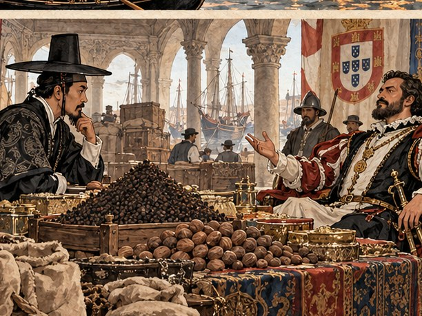
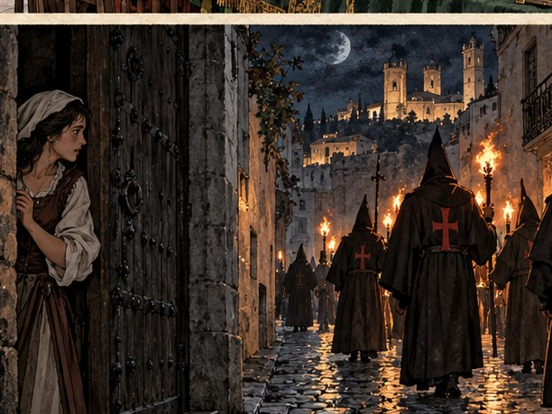
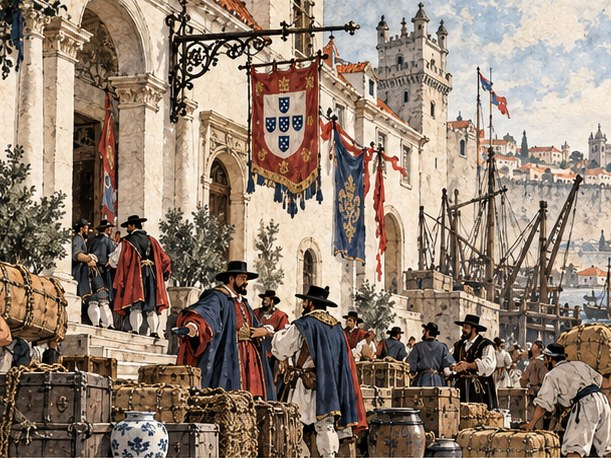

## 19. 마지막 셈

두아르트의 침실에는 약 달이는 냄새와 후추 냄새가 함께 배어 있었다. 침상 옆 탁자에 장부가 높이 쌓여 있었다. 앓아누운 사람의 방이 아니라 상관 장부실 같았다. 노인은 베개에 등을 기댄 채 그 장부들을 보고 있었다. 눈만은 아직 셈하는 사람의 눈이었다.

"만길…… 왔구나. 장부는 다 셈했느냐?"

"아직 많이 남았습니다." 만길은 침상 곁에 무릎을 꿇었다. "그러니 일어나셔야지요."

두아르트가 웃었다. 웃음이 기침으로 바뀌었다. 연이가 물잔을 건넸다. 노인은 물을 한 모금 넘기고 손을 저었다.

"내 셈은 여기까지다. 카락 한 척과 상관 장부의 반을 너에게 남긴다. 루이스에겐 나머지 반을."

문간에 루이스가 서 있었다. 그는 방 안으로 들어오지 않았다. 두아르트는 아들 쪽을 보지 않고 만길의 손을 잡았다. 마른 손이었지만 힘이 있었다.

"그 아이를…… 미워하지 마라. 나를 닮지 못해 화가 난 아이다."

만길은 대답 대신 노인의 손을 두 손으로 감쌌다. 노예시장 광장에서 땅바닥의 숫자를 들여다보던 손이었다. 해방 문서에 이름을 적은 손이었다.

두아르트 페레이라는 그날 밤 숨을 거두었다.

이튿날 아침 리베이라 부두에 카락 한 척이 만길의 이름으로 넘어왔다. 높은 고물에 돛대가 셋, 짐칸은 산타 루치아호의 몇 곱절이었다. 고물에 이름이 새겨져 있었다. 페레이라호. 공증인이 유언장에 적힌 대로 금화 5,000이 든 자루도 함께 건넸다. 만길은 배 이름을 바꾸지 않았다.

"이 배는 이름을 바꾸지 않겠소. 내가 받은 건 배지, 이름이 아니니."

장례 미사는 사흘 뒤에 열렸다. 리스본의 향신료 상인들이 줄지어 관 위에 꽃을 놓았다. 만길이 꽃을 들고 줄 끝에 서자 수군거림이 일었다. 노예였던 자가 주인의 관에 꽃을 놓는다고. 만길의 차례가 오기 전에 루이스가 앞을 막아섰다.

"아버지 장부의 반? 노예 출신에게 페레이라의 이름을 줄 수는 없다."

"이름은 받지 않겠소. 장부만 받겠소." 만길은 꽃을 관 위에 놓았다. "이름은 내 것이 있으니."

루이스의 얼굴이 하얗게 질렸다가 붉어졌다. 그는 만길의 귀에 대고 낮게 말했다.

"……두고 봐라. 왕실 인도 상관의 향신료 독점권은 내가 가져간다."

## 20. 왕실의 문장

공고는 장례가 끝난 지 보름 만에 붙었다. 리스본 상인 조합 벽, 주문서들이 비늘처럼 겹쳐 붙은 그 한가운데에 왕실 문장이 찍힌 큰 종이가 걸렸다.

「인도 후추 일 년 독점 납품권 입찰. 조건: 신용 있는 상인, 보증금 20,000, 후추 견본 100.」

공고 아래에 검은 옷의 사내가 서 있었다. 왕실 인도 상관의 감독관이었다. 그는 공고 앞에 모인 상인들을 하나씩 훑어보았다. 만길에게서 눈이 잠깐 멈췄다. 그날 만길은 연이가 맞춰 준 짙은 비단 더블릿을 입고 있었다. 왕실 사람은 옷부터 본다고 연이가 고집했다.

"왕실 인도 상관 감독관이오. 신용은 우리가 장부로 확인하오. 보증금은 은행에 맡기고, 견본은 입찰하는 날 가져오시오."

연이가 공고의 마지막 줄을 손가락으로 짚었다.

"후추는 인도에서 와야 해요. 이 길은 아프리카를 돌아 고아까지 가는 길이에요."

만길은 공고를 오래 보았다. 아프리카를 돌아 고아까지. 끌려올 때 지나온 길이었다.

"고향으로 가는 길의 반이오. 가 봅시다."

그러나 바로 갈 수는 없었다. 누녜스 환전소의 베아트리스는 만길의 장부를 넘겨 보고 고개를 저었다.

"감독관이 보는 장부의 신용이 아직 모자라요. 거래를 더 쌓아야 해요."

그 뒤로 일 년 남짓, 만길은 두 척의 배로 유럽 바다를 쉬지 않고 돌았다. 페레이라호에는 페드루가 키를 잡고 큰 짐을, 산타 루치아호에는 만길이 타고 빠른 짐을 실었다. 연이는 리스본에 남아 두 배의 장부를 하나로 엮었다. 어느 항구에서 무엇이 오르는지, 어느 주문서가 기한이 급한지. 연이의 장부에서 나온 길로만 다녀도 빈 항차가 없었다.

막손은 리베이라 뒤편 빈터를 빌려 가마를 쌓았다. 세비야 강 위쪽에서 실어 온 하얀 흙으로 첫 가마를 구운 날, 그는 가마 문을 열고 한참 아무 말도 하지 않았다. 하얀 그릇이 서른 개쯤 나왔다. 반은 금이 갔고 반은 성했다. 성한 그릇 하나를 리스본 교역소에 내놓자 귀족 집 집사가 사 갔다. 다음 가마부터는 리스본 교역소가 그릇을 다 받았다. 사람들은 그것을 조선백자라고 불렀다. 막손이 그렇게 부르라고 고집했기 때문이다.

그 일 년 동안 장부 맨 뒤 장의 빈칸도 하나씩 채워졌다.

나폴리 교회에서는 박 의원이 약초 바구니를 내려놓고 만길을 맞았다. 기다리마, 하고 웃던 그 얼굴이었다. 만길은 3,000을 치르고 해방 문서를 건넸다. 박 의원은 문서를 품에 넣고 말했다. "긴 항해에는 의원이 있어야 하오. 배에서 병자가 나면 나를 부르시오."

바르셀로나 조선소에서는 노를 깎던 덩치 큰 사내가 고개를 들었다. 다대포 격군 돌쇠였다. 돌쇠는 해방 문서를 받아 들고 아무 말 없이 만길의 배에 노를 걸었다. 노 젓는 데는 몸값이 안 든다고, 그 한마디가 다였다.

마르세유 술집 부엌에서는 조선 노래를 흥얼거리던 순덕이 앞치마를 벗어 개켜 두었다. "이 집 수프는 내가 끓여야 맛있대요. 이젠 알아서들 끓이라죠."

앤트워프 상점에서는 플랑드르 말로 손님을 맞던 소년이 만길을 보고 조선말로 소리쳤다. "아저씨!" 어린 개동이였다. 개동이는 배에 오르는 내내 세 나라 말을 섞어 가며 쉬지 않고 떠들었다. 그 아이에게 그 몇 해는 한 생애였다.

알제에는 어음이 통하지 않았다. 만길은 금화 5,000을 자루째 싣고 해적의 항구에 들어갔다. 술집 구석에서 사슬에 묶인 사내가 화살촉을 갈고 있었다. 활잡이 김씨였다. 사슬이 풀리자 김씨는 제일 먼저 활시위를 걸었다. "다시는 남의 배에서 활을 쏘지 않겠소. 이제 내 사람들을 지키는 데만 쓰지."

마지막은 리스본이었다. 부두 뒤 여관에서 일하는 덕이를 만길은 진작 찾아 두었다. 몸값 2,000이 모일 때까지 연이는 여관 앞을 지날 때마다 걸음을 늦추었다. 금화를 치르던 날, 덕이는 해방 문서를 받기도 전에 연이에게 달려왔다.

"만길 오라버니? 연이 언니는요? 언니도 살아 있어요? ……언니한테 가요. 빨리요. 할 말이 몇 해 치나 밀려 있어요."

장부 맨 뒤 장, 열 사람의 이름 가운데 일곱 줄 끝에 「갚음」이 적혔다. 앤트워프에서, 이스탄불에서, 베네치아에서, 이제는 리스본에서도 사람들은 만길을 약속을 지키는 동쪽 상인이라고 불렀다. 동포를 사는 상인이 아니라 동포를 풀어 주는 상인이라고.

베아트리스는 다시 장부를 넘겨 보고 이번에는 고개를 끄덕였다. 만길은 일 년 동안 모은 금화를 그녀의 탁자 위에 올렸다.

"보증금 20,000, 우리 은행이 맡았어요. 입찰이 끝나면 돌려받아요. 어음 하나 써 드릴게요."

그녀가 어음에 서명하는 동안 만길은 금고에 남은 숫자를 셈했다. 고아까지 가는 길의 보급, 선원 품삯, 후추 견본 100의 값. 모자랐다. 보증금은 돌아올 돈이지만 지금은 묶인 돈이었다.

피사의 바르디 은행은 그 모자란 셈을 알고 있는 것 같았다. 조반나 바르디는 만길이 견본으로 가져간 막손의 백자 사발을 손바닥에 올려 이리저리 돌려 보았다. 굽을 보고, 가장자리를 튕겨 소리를 들었다. 피사에서 만길에게 배운 대로였다.

"왕실 독점권 입찰에 나간다고요? 피렌체 은행은 이기는 쪽에 돈을 대요."

그녀가 사발을 내려놓았다.

"10,000을 빌려 드리죠. 이자는…… 당신이 고향에서 가져올 동방 도자기의 첫 선택권."

"이자를 금화로 받지 않는 은행은 처음 보오."

"금화는 어디서나 받을 수 있어요. 이 그릇을 구운 손의 고향 그릇은 당신에게서만 받을 수 있고요." 조반나가 웃었다. "그리고 주문 하나 더. 피사 와인 80을 고아 교역소로, 여섯 달 안에. 그쪽 포르투갈 사람들은 와인에 굶주렸대요."

페레이라호의 짐칸에 피사 곡류 80과 와인 80이 나란히 실렸다. 곡류는 지난번 조반나가 맡긴 루안다 주문 몫이었다. 산타 루치아호 한 척으로는 꿈도 못 꿀 짐이었다. 두아르트가 남긴 배가 두아르트가 가 보지 못한 길을 가게 되었다.

## 21. 콩고 왕의 편지

아프리카 서해안을 따라 남쪽으로 내려간 지 열흘째였다. 바다 빛이 짙어지고 해가 머리 위로 높아졌다. 페드루는 며칠째 말수가 적었다. 그는 해도 위의 한 줄을 손가락으로 짚었다.

"이 바다엔 노예선 길이 있다. 저 곶 너머로 돌면 그 길을 피할 수 있다."

만길은 해도를 보았다. 페드루가 짚은 길은 곤살루 같은 배들이 다니는 길이었다. 그 길을 피해 가는 바닷길은 사흘이 더 걸렸다. 만길은 사흘을 셈하지 않았다.

"당신 고향 바다요?"

페드루는 오래 수평선을 보았다.

"……그래. 루안다에 들르자."

루안다 교역소 주인은 곡식 자루를 하나 풀어 손바닥에 낟알을 쏟아 보았다.

"기한 안에 왔군. 이 곡식이면 마을 몇이 겨울을 넘기겠소."

금화 2,500. 피사에서 산 값의 세 배가 넘었다. 그러나 만길은 그 숫자보다 주인의 말을 장부에 먼저 적었다. 마을 몇이 겨울을 넘긴다. 곡식 자루가 사람을 살리는 셈이었다. 이 바다에서 오래 거꾸로 돌던 셈이었다.

항구 관리소 앞에서 노를 젓던 뱃사공 하나가 페레이라호 뱃전을 올려다보다 노를 놓쳤다. 고물에 걸린 작은 깃발 때문이었다. 연이가 수놓아 준 깃발이었다. 하얀 바탕에 먹빛 글자 하나. 徐.

"만길이! 서 객주 집 만길이 아니오!"

다대포 뱃사공 최 서방이었다. 몸값은 3,500이었다. 해방 문서를 받은 최 서방은 페레이라호의 해도부터 들여다보았다. 그는 남쪽 바다의 물길을 손바닥처럼 알고 있었다. 이 항구에서 몇 해 동안 남쪽으로 가는 배들의 노를 저은 사람이었다.

"희망봉을 돌 때는 내 말을 들으시오."

그날 밤 루안다 술집에서 페드루가 술잔을 들고 말했다. 낮에 항구에서 고향 말을 하는 사람들과 오래 이야기한 뒤였다.

"콩고 왕이 포르투갈 왕에게 편지를 보냈다더군. '내 백성을 사고파는 일을 멈춰 달라'고."

"답이 왔소?"

"아직." 페드루가 웃었다. "왕의 장부도 셈이 느린 모양이다."

그는 잔을 비우지 않고 내려놓았다.

"나는 여기 남지 않겠다. 끝까지 너와 가고, 돌아오는 길에 내리겠다. 그때는 내 이름으로."

만길은 그 말이 무엇을 뜻하는지 알았다. 이 항구에 지금 내리면 페드루는 포르투갈 상인의 배에서 내린 세례명 가진 사내였다. 돌아오는 길에 내리면 세계를 한 바퀴 돈 배의 항해사였다. 페드루 은감바. 아버지가 콩고 왕의 신하였던 사람의 아들.

"그때 당신 이름 옆에 내 이름으로 보증을 서겠소. 그게 내 장부에서 가장 무거운 줄이 될 거요."

최 서방의 말대로 희망봉은 사흘 동안 배를 놓아주지 않았다. 그는 돛을 언제 줄이고 언제 펼지 하나하나 일렀다. 바람이 북서로 돌던 새벽, 그가 소리쳤다. "지금이오!" 페레이라호가 곶을 돌았다. 바다가 거짓말처럼 순해졌다.

고아는 포르투갈 사람들이 인도에 세운 도시였다. 하얀 교회 탑들이 야자수 위로 솟았고, 부두에는 후추와 계피 자루가 산처럼 쌓였다. 교역소 주인이 와인 통의 마개를 따자 그 냄새를 맡으려고 포르투갈 병사들이 몰려들었다.

"기한 안에! 고아의 포르투갈 사람들이 축제를 열겠군."

금화 3,000. 만길이 교역소를 나서려는데 교회 종이 울렸다. 연이가 그쪽을 보았다. 장부에는 이 노인의 이름 옆에 「고아 교회」가 적혀 있었다.

교회 마당을 쓸던 노인이 빗자루를 떨어뜨렸다. 이 노인이었다. 끌려올 때 이미 백발이던 사람이 이제는 허리까지 굽어 있었다. 만길이 몸값 3,000을 치르고 해방 문서를 건네자 노인은 만길의 손을 잡고 오래 놓지 않았다.

"죽기 전에 고향 흙을 밟겠구나."

총독부 저택의 관리는 만길의 장부를 펴 보지도 않았다. 그는 왕실 입찰 공고의 사본을 탁자에 펼쳐 놓고 있었다.

"왕실 입찰에 나간다는 상인이오? 납품할 능력을 먼저 보이시오. 캘리컷 육두구 60을 석 달 안에 이 고아 교역소로."

"캘리컷은 바로 아래요. 곧 가져오겠소."

## 22. 깃발 없는 카락

캘리컷 교역소는 향신료 냄새로 숨이 막힐 지경이었다. 육두구, 정향, 계피, 후추. 자루마다 다른 냄새가 났다. 그런데 교역소 주인은 육두구 자루 앞에서 고개를 저었다.

"육두구? 값이 올랐소. 리스본의 페레이라라는 젊은 상인이 대리인을 보내 다 사들이고 있거든."

만길은 주인이 부른 값을 장부에 적었다. 지난달 시세의 한 배 반이었다.

"……루이스가 먼저 왔군."

연이가 장부를 넘겼다. 그녀의 손가락이 숫자 위를 빠르게 지나갔다.

"값이 올라도 사야 해요. 실사를 통과해야 입찰에 나가요." 연이가 고개를 들었다. "육두구에서 잃는 돈은 입찰장 입장료라고 생각해요. 입장료가 비싸면 상도 큰 법이에요."

만길은 웃었다. 그리고 주인에게 몸을 돌렸다.

"육두구 60을 사겠소. 그 대신 내 배가 다음에 올 때 유럽 와인을 먼저 보여 드리지. 루이스의 대리인은 사기만 하고 팔 것은 없을 테니."

주인은 잠시 생각하다가 한 자루에 2씩 깎아 주었다. 큰 돈은 아니었다. 그러나 다음 거래를 약속받은 값이었다.

고아로 돌아가는 바다는 잔잔했다. 사흘째 오후, 페드루가 고물 쪽을 가리켰다. 큰 카락 두 척이 뒤를 따라오고 있었다. 돛대 꼭대기가 비어 있었다.

베아트리스가 망원경을 내렸다. 그녀는 리스본 부두의 소문이라면 다 알았다. 어떤 배가 누구 돈으로 움직이는지도.

"깃발이 없어요. 사략선이에요. 누가 돈을 주고 우리를 막으라 했겠죠."

카락 한 척이 바람을 타고 가까이 다가왔다. 갑판에 칼을 찬 사내가 섰다. 그가 웃으며 소리쳤다.

"리스본의 페레이라 나리가 보내셨지. 그 육두구와 함께 바다에 가라앉아 주면 두둑이 받기로 했다."

만길은 뱃전에서 대답했다.

"그 나리의 장부엔 당신 이름이 없을 거요. 사략선은 늘 그렇지."

사내의 웃음이 잠깐 멈췄다. 그 말이 맞다는 것을 그도 알았다. 깃발 없는 배는 이겨도 이름이 남지 않았다. 져도 아무도 찾지 않았다.

페레이라호는 무거운 배였다. 육두구와 고아에서 실은 물자로 배가 깊이 잠겨 있었다. 페드루는 그 무게를 오히려 썼다. 그는 바람을 비스듬히 받아 배를 크게 돌렸다. 묵직한 페레이라호의 옆구리가 사략선의 뱃머리를 향했다. 한쪽 뱃전의 포가 한꺼번에 울렸다.

사략선 하나가 돛대 위쪽을 잃고 기울었다. 다른 하나가 갈고리를 던지며 다가왔다. 그 갑판 위로 화살 하나가 날아가 갈고리 밧줄을 끊었다. 김 활잡이였다. 그는 두 번째 화살로 사략선 키잡이의 모자를 날렸다. 사람을 겨누지 않고도 배를 멈추게 하는 활이었다. 키를 놓친 사략선이 엉뚱한 쪽으로 돌았다. 노를 잡은 돌쇠가 뱃전에서 웃음을 터뜨렸다.

사략선들은 해가 지기 전에 물러났다. 깃발 없는 돛 두 개가 수평선 아래로 작아졌다.

고아 교역소 주인은 육두구 자루를 하나씩 열어 냄새를 맡고 손으로 쪼개 보았다.

"기한 안에. 실사는 통과요. 총독부에 알리겠소."

그가 장부에 도장을 찍고 덧붙였다.

"입찰에 낼 후추 견본 100도 여기서 사 가시오. 리스본까지 여덟 달이면 충분하겠지."

총독부 저택의 관리는 이번에는 만길의 장부를 폈다. 실사 도장이 찍힌 줄을 손가락으로 짚고, 다시 덮었다.

"실사는 통과요. 이제 값이오. 독점권을 따면 총독부에 얼마를 떼어 주겠소?"

흥정이었다. 만길은 관리의 얼굴을 보았다. 이 사람은 마르코 조르치와 달랐다. 마르코는 한 번 지면 소문내지 말라고 하는 상인이었다. 이 관리는 한 번 지면 리스본에 보고서를 쓰는 사람이었다. 그리고 독점권은 일 년짜리였다. 해마다 다시 이 탁자에 앉아야 했다.

만길은 이 할을 불렀다. 세게 부를 수도 있었다. 관리의 눈썹이 한 번 움직였다가 내려왔다. 망설임이 아니라 셈하는 얼굴이었다.

"좋소. 그 조건이면 총독부가 당신 편을 들겠소."

금화 2,500이 건너왔다. 저택을 나오며 연이가 물었다.

"조금 더 부를 수 있었잖아요."

"이 사람과는 앞으로 몇 해를 거래해야 하오. 오늘 다 받으면 내년엔 받을 게 없소." 만길은 장부를 덮었다. "조금 남겨 두는 것도 받을 것을 적어 두는 일이오."

## 23. 입찰과 횃불

리스본 상인 조합의 큰 방에 긴 탁자 하나가 놓였다. 탁자 끝에 왕실 문장을 수놓은 천이 드리워졌고, 그 앞에 감독관이 앉았다. 벽을 따라 리스본 상인들이 빽빽이 서 있었다. 입찰에 나선 상인보다 구경하러 온 상인이 훨씬 많았다.

만길은 후추 자루 백 개를 조합 마당에 부려 놓았다. 감독관의 서기가 자루를 무작위로 열어 낟알을 쏟아 보았다. 고아에서 산 지 여덟 달이 다 되어 가는 후추였다. 연이가 자루마다 기름종이를 한 겹 더 대어 습기를 막아 두었다.

"견본 100, 기한 안에 왔군."

탁자 맞은편에 루이스가 앉아 있었다. 그도 비단 더블릿을 입었다. 아버지의 인장 반지가 그의 손가락에서 조금 헐거웠다. 그가 만길의 손을 보았다. 만길의 손가락에도 반지가 있었다. 막손이 백자 흙으로 틀을 떠서 은장이에게 맡긴 인장이었다. 새겨진 글자는 하나였다. 徐.

"노예 출신이 왕실 입찰장에? 좋아, 값으로 끝내자."

입찰은 값의 싸움이었다. 일 년 동안 왕실 인도 상관에 후추를 대고, 그 대가로 얼마를 받을지. 그리고 왕실에 무엇을 보증할지. 감독관이 기본 조건을 읽었다. 두 상인은 그 위에 조건을 얹어 불러야 했다.

루이스가 먼저 불렀다. 기본 조건보다 낮은 납품가였다. 벽을 따라 선 상인들이 웅성거렸다. 그 값이면 이익이 거의 없었다. 루이스는 독점권 자체를 사려 하고 있었다. 이기기 위해 이익을 버리는 값이었다.

만길은 바로 부르지 않았다. 그는 장부를 폈다. 그리고 감독관이 아니라 루이스를 보았다.

"그 값이면 고아에서 리스본까지 배 한 척이 가라앉아도 남는 게 없소. 캘리컷 육두구를 한 배 반에 사들인 상관이라면 더 그렇지."

루이스의 얼굴이 굳었다. 감독관의 눈이 루이스의 장부로 갔다.

"나는 고아 총독부의 실사 도장과 캘리컷 교역소의 다음 거래 약속을 가지고 있소." 만길이 장부를 감독관 쪽으로 돌렸다. "그리고 기한 안에 납품한 주문서가 일곱 장이오. 앤트워프, 리스본, 이스탄불, 루안다, 고아. 내 값은 기본 조건보다 높소. 대신 한 번도 늦지 않은 장부가 그 값을 보증하오."

감독관은 두 장부를 나란히 놓고 오래 보았다. 왕실은 싼 값보다 끊기지 않는 후추를 원했다. 리스본에 후추가 끊기면 앤트워프의 왕실 상관이 멈추고, 그러면 왕의 금고가 멈췄다. 그는 그것을 누구보다 잘 아는 사람이었다.

"서만길, 가장 좋은 조건. 독점권은 그대의 것이오."

방 안이 술렁였다. 벽을 따라 선 상인들이 서로의 얼굴을 보았다. 누군가 손뼉을 치려다 멈췄다. 서기가 금화 25,000의 첫 지급 증서를 만길 앞에 놓았다. 그리고 누녜스 환전소의 어음 한 장. 보증금 20,000을 돌려받는 어음이었다.

루이스는 일어서지 않았다. 그는 이를 악문 채 탁자 위의 장부를 노려보았다.

"……아버지가 왜 너를……"

그는 말을 끝맺지 않고 방을 나갔다. 만길은 그 뒷모습을 보았다. 그리고 두아르트의 마지막 말을 떠올렸다. 그 아이를 미워하지 마라.

그날 밤 만길과 연이는 리스본 교회에 있었다. 두아르트의 무덤 앞에 초를 켜러 간 길이었다. 입찰에서 이겼다는 것을 장부보다 먼저 알려야 할 사람이었다.

교회 문이 거칠게 열렸다. 베아트리스였다. 머리쓰개가 반쯤 벗겨져 있었고 숨이 턱까지 차 있었다.

상인 거리 끝, 누녜스 환전소 앞에 횃불이 늘어서 있었다. 종교재판소 사람들이었다. 누군가 고발장을 냈다고 했다. 새 기독교도가 몰래 옛 신앙을 지킨다고. 증거는 필요 없었다. 의심이면 충분했다. 그것이 이 도시에서 그들이 평생 지고 산 무게였다.

"루이스예요." 베아트리스가 숨을 몰아쉬었다. "입찰에 진 다음 날 고발장이 들어갔대요."

연이가 베아트리스의 차가운 손을 잡았다.

"베아트리스를 숨겨야 해요. 어디로 가죠?"

길은 둘이었다. 앤트워프에는 누녜스 집안의 친척이 있었다. 밤배를 띄우면 닿을 수 있었다. 그러나 테주 강어귀에는 오늘 밤 왕실 순찰선이 나와 있을 것이었다. 독점권 입찰이 끝난 밤이었다. 리스본에서 나가는 배는 모두 검문을 받았다. 그리고 리베이라 부두에는 만길이 빌린 창고가 있었다. 독점권 후추를 받기 위해 빌려 둔 창고였다. 고아에서 온 후추 자루가 천장까지 쌓여 있었다.

만길은 셈을 오래 하지 않았다.

"우리 창고로. 후추 자루 뒤라면 아무도 찾지 못하오."

사흘 밤낮, 베아트리스는 후추 자루 사이에서 숨을 죽였다. 덕이가 밤마다 빵과 물을 날랐다. 막손은 창고 앞에 가마 땔감을 쌓아 문을 반쯤 가렸다. 연이는 낮에 창고 장부를 들고 드나들며 아무 일도 없다는 얼굴을 했다.

둘째 날 저녁, 종교재판소 사람들이 창고 문 앞까지 왔다. 문틈으로 후추 냄새가 독하게 새어 나왔다. 그들 중 하나가 재채기를 했다. 그들은 장부를 보자고 했고, 연이가 문간에서 장부를 내밀었다. 왕실 독점권 도장이 찍힌 장부였다. 그들은 장부를 덮고 돌아갔다.

사흘째 새벽, 만길이 후추 자루를 들어내자 베아트리스가 기어 나왔다. 머리카락과 옷깃에 후추 가루가 하얗게 묻어 있었다. 그녀는 재채기를 한 번 하고 웃었다.

"후추 냄새는 평생 잊지 못하겠네요. 고마워요. 앞으로도 당신 배에 있을게요."

누녜스 환전소의 덧문은 그 뒤로 한동안 열리지 않았다. 베아트리스는 그 문 앞을 지나며 걸음을 멈추지 않았다. 다만 만길의 장부를 펴고, 거기 적힌 어음의 숫자를 하나하나 다시 맞춰 보았다. 그녀가 할 줄 아는 가장 단단한 기도였다.

## 24. 서씨 상관

리스본 교역소 주인은 부두 지도를 펴 놓고 한 자리를 손가락으로 짚었다. 리베이라 부두, 막손의 가마 바로 옆이었다.

"부두 자리 하나를 상관으로 쓰려면 50,000이 든다오. 왕실 독점권이 있어도 그건 별개요."

만길은 먼저 피사로 어음 한 장을 보냈다. 조반나에게 빌린 10,000이었다. 이자는 금화로 받지 않겠다고 한 사람이었다. 그 이자는 아직 갚을 때가 되지 않았다. 원금은 갚을 때가 되었다. 그다음에 만길은 50,000을 교역소 탁자에 올렸다.

한 달 뒤 리베이라 부두에 새 간판이 걸렸다. 검은 나무판에 금빛 글씨였다. 위에는 이 나라 글자로, 아래에는 먹으로 쓴 한자로.

「서씨 상관 ― 동방 물산·향신료」

간판을 다는 날 부두 사람들이 모였다. 노예가 선장이 된 배라고 손가락질하던 그 부두였다. 오늘은 손가락질 대신 모자를 들었다. 막손이 가마에서 갓 꺼낸 백자 사발에 술을 따라 돌렸다. 덕이와 순덕이 그 사발을 날랐다. 개동이가 세 나라 말로 손님을 맞았다.

상관 안 장부실에서 연이가 새 장부를 폈다. 가죽 표지에 아직 아무것도 적히지 않은 장부였다.

"장부 첫 줄에 뭐라고 쓸까요?"

만길은 붓을 들어 연이에게 건넸다. 첫 줄은 우리 손으로 쓰자고 한 사람이 연이였다.

"'빚 없음.' 그리고 그 아래에 '동포 열 사람.'"

연이가 그대로 적었다. 빚 없음. 동포 열 사람. 첫 줄은 셈이 끝난 것이고, 둘째 줄은 셈이 아직 남은 것이었다.

그날 저녁 만길은 페레이라 저택에 갔다. 혼자였다. 루이스는 아버지의 서재에 앉아 있었다. 탁자 위에 술병이 있었고 잔은 비어 있었다.

"……무슨 일로 왔나. 이긴 자가 진 자를 구경하러 왔나?"

만길은 대답 대신 낡은 장부 한 권을 내밀었다. 두아르트가 남긴 상관 장부의 절반, 그 가운데 가장 오래된 것이었다. 표지가 닳아 가죽이 하얗게 일어나 있었다.

"당신 아버지의 첫 장부요. 맨 끝 장을 보시오."

루이스가 장부를 넘겼다. 맨 끝 장에 두아르트의 글씨가 있었다. 젊은 날의 글씨였다. 획이 힘차고 반듯했다.

「루이스는 셈이 빠르지 못하다. 그러나 정직하다. 그 아이에게 정직한 동업자를 붙여 주어야 한다.」

루이스는 오래 말이 없었다. 장부를 쥔 손이 떨렸다. 그는 그 한 줄을 몇 번이고 다시 읽었다.

"……아버지는 나를 믿지 않은 게 아니었군."

만길은 베아트리스를 생각했다. 사흘 동안 후추 자루 사이에서 숨을 죽인 사람을. 그 셈은 따로 있었다. 언젠가 루이스가 스스로 갚아야 할 셈이었다. 그러나 오늘 이 방에서 할 셈은 아니었다. 두아르트는 미워하지 말라고 했다. 용서하라고는 하지 않았다.

"독점권 장부의 절반을 당신 상관과 나누겠소. 정직하게."

루이스가 고개를 들었다. 그는 무언가 말하려다 입을 다물었다. 그리고 천천히 고개를 끄덕였다. 장부를 덮는 손이 아버지의 손을 닮아 있었다.

여관 방 창으로 테주 강의 불빛이 보였다. 노예였을 때 하인 방 작은 창으로 보던 그 불빛이었다. 연이가 창가에 앉아 상관 장부를 덮었다.

"빚도 없고, 상관도 있어요. 이제…… 돌아갈 수 있어요."

만길은 창밖을 보았다. 강은 바다로 이어지고, 바다는 다른 바다로 이어졌다.

"세계를 한 바퀴. 아프리카를 돌고, 인도를 지나, 고향 바다까지."

연이가 장부 맨 뒤 장을 폈다. 열 사람의 이름 가운데 아홉 줄 끝에 「갚음」이 적혀 있었다. 마지막 한 줄, 옥이의 이름 옆에는 「말라카」만 적혀 있었다. 리스본 지하 창고에서 연이의 치맛자락을 붙들고 있던 아이였다.

"거의 다 찾았어요. 우리 배가 고향 사람들로 가득 차겠네요."

이튿날 아침 항구 관리소에서 만길은 출항 장부에 서명했다. 그리고 자기 장부 맨 앞 장을 폈다. 몇 해 전 「아직 적을 것이 적다」고 적었던 그 자리 아래에 새 줄을 썼다.

「서만길. 리스본 서씨 상관. 신용 ― 이제 적을 칸이 모자라다.」

페드루가 관리소 문간에 기대어 서 있었다. 그가 웃으며 물었다.

"다음 항해는 어디냐, 거상 나리."

만길은 장부를 덮었다.

"집이오."
