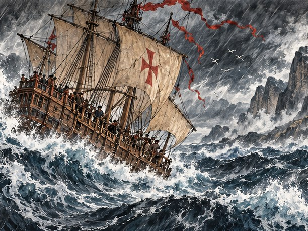
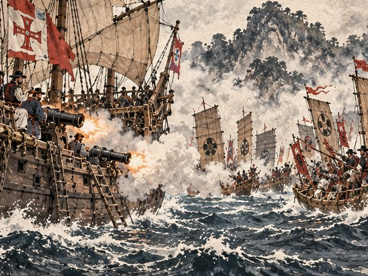
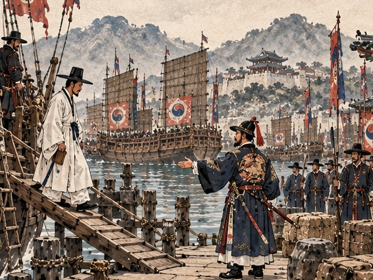

## 25. 만리

리스본 교역소의 창으로 테주 강이 보였다. 일곱 해 전 하인 방의 작은 창으로 내다보던 그 강이었다. 강은 변하지 않았다. 변한 것은 창의 크기와, 그 창 앞에 앉은 사람의 자리였다.

연이가 새 장부를 펼쳤다. 아직 손때가 묻지 않은 장부였다. 첫 장 맨 위에 그녀는 반듯한 해서로 네 글자를 적어 두었다. 歸鄕準備.

"귀향 준비 장부예요." 연이가 붓끝으로 첫 줄을 짚었다. "조정에 바칠 진상품이 있어야 해요. 빈손으로 돌아온 표류민은 의심받으니까요."

옳은 말이었다. 바다 건너에서 돌아온 사람은 무엇보다 먼저 의심을 받는다. 왜구와 내통한 것은 아닌지, 남의 나라 첩자는 아닌지. 다대포 객주 집에서 자라며 만길은 그런 이야기를 여러 번 들었다. 말로는 그 의심을 풀 수 없었다. 물건이 대신 말해 주어야 했다.

"리스본 벨벳 30을 싣고 가겠소. 조선에선 본 적 없는 천이니."

그는 창고에서 벨벳 한 필을 꺼내 손바닥으로 쓸어 보았다. 결을 따라 쓸면 털이 눕고, 거슬러 쓸면 빛깔이 한 겹 짙어졌다. 비단도 아니고 무명도 아닌 천. 이 천을 처음 만지는 조선 관리의 얼굴을 만길은 떠올려 보았다. 그 얼굴이 놀라는 만큼, 그들이 지나온 바다가 먼 바다가 될 것이었다.

연이가 첫 줄 옆에 작게 적었다. 「벨벳 30. 부산포에 닿을 때까지 손대지 말 것.」

다음 줄은 배였다.

리스본 조선소의 주인은 만길이 내민 도면을 한참 들여다보더니 고개를 저었다.

"세계를 한 바퀴 돌 배라면 갤리온이어야 하오. 15,000은 있어야 짓지."

만길은 값을 깎지 않았다. 일곱 해 동안 그는 깎을 값과 깎지 말아야 할 값을 가리는 법을 배웠다. 아프리카를 돌고 인도양을 건너 동쪽 끝까지 사람을 싣고 갈 배였다. 그런 배의 용골 값을 깎는 것은 그 배에 탈 사람의 목숨 값을 깎는 것과 같았다. 그는 금화를 마지막 한 닢까지 직접 세어 건넸다.

석 달 동안 조선소 비탈에서 망치 소리가 그치지 않았다. 참나무 용골이 놓이고, 늑골이 서고, 뱃전이 높이 올라갔다. 만길은 날마다 비탈에 나가 목재의 결을 보고 못의 수를 셌다. 상관 옆 가마에서 백자를 굽던 막손이 가끔 따라 나왔다. 사기장은 흙 묻은 손으로 판자를 두드려 보고는 고개를 끄덕였다.

"나무도 흙이랑 같다. 결을 거스르면 터지고, 결을 따르면 버틴다. 이 배는 결을 따랐구나."

배가 물에 내려가는 날, 리베이라 부두에 사람들이 모였다. 상관의 일꾼들과 이웃 상인들, 구경 나온 아이들. 일곱 해 전 노예가 선장이 된 배라며 손가락질하던 부두였다. 오늘은 아무도 손가락질하지 않았다.

받침목이 빠지자 새 갤리온이 몸을 떨며 비탈을 미끄러져 내려갔다. 용골이 강물을 가르는 소리가 났다. 흰 물보라가 솟았다가 가라앉았을 때, 배는 테주 강 위에 꼿꼿이 떠 있었다.

뱃머리에 한자 두 글자가 새겨져 있었다. 만길이 붓으로 쓰고 막손이 끌로 판 글자였다. 萬里. 만리호.

부두의 포르투갈 사람들은 그 글자를 읽지 못했다. 그래도 괜찮았다. 그 이름은 그들에게 보이려고 새긴 것이 아니었다.

"만 리를 가는 배." 연이가 뱃머리를 올려다보았다. "당신 이름 만길(萬吉)과도 닮았네요."

"길한 일 만 가지보다 지금은 바닷길 만 리가 더 아쉽소."

"둘 다 가져가요." 연이가 장부를 덮었다. "우리 장부엔 칸이 넉넉하니까."

## 26. 리스본의 마지막 밤

출항을 앞둔 저녁, 만길은 부두 뒤 술집 하나를 통째로 빌렸다.

술집이 비좁았다. 막손, 덕이, 돌쇠, 개동이…… 연이가 이름을 부를 때마다 누군가 울었다. 박 의원, 김 활잡이, 순덕, 최 서방, 이 노인. 저마다 다른 항구에서, 저마다 다른 날에 해방 문서를 받은 사람들이었다.

일곱 해 전, 이 도시의 어느 술집 지하 창고에서 연이가 서로의 이름을 외우게 했던 사람들이었다. 그때는 팔릴 날을 기다리며 모였고, 오늘은 떠날 날을 기다리며 모였다. 같은 도시, 같은 술 냄새. 그러나 오늘은 문이 안에서 열렸다.

다들 짐 보따리를 들고 있었다. 순덕의 보따리에서는 마르세유 부엌의 향초 냄새가 났고, 개동이의 보따리에서는 플랑드르 그림책 귀퉁이가 삐죽 나와 있었다. 돌쇠는 보따리 대신 노 한 자루를 어깨에 메고 왔다. 아무도 그것을 놀리지 않았다.

탁자 끝에 빈 의자가 하나 있었다. 연이가 그 앞에 잔을 하나 놓았다. 옥이의 자리였다. 말라카로 다시 팔려 갔다는 소문 말고는 아무것도 알 수 없는 아이.

만길이 잔을 들었다.

"만리호에 자리는 넉넉하오. 함께 갑시다. 집으로."

누가 먼저였는지는 모른다. 다대포 뱃노래가 시작되었다. 노 젓는 손에 맞춰 부르던 노래였다. 창밖에서 포르투갈 술꾼들이 기웃거렸다. 그들은 가사를 알아듣지 못했다. 그러나 그 노래가 어느 쪽을 향하는지는 알아들은 얼굴이었다.

그날 밤 여관 방에는 등잔 하나가 타고 있었다.

페드루가 창틀에 기대어 강을 보고 있었다. 콩고 왕이 포르투갈 왕에게 보냈다는 편지는 아직 답이 없었다. 그는 리스본에 닿는 배마다 찾아가 남쪽 소식을 물었지만, 돌아오는 것은 고개 젓는 얼굴뿐이었다.

"루안다까지는 함께 간다고 했지." 페드루가 돌아보았다. "마음이 바뀌었다. 끝까지 가서 네 고향 바다를 보고 돌아오겠다."

"편지의 답은 어쩌고?"

"왕의 장부는 셈이 느리다고 내가 그랬지. 기다리는 동안 네 바다나 보고 오겠다." 페드루가 웃었다. "너는 내 말로 '집'을 배웠다. 이번엔 내가 네 집을 볼 차례다."

베아트리스는 탁자에 어음 뭉치를 펼쳐 놓고 하나하나 접고 있었다.

"동쪽 끝의 환전상이 되어 볼까요. 어음을 들고 갈게요. 리스본 종이가 마카오에서도 금화가 되는지, 제 눈으로 봐야겠어요."

연이는 장부를 무릎에 얹은 채 오래 말이 없었다. 그러다 창밖의 불빛을 보며 입을 열었다.

"내일이면 떠나요. 이 도시에서 우리는 팔렸고, 풀려났고, 다시 섰어요."

"그러니 이 도시에도 셈을 남겨야지." 만길이 말했다. "상관은 루이스와 함께 꾸리기로 했소."

두아르트의 아들은 그 제안을 받던 날 한마디도 하지 않았다. 다만 장부를 받아 들고 첫 장부터 다시 셈하기 시작했다. 느리지만 틀리지 않는 손이었다. 만길은 그것으로 충분하다고 생각했다.

이튿날 새벽, 만길은 연이가 석 달 동안 몰래 지은 흰 도포를 입었다. 리스본 아마포로 지은 도포였다. 갓은 막손이 대나무를 깎아 엮었다. 부두의 사람들이 그 낯선 차림을 돌아보았다. 만길은 개의치 않았다. 일곱 해 동안 그는 이 나라 옷을 입고 이 나라 이름으로 불렸다. 오늘부터는 제 옷을 입고 제 이름으로 돌아갈 것이었다.

만리호가 테주 강을 내려갔다. 벨렝의 탑이 멀어지고, 리스본의 언덕이 멀어졌다. 귀향 선단은 아프리카 해안을 따라 남쪽으로 뱃머리를 돌렸다.

## 27. 닫히는 장부

남쪽으로 내려갈수록 바다가 넓어졌다. 마지막 보급항을 떠난 지 닷새째, 희망봉을 앞둔 바다에서 페드루가 고물 쪽 수평선을 오래 노려보았다.

"뒤에 배가 붙었다. 카락 둘, 나오 둘." 그가 망원경을 내렸다. "……저 깃발은 곤살루다."

만길의 손이 뱃전을 짚었다. 일곱 해 전 자신을 이 바다로 실어 온 배. 머릿수를 속여 적던 장부의 주인. 리스본 앞바다에서 한 번 물리쳤지만, 그 장부는 아직 덮이지 않았다.

"동포들이 탄 배를 노리는군." 만길이 말했다. "이번엔 장부를 끝까지 바로잡겠소."

곤살루의 기함이 바람을 안고 다가왔다. 뱃머리에 선 사내는 일곱 해 동안 더 거칠어져 있었다. 그가 만리호의 갑판을 훑어보더니 크게 웃었다.

"조선 원숭이 떼가 통째로 바다에 떠 있군! 한 번에 팔면 평생 놀고먹겠어!"

갑판의 동포들이 몸을 굳혔다. 그 목소리를 기억하는 사람이 있었다. 하선하라고, 줄을 맞추라고, 숫자 세는 동안 입 다물라고 외치던 목소리였다.

만길은 도포 소매를 걷었다. 목소리는 높이지 않았다.

"곤살루 바스. 당신 장부는 오늘로 닫히오."

페드루가 키를 꺾었다. 만리호가 바람 위쪽으로 올라서며 곤살루의 나오 두 척 사이를 비스듬히 갈랐다. 김 활잡이가 뱃전에 붙어 시위를 당겼다. 사슬이 풀리던 날 그는 다시는 남의 배에서 활을 쏘지 않겠다고 했다. 오늘 그의 화살은 제 사람들이 탄 배를 지키는 데만 날아갔다. 돌쇠는 동포 장정들을 이끌고 돛줄에 매달렸고, 만리호의 포가 연이어 울었다.

싸움은 길지 않았다. 곤살루의 노예선이 불길에 휩싸였다. 만리호의 거룻배들이 연기 사이를 오가며 선창의 문을 열었다. 선창에 갇혀 있던 사람들은 모두 만리호로 옮겨 탔다. 곤살루와 그의 선원들은 작은 배 한 척에 실려 해안 쪽으로 밀려갔다. 만길은 그를 쫓지 않았다. 사람을 실을 선창도, 사람을 숫자로 적을 장부도 잃은 노예선 선장은 이제 아무것도 아니었다.

페드루가 노예선에서 걷어 온 사슬 뭉치를 들어 올렸다. 그리고 그것을 바다에 던졌다. 쇠가 물에 잠기는 소리는 생각보다 작았다.

"이번엔 다 받았나?"

"이 바다에서 받을 것은 다 받았소."

그날 밤 만길은 새로 탄 사람들 앞에 장부를 펼쳤다. 페드루가 곁에서 그들의 말을 옮겼다. 콩고 말을 하는 이도 있었고, 만길이 처음 듣는 말을 하는 이도 있었다. 만길은 한 사람씩 이름을 물었다. 이름을 받아 적는 데 밤이 다 갔다. 곤살루의 장부에는 숫자 하나로 적혀 있던 사람들이었다.

희망봉 앞바다에서 하늘이 무너졌다.

낮인데 밤처럼 어두웠다. 산 같은 물결이 뱃머리를 들어 올렸다가 내리꽂았다. 바람이 돛대를 휘게 했고, 비가 옆으로 날아와 뺨을 때렸다.

"돛을 내려라! 키를 놓지 마!" 페드루가 외쳤다.

최 서방이 키잡이 곁에 붙어 섰다. 루안다 앞바다에서 노를 젓던 뱃사공은 남쪽 바다의 물길을 손바닥처럼 알았다. 희망봉을 돌 때는 자기 말을 들으라던 사람이었다. "물결을 정면으로 받지 마시오! 비스듬히, 비스듬히!" 그의 목소리가 바람을 뚫었다.

선창에서는 박 의원이 멀미하는 사람들 사이를 오가며 약을 먹였다. 순덕은 꺼진 화덕 대신 마른 떡을 나누었다. 개동이는 겁먹은 아이들 곁에 앉아 세 나라 말을 섞어 가며 쉬지 않고 이야기를 했다.

연이는 장부를 품에 안고 있었다. 물이 갑판을 덮칠 때마다 그녀는 몸을 웅크려 장부를 감쌌다.

"장부는 젖어도 셈은 젖지 않아요!"

만길은 당번이 바뀔 때마다 갑판과 선창을 돌며 이름을 불렀다. 숫자를 세지 않았다. 한 사람씩, 이름으로. 대답이 돌아올 때마다 그는 속으로 한 줄을 그었다.

사흘 밤낮을 버티자 바다가 잠잠해졌다. 구름 사이로 해가 나왔다. 만길은 마지막으로 이름을 불렀다. 모두 대답했다.

아무도 잃지 않았다.

## 28. 서른넷 중의 둘

소팔라의 술집은 낮에도 어두웠다. 바닷바람에 삭은 덧창 틈으로 빛이 줄무늬처럼 들어왔다.

구석 탁자에 북쪽 사람 하나가 앉아 있었다. 마른 몸에 손가락마다 먹물이 배어 있었고, 탁자 위에는 측각기와 둘둘 만 종이가 놓여 있었다. 그는 만리호 사람들이 들어오는 것을 보고 펜을 내려놓았다.

"동쪽으로 가는 선단이라고? 나는 지도를 그리는 사람이네. 에르네스트 폰 보어."

그가 종이를 펼쳤다. 인도양의 해안선이 촘촘히 그려져 있었다. 곶마다 수심이 적혀 있었고, 바다 위에는 계절마다 바뀌는 바람의 방향이 화살표로 그려져 있었다. 그 선은 말라카를 지나 북쪽으로, 동중국해까지 이어졌다.

"인도양에서 동중국해까지의 해도일세. 이것이면 계절풍을 놓치지 않을 걸세."

만길은 그 해도를 오래 내려다보았다. 이만한 해도를 그리려면 몇 해의 항해가 들었을지 셈해 보았다. 셈이 끝나지 않았다.

"이 귀한 것을 왜 우리에게?"

에르네스트가 웃었다. 바다에서 오래 산 사람의 웃음이었다.

"지도는 누군가 그 길을 가야 완성되지. 내 어린 딸에게 들려줄 이야기가 하나 늘겠군. 세계를 한 바퀴 돌아 집에 간 상인 이야기."

만길은 값을 치르려 했지만 지도 그리는 사람은 받지 않았다. 그래서 만길은 장부를 펼쳐 빚 칸에 적었다. 「에르네스트 폰 보어. 해도 한 벌. 갚을 길 ― 이 길을 끝까지 가서, 그 딸에게 들려줄 이야기가 되는 것.」

에르네스트가 그 글자를 읽지는 못했지만, 만길이 무엇을 적었는지는 알아챈 얼굴이었다.

소팔라에서 곤살루의 선창에서 나온 사람들 몇이 배에서 내렸다. 이 해안이 고향인 사람들이었다. 남은 이들은 페드루 곁에 모였다. 서쪽 바다로 돌아가는 길은 페드루가 잇기로 했다.

고아의 교역소 주인은 만리호의 깃발을 보자 두 팔을 벌렸다.

"독점권의 서 선장! 후추는 얼마든지 가져가시오. 마카오에서 후추를 찾는 상인이 많다던데."

연이가 벌써 장부에 새 줄을 긋고 있었다. "마카오 포르투갈 상인들이 후추 150을 원해요. 넉 달 안에. 거기서 선복 계약도 해야 하고요."

넉 달. 에르네스트의 해도가 아니었다면 빠듯했을 날짜였다. 만길은 해도의 바람 화살표를 손가락으로 따라가 보고 고개를 끄덕였다.

말라카 부두에 닿았을 때 연이는 한동안 배에서 내리지 않았다.

칠 년 전 만길과 연이가 노예선으로 옮겨 실린 곳이었다. 그때도 부두는 이렇게 붐볐고, 이렇게 덥고, 이렇게 시끄러웠다. 다른 것은 그날 그들이 갑판 아래에 있었다는 것뿐이었다.

"여기서 우리는 숫자가 됐어요." 연이가 말했다. "서른넷 중의 둘."

"이번엔 선단주로 내리오." 만길이 손을 내밀었다. "장부 첫 줄에 이름을 적고."

항구 관리소의 서기가 입항 장부를 내밀었다. 만길은 붓을 들어 적었다. 서만길. 그 아래에 연이. 그리고 만리호에 탄 사람들의 이름을 하나도 빼지 않고. 서기가 언제 끝나느냐는 얼굴로 한숨을 쉬었지만, 만길은 붓을 멈추지 않았다.

연이가 만길의 소매를 당겼다. "옥이가 이 항구 술집에 있다고 했어요. 잊지 마요."

잊을 리 없었다. 잊으면 셈이 틀린 것이었다.

항구 술집에서 잔을 나르던 소녀가 조선말을 듣고 쟁반을 떨어뜨렸다. 잔이 깨지는 소리에 술집이 조용해졌다.

옥이였다.

일곱 해 전 지하 창고에서 연이의 치맛자락을 붙들고 있던 아이는 이제 키가 연이의 어깨만큼 자라 있었다. 그러나 눈은 그대로였다.

만길은 술집 주인과 마주 앉았다. 금화 4,000. 그는 흥정하지 않았다. 해방 문서에 이름을 적는 손만 조금 떨렸다. 옥이. 그 두 글자를 다 적고서야 만길은 문서를 옥이의 손에 쥐여 주었다.

옥이는 연이의 품에 안겨 한참을 울었다.

"언니가 이름을 외워 줘서, 저도 제 이름을 안 잊었어요."

그날 저녁, 만리호의 식탁 끝 빈 의자에 처음으로 사람이 앉았다. 연이는 장부를 펴고 열째 이름 옆에 마지막 동그라미를 쳤다.

열 사람. 셈이 맞았다.

## 29. 고향 바다 냄새

마카오의 포르투갈 상인들은 만리호의 짐칸을 보고 놀란 얼굴을 감추지 못했다. 후추 150. 해도의 바람 화살표는 틀리지 않았다.

"기한 안에. 이 바다에선 드문 일이오."

상인 대표가 금화를 세어 건넨 뒤 은근히 말을 꺼냈다.

"앞으로 동쪽 바다의 짐을 실어 나를 선복 계약도 하겠소? 값은 흥정으로."

흥정은 해가 질 때까지 이어졌다. 상대는 처음에 낮은 값을 불렀다. 만길은 웃기만 하고 대답하지 않았다. 상대가 값을 조금 올렸다. 만길은 고아에서 마카오까지 걸린 날수를 말했다. 상대가 또 올렸다. 만길은 리스본에서 이곳까지 한 사람도 잃지 않았다는 이야기를 했다. 기한을 지키는 배가 이 바다에 얼마나 드문지는 상대가 먼저 말한 것이었다.

마지막 값이 장부에 적혔을 때, 상인 대표가 길게 한숨을 쉬었다.

"리스본 거상의 셈은 무섭군."

베아트리스는 그 흥정을 끝까지 지켜보다가 창밖의 골목으로 눈을 돌렸다. 환전상들이 탁자를 내놓고 여러 나라 돈을 바꾸고 있었다. 횃불을 든 사람도, 이웃을 고발하는 종이도 보이지 않았다. 그녀는 아무 말도 하지 않았다. 다만 그 골목을 오래 보았다.

천주의 술집 주인은 만길의 도포를 보더니 조선 사람이냐고 물었다. 만길이 그렇다고 하자, 주인이 혀를 찼다.

"왕한의 밀무역 선단? 몇 해 전에 무너졌소. 조선 무관 하나가 장부를 들고 와서 판을 엎었다더군."

만길의 눈이 커졌다.

"조선 무관이……"

천주. 칠 년 전 그들의 이름 대신 숫자가 처음 적힌 곳이었다. 밀무역 선단의 장부. 그 장부를 누군가 들고 와서 엎었다. 칼이 아니라 장부로. 만길은 얼굴도 이름도 모르는 그 무관을 떠올려 보았다. 이 넓은 바다에서 자기와 같은 셈을 한 사람이 또 있었다.

"그런데 조심하시오." 주인이 목소리를 낮추었다. "그때 흩어진 왜구 잔당이 대마도 앞바다에서 남쪽 배를 노린다오. 짐이 많은 배일수록."

연이가 장부를 덮었다.

"고향 바다 바로 앞이에요."

동중국해를 건너 북쪽으로 올라갔다. 사흘째, 바다 빛이 낯익었다. 남쪽 바다의 맑은 쪽빛이 아니라 조금 탁하고 푸르스름한 빛. 물결의 높이도, 갈매기 우는 소리도 달랐다.

새벽 갑판에 연이가 나와 서 있었다. 그녀가 바람을 들이마셨다.

"……이 냄새. 다대포 앞바다 냄새예요."

만길도 숨을 들이켰다. 미역 냄새, 갯벌 냄새, 소나무 송진 냄새. 오래전에 잊었다고 생각한 냄새가 한꺼번에 가슴으로 들어왔다. 갑판 여기저기서 동포들이 하나둘 일어섰다. 아무도 말하지 않았다. 이 노인이 뱃전을 붙잡고 소리 없이 울었다.

그때 돛대 위에서 페드루가 외쳤다.

"돛 그림자다. 검은 돛, 낮은 배들."

섬 그늘에서 배들이 미끄러져 나왔다. 낮고 빠른 관선 세 척, 그 뒤에 덩치 큰 안택선 한 척. 맨 뒤 배의 돛대에 깃발 하나가 걸려 있었다. 바래고 해진 깃발이었다. 그러나 만길은 그 무늬를 알아보았다.

검은 바탕에, 날개를 펼친 흰 학.

그날 새벽 다대포 포구에 닿던 배들의 깃발이었다. 만길은 그 깃발 아래에서 연이의 손을 놓치지 않으려고 장부와 함께 그 손을 끌어안았었다.

왜구의 두목이 뱃머리에서 만리호를 올려다보며 소리쳤다.

"남만 배에 조선 사람이 가득? 다시 팔면 두 번 버는군!"

갑판의 동포들이 일어섰다. 이번에는 아무도 몸을 굳히지 않았다. 돌쇠가 노 대신 갈고리를 들었고, 김 활잡이가 화살 통을 멨다. 막손도, 최 서방도, 개동이도 저마다 손에 무언가를 쥐었다.

만길은 뱃머리에 섰다. 흰 도포 자락이 바람에 날렸다.

"칠 년 전 당신들 같은 자들이 우리를 이 바다에서 실어 갔소. 오늘은 우리가 이 바다를 건너 집에 가오."

만리호의 포가 불을 뿜었다. 관선들이 갤리온의 높은 뱃전에 붙으려 했지만, 페드루는 그들에게 틈을 주지 않았다. 김 활잡이의 화살이 갈고리 줄을 끊었다. 안택선이 포탄에 돛대를 잃고 기울었다. 관선들이 하나둘 뱃머리를 돌렸다.

왜구 잔당이 흩어졌다. 바랜 검은 학 깃발이 물결 사이로 떠내려갔다. 아무도 그것을 건지지 않았다.

그리고 멀리, 북쪽 수평선 위로 조선 수군의 판옥선 돛이 보였다.

## 30. 여긴 당신들의 바다요

1531년 봄. 경상도 부산포.

남만 갤리온 한 척이 포구에 들어오자 수군이 활을 겨눴다. 부두의 장졸들이 일제히 시위를 당겼다. 남만의 배가 부산포에 들어온 일은 없었다. 들어왔다면 좋은 일로 들어왔을 리 없었다.

뱃전에 흰 도포를 입은 사내가 섰다.

부두 끝에서 무관 하나가 앞으로 나왔다. 햇볕과 바닷바람에 오래 그은 얼굴이었다. 그가 활을 겨눈 채 외쳤다.

"어느 나라 배냐! 이름을 대라!"

만길은 숨을 들이쉬었다. 일곱 해 동안 수없이 이름을 댔다. 노예시장에서, 세례대 앞에서, 조합의 입찰장에서. 남이 붙여 준 이름을 대야 할 때도 있었고, 제 이름을 대고도 비웃음을 받은 때도 있었다. 그러나 이 말만은 한 번도 해 본 적이 없었다.

"다대포 객주 집 아들 서만길이오! 임오년 봄, 검은 학 깃발의 왜구에게 끌려간 다대포 사람들이 돌아왔소!"

부두가 조용해졌다.

무관은 오래 말이 없었다. 그의 눈이 만길의 얼굴에서 뱃전으로, 뱃전에 늘어선 사람들의 얼굴로 옮겨 갔다. 흰 머리의 노인, 노를 멘 장정, 키 작은 소녀. 무관이 천천히 활을 내렸다.

"……다대포. 나도 그날 그 바다에 있었소. 살아 돌아왔구려."

그 목소리에 무엇이 담겨 있는지 만길은 다 헤아리지 못했다. 다만 그 무관이 그날 그 바다를, 그 깃발을 자기만큼 오래 기억해 왔다는 것은 알 수 있었다. 천주에서 들은 소문이 떠올랐다. 장부를 들고 와서 판을 엎었다는 조선 무관. 만길은 묻지 않았다. 어떤 셈은 묻지 않아야 맞는 법이었다.

"부산포 수영에 알리겠소." 무관이 장졸들에게 손짓했다. 활이 모두 내려갔다. "모두 내리시오. 여긴 당신들의 바다요."

동포들이 사다리를 내려왔다. 이 노인이 맨 먼저 부두 끝 흙바닥에 무릎을 꿇었다. 그는 두 손으로 흙을 한 줌 떠서 오래 들여다보았다. 고아의 교회 마당을 쓸던 노인이 죽기 전에 밟겠다던 흙이었다. 그 곁에서 덕이와 순덕이 서로를 붙들고 울었고, 개동이는 무엇이 그리 우스운지 울면서 웃었다.

페드루는 마지막으로 내렸다. 그는 부두에 서서 사방을 둘러보았다. 낯선 산, 낯선 지붕, 낯선 말. 그러나 그가 아는 얼굴들이 그 속에서 웃고 울고 있었다. 페드루가 만길의 어깨를 쳤다.

"네 집이군."

수영 관아의 관리는 만길이 내놓은 꾸러미를 의심스러운 얼굴로 내려다보았다.

"먼 바다에서 왔다는 표류민이오? 조정에 올릴 문서를 쓰려면 증거가 될 진상품이 있어야 하오."

연이가 꾸러미를 풀었다. 리스본에서 실은 벨벳 서른 필이 한 필도 젖지 않은 채 나왔다. 희망봉의 폭풍 속에서 연이가 장부와 함께 지킨 것이었다.

관리가 손을 뻗어 천을 쓸었다. 결을 따라 털이 눕고, 거슬러 쓸자 빛깔이 짙어졌다. 그의 얼굴이 만길이 리스본에서 떠올려 본 그대로 바뀌었다.

"이런 천은 처음 보오. 장계를 올리겠소. '먼 바다에서 돌아온 표류민. 남만의 물산을 바침.'" 관리가 붓을 들었다가 잠시 멈추고 만길을 보았다. "조정에서 상이 내려올 것이오. 고생 많았소."

고생 많았소. 그 짧은 말이 만길에게는 어떤 해방 문서보다 무겁게 들렸다.

그날 저녁, 부산포의 주막.

동료들이 마지막으로 한 탁자에 둘러앉았다. 막걸리 사발이 돌았다. 페드루는 첫 모금에 얼굴을 찌푸렸다가 두 번째 모금에 웃었다. 베아트리스는 조선 엽전을 손바닥에 올려놓고 이리저리 뒤집어 보았다. 바깥에서는 동포들이 모인 방에서 뱃노래가 새어 나왔다.

"나는 마카오로 가는 배를 타겠다." 페드루가 사발을 내려놓았다. "거기서 서쪽으로, 루안다로. 이번엔 내 이름으로 된 배를 타고."

"저는 마카오에 남아 환전소를 열래요." 베아트리스가 엽전을 탁자에 내려놓았다. "종교재판소가 없는 항구에서."

연이가 만길을 보았다. 장부를 펴지 않은 채였다. 이 물음만은 장부에 적힌 숫자로 답할 수 없다는 것을, 그녀도 만길도 알았다.

"당신은요? 상관은 리스본에 있고, 고향은 여기 있어요."

주막의 등잔불이 흔들렸다. 만길은 오래 대답하지 않았다. 창밖으로 부산포의 밤바다가 보였다. 그 바다는 남쪽으로 다대포에 닿고, 다시 남쪽으로 말라카와 고아와 희망봉을 돌아 리베이라 부두에 닿아 있었다.

한 바다였다. 처음부터.
