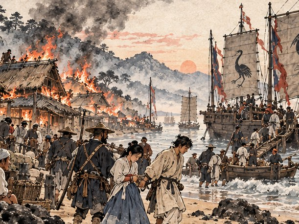
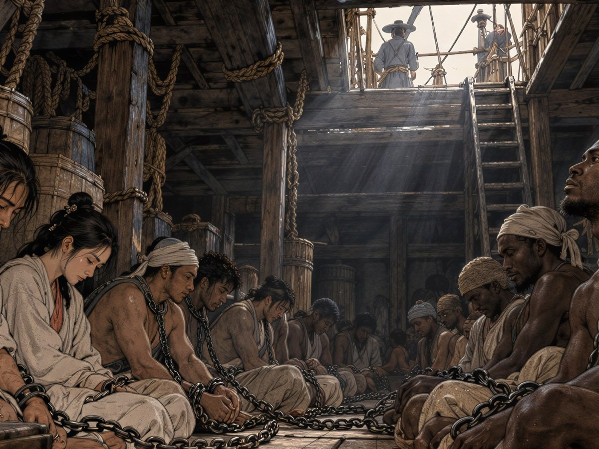

1522년 봄, 경상도 다대포.

서만길은 그날 새벽에도 장부 앞에 앉아 있었다. 객주 집 아들의 새벽은 늘 그랬다. 어제 들어온 미역 몇 동, 소금 몇 섬, 대마도 상인에게 외상으로 넘긴 무명 몇 필. 등잔 심지를 돋우고 주판알을 튕기다 보면 포구의 하루가 숫자로 줄을 섰다. 아버지는 그런 아들을 보고 "너는 잠보다 셈이 더 달구나" 하고 웃었다. 틀린 데 없이 맞아떨어진 장부를 덮을 때의 기분을, 만길은 잠보다 좋아했다.

그날은 마지막 줄이 맞지 않았다. 외상 장부의 합계가 은 두 냥쯤 어긋났다. 다시 셈하려고 주판을 털었을 때, 개가 짖었다. 한 마리가 짖자 온 포구의 개가 따라 짖었다. 그리고 냄새가 났다. 아궁이 냄새가 아니었다. 젖은 이엉이 타는 냄새, 기름 먹은 무언가가 타는 냄새였다.

문을 열자 포구가 붉었다.

물안개 사이로 배들이 닿아 있었다. 다섯 척. 앞장선 배는 갑판 위에 집을 올린 듯 망루가 높았고, 돛에는 검은 바탕에 날개를 편 흰 학이 그려져 있었다. 사람들이 뱃전에서 뛰어내려 물을 헤치며 올라왔다. 손에 든 횃불이 초가지붕에 하나씩 옮겨 갔다. 어디선가 마른 나무가 부러지는 것 같은 소리가 연달아 났다. 활보다 멀리서 사람을 쓰러뜨린다는 쇠막대 소리라는 것을, 만길은 한참 뒤에야 알았다.

"왜구다! 뒷산으로, 뒷산으로 가거라!"

아버지의 목소리였다. 아버지는 마당 한가운데 서서 일꾼들을 뒷문으로 밀어내고 있었다. 어머니가 안방에서 달려 나와 무명 보자기에 싼 무언가를 연이의 손에 쥐여 주었다. 연이가 무어냐고 물을 틈도 없었다. 어머니는 연이의 손을 두 손으로 꼭 감싸 쥐었다가 놓았다. 그것이 만길이 본 어머니의 마지막 얼굴이었다.

만길은 무엇을 챙겨야 할지 몰랐다. 손에 잡힌 것은 방금까지 들여다보던 장부였다. 외상 장부. 포구 사람 누가 누구에게 얼마를 빚졌는지, 이 집이 누구에게 무엇을 맡아 두었는지가 다 적힌 책. 이게 타면 포구의 셈이 다 사라진다. 그런 생각을 한 것도 아니었다. 손이 먼저 그것을 끌어안았다.

뒷산으로 오르는 길은 이미 막혀 있었다. 연기 속에서 칼날이 번득였고, 만길과 연이는 갯가로 떠밀렸다. 밧줄이 손목을 감았다. 같은 줄에 이웃 사람들이 묶였다. 사기막의 막손 아재, 연이의 동무 덕이, 어린 개동이. 망루 높은 배 위에서 얼굴에 긴 흉터가 난 사내가 그 광경을 내려다보며 웃고 있었다. 마을이 타는 동안 내내.

배에 실리면서 만길은 한 번 돌아보았다. 객주 집 지붕이 무너져 내리고 있었다. 아버지가 서 있던 마당은 연기에 가려 보이지 않았다. 연이가 묶인 손으로 만길의 소매를 잡았다. 만길은 장부를 놓지 않았다. 놓으면 무언가 하나가 더 끝날 것 같았다.

## 선창

대마도에서 그들은 처음으로 팔렸다.

천주로 가는 밀무역 선단의 짐칸이었다. 명나라 말을 쓰는 서기가 붓으로 무언가를 적었다. 만길은 그 글자를 읽을 수 있었다. 서당에서 배운 한자였다. 「高麗人 十四口」. 고려 사람 열넷. 입 열넷. 사람을 세는 말이 아니라 먹일 입을 세는 말이었다. 이름 적는 칸은 없었다.

천주에서 말라카까지 다시 몇 달. 말라카의 부두에서 그들은 또 팔렸다. 이번에는 붉은 십자를 돛에 그린 포르투갈 배였다. 선장은 곤살루 바스라는 사내였다. 햇볕에 그을린 얼굴에 목소리가 컸고, 사람을 짐처럼 세었다. 배에 오를 때 선원 하나가 만길의 품에서 장부를 빼앗았다. 앞뒤로 넘겨 보더니 읽을 수 없는 글자에 코웃음을 치고, 뱃전 너머로 던졌다. 장부는 잠깐 물 위에 떴다가, 펼쳐진 채로 가라앉았다.

그날부터 만길은 장부를 머릿속에 적었다.

선창은 어둡고 낮았다. 허리를 펴면 머리가 들보에 닿았다. 사다리 위 네모난 구멍으로 하루에 두 번 빛과 물이 내려왔다. 그 아래 여러 나라 사람들이 한 줄 사슬에 앉아 있었다. 말라카에서 탄 사람, 고아에서 탄 사람, 아프리카 해안에서 탄 사람. 말은 서로 통하지 않았다. 그래도 물 한 바가지가 내려오면 누구도 먼저 다 마시지 않았다. 바가지는 손에서 손으로 돌았고, 마지막 사람에게도 한 모금은 남았다. 말이 통하지 않는 사람들 사이에서 그것이 첫 약속이었다.

만길은 셈을 했다. 할 수 있는 일이 그것뿐이었다. 해 뜨는 쪽이 어느 쪽인지, 물통이 며칠에 하나씩 비는지, 배가 하루에 몇 마장쯤 가는지. 서기는 갑판 위에서 물통에 분필로 숫자를 그었다. 동그라미와 갈고리 같은 아라비아 숫자였다. 만길은 사다리 틈으로 그것을 훔쳐보며 하나씩 익혔다. 열흘이 지나자 서기의 셈을 서기보다 먼저 읽었다. 선원들이 외치는 말에서 숫자와 물과 바람을 뜻하는 포르투갈 말을 주워 담았다.

연이는 사람들의 이름을 물었다. 손짓으로, 제 가슴을 두드리며 "연이" 하고, 상대의 가슴을 가리키며 기다렸다. 고아에서 탄 늙은 직공의 이름도, 아프리카 해안에서 탄 젊은 어부의 이름도 그렇게 알았다. 연이는 그 이름을 소리 내어 한 번씩 불러 주었다. 불린 사람들은 처음에 놀란 얼굴을 했고, 그다음에는 웃었다.

고아를 지나 아프리카 해안을 따라 내려가는 동안 바다가 달라졌다. 물빛이 짙어졌고 바람이 차가워졌다. 남쪽 끝 곶을 돌 때는 사흘 밤낮 배가 비명을 질렀다. 선창 바닥으로 바닷물이 새어 들었다. 사람들은 서로의 사슬을 붙들고 버텼다.

만길과 연이 말고도 그 배에 실린 조선 사람은 열둘이었다. 열병이 돌았던 열흘 동안, 박 의원이 맨손으로 이마를 짚고 다녔지만 그중 둘을 붙잡지 못했다. 칠복 아재와 분이 할매. 선원들이 두 사람을 갑판 위로 데려갔고, 다시 내려오지 않았다. 갑판의 서기는 물통 옆에 분필로 줄 두 개를 더 그었다. 만길은 그 두 이름을 머릿속 장부의 맨 앞 장에 적었다. 숫자가 아니라 이름으로.

열둘 가운데 살아 닿은 이는 열이었다.

해가 바뀌었다. 겨울이 끝나 갈 무렵, 사다리 위 구멍으로 내려오는 바람에 흙냄새가 섞였다. 갈매기 소리가 들렸다. 선원들이 들떠서 무어라 외쳤다. 만길이 주워 담은 말로는 강, 그리고 집이라는 말이었다.

1523년 초, 포르투갈 왕국 리스본.

갑판으로 끌려 올라간 사람들은 눈을 뜨지 못했다. 선창에서는 조각으로만 보던 해가 머리 위에 있었다. 눈물이 저절로 흘렀다. 겨우 실눈을 뜨자 넓은 강어귀가 보였다. 강 위에 돛이 숲처럼 서 있었고, 언덕마다 흰 벽과 붉은 지붕이 층층이 쌓여 있었다. 다대포 사람 누구도 본 적 없는 크기의 도시였다.

만길은 연이의 손을 꼭 쥐었다. 손목의 쇠고랑끼리 부딪혀 작은 소리가 났다.

"……여기가 세상 끝이라는 곳인가 보오."

연이가 강물을 보며 말했다. 반년 동안 한 번도 무너지지 않은 목소리였다.

"끝이면 돌아갈 길도 있겠지요. 끝은 늘 처음과 이어져 있으니까."
