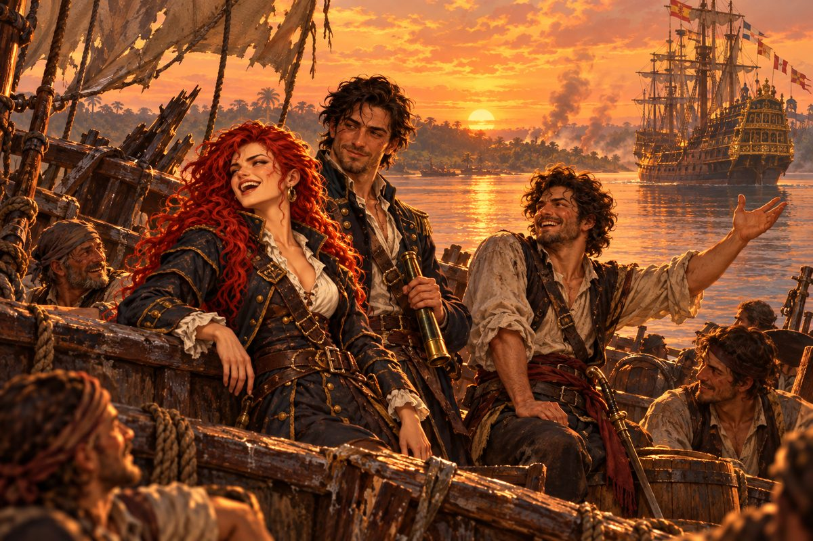

## 34. 신호기

해 질 녘이 되어서야 강 위의 연기가 걷혔다.

리벨리온의 갑판은 엉망이었다. 앞돛은 넝마가 되었고, 뱃머리는 마르티네스의 기함을 들이받을 때 절반쯤 부서져 있었다. 선원들은 그 위에 아무렇게나 누워 숨을 골랐다. 누군가 낮게 노래를 흥얼거렸다. 세비야의 뱃노래였다.

조안의 배가 다가와 나란히 섰다. 조안이 뱃전 너머로 손을 내밀었다. 카탈리나는 잠시 그 손을 보다가 마주 잡았다.

"축하하오, 카탈리나. 끝내 원수를 갚았군요."

"……그래."

"요새 쪽은 에제키엘 사령관이 끝장을 냈다 하오. 화약고까지 통째로 날아갔다더군." 조안이 강기슭을 보았다. 언덕 위에는 아직 검은 연기 몇 줄기가 피어오르고 있었다. "에스파니아 무적함대라는 이름이 괜한 게 아니었군."

조안 곁에 루치아가 서 있었다. 조안의 외투를 여전히 어깨에 두른 채였다. 그녀가 카탈리나에게 작게 손을 흔들었다. 세우타 여관 계단참에서 그랬던 것처럼. 카탈리나도 손을 들어 답했다. 이번에는 가슴이 답답하지 않았다.

그때 망대에서 사누드가 내려왔다.

"제독. 저쪽에 산타크루스호 뱃머리가 보여. 신호기가 올라왔어."

"뭐라는데?"

사누드는 망원경을 눈에 댄 채 깃발을 한 장씩 읽었다. 처음 쫓기던 그 겨울, 카디스 앞바다에서 그랬던 것처럼.

"승리를 축하한다. 다시 만나 결판을 낼 날을 기다리겠다. ……이상이야."

카탈리나는 강 하류 쪽을 보았다. 석양 속에 산타크루스호의 높은 선미루가 검게 솟아 있었다. 그 위 어딘가에 단추 하나 풀지 않은 사내가 서 있을 것이었다.

투항하겠다고 했다. 어떤 처분이든 피하지 않겠다고 했다. 그 말을 그녀는 잊지 않았다. 에제키엘도 잊지 않았을 것이다. 그런데 그는 지금 그녀를 잡으러 오는 대신 깃발을 올렸다. 다시 만나자고. 그때 결판을 내자고.

"다시 만나서 결판이라……." 카탈리나가 중얼거렸다. "둘 다 썩 내키지는 않는군."

"제독, 답신은?"

"내가 방금 기가 막힌 답을 하나 생각해 냈는데, 그걸 보냅시다." 기지가 손을 번쩍 들었다. 그는 목청을 가다듬고 신호수 흉내를 냈다. "너희쯤은 단숨에 바다에 처넣을 수 있으나, 묵은 정을 봐서 오늘만 참는다. 살고 싶거든 실은 금화와 짐을 전부 바쳐라. 어떻소?"

선원들이 와르르 웃음을 터뜨렸다. 누워 있던 자들이 배를 잡고 굴렀다.

사누드가 한숨을 쉬었다. "답장으로는 훌륭한데, 저 배 포가 안 닿는 데까지 간 다음에 올리자."

"결정만 내리십쇼, 제독!" 기지가 이를 드러내고 웃었다. "하하하!"

카탈리나는 두 사내를 보았다. 칼끝 앞에서 그녀의 일당이 되겠다던 요령 없는 사내. 널빤지에 매달려 와서 에르난의 이름을 꺼낸 술꾼. 두 해 동안 그녀를 바다 위에 붙들어 둔 것은 분노만이 아니었다. 그녀는 이제야 그것을 알았다.

그녀는 웃었다. 오랜만이었다. 너무 오랜만이라 웃는 법을 잊었을까 걱정했는데, 웃음은 저절로 터져 나왔다. 배 위의 모두가 그녀를 돌아보았다. 그리고 따라 웃었다.

## 35. 끝나지 않는 기록

그날 밤 카탈리나는 선실에서 오래된 상자를 열었다.

그 안에 그을린 깃발이 접혀 있었다. 두 해 동안 한 번도 꺼내 보지 않은 것이었다. 그녀는 깃발을 펼쳐 무릎 위에 놓았다. 소금물에 바랜 천, 불에 그을린 가장자리. 손끝으로 그 자국을 더듬었다. 처음 그것을 만졌던 날처럼.

"오빠. 에르난."

그녀는 그 이름들을 소리 내어 불러 보았다. 두 해 동안 원한과 함께가 아니면 입에 올리지 못했던 이름들이었다.

"끝났어."

대답은 없었다. 뱃전을 핥는 강물 소리와, 갑판 위에서 아직 웃고 떠드는 선원들의 소리뿐이었다. 기지가 또 무슨 허풍을 떠는 모양이었다. 사누드가 그것을 타박하는 소리도 들렸다.

카탈리나는 깃발을 다시 접었다. 그리고 그것을 상자에 넣는 대신 품에 안고 갑판으로 올라갔다.

밤하늘에 남쪽의 별들이 쏟아질 듯 떠 있었다. 미카엘이라면 저 별들의 이름을 알았을 것이다. 그녀는 이제 그 이름들을 직접 배워 볼 생각이었다.

"사누드."

"응, 제독."

"배가 다 고쳐지면 어디로 갈까."

사누드가 그녀를 보았다. 그는 그 질문을 두 해 동안 기다려 온 사람처럼 웃었다.

"그건 제독이 정할 일이지. 이 배 주인은 너니까."

리스본으로 가야 했다. 루치아를 어머니에게 데려다주겠다고 약속했다. 그다음은 몰랐다. 에제키엘과의 결판도, 조국에 지은 죄도, 그녀의 이름 앞에 붙은 반역자라는 말도 아직 그대로 남아 있었다. 그러나 오늘 밤만은 그 모든 것이 수평선 너머에 있었다.

---

그렇게 카탈리나 에란초는 오빠와 정혼자를 앗아 간 자에게 마침내 값을 치르게 했다. 두 해 가까이 그녀를 바다 위로 끌고 다닌 싸움도 이제 닫히는 것처럼 보였다.

그러나 바다는 기록을 남기지 않는다. 아침이 되자 리벨리온은 다시 돛을 올렸다. 아무 문장도 그려지지 않은 흰 돛이 바람을 가득 품고 부풀었다. 붉은 머리의 여제독은 고물에 서서, 처음으로 원한이 아닌 것을 바라보며 넓은 바다로 나아갔다.
