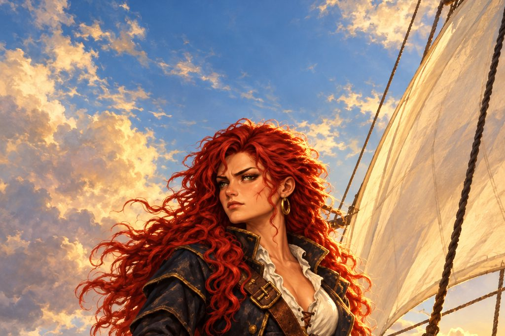

에스파니아 해군 중위 카탈리나 에란초는 오빠 미카엘과 약혼자 에르난을 바다에서 잃은 뒤, 군함을 빼앗아 스스로 반역자가 되어 원수를 쫓습니다. 해군의 추격과 동료들의 의심 속에서 리스본과 홍해, 신대륙을 누비며 두 사람을 죽인 자의 정체와 그 뒤에 숨은 마르티네스 후작의 음모에 다가갑니다.

:::caution[줄거리 공개]
이 소설에는 카탈리나 에란초 이야기의 처음부터 마지막 결말까지 모든 줄거리가 들어 있습니다. 게임을 먼저 즐기고 싶다면 다 끝낸 뒤에 읽으세요.
:::

## 차례

| 차례 | 내용 |
| --- | --- |
| [서장 ― 떠나는 돛](/novel/catalina/prologue/) |  |
| [1부 ― 반역의 돛](/novel/catalina/part1/) | 사령실의 깃발, 마데이라 포도주, 청원, 주정뱅이 |
| [2부 ― 추격자들](/novel/catalina/part2/) | 여해적의 이름, 산타크루스호, 포위, 널빤지 위의 사내 |
| [3부 ― 리스본의 노래](/novel/catalina/part3/) | 허풍쟁이, 마르세유의 매듭, 흥정, 리스본의 노래 |
| [4부 ― 홍해의 구원자](/novel/catalina/part4/) | 피라미들, 홍해 어귀, 구원자, 내가 믿은 것 |
| [5부 ― 신성왕국](/novel/catalina/part5/) | 이슬람 상인, 리스본의 어머니, 신성왕국, 남쪽 대륙 |
| [결말 ― 반란의 돛, 바다로](/novel/catalina/ending/) | 신호기, 끝나지 않는 기록 |
