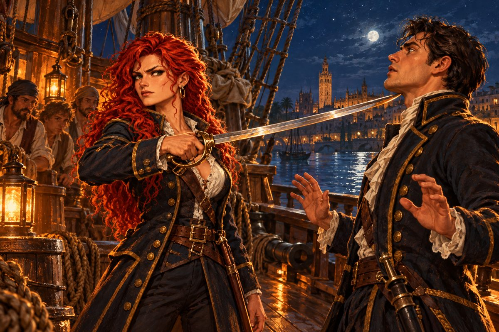

## 1. 사령실의 깃발

1522년 여름의 세비야는 숨이 막힐 만큼 더웠다. 한낮이면 돌길에서 열기가 아지랑이처럼 피어올랐고, 성벽 그늘마다 개들이 혀를 빼물고 누워 있었다.

카탈리나는 그날 아침 일찍 부두에 나가 있었다. 신대륙으로 나갔던 조사대가 돌아온다는 소문이 며칠 전부터 돌았기 때문이다. 미카엘의 함대가 소식을 끊은 지 석 달이 넘었다. 처음 한 달은 항해가 늦어지는 것이려니 했다. 두 달째에는 폭풍에 밀려 먼 항구에 들어갔으려니 했다. 석 달째부터는 아무 생각도 하지 않으려 애썼다.

부두 관리소 서기가 그녀를 보고 손을 들었다.

"에란초 중위님, 마침 잘 오셨습니다. 조금 전에 사누드 중위님이 중위님을 찾으셨어요. 곧장 사령실로 오시랍니다."

"사누드가?"

"네. 신대륙에 나갔던 배가 오늘 새벽 강을 거슬러 들어왔거든요. 아무래도 그 일과 관계가 있는 것 같던데요."

카탈리나는 대답 대신 고개만 끄덕였다. 사령실은 궁성 동쪽, 성문 오른편에 붙은 석조 건물이었다. 그곳까지 가는 길이 오늘따라 길었다. 단골 주점 앞을 지날 때 주인 영감이 문간에서 그녀를 불렀다.

"이봐, 에란초 중위. 오라버니 소식은 들었나? 걱정 말라고. 그 미카엘이 어디 쉽게 죽을 사람인가."

카탈리나는 걸음을 멈추지 않았다. 영감의 말이 맞기를, 그녀도 누구보다 바랐다.

사령실 앞 계단에서 프랑코 사누드가 기다리고 있었다. 미카엘 밑에서 일하던 동기 장교였다. 키가 크고, 표정이 좀처럼 바뀌지 않는 사내. 그 사누드가 오늘은 그녀의 눈을 피했다.

"카탈리나. 찾았어. 사령관께서 부르신다."

"오빠 얘기지? 그렇지?"

"그건……." 사누드가 입술을 깨물었다. "사령관께 직접 듣는 게 좋겠어."

함대사령관 에제키엘은 창을 등지고 앉아 있었다. 반백의 머리, 칼로 그은 듯 곧은 콧날, 언제나 단추 하나 풀지 않는 제복. 에스파니아 해군에서 그의 이름을 모르는 사람은 없었다. 그는 카탈리나에게 의자를 권했다. 사령관이 부하에게 의자를 권하는 일은 드물었다. 카탈리나는 그것만으로도 무엇을 듣게 될지 알 것 같았다.

"짐작하고 왔으리라 믿네, 중위. 자네 오빠 미카엘 준장의 일이다."

에제키엘은 서류 한 장을 내려다보며 담담하게 읽었다. 미카엘이 이끌던 왕립함대가 1522년 5월 10일 산토도밍고 앞바다에서 소식이 끊겼다는 것. 오늘 새벽 돌아온 조사대가 카리브 해역에서 난파선 한 척을 찾아냈다는 것. 배 안에는 아무도 없었고, 선체는 키조차 듣지 않을 만큼 망가져 있었다는 것.

"원인은 알 수 없네. 폭풍에 휩쓸린 것인지, 누군가의 공격을 받은 것인지."

"오빠가 해적 무리에게 질 리가 없습니다." 카탈리나의 목소리가 높아졌다. "게다가 그 배에는…… 에르난도 타고 있었어요."

"알고 있네." 에제키엘의 목소리가 처음으로 조금 낮아졌다. "미카엘은 유능한 제독이었다. 그리고 자네와 인연이 깊었던 오브레곤 부관도 더 바랄 것 없는 군인이었지."

사령관은 책상 밑에서 접힌 천 하나를 꺼내 책상 위에 펼쳤다. 소금물에 바래고 가장자리가 그을린 깃발이었다. 카탈리나는 그 깃발을 알았다. 에란초 가문의 문장을 미카엘이 직접 도안해 함대 깃발로 만든 것이었다. 출항하던 날 그 깃발이 기함 꼭대기에서 펄럭이는 것을 그녀는 부두에서 올려다보았다.

"현장을 조사하다 찾아냈다고 하네. 가혹하게 들리겠지만, 그들은 살아 있지 않을 가능성이 높다."

카탈리나는 깃발에 손을 얹었다. 거칠었다. 바다가 오래 씹다 뱉은 천이었다. 그을린 자국을 손끝으로 더듬었다. 폭풍은 천을 찢을 수는 있어도 태우지는 못한다. 그 생각이 머릿속을 스쳤지만 입 밖으로 나오지는 않았다.

에제키엘이 일어서서 벽에 걸린 사브르 한 자루를 내렸다. 손잡이에 가는 은실이 감긴, 오래 손을 탄 칼이었다.

"미카엘이 출항 전에 내게 맡기고 간 칼이네. 돌아오면 찾아가겠다더군." 사령관은 칼을 그녀에게 내밀었다. "이제 자네가 가지게. 낙심하지 말게, 중위. 자네는 그들 못지않은 인재야. 지금은 힘들겠지만, 다시 일어서리라 믿네."

카탈리나는 두 손으로 칼을 받았다. 무거웠다. 오빠의 손이 수천 번 쥐었던 무게였다. 에제키엘은 그을린 깃발을 반듯하게 접어 그 칼 위에 얹어 주었다. 가족이 간직하는 것이 옳다고, 그는 짧게 말했다.

"사누드 중위, 에란초 중위를 배웅하도록."

계단을 내려오는 동안 사누드가 낮게 말했다.

"힘을 내, 카탈리나. 미카엘 제독은 나한테도 은인이었어. 그 배에 무슨 일이 있었는지, 반드시 같이 밝혀내자."

## 2. 마데이라 포도주

해가 기울 무렵 사누드가 그녀를 주점으로 끌고 갔다.

"사령실 앞에 서 있어 봐야 아무것도 안 나와. 뱃사람 소문은 주점에 제일 먼저 닿는 법이야."

주점 안은 담배 연기와 생선 기름 냄새로 뿌옜다. 주인 영감이 카탈리나를 보더니 입을 열려다가, 사누드가 고개를 젓는 것을 보고 도로 다물었다. 사누드는 구석 탁자에 앉아 손가락 두 개를 들었다.

"영감, 마데이라산으로 두 잔. 좋은 걸로."

잔이 놓였다. 카탈리나는 마시지 않았다. 호박색 포도주가 등잔불을 받아 흔들렸다.

"사누드. 나는 오빠가 폭풍 따위로 배를 잃었다고 생각하지 않아."

"나도 그래." 사누드가 잔을 비웠다. "왕립함대야. 폭풍 하나에 배가 다 사라질 리 없지. 아마 카리브를 휘젓는 해적 놈들 짓이겠지."

"어떻게 하면 진짜 원수를 하루라도 빨리 찾을 수 있을까."

"우린 해군 사관이야. 항해가 잦지. 항구에 닿을 때마다 귀를 열어 두는 수밖에 없어." 사누드는 그렇게 말하다가 문득 턱으로 옆 탁자를 가리켰다. "저기 저 사람들, 뭔가 쑥덕거리고 있군."

옆 탁자에서 선원 둘이 머리를 맞대고 있었다. 하나가 다른 하나를 조반니라고 불렀다.

"카리브 해에서 왕립함대가 통째로 사라졌다는 얘기 들었지? 흑수염 짓이라던데."

"쉿, 목소리 낮춰. 그게 아니래." 조반니라는 사내가 주위를 살폈다. "아는 선장한테서 들은 얘기야. 산토도밍고에서 물이랑 식량을 싣고 있는데 어디서 배들이 몰려와서 함대에 불을 질렀대. 불길이 어찌나 세던지 밤인데도 대낮처럼 밝아서, 덮친 배들 돛에 뭐가 그려졌는지 다 보였다는 거야."

"뭐가 그려져 있었는데?"

"붉은 십자가. 마르타 기사단의 붉은 십자가 말이야."

"그거…… 페레로 공작네 함대 문장 아니야? 포르투갈 놈들이 끼었단 말이지?"

"그러니까 큰소리로 못 하는 얘기지. 하여간 포르투갈 놈들은 믿을 수가 없다니까."

카탈리나는 의자를 밀고 일어섰다. 사누드가 소매를 잡을 틈도 없었다.

"방금 그 이야기, 한 번만 더 해 주겠어요?"

선원들이 그녀를 올려다보았다. 제복을 보고 얼굴이 굳었다.

"당신은 누구요?"

"에스파니아 해군 사람입니다. 그 이야기, 사실입니까?"

조반니가 잔을 만지작거렸다. "……사실인지는 나도 모르오. 뱃사람들 사이에 꽤 퍼진 소문이라는 것뿐이지. 나는 들은 대로 말했을 뿐이오."

카탈리나는 자리로 돌아왔다. 잔을 들어 단숨에 비웠다. 포도주가 목을 태우며 내려갔다.

"사누드. 지금 들은 걸 사령관께 보고하겠어. 그리고."

"그리고?"

"사령관께 정식으로 청하겠어. 페레로 가를 치게 해 달라고."

## 3. 청원

이튿날 아침 에제키엘은 같은 의자에, 같은 자세로 앉아 있었다. 다만 이번에는 그녀에게 의자를 권하지 않았다.

"왕립함대를 친 자들을 알아냈습니다." 카탈리나는 똑바로 서서 말했다. "포르투갈 재상 페레로 공작과 그 아들 조안입니다. 산토도밍고에서 불을 지른 배들의 돛에 페레로 가의 붉은 십자가가 있었다는 증언이 있습니다."

"증언이라." 에제키엘이 손가락을 깍지 꼈다. "누구의 증언인가."

"……선원들 사이에 도는 이야기입니다. 하지만 목격한 선장이 있다고 합니다."

"그 선장의 이름은? 그 배의 이름은?"

카탈리나는 대답하지 못했다. 그녀는 숨을 한 번 고르고, 준비해 온 말을 했다.

"제게 군함 한 척과 병력을 내어 주십시오. 오빠와 오브레곤 부관을 그렇게 만든 자들에게 제 손으로 값을 치르게 하겠습니다. 간청드립니다, 사령관님."

에제키엘은 오래 그녀를 바라보았다. 창밖에서 수병들이 구령에 맞춰 발을 구르는 소리가 들렸다.

"중위. 자네는 지금 자기가 무슨 말을 하는지 알고 있나."

"그건……."

"자네 말은 근거 없는 추측에 불과하네. 그리고 이것 하나만은 분명하지. 그 청원을 받아들이는 순간 에스파니아와 포르투갈은 전쟁을 하게 된다. 술집 소문 하나로 두 나라의 젊은이 수천을 바다에 묻을 수는 없네." 사령관의 목소리에는 노여움보다 피로가 묻어 있었다. "헛된 생각은 버리고 자네 자리를 지키게. 그것이 미카엘이 자네에게 바랐을 일이야."

카탈리나는 경례를 하고 물러났다. 경례하는 손끝이 굳어 있었다.

복도에서 기다리던 사누드가 그녀의 얼굴을 보고 아무것도 묻지 않았다.

## 4. 주정뱅이

그날 밤 주점은 붐볐다. 신대륙에서 돌아온 조사대 선원들이 몇 달 치 급료를 털어 마시고 있었다. 노랫소리와 웃음소리가 천장을 울렸다. 카탈리나와 사누드의 탁자만 조용했다.

"사령관 생각이 틀린 건 아니야." 사누드가 말했다. "두 나라 사이에 전쟁이 나면 미카엘도 원하지 않았을 거고."

"그럼 난 어떻게 해야 하지?"

"……모르겠어. 그렇다고 포기하라고는 못 하겠군."

카탈리나는 잔을 내려다보았다. 잔 속에 등잔 불꽃이 비쳤다. 그 불꽃이 산토도밍고의 불길처럼 보였다. 그녀가 그날 밤 무엇을 하고 있었는지 기억했다. 세비야의 하숙방에서 에르난에게 보낼 편지를 쓰고 있었다. 바다 건너에서 오빠와 약혼자가 불타는 배 위에 있을 때.

"주저앉은 게 아니야." 그녀가 중얼거렸다. "분해서 그래. 오빠가 불길 속에 있을 때 나는 손 하나 쓰지 못했어."

"카탈리나……."

"사누드. 나 해군을 그만둘까 해."

사누드가 잔을 내려놓았다. "뭐라고? 해군의 지원도 없이 어떻게 하려고."

"제복을 입고 있는 한 나는 아무것도 못 해. 명령을 기다리다 늙어 죽을 거야."

"하지만 페레로 가는 너무 큰 상대야. 포르투갈의 재상이라고. 민간인 혼자 힘으로 일국의 재상을 친다는 건 꿈같은 얘기야."

그때 옆자리에서 누군가 혀를 찼다.

"흥, 한심하군."

두 사람이 고개를 돌렸다. 벽에 기대앉은 사내 하나가 술병을 끌어안고 있었다. 수염은 며칠째 깎지 않았고, 셔츠 앞섶은 포도주 얼룩투성이였다. 그러나 눈만은 술에 젖지 않은 것처럼 맑았다.

"뭐야, 넌." 사누드가 말했다.

"아, 나야 그냥 술꾼이오. 다만 당신 말이 하도 귀에 거슬려서." 사내는 병째로 한 모금 마셨다. "질 것 같으니 칼도 안 뽑아 보고 물러서겠다? 에스파니아 해군 장교라는 양반들이 고작 그 정도요?"

사누드의 얼굴이 붉어졌다. "제 앞가림도 못 하는 주정뱅이가 뭘 안다고. 카탈리나, 나가자."

그러나 카탈리나는 일어나지 않았다. 그녀는 술꾼을 보고 있었다. 정확히는 술꾼의 말을. 질 것 같으니 칼도 뽑지 않는다. 그 말이 가슴 어딘가에 박혀 빠지지 않았다.

"기다려, 사누드. 이제야 마음을 정했어."

"무슨 마음?"

카탈리나는 사누드의 눈을 보았다. 그를 끌어들여서는 안 된다는 것을 그녀는 알았다. 그러나 혼자서는 배 한 척도 움직일 수 없다는 것도 알았다.

"부탁이 있어, 사누드. 나를 도와줘."

사누드는 그녀를 오래 보았다. 그리고 한숨처럼 대답했다.

"……그래. 무슨 일인지는 몰라도, 내 힘이 닿는 데까지는."

"그럼 항구로 가자. 지금 당장."

두 사람이 나간 뒤 술꾼은 빈 의자를 향해 병을 들어 보였다. 그 눈에 웃음 같은 것이 스쳤다. 아무도 그것을 보지 못했다.

## 5. 반역

밤의 부두는 고요했다. 강물이 말뚝을 핥는 소리와 멀리서 짖는 개 소리뿐이었다. 정박한 배들 사이로 등불 몇 개가 졸고 있었다.

사누드가 지휘하는 배는 부두 끝에 매여 있었다. 지난봄 진수한 최신 갤리온이었다. 신대륙의 금을 실어 나르기 위해 만든 배라 선체가 깊고 단단했고, 양현에 포문이 가지런히 뚫려 있었다. 달빛이 새로 칠한 뱃전 위로 미끄러졌다.

"아름다운 배야." 카탈리나가 말했다. 그녀는 사다리를 올라 갑판에 섰다. 당직 수병 몇이 잠에서 깨어 그녀에게 경례했다.

"그래, 우리 함대에서 제일 새 배지." 사누드가 뒤따라 올라왔다. "그런데 여긴 왜……."

카탈리나가 돌아섰다. 그녀의 손에 미카엘의 사브르가 들려 있었다. 칼끝이 사누드의 목 앞에서 멈췄다.

"신대륙 금을 나르는 배라. 이 배, 내가 가져야겠어, 사누드."

"카탈리나! 지금 뭐 하는 거야. 미쳤어?"

"해적이 되기로 했어. 그 첫 배를 에스파니아 해군에게서 얻어 가야겠어."

당직 수병들이 웅성거렸다. 하나가 허리의 칼로 손을 가져가다가 카탈리나의 눈과 마주쳤다. 손이 멈췄다.

"이건 반역이야." 사누드의 목소리가 떨렸다. 두려움 때문이 아니었다. "제발 그만둬. 사령관께서 절대 가만있지 않을 거야. 지금 멈추면 없었던 일로 해 줄게. 내가 어떻게든 해 볼게."

"두려워? 그럼 됐어." 카탈리나는 칼을 거두지 않았다. "움직이지 마. 반항하지 않으면 아무 짓도 안 해. 넌 인질 노릇만 하면 돼. 안전한 중립 항구에 닿으면 내려 줄게. 그때까지만 참아."

그녀의 목소리가 처음으로 흔들렸다.

"사누드. 너한테 씻지 못할 짓을 하고 있다는 거 알아. 하지만 다른 길이 없어. 나는 이제 이렇게밖에 살 수 없는 사람이 됐어."

사누드는 칼끝을 내려다보았다. 그리고 칼을 쥔 그녀의 손을 보았다. 손가락 마디가 하얗게 질려 있었다. 그는 아주 오래 숨을 내쉬었다.

"……그래, 됐어. 네 속은 충분히 들었으니까 그 칼은 이제 내려."

"뭐?"

"한패가 되겠다고. 제복은 벗고 너를 따라가겠어." 사누드는 손을 들어 칼등을 살짝 밀어냈다. "다만 분명히 해 두자. 지휘자도 책임자도 너야. 나는 협박에 못 이겨 끌려간 거고. 반역죄 주모자는 교수형이지만, 협박당한 공범쯤은 감옥에서 끝나겠지."

카탈리나는 칼을 내렸다. 그녀는 무어라 말하려다 그만두었다. 목이 메어 있었다.

"……고마워."

"고마워할 것 없어." 사누드가 쓴웃음을 지었다. "하룻밤 사이에 배도 빼앗기고 빈털터리 해적이 됐군. 이제 이 배는 네 거니까 이름이나 지어."

카탈리나는 갑판을 둘러보았다. 돛대와 밧줄과 접힌 돛. 달빛 아래 잠든 포들. 이 배는 이제 왕의 것이 아니었다. 그렇다고 그녀의 것도 아니었다. 이 배는 그녀의 분노가 될 것이었다.

"리벨리온."

"반란이라." 사누드가 그 이름을 입속에서 굴려 보았다. "여해적의 기함다운 이름이군."

당직 수병들은 어찌할 바를 몰라 서로 얼굴만 보았다. 카탈리나는 그들 앞에 섰다.

"내리고 싶은 사람은 지금 내려. 남는 사람은 오늘부터 반역자다. 대신 내가 너희를 굶기지는 않겠다."

여섯 중 둘이 사다리를 내려갔다. 넷이 남았다. 그중 가장 어린 수병이 말했다. "미카엘 제독님 밑에서 일했던 형이 그 배에 있었습니다." 카탈리나는 그 수병의 어깨를 한 번 쥐었다가 놓았다.

## 6. 강을 내려가며

리벨리온은 동트기 전에 밧줄을 풀었다.

강물을 따라 하류로 미끄러지는 동안 세비야의 종탑이 천천히 멀어졌다. 성당의 히랄다 탑 꼭대기가 새벽빛을 받아 분홍색으로 물들었다. 카탈리나는 그 탑을 보지 않으려 했다. 에르난과 함께 가기로 한 성당이 그 탑 아래 있었다.

강어귀 산루카르에 닿았을 때 해가 떠올랐다. 강물의 흙빛이 바다의 푸른빛과 섞이는 자리에서 배가 처음으로 크게 흔들렸다. 짠바람이 얼굴을 때렸다. 카탈리나는 고물에 서서 키를 잡은 사누드 옆에 섰다.

"추격대가 붙을 때까지 하루는 걸릴 거야." 사누드가 말했다. "사령관은 서두르는 사람이 아니니까. 대신 한번 움직이면 끝을 보는 사람이지."

"알아."

"선원이 턱없이 모자라. 포를 다룰 사람도, 돛을 다룰 사람도. 첫 항구에서 사람부터 모아야 해. 돈도 필요하고."

"그것도 알아."

사누드가 그녀를 곁눈질했다. "그럼 하나만 더. 이제부터 널 뭐라고 불러야 하지? 중위는 아니고."

카탈리나는 대답하지 않았다. 사누드가 혼자 고개를 끄덕였다.

"제독. 배를 가진 해적 두목한테는 그게 어울리겠지. 어때, 제독."

그 호칭은 미카엘의 것이었다. 카탈리나는 바다를 보았다. 서쪽 수평선 너머 어딘가에 산토도밍고가 있었다. 오빠와 에르난이 마지막으로 본 바다가 있었다.

"좋아. 그렇게 불러."

그녀는 미카엘의 사브르를 허리에 찼다. 칼집이 허벅지에 닿는 감촉이 낯설었다. 곧 익숙해질 것이었다.

리벨리온의 돛에는 아무 문장도 그려지지 않았다. 카스티야의 성도, 레온의 사자도 없었다. 흰 돛만이 바람을 가득 품고, 대서양을 향해 부풀었다.
