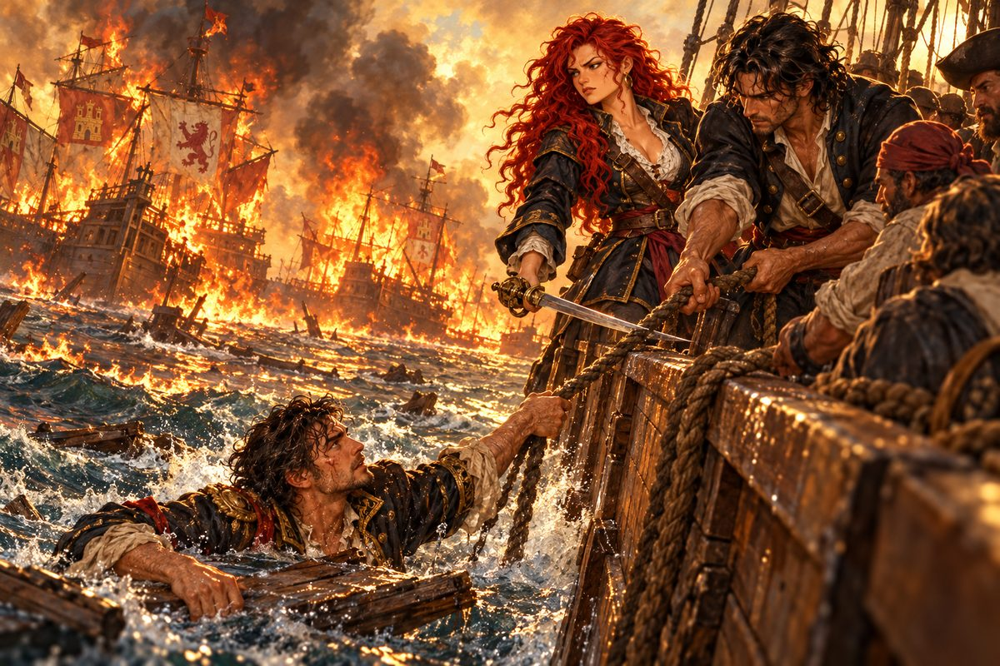

## 7. 여해적의 이름

이름은 생각보다 빨리 퍼졌다.

첫 두 달 동안 리벨리온은 이베리아 반도 남쪽 바다를 오가며 상선을 털었다. 카탈리나는 원칙을 세웠다. 항복한 배의 선원은 죽이지 않는다. 화물은 빼앗되 물과 식량은 남긴다. 에스파니아 국기를 단 배는 건드리지 않는다. 마지막 원칙에 대해 사누드는 아무 말도 하지 않았다. 그것이 그녀의 마지막 자존심이라는 것을 그도 알았다.

선원은 항구마다 조금씩 늘었다. 빚에 쫓기는 뱃사람, 배에서 쫓겨난 포수, 고향이 싫어 바다로 나온 청년들. 그들은 붉은 머리 여제독의 배라는 소문을 듣고 찾아왔다. 처음에는 여자의 배라고 비웃던 자들도 첫 해전을 치르고 나면 입을 다물었다. 카탈리나는 해군에서 배운 모든 것을 해적질에 쏟았다. 바람을 읽는 법, 포격의 순서, 적선의 옆구리를 찌르는 각도. 해군의 정석으로 싸우는 해적은 흔치 않았다.

그해 가을, 세비야 바깥의 한 항구에서 사누드가 시장 어귀의 상인들 사이를 돌다 돌아왔다. 얼굴이 굳어 있었다.

"제독. 부두에 고약한 소문이 돌아."

"어떤 소문?"

"에제키엘 사령관이 왕궁에 정식으로 해적 토벌을 청했대. 불법 해적단 하나를 소탕하겠다고. 누구 얘긴지는 묻지 않아도 알겠지."

카탈리나는 창밖의 바다를 보았다. "그래? 적으로 만나고 싶지 않은 사람이었는데."

"어떻게 할 거야?"

"자수할 생각이 있느냐고 묻는 거라면, 대답은 정해져 있어."

"그렇겠지. 끝까지 싸울 작정이군."

카탈리나가 사누드를 돌아보았다. "너는 그만둬도 돼. 지금쯤 조국에 항복하면 너만은 용서받을지도 몰라. 협박에 끌려왔다고 했잖아."

사누드는 웃지도 화내지도 않았다. "한번 너한테 붙기로 마음먹었으면 그걸로 끝이야. 흔들릴 일은 없어."

"아, 그렇지. 잊고 있었네." 카탈리나의 입꼬리가 아주 조금 올라갔다. "넌 요령이라곤 없는 사람이었지."

## 8. 산타크루스호

겨울로 들어설 무렵, 그들은 카디스 앞바다에서 추격대를 만났다.

처음에는 수평선에 돛 세 개가 보였다. 다음에는 일곱. 그다음에는 셀 수 없었다. 돛대 꼭대기 망대에서 망꾼이 비명처럼 외쳤다.

"제독! 함대입니다! 에스파니아 군함! 열, 열다섯…… 더 옵니다!"

카탈리나는 망원경을 눈에 댔다. 돛마다 카스티야의 성과 레온의 사자가 펄럭였다. 1년 전 세비야 부두에서 올려다보던 그 깃발이었다.

"장관이로군." 그녀가 중얼거렸다. "무적함대가 통째로 나오기라도 했나."

"전초전인데 벌써 이 규모라니." 사누드가 이를 악물었다. 그의 눈이 함대 한가운데의 커다란 배에 멈췄다. "제독, 저기…… 사령관의 기함이야. 산타크루스호."

산타크루스호는 다른 배들보다 머리 하나가 컸다. 높은 선미루에 금박 장식이 햇빛을 받아 번쩍였다. 그 돛대에 신호기가 줄지어 올라갔다. 사누드가 해군에서 수천 번 읽었을 깃발들이었다. 그는 망원경을 눈에 댄 채 한 장씩 소리 내어 읽었다.

"쓸데없는 저항을 그만두고 항복하라. 지금 항복하면 사면될 수도 있다." 사누드가 잠시 멈췄다가 이어 읽었다. "그러나 끝까지 저항한다면, 반란군에게는 미래도, 희망도, 목숨도 없을 것이다."

갑판 위가 조용해졌다. 선원들이 카탈리나를 보았다.

"반란군이라." 카탈리나가 웃었다. 바람이 붉은 머리칼을 휘날렸다. "제대로 알고 있군. 이 배 이름이 뭔지."

그녀는 사브르를 뽑아 하늘로 치켜들었다.

"항복은 없다! 우리는 끝까지 싸운다! 포문 열어!"

첫 포성이 울렸다. 리벨리온의 포탄이 선두 군함의 앞돛대를 꺾었다. 군함들이 대열을 펼치며 양쪽에서 조여 왔다. 해군의 진형이었다. 카탈리나는 그 진형을 알았다. 그 진형의 약점도 알았다. 그녀는 대열이 다 펼쳐지기 전의 틈을 노려 배를 밀어 넣었고, 오른편 군함 둘의 사이를 빠져나가며 양현으로 동시에 포를 쏘았다.

"방향타 유지해!" 사누드가 키잡이에게 고함쳤다. 그러고는 고물 쪽을 돌아보았다. "제독! 뒤쪽에 후속대가 더 보여! 이대로면 둘러싸인다. 일단 물러나야 해!"

카탈리나는 산타크루스호를 노려보았다. 그 높은 선미루 어딘가에 에제키엘이 서서 이쪽을 보고 있을 것이었다. 그녀에게 의자를 권하던 사람. 미카엘의 칼을 건네주던 사람.

"……물러난다. 돛 전부 펼쳐!"

리벨리온은 바람을 등지고 남쪽으로 달아났다. 등 뒤에서 포성이 한참 동안 따라왔다.

## 9. 포위

그 뒤로 한 달 동안 그들은 쫓겼다.

항구에 들어가면 사흘 안에 군함이 나타났다. 바다로 나가면 수평선 어딘가에 늘 낯익은 돛이 걸려 있었다. 에제키엘은 서두르지 않았다. 사누드의 말대로였다. 한번 움직이면 끝을 보는 사람. 그는 그물을 던지는 어부처럼 천천히, 그러나 빈틈없이 포위망을 좁혀 왔다.

"에스파니아 함대와 다시 맞붙겠다." 어느 아침 카탈리나가 말했다. "도망만 다니다가는 물과 식량이 먼저 떨어져."

그 싸움에서 그들은 포위되었다.

해가 중천에 떴을 때, 리벨리온의 사방에 돛이 있었다. 앞에도, 뒤에도, 양옆에도. 포연이 바다를 덮어 하늘이 누렇게 보였다. 선원 몇이 갑판에 쓰러져 있었고, 앞돛은 찢어져 너덜거렸다.

"제독. 완전히 포위됐어." 사누드의 얼굴이 그을음으로 검었다. "더는 빠져나갈 길이 없어."

카탈리나는 뱃전을 짚었다. 손바닥 아래에서 배가 떨렸다. 포탄이 바로 옆 물에 떨어져 물기둥이 솟았다.

"……여기서 끝나는 건가."

그녀는 사누드를 보았다. 그를 이 배에 태운 것은 그녀였다. 칼을 들이대고. 이 넷의 수병도, 항구마다 모인 저 사내들도, 모두 그녀가 데려온 사람들이었다.

"사누드, 미안해. 내 원한에 너까지 끌어들였어. 부디 날 용서해……."

"그만해!" 사누드가 그녀의 어깨를 움켜쥐었다. 그가 그렇게 소리치는 것을 그녀는 처음 들었다. "약한 소리 하지 마! 나는 네 생각이 옳다고 여겨서 스스로 따라온 거야. 협박? 그런 건 처음부터 없었어. 자, 마지막까지 싸우다 죽자."

카탈리나는 그의 손을 마주 잡았다. 그리고 돌아서서 갑판 전체에 들리도록 외쳤다.

"전원 전투태세! 우리는 여기서 결사항전한다!"

선원들이 함성을 질렀다. 포수들이 다시 포에 매달렸다. 그런데 바로 그때, 사누드가 눈을 가늘게 떴다.

"제독. 적의 움직임이 이상해."

포위망 한쪽이 술렁이고 있었다. 군함들이 대열을 잃고 서로 엉켰다. 그리고 그 한가운데에서 불길이 치솟았다. 처음에는 한 척, 다음에는 그 옆의 배, 그다음에는 바람을 타고 또 옆의 배. 돛이 횃불처럼 타올랐다.

"화공이다! 누가 저들 사이에 불을 질렀어!"

불타는 배들이 바람에 밀려 대열 안쪽으로 흘러들었다. 에스파니아 군함들이 불붙은 배를 피하느라 앞다투어 방향을 틀었다. 포위망이 무너졌다. 신호 나팔이 다급하게 울렸고, 군함들은 하나둘 뱃머리를 돌려 물러나기 시작했다.

"적이…… 퇴각하고 있어?"

카탈리나는 넋을 잃고 그 광경을 보았다. 불길이 바다 위에 붉은 길을 깔았다. 그 붉은 빛 속에서 그녀는 1년 전의 산토도밍고를 보았다. 오빠의 배도 저렇게 탔을까. 에르난도 저 불빛을 보았을까.

"후, 살았어. 정말이지 천운이군." 사누드가 이마의 땀을 훔쳤다. 그러다 그의 손이 멈췄다. "……그런데 저건 뭐지?"

## 10. 널빤지 위의 사내

불타는 배들 사이로 널빤지 하나가 떠내려오고 있었다. 그 위에 사람 하나가 매달려 있었다. 에스파니아 해군 장교의 제복을 입은 사내였다.

"끌어올려!"

선원들이 밧줄을 던졌다. 사내는 밧줄을 붙잡고 뱃전을 기어올라 갑판에 대자로 뻗었다. 물을 한 바가지는 토해 내고서야 고개를 들었다.

"후아, 살았다!"

카탈리나는 그의 목에 칼끝을 겨누었다. "꼼짝 마라. 너를 포로로 잡는다. 이름과 계급을 대."

사내는 칼끝을 보고 히죽 웃었다. "해적이 큰소리는. 안드레아 기지라 하오. 계급은 대위, 소속은 에스파니아 해군."

"해군 대위가 왜 널빤지에 매달려 있었지?"

"내가 불을 질렀으니까." 기지가 젖은 머리를 털었다. 물방울이 사방으로 튀었다. "아까 우리 함대를 태워서 당신들을 살려 준 사람이 바로 나란 말이오. 그러니까 나는 당신들 목숨의 은인이지."

"그딴 허풍을 믿으라고? 생판 처음 보는 놈이 왜 우리 편을 들어."

"이런, 그때도 꼴이 말이 아니더니 기억력까지 형편없군." 기지가 혀를 찼다. "벌써 잊었소? 뭐, 그날 밤 내 꼴이 술독에 빠진 생쥐였으니 그럴 만도 하지."

카탈리나의 칼끝이 조금 흔들렸다. 수염을 깎았고 제복을 입었지만, 그 눈은 알아볼 수 있었다. 술에 젖지 않은 것처럼 맑던 눈.

"너…… 그날 세비야 주점의 그 주정뱅이?"

"이제야 알아보는군." 기지가 몸을 일으켜 앉았다. 그의 얼굴에서 웃음기가 조금 가셨다. "내가 왜 당신들을 도왔는지 말해 줄까. 나는 에르난 오브레곤과 같은 해에 임관했소. 동기였지."

카탈리나의 숨이 멎었다.

"에르난은 귀족인데도 좋은 녀석이었소. 나는 제노바 빈민가 출신이오. 사관학교에서 나한테 말을 거는 귀족 자제는 없었지. 에르난만 빼고." 기지는 바다를 보았다. 불타는 배들이 아직 수평선 가까이에서 연기를 올리고 있었다. "그 녀석한테 마음의 빚이 있었소. 그날 밤 주점에서 당신들 얘기를 다 들었지. 그리고 생각했소. 에르난의 약혼자가 원수를 갚겠다는데 나는 해군 제복을 입고 그 여자를 쫓고 있구나."

"……."

"그래서 이렇게 됐소. 당신들이 하려는 일에 끼고 싶기도 하고." 기지가 손을 내밀었다. "어떻소, 나를 끼워 주지 않겠소? 이래 봬도 꽤 쓸모 있는 놈이오. 배에 불 지르는 솜씨는 방금 보셨고."

사누드가 카탈리나를 보았다. "제독. 어떻게 할까."

카탈리나는 오래 기지를 내려다보았다. 그리고 칼을 거두었다.

"풀어 줘라. 합류를 허락한다."

"휴, 고맙소, 제독님."

"고맙다는 말은 네 입한테나 해." 카탈리나가 차갑게 말했다. "네 입에서 에르난이라는 이름이 안 나왔으면 넌 지금쯤 상어 뱃속에서 단잠을 자고 있었을 테니까. 그리고 기억해 둬. 네가 믿을 만한 놈인지 계속 지켜볼 거다. 배신하면 그때는 망설이지 않고 죽인다."

"명심하겠소." 기지는 경례 흉내를 냈다. 해군식 경례였다. 그러다 멋쩍은지 손을 내렸다. "아, 이제 해군이 아니지. 해적식 인사는 어떻게 하는 거요?"

그날 밤 카탈리나는 선실에서 혼자 오래 앉아 있었다. 에르난의 동기. 에르난이 친절을 베풀었던 가난한 제노바 사내. 그녀가 모르는 에르난의 조각이 이 배에 올라탔다. 그것이 이상하게 위로가 되었다.

## 11. 두 개의 소문

기지는 금세 배에 녹아들었다. 입이 거칠고 성미가 급했지만 뱃일에 능했고, 무엇보다 선원들을 웃길 줄 알았다. 사누드와는 하루가 멀다 하고 티격태격했다. 사누드는 기지를 경박하다고 했고, 기지는 사누드를 돌부처라고 불렀다. 카탈리나는 두 사람의 다툼을 말리지 않았다. 다투는 동안에는 둘 다 살아 있다는 뜻이었다.

해가 바뀌고 1523년이 되었다. 어느 항구에서 사누드가 새 소문을 물어 왔다.

"제독, 이상한 얘기를 들었어."

"또 사령관의 추격대 얘기야?"

"아니, 제독의 원수 얘기요." 기지가 끼어들었다. "페레로 가 아들 조안이 집에서 쫓겨나 바다를 떠돌고 있다는군. 공작이 아들한테 젊은 시절 자기 흉내라도 내 보라고 내보낸 건가."

카탈리나의 눈빛이 바뀌었다. "사실이라면 하늘이 돕는 거지."

"그렇지! 리스본 저택에 처박혀 있으면 손도 못 대지만, 바다에 나와 있다면 얘기가 다르잖소. 수장시킬 기회가 얼마든지 있다는 소리지."

"기지."

"예이, 제독. 뭡니까?"

"페레로 가 아들놈은 내가 죽인다." 카탈리나가 그를 똑바로 보았다. "누구든 먼저 손대면 내가 가만두지 않아."

"예, 예. 알아 모시겠습니다요." 기지가 어깨를 으쓱했다. "그 성미, 늘 화끈하시구만."

몇 주 뒤 또 하나의 소문이 들려왔다. 포르투갈의 왕자가 행방불명되었다는 것. 그리고 사람들은 페레로 공작이 아들 조안에게 왕위를 물려주려고 왕자를 납치해 죽였다고 수군거린다는 것.

"그게 사실이라면 역시 페레로 가 놈들은 죽어 마땅한 악당이군." 카탈리나가 말했다.

"해적보다 더한 놈들이네요." 기지가 혀를 찼다.

그들은 리스본에 들렀다. 테주 강가 언덕 위에 페레로 공작의 저택이 있었다. 하얀 석회벽에 푸른 타일을 두른, 정원에 오렌지 나무가 늘어선 저택이었다. 카탈리나는 대문 앞에 오래 서 있었다.

"제독. 여기가 페레로의 집이야." 사누드가 낮게 말했다. "들어가면 살아서는 못 나와."

"제독님, 담 넘어 들어가서 때려죽입시다." 기지가 주먹을 쥐었다.

"멍청하긴. 이런 데서 소란을 피워서 온 리스본의 눈을 다 끌어모을 셈이야?"

대문이 열리고 늙은 하인이 나왔다. 그는 세 사람을 위아래로 훑어보았다.

"이 저택에 무슨 용무가 있으십니까?"

"아, 아닙니다. 길을 잘못 들었나 봅니다."

그들은 돌아섰다. 등 뒤에서 하인이 중얼거리는 소리가 들렸다. 수상한 세 사람이로군.

그 뒤로 그들은 유럽의 항구마다 들러 조안을 찾았다. 주점 주인에게, 부두의 짐꾼에게, 조선소 목수에게 물었다. 조안 페레로라는 포르투갈 사내를 보았는가. 아무도 보지 못했다.

"모래사장에서 바늘을 찾는 꼴이군요." 기지가 투덜거렸다.

"이 근방 어느 항구엔가 숨어 있을 거야." 카탈리나는 지도를 접었다. "반드시 찾아낸다."

## 12. 조선소의 칼

나폴리의 오후는 소란했다. 베수비오 산 그림자가 만 위에 길게 드리웠고, 부두에서는 생선 장수들이 목청을 높였다.

"제독, 저기 뭔가 급하게 뛰어가는 놈이 있는데."

사누드가 가리킨 쪽으로 사내 하나가 달려가고 있었다. 그 뒤를 칼 든 자들이 쫓았다. 사내는 조선소 안으로 뛰어들었다.

"싸움인가 보군. 가 보자."

조선소 안은 반쯤 짓다 만 배의 늑골이 고래 뼈처럼 늘어서 있었다. 대팻밥과 송진 냄새 사이로 쇳소리가 울렸다. 그 한가운데서 젊은 사내 둘이 등을 맞대고 칼을 휘두르고 있었다. 그들을 열 명 가까운 무리가 둘러쌌다. 무리 중 하나가 목수 견습인 듯한 소년의 목에 칼을 대고 있었다.

"칼을 버려라. 안 그러면 이 꼬마부터 죽는다."

"비겁한 놈들……."

"엥, 분위기 보니 하나 죽어 나가게 생겼소." 기지가 중얼거렸다.

"사람 많은 쪽이 인질을 잡고 두 사람을 협박하고 있군." 사누드가 말했다.

카탈리나는 이미 걸음을 옮기고 있었다. "이런 꼴은 그냥 못 넘기는 게 내 큰 병이야."

무리의 우두머리가 젊은 사내 하나에게 칼을 내리쳤다. "제법 버티는군. 할 수 없지, 너라도 먼저 죽어 줘야겠다!"

"그렇게는 안 될걸."

카탈리나의 사브르가 그 칼을 받아 냈다. 쇳소리가 늑골 사이로 울려 퍼졌다. 우두머리가 뒤로 물러섰다.

"뭐야, 넌?"

"너희 같은 부류." 카탈리나가 칼끝을 들었다. "다만 아이를 방패로 삼을 만큼 비겁하지는 않지."

우두머리가 그녀의 얼굴을 보았다. 붉은 머리를 보았다. 그의 얼굴이 하얗게 질렸다.

"너…… 여자? 붉은 머리…… 젠장, 나라를 판 그 여해적이로군! 하필 지금……."

"왜 그래? 갑자기 싸울 마음이 싹 가셨나?"

기지와 사누드가 그녀 양옆에 섰다. 우두머리는 침을 뱉었다. "젠장! 두고 보자!" 무리가 인질을 밀쳐 내고 흩어졌다. 소년은 엉엉 울며 목수들 쪽으로 달려갔다.

"저런 놈들은 어째 하는 말이 다 똑같은지 몰라." 카탈리나가 칼을 거두었다.

젊은 사내가 그녀에게 다가와 고개를 숙였다. 스물을 갓 넘긴 얼굴이었다. 밝은 갈색 머리에 맑은 눈, 땀에 젖은 셔츠 위로 질 좋은 조끼를 걸쳤다.

"고맙소! 덕분에 살았소."

"인사는 됐어요. 그런데 말투를 들으니 포르투갈에서 왔나 보군요?"

"그렇소. 조안 페레로요. 이 은혜를 어떻게 갚아야 할지……."

카탈리나의 얼굴에서 핏기가 빠져나갔다. 그녀는 방금 칼집에 넣은 사브르의 손잡이를 다시 쥐었다.

"……이럴 수가. 내가 페레로 가의 인간을 구했다니."

"왜, 왜 그러시오? 갑자기 눈빛이……."

"내 이름은 카탈리나. 에스파니아 왕립함대를 이끌던 미카엘 에란초가 내 오빠다." 사브르가 칼집을 빠져나왔다. "그를 기억하겠지. 지금 여기서 오빠의 원수를 갚겠다."

조안이 뒷걸음질 쳤다. "잠깐! 이게 무슨 짓이오? 내가 왜 당신 칼을 받아야 하는지 모르겠소!"

"칼을 뽑아라. 죽여 버리겠다."

그때 사누드가 그녀의 팔을 잡았다. "제독, 기다려! 저쪽에서 발소리가 나."

조선소 입구로 병사들이 몰려들었다. 창끝이 햇빛에 번쩍였다. 맨 앞의 장교가 두루마리를 펼쳐 들었다.

"여해적 카탈리나! 거기 있는 것을 알고 있다! 카를로스 1세 폐하의 명으로 체포한다. 반역자는 순순히 포박을 받아라!"

카탈리나는 이를 갈았다. 원수가 바로 눈앞에 있었다. 한 걸음, 칼 한 번이면 닿을 거리였다. 그러나 병사들이 이미 조선소 양쪽 출구를 막아서고 있었다.

"제독! 지금 안 빠지면 다 같이 교수대야!" 기지가 그녀의 소매를 끌었다.

카탈리나는 조안을 노려보았다. 조안은 영문을 모르겠다는 얼굴로 그녀를 보고 있었다. 그 얼굴이 그녀를 더 화나게 했다.

"잘 들어, 페레로의 풋내기. 네 집안은 언젠가 내 손으로 지옥 밑바닥까지 끌고 가 주마."

그녀는 짓다 만 배의 늑골 사이로 몸을 던졌다. 사누드와 기지가 뒤를 따랐다. 등 뒤에서 병사들의 고함과 총성이 울렸다. 세 사람은 목재 더미를 넘고 물가 창고 지붕을 타고 달려 부두에 닿았고, 그날 밤 리벨리온은 등불 하나 켜지 않고 나폴리 만을 빠져나갔다.
