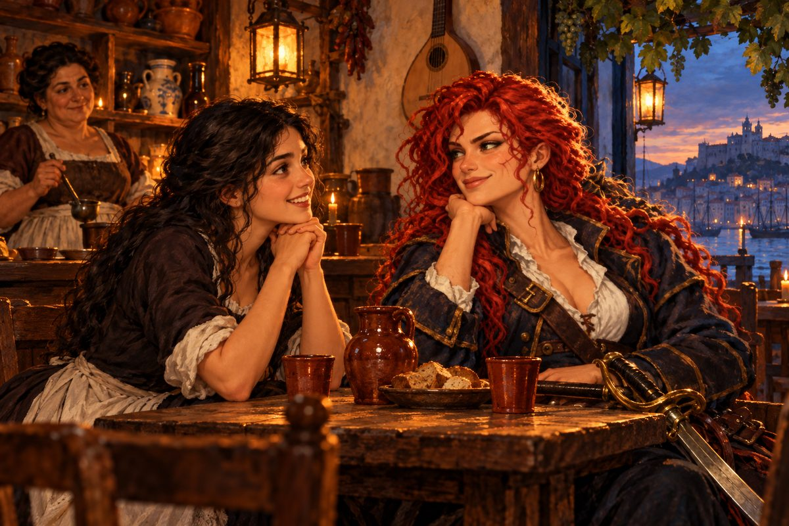

## 13. 허풍쟁이

제노바는 기지의 고향이었다. 산비탈에 층층이 쌓인 집들이 바다를 내려다보았고, 골목은 사람 하나 겨우 지나갈 만큼 좁았다. 기지는 배가 닿자마자 사라졌다가 해 질 녘에야 돌아왔다. 신이 난 얼굴이었다.

"제독님. 조안 놈이 있는 곳을 안다는 자를 찾았습니다요."

"확실한 거야?" 지도를 보던 사누드가 고개도 들지 않고 말했다. "자네가 주워 오는 소식은 반은 술값이고 반은 헛소리라서."

"뭐요? 이 돌부처가 보자 보자 하니까. 그러는 당신이야말로 쓸모없는 양반이지!"

"어느 쪽이 더 한심한지 겨뤄 볼까?" 사누드가 천천히 일어나 기지를 향해 소매를 걷었다. "좋아. 언제든 덤벼. 바로 상대해 주지."

"제발 둘 다 쓸데없는 싸움은 그만둬!" 카탈리나가 손바닥으로 탁자를 내리쳤다. 두 사내가 동시에 입을 다물었다. "기지. 누가 조안이 있는 곳을 안다고?"

"아, 예. 인색하기로 소문난 해적 브렛 페롯이란 자입니다. 제독님한테만 직접 말하겠다고 해서 술집에 붙잡아 뒀죠."

제노바 항구 뒷골목 술집은 천장이 낮았다. 페롯은 구석 자리에서 생선 튀김을 손가락으로 집어 먹고 있었다. 마른 몸에 눈이 가늘었고, 웃을 때마다 누런 이가 드러났다. 기지가 그의 맞은편 의자를 발로 끌어당겨 앉았다.

"어이, 페롯. 제독님 모셔 왔다. 그리고 잘 알겠지만, 엉터리 정보를 지껄이면 쓴맛을 보게 될 거다. 이분이 누군지 알지? 친히 네 목을 쳐 주실 거야. 목이 떨어져 나가는 건 꽤 근사한 경험이라더군."

"아이고, 그럼 그럼. 잘 알고말고요, 형님. 나는 형님한테 거짓말 안 하오." 페롯은 손가락을 핥았다. "이틀 전이었나? 이 항구 앞바다에서 포르투갈 배들을 만났지. 그때 말이오, 히야, 끝내줬다고! 우리 배가 포르투갈 상선으로 감쪽같이 변장을 했거든. 언뜻 봐서는 절대 모른다니까. 상대가 방심한 틈에 확 덮쳐서 쓸어버리는 수법인데, 이게 아무나 할 수 있는 게……."

"쓸데없는 소리는 집어치우고 아는 거나 말해!" 기지가 탁자를 쳤다.

"알았소, 알았으니 보채지 마쇼. 그래서 내가 배짱 좋게 그 함대랑 흥정을 했지. 너희 어디 가느냐고. 그랬더니 조안 옆에 붙어 다니는 로코라는 늙은이가 나와서는, 눈물 콧물 짜면서 다 털어놓더라고. 마르세유로 간다고 말이오. 형님, 내가 이런 놈이오!"

"알았어, 그만." 카탈리나가 손을 들었다. "정보는 고맙지만 자네는 잡소리가 너무 많아. 그런데 그 얘기, 정말이야?"

"아이고, 사람을 그렇게 못 믿으면 섭하지, 여해적 나리! 내 배를 걸고 맹세하리다. 내 밑의 뱃놈들한테 다 물어보쇼."

"페롯이라고 했지. 일단 고맙다는 말은 해 두지." 카탈리나가 일어섰다. "사누드, 기지. 가자."

## 14. 마르세유의 매듭

마르세유 주점 주인은 배가 불룩 나온 사내였다. 그는 기지의 질문에 행주로 잔을 닦으며 대꾸했다.

"조안이란 항해자? 온 적 없는데."

"정말이오? 숨기는 거 아니고?"

"아니, 이 사람이. 내가 뭐 하러 거짓말을 해?"

"그만해, 기지." 카탈리나가 기지의 어깨를 잡았다. "실례했어요, 주인장." 그리고 문을 나서며 중얼거렸다. "그 떠버리 말을 곧이들은 내가 바보지."

"제독. 조안 함대가 아직 이 항구에 안 닿은 걸지도 몰라." 사누드가 말했다. "아니면 아직 술집에 얼굴을 안 내민 거거나."

"……알았어. 며칠 더 기다려 보자."

사흘 뒤 그들은 다시 주점을 찾았다. 주인이 그들을 보더니 행주를 떨어뜨렸다.

"어이쿠, 또 왔어?"

"또? 뭐가 또라는 거야!" 기지가 카운터를 넘어 주인의 멱살을 잡았다. "안 그래도 열 받아 죽겠는데. 당신, 가만 좀 있어 봐!"

"으억, 알았어, 알았다고! 말할 테니 제발 놔줘!"

"기지, 놔줘."

주인은 목을 문지르며 콜록거렸다. "무슨 놈의 힘이 이렇게 세……. 거짓말한 건 아니야. 그땐 정말 안 왔었어. 그런데 그 뒤에 자네들이 찾는 사내가 정말로 왔길래, 자네들 얘기를 해 줬지. 붉은 머리 여자가 찾고 있다고……."

"뭐라고!"

"먼저 찾아온 건 우린데, 그놈 편을 들어?" 기지가 다시 달려들려 했다.

"모두 그만!" 카탈리나의 목소리가 주점을 울렸다. "아직 멀리 못 갔을 거야. 흩어져서 찾는다."

카탈리나는 항구 북쪽 거리를 뒤졌다. 여관에도, 성당 앞 광장에도 조안은 없었다. 한 시간 뒤 약속한 교역소 앞에 왔을 때 사누드도 기지도 보이지 않았다. 교역소 문은 반쯤 열려 있었다. 안에서 무언가 둔하게 쿵쿵거리는 소리가 났다.

"거기 숨어 있는 놈. 나와."

그녀는 사브르를 뽑아 들고 들어갔다. 소리는 쌓인 곡물 자루 뒤에서 났다. 자루를 걷어 내자, 밧줄로 꽁꽁 묶이고 입에 재갈을 문 두 사내가 굴러 나왔다.

"제독! 살려 줘!"

"사누드? 기지! 꼴이 이게 뭐야."

"하, 살았다……." 기지가 재갈을 뱉었다. "제독님, 정말 면목이 없수다."

"누가 이랬어? 조안이야?"

"정확히는 조안이 아니야." 사누드가 손목을 주물렀다. 밧줄 자국이 붉게 패여 있었다. "조안이 늘 데리고 다니는 항해사, 로코라는 늙은이한테 당했어. 이 건물까지 쫓아와서 기회를 잡았다 싶었는데, 그 노인이 앞을 막더군. 우리 둘이 덤볐는데도 상대가 안 됐어."

"생각해 보니 들은 얘기가 있소." 기지가 목을 비틀었다. "페레로 집안을 섬기는 그 영감, 젊어서는 호걸 로코로 이름깨나 날렸다던데."

"그런 건 진작 말해 줬어야지."

"별수 없었소. 나도 그렇게까지 셀 줄은 몰랐으니까."

카탈리나는 한숨을 쉬었다. "할 수 없지. 다들 일어나. 그래서 조안은 어디로 갔어?"

"항구에서 합류한다고 했어."

그들은 부두로 달렸다. 항구 관리인이 장부를 덮으며 말했다.

"조안 제독의 함대요? 방금 막 나갔습니다. 저기 저 돛들이오."

만 입구에 돛 네 개가 멀어지고 있었다. 돛마다 붉은 십자가가 선명했다.

"그놈들 낯짝이 어떻던가?" 기지가 물었다.

"꼴이라뇨? 일행이랑 웃고 떠들면서 가던데요. 그 밖에는 잘 모르겠습니다."

카탈리나는 멀어지는 돛을 바라보았다. 웃고 떠들면서. 오빠의 함대를 불태운 자들의 아들이 웃으면서 바다로 나갔다.

"……다음엔 반드시 갚아 준다."

## 15. 흥정

마요르카 섬 팔마의 주점에서 페롯이 다시 나타났다. 그는 문을 열고 들어오자마자 두 팔을 활짝 벌렸다.

"이게 누구신가, 여해적 나리! 얼마나 찾아다녔다고요. 목가적인 해적 일은 날로 번창하시는지?"

"뭐야, 자네야?"

"아, 기지 형님! 조안이 마르세유에 있었죠? 거보쇼, 내 말이 틀리지 않았잖소."

"그건 맞는데 결과가 안 좋았어." 기지의 목소리가 낮아졌다.

"그거야 내 잘못이 아니죠! 조안을 놓친 것도, 형님들이 꽁꽁 묶인 것도." 페롯이 킬킬거렸다. "소문이 자자합디다. 여해적 부하들이 노인네 하나한테 어이없이 당했다고, 술꾼들 사이에서 얼마나 인기인데."

기지의 손이 번개처럼 페롯의 목을 움켜쥐었다. 페롯의 발이 바닥에서 떨어졌다.

"하, 이놈 봐라. 아직 덜 맞았구나. 진짜 뜨거운 맛을 보여 줄까?"

"으아악! 제, 제발…… 살려 주쇼, 형님!"

"우리 약 올리러 왔다면 번지수를 잘못 짚었어." 카탈리나가 의자에 앉아 다리를 꼬았다. "그대로 숨이 끊어져도 난 안 말려."

"아니오, 아니오! 이 주둥이가 제멋대로 놀았을 뿐이오! 진짜로는 쓸 만한 소식을 가져왔단 말이오!"

"좋은 정보? 당연히 조안 얘기겠지?"

"크으윽…… 노, 놔주쇼, 형님……."

"기지, 그만."

기지가 손을 놓자 페롯이 바닥에 주저앉아 숨을 헐떡였다. 한참 만에 그가 고개를 들었다.

"얘기는 하겠는데…… 대신 조건이 있소."

"그래? 기지, 계속해."

"아니, 이게 아니오! 말하겠소!" 페롯이 두 손을 내저었다. "조안 함대가 어디 있는지 꿰고 있는 양반이 있소. 포르투갈 귀족님인데 지체가 아주 높으신 분이오. 이름은 밝히지 말라는 엄명을 받아서…… 그것만은 제발 이해해 주쇼. 밝혔다간 나는 확실히 죽소. 아무튼 그분은 페레로 가와 여러모로 인연이 깊어서, 그 집 아들 조안이 다음에 어디로 갈지까지 훤히 꿰고 있다오."

"그래서?"

"그분이 내가 요즘 조안 뒤를 캐고 다니는 걸 어찌 알았는지, 일을 하나 해 달라고 합디다." 페롯이 목소리를 낮췄다. "그 귀족님이 리스본 주점의 루치아라는 여급한테 홀딱 빠졌다는 거요. 근데 높으신 분이 리스본 시내에서 주점 여급이랑 대놓고 만날 수는 없잖소. 그래서 다른 항구로 그 아가씨를 좀 불러내 달라는 거요. 그런데 보쇼, 내 이 간사한 얼굴로 그게 되겠소? 아무리 웃어 봐야 그 아가씨가 관청에 신고나 안 하면 다행이지."

그가 카탈리나를 올려다보며 손을 비볐다.

"그러니 여해적 나리 같은 근사한 분이 나서 주셔야 한단 말이오. 일은 맞는 사람이 해야 하는 법 아니겠소? 이 일만 해 주면 조안이 있는 곳을 소상히 알려 주겠답디다."

"뭘 그렇게 번거롭게 해." 기지가 코웃음을 쳤다. "그깟 계집애 하나, 그냥 자루에 넣어서 실어 가면 되잖아."

"넌 일을 크게 만드는 데는 재주가 있구나." 사누드가 이마를 짚었다. "좀 얌전하게 끝낼 궁리는 못 하냐?"

"또 시작이야? 그만들 해." 카탈리나가 손가락으로 탁자를 두드렸다. 내키는 일은 아니었다. 그러나 조안이 있는 곳을 알 수 있다는 말은 미끼치고는 너무 달았다. "……좋아. 그 아가씨를 어디로 데려가면 되지?"

"지브롤터 해협 건너편에 세우타라는 항구가 있소. 리스본에서 뱃길로 며칠이면 닿지. 거기 여관까지만 모셔다드리면 되오. 나는 귀족님께 일이 성사됐다고 보고하러 갈 테니까, 자연스럽게, 감쪽같이 해야 하오. 아셨죠?"

페롯이 나간 뒤 기지가 손바닥을 비볐다. "드디어 조안 놈 코를 납작하게 해 줄 기회가 왔군요."

"나쁘지 않아." 카탈리나가 말했다. "이런 기회는 흔치 않으니까."

## 16. 리스본의 노래

리스본의 그 주점은 알파마 언덕 아래, 강이 내려다보이는 골목에 있었다. 문간에 포도 덩굴이 늘어졌고, 안에서는 기타 소리가 흘러나왔다. 기지가 먼저 문을 밀고 들어갔다.

"여급 하나 모시고 나오면 끝나는 일이지? 옳지, 저기 계시네."

카운터 뒤에서 여자 하나가 돌아섰다. 검은 머리를 단정히 틀어 올리고 앞치마를 두른 여인이었다.

"어머, 손님. 뭘 드릴까요?"

기지가 고개를 갸웃했다. 그리고 그가 평생 후회할 말을, 평소의 목청 그대로 내뱉었다.

"미인이긴 한데…… 좀 늙었군. 어, 아니잖아. 할멈이잖아."

"할멈? 누가 할멈이야!" 여인의 손에 들린 국자가 허공을 갈랐다. "이 건달 놈이!"

"어어, 들었나 봐?"

"그 목청으로 떠들었으니 옆 동네까지 다 들렸겠다!" 사누드가 기지의 뒷덜미를 잡았다.

"당장 이 가게에서 나가! 너희한테 팔 술은 한 방울도 없어!"

두 사내는 국자에 쫓겨 골목으로 굴러 나왔다. 기지가 머리를 감싸 쥐고 투덜거렸다. "젠장, 노인하고 할멈한테는 도무지 못 당하겠네."

카탈리나는 이마를 짚고 한숨을 쉬었다. 그리고 두 사내를 골목에 세워 둔 채 혼자 주점에 들어갔다. 여인은 아직 국자를 쥐고 씩씩거리고 있었다.

"아까는 동행이 무례를 저질렀어요. 정말 죄송합니다. 혹시 루치아 씨인가요?"

여인은 그녀를 보더니 표정이 조금 누그러졌다. "어머, 제가요? 아니에요. 루치아는 우리 딸이랍니다."

"따님과 잠깐 이야기를 나눌 수 있을까요?"

"여자분이 바다를 다니시나 봐요? 신기하기도 하지." 여인은 국자를 내려놓았다. "좋아요. 재밌는 얘기나 해 주세요. 우리 애가 그런 얘기라면 사족을 못 써요. 루치아, 얘야, 손님 오셨다!"

안쪽 문이 열리고 처녀 하나가 나왔다. 열여덟이나 되었을까. 어머니를 닮은 검은 머리를 어깨에 늘어뜨렸고, 눈동자는 강물처럼 반짝였다. 그녀는 카탈리나를 보더니 손뼉을 쳤다.

"어머, 처음 뵙네요. 혹시 배를 타시는 분이세요? 여자분이? 바다는 남자들만 나가는 줄 알았어요. 좋겠다. 저도 한 번만이라도 먼바다에 나가 보고 싶은데."

"바다 여행은 누구나 할 수 있어요." 카탈리나는 저도 모르게 미소 지었다. "배 한 척과 용기, 그리고 가겠다는 마음만 있으면."

"하지만 저는 이 가게를 지켜야 하니까요. 바다 건너 이야기는 손님들한테 듣는 수밖에 없어요."

"그렇군요." 카탈리나는 잠시 말을 골랐다. "그런데 아가씨, 이 나라 귀족 자제 중에 알고 지내는 분이 있나요?"

루치아의 뺨이 붉어졌다. "네! 딱 한 분요. 가게에 오시면 제가 노래할 때 류트로 반주를 해 주세요. 다정하시고, 늘 진심이시고, 얼굴도 정말 근사하세요!"

카탈리나는 그 얼굴을 보았다. 사랑에 빠진 얼굴이었다. 세비야 부두에서 에르난을 배웅하던 날, 그녀도 저런 얼굴이었을까.

"실은 그분께 부탁을 받았어요. 당신을 지금 그분이 머무는 항구로 모셔 와 달라고요. 거기서 당신을 보고 싶대요. 리스본에서 남쪽으로 내려가면 세우타라는 아름다운 항구가 있어요. 그곳을 당신에게 보여 주고 싶으신가 봐요."

"정말요? 세우타라면 조용하고 아름다운 곳이라던데." 루치아는 어머니를 돌아보았다가, 다시 카탈리나를 보았다. 눈이 반짝였다. "갈래요! 여행도 하고, 그분도 만나고."

"그럼 근처 여관에서 기다릴게요. 준비하고 와요. 어머님께는 잘 말씀드리고요. 걱정하실 테니까."

"네! 두 시간쯤 뒤에 갈게요."

---

여관 식당에서 기다리는 두 시간은 길었다. 기지는 국자에 맞은 머리를 연신 문질렀고, 사누드는 창밖의 강을 보았다.

"제독, 일은 어떻게 됐어?"

"그 아가씨, 몹시 기뻐하더군. 두 시간 뒤에 온대."

"한 시간쯤 남았군."

"그래."

카탈리나는 창밖을 보았다. 테주 강 위로 해가 기울었다. 그녀는 어쩐지 마음이 무거웠다. 무엇 때문인지는 알 수 없었다. 사랑에 빠진 처녀를 연인에게 데려다주는 일이었다. 좋은 일이었다. 그런데 왜 이리 가슴이 답답할까.

문이 열리고 루치아가 숨을 몰아쉬며 들어왔다. 작은 보따리 하나를 품에 안고 있었다.

"늦어서 죄송해요! 오래 기다리신 건 아니죠?"

"아니에요. 우리도 방금 왔어요." 카탈리나가 일어섰다. "그럼 배로 가 볼까요?"

"신난다!"

## 17. 세우타

세우타는 아프리카 땅 끝에 매달린 하얀 항구였다. 해협 건너로 지브롤터의 바위산이 보였고, 성벽 위로 야자나무 잎이 바람에 흔들렸다. 루치아는 뱃전에 매달려 탄성을 질렀다.

"여기가 세우타예요? 너무 예뻐요!"

"살기 좋은 곳이죠. 고향과는 바람부터 다를 거예요. 가깝긴 해도 남쪽의 큰 땅에 속한 곳이니까."

여관 주인은 카탈리나의 물음에 장부를 넘겼다.

"포르투갈 귀족 손님 말씀이시죠? 네, 방에서 기다리고 계십니다. 아, 그리고 페롯이라는 분이 전갈을 남기셨어요. 아가씨를 데려다드린 뒤에 이 항구 주점으로 오시랍니다."

루치아가 카탈리나의 두 손을 꼭 잡았다.

"카탈리나 씨, 정말 고마워요. 이 은혜는 잊지 않을게요."

"별말씀을. 그분과 행복한 시간 보내요."

루치아는 계단을 올라갔다. 계단참에서 한 번 돌아보고 손을 흔들었다. 카탈리나도 손을 들어 답했다. 그 뒤로 오랫동안, 그녀는 그 손짓을 잊지 못하게 된다.

주점으로 가는 길에 기지가 흥얼거렸다. "좋은 일을 하니 기분이 좋구먼. 그 아가씨 꽤 미인이던데. 귀족이 반할 만해."

"낭만적인 귀족이라." 사누드가 말했다. "페레로 가 쓰레기들과는 딴판이군."

"다정하고 진심 어린 미남이라더군." 카탈리나가 덧붙였다. "조안 같은 교활한 비겁자가 같은 나라 귀족이라니."

주점에서 페롯이 두 팔을 벌려 그들을 맞았다.

"여해적 나리! 오셨습니까요? 루치아 아가씨를 무사히 데려다주신 모양이군요."

"페롯. 약속은 지켰어. 이제 조안이 어디 있는지 불어."

"물론이지요! 조안은 알렉산드리아로 갔소. 이번에는 거기서 꽤 오래 머문답니다!" 페롯이 손가락을 튕겼다. "절호의 기회니 최선을 다하쇼, 여해적 나리. 절대 놓치지 마시고요!"

## 18. 영국인

알렉산드리아 항구는 먼지와 향신료 냄새로 가득했다. 부두 너머로 무너진 등대의 잔해가 보였다. 카탈리나는 배에서 내리며 말했다.

"여기서 끝장을 낸다. 그러니 함부로 움직이지 마."

시장 어귀를 지날 때 누군가 그들을 불러 세웠다.

"잠깐 말 좀 묻지."

금발을 짧게 깎은 사내가 서 있었다. 서른 남짓, 군인다운 꼿꼿한 자세에 영국식 외투를 입었다. 그 뒤에 술 냄새를 풍기는 부하 하나가 따랐다.

"……누구시죠?"

"나는 오토 베인스. 대영제국 기사단 소속 영국 함대의 지휘관이다. 세우타에서부터 너희를 지켜보며 뒤를 따라왔다." 오토의 회색 눈이 카탈리나를 꿰뚫었다. "세우타 술집에서 만난 자가 해적 브렛 페롯이 맞나?"

"그런데요?"

"그놈은 마르티네스 후작의 뒷돈을 받고 움직이는 악질 해적이다. 알고서 만난 건가?"

"그 귀족이 마르티네스 후작인가 보군요. 그게 어쨌다는 거죠?"

"그렇다면 너희가 유괴범이군. 납치한 처녀는 어디 있나. 순순히 돌려주면 보내 주겠다."

기지가 앞으로 튀어 나갔다. "이게 어디서 생트집이야! 한 마디만 더 해 봐, 그 길로 저승 구경 시켜 줄 테니!"

오토의 부하도 지지 않았다. "이 자식이! 감히 제독님께 말버릇이! 나보다 예절 교육이 급한 놈이 여기 있었네!"

"하, 우리 이름값이 많이 떨어졌나 보군. 별것들이 다 시비를 거네."

"기다려, 기지." 카탈리나가 그의 앞을 막았다. 그녀의 얼굴이 하얗게 굳어 있었다. "생각 좀 해 보자. 오토라고 했죠? 우리가 그 아이를 납치했다니, 무슨 소리죠? 나는 그 후작의 부탁으로 루치아 양을 세우타 여관에 데려다줬을 뿐이에요."

오토가 눈을 가늘게 떴다. 그는 잠시 그녀의 얼굴을 살피더니 고개를 끄덕였다.

"그렇다면 너희는 모르고 한 일이군. 내가 이 일을 안 것은 우연이었다. 매튜, 설명하게."

술 냄새를 풍기던 부하가 헛기침을 했다. "예, 제독님. 얼마 전에 내가 알제의 술집에서 혼자 온종일 마시고 있었소. 그런데 거기서 마르티네스 후작이랑 페롯이 밀담을 나누는 걸 봤지. 후작의 무슨 고약한 비밀을 그 루치아라는 아가씨가 알아 버린 모양이오. 그래서 입을 막으려고 납치를 꾸민 거요."

카탈리나는 숨을 들이켰다. 매튜가 말을 이었다.

"머리 하나는 잘 썼지. 같은 여자가 찾아와 웃으며 청하면 어미도 딸도 의심할 리가 없으니."

"그 말, 사실이야?"

"당신들 속여서 내가 얻을 게 뭐 있소."

"페롯, 이 쥐새끼 같은 놈!" 기지가 벽을 걷어찼다. "처음 봤을 때부터 낯짝이 마음에 안 들었어. 이번에 상어 밥으로 던져 주마!"

"이대로면 루치아가 위험해." 사누드가 말했다.

카탈리나는 눈을 감았다. 계단참에서 손을 흔들던 루치아. 강물처럼 반짝이던 눈. 그 아이의 손을 잡아 계단으로 올려 보낸 것은 그녀였다.

"오토. 이건 명백히 내 잘못이에요. 내 손으로 해결하겠어요."

"그대 뜻대로 하게. 한패라고 의심한 것은 사과하지." 오토가 외투 깃을 여몄다. "해적 페롯은 흑해 쪽으로 갔다. 우리 함대가 풀어 둔 눈과 귀가 전해 온 소식이니 틀림없을 거다."

"고마워요. 서둘러야겠군요."

## 19. 흑해의 해적

흑해는 이름처럼 검었다. 보스포루스를 빠져나오자 바다는 갑자기 색을 바꾸었다. 짙고 무거운 물, 낮게 깔린 구름. 리벨리온은 그 위를 사흘 동안 헤맸다.

나흘째 아침, 망꾼이 외쳤다. "포르투갈 상선 깃발입니다! 그런데…… 배 모양이 이상합니다!"

"변장한 배야." 카탈리나가 망원경을 내렸다. "페롯이 자랑하던 그 수법이지."

리벨리온이 다가가자 상선 깃발이 내려가고 해골 깃발이 올라갔다. 페롯이 뱃머리에 서서 소리쳤다.

"하하, 냄새 하나는 잘도 맡는군! 할 수 없지, 다들 물고기 밥으로 만들어 주마. 요즘 너희가 그렇게 유명하다며? 누가 진짜 해적인지 가려 보자고. 가짜는 이 바다에서 사라지는 거야!"

"페롯, 멈춰라! 날 속일 수 있을 줄 알았나? 루치아는 어디 있어!"

대답 대신 포탄이 날아왔다.

싸움은 길지 않았다. 페롯의 배들은 빨랐지만 포가 약했다. 리벨리온의 첫 일제사격에 한 척의 돛대가 부러졌고, 두 번째 일제사격에 또 한 척이 기울었다. 카탈리나는 페롯의 기함 옆구리에 배를 붙였다. 갈고리가 날아가 뱃전에 박혔다.

"모두 주목!" 기지가 뱃전에 올라서서 고함쳤다. "우리 여제독께서, 감히 우리한테 덤빈 해적 두목이 어떤 꼴로 끝나는지 똑똑히 보여 주실 거다!"

카탈리나는 널판을 건너 페롯의 갑판에 내려섰다. 페롯이 쌍날 칼을 뽑아 들었다. 그의 얼굴에 비굴한 웃음 대신 탐욕이 번들거렸다.

"제법이군. 좋아, 카탈리나. 네 이름값도, 네 배도, 네 목도 몽땅 내가 가져가 주지!"

칼이 부딪쳤다. 페롯의 칼은 빠르고 지저분했다. 발을 걸고, 모래를 뿌리고, 등 뒤를 노렸다. 카탈리나는 해군 사관학교에서 배운 검술로 그 모든 것을 받아 냈다. 정직한 칼이었다. 정직한 칼은 느리지만 흔들리지 않았다. 열 합, 스무 합. 페롯의 숨이 거칠어졌다. 그가 크게 휘두른 칼이 허공을 갈랐고, 카탈리나의 사브르가 그의 손목을 쳤다. 칼이 갑판 위를 굴렀다.

"사누드! 배를 뒤져!"

사누드와 선원들이 선실로 뛰어들었다. 문 부서지는 소리, 상자 뒤집는 소리가 이어졌다. 한참 뒤 사누드가 올라왔다. 얼굴이 어두웠다.

"제독. 선창 밑바닥까지 다 뒤졌어. 루치아는 없어."

카탈리나는 칼끝을 페롯의 목에 댔다. "브렛 페롯. 그녀는 어디 있지? 말하면 목숨만은 살려 줄 수도 있다."

페롯이 웃기 시작했다. 처음에는 낮게, 그러다 미친 사람처럼 크게.

"으하하! 그 계집애는 아주 멋진 곳에 있지! 세상에서 제일 멋진 곳! 어딘 줄 알아? 저세상이다, 하하하!"

"이 미친놈이!" 기지가 그의 멱살을 잡아 일으켰다. "정말로 그 아가씨를 죽였어? 너는 오늘 곱게 죽을 생각은 버려라!"

"그래, 젠장, 어차피 죽을 목숨이다! 웃고 싶으면 웃어! 히히, 하지만 나는 죽어서도 이 바다에 남을 거다!"

카탈리나는 페롯을 내려다보았다. 그녀의 목소리는 이상하리만큼 조용했다.

"바다에 남고 싶다고? 좋아, 그렇게 해 주지. 이 검은 물 위를 쉬지도 못하고 헤매는, 가장 처량한 혼으로."

그날 흑해의 물결은 높았다. 리벨리온이 떠난 자리에는 불타는 배의 잔해만 남아 오래도록 연기를 피워 올렸다.

---

밤이 깊었다. 카탈리나는 고물에 혼자 서 있었다. 사누드가 다가와 옆에 섰다. 한참 동안 둘 다 말이 없었다.

"내가 그 아이를 데려다줬어." 마침내 카탈리나가 말했다. "바다를 보고 싶다던 아이를. 내 손으로 계단 위로 올려 보냈어."

"넌 몰랐어."

"몰랐다는 게 무슨 변명이 돼?" 그녀의 손이 뱃전을 움켜쥐었다. "오빠가 죽을 때도 나는 몰랐어. 몰랐다는 건 아무것도 지켜 주지 않아."

사누드는 대답하지 않았다. 대답할 말이 없었다. 바다 위로 차가운 바람이 불었다. 카탈리나는 리스본의 주점을 생각했다. 국자를 휘두르던 루치아의 어머니를. 딸이 세우타의 아름다운 풍경을 보고 돌아올 날을 기다리고 있을 그 여인을.
