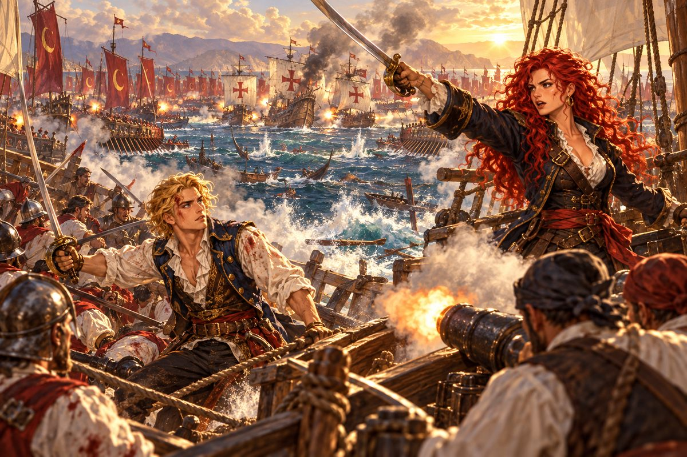

## 20. 피라미들

1523년의 나머지는 바다 위에서 흘러갔다.

리벨리온은 지중해와 대서양을 가리지 않고 누볐다. 해적선을 만나면 해적선을 쳤고, 노예선을 만나면 노예선을 쳤다. 카탈리나의 이름은 이제 리스본에서 베네치아까지, 주점마다 술안주처럼 오르내렸다. 붉은 머리 여해적. 에스파니아 무적함대에 쫓기면서도 잡히지 않는 반역자. 그 이름이 커질수록 선원이 늘었고, 배가 늘었다. 리벨리온 뒤로 이제 세 척의 배가 따랐다.

그러나 조안은 어디에도 없었다.

"쳇, 맥이 빠지는군. 보람이 없어." 어느 날 저녁, 막 끝난 해전의 연기가 걷히는 갑판에서 기지가 투덜거렸다. "온 바다를 휘젓고 다녀도 걸리는 건 피라미들뿐이니. 그놈들 찾기가 왜 이리 어렵지?"

"대체 어디로 숨었는지 소식 한 자락 없소. 바다에 빠져 죽었나?"

"죽은 것 같지는 않아." 카탈리나가 칼에 묻은 피를 닦았다. "다만 유럽 바다에서 봤다는 사람이 하나도 없어."

"잡담은 그만하고. 전리품은 다 실었어?"

"그건 빈틈없지요."

사누드가 선창에서 올라왔다. 그는 비쩍 마른 사내 하나의 뒷덜미를 잡고 있었다.

"제독, 적선 짐칸에 항해사 놈이 하나 숨어 있었어. 끌고 왔지."

"알아서 해. 그런 잔챙이 일까지 내 귀에 넣을 것 없어."

"그자가 제독한테 도움이 될 정보를 안다길래."

카탈리나가 고개를 들었다. 사내는 사누드의 손아귀에서 버둥거리다가 그녀를 보고 몸이 굳었다.

"당신이…… 그 여해적이오?"

"그런데?"

"당신한테 도움이 될 정보가 있소. 흥정을 하지 않겠소?"

"사양하지. 나는 흥정 안 해." 카탈리나가 돌아섰다. "기지. 이자 판자 위로 걷게 해."

"옙, 기꺼이."

기지가 사내를 번쩍 들어 뱃전 밖으로 내민 판자 위에 세웠다. 판자 끝 아래로 검푸른 물이 넘실거렸다. 사내가 비명을 질렀다.

"기, 기다려! 살려 주시오!"

"그럼 말해 봐. 마음에 들면 살려 주지."

"조안! 당신들이 쫓는 그 조안이 어디 있는지 나는 아오!" 사내가 판자 위에서 떨며 외쳤다. "홍해 어귀, 마사와라는 항구에 있소! 조안 함대 선원 친구한테서 직접 들은 얘기라 틀림없소! 조안은 거기서 사람들을 지키겠다고 오스만 세력과 싸울 작정이라고 했소. 그래서 마사와 사람들이 그를 구원자라고 떠받든다는 소문이오. 내가 아는 건 이게 전부요!"

갑판 위가 조용해졌다. 카탈리나는 오래 바다를 보았다.

"기지."

"예이. 떨어뜨릴까요?"

"아니. 뭍이 보이거든 아무 데나 내려 줘. 운이 좋으면 살겠지."

기지가 휘파람을 불었다. "흠, 운 좋은 놈이네. 이 자식아, 우리 여제독께서 포로를 놓아주시는 건 처음이다. 고마운 줄 알아라!"

카탈리나는 키를 잡은 사누드에게 걸어갔다.

"사누드. 뱃머리를 남쪽으로. 아프리카를 돌아 홍해로 간다."

"명령대로." 사누드가 키를 돌리며 그녀를 곁눈질했다. "그자 말을 믿는 거야?"

"다 믿지는 않아. 하지만 마사와라는 항구에는 가 봐야겠어."

---

아프리카를 도는 항해는 석 달이 걸렸다.

적도를 지날 때는 바람이 죽어 배가 열흘 동안 바다에 박혀 있었다. 물통의 물이 썩어 들어갔고, 선원들은 돛 그늘에 누워 꼼짝하지 않았다. 희망봉 앞바다에서는 거꾸로 바람이 미쳐 날뛰었다. 산더미 같은 파도가 고물을 덮쳤고, 세 척 중 한 척이 돛대를 잃었다. 카탈리나는 그 사흘 동안 거의 잠을 자지 않았다.

동쪽 해안을 따라 올라가며 바다는 다시 순해졌다. 모잠비크의 하얀 모래, 몸바사의 산호석 성채, 소코트라 섬의 이상한 나무들. 카탈리나는 밤마다 갑판에 나가 낯선 별자리를 보았다. 미카엘이라면 이 별들의 이름을 알았을 것이다. 그는 늘 새로운 바다를 보고 싶어 했다.

그리고 아덴 앞바다를 지날 때 그들은 보았다.

수평선을 따라 끝없이 늘어선 돛. 수십, 아니 백을 넘을지도 몰랐다. 초승달 깃발이 바람에 일렁였다. 오스만 제국의 함대였다. 그 함대는 홍해 어귀를 틀어막은 채 움직이지 않고 있었다. 무언가를 기다리는 짐승처럼.

## 21. 홍해 어귀

마사와는 뜨거웠다. 세비야의 한여름도 이곳에 비하면 봄날이었다. 산호석으로 지은 하얀 집들이 햇빛을 되쏘아 눈이 시렸고, 부두의 돌은 맨발로 디딜 수 없을 만큼 달아 있었다.

"조안부터 찾자." 카탈리나가 말했다.

그들은 해안 언덕 위의 커다란 저택부터 찾았다. 항구에서 가장 큰 집이었다. 나무 덧문은 모두 닫혀 있었고, 안은 어둡고 서늘했다.

"제독, 이상하군. 이렇게 큰 집에 아무도 없는 것 같아."

"어디 숨어 있는 거 아닐까?" 기지가 목소리를 낮췄다. "불을 안 켜면 뭔가 시커멓고 흉측한 게 툭 튀어나올 것만 같은데……."

"갑자기 웬 엄살이야? 자네가 무서워하는 건 밤바다에서 우는 물귀신뿐인 줄 알았는데."

그때 어둠 속에서 고함이 터졌다.

"거기 누구냐!"

기지가 펄쩍 뛰어올랐다. 안쪽 방에서 덩치 큰 사내 하나가 나왔다. 이 저택의 주인 메콘베였다. 짙은 피부에 흰 옷을 두르고, 이마에 깊은 주름이 패여 있었다. 그는 낯선 이방인 셋을 노려보았다.

"이거 실례했습니다. 해를 끼치러 온 사람들은 아닙니다." 사누드가 정중하게 고개를 숙였다.

기지가 가슴을 쓸어내리며 말을 보탰다. "놀라긴 했어도 무시무시하진 않네. 다행이야. 맞소, 우린 수상한 자들이 아니오. 그냥 좀 수상한 해적들이지. 걱정 마쇼, 오늘은 불 지를 생각 없으니."

메콘베의 얼굴이 굳었다. "……당장 나가!"

"뭐야? 내가 무슨 실수라도 했나?" 저택에서 쫓겨나며 기지가 투덜거렸다. "솔직히 말하면 그 양반 얼굴이 우리보다 훨씬 무서웠는데."

"그 말은 제발 속으로만 해." 사누드가 한숨을 쉬었다.

거리 사람들은 조안의 이름을 듣자마자 얼굴이 환해졌다.

"조안 님이요? 물론 알지요. 그분은 우리의 구원자이십니다."

"그자가 구원자라고?"

"그럼요. 혼자서 저 강대한 오스만 해군에 맞서 이 항구를 지키겠다고 오신 분을 구원자라 부르지 않으면 뭐라 부르겠소."

카탈리나는 대답하지 않았다. 아덴 앞바다를 메운 돛들이 눈앞에 떠올랐다. 수평선을 따라 끝없이 이어지던 초승달 깃발. 저것을 상대하겠다고? 조안이, 그 함대 네 척으로?

'소문이 사실이었나. 아니면 사람들 앞에서 영웅 흉내를 내는 것뿐인가.'

## 22. 구원자

부두로 내려가는 계단에서 기지가 그녀의 팔을 잡았다.

"제독! 저기 봐! 저거 조안 아니오?"

부두 끝에서 젊은 사내 하나가 늙은 사내와 함께 배로 향하고 있었다. 밝은 갈색 머리, 질 좋은 조끼. 나폴리 조선소에서 본 그 얼굴이었다. 늙은 사내는 흰 수염을 짧게 깎았고, 나이에 어울리지 않게 어깨가 떡 벌어졌다. 허리에 찬 칼이 유난히 컸다.

"제기랄, 저 녀석들! 이번엔 안 놓친다!"

카탈리나는 계단을 단숨에 뛰어내렸다. 그리고 조안의 앞을 막아섰다.

"찾았다, 조안. 오랜만이야."

늙은 사내가 먼저 칼자루를 쥐었다. "이런 젠장! 제독님 꽁무니를 쫓던 그 여자 해적 아니야. 하필 이 바쁜 때에!"

"잠깐만요!" 조안이 늙은 사내를 막았다. 그리고 카탈리나를 보았다. "그보다, 당신. 루치아를 어떻게 한 거요?"

카탈리나는 걸음을 멈췄다. 루치아. 그 이름이 이 사내의 입에서 나올 줄은 몰랐다.

"루치아? 리스본 주점의 그 여급 말이야? ……그래. 그 아이한테는 정말 미안한 짓을 했지."

"그럼 정말 당신이 루치아를 데려간 거요?" 조안의 얼굴이 일그러졌다. "집요한 사람이라고는 생각했지만, 그런 비겁한 짓을 할 줄은 몰랐소."

카탈리나는 그의 얼굴을 보았다. 그 얼굴에 담긴 것은 분노였다. 그리고 그 밑에, 그녀가 잘 아는 다른 것이 있었다. 사랑하는 사람을 잃은 자의 얼굴. 그녀가 세비야 사령실에서 그을린 깃발을 만졌을 때 지었을 얼굴.

다정하고, 늘 진심이고, 류트를 타 주는 귀족.

"……알겠군. 그 아이가 말하던 귀족이 바로 당신이었어." 카탈리나는 쓴웃음을 지었다. "질문에 대답하자면, 결과적으로는 그렇게 된 셈이야. 교활한 해적 한 놈한테 속아서. 하지만 그 일은 당신네가 저지른 짓에 비하면 아무것도 아니야."

"뻔뻔하기까지 하군." 늙은 사내가 이를 갈았다. "무슨 이런 여자가 다 있어."

"그래서 루치아는? 살아는 있는 거요?" 조안이 다그쳤다.

"모르겠어. 그 해적 놈들을 전부 쓸어버리고 배를 샅샅이 뒤졌지만, 어디에도 없었어." 카탈리나는 사브르를 뽑았다. "잡담은 이걸로 끝이야. 칼을 뽑아."

조안은 칼을 뽑지 않았다. 그는 바다 쪽을, 홍해 어귀 쪽을 보았다.

"카탈리나. 미안하지만 지금 당신과 칼을 섞을 여유가 내게는 없소. 오스만 함대가 코앞이오. 나는 지금 바다로 나가야 하오. 길을 열어 주시오. 당신이 왜 내 목을 원하는지는 모르겠으나, 이 싸움에서 살아 돌아오면 그때는 도망치지 않고 당신 앞에 서겠소. 맹세하오."

카탈리나는 그를 오래 보았다. 그리고 칼끝을 내렸다.

"……그래? 좋아. 오늘은 물러나 주지."

"제독님!" 기지가 소리쳤다. "그게 무슨 말이오! 이런 교활한 놈 말을 믿는 거요?"

"이자는 여기서 구원자로 떠받들어진다며. 사람들 머릿속의 환상이 벗겨지는 꼴을 지켜보는 것도 나쁘지 않지." 카탈리나는 조안에게 한 걸음 다가섰다. 목소리가 칼날처럼 얇아졌다. "아덴 앞바다를 수평선까지 메운 오스만 함대, 나도 봤어. 자, 조안. 어서 저 무리하고 맞서 보시지. 입에 발린 말로 사람들 마음을 사서 영웅 노릇을 하고 싶은 모양인데, 비겁한 진짜 당신한테 그럴 용기가 있을지 궁금하군. 도망쳐도 좋아. 차라리 그쪽이 나아. 그때는 내가 웃으면서 당신 숨통을 끊어 줄 수 있으니까."

"젠장, 이건 뭐……." 늙은 사내가 얼굴을 붉혔다. "들을수록 못 참겠군. 이 여자는 대체 뭐가 이렇게 분해서 지껄이는 거야?"

"그만두게, 로코." 조안이 조용히 말했다. 그는 카탈리나를 보고 있었다. 화난 얼굴이 아니었다. 안타까워하는 얼굴이었다. "지금은 무슨 말을 해도 소용없어. 복수심이 이 사람의 온화함을 재로 만들어 버린 걸세. 그 잘못된 불길이 언젠가 꺼지기를 바랄 뿐이야."

"제기랄. 자, 제독님. 시간이 없습니다. 어서 가시죠." 로코가 조안의 팔을 끌었다. 그러다 돌아서서 카탈리나에게 말했다. "여해적, 우리는 반드시 돌아온다. 그때 우리 운명이 어찌 될지는 몰라도, 적어도 우리 제독님이 당신 앞에 부끄러운 꼴로 서 있지는 않을 거다."

두 사람은 배에 올랐다. 붉은 십자가 돛이 펼쳐졌다. 네 척의 배가 천천히 항구를 빠져나가 남쪽으로, 아덴 앞바다를 향해 나아갔다.

## 23. 내가 믿은 것

그날 밤 카탈리나는 여관 뜰의 우물가에 앉아 있었다. 사누드가 다가와 그녀 옆 돌계단에 걸터앉았다.

"제독. 결국 그놈 말을 믿었군. 왜 그랬어?"

"아니." 카탈리나가 고개를 저었다. "내가 믿은 건 루치아야."

"무슨 소리야?"

"그 아이가 그랬어. 그 사람은 다정하고, 늘 진심이라고." 카탈리나는 우물 속 어둠을 내려다보았다. "정말 그런 사람인지, 내 눈으로 보고 싶었어."

그녀는 한참 말이 없었다. 우물 바닥 어딘가에서 물방울 떨어지는 소리가 났다.

"이상하지, 사누드. 일부러 날을 세워서 쏘아붙였는데, 말을 하면 할수록 속이 텅 비는 것 같았어. 1년 넘게 그 이름만 생각하며 살았는데. 막상 눈앞에 두고 보니…… 내 복수심이 다 어디로 갔는지 모르겠어."

사누드는 대답하지 않았다. 대신 담장 위에 걸터앉아 있던 기지가 뛰어내렸다. 엿듣고 있었던 모양이었다.

"흠, 그렇단 말이지." 기지가 손을 털었다. "그럼 아직 늦지 않았소. 제독, 당장 바다로 나갑시다."

"뭐?"

"그놈이 어떤 놈인지 확인하겠다면서요? 그냥 죽게 내버려 둘 거요? 여기 앉아서 결과나 기다리는 건 제독님 취향이 아닌 것 같은데." 기지가 이를 드러내고 웃었다. "벌써 군침이 도는군. 바닷속에 처박을 것들이 수평선까지 널렸으니. 자, 화끈하게 불꽃 한번 쏘아 올립시다!"

카탈리나는 기지를 보았다. 그리고 사누드를 보았다. 사누드가 어깨를 으쓱했다. 이번만은 그도 기지와 같은 생각인 모양이었다.

카탈리나가 일어섰다.

"전원 승선. 날이 밝기 전에 출항한다."

## 24. 수평선의 함대

아덴 앞바다는 불바다였다.

새벽빛 아래 오스만 함대가 거대한 초승달 모양으로 펼쳐져 있었다. 그 한가운데에 붉은 십자가 돛 네 개가 갇혀 있었다. 아니, 셋이었다. 한 척은 이미 기울어 연기를 토하고 있었다. 남은 세 척이 서로 등을 맞대고, 사방에서 조여 오는 갤리선들에 포를 쏘아 대고 있었다.

"끝도 없이 몰려왔군." 사누드가 망원경을 내렸다. "제독, 저기 낯익은 포르투갈 배들이 고군분투하고 있어."

"붉은 십자가 돛이군. 틀림없어." 카탈리나가 사브르를 뽑았다. "키 돌려! 조안의 배들 쪽으로 붙는다!"

리벨리온과 세 척의 배가 초승달의 등 뒤로 돌진했다. 오스만 갤리선들은 포르투갈 배에 정신이 팔려 등 뒤를 보지 못했다. 카탈리나는 그 틈을 놓치지 않았다. 리벨리온의 우현 포가 한꺼번에 불을 뿜었고, 가장 가까운 갤리선의 노가 부러진 성냥개비처럼 튀어 올랐다.

"하하! 이거야말로 불꽃놀이로군!" 기지가 뱃머리에서 외쳤다.

초승달의 한쪽 끝이 무너졌다. 카탈리나는 그 틈으로 배를 밀어 넣어 조안의 기함 옆에 붙였다. 조안이 뱃전에 서 있었다. 이마에서 피가 흘렀고, 옷은 그을음투성이였다. 그는 칼을 높이 들고 선원들에게 외치고 있었다.

"물러서지 마라! 우리는 끝까지 싸운다!" 그러다 그가 리벨리온을 보았다. 그의 눈이 커졌다. "……카탈리나? 당신이 어떻게……."

"조안. 보기 아슬아슬하게도 싸우는군."

"당신이 왜……."

"오해하지 마. 당신을 봐준 게 아니니까." 카탈리나가 뱃전 너머로 소리쳤다. "내 사냥감을 잡어 따위한테 넘겨줄 수는 없어서 말이지. 다른 함대는 내가 맡을 테니 당신은 저 기함만 집중해서 쳐!"

조안은 잠시 그녀를 보았다. 그리고 고개를 한 번 끄덕였다. 그것으로 충분했다.

그 뒤의 일은 카탈리나도 오래 기억하지 못했다. 포성과 연기, 갈고리와 칼, 불타는 돛과 물에 뛰어드는 사람들. 해가 중천에 오를 무렵, 오스만 기함의 돛대가 부러졌다. 기함이 기울자 초승달 전체가 흔들렸다. 갤리선들이 하나둘 뱃머리를 돌렸다. 정오가 지나자 수평선에는 연기 기둥만 남았다.

마사와의 부두에는 사람들이 몰려나와 있었다. 그들은 돌아오는 배들을 향해 함성을 질렀다. 붉은 십자가 돛을 향해서, 그리고 그 옆을 나란히 들어오는, 아무 문장도 없는 흰 돛을 향해서.

## 25. 저택의 결말

조안은 싸움이 끝난 뒤 남서쪽 왕궁에 승전을 알리고, 메콘베의 저택에 머문다고 했다. 그날 저녁 카탈리나는 그 저택 앞에 섰다.

"사누드, 기지. 여기서부터는 나 혼자 간다. 너희는 문밖에 있어."

"제독님, 그건 안 되오." 기지가 막아섰다. "놈들 소굴에 맨몸으로 들어가겠다니, 그러다 무슨 일 나면 어쩌려고."

"잠깐, 기지." 사누드가 기지의 팔을 잡았다. "제독 뜻대로 하게 두자. 이번엔 내 말 들어." 그가 기지를 끌고 돌아서며 낮게 덧붙였다. "지금 제독이 고민하는 건 칼부림 같은 게 아니야."

메콘베는 이번에는 그녀를 쫓아내지 않았다. 그는 말없이 그녀를 안쪽 뜰로 안내했다. 분수 곁에 조안이 서 있었다. 이마에 붕대를 감고 있었다. 그 뒤에 로코가 팔짱을 끼고 섰다.

"조안. 당신이 도망칠 줄 알았어." 카탈리나가 먼저 말했다. "당신을 비웃었던 말은 전부 거두지."

"아덴 바다에서는 신세를 졌소, 카탈리나." 조안이 허리의 칼을 만졌다. "약속은 약속이지. 이제 끝을 봅시다."

그때 로코가 한 걸음 나섰다.

"카탈리나 양. 하나만 물어봐도 되겠소?"

"뭐지?"

"무슨 이유로 우리 제독님을 원수라고 여기는 거요?"

카탈리나는 로코를 보았다. 그의 얼굴에는 조롱이 없었다. 정말로 모르는 사람의 얼굴이었다.

"정말 몰라서 묻는 거야? ……말해 주지. 그날 그 바다에 있던 사람이 있어. 당신 집안이 한 더러운 짓을 제 눈으로 본 사람이." 그녀의 목소리가 떨렸다. "1522년 5월 10일. 에스파니아 왕립함대는 보급을 위해 산토도밍고에 머물다가 포르투갈 사설 함대의 화공을 받고 몰살당했어. 그 기습을 이끈 게 페레로 가의 함대야. 그 배들 돛에는 당신 집안의 표식이 있었어. 마르타 기사단의 붉은 십자가."

"그건 좀 이상한데?"

낯선 목소리가 끼어들었다. 회랑 기둥에 등을 기댄 사내 하나가 손을 흔들었다. 햇볕에 그을린 얼굴에 장난기 어린 눈, 깃털 꽂은 모자를 비스듬히 쓴 사내였다.

"당신은 누구지?"

"이런, 인사가 늦었네. 피에트로 콘티라고 해. 제노바에서 굴러먹던 모험가지. 조안하고는 이래저래 엮인 사이고." 피에트로가 모자를 벗어 과장되게 인사했다. "내가 걸리는 건 페레로 집안 함대였다는 부분이야. 조안, 네가 직접 말해 주는 게 낫겠어."

조안이 카탈리나를 똑바로 보았다.

"믿기 어렵겠지만, 1522년 5월에 페레로 가에는 함대는커녕 배 한 척도 없었소."

"……뭐?"

"한때 아버지 레온 페레로가 바다에서 이름을 떨치며 큰 함대를 거느린 건 맞소. 그러나 어머니를 맞으신 뒤로 아버지는 다시는 배를 타지 않으셨소. 거느리던 배들도 남김없이 왕실에 넘기셨고. 그러니까 내가 이 함대를 꾸리기 전까지 페레로 가의 함대라는 건 존재하지 않았던 거요."

분수의 물소리가 갑자기 크게 들렸다. 카탈리나는 그 자리에 서 있었다. 발밑의 돌바닥이 기우는 것 같았다.

"……그럼 대체 누가. 누가 오빠를, 에르난을 죽였다는 거야?"

"그건 모르겠소. 그 습격을 한 자들이 정말 포르투갈인이었는지조차." 조안의 목소리는 낮았다. "다만 확실히 말할 수 있는 건, 페레로 가와 당신이 겪은 불행은 아무 관계가 없다는 것이오."

"모른다고……." 카탈리나는 웃었다. 웃음이라고 부르기 힘든 소리였다. "그래, 모르겠지. 결국 아무도 모르는 거야."

그녀는 한참 동안 아무 말도 하지 않았다. 그리고 천천히, 해군 사관이 상관에게 하듯 허리를 굽혔다.

"내 오해로 저지른 모든 일을 진심으로 사죄하겠다. 지금까지의 무례를 용서해 주길. 이만 물러가지."

"나도 기회가 닿는 대로 알아보겠소." 조안이 말했다. "페레로 가의 이름을 훔쳐 무고한 사람들을 죽인 자들이니."

"그만." 카탈리나가 돌아섰다. 목소리가 갈라져 있었다. "포르투갈 사람의 동정은 받지 않아. ……가 보겠어."

저택 문을 나서자 사누드와 기지가 기다리고 있었다. 두 사람은 그녀의 얼굴을 보고 아무것도 묻지 않았다.

마사와의 밤하늘에 낯선 별들이 떴다. 카탈리나는 부두로 걸어가며 한 번도 고개를 들지 않았다. 1년 반 동안 그녀를 바다 위에 세워 둔 것은 분노였다. 그 분노가 겨눌 곳을 잃었다. 리벨리온의 돛이 어둠 속에서 하얗게 흔들렸다. 반란. 그녀는 무엇에 대한 반란을 하고 있었던 걸까.
