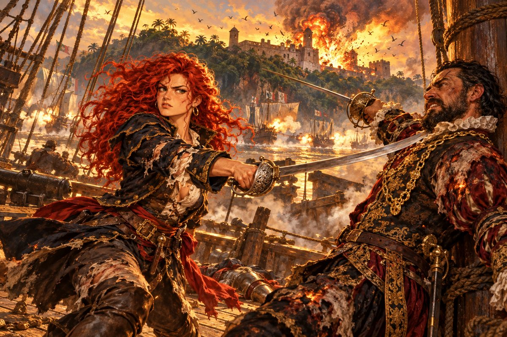

## 26. 이슬람 상인

돌아가는 길도 길었다. 리벨리온은 다시 아프리카 동쪽 해안을 따라 내려갔다. 카탈리나는 항구에 닿을 때마다 갑판을 떠나지 않았다. 사누드가 무엇을 물어도 짧게 대답했고, 기지의 농담에도 웃지 않았다. 원수를 잃은 복수자는 키를 잃은 배와 같았다. 바람이 부는 대로 흘러갈 뿐이었다.

모잠비크 항구의 여관에서 저녁을 먹을 때였다. 여관 심부름꾼이 그녀의 탁자로 다가왔다.

"혹시 카탈리나 씨인가요?"

"그래요."

"알 베자스라는 이슬람 상인이 당신을 뵙고 싶어 합니다. 이슬람 분들은 술을 드시지 않으니 주점이 아니라 이 여관 위층으로 와 달라시네요."

"알 베자스?" 사누드가 숟가락을 내려놓았다. "들어 본 이름이야. 엄청나게 큰 무역상이지. 요즘 눈에 띄는 바다마다 동맹 항구를 무섭게 늘리고 있다던데."

"맞습니다. 오스만의 술레이만 대제에게 직접 칙명을 받아 움직인다는 소문도 있지요." 심부름꾼이 고개를 끄덕였다.

"그 동네 장사꾼들은 동전 한 닢에도 벌벌 떤다던데." 기지가 빵을 뜯었다. "언제 바다에서 마주치면 주머니 좀 가볍게 해 줘야지."

"안됐지만 여긴 바다가 아니야." 카탈리나가 일어섰다. "일단 다녀오지."

위층 방에는 향 냄새가 은은했다. 창가에 서 있던 사내가 돌아섰다. 젊었다. 검은 수염을 단정히 다듬고 흰 터번을 둘렀으며, 눈빛이 영리했다. 그는 서툰 카스티야 말로 천천히 말했다.

"실례. 당신이, 카탈리나 에란초?"

"그렇다. 당신은?"

"내 이름, 알 베자스. 오스만 제국의 무역상. 이쪽 말, 서툴러서 이렇게밖에 말 못 한다. 이해 바란다."

"나한테 무슨 볼일이지?"

"아는 모험가가 부탁했다. 당신도 아마 안다. 피에트로 콘티."

카탈리나는 마사와의 저택 회랑에서 모자를 흔들던 사내를 떠올렸다. "그래. 한 번 스친 적은 있지."

"그가 중요한 볼일 있다고, 만나고 싶다고 전해 달랬다. 그런데 자기는 너무 바빠 못 움직인다. 그러니 당신이 와 달라고." 알이 손가락을 꼽았다. "장소는 리스본. 페레로 공작의 저택. 분명히 전했다. 내 일은 끝났다. 그럼, 가 보겠다."

알은 짧게 고개를 숙이고 방을 나갔다. 카탈리나는 창밖의 항구를 보았다.

"리스본이라……. 별로 좋은 기억이 없는 곳인데."

## 27. 리스본의 어머니

리스본에 닿은 것은 몇 달 뒤였다. 테주 강 어귀의 벨렘 탑이 저녁 해를 받아 금빛으로 빛났다. 카탈리나는 선원들에게 배에서 대기하라 이르고, 사누드와 기지만 데리고 뭍에 올랐다.

알파마 언덕 아래 그 주점에 들어서자, 카운터 뒤의 여인이 그녀를 알아보았다. 여인은 한 해 사이에 십 년은 늙어 있었다. 틀어 올린 머리에 흰 가닥이 섞였고, 눈 밑이 검게 꺼져 있었다.

"당신은…… 그때 그……."

여인이 카운터를 돌아 나와 카탈리나의 소매를 붙잡았다. 손이 떨렸다.

"루치아는요? 루치아는 어디 있어요! 세우타에 간다던 아이가 돌아오지 않아요. 편지 한 장 없이. 루치아를 돌려줘요……."

카탈리나는 그 손을 뿌리치지 못했다. 그녀는 여인의 눈을 마주 보았다. 피하고 싶었지만 피하지 않았다.

"……죄송합니다. 저도 따님을 찾아 흑해까지 갔어요. 하지만 찾지 못했어요."

여인이 무너져 내렸다. 소매를 붙잡은 채 바닥에 주저앉아, 소리 내어 울었다. 루치아, 루치아. 기지가 문간에서 고개를 돌렸다. 그날 국자를 휘두르던 여인이었다.

카탈리나는 무릎을 꿇고 여인의 어깨를 감쌌다. 할 수 있는 말이 없었다. 그녀는 오래 그렇게 있었다.

주점을 나서자 어린 여급 하나가 뒤따라 나왔다.

"카탈리나 씨인가요? 피에트로 님이 저 동쪽 저택에서 기다리고 계신대요. 우리나라 재상이신 레온 페레로 님의 관저예요."

언덕 위의 그 저택이었다. 하얀 석회벽, 푸른 타일, 오렌지 나무. 한 해 전 담을 넘어 들어가 때려죽이자던 그 집.

"재상 댁이라 그런지 번쩍번쩍하네." 기지가 휘파람을 불다가 목소리를 낮췄다. "그런데 부두에서 들으니 에제키엘 사령관이 배란 배는 다 끌고 나왔다더군. 누굴 잡으려는지야 뻔하지."

"그래. 다들 몸조심해." 카탈리나가 말했다. "너희는 배로 돌아가 있어. 저택에는 나 혼자 간다."

"알았어. 언제든 출항할 수 있게 준비해 두지." 사누드가 말했다.

## 28. 신성왕국

저택의 문을 열어 준 것은 하인이 아니었다. 은빛 머리를 단정히 빗어 올린 귀부인이었다. 눈매가 조안을 닮았다.

"누구신지요?"

"카탈리나 에란초입니다. 피에트로 콘티를 만나러 왔습니다. 여기 있다고 들었어요."

"어머, 그럼 카탈리나 씨로군요." 귀부인의 얼굴이 환해졌다. "아들 조안에게서 이야기를 들었어요. 마사와에서 그 아이가 큰 위험에 처했을 때 몸소 와서 도와주셨다고. 이 은혜를 어떻게 갚아야 할지……."

카탈리나는 대답이 궁해 시선을 돌렸다. 이 집 아들의 목에 칼을 겨누었던 것이 불과 반년 전이었다.

"지나가다 손을 보탰을 뿐입니다. 그보다 피에트로는 안에 있습니까?"

"그럼요. 잠시만 기다리세요."

응접실은 서늘했다. 벽에 걸린 낡은 해도 한 장이 눈에 띄었다. 오래전 이 집의 주인이 바다를 누비던 시절의 것이리라. 곧 피에트로가 모자를 흔들며 들어왔다.

"아, 카탈리나! 오랜만이야. 한참 기다렸다고."

"나를 일부러 여기까지 부른 이유가 뭐지?"

"어, 하하. 쌀쌀맞은 건 여전하구먼. 너무 그러지 말자고. 그대가 제일 알고 싶어 하는 걸 알려 주려는 건데."

"알고 싶은 거 없어."

"흠, 그래?" 피에트로가 고개를 갸웃했다. "마사와에서 내 앞에 서 있던 그 기세등등한 아가씨는 어디로 갔지? 복수는 이제 그만둔 건가?"

"잊은 적 없어." 카탈리나의 목소리가 날카로워졌다. "하지만 칼끝을 어디로 겨눠야 할지 모르는걸."

"알려 줄까?"

카탈리나가 고개를 들었다. "무슨 소리야. 알고 있어?"

"그래. 마르티네스야. 이 나라의 후작이지."

마르티네스. 알렉산드리아에서 오토가 말한 이름이었다. 페롯의 뒷배. 루치아를 납치한 자.

"당신, 지레짐작으로 하는 말은 아니겠지?"

"그럴 줄 알았어. 증거가 있다고, 이 사람아. 살아 있는 증인 말이야."

"그렇소. 내가 그 증인이오."

응접실 안쪽 문에서 노인 하나가 지팡이를 짚고 나왔다. 허리가 굽었고, 흰 수염이 가슴까지 내려왔다. 얼굴의 주름 사이로 오랜 어둠에 익숙해진 사람의 창백함이 배어 있었다. 그러나 눈빛만은 형형했다.

"당신은……?"

"파브리스 페레로라 하오. 이름만으로는 모르겠지. 레온이 내 아들이고, 그대가 쫓던 조안은 내 손자요."

"그분은 오래전에 세상을 떠났다고 들었어요. 스무 해도 더 전에."

"갇혀 있었소. 신성왕국의 지하 굴에." 노인은 의자에 몸을 내렸다. 지팡이를 쥔 손이 떨렸다. "그대는 사제 요한의 왕국 이야기를 아시오?"

"동방 어딘가에 있다는 그 기독교 왕국 얘기요? 뱃사람들 허풍이죠."

"총명한 아가씨로군. 그렇지, 당치도 않은 이야기요. 그런데 그 허상을 현실로 끌어내려는 자들이 있소." 파브리스의 목소리가 낮아졌다. "그럴듯한 전설을 덮어쓰고 세상의 눈을 피해 만든 단체, 이름만 왕국인 거짓 나라. 그것이 신성왕국이오. 그리고 그 교주를 자처하는 자가 마르티네스 후작이지."

노인은 천천히 이야기했다. 남미의 밀림 깊숙한 곳에 아무 죄 없는 원주민을 노예로 부려 요새를 쌓았다는 것. 그곳을 성지라 속여 눈먼 신자들을 끌어모으고 있다는 것. 군대를 길러 기독교도와 이슬람교도를 가리지 않고 칠 큰 전쟁을 준비하고 있다는 것. 제2의 십자군이라는 이름을 내걸고 세상을 손에 넣으려는 망상.

"어디에나 있는 광신도 쓰레기들이군." 카탈리나가 내뱉었다.

"그대 오라버니 미카엘은 운이 나빴어." 피에트로가 말을 받았다. 그의 목소리에서 장난기가 사라져 있었다. "신대륙 내륙을 살피다가, 하필 신성왕국의 본거지 요새와 맞닥뜨린 거야. 그 요새는 토르데시야스 조약을 어긴 자리에 있었지. 에스파니아 땅이어야 할 곳에 포르투갈 후작이 요새를 쌓은 거야. 미카엘이 그 사실을 본국에 알리려 한다는 걸 알고, 후작이 기습해서 입을 막은 거지."

카탈리나는 의자 팔걸이를 움켜쥐었다. 그을린 깃발이 떠올랐다. 폭풍은 천을 태우지 못한다. 그녀가 처음부터 알았던 것.

"마르타 기사단의 붉은 십자가는?"

"남의 문장을 돛에 그리는 데는 돈이 들지 않지." 피에트로가 어깨를 으쓱했다. "덤으로 에스파니아와 포르투갈 사이를 갈라놓고, 페레로 가에 누명까지 씌울 수 있다면 일석삼조 아니겠어?"

"그렇단 말이지." 카탈리나가 일어섰다. 목소리가 차갑게 가라앉았다. "이제 다 알겠군. 마르티네스, 그놈은 지금 어디 있지?"

"남미의 신성왕국 요새에 있을 거요." 파브리스가 말했다. "조심하시오. 오랜 세월에 걸쳐 쌓은 난공불락의 요새요."

"게다가 소문 들었지? 에제키엘 사령관이 그대를 잡으려고 무적함대를 총동원해 나섰다더군." 피에트로가 덧붙였다. "진짜 조심해야 할 거야."

"사령관은 만만한 상대가 아니야. 일을 마치기 전에 그분과 부딪치고 싶지는 않아." 카탈리나는 모자를 집었다. "토벌 함대와 마주치기 전에 최대한 빨리 끝내야겠군. 여기 오길 잘했어. 중요한 걸 알려 줘서 진심으로 고마워. 출항해야 하니 이만 가 보겠어."

"힘내시오." 노인이 말했다.

"겁 없는 해적 아가씨." 피에트로가 모자를 흔들었다. "이번에는 제대로 끝내고 와. 바다의 운이 그대 돛에 실리기를."

## 29. 남쪽 대륙

대서양을 건너는 데 한 달이 걸렸다. 카탈리나는 그 한 달 동안 거의 웃지 않았지만, 마사와를 떠날 때의 텅 빈 얼굴은 아니었다. 다시 겨눌 곳이 생긴 사람의 얼굴이었다.

"남미라는 데는 무지막지하게 넓군." 기지가 해도를 펼치고 혀를 내둘렀다. "이래서야 어디서 찾는단 말이오."

"감도 안 잡히는군. 발로 뛰는 수밖에."

그들은 카리브의 섬들을 지나 남미 해안을 따라 내려갔다. 항구마다 원주민과 이주민들에게 물었다. 밀림 깊은 곳의 요새, 이상한 신자들, 사라지는 노예들. 단서는 조금씩 모였다. 모든 이야기가 거대한 강 하나를 가리키고 있었다. 아마존.

강어귀에서 멀지 않은 카옌 항구에 닿은 날이었다. 부두를 걷던 기지가 걸음을 멈췄다.

"응? 누가 쫓기는데. 싸움인가?"

"주점 쪽이군. 둘 다 들어갔어."

주점 문 앞에 험악한 사내들이 몰려 있었다. 안에서 칼 부딪치는 소리가 났다. 카탈리나는 열린 창 너머로 안을 들여다보았다. 그리고 숨을 멈췄다.

"……저 아이. 루치아잖아!"

주점 한구석에 검은 머리 처녀가 웅크리고 있었다. 리스본에서 보았던 그 얼굴이었다. 야위었고 옷은 해졌지만, 틀림없었다. 그 앞을 두 사내가 막아서서 칼을 휘두르고 있었다.

"어? 저기 조안하고 로코가 인상 더러운 놈들이랑 싸우고 있소!" 기지가 눈을 비볐다. "저 사람들은 볼 때마다 몰매를 맞고 있네."

"저 둘이라면 걱정할 것 없을 것 같은데." 카탈리나가 말했다. "일단 나서지 말고 지켜보자."

주점 안의 싸움은 끝이 없었다. 쓰러뜨리면 또 들어왔다. 로코가 거칠게 숨을 몰아쉬었다.

"후, 대체 몇 놈을 쓰러뜨려야 끝나는 거야. 이놈들 어디서 자꾸 기어 나오는 거냐."

그때 비명이 울렸다. 사내 하나가 뒷문으로 들어와 루치아의 팔을 비틀어 잡았다.

"제기랄! 나, 낭패다!"

"로코, 어떻게 된 거냐!"

"죄송합니다, 제독님! 루치아가 저놈한테 붙잡혔습니다!"

"조안 님! 안 돼요! 저는 버리고 어서 도망치세요!" 루치아가 외쳤다.

"도망? 우리 낯을 본 놈들을 곱게 보낼 줄 알고?" 루치아를 잡은 사내가 그녀의 목에 칼을 댔다. "자, 칼을 버리고 저 벽에 나란히 서라. 그러면 이 계집 목숨은 살려 주지."

조안의 얼굴이 일그러졌다. 그는 루치아를 보았다. 그리고 칼을 바닥에 내려놓았다. 로코도 이를 갈며 따랐다. 두 사람은 벽 쪽으로 걸어가 섰다.

"네 말대로 했다. 이제 어쩔 셈이냐."

"하하하! 적을 믿다니, 이런 바보가 있나!" 사내들이 칼을 들고 다가섰다.

"생긴 대로 노는군." 카탈리나가 문을 걷어찼다. "사누드, 기지! 저놈들 전부 쓸어버려!"

## 30. 죽음의 신

주점 안이 순식간에 뒤집혔다. 기지가 탁자를 집어 던졌고, 사누드의 칼이 루치아를 잡은 사내의 손목을 쳤다. 루치아가 바닥에 쓰러지자 조안이 몸을 날려 그녀를 감쌌다.

"조안! 여긴 나한테 맡기고 그 아가씨 데리고 빨리 도망쳐!"

"카탈리나? 당신이 어떻게……." 조안이 루치아를 일으켜 세웠다. "이 빚은 잊지 않겠소!"

조안과 로코가 루치아를 데리고 뒷문으로 빠져나갔다. 카탈리나는 그 뒷문을 등지고 섰다. 사내들이 그녀를 에워쌌다.

그 사이로 사내 하나가 천천히 걸어 나왔다. 키가 크고 말랐으며, 검은 옷을 입었다. 얼굴의 반이 오래된 화상 자국으로 일그러져 있었다. 그가 걸어 나오자 다른 사내들이 길을 비켰다. 그들 사이에서 그 이름이 수군거림으로 번졌다. 루돌프. 죽음의 신.

"신성왕국의 일을 방해하는 게 너냐." 루돌프가 쌍검을 뽑았다. "여자라도 봐주지 않는다."

"봐 달라고 한 적 없어."

칼이 부딪쳤다. 루돌프의 칼은 페롯과 달랐다. 빠르고, 차갑고, 한 치의 낭비도 없었다. 사람을 죽이는 일을 직업으로 삼은 자의 칼이었다. 첫 합에 카탈리나의 소매가 갈라졌다. 둘째 합에 뺨에 가는 선이 그어졌다.

카탈리나는 물러서지 않았다. 그녀는 루돌프의 칼끝이 아니라 어깨를 보았다. 미카엘이 가르쳐 준 것이었다. 칼은 거짓말을 해도 어깨는 거짓말을 못 한다. 루돌프의 왼쪽 어깨가 미세하게 처졌다. 오른쪽 칼이 온다. 카탈리나는 몸을 비틀어 그 칼을 흘려보내고, 사브르를 그의 옆구리로 밀어 넣었다.

루돌프가 비틀거렸다. 그의 입가에 피가 번졌다.

"흥…… 제법이구나."

그가 무릎을 꿇었다. 카탈리나가 숨을 고르는 순간, 등 뒤에서 기지의 고함이 터졌다.

"제독님! 위험하오! 죽어라, 이 더러운 놈아!"

돌아보니 쓰러진 줄 알았던 사내 하나가 단검을 치켜든 채 그녀의 등 뒤에 서 있었다. 그리고 그 사내의 등에 기지의 칼이 꽂혀 있었다.

"크악……! 제길, 뒤에서 찌르다니, 비겁한 놈……! 내, 내가……."

사내가 쓰러졌다. 기지가 칼을 뽑으며 숨을 몰아쉬었다. 카탈리나는 그를 보았다. 처음 그를 바다에서 건져 올렸을 때, 배신하면 죽이겠다고 했던 일이 떠올랐다.

"휴, 기지. 이번엔 정말 위험했다." 카탈리나의 입가에 웃음이 번졌다. "너도 가끔은 쓸모가 있구나."

"가끔이라니, 섭섭하오." 기지가 칼에 묻은 피를 털었다. "나는 늘 쓸모 있는 놈이었소."

"다 정리됐나?" 사누드가 주점 안을 둘러보았다. 쓰러진 사내들 사이로 탁자와 의자가 뒤엉켜 있었다. "이쪽도 대충 끝났어. 조안 일행은 항구 쪽으로 피한 것 같아."

"가 보자."

## 31. 살아 있던 아이

부두 끝 창고 앞에서 조안이 루치아의 어깨를 감싸고 있었다. 루치아는 조안의 외투를 덮어쓰고 떨고 있었다. 로코가 그 앞을 지키듯 서 있었다.

"그래, 루치아. 신성왕국 놈들한테 잡혀 있었다니……." 조안의 목소리가 떨렸다. "마르티네스 후작, 그자는 내 손으로 끝내겠소."

"마르티네스를?" 카탈리나가 다가갔다. "미안하지만 그 몫은 내 거야."

"카탈리나! 무사했군요!"

"응? 그 정도 칼잡이들이야 떼로 와도 상관없어." 카탈리나는 뺨의 상처를 손등으로 훔쳤다. "그보다 들어 둬. 내 오빠를 죽인 자가 바로 그 후작이야."

"후작이? 그게 정말이오?"

카탈리나는 리스본에서 들은 것을 이야기했다. 미카엘이 사령부의 명을 받아 신대륙을 탐험하다 신성왕국이 숨은 곳을 알아낸 일. 서경 46도 선 서쪽을 에스파니아 땅으로 정한 토르데시야스 조약을 그 요새가 어기고 있었다는 것. 그리고 미카엘이 그 사실을 알리러 돌아가기 전에 입을 막으려 기습을 당했다는 것.

"그래서 보고하기 전에 습격해 입을 막았단 얘기군요." 조안이 이를 악물었다.

"마르티네스가 어디 있는지는 알아. 하지만 그곳은 요새로 꽁꽁 둘러쳐져 있어서 보통 수로는 어림도 없을 거야." 카탈리나가 수평선을 보았다. "게다가 나한테는 그놈 말고 까다로운 상대가 하나 더 있지."

"에제키엘 사령관의 무적함대 말이오? 아직도 쫓기고 있는 거요?"

"그래. 지금도 나를 잡으려고 이 근처 바다를 샅샅이 뒤지고 있을 거야."

조안은 잠시 생각에 잠겼다. "하긴, 정면으로 맞서서는 승산이 없겠지요. 그러나 당신이 이 궁지를 빠져나갈 길이 하나 있소."

"무슨 길?"

"우리가 에제키엘 사령관에게 신성왕국 이야기를 하고, 그가 이끄는 해군의 힘을 빌리는 거요."

카탈리나가 코웃음을 쳤다. "뭐라는가 했더니. 꿈같은 소리야. 나는 에스파니아 해군에게 쫓기는 몸이고, 당신은 남의 나라 사람이잖아."

"해 보지 않고는 모를 일이오. 어쨌든 그것 말고는 방법이 없어 보이오."

카탈리나는 대답하지 않았다. 바다 쪽을 보았다. 저 바다 어딘가에 산타크루스호가 있을 것이다. 의자를 권하던 사람. 미카엘의 칼을 건네주던 사람. 그녀가 칼을 겨누고 배를 빼앗아 달아난 사람.

"……그래. 일리는 있어." 그녀가 마침내 말했다. "나도 이제 내 나라 깃발에 포를 쏘는 일은 넌더리가 나. 사령관 앞에 가서 칼을 내려놓겠어."

사누드가 그녀를 보았다. 기지도 보았다. 두 사람 다 아무 말도 하지 않았다.

그때 조안의 외투 아래에서 루치아가 고개를 들었다. 카탈리나는 그 아이와 눈이 마주쳤다. 무슨 말을 해야 할지 몰랐다. 내가 너를 그 계단 위로 올려 보냈다고. 몰랐다는 것은 변명이 되지 않는다고.

루치아가 먼저 입을 열었다. 목소리가 갈라져 있었다.

"카탈리나 씨. 또 구해 주셨네요."

"……또?"

"바다로 데려가 주셨잖아요. 저, 그때 정말 기뻤어요." 루치아가 조금 웃었다. 야윈 얼굴에 그 웃음이 아팠다. "그러니까, 이번엔 꼭 리스본으로 데려다주세요. 엄마가 기다릴 거예요."

카탈리나는 루치아의 손을 잡았다. 차갑고 작은 손이었다. 그녀는 그 손을 오래 놓지 않았다.

"그래. 약속할게. 어머님이 아직 그 가게에서 기다리고 계셔."

## 32. 투항

이틀 뒤, 아마존 강어귀 앞바다에서 그들은 에스파니아 함대를 만났다.

수평선을 메운 돛이 다가왔다. 그 한가운데에 산타크루스호가 있었다. 리벨리온과 조안의 배들은 돛을 내리고 기다렸다. 포문은 모두 닫았다. 곧 산타크루스호의 뱃머리에서 확성 나팔을 통한 목소리가 바다를 건너왔다.

"앞의 배들은 돛을 내려라! 따르지 않으면 발포한다!"

조안이 뱃전에 올라섰다. "잠깐! 공격하지 마시오. 에제키엘 사령관께 전할 말이 있어 왔소!"

산타크루스호가 다가와 나란히 섰다. 높은 선미루 위에 반백의 사내가 서 있었다. 단추 하나 풀지 않은 제복. 카탈리나는 그 모습을 두 해 가까이 만에 다시 보았다. 그는 조금도 변하지 않았다.

"에스파니아 함대를 맡은 에제키엘이다."

"나는 조안 페레로. 포르투갈 함대의 제독이오. 우리는 싸울 뜻이 없소. 부탁이 있어 당신을 찾고 있었소."

"우리도 싸울 뜻은 없다. 다만 서둘러 마쳐야 할 임무가 있을 뿐이지." 에제키엘의 눈이 리벨리온으로 향했다. "그 옆의 해적선을 붙잡는 일이지. 그대의 용건은 그 일을 마친 다음에 듣겠다."

카탈리나가 뱃전에 섰다. 바람이 붉은 머리칼을 흩뜨렸다.

"기다려 주십시오, 사령관님. 카탈리나입니다. 투항하겠습니다."

"……뭐라고?"

"모든 저항을 그만두고 사령관님의 처분에 따르겠습니다. 그러니 부디, 저 포르투갈 제독의 이야기를 들어 주십시오."

에제키엘은 오래 그녀를 보았다. 두 해 전 사령실에서처럼.

"카탈리나. 속임수가 아니라면, 나도 기사의 이름으로 그대 말을 끝까지 듣겠다. 말하라."

"감사합니다, 사령관님."

카탈리나는 이야기했다. 포르투갈 궁정이 페레로 가와 마르티네스 가 두 파벌로 갈라져 있다는 것. 페레로 가는 가문은 낮아도 왕실의 신임이 두텁고 백성의 지지를 받는다는 것. 그것을 시기한 마르티네스 일파가 남미의 밀림에 거짓 왕국을 세우고, 신자들을 꾀어 광신의 군대를 만들고 있다는 것. 그들이 스스로를 신성왕국이라 부르며 세상을 혼란에 빠뜨려 손에 넣으려 한다는 것. 그리고 아마존 강 상류에 쇠처럼 단단한 요새를 쌓았다는 것.

"왕립함대 제독 미카엘은 그 요새를 찾아낸 뒤 본국에 알리려 돌아오던 길에 마르티네스 일파에게 살해당했습니다." 카탈리나의 목소리가 처음으로 흔들렸다. "제 복수를 이루게 도와주십시오. 일이 끝나면 어떤 처분이든 피하지 않겠습니다."

바다 위에 침묵이 내렸다. 갈매기 한 마리가 두 배 사이를 가로질러 날았다.

"우리 척후선도 아마존 상류에 이상한 성채가 있다고 알려 왔었다." 에제키엘이 천천히 말했다. "그것이 지금 너희가 말하는 신성왕국이겠지."

그는 선미루 난간을 짚었다.

"잘 알았다. 이것은 결코 지나칠 수 없는 일이다. 일단 힘을 합치자. 같은 이베리아의 사람으로서 함께 싸우자!"

"감사합니다, 사령관님. 길은 저희가 압니다. 앞장서겠습니다."

리벨리온의 돛이 다시 펼쳐졌다. 그 뒤로 붉은 십자가의 돛이, 그 뒤로 카스티야의 성과 레온의 사자가 따랐다. 사누드가 키를 잡으며 중얼거렸다.

"살다 보니 별일을 다 보는군. 반란군이 무적함대를 이끌다니."

## 33. 아마존

아마존은 강이라기보다 바다였다. 강어귀에서는 건너편 기슭이 보이지 않았다. 흙탕물이 바다로 쏟아져 나와 수평선까지 누렇게 물들였다. 강을 거슬러 오르자 양쪽 기슭에 밀림이 벽처럼 솟았다. 이름 모를 새들이 울었고, 공기는 물을 먹은 솜처럼 무거웠다.

사흘째 되던 날, 굽이를 돌자 강 한가운데에 함대가 기다리고 있었다. 돛마다 이상한 문장이 그려져 있었다. 십자가와 왕관이 얽힌 문양. 그 뒤로 강기슭 언덕 위에 돌로 쌓은 성벽이 보였다. 신성왕국의 요새였다.

함대 한가운데의 기함 뱃머리에 사내 하나가 서 있었다. 화려한 비단옷에 금목걸이, 기름을 바른 검은 수염. 그가 리벨리온을 보고 웃었다.

"흐흐, 여해적. 언제까지 도망만 다닐 셈이지? 이럴 바에야 그냥 조용히 저세상으로 사라지는 게 어때?"

그러다 그는 리벨리온 뒤로 굽이를 돌아 나오는 돛들을 보았다. 붉은 십자가. 카스티야의 성. 레온의 사자. 끝이 없었다. 그의 웃음이 굳었다.

"……어찌 된 거지? 나를 노린 게 아니었나?"

"마르티네스 후작." 산타크루스호에서 에제키엘의 목소리가 울렸다. "네 꿍꿍이는 이미 다 드러났다!"

"흥! 그게 어쨌다는 거냐." 마르티네스가 칼을 뽑았다. "지금 여기서 너희를 모조리 수장시키면 아무것도 달라지지 않는다!"

"우리 함대는 적의 비밀 요새를 총공격하겠다." 에제키엘이 명령했다. "이쪽 해전은 너희가 마무리하라."

산타크루스호와 무적함대가 강기슭으로 방향을 틀었다. 포문이 일제히 요새를 향했다. 카탈리나는 조안의 배를 향해 소리쳤다.

"조안. 마르티네스는 나한테 양보해 줘. 부탁이야."

조안은 망설이지 않았다. "알겠소. 나머지 함대는 내가 전부 끌어내겠소. 그동안 마르티네스를 치시오!"

붉은 십자가의 돛들이 강 한쪽으로 미끄러져 나갔다. 마르티네스의 호위선들이 그 뒤를 쫓았다. 강 한가운데에 마르티네스의 기함만 남았다.

"돛 전부 펼쳐! 저 배에 붙인다!"

리벨리온이 흙탕물을 가르고 달렸다. 기함의 포가 불을 뿜었다. 포탄이 앞돛을 찢었고, 뱃전 한쪽이 부서져 나갔다. 리벨리온은 멈추지 않았다. 뱃머리가 기함의 옆구리를 들이받았다. 나무가 비명을 지르며 부서졌다. 갈고리가 날았다.

카탈리나는 미카엘의 사브르를 뽑아 들고 기함의 갑판으로 뛰어내렸다.

갑판 위는 연기로 가득했다. 강기슭 쪽에서 요새를 때리는 무적함대의 포성이 천둥처럼 울렸다. 그 연기 사이로 마르티네스가 서 있었다. 비단옷 소매가 그을려 있었다.

"네년이……. 네년 하나 때문에……."

"마르티네스. 1522년 5월 10일, 산토도밍고. 기억하나?"

"기억할 게 뭐 있나. 바다에 배 몇 척 가라앉힌 일을 일일이 기억하는 사람도 있나?"

카탈리나는 대답하지 않았다. 그녀가 먼저 칼을 내질렀다.

마르티네스는 귀족의 검술을 배운 자였다. 자세가 반듯했고 칼끝이 날카로웠다. 그러나 그 칼에는 무게가 없었다. 남의 손으로 사람을 죽여 온 자의 칼이었다. 카탈리나의 칼에는 두 해의 세월이 실려 있었다. 세비야의 사령실, 그을린 깃발, 불타던 카디스 앞바다, 흑해의 검은 물결, 희망봉의 파도, 마사와의 텅 빈 밤. 리스본 주점 바닥에 주저앉아 울던 어머니.

칼과 칼이 열 번, 스무 번 부딪쳤다. 마르티네스가 뒷걸음질 쳤다. 돛대에 등이 닿았다. 그가 마지막으로 크게 칼을 휘둘렀다. 카탈리나는 그 칼을 사브르의 밑동으로 받아 흘리고, 한 걸음 안으로 들어섰다.

사브르가 마르티네스의 가슴을 꿰뚫었다.

마르티네스의 눈이 커졌다. 그의 입술이 떨렸다.

"내 배들이…… 내가 쌓은 것이…… 내 왕국이……. 너 하나 때문에…… 모조리……."

카탈리나는 칼자루를 놓지 않았다. 그녀는 그의 귀에 대고 낮게 말했다.

"기억해 둬, 마르티네스. 지금 너를 꿰뚫고 있는 건 미카엘과 에르난의 원한이다."

그녀가 칼을 뽑았다. 마르티네스가 돛대를 따라 미끄러져 내려앉았다. 그는 다시 일어나지 않았다.

강기슭 언덕 위에서 거대한 폭음이 울렸다. 요새의 화약고였다. 불기둥이 밀림 위로 치솟았고, 검은 연기가 하늘을 덮었다. 새 떼가 한꺼번에 날아올랐다.

카탈리나는 피 묻은 사브르를 늘어뜨린 채 그 불기둥을 바라보았다. 두 해 전 산토도밍고의 하늘도 저렇게 붉었을 것이다. 오빠와 에르난도 마지막으로 저런 불빛을 보았을 것이다.

이제 끝났다. 그녀는 그렇게 생각했다. 그런데 이상하게도, 아무것도 끝나지 않은 것 같았다.
