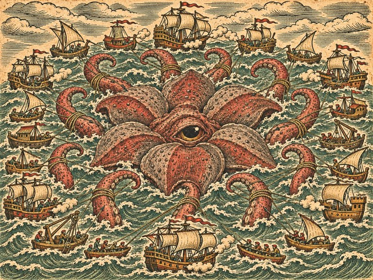

1539년, 노르웨이 베르겐. 고래잡이 선장인 아버지의 배 「북극성」이 돌아오지 않자, 스물두 살 잉리드 하우게는 낡은 고래잡이 배 한 척과 늙은 작살잡이 토르켈을 데리고 바다로 나섭니다. 베네치아의 지도 제작자가 해도에 그려 넣은 괴물들은 정말로 바다에 있었습니다. 해도를 그리는 수녀 마르그레테, 암스테르담의 구난선장 디르크, 알렉산드리아의 배 목수 이븐 살림, 제노바의 밀수선장 파올라와 함께, 잉리드는 북해에서 지중해와 인도양, 얼음 바다와 은의 바다를 건너 괴물들이 왜 얕은 바다로 올라오는지를 쫓습니다. 그 끝에는 아버지가 먼저 본 가장 큰 것과, 스무 척의 배가 함께 맞서는 마지막 바다가 있습니다.

:::caution[줄거리 공개]
이 소설에는 잉리드 이야기의 처음부터 마지막 결말까지 모든 줄거리가 들어 있습니다. 게임을 먼저 즐기고 싶다면 다 끝낸 뒤에 읽으세요.
:::

이 소설은 게임의 이야기를 바탕으로 장면과 대화를 덧붙인 각색입니다. 3부에서 스킬라를 깊은 물로 몰아내고, 7부 결전에서 아버지의 방법을 고른 여정을 따라가며 결말에서는 세 갈래를 모두 소개합니다. 실제 게임에서 어떤 선택을 하고 어떻게 싸우느냐에 따라 만나는 장면은 달라질 수 있습니다.

## 차례

| 차례 | 내용 |
| --- | --- |
| [서장 ― 키에 새긴 별](/novel/deepsea/prologue/) | 1539년 봄 베르겐, 아버지가 키 손잡이에 새긴 별과 떠나는 「북극성」 |
| [1부 ― 돌아오지 않는 배](/novel/deepsea/part1/) | 비어 있는 계류 자리, 새 섬의 소문, 흔적 셋, 해도를 그리는 수녀, 숨 쉬는 섬 |
| [2부 ― 안개 속의 돛](/novel/deepsea/part2/) | 사람 없는 배, 구난선장 디르크, 일곱 돛, 약탈선, 물결이 다른 곳 |
| [3부 ― 팔 달린 것](/novel/deepsea/part3/) | 나폴리의 밀수선장, 알렉산드리아의 배 목수, 불빛과 세관선, 해협의 밤 |
| [4부 ― 폭풍의 길](/novel/deepsea/part4/) | 한 줄로 부서진 배들, 흩어진 함대, 무거운 배와 가벼운 배, 폭풍의 눈 |
| [5부 ― 얼음 바다](/novel/deepsea/part5/) | 얼음 깨는 뱃머리, 무리의 자국, 우두머리의 쉼, 아버지의 작살 |
| [6부 ― 물기둥](/novel/deepsea/part6/) | 세비야의 관청, 첫 물기둥, 펌프, 멈춘 고래, 마데이라의 일지, 안개 속의 것, 북극성 |
| [7부 ― 심해의 징조](/novel/deepsea/part7/) | 부르러 가는 길, 스무 척, 분대, 1막·2막·3막, 안개가 걷힌다, 베르겐 |
| [결말 ― 세 갈래 바다](/novel/deepsea/ending/) | 깊은 물의 문지기, 해도의 기록자, 다른 바다 ― 토벌의 선장, 그 뒤 |

게임에서 괴물과 싸우는 방법은 [심해 외전 안내](/side-story/deepsea/)와 [괴물전 안내](/side-story/deepsea-monsters/)를 참고하세요.
