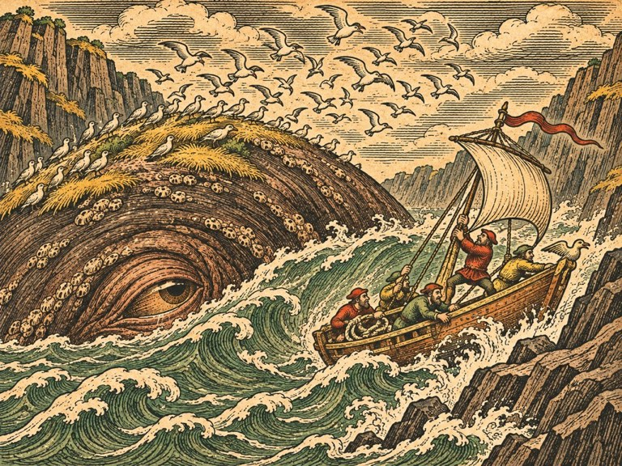
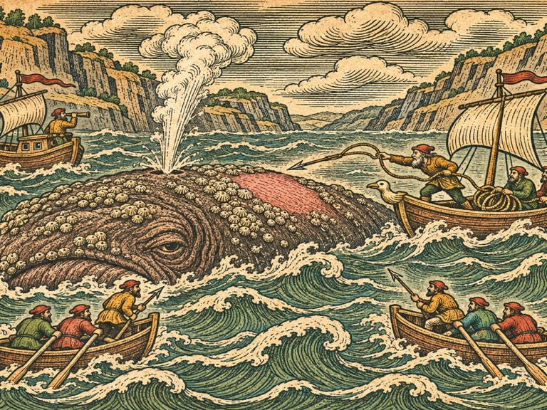
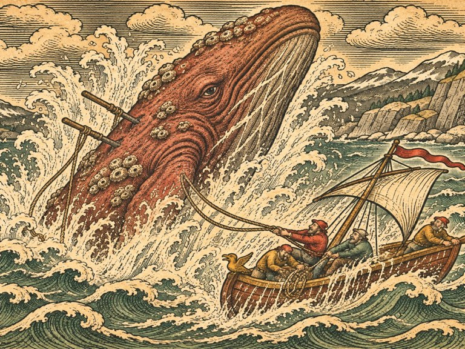

## 1. 비어 있는 계류 자리

1539년 가을, 베르겐.

부두 끝 계류 자리는 석 달째 비어 있었다.

잉리드는 아침마다 그 자리를 보러 갔다. 말뚝에는 「북극성」의 밧줄이 쓸고 간 자국이 반들반들하게 남아 있었다. 다른 배가 그 자리에 대려고 하면 부두 사람들이 손을 내저었다. 아르네의 자리다. 아직은. 그 '아직은'이 날마다 조금씩 작아지는 것을, 잉리드는 말하지 않아도 알았다.

이모 시그리드의 여관은 브뤼겐 창고 거리 끝에 있었다. 어머니가 일찍 죽은 뒤로 잉리드는 배에 있지 않을 때면 그 여관 다락에서 잤다. 그날 아침 이모는 부엌 탁자에 열쇠 하나를 내려놓았다.

"아르네가 떠나기 전에 맡겨 두고 간 거다."

녹슨 쇠 열쇠였다. 손잡이에 기름 먹인 끈이 감겨 있었다.

"무슨 열쇠예요."

"조선소 뒤 창고. 갈매기호가 거기 있다."

잉리드는 열쇠를 보았다. 갈매기호는 아버지가 「북극성」을 사기 전에 몰던 배였다. 작고 낡은 고래잡이 배. 잉리드가 처음 밧줄을 감은 배이기도 했다. 몇 해 전부터 물에서 끌어올려 창고에 넣어 두었다는 것은 알고 있었지만, 아버지가 그 열쇠를 따로 남겨 두었다는 것은 몰랐다.

"아버지가 뭐라고 했어요."

이모는 앞치마에 손을 닦았다. 대답을 고르는 얼굴이었다.

"석 달이 지나도 안 돌아오면 너한테 주라고 했다. 그리고 네가 그걸 받으면 틀림없이 바다로 나갈 테니, 말리지 말라고."

"그게 다예요?"

"말려 봐야 소용없을 테니까, 라고 덧붙였지."

잉리드는 열쇠를 집어 들었다. 쇠가 손바닥에 차가웠다.

창고 문은 한참 만에 열렸다. 경첩이 비명을 질렀다. 먼지 낀 빛줄기 속에 갈매기호가 버팀목 위에 올라앉아 있었다. 생각보다 작았다. 돛대 하나, 뱃전은 낮고, 뱃머리에는 누군가 갈매기를 서툴게 새겨 놓았다. 잉리드가 열두 살 때 새긴 것이었다. 아버지는 그 갈매기를 보고 한참 웃더니 지우지 않았다.

잉리드는 뱃전을 손바닥으로 두드렸다. 판자는 마르고 틈이 벌어져 있었지만 썩지는 않았다. 물에 들어가면 하루 이틀 새면서 부풀 것이다. 그다음엔 버틸 것이다.

"넌 아직 떠."

혼잣말이었다. 갈매기호가 대답할 리 없었다. 그래도 잉리드는 그 말이 맞다고 느꼈다.

## 2. 새 섬의 소문

부두 술집 '고래뼈'는 그날도 젖은 털옷 냄새와 맥주 냄새로 가득했다. 천장 들보에 걸린 커다란 고래 턱뼈가 등잔 불빛에 누렇게 빛났다. 잉리드가 문을 열고 들어서자 시끄럽던 탁자 몇 개가 조용해졌다.

토르켈은 늘 앉던 구석 자리에 있었다. 예순이 넘은 사내였다. 어깨는 여전히 넓었지만 등은 굽었고, 왼손 손가락 둘은 젊을 때 밧줄에 감겨 마디가 없었다. 탁자 위에는 맥주잔 하나와, 손질하다 만 작살 촉이 놓여 있었다.

잉리드는 맞은편에 앉았다.

"갈매기호를 띄울 거예요."

토르켈은 작살 촉을 숫돌에 대고 한 번 밀었다. 쇳소리가 났다.

"그 배는 물이 샌다."

"이틀이면 부풀어요."

"돛도 삭았다."

"이모네 여관 차양 천을 뜯으면 돼요."

토르켈이 고개를 들었다. 처음으로 잉리드의 얼굴을 똑바로 보았다. 그 눈에는 무언가가 있었다. 잉리드는 그게 뭔지 알 수 없었다. 미안함 같기도 하고, 겁 같기도 했다.

"아르네를 찾으러 가겠다는 거냐."

"아버지 배가 어디서 발견되든 누구 배였는지 알 수 있대요. 키에 별을 새겨 놨으니까." 잉리드는 탁자를 손가락으로 두드렸다. "그러니까 찾으러 가는 게 아니라, 확인하러 가는 거예요. 어느 쪽이든."

토르켈은 한참 말이 없었다. 그러다 작살 촉을 가죽에 싸서 품에 넣었다.

"작살잡이가 없는 고래잡이 배는 그냥 나무통이다."

"그러니까 아저씨한테 온 거예요."

"나는 「북극성」에 안 탔다."

"알아요."

"왜 안 탔는지 안 묻냐."

"물으면 말해 줄 거예요?"

토르켈은 대답하지 않았다. 잉리드도 더 묻지 않았다. 둘 사이에는 그 정도의 약속이면 충분했다.

옆 탁자에서 누군가 목소리를 높였다. 북쪽 포구에서 내려온 어부들이었다.

"……틀림없다니까. 피오르 어귀에 섬이 생겼어. 지난 봄까지만 해도 거긴 물이었다고. 내가 거기서 서른 해를 낚시했어."

"섬이 하룻밤에 생기냐."

"그러니까 이상하다는 거지. 거무튀튀하고, 풀이 나 있고, 바닷새가 앉아 있어. 그런데 물때가 바뀌면 자리가 조금씩 달라."

"술을 덜 마셔라, 하랄."

웃음이 터졌다. 그러나 웃지 않는 사람도 몇 있었다. 잉리드는 그 사람들의 얼굴을 보았다. 돌아오지 않은 배의 선원 가족들이었다.

토르켈이 맥주잔을 비우고 일어섰다.

"내일 아침, 창고로 가마. 송진하고 뱃밥을 가져가지."

## 3. 베네치아에서 온 편지

갈매기호를 물에 띄우는 데 사흘이 걸렸다. 첫날은 정말로 샜다. 둘째 날에는 덜 샜다. 셋째 날 아침, 토르켈이 선창에 내려가 판자 틈에 손바닥을 대 보더니 고개를 끄덕였다.

그날 오후, 한자 상관에서 사람이 왔다.

브뤼겐의 창고들은 모두 독일 상인들의 것이었다. 그들은 베르겐에 살면서도 베르겐 사람이 아니었다. 자기들끼리 법을 만들고, 자기들끼리 결혼하지 않고, 말린 대구를 사서 뤼베크로 실어 보냈다. 고래잡이 선장들은 그들에게 기름을 팔고 그들에게서 밧줄과 쇠를 샀다. 좋아하는 사이는 아니었다. 필요한 사이였다.

상관 이층 방은 밀랍과 종이 냄새가 났다. 창가 책상 앞에 마흔쯤 된 사내가 앉아 있었다. 깔끔한 검은 저고리, 손가락에 낀 도장 반지, 장부 위를 오가는 빠른 눈.

"한스 뵈켈이오." 사내는 일어나지 않았다. "아르네 하우게의 딸이라고."

"그런데요."

"그대 아버지에게 맡길 일이 있었는데, 아버지가 없으니 딸에게 묻는 거요. 바다에 나갈 생각이라고 들었소."

한스는 책상 서랍에서 접힌 종이를 꺼냈다. 붉은 밀랍 봉인이 반쯤 떨어져 있었다. 그 옆에 또 한 장, 넓게 접힌 종이가 있었다. 한스는 그것을 책상 위에 펼쳤다.

잉리드는 숨을 멈췄다.

지도였다. 아니, 지도라고 부르기에는 너무 많은 것이 그려져 있었다. 노르웨이 해안선이 톱니처럼 들쑥날쑥하게 이어졌고, 그 바깥 바다에는 온갖 것이 우글거렸다. 배를 휘감은 긴 뱀. 물을 뿜어 배를 덮치는 고래. 엄니를 바위에 걸고 잠든 짐승. 그리고 바다 한가운데, 등에 닻을 내린 배를 얹고 떠 있는 커다란 물고기. 그 등에서 선원들이 불을 피우고 있었다.

"베네치아에서 찍어 낸 해도요. 올라우스 마그누스라는 스웨덴 성직자가 그렸소." 한스가 손가락으로 지도 가장자리를 눌렀다. "그 사람이 이 편지를 보냈소. 라틴 말이라 우리 서기가 옮겼지."

한스는 편지를 소리 내어 읽었다. 고르고 단정한 목소리였다.

"「북쪽 바다의 뱃사람들에게. 나는 내가 그린 것들을 직접 보지 못했다. 들은 것을 그렸을 뿐이다. 그러나 들은 것이 모두 거짓이라고도 믿지 않는다. 올해 베르겐 앞바다에 지난해까지 없던 섬이 생겼다는 소식을 들었다. 그것이 섬인지, 섬이 아닌 무엇인지 확인해 줄 사람을 찾는다. 확인한 것을 적어 보내 주면, 그 값을 치르고, 그 이름을 해도에 남기겠다.」"

한스가 편지를 내려놓았다.

"값은 상관이 먼저 치르기로 했소. 그 성직자와 우리 상관 사이에는 거래가 있으니까. 그대가 할 일은 어귀에 가서 그 섬을 보고 오는 것이오."

"왜 저예요. 상관에는 배가 많잖아요."

"상관 배는 대구를 싣지, 섬을 구경하지 않소." 한스가 처음으로 입꼬리를 올렸다. "그리고 솔직히 말하면, 그 어귀로 간 배 셋이 돌아오지 않았소. 우리 배는 아니었지만, 우리 기름이 실려 있었지."

잉리드는 지도 위 물고기를 다시 보았다. 등 위에서 불을 피우는 선원들. 그들은 아직 아무것도 모르는 얼굴이었다.

"갈게요."

"좋소." 한스는 장부에 무언가를 적었다. "돌아오면 보고는 나에게 하시오. 편지는 내가 베네치아로 부치겠소. 그리고 하우게 양."

"네."

"돌아오시오. 돌아와야 값을 치를 수 있으니."

## 4. 흔적 셋

갈매기호는 이른 아침 썰물을 타고 피오르를 나섰다. 토르켈이 키를 잡고, 잉리드는 돛대에 기대 바다를 보았다. 선원은 넷이 더 있었다. 모두 돌아오지 않은 배의 가족이었다. 품삯을 묻지 않고 따라나선 사람들이었다.

어귀까지는 반나절 거리였다. 바다는 잔잔했다. 회색 물결이 둥글게 밀려왔다 밀려갔고, 갈매기 떼가 배를 따라왔다.

처음 본 것은 통이었다.

기름통 하나가 물결에 떠서 빙글빙글 돌고 있었다. 테두리에 낙인이 찍혀 있었다. 잉리드는 낙인을 알아보았다. 에이나르 아저씨네 배의 낙인이었다. 조금 떨어진 곳에 작살이 하나 떠 있었다. 자루가 반쯤 부러진 채, 촉은 아래로, 자루 끝만 물 위로 내밀고 있었다. 마치 누군가 바다에 꽂아 두고 간 것처럼.

토르켈이 갈고리로 작살을 건져 올렸다. 그는 촉을 손가락으로 쓸어 보더니 얼굴을 찌푸렸다.

"뭔가에 박혔다가 빠졌다. 그런데 피가 없다."

"고래면 피가 나잖아요."

"보통은 그렇지."

그들은 북쪽 포구에 들러 물을 채웠다. 포구라고 해야 집 열댓 채와 부두 하나가 전부인 마을이었다. 거기서 하랄이라는 늙은 어부를 다시 만났다. '고래뼈'에서 사람들이 술 덜 마시라고 놀리던 그 사람이었다. 하랄은 잉리드를 보자 반가워했다. 놀리지 않는 사람이 와서였다.

"내가 본 걸 말해 주지. 아니, 내가 본 게 아니라 에이나르네 막내가 본 거다. 걔 혼자 살아 돌아왔으니까."

막내는 열여섯 살쯤 된 소년이었다. 다리를 절었다. 하랄의 집 아궁이 앞에 앉아, 불을 보며 말했다.

"섬이었어요. 정말 섬이었어요. 등이 넓고, 풀이 나 있고, 바위 같은 게 다닥다닥 붙어 있었어요. 새들이 앉아 있었고요. 아버지가 거기 닻을 내리자고 했어요. 바람이 세서, 섬 뒤에 숨으면 좋겠다고."

소년은 말을 멈췄다. 손가락으로 무릎을 쥐었다.

"닻을 내리고, 불을 피웠어요. 고기를 구우려고. 그런데 섬이…… 따뜻해졌어요. 그러더니 가라앉았어요. 천천히. 우리 배를 끌고."

하랄이 소년의 어깨에 손을 얹었다. 잉리드는 한스의 지도를 떠올렸다. 등 위에서 불을 피우던 선원들.

"섬인 척하는 거예요." 잉리드가 말했다. "위장."

"짐승이 그런 걸 알고 하겠냐." 토르켈이 낮게 말했다.

"알고 하는지 모르고 하는지는 몰라요. 그래도 하는 건 맞잖아요."

다음 날 그들은 어귀 쪽으로 더 나갔다. 정오쯤, 잉리드가 돛대 꼭대기에서 손을 들었다. 바다 위에 무지갯빛 얼룩이 퍼져 있었다. 기름띠였다. 둥글게, 크게, 마치 누군가 커다란 기름 항아리를 쏟은 것처럼.

토르켈이 뱃전에 몸을 내밀고 냄새를 맡았다.

"고래 숨 냄새다."

"이렇게 커요?"

"이렇게 큰 숨은 처음 맡는다." 토르켈은 몸을 일으켰다. 그의 얼굴이 굳어 있었다. "숨을 쉬러 올라오는 놈이다. 섬이든 뭐든. 숨은 쉬어야 해."

잉리드는 허리춤의 작은 공책에 그 말을 적었다. 글씨가 서툴렀다. 적는 것은 아버지가 하던 일이었다. 날씨, 물때, 고래가 보인 자리. 아버지의 공책은 「북극성」과 함께 바다에 있었다. 잉리드는 새 공책을 샀고, 첫 장에 이렇게 적었다.

섬처럼 보인다. 숨을 쉬러 올라온다.

## 5. 섬이 움직였다

어귀에 섬이 있었다.

정말로 섬처럼 보였다. 피오르 두 기슭 사이, 배가 드나드는 물길 한가운데. 거무스름한 등이 물 위로 길게 솟아 있었고, 등 위에는 누런 풀과 따개비가 덮여 있었다. 바닷새 수십 마리가 앉아 깃을 고르고 있었다. 물결이 그 가장자리에 부딪혀 하얗게 부서졌다. 바위에 부딪히는 소리와 똑같았다.

"가까이 가지 마라." 토르켈이 말했다.

"보기만 할 거예요."

"보기만 하는 것도 가까이 가는 거다."

잉리드는 돛을 줄이게 했다. 갈매기호는 바람을 비껴 천천히 다가갔다. 섬까지 거리가 활 두 번 쏠 만큼 남았을 때, 새들이 한꺼번에 날아올랐다.

소리도 없이.

바다가 기울었다.

아니, 섬이 기울었다. 거무스름한 등이 한쪽으로 천천히 돌아누우면서, 그 아래에서 물이 부풀어 올랐다. 언덕 하나만 한 물결이 갈매기호 쪽으로 밀려왔다. 잉리드는 키를 잡은 토르켈에게 소리쳤다. 토르켈은 이미 키를 꺾고 있었다. 갈매기호는 물결의 등을 비스듬히 타고 올라갔다가 미끄러져 내려왔다. 선창에서 무언가 우르르 쏟아지는 소리가 났다.

섬이 눈을 떴다.

등과 물 사이, 물결에 반쯤 잠긴 곳에서 무언가가 열렸다. 잉리드는 그것이 눈이라는 것을 한참 뒤에야 알았다. 배의 선창 창문만 했다. 흐릿한 갈색이었고, 그 속에 아무 생각도 없어 보였다. 화가 난 것도, 배가 고픈 것도 아닌 눈. 그냥 잠에서 깬 눈이었다.

"돌려!" 잉리드가 외쳤다. "어귀 밖으로!"

갈매기호는 돌았다. 돛이 바람을 받아 부풀었다. 뒤에서 물이 다시 부풀었다. 섬이 따라오고 있었다. 빠르지는 않았다. 그러나 멈추지도 않았다. 섬의 등이 물속으로 잠겼다 떠올랐다 할 때마다, 그 앞의 물이 밀려나 갈매기호의 꼬리를 들어 올렸다.

"한 번만 더 밀리면 바위다!" 토르켈이 외쳤다. 왼쪽 기슭이 가까웠다. 검은 바위가 이빨처럼 물 밖으로 나와 있었다.

잉리드는 돛줄을 잡았다. 손바닥이 쓸려 화끈거렸다. 아버지가 가르쳐 준 대로, 바람을 한쪽으로 몰아 배를 비틀었다. 갈매기호는 바위를 한 뼘 차이로 비켜 갔다. 뒤에서 섬이 바위에 부딪혔다. 둔하고 깊은 소리가 물 밑에서 울렸다.

섬은 거기서 멈췄다.

바위에 등을 기댄 채, 물 위로 숨을 내뿜었다. 하얀 물줄기가 돛대 높이까지 솟았다가 비처럼 흩어졌다. 비린내와 기름 냄새가 바람에 실려 왔다. 그리고 섬은 다시 가라앉아 잠들었다. 새들이 하나둘 내려앉았다.

갈매기호는 어귀를 빠져나왔다. 아무도 한동안 말하지 않았다. 선원 하나가 뱃전에 기대 토했다. 다른 하나는 갑판에 주저앉아 무릎을 끌어안았다.

잉리드는 공책을 꺼냈다. 손이 떨려서 글씨가 더 엉망이 되었다.

움직인다. 가까이 가면 몸을 뒤집어 물을 민다. 깨면 따라온다. 바위에 부딪히면 멈춘다.

그리고 한 줄을 더 적었다.

고래다. 아주 늙고 아주 큰 고래.

토르켈이 옆에 와서 공책을 내려다보았다. 그는 글을 읽지 못했다. 그래도 잉리드가 무엇을 적는지는 알았다.

"그걸로 뭘 하려고."

"보고하려고요. 상관에. 그리고 베네치아에."

"그다음엔."

잉리드는 공책을 덮었다.

"그다음엔 잡아야죠. 어귀가 막혀 있으면 베르겐 고래잡이들은 다 굶어요."

토르켈은 아무 말 없이 키로 돌아갔다. 그러나 잉리드는 보았다. 그가 처음으로, 아주 조금, 웃었다는 것을.

## 6. 해도를 그리는 수녀

한스는 보고를 들으며 아무것도 적지 않았다. 다 듣고 나서야 펜을 들었다.

"눈을 봤다고."

"선창 창문만 했어요."

"그걸 베네치아에 그대로 쓰라는 거요?"

"본 대로 쓰라고 했잖아요. 그 사람이."

한스는 한참 잉리드를 보다가, 이번에는 정말로 웃었다. 상인의 웃음이 아니었다.

"좋소. 그대로 쓰지. 서기가 기절할 거요."

답장은 한 달 뒤에 왔다. 베네치아에서 베르겐까지는 그보다 오래 걸려야 했지만, 편지는 마침 북쪽으로 오던 한자 배를 탔다고 했다. 이번에는 편지가 두 장이었다. 한 장은 상관에, 한 장은 잉리드에게.

「그대가 본 것을 나는 오래전에 들었다. 아일랜드 수도사들의 옛이야기에는 섬인 줄 알고 내려 미사를 드린 큰 물고기가 나온다. 그 수도사들은 그 물고기를 야스콘이라 불렀다. 나는 그 이야기를 해도에 그렸지만, 그것이 베르겐 어귀에 누워 있으리라고는 생각하지 못했다.

그대가 그것과 다시 맞서려 한다면, 혼자서 하지 말라. 암스테르담의 성 우르술라 수녀원에 마르그레테라는 수녀가 있다. 나에게 북쪽 바다의 소식을 적어 보내 주는 사람이다. 그는 바다를 그릴 줄 알고, 그보다 더 잘 볼 줄 안다. 그에게 이 편지를 보이라.」

암스테르담까지는 엿새가 걸렸다. 갈매기호로는 처음 가는 먼 길이었다. 북해는 가을 바람이 거칠었고, 잉리드는 사흘 밤을 거의 자지 못했다. 토르켈은 한 번도 불평하지 않았다. 다만 둘째 날 밤, 키를 잡은 채 혼잣말처럼 말했다.

"아르네도 처음엔 이 배로 암스테르담까지 갔다. 기름 팔러. 너만 했을 때."

수녀원은 운하 옆 좁은 골목 끝에 있었다. 문지기 수녀는 편지를 받아 들고 한참 의심스러운 눈으로 잉리드를 훑어보더니, 안으로 들어가 버렸다. 잉리드는 문 앞에서 기다렸다. 토르켈은 운하 난간에 기대 담배 대신 마른 풀을 씹었다.

문이 다시 열렸을 때 나온 사람은 생각보다 젊었다. 서른 남짓. 검은 수녀복 소매를 팔꿈치까지 걷어 올렸고, 손가락 끝에는 잉크가 묻어 있었다. 둥근 안경 너머의 눈이 잉리드를 위아래로 빠르게 훑었다. 한스의 눈과 비슷했다. 그러나 한스는 값을 쟀고, 이 사람은 무언가 다른 것을 재고 있었다.

"하우게 선장."

"선장은 아니에요."

"배가 있고, 그 배를 몰고 엿새를 왔으면 선장이에요." 마르그레테는 편지를 흔들었다. "올라우스 신부님이 그 고래를 봤냐고 물으시는데, 내가 대신 물어볼게요. 숨을 쉴 때 물줄기가 하나였어요, 둘이었어요?"

잉리드는 눈을 깜박였다.

"하나요. 비스듬하게. 앞으로."

"얼마나 높이?"

"돛대만큼."

"숨을 쉬기 전에 얼마나 오래 물속에 있었어요?"

"……몰라요. 세지 않았어요."

"다음엔 세요." 마르그레테는 편지를 접어 소매에 넣었다. "그리고 나를 데려가요. 신부님이 말하지 않은 게 있는데, 나는 원래 수녀원 배를 타고 북쪽 섬들을 돌며 해도를 고치는 일을 했어요. 수녀원장님은 내가 바다로 나가는 걸 싫어하시지만, 신부님 편지를 보이면 반대하지 못하실 거예요."

"배가 있어요?"

"작은 배가 하나 있어요. 측량하는 배. 대포는 없고, 망원경은 있어요."

토르켈이 운하 난간에서 몸을 일으켰다.

"수녀가 고래를 잡겠다고."

"잡지 않아요. 보는 거예요." 마르그레테가 토르켈을 돌아보았다. 조금도 물러서지 않는 얼굴이었다. "작살잡이님이 던지기 전에, 어디로 던져야 하는지 보는 사람이 있어야 하잖아요."

그날 저녁, 마르그레테는 수녀원 해도실에서 커다란 가죽 수첩 한 권을 가져왔다. 표지에는 아무것도 쓰여 있지 않았다. 첫 장을 펼치고, 그는 잉리드의 서툰 공책을 옆에 놓고 한 줄씩 옮겨 적었다. 정갈한 글씨였다.

야스콘. 섬고래.
하나, 섬인 척한다. 등에 풀과 따개비. 새가 앉는다.
둘, 숨을 쉬러 올라온다. 기름띠.
셋, ……

마르그레테는 세 번째 줄에서 펜을 멈췄다.

"셋째는 아직 몰라요. 그러니까 다시 가서 봐야 해요."

## 7. 깨우면 쫓아온다

마르그레테의 배는 정말로 작았다. 갈매기호보다도 작았다. 대신 뱃머리에 놋쇠 망원경을 고정하는 받침이 있었고, 선실 벽에는 해도가 가득 붙어 있었다.

두 배는 어귀 밖에 닻을 내렸다. 바람이 잦아드는 날을 사흘 기다렸다. 그동안 마르그레테는 해 뜰 때부터 해 질 때까지 망원경에서 눈을 떼지 않았다. 잉리드는 그 옆에서 모래시계를 뒤집었다. 섬이 숨을 쉴 때마다 마르그레테가 손을 들었고, 잉리드는 시계를 뒤집은 횟수를 적었다.

"한 시간에 한 번이에요. 잘 때는." 사흘째 저녁, 마르그레테가 말했다. "그런데 하랄 아저씨 말로는, 그 배들이 사라질 때는 물이 연달아 솟았대요. 깨어 있을 때는 더 자주 쉰다는 뜻이에요."

"깨우면 숨을 자주 쉰다."

"깨우면 움직이니까요. 움직이면 숨이 차요. 사람도 그렇잖아요."

나흘째, 마르그레테는 해보자고 했다. 잉리드는 갈매기호의 대포 하나에 화약만 넣고 공포를 쏘게 했다. 어귀 바깥, 섬에서 활 세 번 쏠 거리.

섬이 깼다.

새들이 날아오르고, 등이 기울고, 물이 부풀었다. 이번에는 다들 알고 있었다. 갈매기호는 미리 돛을 펴 두었다. 섬이 따라오기 시작하자 잉리드는 배를 어귀 밖 넓은 바다로 몰았다. 피오르 바위가 없는 곳으로.

섬은 따라왔다. 갈매기호가 오른쪽으로 꺾으면 오른쪽으로, 왼쪽으로 꺾으면 왼쪽으로. 가장 가까운 것을 쫓는 개처럼.

마르그레테의 배는 멀찍이서 따라붙었다. 섬은 그 배에는 눈길도 주지 않았다.

"가장 가까운 걸 쫓아요!" 마르그레테가 외쳤다. 바람에 목소리가 찢어졌다. "멀리 있는 건 안 봐요!"

그리고 세 번째로 모래시계를 뒤집었을 때, 섬이 멈췄다.

멈추고, 떠올랐다. 등뿐 아니라 머리까지. 커다랗고 뭉툭한 머리가 물 밖으로 나오면서, 정수리의 숨구멍이 활짝 열렸다. 물줄기가 솟았다. 한 번, 두 번, 세 번. 숨을 고르는 동안 섬은 꼼짝하지 않았다. 등 위의 따개비 사이로 맨살이 드러났다. 거기만은 회색이 아니라 분홍빛이었다.

토르켈이 뱃머리에서 작살 자루를 고쳐 쥐었다. 그러나 던지지 않았다.

"지금이 아니다." 그가 말했다. "지금 던지면 촉만 잃는다. 작살이 셋은 있어야 해. 밧줄도. 그리고 배가 둘은 더."

숨을 다 고른 섬은 다시 가라앉았다. 이번에는 쫓아오지 않았다. 어귀 쪽으로 천천히 돌아가 원래 자리에 누웠다.

마르그레테가 수첩을 펼쳤다. 세 번째 줄에 썼다.

셋, 깨우면 가장 가까운 배를 쫓는다. 한참 쫓으면 숨이 차서 떠오른다. 떠오른 동안은 움직이지 않는다. 등 한가운데 맨살.

"이게 약점이에요." 마르그레테가 펜 끝으로 마지막 말을 짚었다. "깨워서, 끌고 다니다가, 숨 쉬러 올라올 때."

"누가 끌고 다녀요?"

마르그레테가 잉리드를 보았다. 잉리드도 알고 있었다. 가장 빠르고 가장 작은 배. 갈매기호.

## 8. 작살 값

작살과 밧줄은 한자 상관이 팔았다. 다른 데서 살 수도 있었지만, 베르겐에서 쇠를 가장 많이 가진 것은 그들이었다.

한스는 장부를 넘기며 말했다.

"작살 여섯, 밧줄 이백 길, 쇠 촉 여분 열. 금화 팔백."

"사백이요."

"그대는 흥정을 아버지에게서 배우지 않았군."

"아버지는 흥정을 안 했어요. 그냥 비싸다고 하고 나갔다가, 다음 날 와서 샀어요."

"그래서 우리가 그대 아버지를 좋아했지." 한스는 펜을 내려놓았다. "칠백."

"어귀가 열리면 상관 대구 배들도 나갈 수 있어요. 지금은 다 묶여 있잖아요. 하루에 얼마씩 손해 보는지 그 장부에 적혀 있을 텐데."

한스는 대답하지 않았다. 장부를 덮었다.

"육백. 그리고 그대가 돌아오지 못하면 작살 값은 받지 않겠소. 죽은 사람에게 빚을 받는 건 상관 규칙에 없으니."

"돌아오면요?"

"돌아오면 육백을 받지. 그리고 상관이 따로 보수를 얹겠소."

잉리드는 손을 내밀었다. 한스는 잠깐 그 손을 보다가, 반지 낀 손으로 맞잡았다. 차갑고 단단한 손이었다.

그날 밤 '고래뼈'에 고래잡이 선장 둘이 찾아왔다. 올라프와 군나르 형제. 둘 다 아버지보다 젊었고, 둘 다 어귀가 막혀 한 철을 통째로 놀았다.

"수녀하고 작살잡이 하나 데리고 그 섬을 잡겠다는 게 너냐." 형 올라프가 말했다.

"네."

"미쳤군."

"네."

동생 군나르가 웃음을 터뜨렸다. 올라프는 웃지 않았다. 대신 맥주잔을 내려놓고 탁자에 팔꿈치를 괴었다.

"우리 배 두 척을 붙이마. 작살잡이도 둘씩. 대신 기름은 반씩 나눈다."

"그 고래 기름 얼마나 나올지 몰라요."

"그러니까 반씩이지." 올라프가 잉리드를 똑바로 보았다. "아르네는 내가 처음 고래를 놓쳤을 때 자기가 잡은 걸 나눠 줬다. 그 빚이다."

## 9. 숨 쉬는 섬

새벽 안개가 걷히자 어귀가 보였다.

배는 넷이었다. 갈매기호, 마르그레테의 측량선, 올라프와 군나르의 고래잡이 배 두 척. 토르켈은 갈매기호 뱃머리에 섰다. 마르그레테는 측량선에서 망원경 받침을 조이고 있었다. 형제의 배는 어귀 양쪽으로 갈라져 기슭 가까이에 숨었다.

작전은 간단했다. 갈매기호가 깨워서 넓은 바다로 끌고 나간다. 끌고 다니는 동안 다른 배들은 쫓아오는 섬과 거리를 둔다. 섬이 숨을 쉬러 떠오르면 넷이 한꺼번에 다가가 작살을 박는다. 마르그레테가 그 순간을 알린다.

"한 시간은 끌어야 해요." 출발 전에 마르그레테가 말했다. "모래시계 세 번. 그보다 빨리 떠오르진 않아요."

"한 시간 동안 안 따라잡히면 되는 거죠."

"그리고 바위에 부딪히지 않으면요."

갈매기호가 공포를 쏘았다.

섬이 깼다. 지난번보다 빨랐다. 몸을 뒤집으면서 밀어낸 물결이 갈매기호 옆구리를 때렸다. 배가 크게 기울었다. 잉리드는 돛줄에 매달렸다. 선원 하나가 미끄러져 뱃전에 부딪혔다. 토르켈이 그의 허리띠를 잡아 끌어 올렸다.

"돌려! 넓은 데로!"

갈매기호는 어귀를 빠져나갔다. 섬이 따라왔다. 한 번, 등이 잠겼다 떠오를 때마다 물이 밀려왔다. 잉리드는 그 물결이 오는 쪽을 보는 법을 익혔다. 물결이 오기 직전, 섬 앞의 물빛이 짙어졌다. 그림자가 먼저 왔다. 그림자가 보이면 키를 꺾었다. 그러면 물결은 꼬리만 스치고 지나갔다.

모래시계가 한 번 뒤집혔다.

올라프의 배가 너무 가까이 붙었다. 섬이 방향을 틀었다. 가장 가까운 것을 쫓는다. 올라프의 배가 가장 가까워진 것이다. 섬의 등이 올라프의 배를 향해 기울었다.

"올라프!" 잉리드가 외쳤다.

물결이 올라프의 배를 들어 올렸다가 내동댕이쳤다. 돛대 하나가 꺾였다. 배는 뒤집히지 않았지만, 옆으로 누운 채 빙글빙글 돌았다.

잉리드는 이를 악물었다. 갈매기호를 섬 앞으로 몰았다. 섬과 올라프의 배 사이로. 가장 가까운 것이 다시 갈매기호가 되도록.

섬이 돌아섰다. 갈매기호를 보았다. 그 흐릿한 갈색 눈이 갈매기호의 뱃전을 훑었다.

"그래." 잉리드가 중얼거렸다. "나야. 나를 따라와."

모래시계가 두 번 뒤집혔다.

군나르의 배가 올라프의 배에 밧줄을 던져 끌어냈다. 마르그레테의 배는 멀찍이서 원을 그리며 따라왔다. 망원경의 놋쇠가 가끔 햇빛에 번쩍였다.

모래시계가 세 번째로 뒤집혔을 때, 마르그레테의 배에서 붉은 깃발이 올랐다.

섬이 멈췄다.

떠올랐다. 머리가, 등이, 숨구멍이. 물줄기가 솟았다. 한 번. 등 한가운데 따개비 사이의 분홍빛 맨살이 드러났다.

"지금!" 마르그레테의 목소리가 바람을 갈랐다.

토르켈이 작살을 던졌다.

예순 넘은 사내의 팔이라고는 믿을 수 없었다. 작살은 낮게, 곧게 날아가 맨살 한가운데에 박혔다. 밧줄이 풀리며 갑판 위를 뱀처럼 기었다. 군나르의 배에서 작살 둘이 더 날아갔다. 하나는 따개비에 맞고 튕겨 나갔다. 하나는 박혔다.

섬이 울었다.

소리는 물 밑에서 났다. 귀가 아니라 배 바닥으로 들렸다. 판자가 떨리고 선창의 통들이 덜그럭거렸다. 숨구멍에서 물줄기가 연달아 솟았다. 두 번, 세 번, 네 번.

그리고 섬이 가라앉았다.

"밧줄 풀어!" 토르켈이 외쳤다. "끌려 들어간다!"

선원들이 도끼로 밧줄을 끊었다. 밧줄 끝이 물속으로 쏜살같이 빨려 들어갔다. 바다가 조용해졌다.

너무 조용했다.

잉리드는 뱃전에서 물을 보았다. 물빛이 변하고 있었다. 갈매기호 바로 아래, 짙은 그림자가 번지고 있었다.

"아래예요!" 마르그레테가 외쳤다. "배 밑으로 올라와요!"

잉리드는 키를 잡은 선원을 밀어내고 직접 키를 꺾었다. 갈매기호가 미끄러지듯 옆으로 비켜났다. 바로 그 자리에서 물이 솟았다. 섬이 수직으로 떠올랐다. 머리부터. 갈매기호가 있던 자리를 머리로 들이받으며, 하얀 물기둥과 함께.

갈매기호는 물보라를 뒤집어썼다. 그러나 떠 있었다.

섬은 이제 섬처럼 보이지 않았다. 반쯤 물 밖으로 솟은 거대한 고래였다. 머리에 따개비가 다닥다닥 붙고, 턱 아래로 오래된 상처가 하얗게 줄지어 있었다. 등에 박힌 작살 둘이 흔들렸다.

고래는 그 자세로 한 번 더 숨을 쉬었다. 길게.

그리고 그 숨이 마지막이었다.

천천히, 아주 천천히, 고래는 옆으로 누웠다. 지느러미 하나가 하늘을 향해 들렸다가 내려왔다. 물결이 가라앉았다. 바닷새들이 하나둘 고래의 옆구리에 내려앉았다. 섬이었을 때처럼.

아무도 환호하지 않았다.

토르켈이 작살 자루를 내려놓고 뱃전에 기대 섰다. 그는 오래 고래를 보았다. 잉리드는 그 옆에 섰다.

"늙었네요." 잉리드가 말했다.

"아주 늙었다. 내 아버지가 태어나기 전부터 살았을 거다." 토르켈이 모자를 벗었다. 고래잡이들이 큰 고래를 잡았을 때 하는 일이었다. "왜 어귀까지 왔을까. 이렇게 늙은 놈이 얕은 데까지."

잉리드는 대답하지 못했다.

## 10. 서쪽 먼바다의 풀

어귀가 열렸다.

베르겐 부두에 처음 들어온 것은 대구 배가 아니라 고래잡이 배들이었다. 한 철을 묶여 있던 배들이 한꺼번에 피오르를 빠져나갔다. '고래뼈'에서는 사흘 밤 동안 노래가 그치지 않았다. 올라프와 군나르는 고래 기름을 약속대로 반씩 나눴다. 반의 반은 돌아오지 않은 배의 가족들에게 갔다. 아무도 그렇게 하자고 하지 않았는데 그렇게 되었다.

한스는 장부에 육백을 지웠다. 그리고 그 아래에 이천을 적었다.

"상관의 보수요. 그리고 베네치아에서 올 값은 따로요." 그는 금화 자루를 책상 위로 밀었다. "작살 값은 받았으니, 이건 그냥 받으시오."

"그냥요?"

"상인은 그냥 주는 게 없소. 이건 다음 거래의 계약금이오." 한스가 장부를 덮었다. "그대는 또 나갈 테니까."

잉리드는 금화 자루를 들어 보았다. 무거웠다. 처음 쥐어 보는 무게였다.

며칠 뒤, 잉리드와 토르켈은 갈매기호를 몰고 다시 어귀로 나갔다. 고래가 누웠던 자리. 이제는 아무것도 없었다. 고래잡이 배들이 몸을 거두어 갔고, 남은 것은 바다 밑으로 가라앉았다. 물은 맑았다. 바닥까지는 보이지 않았다.

마르그레테의 측량선이 옆에 와서 섰다. 그가 무언가를 건져 올려 들어 보였다.

"이게 등에 엮여 있었대요. 올라프 선장이 기름을 짜다가 찾았어요."

뱃조각이었다. 팔뚝만 한 판자. 그 판자를 밧줄처럼 질긴 해초가 칭칭 감고 있었다. 짙은 초록에 가까운 갈색. 잎이 넓고, 줄기에 작은 공기주머니가 달려 있었다.

토르켈이 해초를 손가락으로 집어 보았다.

"이 바다 것이 아니다."

"네. 북해에는 이런 풀이 없어요." 마르그레테가 말했다. "이 판자도 우리 배의 판자가 아니에요. 참나무가 아니라 소나무예요. 칠도 달라요."

잉리드는 판자를 받아 들었다. 판자 한쪽에 무언가 새겨져 있었다. 글자는 아니었다. 숫자 같기도 했다. 오래 물에 불어 잘 보이지 않았다.

"그 고래가 이걸 등에 붙이고 왔다는 거예요? 어디서?"

"그걸 알려면 이 풀이 어디서 자라는지 알아야 해요." 마르그레테가 판자를 돌려받아 수첩 사이에 끼웠다. "신부님께 보내 볼게요. 신부님은 세상 모든 바다의 풀을 다 그려 보고 싶어 하시는 분이니까."

답장은 첫눈이 올 무렵에 왔다.

한스가 편지를 들고 직접 갈매기호까지 내려왔다. 상관 사람이 부두 끝까지 걸어 내려오는 것은 흔한 일이 아니었다. 그는 편지를 잉리드에게 건네고, 서기가 옮겨 적은 쪽을 손가락으로 짚었다.

「그 풀은 북해의 것이 아니다. 아일랜드 서쪽, 먼바다의 배들이 길을 잃는 곳에서 자란다고 들었다. 그 판자는 영국이나 플랑드르의 상선 것으로 보인다. 그대의 늙은 고래는 그 먼바다에서 무엇인가를 등에 붙이고 왔다. 고래가 스스로 오지 않았다면, 무엇인가가 고래를 밀어냈을 것이다.

그대가 본 것을 해도에 그렸다. 「베르겐 어귀, 1539년. 섬처럼 누운 고래. 하우게의 배가 잡다.」 이 이름은 이제 해도에 남는다.

그리고 한 가지 더. 올해 런던의 상인들이 안개 속에서 배 셋을 잃었다고 한다. 살아 돌아온 사람들은 죽은 배들이 줄지어 지나가는 것을 보았다고 말한다. 그대가 아직 바다에 있다면, 그 안개를 보아 주기를 바란다.」

잉리드는 편지를 접었다. 첫눈이 갈매기호 갑판 위에 소리 없이 쌓이고 있었다.

토르켈이 뱃머리에서 밧줄을 감다가 고개를 들었다.

"런던이냐."

"런던이에요."

"그 배로 런던까지 가면, 넌 진짜 선장이다."

"마르그레테가 엿새 전에 이미 선장이라고 했어요."

"수녀 말은 반만 믿어라." 토르켈이 밧줄을 묶었다. 아버지가 가르쳐 준, 풀어야 할 때 한 번에 풀리는 매듭이었다. "나머지 반은 바다가 정한다."

잉리드는 허리춤에서 공책을 꺼냈다. 첫 장에 적은 서툰 글씨 아래, 새로 한 줄을 적었다.

서쪽 먼바다. 무엇인가가 고래를 밀어냈다.

그리고 그 아래, 조금 망설이다가 한 줄을 더 적었다.

아버지도 그쪽으로 갔을까.
