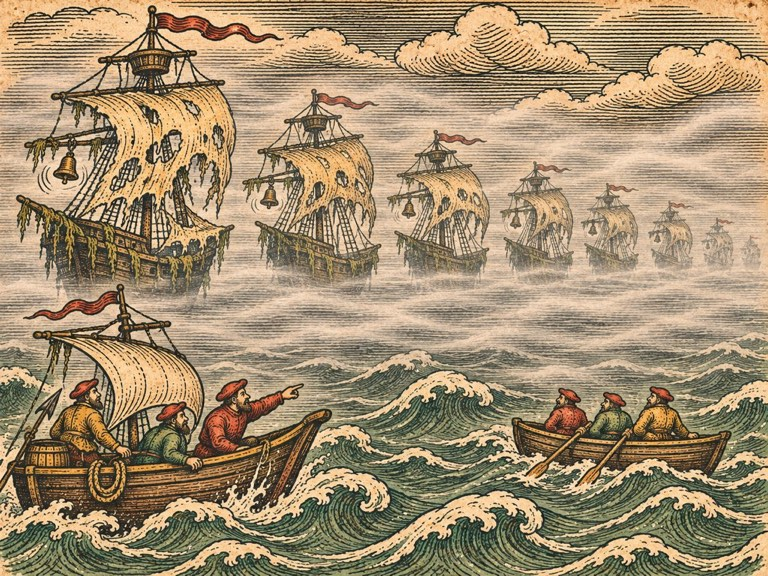
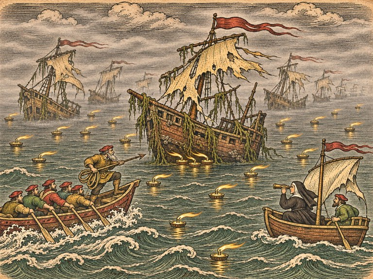
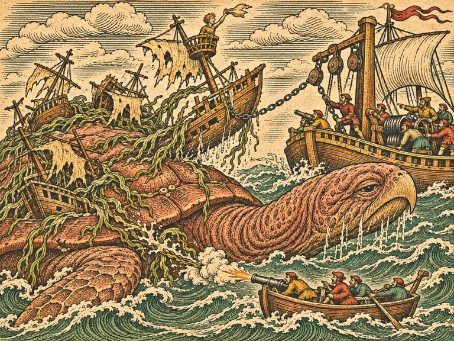

## 1. 런던의 보험 상인

1540년 봄, 런던.

템스강은 북해보다 더러웠고 북해보다 시끄러웠다. 강 양쪽으로 부두와 창고와 선술집이 끝없이 이어졌고, 그 사이로 거룻배들이 소리를 지르며 비집고 다녔다. 갈매기호는 그 틈에 겨우 자리를 얻어 닻을 내렸다. 옆에 댄 플랑드르 상선의 선원들이 작은 고래잡이 배를 내려다보며 웃었다.

잉리드는 웃음을 못 들은 척했다. 토르켈은 들은 척했다. 그는 뱃전에 작살 자루를 기대 세워 두고, 상선 선원들 쪽으로 천천히 숫돌을 꺼냈다. 웃음은 금방 그쳤다.

토르켈에게는 이제 자기 배가 있었다. 지난겨울 올라프가 고래 기름 몫을 정리하면서, 오래 쓰지 않던 작살선 한 척을 그에게 넘겼다. 노 여섯 개에 돛 하나, 뱃머리에 작살 받침이 붙은 날렵한 배였다. 토르켈은 그 배에 이름을 붙이지 않았다. 「배 이름은 배가 일을 하고 나서 붙이는 거다.」 그래서 다들 그 배를 그냥 '토르켈 배'라고 불렀다.

마르그레테의 측량선은 하루 늦게 들어왔다. 수녀원장에게 다시 허락을 받느라 늦었다고 했다. 이번에는 올라우스 신부의 편지만으로는 모자라서, 해도실 창문을 고쳐 주겠다는 약속까지 했다고.

피터 콜스의 가게는 롬바드 거리에 있었다. 가게라기보다는 탁자 몇 개와 장부 선반이 있는 좁은 방이었다. 탁자마다 상인들이 둘러앉아 서류를 넘기며 낮은 목소리로 숫자를 주고받았다. 벽에는 출항한 배와 들어온 배의 이름이 분필로 적혀 있었다. 몇 개의 이름에는 줄이 그어져 있었다.

피터는 서른다섯쯤 된 사내였다. 둥근 얼굴에 볼이 붉었고, 말을 할 때마다 손가락으로 탁자를 두드렸다. 숫자를 셀 때의 버릇 같았다.

"베르겐에서 섬고래를 잡은 아가씨라고. 올라우스 마그누스의 해도에 이름이 실렸다던데." 그는 손가락을 멈추지 않았다. "솔직히 말하겠소. 나는 바다 괴물을 믿지 않소. 믿는 건 장부요."

"그럼 왜 저를 불렀어요."

"장부가 이상하니까." 피터가 벽을 가리켰다. 줄 그어진 이름 셋. "작년 가을, 그해 겨울, 올봄. 세 척이 셰틀랜드 서쪽에서 사라졌소. 폭풍이 없던 날에. 해적이 나올 바다도 아니오. 셋 다 내가 보험을 들었지. 그리고 셋 중 하나가 지난달 돌아왔소."

"돌아왔다고요?"

"배만." 피터의 손가락이 멈췄다. "아일랜드 어부들이 바다에서 끌고 왔소. 돛은 멀쩡하고, 짐도 그대로였소. 사람만 없었소. 식탁에는 먹다 만 빵이 있었다더군."

가게 안이 조금 조용해졌다. 옆 탁자의 상인들이 귀를 기울이고 있었다.

"살아 돌아온 사람들은 이렇게 말하오. 안개 속에서 배들이 줄지어 지나가더라고. 돛을 다 펴고, 사람은 하나도 없이. 죽은 자의 배라고. 북쪽 사람들은 그걸 뭐라고 부르오?"

"드라우그요." 토르켈이 문간에서 대답했다. 그는 안으로 들어오지 않고 문틀에 기대 있었다. "물에 빠져 죽은 놈이 반쪽 배를 타고 다닌다는 거요. 우리 할머니가 그 얘기로 애들을 겁줬소."

"반쪽 배라." 피터가 다시 탁자를 두드리기 시작했다. "나는 그런 건 믿지 않소. 그러나 나머지 두 척이 어디 있는지 알아 오면 금화 사천을 주겠소. 배를 찾아오면 더."

잉리드는 마르그레테를 돌아보았다. 마르그레테는 이미 수첩을 펼치고 있었다.

"사람이 없는 배가 돌아왔다고 하셨죠. 그 배, 지금 어디 있어요?"

## 2. 사람 없는 배

배는 템스강 하구의 버려진 부두에 묶여 있었다. 피터가 보험금을 치르고 넘겨받은 배였지만, 누구도 그 배를 다시 쓰려 하지 않았다.

잉리드는 갑판에 올라섰다. 돛은 정말로 멀쩡했다. 밧줄도 제자리에 감겨 있었다. 선실 식탁에는 말라 비틀어진 빵과 엎어진 잔이 그대로 있었다. 침상의 담요는 개켜져 있지 않았다. 사람들이 자다가 일어나 갑판으로 나간 것 같았다. 그리고 다시 내려오지 않은 것 같았다.

"싸운 흔적이 없어요." 마르그레테가 말했다.

토르켈은 갑판 위가 아니라 뱃전 바깥을 보고 있었다. 그는 갈고리를 내려 물에 잠긴 뱃전을 긁었다. 갈고리 끝에 무언가가 걸려 올라왔다.

해초였다.

짙은 갈색에 넓은 잎. 줄기에 작은 공기주머니. 손가락만 한 굵기의 줄기가 꼬이고 꼬여서 밧줄처럼 질겼다. 토르켈이 칼로 끊으려 하자 칼날이 미끄러졌다.

"베르겐 어귀의 그 풀이다."

잉리드는 숨을 들이쉬었다. 섬고래 등에 판자를 엮고 있던 그 풀. 서쪽 먼바다의 풀.

마르그레테가 해초를 받아 들고 뱃전을 따라 걸었다. 해초는 배 아랫부분을 한 바퀴 감고 있었다. 선체를 두른 띠처럼. 끊어진 끝이 물속으로 늘어져 있었다.

"이 배는 묶여 있었어요." 마르그레테가 말했다. "무언가에. 그리고 끊어져서 떠내려왔어요."

"무엇에요?"

"그건 가서 봐야죠."

## 3. 구난선장

셰틀랜드 서쪽으로 가기 전에, 잉리드는 암스테르담에 들렀다. 마르그레테가 그러자고 했다.

"사라진 배를 찾으면 끌고 와야 하잖아요. 갈매기호로는 못 끌어요. 끌 줄 아는 사람이 있어요."

디르크 판 로의 조선소는 암스테르담 항구 동쪽 끝에 있었다. 조선소라기보다는 고철과 부서진 선체가 쌓인 마당이었다. 마당 한가운데 넓적하고 묵직한 배 한 척이 떠 있었다. 뱃머리에 굵은 기둥이 서 있고, 그 기둥에서 쇠사슬과 도르래가 주렁주렁 늘어져 있었다. 구난선이었다. 가라앉은 배를 끌어 올리고, 좌초한 배를 끌어내는 배.

디르크는 쉰쯤 된 사내였다. 몸집이 컸고, 팔뚝에 쇠사슬에 쓸린 흉터가 감겨 있었다. 그는 잉리드의 이야기를 끝까지 들었다. 그리고 고개를 저었다.

"구난선은 괴물 잡으러 가는 배가 아니오."

"잡자는 게 아니에요. 배를 찾자는 거예요."

"찾으러 간 배도 찾아야 하는 배가 되오." 디르크는 쇠사슬 고리 하나를 들어 손바닥으로 문질렀다. "나는 바다에서 배를 끌어 온 지 서른 해요. 사람이 다 사라진 배를 다섯 번 끌어 왔소. 다섯 번 다, 그 배를 찾으러 간 배가 하나씩 더 사라졌소."

그의 목소리에 무언가가 걸려 있었다. 마르그레테가 조용히 물었다.

"작년 가을에 사라진 배 중에, 아시는 배가 있었어요?"

디르크는 대답하지 않았다. 쇠사슬 고리를 내려놓고 마당 저편을 보았다. 거기 작은 판잣집이 있었다. 문 앞에 아이 신발 한 켤레가 놓여 있었다. 크기로 보아 열서너 살 아이의 것이었다.

"조카가 탔소." 한참 만에 그가 말했다. "얀. 열네 살이었소. 첫 항해였소. 견습으로 나를 따라다니다가, 구난선은 재미없다고, 큰 상선을 타 보고 싶다고."

"그러니까……"

"그러니까 나는 안 가오." 디르크가 잉리드를 똑바로 보았다. "내가 가서 찾은 게 그 아이 배의 빈 식탁이면, 나는 그다음부터 배를 끌 수 없을 거요."

## 4. 해초 밧줄

셰틀랜드 서쪽은 회색 바다였다. 하늘도 회색, 물도 회색, 그 사이에 늘 안개가 걸려 있었다. 바람은 약했고, 물결은 길고 느렸다.

나흘째 되던 날, 마르그레테의 망원경에 배 한 척이 걸렸다.

옆으로 누운 상선이었다. 반쯤 물에 잠겨 있었다. 돛대는 서 있었고, 돛은 찢어진 채 늘어져 있었다. 가까이 가 보니 선체가 해초에 칭칭 감겨 있었다. 런던에서 본 것보다 훨씬 많은 해초였다. 굵은 줄기 수십 가닥이 선체를 감싸고, 그 끝이 물속으로, 서쪽으로 길게 뻗어 있었다.

"끌려가다가 가라앉은 거예요." 마르그레테가 해초 끝을 망원경으로 따라가며 말했다. "다 서쪽으로 늘어져 있어요. 무언가가 이 배를 서쪽으로 끌고 갔어요. 그러다 너무 무거워지니까 놓았거나."

토르켈은 해초 가닥 하나를 잡아당겨 보았다. 꿈쩍도 하지 않았다.

"이건 밧줄이다." 그가 말했다. "누가 엮은 밧줄이 아니라, 자라서 밧줄이 된 거다. 이렇게 길게 자라려면 몇십 년은 한자리에 붙어 있어야 해."

"한자리라뇨. 바다 한가운데에?"

"그러니까 움직이는 한자리지." 토르켈이 해초를 놓았다. "섬고래 등처럼."

마르그레테가 수첩에 적었다. 잉리드는 그 어깨너머로 보았다.

드라우그 선단. 하나, 배를 해초로 엮어 끌고 다닌다.

## 5. 일곱 돛

안개는 다음 날 아침 갑자기 짙어졌다.

갈매기호, 토르켈 배, 마르그레테의 측량선. 세 척이 서로 밧줄 두 길 거리를 두고 나란히 갔다. 그 이상 떨어지면 서로가 보이지 않았다. 잉리드는 뱃머리에 서서 안개 속을 노려보았다. 물소리와 돛 펄럭이는 소리밖에 들리지 않았다.

그리고 종소리가 들렸다.

배의 종소리였다. 안개 속에서 배들이 서로 부딪히지 않으려고 치는 종. 땡, 땡, 땡. 그러나 누가 치는 소리가 아니었다. 종이 흔들려서 저절로 나는 소리였다. 박자가 없었다.

안개가 한 겹 걷혔다.

돛이 있었다.

하나, 둘, 셋…… 일곱. 일곱 척의 배가 줄지어, 돛을 다 펴고, 천천히 지나가고 있었다. 바람이 거의 없는데도. 선체는 해초에 덮여 검푸르렀고, 돛은 누렇게 바래 군데군데 구멍이 나 있었다. 뱃전에 사람은 하나도 없었다. 종만 흔들리고 있었다.

갈매기호의 선원 하나가 성호를 그었다. 다른 하나는 갑판에 엎드렸다.

"쏴요?" 포수가 떨리는 목소리로 물었다.

잉리드는 망설였다. 그리고 고개를 끄덕였다. "맨 앞의 배."

대포가 울렸다. 포탄은 맨 앞 배의 뱃전을 뚫었다. 판자 부스러기가 튀었다. 그것뿐이었다. 배는 아무렇지도 않게 계속 갔다. 빈 배였다.

"다음!"

두 번째 배. 역시 빈 배였다. 세 번째도.

"그만 쏴요!" 마르그레테가 측량선에서 외쳤다. "다 빈 배예요! 쏠수록 화약만 버려요!"

그때 토르켈 배가 비명을 질렀다.

판자가 갈라지는 소리였다. 토르켈 배는 줄지어 가는 배들에 너무 가까이 붙어 있었다. 그 배들 사이로 늘어진 해초가 토르켈 배의 노에 감겼다. 노가 부러졌다. 해초는 배의 옆구리를 휘감았다. 그리고 당겼다. 토르켈 배가 줄지어 가는 배들 쪽으로 끌려가기 시작했다.

"토르켈!"

토르켈은 도끼를 들고 뱃전에 매달려 해초를 찍고 있었다. 한 가닥이 끊어지면 두 가닥이 더 감겼다. 배 옆구리의 판자가 하나 터져 나갔다. 물이 들이쳤다.

잉리드는 갈매기호를 토르켈 배 쪽으로 몰았다. 뱃전과 뱃전이 부딪혔다. 갈매기호 선원들이 칼로 해초를 끊었다. 토르켈이 마지막 가닥을 도끼로 찍었다. 토르켈 배가 풀려났다.

그러나 반쯤 물에 잠겨 있었다.

"끌어!" 잉리드가 외쳤다. "밧줄 걸어!"

갈매기호는 토르켈 배를 꽁무니에 매달고 동쪽으로, 안개 밖으로 돌아섰다. 뒤에서 일곱 척의 배는 아무 일도 없었다는 듯 계속 서쪽으로 갔다. 종소리가 멀어졌다.

안개를 빠져나왔을 때, 토르켈 배는 뱃전까지 물이 차 있었다. 토르켈은 그 배에서 내리지 않았다. 물을 퍼내며, 끝까지.

## 6. 쇠사슬

갈매기호는 토르켈 배를 끌고 암스테르담까지 갔다. 열흘이 걸렸다. 토르켈 배는 가는 동안 두 번 가라앉을 뻔했다.

디르크는 부두에서 그 배를 보았다. 반쯤 잠긴 작살선. 옆구리에 아직 해초가 감겨 있었다.

그는 아무 말 없이 구난선으로 갔다. 쇠사슬을 내리고, 도르래를 돌리고, 토르켈 배를 물에서 들어 올렸다. 물이 쏟아져 나왔다. 배는 마당 버팀목 위에 내려앉았다. 디르크는 그 배의 옆구리에서 해초를 한 가닥 한 가닥 떼어 냈다.

그러다 손을 멈췄다.

해초 사이에 무언가가 엮여 있었다. 작은 나무판. 손바닥만 한, 배 이름을 새기는 판의 조각이었다. 끝이 부러져 글자가 반만 남아 있었다.

……LIJN.

디르크는 그 조각을 오래 들여다보았다. 그의 손이 떨렸다.

"마이케 리진." 그가 중얼거렸다. "얀이 탄 배요."

마당에 바람이 불었다. 판잣집 앞의 아이 신발 한 짝이 바람에 굴렀다.

디르크는 조각을 품에 넣고 일어섰다. 잉리드를 보았다.

"그 배들, 어디로 가고 있었소."

"서쪽이요."

"빈 배였소? 전부?"

"쏜 건 다 빈 배였어요. 일곱 중에 셋을 쐈어요."

디르크는 구난선 쪽으로 걸어갔다. 쇠사슬을 감기 시작했다.

"나머지 넷 중에 그 아이 배가 있으면, 나는 끌어 와야 하오." 그는 뒤돌아보지 않았다. "빈 식탁이든 뭐든."

## 7. 약탈선

디르크의 구난선 '물개호'가 함께 가게 되자, 행렬은 넷이 되었다. 수리를 마친 토르켈 배, 갈매기호, 측량선, 그리고 물개호. 물개호는 느렸다. 대신 무엇이든 끌 수 있었다.

셰틀랜드 서쪽에 다시 들어선 지 사흘째, 안개 밖에서 배 두 척이 보였다.

사람이 탄 배였다. 작고 빠른 배 둘. 그 배들이 해초에 감겨 떠 있는 상선 한 척에 붙어 있었다. 선원들이 상선 갑판에서 짐을 내려 자기 배로 옮기고 있었다.

"약탈꾼이오." 디르크가 이를 갈았다. "남의 배 시체에서 짐을 빼 가는 놈들."

약탈선은 이쪽을 보자 짐을 버리고 돛을 올렸다. 그러나 달아나지 않았다. 둘 다 이쪽으로 뱃머리를 돌렸다. 넷 중 둘이 고래잡이 배와 측량선이라는 것을 알아본 것이다. 만만해 보였을 것이다.

잉리드는 갈매기호의 대포를 다시 장전하게 했다. 이번에는 빈 배가 아니었다.

싸움은 짧았다. 약탈선 하나는 갈매기호의 포탄을 돛대에 맞고 멈췄다. 다른 하나는 토르켈 배에 들이받혔다. 토르켈이 뱃머리에서 작살을 겨누자 약탈선 선원들이 손을 들었다.

붙잡힌 선원 중 하나가 갈매기호 갑판에 꿇어앉았다. 아일랜드 사람이었다. 그는 묻기도 전에 말했다.

"우린 아무도 죽이지 않았소! 배에 사람이 없었소! 우린 그냥 짐만……"

"사람이 왜 없었는데요." 잉리드가 물었다.

선원은 입술을 핥았다. 눈이 안개 쪽으로 갔다.

"……저 배들은 돛이 미끼요." 그가 낮게 말했다. "우리 할아버지가 그랬소. 저건 드라우그가 아니라고. 진짜는 물밑에 있다고. 돛을 보고 가까이 가면, 물밑의 그게 해초로 배를 감는다고. 사람들은 갑판에 나왔다가 해초에 휩쓸려 바다로 떨어진 거요. 밤에. 다들 자다가 배가 기우는 소리에 나왔다가."

잉리드는 런던에서 본 식탁을 떠올렸다. 개켜지지 않은 담요. 자다가 일어나 갑판으로 나간 사람들.

"물밑에 뭐가 있는데요."

"그건 모르오. 본 사람은 다 떨어졌으니까." 선원이 고개를 숙였다. "하지만 우리는 돛 사이로 다니지 않소. 해초가 짧은 쪽으로만 다니지. 해초는 그것한테서 자라니까, 그것에서 멀수록 짧소."

마르그레테의 펜이 멈췄다가 다시 움직였다.

둘, 돛은 미끼다. 진짜는 물밑에 있다. 해초는 그것에게서 자라고, 멀수록 짧다.

## 8. 물결이 다른 곳

"그러니까 일곱 척 중에 하나 밑에 진짜가 있다는 거예요." 그날 밤 측량선 선실에서 마르그레테가 말했다. 탁자 위에 해도가 펼쳐져 있었다. 그 위에 마르그레테가 작은 돌멩이 일곱 개를 줄지어 놓았다. "쏘면 빈 배고. 쏠 때마다 시간을 버리고."

"해초가 가장 긴 배요." 디르크가 말했다. "그 선원 말대로라면."

"안개 속에서 해초 길이를 어떻게 재요." 잉리드가 말했다.

마르그레테는 대답하지 않았다. 대신 돌멩이 하나를 들어 물그릇에 떨어뜨렸다. 동그란 물결이 퍼졌다.

"물밑에 큰 게 있으면, 그 위의 물결이 달라요." 그가 말했다. "섬고래 때 봤잖아요. 깨어나기 전에, 그 앞의 물빛이 짙어졌어요. 이번에도 그럴 거예요. 큰 게 움직이면 물이 밀려요. 돛은 바람에 흔들리지만, 물결은 아래에서 와요."

"안개 속에서 물결은 보여요?"

"가까이 가면 보여요. 그리고 등을 켜면 더 잘 보여요." 마르그레테가 잉리드를 보았다. "물 위에 기름 등을 띄우는 거예요. 고래잡이들이 밤에 고래 피를 찾을 때 하는 것처럼. 등불이 흔들리는 방향이 물결의 방향이에요."

토르켈이 고개를 끄덕였다. 그는 그 방법을 알고 있었다. 아르네가 가르쳐 준 방법이었다.

다음 날 그들은 암스테르담으로 돌아가 기름 등 서른 개를 샀다. 금화 천 닢이 들었다. 디르크가 반을 내겠다고 했지만 잉리드가 거절했다. 런던의 피터에게서 받을 돈이 있었다. 받을 수 있다면.

## 9. 진짜

세 번째로 셰틀랜드 서쪽에 들어섰을 때, 안개는 그들을 기다리고 있었다.

종소리가 들렸다. 일곱 척이 지나갔다. 이번에는 아무도 쏘지 않았다.

"등 띄워요."

갈매기호와 측량선에서 기름 등이 하나씩 물에 내려졌다. 등은 물 위에 떠서 흔들렸다. 대부분 같은 쪽으로, 바람 부는 쪽으로 흔들렸다. 마르그레테는 망원경으로 등불 하나하나를 보았다. 측량선이 일곱 척의 행렬을 따라 천천히 움직였다. 등이 하나, 둘, 셋, 계속 떨어졌다.

다섯 번째 배 근처에서, 등불 셋이 거꾸로 흔들렸다.

바람을 거슬러. 아래에서 밀려 올라오는 물결에.

"다섯 번째!" 마르그레테가 붉은 깃발을 올렸다. "다섯 번째 배 아래!"

다섯 번째 배는 다른 배들보다 조금 낮게 떠 있었다. 해초가 더 굵었고, 돛은 더 낡았다. 그리고 그 배의 뱃머리 아래, 물이 아주 조금, 둥글게 부풀어 있었다.

토르켈 배가 미끄러져 나갔다. 노 여섯이 한꺼번에 물을 찼다. 토르켈은 뱃머리에서 작살을 들었다. 다섯 번째 배의 뱃전 아래, 해초 숲이 가장 빽빽한 곳을 향해.

던졌다.

작살이 해초 숲을 뚫고 들어갔다. 그리고 무언가 단단한 것에 박혔다. 둔한 소리가 났다. 나무도 쇠도 아닌 소리. 뼈에 가까운 소리.

물이 뒤집혔다.

다섯 번째 배가 들렸다. 아니, 다섯 번째 배 아래의 것이 떠올랐다. 해초 숲이 통째로 솟구쳤다. 그 아래에서 둥글고 넓적한 것이 드러났다. 등딱지였다. 마차 열 대를 늘어놓은 것보다 넓은 등딱지. 그 위에 해초가 숲처럼 자라 있었고, 그 해초 숲에 배 일곱 척이 엮여 있었다.

거북이었다. 세상에서 가장 큰 거북.

거북은 고개를 내밀었다. 주름진 목, 부리처럼 생긴 입, 작고 검은 눈. 늙고 지친 눈이었다. 섬고래의 눈과 닮아 있었다.

그리고 거북이 지느러미발을 휘저었다. 등딱지에 엮인 배들이 한꺼번에 조여들었다. 일곱 척이 원을 그리며 안쪽으로 몰려왔다. 그 사이에 토르켈 배가 있었다.

"토르켈, 빠져!"

토르켈 배는 배 두 척 사이로 빠져나갔다. 뱃전이 긁혔다. 디르크의 물개호가 그 뒤를 받쳤다. 굵은 쇠사슬을 해초 숲에 걸고, 도르래를 거꾸로 돌렸다. 엮인 배 하나가 거북에게서 뜯겨 나갔다. 해초가 끊어지는 소리가 천둥 같았다.

"한 척씩 뜯어내요!" 디르크가 외쳤다. "배가 떨어질 때마다 저놈이 가벼워지면, 등이 더 드러나!"

잉리드는 그 말을 알아들었다. 갈매기호의 대포는 이제 빈 배를 쏘지 않았다. 해초 숲을 쏘았다. 배와 등딱지를 잇는 굵은 줄기들을. 포탄이 해초를 찢을 때마다 엮인 배가 하나씩 풀려 떠내려갔다.

여섯 번째로 풀려난 배는 해초에 거의 묻혀 있었다. 돛대에 이름판이 붙어 있었다. 이름판은 반이 떨어져 나갔다.

마이케 리…….

디르크가 그 배를 보았다. 쇠사슬을 던졌다.

"마르그레테, 저 배에 사람이 있어요!" 잉리드가 외쳤다. 망원경을 보던 마르그레테가 손을 흔들었다. 돛대 꼭대기 망대에 무언가가 매달려 있었다. 천 조각. 아니, 사람이었다. 망대에 자기를 묶어 놓은 마른 소년.

얀이었다.

물개호가 마이케 리진호를 끌어냈다. 디르크는 배가 다 끌려오기도 전에 뛰어넘었다. 돛대를 기어올랐다. 쉰 살 사내라고는 믿을 수 없을 만큼 빨랐다.

거북은 이제 등딱지 대부분이 드러나 있었다. 해초 숲이 찢기고, 엮인 배들이 다 떨어져 나갔다. 등딱지 한가운데, 갈라진 틈이 보였다. 오래된 상처였다. 그 둘레에 동그란 흉터가 줄지어 있었다. 접시만 한 동그라미 수십 개.

토르켈이 두 번째 작살을 그 틈에 박았다. 갈매기호의 포탄이 뒤따랐다.

거북은 소리를 내지 않았다. 고개를 한 번 하늘로 쳐들었다. 그리고 천천히 가라앉았다. 해초 숲이 그 위를 덮었다. 물결이 잦아들었다. 안개가 걷히기 시작했다.

바다 위에는 빈 배 일곱 척이 흩어져 떠 있었다. 이제 아무것에도 엮이지 않은 채.

## 10. 빨판 자국

얀은 사흘 동안 말을 하지 못했다. 망대에서 석 달을 버텼다고 했다. 빗물을 받아 마시고, 망대에 걸린 바닷새 둥지의 알을 먹고. 해초가 갑판을 쓸고 갈 때마다 망대에 더 단단히 몸을 묶었다고.

나흘째 되던 날 그는 디르크의 무릎을 베고 누운 채 처음으로 말했다.

"삼촌. 구난선이 재미없다고 한 거, 취소할게요."

디르크는 대답하지 않았다. 대답할 수 없었다. 얀의 머리를 쓰다듬는 그의 손이 쇠사슬보다 무거워 보였다.

피터 콜스는 사라진 배 두 척을 다 받았다. 하나는 셰틀랜드 서쪽에서, 하나는 거북의 해초 숲에서. 그 밖에 이름 모를 상선 다섯 척은 아일랜드와 스코틀랜드의 주인들에게 돌아갔다. 피터는 장부에 줄 그은 이름 셋 중 둘의 줄을 지웠다. 셋째는 지우지 않았다. 그 배는 끝내 찾지 못했다.

"금화 사천이오." 그는 돈자루를 탁자에 올려놓고 손가락으로 두드렸다. "솔직히 말하겠소. 나는 아직 바다 괴물을 믿지 않소."

"그럼 뭘 믿어요."

"그대를 믿소." 피터가 손가락을 멈췄다. "장부보다 조금 더."

암스테르담으로 돌아오는 길에, 디르크가 물개호로 무언가를 건져 올렸다. 거북이 가라앉은 자리에 떠 있던 등딱지 조각이었다. 방패만 한 크기. 마르그레테가 그것을 측량선 선실 탁자에 올려놓고 한참 들여다보았다.

동그란 흉터들. 접시만 한 것이 줄지어 있었다. 흉터 한가운데에는 날카로운 것에 긁힌 자국이 둥글게 나 있었다.

"빨판이에요." 마르그레테가 말했다.

"빨판이요?"

"오징어나 문어의 빨판. 빨판 둘레에 이빨 같은 고리가 있어요. 그게 긁은 자국이에요." 마르그레테는 손가락으로 동그라미를 짚었다. "그런데 이 크기면……."

그는 말을 잇지 못했다. 대신 손바닥을 펴서 동그라미 하나에 대 보았다. 손바닥보다 컸다.

"이 거북은 무엇인가에게 붙잡혔다가 빠져나온 거예요. 그리고 북쪽으로 도망 왔어요." 마르그레테가 천천히 말했다. "이렇게 큰 오징어는 차가운 바다에는 살지 않아요. 따뜻한 바다. 남쪽."

토르켈이 선실 문간에서 물었다.

"그럼 섬고래는. 섬고래도 뭔가에 밀려 왔을까."

"섬고래는 서쪽에서 왔어요. 이 거북에 엮인 풀이 그 등에도 있었으니까." 마르그레테가 수첩을 펼쳤다. "거북이 섬고래를 밀어냈다고는 생각하지 않아요. 둘 다 밀려난 거예요. 같은 방향에서. 무엇인가가 차례차례 밀어내고 있어요."

잉리드는 등딱지 조각을 보았다. 빨판 자국. 그 아래 깊고 오래된 갈라짐.

"그 무엇인가가 이 오징어라는 거예요?"

"모르겠어요." 마르그레테가 솔직하게 말했다. "이 오징어도 밀려났을지 몰라요."

암스테르담에 닿자 베네치아에서 온 편지가 기다리고 있었다. 한스가 베르겐에서 이쪽으로 보내 준 것이었다. 올라우스 신부의 편지였다.

「지중해에서 배가 끌려 들어간다는 소식이 들린다. 메시나 해협에서. 상인들은 해협을 지나지 못해 큰 손해를 보고 있다. 그들이 나를 찾아왔다. 내가 북쪽 바다의 괴물을 해도에 그린 사람이라서. 나는 괴물을 그리기만 했지 잡지는 못한다고 말했다. 그리고 그대의 이름을 말했다.

베네치아로 오라. 그대를 직접 보고 싶다. 그리고 보여 주고 싶은 것이 있다.」

잉리드는 편지를 마르그레테에게 건넸다. 마르그레테가 읽고 웃었다.

"신부님이 직접 보자고 하시는 건 처음이에요. 나한테도 그런 말은 안 하셨는데."

"질투해요?"

"조금요." 마르그레테가 편지를 접었다. "그런데 나도 가요. 신부님 해도실은 꼭 보고 싶었으니까."

디르크는 따라가겠다는 말을 하지 않았다. 대신 물개호의 쇠사슬을 새로 갈았다. 얀은 그 옆에서 도르래에 기름을 쳤다. 출항 전날 밤, 디르크가 갈매기호로 건너왔다.

"지중해는 물이 깊소. 끌어 올릴 게 많을 거요."

"같이 가요?"

"끌어 올릴 게 많다고 했소." 디르크가 뒤돌아섰다. "얀은 여기 남겨 두고."

부두에서 얀이 소리쳤다. "삼촌! 저도 가요!"

"너는 남아서 마당을 지켜라. 구난선 선장은 마당부터 지키는 거다."

"재미없어요!"

디르크가 처음으로 큰 소리로 웃었다. 잉리드는 그 웃음을 처음 들었다.

갈매기호는 다음 날 남쪽으로 돛을 올렸다. 마르그레테의 측량선, 토르켈 배, 물개호가 뒤를 따랐다. 토르켈은 출항 전에 자기 배 뱃머리에 처음으로 이름을 새겼다. 서툰 글씨였다. 잉리드가 무슨 이름이냐고 묻자 그는 대답 대신 손가락으로 글자를 짚었다.

"늦은 별."
