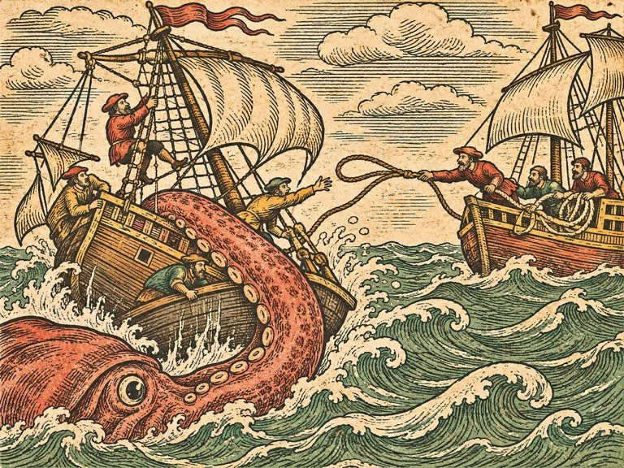
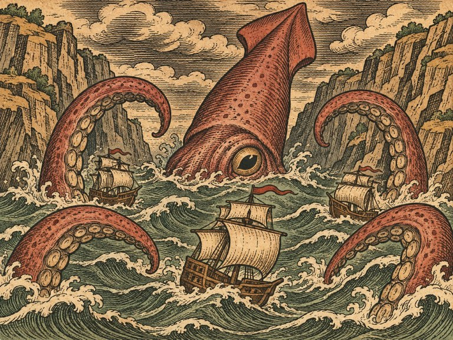
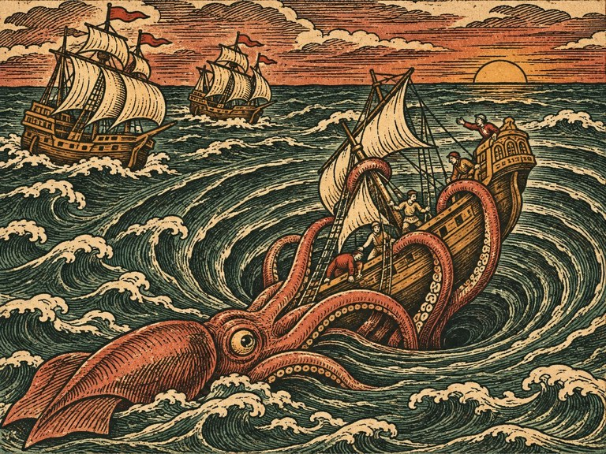
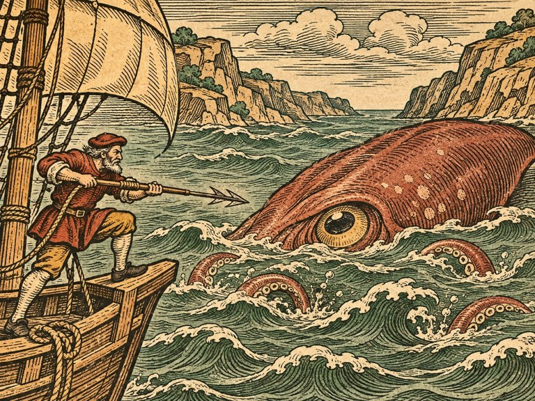
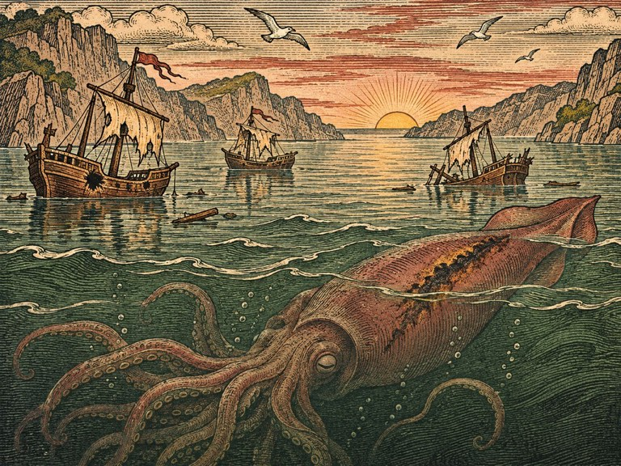

## 1. 제노바의 소문

1541년 봄, 제노바.

지중해는 잉리드가 아는 바다가 아니었다. 물이 파랬다. 북해의 회색도, 셰틀랜드의 검푸름도 아닌, 손을 담그면 손가락까지 파랗게 물들 것 같은 파랑. 하늘은 그보다 옅었고, 햇볕은 갑판 널판을 뜨겁게 달궜다. 토르켈은 첫날부터 털모자를 벗었고, 이틀째에는 셔츠 소매를 걷었다. 사흘째에 그는 말했다. 「이건 바다가 아니라 목욕통이다.」

제노바 항구는 산비탈에 매달린 도시였다. 집들이 층층이 쌓여 바다를 내려다보았고, 항구에는 갤리와 카라크가 빽빽했다. 그러나 그 배들 대부분이 묶여 있었다. 돛을 접은 채, 짐을 실은 채.

술집 주인이 이유를 말해 주었다. 잉리드가 묻기도 전에.

"메시나 해협이 막혔소. 시칠리아와 나폴리 땅 사이, 그 좁은 물길. 거기를 지나지 않으면 동쪽으로 가는 길을 크게 돌아야 하오. 다들 기다리는 중이지. 해협이 다시 열리기를."

"왜 막혔는데요."

주인은 목소리를 낮췄다. "배가 끌려 내려갔소. 통째로. 바다 밑에서 무언가가 배를 붙잡고, 물속으로 끌어당겼다는 거요. 지난 넉 달 동안 다섯 척. 마지막 배는 돛대 끝만 물 위에 남았다더군."

마르그레테가 수첩을 꺼냈다. 주인은 그 수첩을 흘끔 보더니 덧붙였다.

"옛날 사람들은 그 해협에 괴물이 산다고 했지. 스킬라라고. 머리가 여럿 달려서 지나가는 배의 선원을 낚아챈다는. 그건 옛날 이야기요. 그런데 요즘 뱃사람들이 다시 그 이름을 부르기 시작했소."

## 2. 베네치아의 해도실

올라우스 마그누스는 베네치아 운하 옆 좁은 집에 살았다. 일층은 인쇄소였다. 잉크와 기름과 젖은 종이 냄새가 계단까지 올라왔다. 이층 방은 사방 벽이 해도로 덮여 있었다. 그리고 그 한가운데 탁자에, 거대한 목판이 놓여 있었다.

올라우스는 쉰을 갓 넘긴 사내였다. 마르고 키가 컸고, 검은 사제복은 낡아서 팔꿈치가 반들거렸다. 머리는 반쯤 벗어졌고, 눈은 작고 깊었다. 그는 잉리드를 보자 일어서서 두 손을 잡았다. 차갑고 마른 손이었다.

"하우게 선장. 그대가 내 해도에 처음으로 이름을 넣은 사람이오."

"이름은 신부님이 넣으셨잖아요."

"그림은 내가 그렸지만, 그것이 거기 있다고 확인한 것은 그대요." 올라우스는 탁자 위 목판을 가리켰다. "보시오."

목판은 해도의 판이었다. 거꾸로 새겨진 해안선, 거꾸로 새겨진 글자. 그 바다에 괴물들이 빼곡히 새겨져 있었다. 잉리드가 베르겐에서 본 해도와 같은 그림들이었다. 그 가운데, 노르웨이 앞바다에 새로 새긴 자국이 있었다. 날이 선 칼자국. 등에 풀이 난 고래 한 마리. 그 옆에 작은 글씨.

「베르겐 어귀. 섬처럼 누운 고래. 하우게의 배가 잡다.」

잉리드는 그 글씨를 손가락으로 쓸어 보았다. 나무가 매끄러웠다.

"그리고 이것." 올라우스가 다른 탁자로 걸어갔다. 거기 더 큰 종이가 펼쳐져 있었다. 아직 그리는 중인 해도였다. 유럽과 아프리카의 서쪽 해안, 그리고 그 너머 대서양. 해안선은 꼼꼼했지만, 대서양 한가운데에는 아무것도 없었다. 커다랗게 비어 있었다.

"여기에 무엇을 그려야 할지 모르겠소." 올라우스가 말했다. "뱃사람들은 대서양 한가운데에 대해 말하지 않소. 지나가기만 할 뿐. 거기 무엇이 있는지 본 사람이 없소. 아니, 본 사람은 돌아오지 않았거나."

마르그레테가 그 빈칸을 오래 보았다. 그리고 수첩을 펼쳐 섬고래와 드라우그의 기록을 보였다. 서쪽에서 온 해초. 남쪽에서 온 빨판 자국.

올라우스는 기록을 읽었다. 읽는 동안 그의 손가락이 해도 빈칸 위를 천천히 맴돌았다.

"그대들은 그것들이 밀려난 거라고 생각하오."

"네." 마르그레테가 말했다.

"무엇에?"

"아직 몰라요."

올라우스는 고개를 끄덕였다. 그리고 다시 잉리드를 보았다.

"제노바와 베네치아의 상인들이 나에게 왔었소. 해협을 열어 달라고. 나는 그대의 이름을 말했소. 그들은 그대를 기다리고 있소." 그가 잠깐 말을 멈췄다. "한 가지 부탁하고 싶소. 해협의 것을 잡게 되거든, 그것이 어디서 왔는지도 보아 주시오. 죽이기 전에."

## 3. 돛대만 남은 배

메시나 해협은 정말로 좁았다. 시칠리아 쪽 기슭과 나폴리 땅 쪽 기슭이 손을 뻗으면 닿을 것처럼 가까웠다. 그 사이로 물이 빠르게 흘렀다. 소용돌이가 군데군데 생겼다가 사라졌다.

해협 한가운데, 돛대 하나가 물 위로 비스듬히 솟아 있었다. 돛대 끝에 찢어진 깃발이 매달려 있었다. 배는 보이지 않았다. 돛대만.

디르크가 물개호를 그 옆에 댔다. 쇠사슬을 내려 돛대에 걸고 도르래를 돌렸다. 돛대가 조금 올라왔다. 그 아래로 선체의 일부가 보였다. 뱃전에 굵은 자국이 있었다. 기둥만 한 굵기의 무언가가 뱃전을 감았다가 미끄러진 자국. 판자가 그 모양대로 짓눌려 있었다.

그리고 자국을 따라, 동그란 구멍들이 줄지어 있었다.

"빨판." 마르그레테가 말했다. 거북 등딱지의 자국과 같은 크기였다.

디르크는 도르래를 멈췄다. 더 끌어 올리지 않았다.

"배가 너무 무겁소. 아래에 물이 꽉 찼소." 그가 쇠사슬을 풀었다. "그리고 이 깊이에서 이 배를 끌어 올리다가, 아래에 있는 것이 깨면……."

말을 끝내지 않았다. 아무도 끝내라고 하지 않았다.

## 4. 나폴리의 밀수선장

나폴리 항구 술집에서 그 여자를 찾는 데 하루가 걸렸다.

"파올라 스피놀라." 술집 주인이 귀띔했다. "제노바 사람인데 나폴리에서 일하오. 무슨 일이냐고 묻지는 마시오. 해협을 그 여자만큼 아는 사람은 없소. 세관선도 그 여자를 못 잡소."

파올라는 술집 뒷방에서 혼자 카드를 뒤집고 있었다. 서른쯤. 짧게 자른 검은 머리, 햇볕에 그을린 얼굴, 귀에 작은 금고리. 소매 없는 가죽 조끼에 허리에는 칼 대신 노 젓는 사람들이 차는 짧은 갈고리를 찼다. 잉리드가 들어서자 카드를 엎었다.

"북쪽에서 온 고래잡이 아가씨. 소문 들었어요." 그가 의자를 발로 밀어 주었다. "앉아요. 해협 얘기죠?"

"해협의 샛길을 안다고 들었어요."

"알죠. 시칠리아 쪽 바위 사이로 빠지는 길, 나폴리 쪽 얕은 물로 도는 길, 소용돌이 뒤에 숨는 길. 세관선이 쫓아오면 다 써먹어요." 파올라가 손가락으로 탁자를 그었다. "그 길로 지금도 다녀요. 해협이 막힌 다음부터 장사가 더 잘 돼요. 다른 배들이 못 다니니까."

"그것을 봤어요?"

파올라의 손가락이 멈췄다.

"봤어요." 그가 말했다. 처음으로 웃음기 없는 목소리였다. "밤에. 멀리서. 다른 배가 끌려 내려가는 걸. 팔이…… 기둥 같았어요. 물 위로 올라와서 배를 감았어요. 그리고 배가 그냥, 아래로 갔어요. 물이 빨려 들어가는 소리만 났어요."

"그래도 다녀요?"

"그래서 다녀요. 그게 다니는 길을 아니까. 그게 안 다니는 길로만 다녀요."

잉리드는 탁자 위에 금화 주머니를 올려놓았다.

"우리를 그 길로 안내해 줘요. 그것이 다니는 길로."

파올라는 주머니를 보았다. 열어 보지도 않았다.

"천 두카트."

"없어요."

"그럼 팔백."

"그것도 없어요."

"북쪽 사람들은 흥정을 그렇게 해요? 없다고만?" 파올라가 웃었다. "좋아요. 돈은 해협이 열리면 받아요. 상인들한테서. 그 대신 내 일을 하나 도와줘요. 언젠가. 그때 거절하면 안 돼요."

"무슨 일인데요."

"그건 그때 말해 줄게요."

## 5. 붙잡힌 배

파올라는 자기 배로 앞장섰다. 좁고 길고, 돛이 셋 달린 배였다. 물 위를 미끄러지듯 달렸다. 갈매기호가 따라가기 벅찰 만큼.

해협 입구에서 파올라가 손을 들었다. 멈추라는 신호였다.

"저기요. 소용돌이가 없는 데. 물이 너무 잔잔한 데."

해협 한가운데, 물살이 빠른 곳에 이상하게 물결이 없는 동그란 자리가 있었다. 그 둘레로만 물이 흘렀다. 마르그레테가 망원경을 들이댔다.

"그 아래 있어요. 물이 그 위로는 안 흘러요. 무언가가 물을 붙잡고 있어요."

"가까이 가지 마요." 파올라가 소리쳤다. "그 둘레, 배 세 척 거리까지가 팔이 닿는 데예요."

그 말이 끝나기도 전에 토르켈의 늦은 별호가 기울었다.

늦은 별호는 갈매기호 옆에 있었다. 잔잔한 자리에서 배 네 척 거리. 안전한 거리였다. 그러나 늦은 별호 뱃전 아래에서 물이 갈라졌다. 기둥 같은 것이 솟았다. 붉은 갈색, 매끈하고 젖은 것. 끝이 넓적하게 퍼졌고, 그 안쪽에 접시만 한 동그라미가 줄지어 있었다. 그것이 늦은 별호의 뱃전을 감았다.

팔이었다.

"넷이에요!" 마르그레테가 외쳤다. 망원경을 돌리며. "물밑에 셋이 더 있어요! 다 이쪽으로 와요!"

늦은 별호가 끌려가기 시작했다. 잔잔한 자리 쪽으로. 노 젓던 선원들이 뱃전에서 물러났다. 토르켈은 물러나지 않았다. 작살을 들고 팔에 박았다. 작살은 박혔다. 팔은 놓지 않았다.

"토르켈!" 잉리드는 갈매기호를 돌렸다. "포수! 저 팔!"

갈매기호의 대포가 울렸다. 포탄이 팔을 스쳤다. 팔이 움찔했다. 그러나 놓지 않았다. 늦은 별호의 뱃전 판자가 비명을 질렀다.

디르크의 물개호가 늦은 별호 뒤로 미끄러져 들어왔다. 쇠사슬을 늦은 별호의 꼬리에 걸었다. 그리고 도르래를 감았다. 늦은 별호가 양쪽에서 당겨졌다. 판자가 하나 터졌다.

잉리드는 갈매기호를 팔 바로 옆에 댔다. 너무 가까웠다. 그래도 댔다. 그리고 허리의 고래 칼을 뽑아 들고 뱃전을 넘었다.

"잉리드!"

팔은 미끄러웠다. 차갑고 단단했다. 잉리드는 빨판 사이, 살이 얇아 보이는 곳에 칼을 꽂았다. 온몸의 무게를 실어 그었다.

팔이 떨렸다. 그리고 풀렸다. 순식간에, 물속으로 빨려 들어갔다. 잉리드는 바다로 떨어졌다.

떨어진 순간, 물속에서 보았다.

아래. 깊은 곳. 파랗고 어두운 물속에, 커다란 눈 하나가 떠 있었다. 수레바퀴만 한 눈. 그 둘레로 팔들이 천천히 꿈틀거렸다. 그리고 그 눈이, 아주 조금, 잉리드를 보았다.

토르켈의 손이 잉리드의 옷깃을 잡아 올렸다.

"달아나!" 파올라가 외쳤다. "다른 팔이 와요!"

넷은 해협 밖으로 달아났다. 늦은 별호는 물개호에 끌려서. 잉리드는 갈매기호 갑판에 누워 물을 토했다. 토르켈이 그 옆에 앉아 있었다. 한참 동안 아무 말이 없다가, 그가 말했다.

"아르네가 알면 나를 죽일 거다."

"아버지는 알면 웃을 거예요." 잉리드가 기침했다. "그리고 칼을 더 잘 갈아 놓으라고 하겠죠."

마르그레테가 수첩에 적었다. 손이 떨려서 글씨가 비뚤었다.

스킬라. 하나, 배를 붙잡는다. 팔은 넷. 붙잡은 팔을 치면 놓는다.

## 6. 알렉산드리아의 배 목수

"방패 판이 필요해요." 해협에서 돌아온 날 밤, 디르크가 말했다. "늦은 별호 옆구리를 봤소? 팔이 감은 자리가 다 터졌소. 다음엔 붙잡히는 순간 배가 쪼개질 거요."

"그런 판을 누가 만들어요?"

"베네치아 조선소는 그런 걸 안 만드오. 갤리만 만들지." 디르크가 턱을 문질렀다. "그런데 소문을 들었소. 알렉산드리아에 이상한 배 목수가 있다고. 무슨 배든 고친다고. 이집트 사람인데, 포르투갈 배도 고치고 베네치아 배도 고치고, 인도에서 온 다우도 고친다고."

알렉산드리아까지는 바다로 열흘이었다. 항구는 거대한 등대 터 옆에 있었다. 등대는 오래전에 무너졌고, 그 돌로 쌓은 요새가 항구 어귀를 지키고 있었다. 부두에는 온갖 배가 있었다. 삼각돛의 다우, 노가 줄지어 달린 갤리, 둥근 몸통의 상선.

이븐 살림의 조선소는 부두 끝 야자나무 그늘에 있었다. 조선소라기보다 거대한 천막이었다. 그 아래 부서진 배 반쪽이 놓여 있었고, 그 옆에 쉰쯤 된 사내가 쭈그리고 앉아 판자를 대패로 밀고 있었다. 터번을 감았고, 수염은 희끗했고, 안경을 코끝에 걸쳤다. 잉리드가 다가가도 고개를 들지 않았다.

"방패 판이라." 잉리드의 이야기를 다 듣고 그가 말했다. 대패질을 멈추지 않고. "배를 붙잡아 끄는 것에 맞서는 판."

"만들 수 있어요?"

"만들 수는 있지." 이븐 살림이 대패를 내려놓았다. 처음으로 잉리드를 보았다. 안경 너머 눈이 맑았다. "참나무를 두 겹으로 엇갈려 대고, 쇠띠로 묶고, 바깥에는 생가죽을 씌우오. 빨판이 붙지 못하게. 빨판은 매끈한 데 붙으니까, 가죽을 거칠게 무두질해서. 그러면 팔이 감아도 미끄러지고, 감기더라도 판이 버티오."

그는 그 자리에서 판자 위에 숯으로 그림을 그렸다. 빠르고 정확한 선이었다.

"재료가 있으면 열흘이오. 참나무 스무 짐, 쇠 열 짐. 알렉산드리아에는 참나무가 없소. 나무는 다 남에서 오니까."

"사 올게요."

이븐 살림은 다시 대패를 들었다. 그리고 말했다. 혼잣말처럼.

"나는 바다 짐승을 무서워하지 않소. 내가 무서워하는 건 사람의 욕심이오. 짐승은 배가 부르면 그만두지만, 사람은 그만두지 않소."

"무슨 뜻이에요?"

"그 오징어를 잡으면, 상인들이 그대에게 고마워할 거요. 그러고는 해협을 지나 더 많은 배를 보낼 거요. 더 많은 짐을 싣고. 그리고 그 해협 바닥에 무엇이 사는지는 아무도 묻지 않을 거요." 이븐 살림의 대패가 판자 위를 길게 미끄러졌다. "그대는 묻는 사람 같소. 그래서 판을 만들어 주겠소."

참나무와 쇠를 사는 데 한 달이 걸렸다. 키프로스와 크레타를 돌며 교역을 했다. 북해에서 실어 온 말린 대구가 생각보다 비싸게 팔렸다. 토르켈은 그 값을 듣고 한참 웃었다. 「베르겐에서는 이걸로 개를 먹인다.」

방패 판이 완성되던 날, 이븐 살림은 자기 연장 상자를 들고 갈매기호에 올랐다.

"판은 만들었소. 그런데 판이 버티는지 아닌지는 바다에서만 알 수 있소. 그리고 판이 깨지면 그 자리에서 고쳐야 하오." 그가 연장 상자를 갑판에 내려놓았다. "그러니 내가 가야겠소."

"배는요?"

"내 배가 있소." 이븐 살림이 부두 쪽을 가리켰다. 뚱뚱하고 낮은 배 한 척이 떠 있었다. 갑판에 목재와 쇠붙이가 산처럼 쌓여 있었다. 배라기보다 떠다니는 작업장이었다. "느리오. 대포도 없소. 그 대신 바다 한가운데서 돛대를 새로 세울 수 있소."

## 7. 불빛과 세관선

나폴리로 돌아오자 파올라가 기다리고 있었다.

"그때 말한 내 일. 지금이에요."

일은 간단했다. 파올라의 배에 실린 짐을 해협 남쪽 칼라브리아 해안의 작은 포구까지 옮기는 것. 무슨 짐인지는 묻지 말라고 했다. 문제는 세관선이었다. 나폴리 총독의 세관선 두 척이 파올라를 쫓고 있었다.

"싸우자는 거예요?" 잉리드가 물었다.

"아니요. 따돌리자는 거예요. 세관선 선원들도 다 나폴리 사람이에요. 내 사촌도 하나 있어요." 파올라가 어깨를 으쓱했다. "가라앉히면 안 돼요. 그러면 나는 다시는 나폴리에 못 들어와요. 겁만 주고, 길을 막고, 내 배가 빠질 시간만 벌어 줘요."

이틀 뒤 밤, 파올라의 배가 출항했다. 세관선 둘이 곧 따라붙었다. 갈매기호와 늦은 별호가 세관선 앞을 가로질렀다. 포를 쏘았다. 세관선 돛대 위로, 일부러 높게. 세관선이 멈칫하는 사이, 물개호가 쇠사슬을 세관선 키에 걸었다. 세관선이 빙글 돌았다. 다른 세관선이 그 배를 피하느라 멈췄다.

그사이 파올라의 배는 어둠 속으로 사라졌다.

새벽, 칼라브리아 해안의 작은 포구에서 파올라를 다시 만났다. 짐은 이미 내려져 있었다. 포구 사람들이 그 짐을 등에 지고 산으로 올라가고 있었다. 소금 자루였다. 세금이 붙지 않은 소금.

"소금이었어요?" 잉리드가 물었다.

"소금이에요. 이 산골 사람들은 세금 붙은 소금을 못 사요. 그래서 내가 가져다줘요." 파올라가 웃었다. "실망했어요? 금이나 보석일 줄 알았어요?"

"아니요." 잉리드가 말했다. "생각보다 마음에 들어요."

그날 아침 포구 어부 하나가 이상한 말을 했다. 파올라가 해협 이야기를 꺼내자, 늙은 어부가 고개를 저었다.

"그건 밤에 올라와. 불빛을 보면."

"불빛이요?"

"고기잡이 횃불. 우리는 밤에 횃불을 켜고 오징어를 잡아. 오징어는 불빛에 모여드니까. 그런데 요즘은 아무도 해협에서 횃불을 안 켜. 큰 오징어도 불빛에 모여드니까." 어부가 침을 뱉었다. "작은 놈이든 큰 놈이든, 오징어는 오징어야."

마르그레테가 수첩에 적었다.

둘, 불빛에 끌린다. 밤에 올라온다.

그리고 파올라는 그날부터 갈매기호를 따라다녔다. 아무도 부탁하지 않았는데.

"해협이 열려야 내가 돈을 받잖아요." 그가 말했다. "그리고 그 불빛 일, 미끼가 필요하죠? 빠른 배가. 내 배보다 빠른 배는 지중해에 없어요."

## 8. 팔 넷과 몸통

해협 입구에서 사흘 밤을 지켜보았다. 마르그레테는 밤새 망원경 앞에 있었다. 파올라의 배가 해협 바깥에서 횃불을 하나 켰다가 껐다. 둘을 켰다가 껐다.

셋째 날 밤, 횃불 셋을 켜자 팔이 올라왔다. 하나. 그리고 둘. 셋. 넷. 불빛 쪽으로 천천히 뻗어 왔다. 파올라는 횃불을 끄고 달아났다. 팔들은 한참 허공을 더듬다가 물속으로 돌아갔다.

"팔이 다 나와 있을 때는 몸이 안 보여요." 마르그레테가 말했다. "몸은 깊은 데 있어요. 팔만 올려 보내요."

"그럼 몸은 어떻게 쳐요?"

"팔을 다 묶으면." 토르켈이 말했다. 그는 늦은 별호의 작살 받침을 고치고 있었다. "고래도 그래. 꼬리를 묶으면 머리가 올라와. 숨 쉬러."

"오징어는 숨을 안 쉬어요." 마르그레테가 말했다.

"그럼 화가 나서 올라오겠지."

마르그레테는 웃지 않았다. 대신 수첩의 첫 장을 넘겨 섬고래의 기록을 다시 읽었다. 그리고 해협 쪽을 오래 보았다.

"토르켈 말이 맞을지도 몰라요. 팔이 묶이면 몸이 팔을 되찾으려 올라올 거예요. 팔 넷을 다 묶으면, 몸통이 직접 올라와요. 그때가 약점이에요."

셋, 팔 넷을 다 제압하면 몸통이 올라온다.

이븐 살림은 그 말을 듣고 사흘 동안 늦은 별호의 작살 받침에 매달렸다. 사흘째, 받침은 작은 대포처럼 변해 있었다. 쇠통에 작살을 넣고 화약으로 쏘는 장치. 토르켈이 손으로 던지는 것보다 두 배는 멀리 날아갔다.

"작살포요." 이븐 살림이 말했다. "이름은 내가 붙였소. 쓰기는 작살잡이가 하고."

상인들에게 받은 선금 삼천 닢이 작살포와 미끼 배에 다 들어갔다. 미끼 배는 파올라의 배였다. 돛대마다 횃불 받침을 달았다.

출항 전날, 잉리드는 배들을 둘러보았다. 갈매기호, 늦은 별호, 측량선, 물개호, 이븐 살림의 작업선, 파올라의 배. 여섯 척. 다 데려갈 수는 없었다. 해협은 좁았다. 배가 많으면 서로 걸릴 뿐이었다.

"마르그레테, 디르크, 파올라." 잉리드가 말했다. "토르켈은 갈매기호에 타요. 작살포는 갈매기호 뱃머리로 옮겨요. 이븐 살림은 해협 입구에서 기다려 줘요. 다친 배가 나오면 바로 고칠 수 있게."

토르켈이 고개를 저으려다 말았다. 늦은 별호는 아직 옆구리가 성치 않았다. 그도 알았다.

## 9. 해협의 밤

달이 없는 밤이었다.

파올라의 배가 해협 한가운데로 들어갔다. 돛대마다 횃불이 타올랐다. 물 위에 불빛이 길게 늘어졌다. 갈매기호와 물개호는 양쪽 기슭 그림자 속에 숨었다. 마르그레테의 측량선은 해협 입구 바위 뒤에서 망원경을 겨눴다.

물이 잔잔해졌다.

팔이 올라왔다. 넷. 불빛을 향해 뻗었다. 파올라의 배는 기다렸다. 팔이 배 세 척 거리까지 왔을 때, 파올라가 키를 꺾었다. 배가 미끄러지듯 비켜났다. 팔 하나가 허공을 쳤다. 다른 팔이 따라왔다.

"지금!"

갈매기호가 그림자에서 튀어나왔다. 뱃머리에서 토르켈이 작살포를 쏘았다. 작살이 쇳소리를 내며 날아가 첫째 팔에 박혔다. 밧줄이 팽팽해졌다. 갈매기호 선원들이 밧줄을 뱃전 기둥에 감았다. 첫째 팔이 물속으로 돌아가려다 멈췄다.

둘째 팔이 갈매기호를 향해 돌아섰다.

방패 판이 그 팔을 받았다. 빨판이 거친 가죽에 미끄러졌다. 팔은 다시 감으려 했다. 판이 삐걱였다. 버텼다.

"이븐 살림, 당신 판 버텨요!" 잉리드가 외쳤다. 들릴 리 없었다. 그래도 외쳤다.

셋째 팔은 물개호를 감았다. 디르크는 피하지 않았다. 오히려 쇠사슬을 풀어 팔에 감았다. 물개호의 도르래가 거꾸로 돌았다. 팔이 당기는 만큼 쇠사슬이 팔을 조였다. 팔과 배가 서로를 붙잡고 버텼다.

넷째 팔이 파올라의 배를 쫓았다. 파올라는 해협 안을 지그재그로 달렸다. 소용돌이 뒤로 숨고, 바위 사이로 빠지고. 팔이 따라오다가 바위에 걸렸다. 파올라가 웃는 소리가 물 위로 건너왔다.

마르그레테의 측량선에서 등불이 깜박였다. 신호였다. 몸이 움직인다.

물이 부풀었다.

해협 한가운데가 솟아올랐다. 그 아래에서 거대한 것이 떠올랐다. 처음에는 바위 같았다. 붉은 갈색, 매끈하고 둥근. 그리고 그 옆에 수레바퀴만 한 눈이 열렸다. 몸통이었다. 갈매기호보다 컸다. 팔 넷이 그 몸통에서 뻗어 나와 있었다. 넷 다 무언가에 붙잡힌 채.

몸통이 떠오르자, 물이 거꾸로 흘렀다. 해협이 몸통 쪽으로 기울었다. 붙잡힌 배들이 끌려 들어가기 시작했다. 물개호의 뱃머리가 물속에 잠겼다.

"끌고 내려가려 해요!" 마르그레테의 목소리가 등불 신호와 함께 날아왔다. "깊은 데로!"

토르켈이 두 번째 작살을 작살포에 넣었다. 몸통을 겨눴다.

그리고 잉리드가 그 팔을 잡았다.

"기다려요."

"지금이다! 몸통이 올라왔어!"

"알아요." 잉리드는 몸통의 눈을 보고 있었다. 수레바퀴만 한 눈. 그 눈 아래, 몸통 옆구리에 길게 그을린 자국이 있었다. 오래된 상처. 불에 덴 것처럼 검게 오그라든 살. "저거 봐요. 상처예요."

"그래서."

"얘도 쫓겨 온 거예요. 섬고래처럼. 거북처럼." 잉리드가 마르그레테 쪽을 돌아보았다. 등불이 깜박이고 있었다. 무슨 신호인지 알 수 없었다. "신부님이 그랬어요. 죽이기 전에 어디서 왔는지 보라고."

"죽이지 않으면 또 올라온다!"

"깊은 데로 쫓으면요?" 잉리드가 해협 남쪽을 가리켰다. 해협이 끝나는 곳, 이오니아해의 깊은 물. "여기는 좁아요. 얘한테도 좁아요. 넓고 깊은 데로 보내면 해협에 다시 안 올지도 몰라요."

"지도 모른다고!" 디르크가 물개호에서 외쳤다. 반쯤 잠긴 뱃머리에서. "결정하시오, 선장! 지금!"

잉리드는 숨을 들이쉬었다.

"팔을 놔요! 다 같이! 대신 북쪽에서 쏴요! 북쪽 물에! 남쪽으로 몰아요!"

토르켈이 잉리드를 보았다. 한순간. 그리고 작살포를 돌려 몸통이 아니라 몸통 북쪽 물을 쏘았다. 갈매기호의 대포가 따라 울렸다. 물개호가 쇠사슬을 풀었다. 파올라의 배가 횃불을 모두 바다에 던졌다. 북쪽 물 위에서 횃불들이 꺼지며 연기를 뿜었다.

몸통이 움찔했다. 팔들이 풀려 몸통 쪽으로 돌아갔다. 북쪽에서 포탄이 계속 떨어졌다. 몸통은 남쪽으로 물러났다. 천천히. 그리고 빠르게. 해협 남쪽 끝, 물빛이 짙어지는 곳에서, 몸통이 가라앉았다.

물이 다시 북쪽으로 흘렀다.

해협이 조용해졌다. 물개호의 뱃머리가 천천히 물 위로 올라왔다.

마르그레테의 측량선이 해협 남쪽 끝까지 따라갔다. 마르그레테는 동이 틀 때까지 망원경을 들고 있었다. 돌아왔을 때 그의 수첩에는 새 장이 하나 있었다. 해협 남쪽 해도. 깊은 물의 경계선. 그 경계선을 따라 화살표가 남쪽으로 그어져 있었다.

"깊은 물길." 마르그레테가 그 장을 잉리드에게 보여 주었다. "그게 내려간 길이에요. 저 깊이부터는 물이 갑자기 차가워져요. 그 아래로 갔어요. 거기는 넓어요. 해협보다 훨씬."

"잘한 거예요?"

"모르겠어요." 마르그레테가 수첩을 덮었다. "하지만 이 길은 그린 사람이 없었어요. 이제 생겼어요."

## 10. 그을린 상처

해협이 열렸다.

제노바와 베네치아의 배들이 한꺼번에 해협으로 밀려들었다. 상인들은 기뻐했다. 그러나 보수를 줄 때는 그렇게 기뻐하지 않았다.

"죽이지 않았다고 들었소." 베네치아 상인 조합의 대표가 말했다. 금화 자루를 탁자에 올려놓으면서도 손을 떼지 않았다. "다시 올라오면 어쩌오."

"다시 올라오면 다시 부르세요." 잉리드가 말했다.

"그때는 또 값을 치러야 하잖소."

"네."

대표는 한참 잉리드를 보다가 손을 뗐다. 약속한 육천이 아니라 이천오백이었다. 잉리드는 따지지 않았다. 파올라에게 천을 주고, 이븐 살림에게 재료값을 치르고 나니 거의 남지 않았다.

올라우스는 마르그레테의 해도를 받아 들고 아무 말도 하지 않았다. 오래 보았다. 그리고 목판 앞에 앉아 칼을 들었다. 메시나 해협 남쪽, 아무것도 없던 자리에 선을 하나 그었다. 깊은 물의 경계. 그 옆에 작은 글씨를 새겼다.

「스킬라가 내려간 길. 1541년. 하우게의 배들이 보내다.」

"죽인 고래보다, 보낸 오징어가 해도에는 더 많은 것을 남기는군." 올라우스가 칼을 내려놓았다. "그대의 수녀가 그린 이 선을 따라가면, 언젠가 누군가 이 바다 밑을 알게 될 것이오."

알렉산드리아로 이븐 살림을 데려다주러 간 날, 부두에서 인도양을 건너온 다우 선장이 그들을 불러 세웠다. 이븐 살림이 늘 배를 고쳐 주던 사람이었다.

"해협의 오징어를 쫓았다던 북쪽 아가씨요?" 선장이 물었다. 그의 다우는 돛이 반쯤 찢어져 있었다. 뱃전이 길게 긁혀 있었다. "그 오징어에 그을린 상처가 있지 않았소?"

잉리드는 놀라 그를 보았다.

"있었어요. 어떻게 알아요?"

"캘리컷 앞바다에서 그 오징어를 봤소. 작년에. 폭풍 속에서." 선장이 찢어진 돛을 올려다보았다. "폭풍 속에 긴 것이 있었소. 아주 긴 것. 그게 지나가면서 오징어를 감았소. 번개가 쳤소. 그 긴 것 위로. 오징어가 불타면서 떨어져 나갔소. 그리고 서쪽으로, 홍해 쪽으로 도망갔소."

"긴 것이요?"

"뱀 같았소. 은빛이고, 머리에 붉은 볏이 있었소." 선장이 목소리를 낮췄다. "계절풍이 올 때마다 그게 나타나오. 올해 캘리컷 선단의 반이 돌아오지 않았소."

이븐 살림이 잉리드를 돌아보았다. 그의 안경 너머 눈이 조용히 웃고 있었다.

"인도양이오." 그가 말했다. "내 연장 상자는 이미 배에 있소."

마르그레테는 수첩에 적었다. 해협의 기록 마지막 줄에.

그을린 긴 상처. 폭풍 속의 긴 것에게 감겼다. 동쪽, 인도양.

그리고 그 아래에 조그맣게.

섬고래는 서쪽에서. 거북은 서쪽에서, 남쪽의 오징어에게 쫓겨. 오징어는 동쪽에서, 폭풍의 뱀에게 쫓겨.

줄이 자꾸 길어진다.
