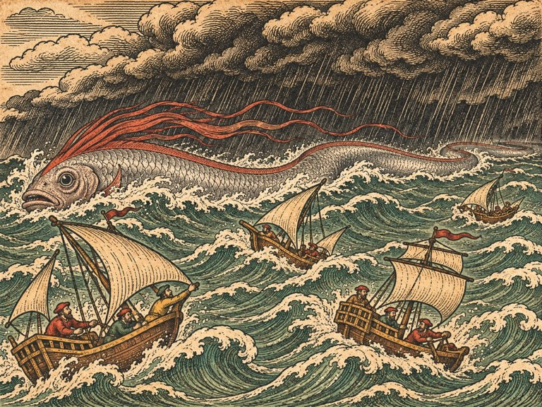
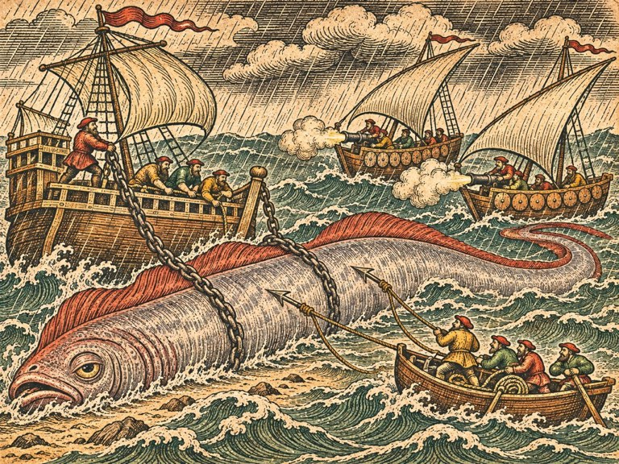
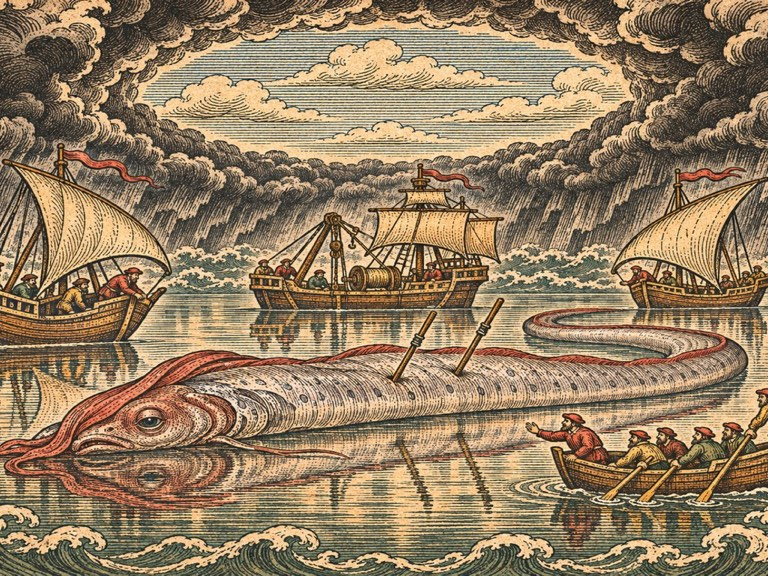

## 1. 캘리컷의 상인 조합장

1542년 봄, 캘리컷.

아프리카를 돌아 인도양으로 들어오는 데 넉 달이 걸렸다. 희망봉에서 폭풍을 한 번 만났고, 모잠비크에서 열병으로 선원 둘을 잃을 뻔했다. 이븐 살림이 약초를 달여 먹여 살렸다. 「배 목수가 왜 약을 알아요.」 잉리드가 묻자 그는 대답했다. 「배를 고치는 사람은 배에 탄 사람도 고칠 줄 알아야 하오. 사람이 없으면 배는 나무일 뿐이니.」

캘리컷은 소리와 냄새의 도시였다. 후추 자루를 나르는 짐꾼들의 노래, 시장 바닥의 계피와 생강, 사원의 북소리, 부두에 늘어선 다우의 삼각돛. 포르투갈 사람들의 배는 보이지 않았다. 이 도시의 왕은 포르투갈과 오래 싸워 왔고, 포르투갈 배는 북쪽 고아에 모여 있다고 했다. 잉리드가 노르웨이에서 왔다고 하자 부두 관리는 한참 지도를 떠올리는 얼굴을 하다가 그냥 손을 내저어 들여보내 주었다.

상인 조합장 코야 하산은 예순쯤 된 사내였다. 하얀 옷에 하얀 수염, 손가락마다 반지. 그는 잉리드 일행을 조합 건물 안뜰로 맞아들이고 차부터 내왔다. 생강과 후추를 넣어 끓인, 혀가 얼얼한 차였다. 토르켈은 한 모금 마시고 얼굴을 찡그렸다. 파올라는 세 잔을 마셨다.

"알렉산드리아의 이븐 살림이 함께 왔다면, 당신들은 믿을 만한 사람이오." 코야 하산이 말했다. "그는 사람을 가려서 배를 고치니까."

이븐 살림이 가볍게 고개를 숙였다. 둘은 오래 아는 사이 같았다.

"우리 선단은 계절풍을 타고 다니오." 코야 하산이 찻잔을 내려놓았다. "겨울에는 북동풍을 타고 아덴과 홍해로 가고, 여름에는 남서풍을 타고 돌아오오. 수백 년을 그렇게 했소. 바다가 정한 길이오. 그런데 지난 두 해 동안, 남서풍이 올 때마다 선단이 흩어졌소. 돌아온 배는 반. 나머지는 부서졌거나 사라졌소."

"폭풍 때문에요?"

"폭풍은 늘 있었소. 우리는 폭풍을 아오." 코야 하산이 고개를 저었다. "이건 다르오. 돌아온 선원들은 폭풍 앞에 무언가가 있었다고 말하오. 긴 것. 바다뱀. 그들은 그걸 마카라라고 부르오. 사원의 문에 새겨진 바다 짐승의 이름이오."

"알렉산드리아에서 들었어요." 잉리드가 말했다. "은빛이고 머리에 붉은 볏이 있다고."

"그렇소." 코야 하산이 처음으로 놀란 얼굴을 했다. "그것까지 알고 왔다면 이야기가 쉽겠군. 다음 남서풍에 선단이 돌아오오. 마흔 척. 그 선단을 지켜 주시오. 무사히 돌아오면, 금화 팔천을 드리겠소."

## 2. 한 줄로 부서진 배들

캘리컷 남쪽 해안을 따라 내려가다가, 마르그레테가 망원경을 내렸다.

"저거 봐요."

해안 앞바다, 암초가 이어지는 곳에 부서진 배들이 있었다. 다우 다섯 척. 하나는 돛대가 꺾였고, 하나는 뒤집혀 바닥을 드러냈고, 나머지는 암초에 걸려 기울어 있었다. 그런데 그 배들이 이상하게 놓여 있었다. 일렬로. 남서쪽에서 북동쪽으로, 자로 그은 것처럼 한 줄로.

"폭풍이 흩어 놓았으면 저렇게 안 돼요." 마르그레테가 말했다. "흩어져야 해요. 저건 무언가가 한 줄로 지나가면서 쓸어 놓은 거예요."

파올라가 휘파람을 불었다. "길로 다니는 놈이네요. 세관선처럼."

"세관선은 길로 다녀요?"

"다녀요. 늘 같은 길로. 그래서 피할 수 있어요." 파올라가 씩 웃었다. "길로 다니는 놈은 길만 알면 돼요."

마르그레테가 수첩에 적었다.

마카라. 하나, 한 길로 지나간다. 지나간 자리의 배는 한 줄로 부서진다.

## 3. 말린디의 선장

아프리카 쪽 말린디 항구에 살아남은 선장이 있다고 했다. 캘리컷 선단에서 돌아온 배 중 하나를 몰았던 사람. 지금은 배를 버리고 항구에서 대추야자를 팔고 있었다.

선장은 잉리드의 질문을 듣고 한참 웃었다. 웃다가 울었다.

"바람이 먼저 바뀌오." 눈물을 닦으며 그가 말했다. "그게 오기 전에. 남서풍이 잘 불다가, 갑자기 뚝 그치오. 그러고는 북쪽에서 바람이 불어오오. 거꾸로. 그다음에 폭풍이 오오. 그리고 그 폭풍 앞머리에 그게 있소. 은빛으로. 파도 위를 미끄러지면서. 머리에 붉은 볏을 세우고."

"바람이 바뀌면 그게 온다는 거예요?"

"바람이 바뀌면 폭풍이 오고, 폭풍이 오면 그게 오오. 그게 폭풍을 데려오는 건지, 폭풍이 그걸 데려오는 건지는 모르오." 선장이 대추야자 하나를 집어 잉리드의 손에 쥐여 주었다. "아가씨. 바람이 바뀌면 도망가시오. 그게 내가 아는 전부요."

이븐 살림이 돌아오는 길에 말했다.

"폭풍 전에 떠오르는 고기가 있소. 아라비아 어부들도, 인도 어부들도 아는 고기요. 길고 은빛이고, 머리에 붉은 지느러미가 있소. 보통은 깊은 데 살다가, 땅이 흔들리거나 폭풍이 올 때 물 위로 올라오오. 어부들은 그걸 보면 그물을 걷고 돌아가오."

"그 고기가 배를 부숴요?"

"보통은 팔뚝만 하오. 길어 봐야 사람 키 셋." 이븐 살림이 바다를 보았다. "그런데 이 바다에서 지금 그것이 사람 키 서른이라면."

둘, 바람이 먼저 바뀐다. 폭풍 앞머리에 그것이 있다.

## 4. 흩어진 함대

첫 조우는 바라지 않을 때 왔다.

선단이 돌아오기 한 달 전, 잉리드는 바다를 익히려고 캘리컷 앞바다로 나갔다. 갈매기호, 늦은 별호, 측량선, 물개호. 이븐 살림의 작업선은 항구에 남았다. 파올라는 고집을 부려 따라왔다.

정오쯤 바람이 멎었다.

돛이 축 늘어졌다. 바다가 거울처럼 잔잔해졌다. 하늘이 노랗게 변했다. 그리고 북쪽에서, 거꾸로, 바람이 불어왔다.

"바람이 바뀌었어요!" 마르그레테가 외쳤다.

"돌아가요! 항구로!"

늦었다. 남서쪽 수평선에 검은 벽이 섰다. 구름이 아니라 비와 바람의 벽이었다. 그 벽이 무서운 속도로 다가왔다. 그리고 그 벽 앞에서, 파도 위로, 은빛 줄이 번쩍였다.

길었다. 끝이 보이지 않았다. 파도가 솟을 때마다 은빛 몸통이 파도 꼭대기를 타고 미끄러졌다. 몸통 앞쪽, 머리에서 붉은 볏이 깃발처럼 펄럭였다. 그것이 지나가는 자리마다 파도가 두 갈래로 갈라졌다.

폭풍이 닥쳤다.

갈매기호가 기울었다. 돛줄이 끊어졌다. 비가 옆으로 쏟아졌다. 잉리드는 돛대에 몸을 묶고 바다를 보았다. 아무것도 보이지 않았다. 늦은 별호도, 측량선도, 물개호도, 파올라의 배도.

은빛 몸통이 갈매기호 옆을 지나갔다. 아주 가까이. 배를 노린 것이 아니었다. 그냥 지나갔다. 그러나 그것이 지나가며 일으킨 파도가 갈매기호를 들어 올려 내동댕이쳤다. 갈매기호는 옆으로 누웠다가, 간신히, 다시 일어섰다.

폭풍은 한 시간 만에 지나갔다.

바다는 다시 잔잔해졌다. 잉리드는 돛대에서 몸을 풀었다. 둘러보았다. 아무 배도 보이지 않았다.

"찾아요." 목이 쉬어 있었다. "한 척씩. 다 찾을 때까지 안 돌아가요."

해가 질 때까지 찾았다. 토르켈의 늦은 별호는 동쪽으로 밀려가 있었다. 노 둘이 부러졌다. 측량선은 북쪽에서, 돛대가 기운 채 떠 있었다. 마르그레테는 선실에서 해도를 끌어안고 있었다. 젖지 않게. 물개호는 무거워서 거의 밀리지 않았다. 디르크는 제자리에서 다른 배들이 오기를 기다리고 있었다.

파올라는 마지막에 찾았다. 가장 멀리, 남쪽 수평선 근처에서. 배는 멀쩡했다. 파올라도 멀쩡했다. 다만 얼굴이 하얗게 질려 있었다.

"가벼운 배는 날아가요." 갈매기호에 끌려 돌아오면서 파올라가 말했다. "내 배가 지중해에서 제일 빠르다고 했죠. 저 폭풍 속에서는 그냥 나뭇잎이었어요."

## 5. 무거운 배와 가벼운 배

이븐 살림은 돌아온 배들을 하나하나 살폈다. 늦은 별호의 노, 측량선의 돛대, 갈매기호의 끊어진 돛줄. 물개호는 거의 다치지 않았다.

"보시오." 이븐 살림이 물개호의 뱃전을 손바닥으로 두드렸다. "무거운 배는 버티오. 폭풍이 와도 덜 밀리오. 가벼운 배는 날아가오. 빠르지만, 폭풍 속에서는 아무것도 못 하오."

"그럼 무거운 배로 싸우면 돼요?"

"무거운 배는 느리오. 그것을 쫓아가지 못하오." 이븐 살림이 안경을 고쳐 썼다. "그러니 쫓지 말고 기다려야 하오. 그것이 지나갈 길목에서."

## 6. 고아의 수로 안내인

길목을 아는 사람은 고아에 있었다.

고아는 포르투갈의 도시였다. 성당 종소리가 항구까지 울렸다. 캘리컷과는 서로 적이었지만, 바다를 아는 사람들끼리는 서로를 알았다. 코야 하산이 편지 한 장을 써 주었다. 「이 편지를 들고 가면 그가 만나 줄 것이오. 그는 포르투갈 사람의 수로를 안내하지만, 포르투갈 사람은 아니오.」

수로 안내인은 구자라트 사람이었다. 이름은 말하지 않았다. 늙고 말랐고, 귀가 반쯤 먹었다. 그러나 해도를 펼치자 손가락이 날아다녔다.

"남서풍의 폭풍은 늘 같은 데로 지나가오." 그가 해도 위에 세 군데를 짚었다. "여기, 섬들 사이의 물목. 여기, 해안이 튀어나온 곶 앞. 여기, 깊은 물이 얕아지는 둔덕. 폭풍은 이 셋 중 하나를 지나오. 해마다 다르지만, 이 셋을 벗어나지 않소."

"왜요?"

"바다 밑이 그렇게 생겼으니까. 물은 깊은 데로 흐르고, 바람은 물을 따라가오." 안내인이 손가락을 멈췄다. "그리고 당신들이 찾는 그것도, 물을 따라가오."

마르그레테가 해도를 베꼈다. 그날 밤 그는 잉리드에게 말했다.

"섬고래는 숨 쉬러 올라왔고, 거북은 해초에 배를 엮었고, 오징어는 불빛에 끌렸어요. 다 이유가 있었어요. 이것도 있을 거예요. 길목을 지날 때 왜 지나는지."

그들은 첫째 길목으로 갔다. 섬들 사이의 물목. 사흘을 기다렸다. 바람이 바뀌지 않았다. 둘째 길목, 곶 앞. 거기서 닷새째 되던 날, 바람이 멎었다.

이번에는 도망가지 않았다. 배들을 곶 뒤에 숨기고 마르그레테의 측량선만 곶 끝에 남겼다. 폭풍이 왔다. 은빛 몸통이 왔다.

그리고 곶 앞, 물이 얕아지는 곳에서, 그것이 몸을 드러냈다.

파도 위로 미끄러지던 몸통이 얕은 물에 걸려 한순간 멈췄다. 은빛 몸통 전체가 물 위로 드러났다. 길이가 갈매기호 열 척을 이어 놓은 것만 했다. 몸통은 리본처럼 얇았다. 머리의 붉은 볏이 활짝 펴졌다. 그리고 그것은 몸을 비틀어 다시 깊은 물로 빠져나갔다.

마르그레테는 폭풍이 지나간 뒤 수첩에 적었다. 손이 젖어 잉크가 번졌다.

셋, 길목의 얕은 데서 몸이 드러난다. 한순간. 그때 옆에 있는 배만 칠 수 있다. 그리고 그 배는 폭풍에 날아가지 않을 만큼 무거워야 한다.

## 7. 편지들

선단이 돌아오기 열흘 전, 캘리컷에 편지 꾸러미가 도착했다. 알렉산드리아와 베네치아를 거쳐, 여러 손을 거쳐 온 꾸러미였다. 맨 위에 한스의 반듯한 글씨가 있었다.

잉리드는 조합 안뜰에 앉아 편지를 하나씩 열었다.

한스: 「상관 장부에 그대의 이름이 올랐소. 거래처로. 무슨 거래인지는 나도 모르겠소. 베르겐 고래잡이들이 그대 이야기를 하오. 올라프 형제는 그대 몫의 기름을 따로 떼어 놓고 있소. 돌아오면 받으라고.」

피터 콜스: 「장부를 보니 셰틀랜드 서쪽에서 올해 사라진 배가 없소. 처음이오. 보험료를 내렸소. 상인들이 좋아하오. 그대에게 갚을 것이 있다고 장부에 적어 두었소. 장부에 적은 건 갚소.」

얀 판 로. 비뚤비뚤한 글씨였다. 「삼촌, 마당 잘 지키고 있어요. 재미없어요. 그래도 지켜요. 구난선 한 척을 혼자 수리했어요. 삼촌이 돌아오면 보여 줄게요. 잉리드 선장님, 삼촌을 잘 부탁해요. 삼촌은 자기가 늙은 걸 몰라요.」

디르크가 그 편지를 받아 들고 오래 읽었다. 그는 한 번 웃었다. 그리고 편지를 품에 넣었다.

나폴리의 어부들도 편지를 보냈다. 글을 쓸 줄 아는 사람이 하나뿐이라 짧았다. 「해협에서 다시 횃불을 켭니다. 오징어가 잘 잡힙니다. 작은 것만.」

파올라가 그 편지를 읽고 크게 웃었다.

마르그레테가 편지들을 한데 모아 수첩 사이에 끼웠다. 그리고 말했다.

"이 사람들이 다 우리를 기억해요."

"고마워서요?"

"고마워서도 있고." 마르그레테가 수첩을 덮었다. "언젠가 우리가 부르면, 올 사람들이에요."

## 8. 폭풍의 눈

남서풍이 왔다. 그리고 선단이 왔다.

다우 마흔 척이 수평선을 가득 메웠다. 코야 하산이 조합 지붕에 올라 그 돛들을 보며 기도했다. 그리고 잉리드에게 무거운 배 두 척을 내주었다. 짐을 다 내리고 대신 돌을 실은 다우. 뱃전에 이븐 살림이 방패 판을 덧댔다.

"선단은 북쪽 해안을 따라 들어오오. 그것과 마주치지 않게." 코야 하산이 말했다. "당신들은 길목에서 그것을 막으시오."

이븐 살림은 지난 두 달 동안 모든 배에 폭풍 돛을 새로 달았다. 작고 두꺼운 돛. 바람을 덜 받지만 찢어지지 않는 돛. 닻줄은 두 배로 굵게 했다. 잉리드의 금화 사천이 거기 들어갔다.

"어느 길목이에요?" 잉리드가 파올라에게 물었다.

파올라는 사흘 동안 바다를 읽었다. 구름의 모양, 물빛, 바닷새가 나는 방향. 그리고 셋째 날 밤 갈매기호로 건너와 해도의 한 점을 짚었다.

"둔덕이에요. 깊은 물이 얕아지는 데. 섬들 사이도 곶도 아니에요. 바람이 남쪽으로 틀었어요. 세관선이 길을 바꿀 때처럼."

잉리드는 그 말을 믿었다. 그리고 배들을 둔덕에 세웠다.

무거운 배 둘과 물개호는 둔덕 바로 옆. 닻을 두 개씩 내리고, 방패 판을 바깥쪽으로. 갈매기호는 그 뒤. 늦은 별호는 갈매기호 옆에. 마르그레테의 측량선은 둔덕에서 멀찍이, 길이 보이는 곳에. 파올라의 배는 가장 바깥, 폭풍이 오는 쪽.

"내가 먼저 봐요." 파올라가 말했다. "그게 어느 쪽으로 들어오는지. 그리고 깃발을 올릴게요."

"폭풍에 날아가요."

"날아가기 전에 올릴게요."

바람이 멎었다.

하늘이 노래졌다. 북쪽에서 바람이 불었다. 남서쪽 수평선에 검은 벽이 섰다. 파올라의 배가 그 벽을 향해 조금 나아갔다. 그리고 돛대에 붉은 깃발이 올랐다. 둘. 셋. 남쪽으로 기운 깃발.

남쪽에서 온다. 둔덕의 남쪽 끝으로.

"남쪽으로!" 잉리드가 외쳤다. "무거운 배, 남쪽 끝으로 옮겨요!"

무거운 배들이 닻을 끌며 남쪽으로 기었다. 느렸다. 폭풍이 먼저 닥쳤다.

파올라의 배가 날아갔다. 나뭇잎처럼. 잉리드는 그 배가 비구름 속으로 사라지는 것을 보았다. 이를 악물었다.

은빛 몸통이 왔다. 파도 꼭대기를 타고, 둔덕을 향해. 붉은 볏이 펄럭였다. 몸통이 지나가는 자리마다 파도가 갈라졌다. 그 파도가 무거운 배 하나를 때렸다. 배가 크게 기울었다. 닻줄이 팽팽해졌다. 버텼다.

몸통이 둔덕에 닿았다.

얕은 물에 걸렸다. 한순간, 은빛 몸통 전체가 물 위로 드러났다. 무거운 배 바로 옆에.

"지금!"

무거운 배 둘의 대포가 한꺼번에 울렸다. 물개호의 쇠사슬이 몸통에 감겼다. 늦은 별호에서 작살포가 터졌다. 작살이 은빛 비늘을 뚫고 박혔다.

몸통이 비틀렸다. 리본 같은 몸이 물결치며 쇠사슬을 끊으려 했다. 물개호가 끌려갔다. 디르크가 도르래를 거꾸로 돌렸다. 버텼다.

그리고 바람이 멎었다.

폭풍 한가운데, 갑자기, 모든 것이 고요해졌다. 비가 그쳤다. 머리 위로 동그랗게 파란 하늘이 열렸다. 사방은 여전히 검은 구름의 벽이었다. 그러나 그 안은 거울처럼 잔잔했다.

폭풍의 눈이었다.

몸통도 멈췄다. 바람이 없자, 파도가 없자, 그것은 미끄러질 수 없었다. 은빛 몸통이 물 위에 길게 늘어졌다. 붉은 볏이 힘없이 접혔다.

"두 번이에요." 마르그레테의 목소리가 고요한 바다 위로 똑똑히 들렸다. 측량선에서. "눈이 지나가는 데 두 번 숨 쉴 시간. 그다음엔 다시 폭풍이에요!"

잉리드는 갈매기호를 몸통 바로 옆에 댔다. 대포를 모두 그쪽으로 돌렸다.

"쏴요. 볏 아래. 머리."

대포가 울렸다. 한 번. 두 번. 늦은 별호의 작살이 두 번째로 박혔다. 무거운 배의 포탄이 뒤따랐다.

몸통이 몸부림쳤다. 그리고 폭풍이 다시 닥쳤다. 눈이 지나갔다. 바람이 거꾸로, 처음과 반대 방향으로 불었다. 몸통은 그 바람을 타고, 쇠사슬을 끊고, 둔덕을 넘어 서쪽으로 미끄러져 갔다. 작살 둘을 몸에 꽂은 채. 은빛이 비구름 속으로 사라졌다.

## 9. 쫓지 않는다

폭풍이 지나갔다.

잉리드는 배를 셌다. 무거운 배 둘. 둘 다 떠 있었다. 하나는 돛대를 잃었고 하나는 방패 판이 반쯤 떨어져 나갔다. 물개호, 늦은 별호, 측량선.

파올라의 배가 없었다.

해 질 녘, 서쪽 수평선에 돛 하나가 보였다. 찢어진 돛. 파올라의 배였다. 파올라는 키를 붙잡고 서서 손을 흔들고 있었다.

"날아갔다가 돌아왔어요!" 갈매기호에 닿자마자 파올라가 외쳤다. 목이 쉬어 있었다. "그게 서쪽으로 가는 걸 봤어요. 아주 빨리. 다시 돌아올 것 같지 않아요."

"쫓아요?" 토르켈이 물었다.

잉리드는 서쪽을 보았다. 해가 지는 쪽. 아라비아해의 끝, 그 너머 아프리카, 그 너머.

"아니요. 안 쫓아요." 잉리드가 말했다. "선단이 들어올 때까지 여기 있어요. 그게 우리 일이에요."

선단은 사흘 뒤에 들어왔다. 마흔 척. 한 척도 빠지지 않았다.

코야 하산은 조합 안뜰에서 잉리드의 두 손을 잡았다. 반지들이 차가웠다.

"바다를 이기려 하지 말라고 했소. 바다가 지나가는 길을 비켜 서라고." 그가 말했다. "당신은 그 길 한가운데 섰소. 그리고 비켜 서지 않았소."

"비켜 섰으면 선단이 그 길로 갔을 거예요."

"그렇소. 그래서 고맙소." 코야 하산이 금화 팔천을 내밀었다. "그리고 우리 무거운 배 둘을 돌려줘서 고맙소. 둘 다 돌아올 거라고는 생각하지 않았소."

## 10. 북쪽을 가리키는 줄

마르그레테는 그날 밤 조합 안뜰에 커다란 해도를 펼쳤다. 올라우스 신부의 것처럼 대서양 한가운데가 비어 있는 해도. 그 위에 숯으로 줄을 그었다.

"섬고래." 베르겐 어귀에서 서쪽으로, 아일랜드 너머로. "그 등의 해초가 자라는 곳."

"거북." 셰틀랜드 서쪽에서 남쪽으로. "빨판의 주인이 있는 따뜻한 바다 쪽."

"오징어." 메시나에서 동쪽으로, 인도양으로. "그을린 상처를 준 것 쪽."

"마카라." 인도양에서 서쪽으로, 아프리카를 넘어. "지금 가는 쪽."

네 줄이었다. 잉리드는 그 줄들을 보았다. 오징어 줄과 마카라 줄은 서로를 가리켰다. 거북 줄은 남쪽으로 가다가 대서양 쪽으로 휘었다. 마카라 줄도 아프리카를 넘으면 대서양이었다.

"셋은 대서양으로 모여요." 마르그레테가 말했다. "한가운데로. 신부님 해도의 빈칸으로."

"넷이 아니고요?"

마르그레테가 섬고래 줄을 손가락으로 짚었다. 베르겐에서 서쪽으로 간 줄. 그 줄은 대서양 한가운데로 가지 않았다. 아일랜드 서쪽에서 북쪽으로 휘어 올라갔다. 아이슬란드 쪽으로. 그 너머 얼음 바다 쪽으로.

"섬고래만 맞지 않아요." 마르그레테가 말했다. "그 해초는 아일랜드 서쪽에서 자라지만, 섬고래는 거기서 오지 않았을지도 몰라요. 더 북쪽에서 내려오다가 그 해초 밭을 지났을지도. 이 줄은 북쪽을 가리켜요."

잉리드는 그 줄을 오래 보았다. 북쪽. 아버지가 이번엔 멀리 간다고 했던 쪽. 북쪽 먼바다까지.

리스본에 들렀을 때, 그곳에 한스의 편지가 기다리고 있었다. 다른 편지들과 달리 봉인이 두 겹이었다.

「급히 쓰오. 올해 북쪽 바다가 일찍 얼었소. 노르카프 너머 대구 어장에 나간 상관 배들이 돌아오지 않고 있소. 그리고 한 가지 더.

지난달 북쪽 포구에 사람 하나가 흘러들어 왔소. 얼어 죽을 뻔하다가 어선에 건져졌다고 하오. 그는 「북극성」의 선원이라고 말하오. 이름은 올레.

돌아오시오. 그대 아버지의 소식을 그가 가지고 있소.」

잉리드는 편지를 쥔 채 서 있었다. 손이 떨리지 않았다. 떨려야 할 것 같은데 떨리지 않았다.

토르켈이 그 옆에 섰다. 편지를 읽지 못하는 그는 잉리드의 얼굴만 보았다. 그리고 알았다.

"올레냐."

"올레예요."

토르켈은 아무 말도 하지 않았다. 대신 늦은 별호로 걸어가 닻줄을 감기 시작했다. 아무도 출항하자고 하지 않았는데.

갈매기호는 다음 날 새벽 리스본을 떠났다. 북쪽으로. 그 뒤로 늦은 별호, 측량선, 물개호, 이븐 살림의 작업선, 그리고 파올라의 배가 따랐다.

"북쪽은 추워요?" 파올라가 물었다.

"추워요." 잉리드가 대답했다.

"얼마나?"

"목욕통이 얼 만큼요."

파올라는 한참 생각하더니, 리스본 시장에서 산 털외투를 하나 더 꺼내 입었다.
