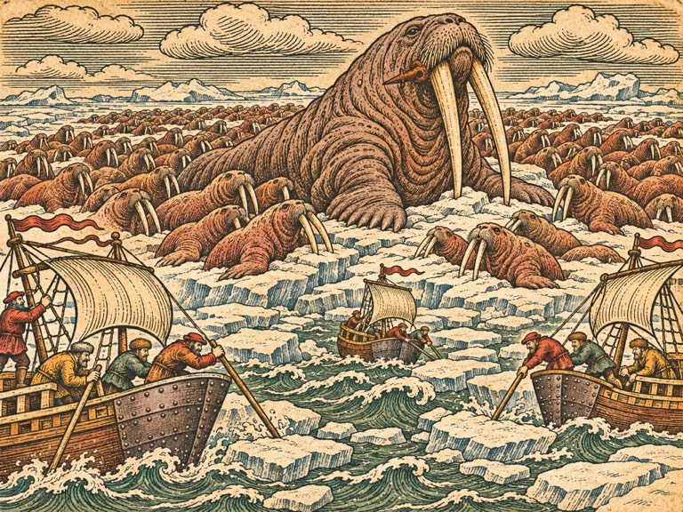
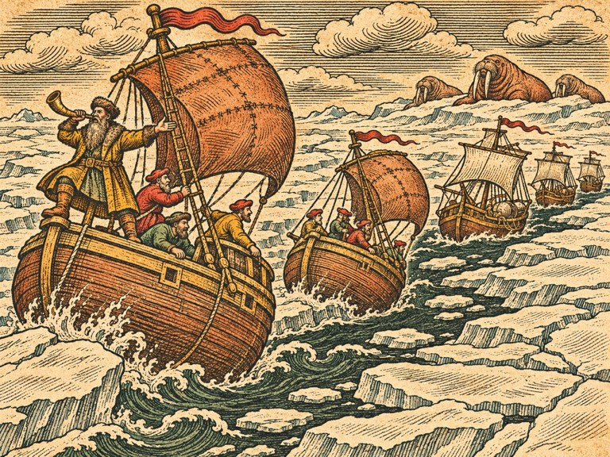
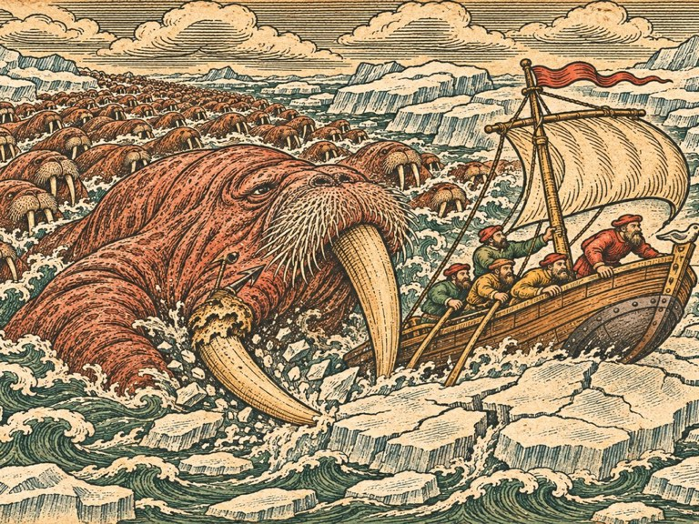

## 1. 올레

1543년 이른 봄, 베르겐.

부두 끝 계류 자리는 이제 비어 있지 않았다. 갈매기호가 거기 매여 있었다. 네 해 전 아버지가 떠난 자리에. 잉리드가 그 자리에 배를 대자 부두 사람들은 아무도 손을 내젓지 않았다.

올레는 이모 시그리드의 여관 다락에 누워 있었다.

잉리드는 그를 알아보지 못했다. 네 해 전의 올레는 스무 살 남짓한 청년이었다. 키가 크고 잘 웃고, 고래 등과 파도를 구별하지 못한다고 잉리드가 놀리던 사람. 지금 침상에 누운 사람은 마흔은 되어 보였다. 수염이 덥수룩했고, 볼이 움푹 꺼졌고, 왼쪽 다리가 이상한 각도로 굽어 있었다.

그러나 잉리드를 보자 그는 웃었다. 그 웃음은 그대로였다.

"잉리드. 망대에 올라가야 할 사람이 왔네."

잉리드는 침상 옆에 앉았다. 무슨 말을 해야 할지 몰랐다. 그래서 그냥 그의 손을 잡았다. 손가락 끝이 몇 개 없었다. 얼어서 떨어진 자리였다.

"아버지는요."

올레는 바로 대답하지 않았다. 천장을 보았다. 숨을 고르는 사람처럼.

"모르겠어. 살아 계신지." 그가 말했다. "내가 마지막으로 본 건 네 해 전 가을이야. 북쪽 얼음 바다에서. 선장님은 배를 서쪽으로 돌리고 있었어. 나는 바다에 떨어졌고."

## 2. 북쪽에서 있었던 일

올레의 이야기는 길었다. 잉리드는 끊지 않고 들었다. 토르켈은 문간에 서서 들었다. 마르그레테는 수첩을 펼쳤다가, 쓰지 않고 다시 덮었다.

「북극성」은 그해 여름 노르카프를 돌아 북쪽 먼바다로 갔다. 고래를 쫓아서였다. 그해에는 북해에 고래가 적었다. 아르네는 고래가 북쪽으로 몰려갔다고 믿었다. 그리고 그 믿음은 맞았다. 얼음 가장자리에 고래가 많았다. 「북극성」은 기름통을 반쯤 채웠다.

그러다 얼음이 이상해졌다.

"얼음이 남쪽으로 내려왔어. 여름인데. 그리고 그 얼음 위에, 바다코끼리들이 있었어. 수백 마리. 그런데 그중에 하나가……." 올레가 눈을 감았다. "배만 했어. 엄니가 돛대 반만 했어. 그놈이 무리를 이끌고 있었어."

무리는 배를 들이받았다. 처음에는 한 마리씩. 그다음에는 여럿이 한꺼번에. 「북극성」은 얼음 쪽으로 밀렸다. 아르네는 작살을 들었다. 우두머리를 향해 던졌다. 작살은 엄니에 박혔다. 엄니 뿌리에, 깊이.

"그때 그놈이 들이받았어. 배 옆구리를. 나는 망대에 있었고, 떨어졌어. 얼음물에." 올레가 굽은 다리를 가리켰다. "얼음에 다리가 끼었어. 마지막으로 본 게, 선장님이 키를 서쪽으로 꺾는 거였어. 얼음이 닫히기 전에 빠져나가려고. 그리고 선장님이 외치는 걸 들었어. 나한테가 아니라 다른 사람들한테."

"뭐라고요."

"「서쪽이다. 저 안개를 봐라. 저게 이놈들을 밀어낸 거다.」" 올레가 눈을 떴다. "그게 무슨 뜻인지 나는 몰라. 나는 얼음물에 있었으니까. 그 뒤로 배는 못 봤어."

올레는 사미 사람들에게 건져졌다. 순록을 치는 사람들. 얼음 가장자리까지 바다코끼리를 사냥하러 나왔다가 그를 보았다. 그들은 그의 다리를 묶어 주고, 겨울 동안 천막에 재워 주었다. 다리는 그 모양으로 붙었다. 봄이 되자 그는 남쪽으로 가는 배를 찾았다. 그런데 북쪽 바다는 해마다 일찍 얼었고, 남쪽으로 가는 배가 오지 않았다. 세 해를 기다렸다. 넷째 해에 그는 사미 사람들의 작은 가죽배를 얻어 혼자 남쪽으로 노를 저었다. 그리고 반쯤 얼어 죽은 채 북쪽 포구 어부에게 건져졌다.

"하랄 아저씨였어." 올레가 말했다. "너희가 섬고래를 잡은 그 포구의."

잉리드는 오래 말이 없었다. 그러다 물었다.

"아버지가 서쪽으로 갔다고요. 북쪽이 아니라."

"서쪽. 안개 쪽."

마르그레테가 그제야 수첩을 펼쳤다. 지난번 캘리컷에서 그은 줄들. 섬고래의 줄, 북쪽을 가리키던 줄. 그 끝에 그는 작은 동그라미를 그렸다.

"섬고래도 북쪽에서 이걸 피해 내려왔을 거예요." 그가 말했다. "얼음이 내려오면, 그 얼음 가장자리에 살던 것들이 다 남쪽으로 밀려요. 고래도, 바다코끼리도. 그리고 그 얼음을 내려보낸 무언가가……."

"서쪽에 있다는 거예요?"

"그건 아직 몰라요." 마르그레테가 동그라미 옆에 물음표를 그렸다. "하지만 아르네 선장님은 뭔가를 보신 거예요."

## 3. 한스의 의뢰

한스는 처음으로 장부를 펼치지 않았다.

"상관 대구 배가 셋 돌아오지 않았소. 노르카프 너머 어장에서." 그는 책상 위에 손을 깍지 끼고 있었다. "셋 다 내 배요. 한 척에는 내 처남이 탔소."

"올레가 말한 그 무리예요?"

"돌아온 대구 배 하나가 그렇게 말하오. 얼음 위에 바다코끼리가 수백 마리, 그리고 배만 한 것 하나." 한스가 고개를 들었다. 그의 눈이 처음으로 상인의 눈이 아니었다. "값은 그대가 부르시오. 흥정하지 않겠소."

"흥정하세요." 잉리드가 말했다. "그래야 한스 씨 같아요."

한스가 한참 잉리드를 보았다. 그리고 웃었다. 작게.

"그럼 오천. 깎으면 안 되오."

## 4. 구멍 난 선체

노르카프로 가는 바다는 잉리드가 아는 바다였다. 차갑고 회색이고, 바람은 칼처럼 얼굴을 베었다. 파올라는 털외투를 세 겹 껴입고도 떨었다. 이븐 살림은 작업선 선실에서 나오지 않았다. 「이 바다는 사람이 살 데가 아니오. 배 목수가 살 데는 더더욱.」

노르카프 앞바다에서 첫 흔적을 찾았다.

대구 배 한 척이 바위 해안에 얹혀 있었다. 사람은 없었다. 선체 옆구리에 구멍이 나란히 둘 뚫려 있었다. 동그랗고 깊은 구멍. 판자가 안쪽으로 부서져 들어가 있었다. 무언가 뾰족하고 굵은 것이 들이받은 자국.

토르켈이 구멍에 팔을 넣어 보았다. 팔꿈치까지 들어갔다.

"엄니다." 그가 말했다. "둘. 나란히."

"바다코끼리 엄니요?"

"바다코끼리 엄니는 내 팔뚝만 하다. 이건……." 토르켈은 팔을 빼고 구멍 둘 사이의 거리를 손 뼘으로 쟀다. 네 뼘. "내 키만 한 엄니다."

로스마루스. 하나, 엄니로 들이받는다. 배 옆구리에 구멍 둘.

## 5. 얼음 깨는 뱃머리

"얼음 바다에 가려면 뱃머리를 바꿔야 하오." 이븐 살림이 말했다. 작업선 선실, 화로 앞에 웅크린 채. "이 배들 뱃머리로는 얼음에 부딪히면 쪼개지오. 쇠를 대야 하오. 두껍게. 그리고 뱃머리를 얼음 위로 올라타게 깎아야 하오. 배 무게로 얼음을 눌러 깨도록."

"쇠는 어디서요?"

"함부르크." 디르크가 대답했다. "북쪽에서 쇠가 제일 많은 데요. 한자 상인들 쇠."

함부르크까지 내려갔다 오는 데 한 달이 걸렸다. 쇠 스무 짐, 참나무 스무 짐. 한스가 상관 이름으로 값을 깎아 주었다. 「흥정하지 말라고 했지만, 남이 흥정하는 건 괜찮소.」

이븐 살림은 베르겐 조선소에 자리를 잡았다. 조선소 사람들은 처음에 터번 쓴 배 목수를 이상하게 보았다. 사흘째부터는 그의 대패질을 구경하러 모였다. 열흘째에는 그에게 뱃머리 깎는 법을 물었다.

갈매기호와 늦은 별호, 측량선의 뱃머리에 두꺼운 쇠판이 씌워졌다. 뱃머리 아래쪽은 숟가락처럼 둥글게 깎였다. 물개호는 원래 무거워서 쇠판만 댔다. 파올라의 배는 이븐 살림이 손을 대지 않았다.

"당신 배는 얼음에 들어가면 안 되오." 이븐 살림이 파올라에게 말했다. "그 배는 얼음 밖에서 달려야 하오. 빠른 것이 할 일이 따로 있으니까."

## 6. 무리의 자국

노르카프를 돌자 얼음이 시작되었다.

처음에는 작은 얼음 조각들이 물 위에 떠 있었다. 그다음에는 배만 한 얼음판들. 그다음에는 끝이 보이지 않는 하얀 들판. 얼음 들판 가장자리는 물결에 부딪혀 깨지고 다시 얼기를 되풀이했다. 그 사이로 검은 물길이 거미줄처럼 나 있었다.

얼음판 위에 자국이 있었다.

마르그레테가 망원경으로 보았다. 눈 위에 무언가가 끌고 지나간 자국. 넓고 깊은 자국 하나. 그 뒤로 작은 자국 수십 개가 따라가 있었다. 큰 자국이 멈춘 자리에서 작은 자국들도 멈췄다. 큰 자국이 물로 들어간 자리로 작은 자국들도 들어갔다.

"우두머리를 따라요." 마르그레테가 말했다. "하나가 가는 데로 다 가요."

둘, 무리를 지어 다닌다. 우두머리를 따른다.

## 7. 얼음 사이

무리는 그날 오후에 나타났다.

얼음판 가장자리에 갈색 덩어리들이 줄지어 엎드려 있었다. 바다코끼리들. 수십, 수백. 서로 몸을 붙이고, 엄니를 얼음에 걸고, 졸고 있었다. 그리고 그 한가운데, 다른 것들보다 두 배는 큰 덩어리 하나가 있었다.

우두머리였다.

몸은 회색에 가까운 갈색이었다. 주름진 가죽이 늙은 나무껍질 같았다. 그리고 엄니. 토르켈의 말대로 사람 키만 한 엄니 둘이 얼음에 박혀 있었다. 그 엄니 하나, 오른쪽 엄니 뿌리 가까이에 무언가가 박혀 있었다. 가늘고 긴 것. 녹슨 쇠.

"작살이다." 토르켈이 숨을 들이쉬었다.

잉리드는 망원경을 빼앗아 들었다. 작살 자루는 부러지고 쇠 촉만 남아 있었다. 녹슬어 붉었다. 그 촉의 목에 무언가가 감겨 있었다. 끈이었다. 고래잡이들이 자기 작살에 감는 표식 끈.

「북극성」의 표식이었다. 붉은 끈과 검은 끈을 엇갈려 감은 것. 아버지가 감은 매듭이었다.

"아버지 작살이에요."

그 말이 끝나기 전에 우두머리가 고개를 들었다.

무리 전체가 깼다. 수백 마리가 한꺼번에 머리를 들었다. 울음소리가 얼음 들판을 울렸다. 그리고 우두머리가 물로 미끄러져 들어갔다. 무리가 뒤따랐다. 물이 갈색 몸통들로 끓어올랐다.

"물러나요!" 잉리드가 외쳤다. "얼음 밖으로!"

무리가 배들을 둘러쌌다. 한 마리가 갈매기호 뱃전을 들이받았다. 쿵. 배가 흔들렸다. 두 마리, 세 마리. 들이받을 때마다 배가 얼음 쪽으로 밀렸다. 이븐 살림이 깎은 뱃머리가 얼음판 위로 올라탔다. 얼음이 깨졌다. 그러나 그 옆에 또 얼음이 있었다.

얼음이 움직이고 있었다. 바람에 밀려서, 물에 밀려서, 얼음판들이 서로 부딪히며 조여들었다. 배들 사이의 물길이 좁아졌다.

"갇혀요!" 마르그레테가 외쳤다. "물길이 닫혀요!"

물개호가 얼음판 하나에 꼈다. 디르크가 도르래로 얼음을 끌어내려 했다. 얼음은 꿈쩍하지 않았다. 늦은 별호는 무리에 둘러싸여 빙글빙글 돌았다. 토르켈이 작살을 휘둘러 바다코끼리들을 쫓았다. 하나를 쫓으면 둘이 왔다.

그리고 우두머리가 물 위로 솟았다.

갈매기호 바로 앞이었다. 엄니 둘이 갈매기호 뱃머리를 향했다. 녹슨 작살 촉이 엄니 뿌리에서 흔들렸다. 우두머리의 작은 눈이 잉리드를 보았다.

잉리드는 그 눈을 마주 보았다. 이 짐승이 아버지의 배를 들이받았다. 아버지의 선원을 얼음물에 떨어뜨렸다.

그런데 그 눈은 화가 나 있지 않았다. 지쳐 있었다. 섬고래의 눈처럼. 거북의 눈처럼. 오징어의 눈처럼.

우두머리가 들이받았다.

갈매기호가 크게 흔들렸다. 뱃머리의 쇠판이 비명을 질렀다. 버텼다. 엄니가 쇠판을 긁고 미끄러졌다. 우두머리가 물로 다시 들어갔다. 다음 들이받기를 위해.

그때 얼음 들판 저편에서 뿔피리 소리가 났다.

## 8. 흰 바다의 상인

배 두 척이 얼음 사이 물길을 따라 들어오고 있었다. 이상하게 생긴 배였다. 배 바닥이 달걀처럼 둥글었다. 돛은 가죽처럼 두꺼웠다. 얼음판에 부딪혀도 쪼개지지 않고 얼음 위로 미끄러져 올라탔다. 그러다 다시 물로 내려왔다.

앞선 배의 뱃머리에 사내 하나가 서 있었다. 털모자를 눌러쓰고, 수염이 가슴까지 내려왔다. 그는 뿔피리를 한 번 더 불고, 이쪽으로 손을 흔들었다. 따라오라는 손짓이었다.

"따라가요!" 잉리드가 외쳤다.

둥근 배는 얼음 들판 사이로 물길을 찾아 나갔다. 잉리드가 보지 못한 물길이었다. 얼음판과 얼음판 사이, 배 한 척이 겨우 지나갈 틈. 둥근 배가 지나가면 그 뒤로 틈이 조금 벌어졌다. 갈매기호가 그 틈을 따랐다. 늦은 별호, 측량선. 물개호는 둥근 배 하나가 돌아와 갈고리를 걸어 끌어냈다.

무리는 따라오지 않았다. 우두머리가 얼음판 위에 다시 올라앉았다. 무리가 그 둘레에 엎드렸다.

얼음 들판 밖, 열린 바다로 나오자 둥근 배의 사내가 갈매기호에 건너왔다. 털모자를 벗자 대머리가 드러났다. 그는 잉리드를 위아래로 훑어보더니 서툰 노르웨이 말로 말했다.

"여자 선장. 처음 본다."

"그쪽은 누구예요."

"바실리. 흰 바다에서 왔다. 소금하고 곡식 싣고, 대구하고 바꾸러." 사내가 얼음 들판 쪽을 턱으로 가리켰다. "저놈들 때문에 이 년째 장사를 못 한다. 그런데 오늘 보니 누가 저놈들한테 싸움을 걸고 있더라. 미친 놈인 줄 알았다. 여자였다."

"고마워요."

"고마운 건 나중에. 지금은 빚이다." 바실리가 손가락을 하나 세웠다. "내가 빚을 지면 갚는다. 남이 나한테 빚을 지면 받는다. 오늘 너는 나한테 빚을 졌다."

"뭘로 갚아요?"

바실리가 얼음 들판을 보았다. 그의 눈이 가늘어졌다.

"저 우두머리. 저놈을 잡으면 갚는 거다. 그러면 빚은 지워진다." 그가 잠깐 말을 멈췄다. "그리고 그때는 내가 너한테 빚을 지는 거다. 그럼 언젠가 내가 갚는다. 언제든 부르면."

## 9. 우두머리의 쉼

갈매기호 뱃머리는 쇠판이 우그러졌다. 이븐 살림이 베르겐에서 다시 펴고, 쇠판 한 겹을 더 댔다. 바실리의 둥근 배를 한참 들여다본 뒤였다.

"바닥을 둥글게 하면 얼음이 배를 조여도 배가 위로 밀려 올라가오. 깨지지 않고." 그는 감탄했다. "흰 바다 사람들은 얼음과 싸우지 않고 얼음 위에 올라앉는 법을 아는군."

금화 사천이 쇠판과 둥근 덧바닥에 들어갔다. 한스가 상관 장부에 달아 주겠다고 했지만 잉리드가 거절했다. 「이건 내 배 값이에요.」

이번에는 무리를 먼저 지켜보았다. 바실리가 얼음 들판 가장자리, 무리에게서 멀찍이 떨어진 곳으로 안내했다. 거기서 닷새를 지켜보았다.

무리는 하루 대부분을 얼음 위에서 잤다. 몇 시간에 한 번씩 물로 들어가 먹이를 찾았다. 우두머리가 먼저 들어가고, 무리가 따랐다. 돌아올 때도 우두머리가 먼저 얼음 위로 올라왔다.

그런데 우두머리는 한 번 올라오면 한참 움직이지 않았다. 다른 것들은 얼음 위에서 서로 밀치고 자리를 다퉜다. 우두머리만은 엄니를 얼음에 박고, 엎드려, 숨을 몰아쉬었다. 그동안 무리는 우두머리 곁을 떠났다. 저마다 먹이를 찾거나, 자리를 다투거나.

"늙었어요." 마르그레테가 말했다. 망원경을 내려놓으며. "물에서 올라오면 숨을 골라야 해요. 그 동안은 무리가 흩어져요. 아무도 우두머리를 지키지 않아요."

"섬고래처럼요?"

"섬고래처럼. 그리고……" 마르그레테가 잠깐 망설였다. "우두머리가 엎드려 있으면, 엄니가 얼음에 박혀요. 그때는 들이받지 못해요."

셋, 우두머리가 얼음 위에 올라 숨을 고를 때, 무리가 흩어진다.

"무리를 떼어 내야 해요." 잉리드가 말했다. "우두머리가 물에서 올라오기 전에. 무리가 먼저 흩어지게."

"어떻게?"

파올라가 손을 들었다. 털외투 네 겹 속에서.

"내 차례죠? 빠른 배가 할 일."

## 10. 아버지의 작살

닷새째 밤, 마르그레테가 잉리드를 측량선 선실로 불렀다. 탁자 위에 망원경으로 그린 그림이 놓여 있었다. 우두머리의 오른쪽 엄니. 그 뿌리의 녹슨 작살 촉. 붉은 끈과 검은 끈.

"이 작살은 네 해 동안 저기 박혀 있었어요." 마르그레테가 말했다. "엄니 뿌리에. 저 짐승은 네 해 동안 저걸 달고 살았어요."

"아프겠네요."

"아팠을 거예요." 마르그레테가 그림을 손가락으로 짚었다. "그런데 이걸 보면 아버님이 어떤 분인지 알 것 같아요. 엄니 뿌리를 노렸어요. 엄니를 뽑으면 들이받지 못하니까. 죽이려던 게 아니라, 못 들이받게 하려던 거예요. 배를 지키려고."

잉리드는 그림을 오래 보았다. 그리고 말했다.

"아버지는 늘 그랬어요. 고래도 숨통을 노리지 않았어요. 꼬리를 먼저 묶었어요. 꼬리를 묶으면 달아나지 못하니까, 그다음에 천천히."

"그럼 우리도 그렇게 해요." 마르그레테가 말했다. "엄니. 아버님이 시작한 데서."

## 11. 얼음 위의 싸움

바실리는 둥근 배 두 척을 붙였다. 「빚 갚는 날은 같이 있어야 한다.」

잉리드는 배를 골랐다. 늦은 별호, 마르그레테의 측량선, 파올라의 배. 그리고 바실리의 둥근 배 둘. 물개호와 이븐 살림의 작업선은 얼음 들판 밖에서 기다리게 했다. 디르크가 불평했다. 「끌어낼 게 많을 거라고 했잖소.」 「그래서 밖에 있어 줘요. 다 끌어내야 하니까.」

새벽, 무리가 물로 들어갔다. 먹이를 찾으러. 우두머리가 앞장서서.

파올라의 배가 얼음 들판 가장자리를 따라 달렸다. 뱃전에서 선원들이 냄비를 두드렸다. 뿔피리를 불었다. 바다코끼리들이 고개를 들었다. 하나, 둘, 그 소리를 따라 물속에서 움직이기 시작했다.

"따라와!" 파올라의 목소리가 얼음 들판을 건너왔다. "이쪽이야, 이 뚱뚱한 것들아!"

무리의 반이 파올라를 따라갔다. 나머지 반은 우두머리 곁에 남았다.

"반은 남았어요." 마르그레테가 신호를 보냈다.

"바실리!" 잉리드가 외쳤다.

바실리의 둥근 배 둘이 얼음판 위로 미끄러져 올라탔다. 얼음을 깨며, 남은 무리 사이로 파고들었다. 바다코끼리들이 흩어졌다. 둥근 배 하나가 들이받혔다. 기울었다가, 둥근 바닥 덕분에 다시 일어섰다.

우두머리가 물에서 올라왔다.

얼음판 위로. 엄니를 얼음에 박고. 엎드려, 숨을 몰아쉬었다. 그 둘레에 무리가 없었다. 반은 파올라를 따라갔고, 반은 바실리의 배에 흩어졌다.

"지금이에요." 마르그레테의 깃발이 올랐다.

갈매기호는 얼음판을 깨며 다가갔다. 이븐 살림이 깎은 뱃머리가 얼음 위로 올라타고, 무게로 눌러 깼다. 쩍, 쩍. 늦은 별호가 그 뒤를 따랐다. 토르켈이 뱃머리에서 작살포를 겨눴다.

"엄니 뿌리." 잉리드가 말했다. "아버지가 박은 데. 오른쪽."

토르켈이 고개를 끄덕였다. 작살포가 터졌다.

작살이 날아가 오른쪽 엄니 뿌리에 박혔다. 녹슨 작살 촉 바로 옆에. 우두머리가 울었다. 얼음 들판이 울렸다.

그리고 우두머리가 몸을 일으켰다. 물로 미끄러져 들어갔다. 흩어졌던 무리가 그 울음을 들었다. 사방에서, 파올라를 따라가던 것들도, 바실리에게 흩어졌던 것들도, 모두 우두머리 쪽으로 몰려왔다.

"모여요!" 마르그레테가 외쳤다. "한 덩어리로! 들이받으러 와요!"

우두머리와 무리가 한 덩어리가 되었다. 갈색 몸통 수백이 물을 끓이며, 우두머리를 앞세우고, 갈매기호를 향해 돌진했다.

"바실리의 배!" 잉리드가 보았다. 무리가 지나가는 길목에 바실리의 둥근 배 하나가 얼음에 걸려 있었다. 들이받힌 배였다. 움직이지 못했다. 덩어리가 그대로 지나가면 쪼개질 것이었다.

잉리드는 키를 꺾었다. 갈매기호를 덩어리와 바실리의 배 사이로 몰았다.

"잉리드!" 토르켈이 외쳤다.

"가장 가까운 걸 쫓아요! 섬고래처럼!"

우두머리가 방향을 틀었다. 가장 가까운 것, 갈매기호를 향해. 무리가 따라왔다. 바실리의 배는 덩어리 옆으로 비켜났다. 갈매기호가 그 앞에서 달렸다. 얼음판 사이 물길로. 덩어리가 뒤에서 쫓아왔다. 들이받을 듯이.

물길 끝에 두꺼운 얼음판이 있었다.

잉리드는 멈추지 않았다. 갈매기호의 뱃머리가 얼음판 위로 올라탔다. 둥근 덧바닥이 얼음을 타고 미끄러졌다. 배가 얼음 위로 반쯤 올라앉았다. 그리고 무게로 눌러, 얼음이 깨지며, 반대편 물로 내려왔다.

우두머리는 그렇게 하지 못했다. 엄니가 먼저 얼음판에 부딪혔다. 둔한 소리가 났다. 쇠가 아니라 뼈가 부러지는 소리. 오른쪽 엄니, 작살 두 개가 박힌 그 엄니가 뿌리에서 부러졌다.

우두머리가 얼음판 앞에서 멈췄다.

무리가 그 둘레에서 멈췄다. 한참 동안 아무도 움직이지 않았다. 우두머리는 부러진 엄니를 얼음에 기대고, 숨을 몰아쉬었다. 길게. 아주 길게.

그리고 그 숨이 멈췄다.

무리는 오래 우두머리 곁에 있었다. 해가 기울 때까지. 그러다 하나씩, 북쪽으로 흩어졌다. 얼음 들판 깊은 곳으로. 마지막 한 마리가 떠날 때까지 잉리드는 갈매기호 뱃전에 서 있었다.

## 12. 서쪽, 은의 바다

부러진 엄니는 얼음판 위에 남아 있었다. 토르켈이 그것을 끌어 올렸다. 혼자서는 들지 못해서 선원 넷이 함께 들었다.

엄니 뿌리에 작살 촉 두 개가 박혀 있었다. 하나는 토르켈의 새 촉. 하나는 녹슨 옛 촉. 붉은 끈과 검은 끈.

토르켈이 새 촉을 먼저 뽑았다. 그리고 옛 촉에 손을 댔다가, 멈췄다. 잉리드를 보았다.

잉리드가 그것을 뽑았다. 네 해 동안 박혀 있던 쇠는 쉽게 빠지지 않았다. 손바닥이 쓸렸다. 그래도 뽑았다.

촉은 녹슬었지만 형태는 그대로였다. 목에 감긴 끈은 바래서 붉은색과 검은색이 겨우 구별되었다. 그 끈 아래, 쇠의 목에 무언가 새겨져 있었다. 칼끝으로 긁어 새긴 글자. 아버지의 글씨였다. 서툴고 큰.

「서쪽, 은의 바다.」

"무슨 뜻이에요?" 파올라가 물었다. 털외투를 벗지도 않고 갈매기호에 건너와 있었다.

잉리드는 대답하지 못했다. 마르그레테가 대신 말했다.

"아르네 선장님은 이 작살을 던지기 전에 이걸 새기신 거예요. 혹시 이 작살이 박힌 채로 누가 이 짐승을 잡으면, 읽으라고." 마르그레테가 촉을 받아 들고 글자를 손가락으로 쓸었다. "서쪽. 은의 바다. 은이 오가는 바다. 서쪽에서 은이 오가는 바다는 하나뿐이에요."

"에스파냐 은 선단." 바실리가 말했다. 모두가 그를 돌아보았다. "흰 바다에도 소문은 온다. 서쪽 큰 대륙에서 에스파냐 사람들이 은을 실어 온다고. 큰 배들이 떼를 지어."

베르겐으로 돌아오자 한스가 부두까지 내려와 있었다. 대구 배 두 척이 먼저 돌아와 있었다. 셋째 배, 그의 처남이 탄 배는 얼음 들판 가장자리에서 바실리가 찾아 끌고 왔다. 선원들은 얼음 위에 천막을 치고 버티고 있었다. 모두 살아 있었다.

한스는 금화 자루를 잉리드에게 건넸다. 그리고 아무 말도 하지 않았다. 흥정도, 계약금 이야기도. 그냥 잉리드의 손을 오래 잡았다.

"오천이오." 한참 뒤에 그가 말했다. "하나도 안 깎았소."

"알아요."

바실리는 베르겐 부두에서 잉리드와 헤어졌다. 흰 바다로 돌아가기 전에, 그는 갈매기호 뱃전에 손을 얹었다.

"빚은 지워졌다." 그가 말했다. "그리고 오늘 너는 내 배를 지켰다. 이번엔 내가 빚을 졌다."

"갚지 않아도 돼요."

"그건 네가 정하는 게 아니다." 바실리가 털모자를 썼다. "언제든 불러라. 얼음이 얼어도, 바다가 끓어도."

그날 밤 마르그레테는 조합 이층 방에 해도를 펼쳤다. 줄이 다섯이었다. 섬고래, 거북, 오징어, 마카라. 그리고 새 줄 하나. 노르카프에서 서쪽으로, 아버지가 배를 돌린 방향.

마르그레테가 다섯 줄을 하나씩 연장했다. 섬고래 줄은 이제 북쪽에서 내려와 서쪽으로 휘었다. 얼음을 피해 내려오다가 서쪽에서 무언가를 피해 다시 휜 줄. 거북 줄, 오징어 줄, 마카라 줄은 대서양으로 모였다. 아버지의 줄도.

다섯 줄이 겹치는 곳이 있었다.

대서양. 신부님 해도의 빈칸. 그 서쪽 가장자리. 에스파냐 은 선단이 서쪽 대륙에서 돌아오는 바닷길과 겹치는 곳.

"은의 바다." 잉리드가 말했다.

마르그레테가 고개를 끄덕였다. 잉리드는 허리춤에서 낡은 공책을 꺼냈다. 네 해 전 베르겐에서 처음 산 공책. 첫 장에 서툰 글씨로 쓴 한 줄이 거기 있었다.

아버지도 그쪽으로 갔을까.

잉리드는 공책을 마르그레테에게 내밀었다. 마르그레테는 그 줄 아래에 정갈한 글씨로 한 줄을 더 적었다.

갔다. 서쪽, 은의 바다로.
