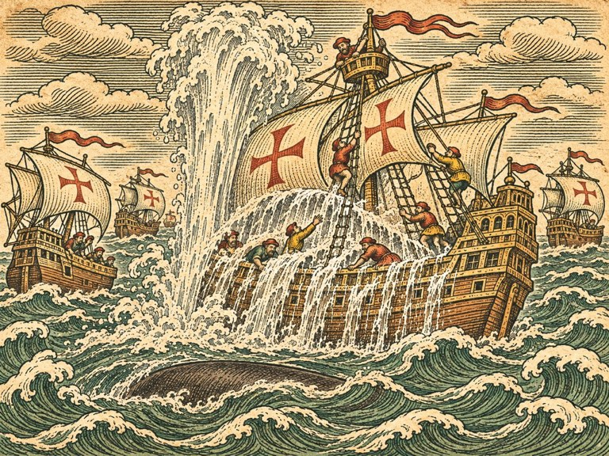
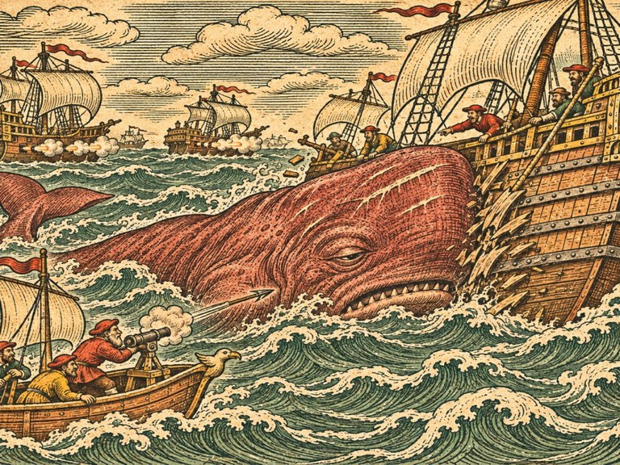
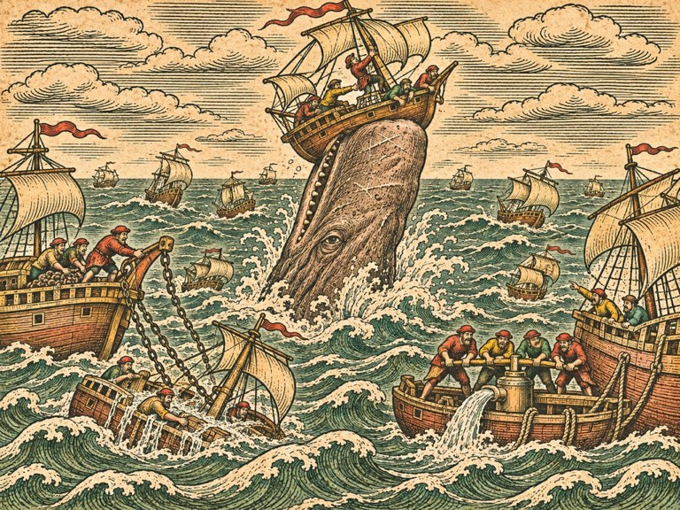
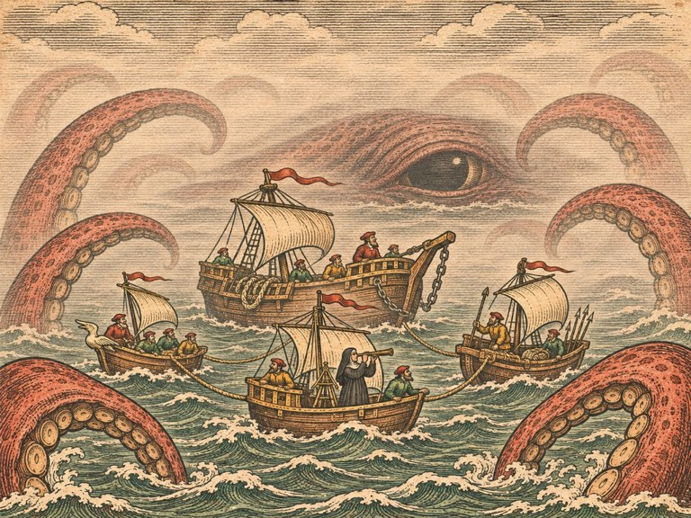

## 1. 세비야의 관청

1544년 봄, 세비야.

세비야는 바다에 있지 않았다. 과달키비르강을 거슬러 하루를 올라가야 했다. 강은 누렇고 느렸고, 양쪽 기슭에는 오렌지 나무가 줄지어 있었다. 그런데도 이 도시가 에스파냐의 모든 바다를 쥐고 있었다. 서쪽 대륙으로 가는 배는 모두 여기서 떠났고, 서쪽 대륙에서 오는 은은 모두 여기로 들어왔다.

서인도 무역 관청은 강가의 커다란 돌집이었다. 안뜰에는 저울이 놓여 있었다. 사람 키만 한 저울. 은괴를 다는 저울이었다.

관청 서기는 잉리드 일행을 오래 기다리게 했다. 기다리는 동안 마르그레테가 안뜰 벽에 걸린 해도를 베꼈다. 서기가 나와서 그것을 보고 기겁했다. 「관청 해도는 베끼면 안 되오! 그건 왕의 비밀이오!」 마르그레테는 수첩을 덮고 웃었다. 「이미 다 외웠어요.」

서기는 그 뒤로 잉리드를 빨리 안으로 들였다.

"은 선단은 해마다 아바나에서 모여 돌아오오." 늙은 관리가 말했다. 금실로 수를 놓은 검은 옷, 하얀 주름 깃. "작년부터 왕께서 명하셨소. 서쪽에서 오는 배는 혼자 다니지 말고 선단을 지어 호위를 받으라고. 프랑스 사략선 때문이었소. 그런데 올해는 사략선보다 더 무서운 것이 생겼소."

"배가 가라앉았다고 들었어요."

"넷이 가라앉았소. 작년 선단에서. 은을 가득 실은 갤리온 둘과 상선 둘." 관리의 목소리가 떨렸다. "부서진 데는 없었다고 하오. 물이 차서 가라앉았다고. 바다가 물을 뿜었다고."

마르그레테의 펜이 멈췄다.

"물을 뿜어요?"

"생존자들이 그렇게 말하오. 바다에서 물기둥이 솟아 갑판을 덮쳤다고. 한 번이 아니라 몇 번이고. 펌프로 퍼내는 것보다 빨리 물이 찼다고." 관리가 서류 한 장을 내밀었다. 왕의 문장이 찍혀 있었다. "올해 선단은 가을에 아바나를 떠나오. 그 선단을 데려오시오. 한 척도 잃지 않고. 그러면 관청이 금화 만 닢을 치르겠소."

토르켈이 잉리드의 귀에 대고 말했다. 「만이면 갈매기호를 열 척 산다.」

"그리고 하나 더." 관리가 잉리드를 보았다. "아바나의 선단 제독은 알론소 데 메나요. 그는 외국인을 좋아하지 않소. 여자는 더 좋아하지 않소. 행운을 빌겠소."

## 2. 바다에 뜬 돌

아바나까지 가는 길에 아조레스를 지났다. 아조레스 서쪽, 세비야로 돌아오는 은 선단의 길목이었다.

거기서 배 한 척을 보았다.

에스파냐 상선이었다. 물에 깊이 잠겨, 뱃전이 수면과 거의 나란했다. 그러나 떠 있었다. 돛대도 멀쩡했다. 디르크가 물개호를 대고 쇠사슬을 걸었다. 선창에 물이 가득했다. 선원은 없었다. 보트가 없는 것으로 보아 달아난 것 같았다.

이븐 살림이 선체를 한 바퀴 돌며 판자를 두드렸다.

"부서진 데가 없소." 그가 말했다. "판자 하나 안 갈라졌소. 물이 위에서 들어왔소. 갑판으로. 해치 틈으로. 위에서 아래로."

"물기둥." 마르그레테가 말했다.

하나, 물기둥으로 갑판을 덮친다. 배를 부수지 않고, 물로 가라앉힌다.

그날 오후, 파올라가 이상한 것을 건져 올렸다.

"돌이 떠 있어요."

회색에 구멍이 숭숭 난 돌이었다. 주먹만 했다. 물에 떠 있었다. 하나가 아니었다. 바다 위에 그런 돌이 띠를 이루고 흩어져 있었다. 물결을 따라 천천히 흘러가는 회색 띠.

이븐 살림이 돌을 받아 들고 냄새를 맡았다. 얼굴이 굳었다.

"부석이오. 불 산에서 나오는 돌. 아이슬란드 바다에서도, 시칠리아 앞바다에서도 이런 게 뜨오. 불 산이 터지면."

"여기 불 산이 있어요?"

"아조레스 섬들이 다 불 산이오." 이븐 살림이 서쪽 수평선을 보았다. "그런데 섬에서 터졌다는 소식은 못 들었소. 그럼 이건……."

그는 말을 끝내지 않았다. 마르그레테가 수첩 귀퉁이에 작게 적었다. 「부석. 아조레스 서쪽. 어디서?」

## 3. 산토도밍고의 생존자

산토도밍고는 짓다 만 성당이 있는 도시였다. 성당 공사는 스무 해째라고 했다. 부두 술집에서 잉리드는 작년 선단의 생존자를 찾았다. 갤리온의 갑판장이었던 사내. 팔 하나를 잃었다.

"가장 큰 배부터였소." 그가 말했다. 남은 팔로 잔을 쥐고. "선단 한가운데, 은을 가장 많이 실은 기함부터. 바다 밑에서 무언가 올라와서, 기함 옆구리를 들이받았소. 기함이 휘청했소. 그다음에 물기둥이. 하늘까지 솟는 물기둥이 기함 갑판에 떨어졌소. 다음 날 또. 그다음 날 또. 기함이 가라앉자, 그다음으로 큰 배를."

"뭐였어요?"

"고래요." 갑판장이 잔을 내려놓았다. "향유를 짜는 고래. 머리가 네모나고, 이빨이 아래턱에만 있는 고래. 그런데 그 머리가 갤리온만 했소. 이마에 하얀 상처가 줄줄이 있었소."

토르켈이 문간에서 고개를 끄덕였다. 그는 그 고래를 알았다. 북해에는 드물지만, 먼바다 고래잡이들이 이야기하는 고래였다. 머리에 기름이 가득 찬, 가장 깊이 잠수하는 고래.

둘, 가장 큰 배를 노린다.

## 4. 선단 제독

알론소 데 메나는 아바나 요새 성벽 위에서 잉리드를 맞았다. 맞았다고 하기에는 등을 돌리고 있었다. 그는 항구에 모인 배들을 내려다보고 있었다. 갤리온 열둘, 상선 스물. 돛대가 숲을 이루었다.

"관청이 노르웨이 여자를 보냈다고." 알론소가 돌아보지 않고 말했다. 마흔쯤. 검은 수염을 뾰족하게 다듬었고, 가슴에 붉은 십자가가 수놓여 있었다. "고래잡이라고."

"네."

"선단은 아무도 기다리지 않소. 사략선도, 폭풍도, 고래도. 날이 차면 떠나오. 시월 첫날. 그때까지 준비가 안 되면 당신을 두고 가겠소."

"준비할게요."

알론소가 그제야 돌아보았다. 잉리드를 위아래로 훑었다. 그 뒤의 토르켈, 마르그레테, 파올라, 디르크, 이븐 살림. 여섯 사람. 그리고 항구 구석에 정박한 작은 배 여섯 척.

"저게 당신 함대요?"

"네."

알론소는 웃지 않았다. 그게 더 무서웠다.

"작년에 나는 갤리온 둘을 잃었소. 내가 지휘한 선단이었소." 그가 다시 항구를 내려다보았다. "그 고래를 잡을 수 있다면, 노르웨이 여자든 터번 쓴 목수든 상관없소. 그러나 잡지 못하면, 내 선단에 짐이 될 뿐이오. 그러니 증명하시오. 시월 첫날 전에."

## 5. 첫 물기둥

증명할 기회는 빨리 왔다. 너무 빨리.

선단은 출항 전에 바다로 나가 줄을 맞추는 연습을 했다. 갤리온들이 바깥쪽, 상선들이 안쪽. 잉리드의 배들은 선단 뒤를 따랐다. 알론소가 그 자리를 정해 주었다. 맨 뒤.

연습 사흘째, 아바나 앞바다에서 물이 솟았다.

선단 한가운데였다. 가장 큰 갤리온, 알론소의 기함 바로 옆. 물이 하늘로 솟았다. 갤리온 돛대보다 높이. 하얀 물기둥이 무너지며 기함 갑판을 덮쳤다. 선원들이 쓸려 갔다. 해치로 물이 쏟아져 들어갔다.

그리고 바다 밑에서 그것이 올라왔다.

네모난 머리. 갤리온만 했다. 회색 가죽에 하얀 상처가 줄줄이 그어져 있었다. 고래가 기함 옆구리를 들이받았다. 기함이 크게 기울었다. 돛대 하나가 꺾였다.

"맨 뒤에서 뭘 해요!" 파올라가 외쳤다.

잉리드는 이미 키를 돌리고 있었다. 갈매기호가 선단 사이를 뚫고 들어갔다. 상선들이 흩어졌다. 갤리온들이 대포를 쏘았다. 포탄이 고래 등에 맞고 튕겨 나갔다. 고래 가죽은 두꺼웠다.

고래가 다시 숨을 쉬었다. 물기둥이 솟았다. 이번에는 다른 갤리온 위로. 두 번째로 큰 배. 갑판이 물에 잠겼다.

"가장 큰 배부터." 마르그레테가 중얼거렸다. "생존자 말대로예요."

디르크의 물개호가 기함에 쇠사슬을 걸었다. 기함은 물이 차서 무거웠다. 끌리지 않았다. 디르크가 도르래를 끝까지 감았다. 물개호의 뱃머리가 들렸다.

"이대로는 둘 다 가라앉소!" 디르크가 외쳤다.

이븐 살림의 작업선이 기함 반대편에 붙었다. 이븐 살림이 기함 갑판으로 건너뛰었다. 연장 상자를 들고. 해치를 막고, 갈라진 판자를 덧대고, 선원들에게 물을 퍼내라고 소리쳤다. 에스파냐 말을 모르면서도, 손짓으로.

고래는 세 번 숨을 쉬고 깊이 잠수했다. 사라졌다.

기함은 가라앉지 않았다. 물개호가 끌고, 작업선이 받치고, 선원들이 퍼내며, 아바나로 돌아왔다. 들어오는 데 하룻밤이 걸렸다.

다음 날 아침, 알론소가 잉리드의 배를 찾아왔다. 이번에는 등을 돌리지 않았다.

"내 배를 끌어 왔소." 그가 말했다.

"디르크가 끌었어요."

"당신 함대가." 알론소가 잠깐 말을 멈췄다. "맨 뒤에 두라고 한 건 취소하겠소."

## 6. 펌프

"물을 퍼내는 게 문제요." 이븐 살림이 말했다. 기함의 선창에서 막 나온 참이었다. 무릎까지 젖어 있었다. "갤리온 펌프는 너무 작소. 물기둥 한 번이면 펌프로 하루를 퍼내야 하오. 그사이 또 물기둥이 오면 끝이오."

"더 큰 펌프를 만들 수 있어요?"

"만들 수 있소. 쇠 통에 가죽 피스톤, 선원 넷이 함께 젓는 손잡이. 한 시간에 갤리온 펌프 열 개만큼 퍼내오." 이븐 살림이 안경을 고쳐 썼다. "그런데 그것보다 중요한 게 있소. 내 작업선에 그 펌프를 싣고, 물기둥 맞은 배에 바로 붙어서 퍼내야 하오. 싸우는 도중에."

"그럼 이번엔 같이 싸워요?"

"이번엔 같이 싸우오." 이븐 살림이 연장 상자를 내려놓았다. "물이 배를 가라앉히는 건 배 목수의 싸움이오."

펌프 다섯 대를 만드는 데 금화 삼천이 들었다. 알론소가 반을 내겠다고 했다. 잉리드는 이번에는 거절하지 않았다.

## 7. 사략선

출항 열흘 전, 아바나 앞바다에 낯선 돛이 셋 나타났다.

"프랑스 놈들이오." 알론소가 망원경을 내리며 말했다. "올해 에스파냐와 프랑스가 다시 싸우고 있소. 사략선이 선단 출항을 노리고 있소. 고래 때문에 우리 선단이 묶여 있는 걸 알고."

"우리가 할게요." 잉리드가 말했다.

"당신 배로?"

"제독님 갤리온은 고래 때문에 아껴야 하잖아요. 우리 배는 작아서 빨라요."

알론소가 잉리드를 보았다. 그리고 처음으로 웃었다. 짧게.

싸움은 하루가 걸렸다. 파올라의 배가 사략선을 꾀어 아바나 앞 암초 쪽으로 끌었다. 사략선 하나가 암초에 걸렸다. 갈매기호와 늦은 별호가 둘째를 붙잡았다. 셋째는 달아났다. 물개호가 암초에 걸린 사략선을 끌어내 아바나로 끌고 왔다. 알론소의 갤리온들은 한 발도 쏘지 않았다.

그날 밤 알론소는 요새 성벽 위에서 잉리드에게 포도주를 따랐다.

"작년 선단에서 은 말고 실은 게 하나 더 있었소." 그가 말했다. "편지 꾸러미. 서쪽 대륙과 아조레스와 마데이라에서 유럽으로 가는 편지들. 기함이 가라앉으면서 그것도 가라앉았소."

"그게 왜요?"

"그 꾸러미 목록을 봤소. 관청에 남아 있으니까. 그중에 노르웨이 베르겐으로 가는 편지가 하나 있었소. 마데이라에서." 알론소가 잔을 내려놓았다. "보낸 사람 이름은 아르네 하우게."

잉리드는 잔을 떨어뜨릴 뻔했다.

"당신 아버지요?"

"……네."

"그럼 작년 가을까지는 살아 있었다는 거요. 마데이라에." 알론소가 성벽 너머 바다를 보았다. "선단은 돌아가는 길에 마데이라를 지나지 않소. 그러나 당신이 고래를 잡으면, 세비야에 은을 내리고 난 뒤 당신 배는 어디로 가든 상관없소."

## 8. 멈춘 고래

"그 고래가 기함 옆구리를 들이받은 다음에." 디르크가 말했다. 측량선 선실, 해도 앞에서. "바로 숨을 쉬지 않았소. 한참 가만히 있었소. 물 위에 떠서. 나는 쇠사슬을 거느라 봤소."

마르그레테가 수첩을 넘겼다. 그날의 기록. 들이받음, 그리고 물기둥까지의 시간. 그는 그 시간을 재고 있었다.

"모래시계 반 바퀴." 그가 말했다. "들이받은 뒤 반 바퀴 동안 움직이지 않았어요. 그리고 기함 옆구리에는 이븐 살림이 대어 준 판이 없었어요. 맨 판자였어요. 그런데도 멈췄어요."

"머리가 아팠겠지." 토르켈이 말했다. "갤리온을 들이받았으니."

"그럼 더 단단한 걸 들이받으면?"

모두가 이븐 살림을 보았다. 이븐 살림이 안경을 벗어 닦았다.

"방패 판을 세 겹으로. 쇠띠를 네 줄로. 뱃전 안쪽에 버팀목을 덧대고." 그가 안경을 다시 썼다. "그러면 그 고래는 바위를 들이받는 거요. 바위를 들이받으면 고래도 정신을 잃소."

셋, 단단한 배를 들이받으면 한동안 멈춘다.

## 9. 미끼

알론소는 반대했다.

"내 기함을 미끼로 쓰겠다고."

"가장 큰 배를 노리니까요. 제독님 기함이 가장 커요."

"작년에 내 기함이 가라앉았소. 올해도 가라앉으라는 거요?"

"안 가라앉게 할게요. 방패 판을 세 겹으로 대고, 펌프 다섯 대를 실어요. 디르크가 옆에 붙어 있고, 이븐 살림이 바로 뒤에 있어요." 잉리드가 알론소를 똑바로 보았다. "그리고 제독님이 기함에 타요. 선단이 보는 데서."

알론소가 오래 말이 없었다. 성벽 아래 항구에서 선원들이 짐을 싣는 소리가 올라왔다.

"선단은 아무도 기다리지 않는다고 했소." 그가 말했다. "그런데 나는 당신을 기다렸소. 사흘 전에 떠날 수도 있었는데." 그가 잉리드를 보았다. "좋소. 내 기함을 미끼로 쓰시오. 그리고 갤리온 둘을 더 붙이겠소. 내 배 중에 가장 무거운 둘."

잉리드는 배를 골랐다. 마르그레테, 디르크, 이븐 살림. 토르켈은 갈매기호 뱃머리에서 작살포를 맡았다. 파올라는 반대했다가, 선단 꼬리를 지키는 일을 받았다. 「사략선이 또 올지 몰라요. 그리고 고래가 꼬리를 노리면, 내가 제일 먼저 봐요.」

## 10. 은 선단의 바다

시월 첫날, 선단이 아바나를 떠났다.

갤리온 열둘, 상선 스물. 그리고 그 사이에 작은 배 여섯. 알론소의 기함이 선단 한가운데 있었다. 뱃전에 이븐 살림의 방패 판이 세 겹으로 덮여 있었다. 기함 양옆에 무거운 갤리온 둘. 그 뒤에 디르크의 물개호와 이븐 살림의 작업선. 마르그레테의 측량선은 선단 앞쪽에서 망원경을 겨눴다.

바하마 해협을 지나고, 대서양으로 나섰다. 엿새째 되던 날, 마르그레테의 깃발이 올랐다.

물 아래, 선단 한가운데로.

바다가 부풀었다. 기함 옆에서. 물기둥이 솟았다. 기함 갑판에 떨어졌다. 선원들이 돛대에 몸을 묶고 버텼다. 이븐 살림의 펌프가 돌기 시작했다. 넷이 한 조가 되어 손잡이를 저었다. 물이 뱃전 밖으로 쏟아져 나갔다.

고래가 올라왔다. 네모난 머리. 하얀 상처들. 작은 눈이 기함을 보았다. 가장 큰 배.

그리고 들이받았다.

쾅.

소리가 바다를 울렸다. 기함이 옆으로 밀렸다. 방패 판 첫 겹이 부서졌다. 둘째 겹이 금 갔다. 셋째 겹이 버텼다.

고래가 멈췄다.

물 위에 떠서, 꼼짝하지 않았다. 네모난 머리를 조금 기울인 채. 정신을 잃은 것처럼.

"지금이에요!" 마르그레테의 깃발.

갈매기호가 미끄러져 들어갔다. 토르켈의 작살포가 터졌다. 작살이 고래 옆구리에 박혔다. 무거운 갤리온 둘이 한꺼번에 대포를 쏘았다. 이번에는 가까이서. 포탄이 가죽을 뚫었다.

고래가 깨어났다. 몸을 비틀고, 꼬리로 바다를 내리쳤다. 물보라가 갤리온 돛대까지 튀었다. 그리고 숨을 크게 들이쉬더니, 깊이 잠수했다.

바다가 조용해졌다.

"어디 있어요?" 잉리드가 외쳤다.

마르그레테가 망원경을 사방으로 돌렸다. 아무것도 보이지 않았다. 물빛도, 그림자도.

"깊이 들어갔어요! 아주 깊이!" 마르그레테가 외쳤다. "어디서 올라올지 몰라요!"

파올라의 배가 선단 꼬리에서 붉은 깃발을 올렸다. 아니, 선단 한가운데를 가리키고 있었다. 상선들 사이.

물이 솟았다.

상선 무리 한가운데. 고래가 수직으로 솟구쳤다. 머리부터, 하늘을 향해. 상선 하나가 그 머리에 받혀 공중으로 들렸다가 떨어졌다. 고래가 다시 떨어지며 일으킨 물결에 상선들이 사방으로 흩어졌다. 그리고 물기둥. 상선 둘의 갑판이 물에 잠겼다.

"디르크!"

물개호는 이미 움직이고 있었다. 느리지만 멈추지 않고. 상선 사이로 들어가 가라앉는 배에 쇠사슬을 걸었다. 이븐 살림의 작업선이 다른 배에 붙어 펌프를 돌렸다.

"한 척도 잃으면 안 돼요!" 잉리드가 외쳤다.

"알고 있소!" 디르크가 외쳤다. 쇠사슬을 하나 더 걸며.

고래가 다시 기함 쪽으로 돌아섰다. 가장 큰 배. 그것이 고래가 아는 전부였다.

잉리드는 갈매기호를 기함 앞에 댔다. 아니, 기함과 고래 사이에. 토르켈이 뱃머리에서 그를 돌아보았다.

"또냐."

"또요."

고래가 들이받으러 왔다. 갈매기호는 마지막 순간 비켜났다. 고래는 그 뒤의 기함을 들이받았다. 셋째 겹 방패 판에. 쾅. 고래가 다시 멈췄다.

이번에는 모두가 기다리고 있었다. 갤리온 열둘의 대포. 토르켈의 작살포. 갈매기호의 대포.

고래는 다시 깨어나지 않았다.

천천히, 옆으로 누웠다. 지느러미 하나가 하늘을 향해 들렸다. 그리고 멈췄다.

선단 전체가 조용했다. 아무도 환호하지 않았다. 토르켈이 모자를 벗었다. 알론소가 기함 갑판에서 그것을 보았다. 그리고 그도 모자를 벗었다.

## 11. 둥근 자국

디르크가 고래 몸에 쇠사슬을 걸어 기함 옆에 붙였다. 고래기름을 짜려고. 선단은 하루를 멈췄다. 알론소가 허락했다. 「선단은 아무도 기다리지 않소. 그러나 하루쯤은 기다리겠소.」

고래 등에서 그것을 찾은 것은 토르켈이었다.

등 한가운데, 하얀 상처들 사이에 둥근 자국이 있었다. 접시만 한 빨판 자국이 아니었다. 갈매기호만 한 동그라미. 그 동그라미를 따라 살이 깊이 파여 있었다. 이빨이 아니었다. 무언가가 고래를 통째로 감았다가, 조였다가, 놓친 자국.

마르그레테가 줄자를 들고 그 둘레를 쟀다. 쟀다가, 다시 쟀다.

"이게 팔이면……." 그가 말했다. 목소리가 작았다. "스킬라의 팔 열 개를 묶어도 이만 안 해요."

아무도 말하지 않았다.

이븐 살림이 고래 몸에 박힌 것을 하나 뽑았다. 회색에 구멍이 숭숭 난 돌. 부석. 고래 가죽 틈에 박혀 있었다.

"이 고래는 불 산 근처에 있었소." 그가 말했다. "깊은 데. 그리고 거기서 무언가에게 감겼다가 빠져나왔소."

## 12. 은을 내리고

세비야 관청 안뜰의 저울이 하루 종일 움직였다. 갤리온 열둘, 상선 스물. 은괴가 쌓였다. 한 척도 빠지지 않았다.

늙은 관리는 금화 만 닢을 세어 탁자에 올렸다. 세어 올리는 데 한참 걸렸다. 그는 다 세고 나서도 손을 떼지 않았다. 대신 잉리드를 보았다.

"작년에 나는 갤리온 두 척의 은을 장부에서 지웠소. 그 이름을 지울 때 손이 떨렸소." 그가 손을 뗐다. "올해는 지울 이름이 없소."

알론소는 부두에서 잉리드를 기다리고 있었다. 기함은 방패 판이 너덜너덜했다. 이븐 살림이 그것을 떼어 내지 말라고 했다. 「다음 해에도 쓰시오. 판은 부서진 만큼 사람을 지킨 거요.」

"선단은 아무도 기다리지 않소." 알론소가 말했다. 처음 만난 날과 같은 말이었다. 그런데 목소리가 달랐다. "그러나 당신은 기다리겠소. 언제든. 당신이 부르면 내 갤리온이 가겠소."

"먼 데라도요?"

"먼 데라도." 알론소가 모자를 들어 보였다. "마데이라에 가시오. 당신 아버지가 거기서 편지를 보냈소. 그 편지는 내 기함과 함께 가라앉았지만, 그 사람은 아직 거기 있을지도 모르오."

## 13. 마데이라의 일지

마데이라는 산이 바다에서 곧장 솟은 섬이었다. 비탈마다 포도밭이 계단처럼 깎여 있었다. 항구 푼샬은 작고 하얬다.

부두 술집 주인은 늙은 포르투갈 여자였다. 잉리드가 아르네 하우게라는 이름을 대자, 그는 말없이 안으로 들어가 기름 먹인 천 꾸러미를 들고 나왔다.

"북쪽 사람이 맡겼소. 키에 별을 새긴 배의 선장." 그가 말했다. "하우게라는 사람이 오면 주라고. 두 해 전부터 맡아 두었소. 그 사람은 가끔 와서 이게 아직 있는지 보고, 다시 나가오. 바다로."

"지금은 어디 있어요?"

"모르오. 한 달 전에 나갔소. 서쪽으로." 늙은 여자가 꾸러미를 잉리드 손에 쥐여 주었다. "그 사람은 안개가 걷히면 돌아온다고 했소."

꾸러미 안에 공책이 있었다. 아버지의 공책. 「북극성」과 함께 바다에 있는 줄 알았던 것. 표지가 바닷물에 얼룩졌지만, 안은 말라 있었다.

잉리드는 술집 구석 탁자에 앉아 공책을 펼쳤다. 마르그레테가 옆에 앉았다. 토르켈은 서 있었다.

아버지의 글씨였다. 서툴고 크고, 날씨와 물때와 고래가 보인 자리가 빼곡했다. 그러다 북쪽 얼음 바다에서 글씨가 달라졌다. 급하고 비뚤어졌다.

「얼음이 내려온다. 여름에. 고래들이 남쪽으로 도망친다. 바다코끼리 무리가 미쳤다. 올레를 잃었다. 하느님, 올레를.

서쪽에 안개가 있다. 수평선에. 걷히지 않는다. 바람이 불어도. 저 안개 쪽에서 모두 도망쳐 오고 있다.」

몇 장 뒤, 마데이라에서 쓴 글.

「안개를 쫓아 서쪽으로 왔다. 아조레스 너머. 안개 아래 바다가 따뜻하다. 북쪽 바다인데 목욕물처럼. 죽은 고기가 떠 있다. 유황 냄새. 바다 위에 돌이 뜬다.

바다 밑에 불 산이 있다. 그것이 터졌다. 깊은 물이 데워졌다. 깊은 데 사는 것들이 위로 올라오고 있다. 데워진 물을 피해서.

그리고 가장 깊은 데 사는 것이 올라왔다.

나는 그것을 보았다. 안개 속에서. 크기를 말할 수 없다. 팔이 있다. 열이 넘는다. 그것은 「북극성」을 감았다가 놓았다. 왜 놓았는지 모른다.

그것은 사냥하러 올라온 것이 아니다. 피하러 올라온 것이다. 다른 것들처럼. 그러나 그것이 올라오자 다른 것들이 그것을 피해 더 위로, 더 멀리 도망쳤다. 섬고래도, 다른 것들도. 그래서 우리 바다에 괴물이 나타났다.」

마지막 몇 장.

「그것을 죽일 수는 없을 것이다. 너무 크다. 그러나 돌려보낼 수는 있을지 모른다.

어제 죽은 고래 한 마리가 가라앉는 것을 보았다. 그것이 따라 내려갔다. 깊이. 한참 뒤에 다시 올라왔다. 깊은 데는 아직 너무 뜨거운 모양이다. 그러나 불 산이 식으면, 그리고 그것을 무언가로 깊은 데까지 끌고 내려가면, 거기 남을지도 모른다.

미끼가 필요하다. 그것이 따라 내려갈 만큼 큰 미끼.

「북극성」이면 될 것이다.

잉리드야. 이 공책이 네 손에 있다면, 너는 여기까지 온 것이다. 미안하다. 그리고 고맙다. 돌아가라.」

잉리드는 공책을 덮었다. 손이 떨리지 않았다. 다섯 해 동안 떨리지 않았다. 지금도.

"돌아가래요."

"돌아갈 거예요?" 마르그레테가 물었다.

잉리드는 대답하지 않았다. 일어섰다. 공책을 품에 넣었다. 그리고 부두로 걸어갔다. 아무도 따라오라고 하지 않았는데, 모두 따라왔다.

## 14. 별이 박힌 부표

아조레스 서쪽 바다는 정말로 따뜻했다. 시월인데. 손을 담그면 미지근했다. 물빛이 이상하게 탁했다. 죽은 고기들이 배를 뒤집고 떠 있었다. 바람에 유황 냄새가 섞여 있었다.

그리고 서쪽 수평선에 안개가 있었다.

하얀 벽이었다. 바람이 불어도 움직이지 않았다. 해가 비쳐도 걷히지 않았다. 그냥 거기, 서쪽 수평선에, 하늘과 바다 사이를 막고 서 있었다.

안개 가장자리에서 파올라가 부표 하나를 건졌다.

나무통에 쇠고리를 박고 밧줄로 묶은 부표였다. 고래잡이들이 작살 맞은 고래를 표시할 때 띄우는 것. 통에 낙인이 찍혀 있었다. 다섯 갈래 별.

키에 새긴 그 별.

잉리드는 부표를 끌어안았다. 젖은 나무가 차가웠다. 밧줄 끝은 끊어져 있지 않았다. 매듭으로 풀려 있었다. 풀어야 할 때 한 번에 풀리는 매듭.

"일부러 띄운 거예요." 잉리드가 말했다. "누가 이걸 찾으라고. 이 안개 가장자리에."

## 15. 안개 속의 것

안개 안으로 들어간 것은 잉리드의 결정이었다. 아무도 말리지 않았다. 말려도 소용없다는 것을 다들 알았다.

배 넷이었다. 갈매기호, 늦은 별호, 측량선, 물개호. 파올라와 이븐 살림은 안개 밖에 남았다. 「아무도 안 나오면 세비야에 알려요.」 파올라가 말했다. 웃지 않고.

안개 속은 하얗고 조용했다. 소리가 이상하게 울렸다. 바로 옆 배에서 하는 말이 멀리서 들렸고, 멀리서 나는 물소리가 바로 옆에서 들렸다. 배들은 서로 밧줄 한 길 거리를 두고 붙어 갔다. 마르그레테가 기름 등을 띄웠다. 등불이 흔들렸다. 아래에서.

"아래에 있어요." 마르그레테가 속삭였다. "아주 크게. 등불이 다 흔들려요. 사방이."

물이 부풀었다.

배 넷 둘레, 사방에서. 물 위로 무언가가 올라왔다. 기둥. 아니, 팔. 스킬라의 팔보다 굵었다. 갈매기호 돛대보다 굵었다. 하나, 둘, 셋…… 마르그레테가 세다가 멈췄다. 안개 속에서 끝을 볼 수 없었다.

팔들은 배를 감지 않았다. 배 둘레를 천천히 맴돌았다. 더듬듯이. 무엇이 왔는지 보려는 것처럼.

그리고 안개 너머, 아주 멀리서, 또는 아주 가까이에서, 무언가가 열렸다.

눈이었다.

잉리드는 그것이 눈이라는 것을 한참 뒤에야 알았다. 너무 컸다. 갈매기호가 통째로 들어갈 만했다. 검고 깊었다. 그 안에 아무것도 비치지 않았다. 안개도, 배도, 잉리드도.

"버텨요." 잉리드가 속삭였다. "움직이지 마요. 아무도 쏘지 마요."

팔 하나가 늦은 별호를 감았다. 천천히. 토르켈이 작살을 들었다. 잉리드가 손을 들었다. 토르켈이 멈췄다. 팔이 늦은 별호를 들어 올렸다. 물 위로 반쯤. 그리고 내려놓았다. 놓았다.

다른 팔이 측량선 뱃전을 쓸었다. 물개호의 쇠사슬을 건드렸다. 갈매기호의 뱃머리를 만졌다. 이븐 살림이 대어 준 쇠판을.

모래시계가 한 바퀴, 두 바퀴 돌았다. 마르그레테가 쉬지 않고 뒤집었다. 일곱 바퀴. 여덟 바퀴.

여덟 바퀴째, 팔들이 물러났다. 하나씩, 물속으로. 눈이 감겼다. 안개가 조금 엷어졌다.

그 엷어진 안개 너머에, 돛이 하나 보였다.

돛 한가운데 다섯 갈래 별이 그려져 있었다.

## 16. 북극성

그 배는 말없이 앞장섰다. 잉리드의 배들은 따라갔다. 안개 속을 한참. 그리고 안개 밖으로.

마데이라 항구에 닿았을 때 해가 지고 있었다. 「북극성」은 부두에 먼저 닿았다. 배는 상해 있었다. 돛은 기운 자국투성이였고, 뱃전 한쪽은 판자를 덧대고 또 덧댔다. 그래도 떠 있었다.

키를 잡고 있던 사내가 부두로 내려섰다.

턱수염은 하얗게 셌다. 얼굴은 바람에 깎여 바위 같았다. 다섯 해 전보다 작아 보였다. 그러나 걸음걸이는 그대로였다. 조금 기우뚱한, 갑판 위를 걷는 것 같은 걸음.

잉리드는 갈매기호에서 내렸다. 걸어갔다. 아버지 앞에 섰다.

무슨 말을 하려고 했다. 다섯 해 동안 생각해 둔 말이 있었다. 하나도 기억나지 않았다.

아르네가 먼저 말했다.

"돌아가라고 썼는데."

"알아요."

"말려 봐야 소용없을 줄 알았다."

"이모가 그 말도 전해 줬어요."

아르네가 웃었다. 그리고 딸을 끌어안았다. 소금과 기름과 유황 냄새가 났다. 잉리드는 아버지의 어깨에 얼굴을 묻었다. 그제야 손이 떨렸다. 다섯 해 만에.

한참 뒤, 아르네가 고개를 들었다. 딸의 어깨 너머로, 부두 위에 서 있는 늙은 사내를 보았다. 작살 자루를 멘 채, 굽은 등으로.

"왔구나, 토르켈."

토르켈은 한참 대답하지 않았다. 그러다 말했다. 목소리가 갈라져 있었다.

"늦었소."

"늦지 않았다." 아르네가 말했다. "제때 왔다. 네가 저 애를 여기까지 데려왔잖냐."

토르켈은 대답하지 않았다. 대신 고개를 숙였다. 오래.

그날 밤, 마데이라 조선소 창고에서 아르네는 모두에게 말했다. 「북극성」을 고치던 연장들 사이에서. 잉리드, 토르켈, 마르그레테, 디르크, 이븐 살림, 파올라.

"그것은 하프구파다. 우리 할머니가 그렇게 불렀다. 바다 안개라는 뜻이지. 가장 큰 것. 바다 밑 가장 깊은 데 산다는 것." 아르네가 공책을 덮었다. "불 산이 식어 가고 있다. 올해 들어 바다가 조금씩 덜 뜨겁다. 내년이면 깊은 데가 다시 차가워질 거다. 그때 그것을 깊은 데로 돌려보내야 한다. 그러지 않으면 그것은 계속 위에 머문다. 그리고 그것이 위에 있는 한, 다른 것들이 계속 밀려 나온다. 우리 바다로."

"「북극성」을 미끼로요?" 잉리드가 물었다.

"그게 내 계획이었다."

"혼자서요?"

아르네가 딸을 보았다. 그리고 그 뒤의 다섯 사람을. 그리고 창고 밖, 부두에 늘어선 작은 배 여섯 척을.

"혼자서는 못 막는다. 오늘 안개 속에서 알았다. 팔이 열둘이 넘는다. 「북극성」 한 척으로 그것을 끌고 내려가려면, 그 팔들이 「북극성」을 붙잡지 못하게 막을 배가 필요하다." 아르네가 공책을 손바닥으로 눌렀다. "많이. 아주 많이."

"얼마나요?"

"바다의 배를 다 불러야 한다."

창고 안이 조용해졌다. 바깥에서 파도 소리가 들렸다.

잉리드가 품에서 공책을 꺼냈다. 자기 공책. 다섯 해 동안 쓴 공책. 마지막 장을 펼쳤다. 그리고 거기 이름을 적기 시작했다.

베르겐의 고래잡이들. 한스. 올라프와 군나르. 런던의 피터. 암스테르담의 얀. 제노바와 나폴리 사람들. 캘리컷의 코야 하산. 흰 바다의 바실리. 세비야의 알론소.

"다 불러요." 잉리드가 말했다. "다 올 거예요."

아르네가 그 목록을 보았다. 한참. 그리고 딸을 보았다. 그 눈에 무언가가 있었다. 잉리드는 그것이 무엇인지 알 수 없었다.

마르그레테는 알았다. 그것은 다섯 해 전 아르네가 키에 별을 새길 때와는 다른 눈이었다. 딸을 두고 떠나는 아버지의 눈이 아니라, 선장을 보는 선장의 눈이었다.
