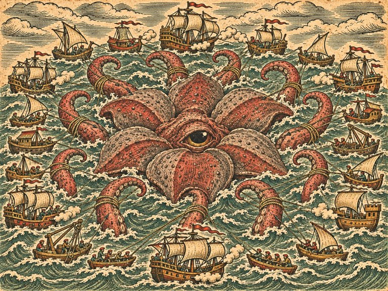
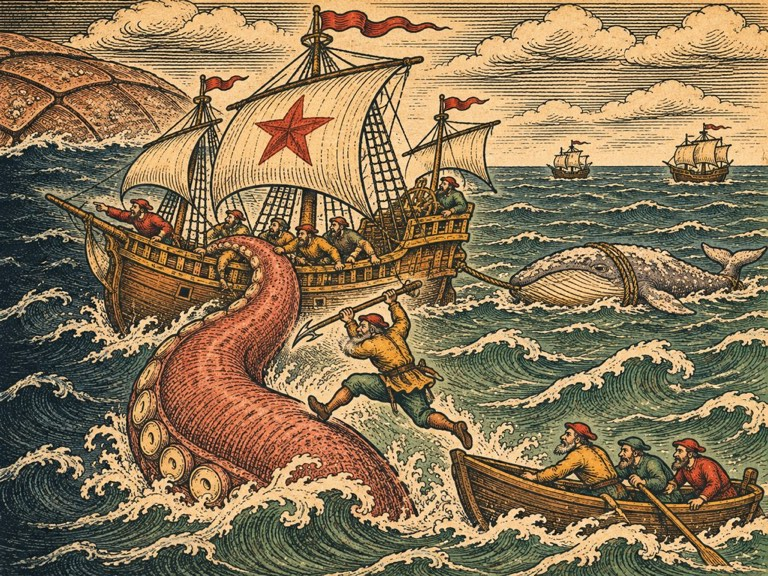

## 1. 리스본의 안개

1545년 이른 봄, 리스본.

안개가 테주강 어귀까지 왔다.

리스본 사람들은 처음에 그것을 봄 안개라고 생각했다. 봄이면 강 어귀에 안개가 끼는 날이 있었다. 그러나 그 안개는 해가 높이 떠도 걷히지 않았다. 바람이 불어도 물러나지 않았다. 사흘, 닷새, 열흘. 벨렝 탑이 안개 속에 반쯤 잠겼다. 어귀를 나간 어선들이 길을 잃고 돌아왔다. 돌아오지 않은 배도 있었다.

부두 술집에서 뱃사람들이 말했다. 바다 끝에서 안개가 온다고. 해마다 조금씩 가까워진다고. 아조레스 사람들이 섬을 버리고 떠난다고.

잉리드는 그 이야기를 들으며 창밖을 보았다. 안개 너머, 보이지 않는 서쪽 수평선. 지난가을 그 안개 속에서 본 눈이 아직 거기 있었다.

아르네는 리스본 조선소에서 「북극성」을 고치고 있었다. 겨울 내내 마데이라에서 고치다가 봄이 되자 리스본으로 옮겼다. 「여기서 모여야 한다. 그것에 가장 가까운 큰 항구가 여기다.」

올라우스 신부의 편지가 그 무렵 도착했다. 한스를 거치지 않고, 베네치아에서 곧장. 편지지가 얇았고 글씨가 떨렸다.

「나는 늙었다. 겨울 동안 앓았다. 다시 바다를 볼 수 있을지 모르겠다.

그대의 수녀가 보내 준 기록을 모두 목판에 새겼다. 섬고래, 거북, 해협의 오징어, 폭풍의 은빛 고기, 얼음 바다의 짐승, 물을 뿜는 고래. 그대가 본 것들이 이제 내 해도에 있다.

그러나 한가운데는 아직 비어 있다. 대서양 한가운데. 그대가 지난가을 안개 속에서 본 것.

나는 그 자리에 무엇을 새겨야 할지 안다. 다만, 어떻게 새겨야 할지는 그대가 정해 주기를 바란다. 「여기 있다」 인가, 「여기 있었다」 인가.

한 번만 더 베네치아에 와 다오. 그대를 보고 싶다.」

## 2. 부르러 가는 길

"바다가 식고 있다." 아르네가 말했다. 조선소 창고, 해도 앞에서. "지난가을보다 확실히 덜 뜨겁다. 여름이 오기 전에 깊은 데가 다시 차가워질 거다. 그때 해야 한다. 늦으면 그것이 위에 자리를 잡는다. 그러면 영영 내려가지 않는다."

"여름 전까지요?" 잉리드가 물었다.

"여름 전까지."

넉 달이었다. 넉 달 안에 바다의 배를 다 불러 모아야 했다.

마르그레테가 해도 위에 줄을 그었다. 베르겐, 암스테르담, 런던, 제노바, 나폴리, 베네치아, 세비야. 그리고 먼 두 곳. 캘리컷, 흰 바다.

"먼 데는 편지로 해야 해요. 지금 떠나도 넉 달 안에 다녀올 수 없어요." 마르그레테가 말했다. "캘리컷은 이븐 살림이, 흰 바다는 한스가 편지를 보내 줄 거예요. 아라비아 상인들 배와 한자 배로. 가까운 데는 우리가 직접 가요."

"다 와 줄까요?" 파올라가 물었다. 처음으로 자신 없는 목소리였다.

잉리드는 공책 마지막 장을 펼쳤다. 지난가을 마데이라에서 적은 이름들. 그 이름들 옆에, 한 줄씩, 그 사람들이 했던 말을 적어 두었다.

장부에 적은 건 갚소. 언제든 부르면. 그러나 당신은 기다리겠소. 이 사람들이 다 우리를 기억해요.

"올 거예요." 잉리드가 말했다.

## 3. 북쪽 바다

베르겐 부두에 갈매기호가 들어오자, 부두 사람들이 계류 자리까지 몰려나왔다. 올라프와 군나르, 하랄, 이모 시그리드. 다리를 절며 올레가. 그리고 장부를 옆구리에 낀 한스가.

잉리드는 '고래뼈' 술집 한가운데 탁자에 올라섰다. 아버지가 살아 있다는 것을 말했다. 바다 한가운데 무엇이 있는지 말했다. 그리고 배가 필요하다고 말했다.

한참 아무도 말하지 않았다.

올라프가 먼저 일어섰다.

"우리 작살선 하나. 작살잡이 넷." 그가 말했다. "아르네가 처음 고래를 나눠 줬을 때 진 빚. 너한테 한 번 갚았지만, 아르네한테는 아직 안 갚았다."

한스가 장부를 탁자에 내려놓았다. 처음으로 펼치지 않은 채.

"상관 무장 코그 하나. 대포 열두 문." 그가 말했다. "값은 묻지 마시오. 상관 장부에는 '거래처 지원'이라고 적겠소. 무슨 거래인지는 나도 모르오."

그리고 하랄이 손을 들었다. 늙은 어부. 섬고래 이야기를 했다가 술 덜 마시라고 놀림받던 사람. 그 옆에 에이나르의 막내가 서 있었다. 이제 스물두 살. 다리는 여전히 절었다.

"우리 고깃배도." 하랄이 말했다.

"하랄 아저씨, 그 배는 대포도 없잖아요."

"대포는 없지. 그물은 있어." 하랄이 웃었다. 이가 몇 개 없었다. "이 녀석이 가겠다고 우겨서. 아버지 배가 그것한테 끌려 내려갔다고. 이번엔 자기가 그걸 끌어 내리는 걸 보겠다고."

에이나르의 막내가 잉리드를 보았다. 여섯 해 전 아궁이 앞에서 「섬이 따뜻해졌어요」 하고 말하던 소년의 눈이 아니었다.

잉리드는 고개를 끄덕였다. 그리고 공책에 적었다. 스무 번째 배. 하랄의 고깃배.

## 4. 남쪽 바다

암스테르담 디르크의 마당에 구난선 한 척이 떠 있었다. 물개호보다 작았다. 그러나 뱃머리 기둥과 도르래는 물개호의 것을 그대로 본떴다. 그 갑판에서 얀이 소리쳤다.

"삼촌! 제가 고쳤어요! 혼자!"

얀은 열아홉 살이었다. 다섯 해 전 망대에 자기를 묶고 석 달을 버틴 소년. 이제 디르크보다 어깨가 넓었다.

디르크는 그 배를 한 바퀴 돌며 판자를 두드렸다. 도르래를 돌려 보았다. 쇠사슬 고리를 하나하나 살폈다. 오래 걸렸다. 얀은 숨도 쉬지 않고 기다렸다.

"쓸 만하다." 디르크가 말했다.

얀이 환호했다. 디르크는 뒤돌아섰다. 잉리드는 그의 얼굴을 보았다. 웃고 있었다.

런던의 피터 콜스는 탁자를 두드리지 않았다.

"무장 상선 하나. 보험 상인 열넷이 돈을 모아 샀소." 그가 장부를 펼쳐 보였다. 한 줄이 새로 적혀 있었다. 「하우게 함대. 갚을 것.」 그 줄에 줄이 그어져 있었다. "이걸로 갚았소. 장부에 적은 건 갚는다고 했잖소."

"그 배를 잃으면요?"

"보험을 들어 놨소." 피터가 처음으로 크게 웃었다. "나는 바다 괴물을 믿지 않는다고 했지. 이제는 믿소. 그래서 보험료를 아주 비싸게 매겼소. 나 자신에게."

제노바와 나폴리에서는 파올라가 사람들을 모았다. 잉리드는 그 자리에 가지 않았다. 「내 사람들은 내가 불러요. 북쪽 선장이 오면 다들 겁먹어요.」 파올라는 사흘 뒤 밀수선 한 척을 끌고 돌아왔다. 그리고 나폴리 어부들의 횃불 어선 한 척. 그 어선 돛대마다 횃불 받침이 달려 있었다.

"해협 어부들이 그러는데." 파올라가 말했다. "오징어 쫓을 때 횃불이 쓸모 있었으니, 이번에도 쓸모 있을 거래요. 그리고 하나 더. 세관선 선장이 안부 전해 달래요. 그날 안 가라앉혀 줘서 고맙대요."

"세관선 선장이요?"

"내 사촌이요." 파올라가 어깨를 으쓱했다. "이번엔 그 사람도 눈감아 줬어요. 밀수선이 항구를 나갈 때."

## 5. 베네치아의 마지막 해도

올라우스는 침상에 누워 있었다. 인쇄소 이층, 해도로 덮인 방에. 네 해 전보다 훨씬 말랐다. 그러나 잉리드가 들어서자 몸을 일으키려 했다. 마르그레테가 말렸다.

"그대가 왔군." 올라우스가 잉리드의 손을 잡았다. 차갑고 가벼웠다. "그리고 아버지를 찾았다고."

"네."

"좋소. 아주 좋소." 그가 눈을 감았다가 떴다. "탁자를 보시오."

탁자 위에 목판이 놓여 있었다. 대서양 해도의 판. 해안선과 섬들이 새겨져 있었다. 그리고 한가운데, 커다랗게 깎아 낸 빈자리. 아무것도 새겨지지 않은 매끈한 나무.

그 옆에 조각칼이 놓여 있었다.

"나는 손이 떨려서 더는 새기지 못하오." 올라우스가 말했다. "그대의 수녀가 새기시오. 그대가 정하는 말로."

마르그레테가 칼을 집어 들었다. 그리고 잉리드를 보았다.

"「여기 있다」 예요, 「여기 있었다」 예요?"

잉리드는 빈자리를 오래 보았다. 매끈한 나무. 아직 아무것도 없는.

"아직 몰라요." 잉리드가 말했다. "돌아와서 알려 드릴게요."

올라우스가 웃었다. 소리 없이.

"그럼 기다리겠소. 그대가 돌아와서 알려 줄 때까지." 그가 눈을 감았다. "바다에 무엇이 있는지 아는 것이, 없다고 믿는 것보다 안전하다고 내가 말했지. 그런데 그대를 보니 하나를 더 알겠소. 무엇이 있는지 알고도 나가는 사람이 있다는 것."

## 6. 먼 데서 온 배들

세비야에서는 알론소가 기다리고 있었다. 갤리온 두 척을 이미 출항 준비해 놓고.

"왕의 허락은 받지 않았소." 그가 말했다. "받으려면 반년이 걸리오. 관청에는 '선단 항로 정찰'이라고 적어 두었소. 틀린 말은 아니지."

"나중에 혼나지 않아요?"

"혼나겠지." 알론소가 붉은 십자가가 수놓인 망토를 걸쳤다. "그러나 내가 작년에 지울 뻔한 이름이 둘이었소. 그 이름이 아직 장부에 있소. 그대 덕분에. 혼나는 건 그 값이오."

리스본으로 돌아왔을 때, 테주강 어귀 안개 속에서 낯선 돛 넷이 기다리고 있었다.

둘은 삼각돛이었다. 다우. 뱃전이 높고 넓적한, 돌을 실은 무거운 배. 한 척의 뱃머리에서 하얀 옷을 입은 늙은 사내가 손을 흔들었다. 코야 하산이었다.

"편지를 받고 바로 떠났소. 남서풍이 오기 전에. 희망봉을 돌아 넉 달." 코야 하산이 갈매기호로 건너오며 말했다. 하얀 수염이 소금에 절어 있었다. "바다가 지나가는 길을 비켜 서라고 내가 말했지. 그런데 이번엔 그 길 한가운데 서려고 왔소. 당신이 그렇게 했으니까."

"선단은요? 캘리컷의?"

"아들에게 맡겼소. 아들은 당신 이야기를 듣고 자랐소. 잘할 거요."

나머지 둘은 달걀처럼 둥근 배였다. 가죽 같은 돛. 그 뱃머리에서 털모자를 쓴 사내가 뿔피리를 불었다.

바실리였다.

"빚 갚으러 왔다." 그가 갈매기호 뱃전에 손을 얹었다. "흰 바다에서 여기까지 석 달. 노르웨이를 돌고, 북해를 지나고. 남쪽은 너무 덥다."

"얼음은 없을 거예요."

"얼음이 없어도 이 배는 둥글다. 둥근 배는 무엇에 받혀도 다시 일어선다." 바실리가 털모자를 벗었다. 대머리가 리스본 햇볕에 빛났다. "그리고 네가 그 우두머리 앞에 갈매기호를 댔을 때, 나는 네가 미쳤다고 생각했다. 그다음엔 네가 선장이라고 생각했다. 미친 선장한테 빚진 건 꼭 갚아야 한다."

## 7. 스무 척

이븐 살림은 리스본 조선소에서 한 달 동안 잠을 거의 자지 않았다.

갈매기호의 뱃머리 쇠판을 새로 펴고, 방패 판을 덧대고, 작살포를 손봤다. 「북극성」의 뱃전을 세 겹으로 쌌다. 늦은 별호에 작살포를 하나 더 달았다. 물개호와 얀의 구난선에 쇠사슬을 새로 걸었다. 다우 둘과 갤리온 둘에 방패 판을 댔다. 바실리의 둥근 배에는 손을 대지 않았다. 「이 배는 내가 고칠 데가 없소. 흰 바다 사람들이 나보다 잘 만들었소.」

하랄의 고깃배에는 그물을 더 실었다. 쇠 그물. 「붙잡히면 이걸 던지시오. 팔이 그물에 걸리면 한동안 엉킬 거요.」

금화 육천이 들었다. 잉리드가 냈다. 그리고 함대의 물과 식량, 화약에 사천이 더 들었다. 은 선단에서 받은 돈이 거의 다 나갔다. 잉리드는 아무렇지 않았다.

출항 사흘 전 아침, 잉리드는 리스본 부두 끝에 서서 배를 세었다.

갈매기호. 「북극성」. 늦은 별호. 마르그레테의 측량선. 디르크의 물개호. 이븐 살림의 작업선. 파올라의 배.

올라프의 작살선. 얀의 구난선. 피터의 무장 상선. 파올라 동료의 밀수선. 나폴리의 횃불 어선. 코야 하산의 다우 둘. 바실리의 둥근 배 둘. 알론소의 갤리온 둘. 한스의 무장 코그.

그리고 하랄의 고깃배.

스물.

잉리드는 두 번 세었다. 세 번 세었다. 스물이었다.

아르네가 옆에 와서 섰다. 그도 세고 있었다. 입술이 움직였다.

"여섯 해 전에." 아르네가 말했다. "나는 혼자 갔다. 「북극성」 하나로. 그게 맞다고 생각했다. 위험한 데는 혼자 가는 거라고."

"틀렸어요?"

"틀렸다." 아르네가 부두에 늘어선 돛들을 보았다. "위험한 데는 혼자 가면 혼자 돌아오지 못한다. 같이 가면, 누군가는 돌아온다. 돌아와서 이야기를 한다."

## 8. 세 겹

출항 전날 밤, 마르그레테가 모두를 리스본 조합 이층 방으로 불렀다. 스무 척의 선장들이 다 모였다. 방이 좁아서 사람들이 창틀에도 걸터앉았다.

탁자 위에 해도가 펼쳐져 있었다. 대서양 한가운데. 안개의 자리. 마르그레테는 지난가을 안개 속에서 모래시계를 뒤집으며 적은 기록을 모두 옮겨 그렸다.

"팔은 열둘이에요. 지난가을 셌어요. 모래시계 여덟 바퀴 동안 하나도 같은 데 두 번 나오지 않았으니까, 열둘이 다예요." 마르그레테가 해도 위에 동그라미 셋을 그렸다. "팔은 넷씩 셋으로 나뉘어 있어요. 북쪽, 남쪽, 동쪽. 서쪽에는 없어요. 서쪽은 깊은 데예요. 그것이 돌아갈 곳."

"몸은?" 디르크가 물었다.

"한가운데. 팔 안쪽에. 지난가을에는 안개 때문에 못 봤어요. 그런데 아르네 선장님 공책에 있어요." 마르그레테가 아르네를 보았다.

아르네가 앞으로 나왔다. 공책을 펼쳤다.

"몸은 꽃 모양이다. 한가운데 머리가 있고, 그 둘레를 몸이 여섯 조각으로 감싸고 있다. 조각마다 두꺼운 껍질이 있다. 거북 등딱지처럼." 그가 해도 한가운데에 꽃잎 여섯 개를 그렸다. "팔이 다 묶이면 몸이 열린다. 오징어처럼. 그런데 몸이 열려도 머리는 껍질 조각 뒤에 있다. 조각을 깨야 머리가 보인다."

"세 겹이네요." 마르그레테가 말했다. "바깥 팔, 몸 조각, 머리."

"우리는 머리까지 갈 필요가 없다." 아르네가 공책을 덮었다. "죽이려는 게 아니다. 돌려보내는 거다. 팔과 몸을 묶어 두는 동안, 「북극성」이 미끼를 끌고 서쪽 깊은 데로 간다. 그것이 따라온다. 깊은 데 닿으면 미끼를 놓는다. 그것이 미끼를 따라 내려간다. 그리고 바다가 차가우면, 거기 남는다."

방 안이 조용해졌다.

"미끼는 뭐예요?" 파올라가 물었다.

"고래." 올라프가 대답했다. 창틀에 걸터앉은 채. "베르겐에서 오는 길에 하나 잡았소. 늙은 고래. 기름도 안 짰소. 소금에 절여서 「북극성」 꽁무니에 매달아 놨지."

"그것이 따라올 만큼 큰가요?"

"모르오." 아르네가 솔직하게 말했다. "지난가을에 본 건 죽은 고래 한 마리를 따라 내려간 것이었다. 그때도 크지 않았다."

## 9. 분대

잉리드가 앞으로 나왔다. 스무 척의 선장들이 그를 보았다. 여섯 해 전 갈매기호 한 척으로 베르겐 어귀에 나간 스물두 살 고래잡이의 딸을.

"스무 척을 한 사람이 지휘할 수는 없어요." 잉리드가 말했다. "안개 속에서는 깃발도 안 보여요. 그래서 넷으로 나눠요. 다섯 척씩."

잉리드는 해도 위에 이름을 적어 나갔다.

"북쪽. 토르켈이 맡아요. 늦은 별호, 올라프의 작살선, 한스의 코그, 바실리의 둥근 배 둘. 작살하고 얼음 깨는 배들이에요. 팔을 묶는 일."

토르켈이 고개를 끄덕였다. 말없이.

"남쪽. 디르크가 맡아요. 물개호, 얀의 구난선, 피터의 상선, 코야 하산의 다우 둘. 무거운 배하고 끌어내는 배. 붙잡힌 배를 구하는 일."

디르크가 얀을 보았다. 얀이 주먹을 쥐었다.

"동쪽. 파올라가 맡아요. 파올라의 배, 밀수선, 나폴리 횃불 어선, 알론소의 갤리온 둘. 빠른 배로 끌어내고, 큰 배로 쳐요."

알론소가 눈썹을 올렸다. 밀수꾼 밑에서 싸우라는 말이었다. 파올라가 그를 보고 씩 웃었다. 알론소는 한참 그 웃음을 보다가, 어깨를 으쓱했다.

"그리고 가운데. 제가 맡아요. 갈매기호, 「북극성」, 마르그레테의 측량선, 이븐 살림의 작업선, 하랄의 고깃배. 보고, 고치고, 미끼를 끌고 가는 일."

"분대장은 턴마다 하나만 정해요." 마르그레테가 덧붙였다. "끌어낼지, 구할지, 칠지, 물러날지, 다른 데를 도울지. 나머지 배는 분대장을 따라요. 다섯 척이 한꺼번에 움직여야 해요. 따로따로 움직이면 안개 속에서 서로 부딪혀요."

코야 하산이 손을 들었다.

"분대장이 무너지면?"

"그 분대의 배가 반 넘게 물러나면, 그 쪽 팔이 다른 쪽으로 넘어가요." 잉리드가 말했다. "그러니까 무너지지 마세요. 무너질 것 같으면 다른 분대를 부르세요. 가운데는 늘 보고 있어요."

## 10. 전날 밤

출항 전날 밤, 잉리드는 「북극성」 갑판에 올랐다. 아버지가 키를 고치고 있었다. 키 손잡이에 새긴 별이 등불 아래 하얗게 보였다. 여섯 해 동안 손때가 묻어 반들거렸다.

토르켈이 뱃전에 기대 서 있었다. 잉리드가 올라오자 그는 몸을 일으켰다. 떠나려는 것 같았다. 그러다 멈췄다.

"말해야 할 게 있다." 토르켈이 말했다. 아르네가 아니라 잉리드를 보며. "여섯 해 전. 내가 왜 「북극성」에 안 탔는지."

아르네가 키에서 손을 뗐다. 그러나 아무 말도 하지 않았다.

"아르네가 타지 말라고 했다." 토르켈이 말했다. "떠나기 전날 밤에. 「이번엔 멀리 간다. 못 돌아올지도 모른다. 내가 못 돌아오면 그 애는 틀림없이 나간다. 말려도 나간다. 그때 옆에 있어 줘라.」"

잉리드는 숨을 멈췄다.

"나는 그 말을 들었다. 그리고 부두에 남았다." 토르켈의 목소리가 갈라졌다. "아르네를 혼자 보냈다. 삼십 년을 같이 탄 배를. 그리고, 그리고……." 그가 말을 멈췄다. 한참. "그리고 안도했다. 그게 제일 부끄럽다. 남으라는 말을 들었을 때, 나는 안도했다. 늙었으니까. 무서웠으니까. 그래서 여섯 해 동안 너한테 말을 못 했다. 네 옆에 있었던 건 아르네의 부탁 때문이 아니라 내가 부끄러워서였다."

갑판이 조용했다. 리스본 부두의 물이 「북극성」 뱃전을 찰싹찰싹 쳤다.

잉리드는 토르켈 앞에 섰다. 늙은 작살잡이의 얼굴을 올려다보았다. 여섯 해 전 '고래뼈'에서 처음 본 그 눈. 미안함 같기도 하고 겁 같기도 하던 눈. 이제 그게 뭔지 알았다.

"아저씨가 안 남았으면." 잉리드가 말했다. "저는 섬고래 앞에서 죽었을 거예요. 첫날. 거북 해초에, 오징어 팔에, 얼음물에. 아저씨가 옷깃을 잡아 올려 줬잖아요. 그게 부탁 때문이든 부끄러워서든, 저는 상관없어요."

토르켈이 고개를 숙였다.

"그리고." 잉리드가 덧붙였다. "아저씨 배 이름. 늦은 별. 그거 아버지 배 이름에서 딴 거죠?"

토르켈은 대답하지 않았다. 대답할 필요가 없었다.

아르네가 키 손잡이를 다시 잡았다. 그리고 등을 돌린 채 말했다.

"토르켈. 내일 「북극성」이 미끼를 끌고 갈 때, 네 분대가 북쪽 팔을 묶는다. 그리고 다 묶으면, 네가 「북극성」 옆에 붙어라."

"……호위요?"

"이번엔 같이 가자." 아르네가 말했다. "여섯 해 늦었지만."

## 11. 작전 회의

출항 날 아침, 리스본 조합 앞에 스무 척의 선장이 다시 모였다. 잉리드가 마지막으로 물었다.

"두 가지 길이 있어요. 하나는 아버지 방법. 「북극성」이 미끼를 끌고 깊은 데로 가요. 그것을 돌려보내요. 다른 하나는, 스무 척이 한꺼번에 머리를 쳐요. 몸 조각을 다 깨고, 머리를 쳐서 끝내요."

"끝낼 수 있소?" 알론소가 물었다.

"모르겠어요. 스무 척이면 할 수 있을지도 몰라요." 잉리드가 솔직하게 말했다. "그런데 그러면 많이 잃을 거예요. 배도, 사람도."

"돌려보내면?" 코야 하산이 물었다.

"그것은 살아요. 깊은 데서. 언젠가 바다가 다시 뜨거워지면 또 올라올지도 몰라요."

선장들이 서로를 보았다. 아무도 먼저 말하지 않았다.

마르그레테가 수첩을 펼쳤다. 첫 장부터. 섬고래, 거북, 오징어, 은빛 고기, 얼음 바다의 짐승, 물 뿜는 고래. 그리고 그 짐승들의 눈에 대해 쓴 줄들. 지쳐 있었다. 지쳐 있었다. 지쳐 있었다.

"다 쫓겨 온 거예요." 마르그레테가 말했다. "그것도요. 불 산에 쫓겨서."

잉리드가 고개를 끄덕였다.

"돌려보내요." 잉리드가 말했다. "아버지 방법으로. 메시나 해협에서 오징어를 보낸 길처럼. 마르그레테가 그 깊은 물길을 그렸어요. 여기도 그릴 수 있어요. 깊은 데가 어디서 시작되는지 알면, 「북극성」이 덜 가도 돼요."

아르네가 딸을 보았다. 그리고 고개를 끄덕였다.

"선장은 너다." 그가 말했다. "미끼는 내 배고."

## 12. 1막, 바깥 팔

안개는 리스본에서 서쪽으로 사흘 거리에 있었다.

하얀 벽. 지난가을보다 넓었다. 더 높았다. 스무 척의 배가 그 앞에서 멈췄다. 넷으로 갈라졌다. 토르켈의 분대가 북쪽으로, 디르크의 분대가 남쪽으로, 파올라의 분대가 동쪽으로. 잉리드의 분대는 가운데에.

마르그레테의 측량선이 돛대에 기름 등을 매달았다. 다른 배들도 따라 했다. 스무 척의 등불이 안개 가장자리에 줄지어 켜졌다.

"들어가요." 잉리드가 말했다.

안개 속은 지난가을보다 따뜻하지 않았다. 손을 물에 담그자 차가웠다. 바다가 식어 있었다. 아르네의 말대로.

그리고 등불이 흔들렸다. 아래에서. 사방이.

북쪽에서 첫 팔이 올라왔다.

늦은 별호 옆이었다. 토르켈은 기다렸다. 팔이 늦은 별호를 감으려 다가왔다. 토르켈이 손을 들었다. 늦은 별호의 작살포와 올라프의 작살선, 한스의 코그 대포가 한꺼번에 울렸다. 작살 셋이 팔에 박혔다. 밧줄이 팽팽해졌다. 바실리의 둥근 배 둘이 밧줄을 받아 뱃전 기둥에 감았다. 팔이 버둥거렸다. 묶였다.

"북쪽 하나!" 마르그레테가 외쳤다. 측량선에서 등불 신호가 깜박였다.

남쪽에서 둘째 팔이 피터의 상선을 감았다. 상선이 기울었다. 디르크가 깃발을 올렸다. 구하라. 물개호와 얀의 구난선이 상선 양쪽에 붙었다. 쇠사슬 둘이 팔에 감겼다. 도르래 둘이 거꾸로 돌았다. 코야 하산의 다우 둘이 그 팔에 대포를 쏘았다. 팔이 상선을 놓았다. 그리고 다우의 방패 판에 부딪혀 미끄러졌다.

동쪽에서는 파올라가 횃불 어선의 횃불을 모두 켰다. 팔 넷이 불빛을 향해 올라왔다. 파올라의 배와 밀수선이 지그재그로 달렸다. 팔들이 쫓아왔다. 그 앞에 알론소의 갤리온 둘이 기다리고 있었다. 대포 서른 문이 한꺼번에 울렸다.

모래시계가 돌았다. 마르그레테가 쉬지 않고 뒤집었다.

넷째 바퀴에 남쪽이 흔들렸다.

팔 둘이 한꺼번에 올라왔다. 피터의 상선과 코야 하산의 다우 하나를 동시에 감았다. 물개호는 상선에 붙어 있었다. 얀의 구난선은 혼자 다우 쪽으로 갔다. 쇠사슬을 걸었다. 그러나 다우는 무거웠다. 구난선이 끌려갔다.

"얀!" 디르크가 외쳤다.

"남쪽이 무너져요!" 마르그레테가 외쳤다. "배 둘이 붙잡혔어요! 하나 더 잡히면 반이에요!"

잉리드는 깃발을 올렸다. 가운데 분대. 남쪽으로.

갈매기호와 하랄의 고깃배가 남쪽으로 달렸다. 갈매기호가 다우를 감은 팔에 작살포를 쏘았다. 하랄의 고깃배가 그 팔 위로 쇠 그물을 던졌다. 에이나르의 막내가 그물을 던졌다. 온몸으로.

그물이 팔에 엉켰다. 팔이 버둥거렸다. 다우를 놓았다. 얀의 구난선이 풀려났다.

"남쪽 둘!" 마르그레테.

여덟째 바퀴, 마지막 팔이 묶였다. 동쪽. 알론소의 갤리온이 그것을 들이받았다. 일부러. 방패 판을 앞세우고. 팔이 갤리온 뱃머리에 깔렸다.

열두 개의 팔이 모두 묶였다.

안개가 조금 엷어졌다.

## 13. 2막, 몸

한가운데가 솟아올랐다.

바다 한가운데, 스무 척이 둘러싼 원 안에서, 섬이 솟았다. 섬고래보다 컸다. 베르겐 어귀만 했다. 회색과 붉은색이 얼룩진 거대한 덩어리. 그 덩어리가 꽃잎처럼 여섯 조각으로 갈라져 있었다. 조각마다 두꺼운 껍질이 덮여 있었다. 거북 등딱지 같은, 그러나 훨씬 두꺼운 껍질.

그 가운데, 조각들 사이 틈으로, 눈이 보였다.

지난가을의 그 눈. 갈매기호가 통째로 들어갈 만한 검고 깊은 눈.

아무도 쏘지 않았다. 아무도 숨 쉬지 않았다.

그리고 묶여 있던 팔들이 꿈틀거렸다. 북쪽, 남쪽, 동쪽에서 동시에. 묶은 밧줄이 팽팽해졌다. 끊어졌다. 하나. 북쪽에서 팔 하나가 풀려 다시 물속으로 들어갔다. 그리고 다른 자리에서 올라왔다. 바실리의 둥근 배 옆에서.

"다시 자라요!" 마르그레테가 외쳤다. "팔이 다시 올라와요! 구역마다 하나씩!"

"몸은 놔두고 팔을 다시 묶어요?" 파올라가 동쪽에서 외쳤다.

"아니요!" 잉리드가 외쳤다. "한 분대는 남아서 팔을 지켜요! 나머지는 몸 조각을! 「북극성」이 갈 길을 열어야 해요!"

"어느 분대가 남아요?"

잉리드는 망설이지 않았다.

"남쪽! 디르크 분대가 남아요! 붙잡힌 배를 구해요! 북쪽하고 동쪽은 몸으로!"

디르크의 분대는 구역 셋을 오가며 다시 올라오는 팔을 쫓았다. 물개호와 얀의 구난선이 쇠사슬을 걸고, 코야 하산의 다우가 쏘고, 피터의 상선이 들이받았다. 다섯 척이 세 구역을. 디르크가 쉬지 않고 깃발을 올렸다.

토르켈의 분대가 서쪽 몸 조각으로 갔다. 서쪽. 「북극성」이 갈 길. 작살포가 껍질에 박혔다. 튕겨 나갔다. 다시. 한스의 코그 대포 열두 문이 한 점을 쏘았다. 껍질에 금이 갔다. 바실리의 둥근 배가 들이받았다. 둥근 바닥이 껍질 위로 올라탔다. 무게로 눌렀다. 이븐 살림이 깎아 준 갈매기호의 뱃머리처럼.

껍질 조각 하나가 깨졌다.

그 방향의 안개가 걷혔다. 서쪽 바다가 보였다. 물빛이 짙었다. 깊은 데의 빛.

"서쪽 하나!" 마르그레테. "길이 열렸어요! 깊은 물이 보여요!"

마르그레테가 측량선을 서쪽으로 몰았다. 깊이를 재는 줄을 던졌다. 줄이 바닥에 닿지 않았다. 계속 풀렸다. 백 길, 이백 길.

"여기예요!" 마르그레테가 외쳤다. "바닥이 갑자기 떨어져요! 여기서부터 깊어요! 메시나보다 훨씬 가까워요!"

"얼마나 가까워요?"

"배로 반나절! 아니, 반의반!"

## 14. 3막, 북극성

아르네가 「북극성」의 키를 잡았다. 꽁무니에 밧줄로 매단 고래가 물결에 흔들렸다. 소금에 절인 늙은 고래. 그 냄새가 바람에 실려 퍼졌다.

몸 조각 사이의 눈이 움직였다.

눈이 고래를 보았다. 아니, 냄새를 맡았다. 몸 전체가 아주 조금, 「북극성」 쪽으로 기울었다.

"따라와요!" 마르그레테가 외쳤다. "따라와요!"

「북극성」이 서쪽으로 돛을 올렸다. 천천히. 고래를 끌고. 깨진 껍질 조각 사이로, 열린 길로.

하프구파가 따라갔다.

섬이 움직였다. 베르겐 어귀만 한 덩어리가 물을 밀어내며 서쪽으로 미끄러졌다. 그 물결에 스무 척이 모두 흔들렸다. 묶여 있던 팔들이 밧줄을 끌고 따라갔다. 밧줄을 잡은 배들이 끌려갔다.

"밧줄 풀어요!" 잉리드가 외쳤다. "다 풀어요! 따라가게 놔둬요!"

밧줄이 풀렸다. 팔들이 자유로워졌다. 그리고 그 팔들이 「북극성」을 향해 뻗었다.

미끼를 쫓는 것이 아니었다. 미끼를 끄는 배를 쫓았다. 미끼를 빼앗으려고.

"토르켈!" 잉리드가 외쳤다.

토르켈의 분대는 이미 움직이고 있었다. 늦은 별호가 「북극성」 왼쪽에 붙었다. 올라프의 작살선이 오른쪽에. 한스의 코그와 바실리의 둥근 배 둘이 뒤에. 다섯 척이 「북극성」을 감쌌다.

팔 하나가 「북극성」 뒤에서 올라왔다. 바실리의 둥근 배가 그 앞을 막았다. 팔이 둥근 배를 감았다. 둥근 배가 기울었다. 그리고 둥근 바닥 덕분에, 다시 일어섰다. 팔이 미끄러졌다.

팔 둘이 오른쪽에서 올라왔다. 올라프의 작살잡이 넷이 한꺼번에 작살을 던졌다. 팔 하나가 움찔했다. 다른 하나는 작살선을 넘어 「북극성」 뱃전을 감았다.

「북극성」이 멈췄다.

"아버지!"

잉리드는 갈매기호를 「북극성」 쪽으로 몰았다. 너무 멀었다. 하프구파의 몸이 그 사이에 있었다.

늦은 별호가 「북극성」에 붙었다. 토르켈이 뱃머리에서 작살포를 겨눴다. 「북극성」 뱃전을 감은 팔을. 쏘았다. 박혔다. 팔이 놓지 않았다. 토르켈이 작살포를 내던졌다. 그리고 작살 자루를 들었다. 손으로 던지는 작살. 여섯 해 전 섬고래에게 던진 그것.

늙은 작살잡이가 늦은 별호 뱃머리에서 뛰었다.

「북극성」 뱃전으로. 팔 위로. 그리고 작살을 팔에, 「북극성」 뱃전을 감은 바로 그 자리에, 온몸의 무게를 실어 박았다.

팔이 떨렸다. 풀렸다. 「북극성」이 다시 움직였다.

토르켈은 「북극성」 갑판 위로 굴러떨어졌다. 아르네가 한 손으로 키를 잡은 채, 다른 손으로 그의 옷깃을 잡아 올렸다.

"늙은이가 뛰기는." 아르네가 말했다.

"같이 가자며." 토르켈이 숨을 몰아쉬었다. "같이 왔잖소."

「북극성」이 깊은 물 경계를 넘었다.

마르그레테의 측량선이 붉은 깃발을 올렸다. 여기.

아르네가 도끼를 들었다. 고래를 매단 밧줄을 내리쳤다. 한 번. 밧줄이 끊어졌다.

늙은 고래가 가라앉기 시작했다. 소금에 절인 무게로. 천천히. 그리고 빠르게.

하프구파가 멈췄다.

팔들이 멈췄다. 몸이 멈췄다. 눈이 가라앉는 고래를 보았다.

그리고 따라갔다.

섬이 가라앉았다. 베르겐 어귀만 한 덩어리가, 물을 빨아들이며, 소리도 없이. 팔들이 하나씩 물속으로 끌려 들어갔다. 마지막 팔이 물 위에서 한 번 휘어졌다. 「북극성」을 향해. 갈매기호를 향해. 스무 척을 향해.

그리고 사라졌다.

바다가 소용돌이쳤다. 스무 척이 모두 그 소용돌이에 흔들렸다. 디르크가 깃발을 올렸다. 서로 붙어라. 배들이 서로 밧줄을 걸었다. 스무 척이 하나로 묶여, 소용돌이가 잦아들 때까지 버텼다.

## 15. 안개가 걷힌다

소용돌이가 잦아들었다.

바람이 불었다. 서쪽에서. 그리고 안개가 움직였다. 다섯 해 동안 움직이지 않던 하얀 벽이, 바람에 밀려, 찢어지기 시작했다. 찢어진 틈으로 햇빛이 쏟아졌다. 파란 하늘이 보였다. 파란 바다가 보였다.

안개가 걷혔다.

잉리드는 갈매기호 뱃머리에 서서 배를 세었다.

「북극성」. 떠 있었다. 아르네가 키를 잡고, 토르켈이 갑판에 앉아 있었다. 늦은 별호. 떠 있었다. 노 절반이 부러졌다. 측량선. 마르그레테가 돛대에 기대 수첩을 끌어안고 있었다. 물개호. 얀의 구난선. 디르크와 얀이 서로를 향해 손을 흔들었다. 이븐 살림의 작업선. 이븐 살림이 벌써 망치를 들고 있었다. 파올라의 배. 파올라가 털외투를 벗어 던지며 소리를 질렀다.

올라프의 작살선. 피터의 상선, 돛대 하나를 잃었다. 밀수선. 횃불 어선, 횃불이 다 꺼졌다. 코야 하산의 다우 둘, 하나는 방패 판이 다 떨어져 나갔다. 바실리의 둥근 배 둘. 둥글게, 다시 일어서서. 알론소의 갤리온 둘, 하나는 뱃머리가 우그러졌다. 한스의 코그.

하랄의 고깃배. 하랄과 에이나르의 막내가 빈 그물을 들고 서 있었다. 그물이 다 찢어져 있었다.

스물.

잉리드는 두 번 세었다. 세 번 세었다. 스물이었다.

아무도 환호하지 않았다. 섬고래 때처럼. 거북 때처럼. 대신 토르켈이 모자를 벗었다. 「북극성」 갑판 위에서. 그것을 본 올라프가 모자를 벗었다. 바실리가 털모자를 벗었다. 알론소가 깃 달린 모자를 벗었다. 코야 하산이 터번에 손을 얹었다. 스무 척의 갑판에서, 하나씩.

깊은 데로 내려간 것을 위해.

## 16. 각자의 바다로

함대는 리스본에서 흩어졌다.

코야 하산은 다우 둘을 끌고 희망봉으로 향했다. 떠나기 전, 그는 잉리드의 두 손을 잡았다. 「바다가 지나가는 길을 비켜 서지 않는 사람이 있다는 걸 아들에게 말해 주겠소. 그리고 그 사람이 결국 바다를 돌려보냈다는 것도.」

알론소는 세비야로 돌아갔다. 왕에게 혼나러. 「선단은 아무도 기다리지 않소. 그러나 그대가 부르면.」 그는 말을 끝내지 않고 모자를 들어 보였다.

바실리는 북쪽으로, 흰 바다로. 「빚은 지워졌다. 이번엔 진짜로. 그런데 다음에 또 지고 싶다.」

피터는 런던으로. 보험료를 다시 내리러. 파올라는 나폴리로, 밀수선과 횃불 어선을 이끌고. 「다음엔 소금 말고 다른 걸 실어 볼까. 북쪽 대구라든가.」 그는 잉리드에게 윙크했다.

이븐 살림은 알렉산드리아로 돌아간다고 했다. 그러나 떠나지 않았다. 리스본 조선소에서 상한 배 열한 척을 다 고칠 때까지 석 달을 더 머물렀다. 「배를 고치지 않고 떠나는 배 목수는 없소.」

디르크와 얀은 암스테르담으로. 물개호가 얀의 구난선을 끌고 갔다. 얀의 구난선 돛대가 부러져서였다. 얀은 투덜거렸다. 「제 배가 삼촌 배를 끌 줄 알았는데.」 디르크는 웃었다. 크게.

마르그레테는 마지막까지 남았다.

"베네치아에 가야 해요." 그가 말했다. 수첩을 품에 안고. "신부님이 기다리세요. 빈칸에 뭘 새길지."

잉리드는 고개를 끄덕였다.

그리고 「북극성」과 갈매기호, 늦은 별호, 올라프의 작살선, 한스의 코그, 하랄의 고깃배는 북쪽으로 돛을 올렸다. 베르겐으로.

## 17. 베르겐

1545년 여름, 베르겐.

부두 끝 계류 자리에 「북극성」이 들어왔다.

여섯 해 만이었다. 부두 사람들이 다 나와 있었다. 이모 시그리드, 올레, 한자 상관 사람들, 고래잡이들, 돌아오지 않은 배의 가족들. 아무도 소리 지르지 않았다. 「북극성」이 말뚝에 밧줄을 걸 때까지. 밧줄이 여섯 해 전 「북극성」의 밧줄이 쓸고 간 말뚝의 반들반들한 자국에 꼭 맞게 감길 때까지. 두 해 동안 그 자리를 지킨 갈매기호는 한 칸 옆으로 비켜 서 있었다.

아르네가 「북극성」에서 내렸다. 올레가 절뚝거리며 다가왔다. 두 사람은 아무 말 없이 서로를 끌어안았다. 이모 시그리드가 앞치마로 눈을 닦았다.

잉리드는 갈매기호 뱃머리에 서 있었다. 내려가지 않았다. 아직.

뱃머리에 새긴 서툰 갈매기. 열두 살 때 새긴 것. 그 아래 판자에 여섯 해 동안 쌓인 상처들. 섬고래의 물결, 거북의 해초, 오징어의 팔, 폭풍, 얼음, 물기둥, 안개.

토르켈이 늦은 별호에서 건너왔다. 그 옆에 섰다.

"이제 뭘 할 거냐."

"모르겠어요." 잉리드가 말했다. "아버지가 돌아왔으니까, 「북극성」은 아버지 배고."

"그럼 너는."

잉리드는 부두를 보았다. 아버지를, 올레를, 이모를. 한스가 장부를 옆구리에 끼고 다가오고 있었다. 무언가 계산하는 얼굴로.

"한스 씨가 다음 거래 얘기를 할 것 같아요."

토르켈이 웃었다. 소리 내어. 잉리드가 처음 듣는 큰 웃음이었다.

그날 저녁, 아르네가 딸을 「북극성」으로 불렀다.
