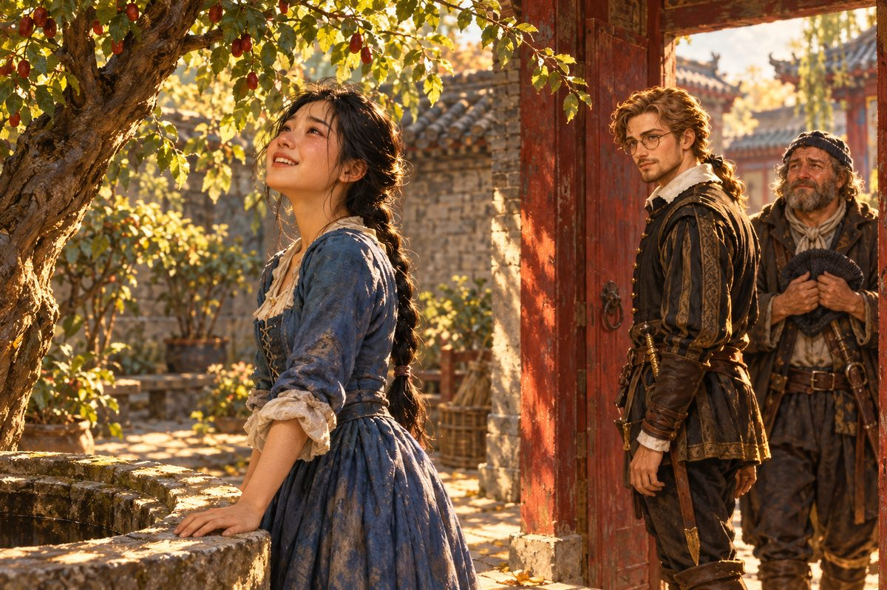

## 32. 장안

누런 강어귀에서 멀지 않은 곳에 커다란 도시가 있었다. 장안이라고 했다. 메르카토르 호는 그 도시의 항구에 닻을 내렸다.

에르네스트는 그렇게 큰 도시를 본 적이 없었다. 성벽이 끝없이 이어졌다. 성문 위의 누각은 지붕 끝이 하늘로 휘어 올라가 있었고, 그 지붕마다 기와가 비늘처럼 덮여 있었다. 성 안으로 들어서자 길이 바둑판처럼 반듯하게 뻗어 있었다. 수레와 가마와 짐을 진 사람들이 끝없이 오갔다. 길가에는 비단 가게와 찻집과 약재상이 늘어섰다. 어디선가 종소리가 울렸다.

그리고 거리를 오가는 모든 사람이 파울라와 닮아 있었다.

파울라는 처음에 에르네스트의 소매를 붙잡고 걸었다. 낯선 도시에서 길을 잃은 아이처럼. 그러나 큰길을 몇 번 건너고 모퉁이를 몇 번 돌자, 그녀의 걸음이 달라졌다. 소매를 놓았다. 앞장서 걸었다. 망설이지 않았다. 어느 골목에서 오른쪽으로 꺾어야 하는지, 어느 다리를 건너야 하는지, 그녀의 발이 먼저 알고 있었다.

"파울라? 어디로 가는 거야?"

그녀는 대답하지 않았다. 스타텐이 숨을 헐떡이며 뒤따랐다. 에르네스트도 걸음을 서둘렀다.

좁은 골목 끝에서 파울라가 멈추어 섰다.

오래된 집이었다. 회색 벽돌 담장 위로 기와가 얹혀 있었고, 붉은 칠이 바랜 나무 대문이 반쯤 열려 있었다. 대문 너머로 작은 안뜰이 보였다. 안뜰 한가운데 돌로 쌓은 우물이 있었고, 그 옆에 늙은 대추나무 한 그루가 가지를 뻗고 있었다. 오후의 햇살이 대추나무 잎 사이로 내려와 마당의 돌바닥에 얼룩을 그렸다.

파울라는 대문 문턱에 손을 짚었다. 그 손이 떨렸다.

"이 집……." 그녀의 목소리가 갈라졌다. "기억나요. 세상에…… 여기예요. 여기가 제 고향이에요. 이곳이요. 이 마당이 너무, 너무 익숙해요."

"정말이니, 파울라? 틀림없는 거야?"

파울라는 대답 대신 안뜰로 들어섰다. 우물가로 걸어가 돌 테두리를 손바닥으로 쓸었다. 테두리 한쪽에 작은 홈이 패어 있었다. 그녀는 그 홈에 손가락을 넣어 보았다. 꼭 맞았다.

"여기 걸터앉으면 안 된다고 혼났어요. 그래도 몰래 앉았어요." 그녀가 웃었다. 웃는데 눈물이 흘렀다. "대추가 익으면 저 나무 밑에서 기다렸어요. 누가 장대로 가지를 쳐 주면, 떨어지는 대추를 치마폭으로 받았어요. 그리고 저 담장 위에 올라가면…… 멀리 누런 강이 보였어요. 아주 넓은, 바다처럼 넓은 강이."

스타텐이 모자를 벗었다. 그 큰 손으로 모자를 쥐어 짜듯 비틀었다.

"아아, 제독님……. 그동안 고생한 게, 돌아다닌 게 하나도 헛되지 않았습니다요. 하나도요……!"

파울라는 대추나무 밑에 서서 마당을 둘러보았다. 처마 끝, 돌계단, 우물, 담장. 하나를 볼 때마다 그녀의 얼굴에 무언가 떠올랐다가 지나갔다.

"이상해요. 여기 오니까 흩어져 있던 기억들이 다 이어져요. 조각조각이던 게, 지금 이 자리에서 뛰어놀던 것까지 전부요." 그녀가 두 손으로 얼굴을 감쌌다. "정말…… 정말 오랜만이에요……."

에르네스트는 대문 곁에 서서 그녀를 보았다. 세비야의 시장에서 길을 잃은 네 살 아이. 낯선 말 속에서 자라 낯선 얼굴로 살아온 소녀. 그 아이가 지금 대추나무 아래에서 울고 있었다. 슬퍼서 우는 울음이 아니었다.

몇 해 동안 그는 수천 개의 숫자를 쟀다. 해의 높이, 별의 높이, 해안의 방위, 강어귀의 폭. 숫자는 정직했고, 숫자는 그를 세상 끝까지 데려다주었다. 그러나 이 마당에 이르는 길은 어떤 숫자로도 잴 수 없었다. 노란 바다라는 아이의 말 한마디. 그것을 믿어 준 것이 전부였다.

"……기적이라는 게 정말 있구나, 파울라."

그가 나직이 말했다. 파울라가 얼굴을 들었다. 젖은 얼굴로, 그녀는 웃었다.

## 33. 마지막 지리 보고

그날 밤, 에르네스트는 항구 여관의 작은 방에서 등잔 아래 앉았다. 탁자 위에 해도와 수첩과 잉크병이 놓여 있었다. 창밖으로 장안의 지붕들이 달빛에 젖어 있었다.

그는 펜을 들었다. 몇 해 동안 수십 통의 보고를 썼다. 그러나 이번만큼 첫 줄이 어려운 적은 없었다.

> 메르카토르 씨께.
>
> 동쪽 끝에서 이 편지를 씁니다. 함께 보내는 해도에 지도의 마지막 빈칸을 채울 숫자들을 적었습니다.
>
> 마르코 폴로가 쓴 섬나라는 실제로 있습니다. 명나라의 북동쪽 바다 건너, 깊은 만 안쪽에 항구가 있습니다. 다만 지붕이 금으로 덮여 있지는 않았습니다. 스타텐 씨는 그래도 만족했습니다. 그가 꼭 그려 달라고 한 붉은 문은 여백에 그려 두었으니, 쓰고 안 쓰고는 당신이 정하십시오.
>
> 그리고 누런 강. 이곳 사람들은 황하라고 부릅니다. 강어귀는 북위 삼십칠 도, 동경 백이십 도 부근입니다. 강이 실어 온 흙 때문에 뭍이 보이지 않는 먼바다까지 물이 누렇습니다. 콩고강보다, 아마존보다 누렇습니다. 처음 보는 사람은 바다가 노랗다고 말할 것입니다. 어린아이라면 더더욱 그렇겠지요.
>
> 파울라의 고향을 찾았습니다. 이 강 가까운 도시, 장안입니다. 그 아이는 오늘 오후 자기가 놀던 마당에 섰습니다. 우물가의 홈에 손가락을 넣어 보고, 대추나무 밑에서 울었습니다. 그 아이가 어떤 길을 택할지는 아직 모릅니다. 그건 그 아이가 정할 일입니다.
>
> 당신은 처음에 저에게 완벽한 세계지도를 만들자고 했습니다. 저는 그 지도가 거의 다 되었다고 생각합니다. 그러나 이번 항해에서 하나를 배웠습니다. 지도에는 땅의 모양만 적힙니다. 그 땅에서 누가 누구를 기다리고 있는지는 적히지 않습니다. 그래서 지도는 아마 영영 완벽해지지 않을 것입니다. 그래도 저는 그 지도가 자랑스럽습니다. 우리 두 사람의 이름이 적힌 지도가.
>
> 돌아가면 계단을 오르겠습니다. 촛불을 넉넉히 준비해 두십시오.
>
> 에르네스트 폰 보어

편지를 다 썼을 때, 문 두드리는 소리가 났다. 파울라였다. 눈가가 아직 조금 부어 있었지만 얼굴은 맑았다. 그녀 뒤로 스타텐이 술병을 들고 서 있었다.

"아직 안 주무셨어요?"

"보고서를 쓰고 있었어. 메르카토르 씨가 목을 빼고 기다리실 테니까."

파울라는 탁자 위의 해도를 내려다보았다. 누런 강어귀 옆에 작은 점 하나가 찍혀 있었다. 장안. 그 점 옆에는 아무 글씨도 없었다.

"제 집 얘기는 안 적어요?"

"지도에는 안 적어. 거기는 땅 모양만 적는 데니까." 에르네스트가 수첩을 펼쳐 보였다. 마지막 장 맨 아래에, 작은 글씨가 있었다. 장안, 우물이 있는 집, 대추나무. 파울라의 고향. "대신 여기 적어 뒀어. 이건 내 수첩이니까."

파울라는 그 글씨를 오래 보았다. 그리고 작게 웃었다.

"에르네스트 씨. 아버지가 고향을 찾으라고만 하시고, 찾은 다음엔 어떻게 하라는 말씀은 안 하셨다고 했죠."

"그랬지."

"이제부터 천천히 생각해 볼게요. 이 도시에서 누구를 찾아야 할지, 누구를 기다려야 할지, 아니면……." 그녀는 말끝을 흐렸다. 그리고 에르네스트를 보았다. "아니면 어디로 가고 싶은지도요. 천천히요."

"천천히 해. 우린 서두를 이유가 없어. 지도는 이제 거의 다 그렸으니까."

스타텐이 술병을 탁자 위에 쿵 내려놓았다.

"자, 자. 오늘 같은 밤에 이런 얘기만 하실 겁니까? 지팡구도 보고, 노란 바다도 보고, 꼬마 아가씨 고향도 찾았는데! 마셔야지요!" 그가 잔 세 개를 채우다가 문득 손을 멈추었다. 그리고 짓궂게 웃었다. "그건 그렇고 제독님. 저번에 대답 안 하신 거, 이젠 하실 때가 되지 않았습니까?"

파울라의 얼굴이 순식간에 붉어졌다. "스타텐 씨!"

에르네스트는 잔을 들었다. 등잔불이 잔 속에서 흔들렸다. 그는 파울라를 보았다. 파울라도 그를 보았다. 잠깐, 아주 잠깐 동안.

"……훗."

"또 그거요?" 스타텐이 탁자를 쳤다. "아이고, 제독님!"

파울라가 웃음을 터뜨렸다. 에르네스트도 웃었다. 스타텐도 결국 따라 웃었다. 세 사람의 웃음소리가 열린 창문으로 흘러 나가, 달빛에 젖은 장안의 지붕 위로 퍼졌다.

---

그 뒤로 몇 달이 지나 암스테르담의 한 인쇄소에서 새 세계지도가 찍혀 나왔다. 지도의 오른쪽 끝, 오랫동안 비어 있던 동쪽 바다에 섬나라의 해안선과 누런 강의 어귀가 그려져 있었다. 그 강어귀 옆에 작은 점이 하나 찍혀 있었다.

지도의 아래 귀퉁이에는 두 사람의 이름이 나란히 적혀 있었다.

메르카토르 & 폰 보어.

그 지도를 사 간 선장들은 아무도 몰랐다. 그 작은 점 옆에, 지도에는 적히지 않은 우물과 대추나무가 있다는 것을. 그리고 그것을 찾기 위해 한 척의 작은 배가 세상을 한 바퀴 넘게 돌았다는 것을.
