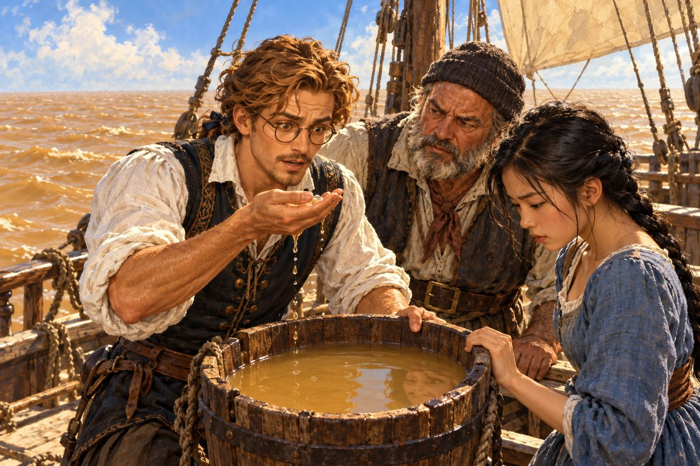

## 21. 왕립학회

암스테르담은 소문으로 들끓고 있었다. 이번에는 스타텐이 먼저 들었다. 그는 항구에서 돌아오자마자 여관 식탁에 모자를 내던졌다.

"메르카토르 씨가 지도 만드는 솜씨를 인정받아서 왕립학회 회원으로 추천됐답니다."

"정말이요? 잘된 일이군요."

"잘된 일이지요. 그분한테는요." 스타텐이 의자에 털썩 앉았다. "제독님, 전부터 생각만 하고 말은 안 했는데요. 그 양반, 좀 약삭빠른 데가 있지 않습니까? 제독님이 바다에서 목숨 걸고 잰 걸 가지고 이름은 그분이 다 내고 있잖아요. 제독님 공을 가로채는 것 같단 말입니다."

파울라가 걱정스러운 눈으로 에르네스트를 보았다. 에르네스트는 잠시 창밖을 내다보았다. 운하 위로 짐배가 천천히 지나갔다.

"글쎄요. 그러면 어떻습니까." 그가 돌아보며 말했다. "저는 정확한 지도를 만드는 일 자체가 즐겁습니다. 그 지도를 들고 바다에 나가는 사람들이 길을 잃지 않는다면, 그걸로 충분하지요. 학회 회원 자리는 배를 타기 무서워하는 사람에게 더 어울립니다. 저는 바다가 더 좋으니까요."

"……제독님은 정말 욕심이 없으십니다요."

"욕심이야 있지요. 세상을 전부 재 보고 싶다는 욕심. 그건 누구보다 큽니다."

스타텐은 한숨을 쉬었다. 그러나 이내 다시 짓궂은 얼굴이 되었다. 그는 파울라와 에르네스트를 번갈아 보았다.

"그건 그렇고, 두 분. 이제 슬슬 확실히 정하시는 게 어떻습니까?"

"뭘요?" 파울라가 고개를 갸웃했다.

"뻔하지 않습니까? 혼인 말입니다, 혼인!"

"그만하세요, 스타텐 씨. 낯 뜨겁게." 에르네스트가 말했다.

"맞아요. 스타텐 씨도 참……." 파울라가 손을 내저었다. 그러나 볼이 빨갰다. "우리 둘은 그런 사이 아니에요. 그렇죠, 에르네스트 씨?"

에르네스트는 대답하지 않았다.

"……제독님?" 스타텐이 고개를 쭉 내밀었다. "얼른 대답 좀 해 보십쇼?"

에르네스트는 찻잔을 들어 한 모금 마셨다. 그리고 내려놓았다. 입가에 작은 웃음이 걸렸다.

"……훗."

그것뿐이었다. 스타텐은 눈을 휘둥그레 뜨더니 무릎을 치며 웃었다. 파울라는 얼굴이 새빨개져서 벌떡 일어나 방을 나가 버렸다. 계단을 내려가는 발소리가 유난히 컸다.

---

메르카토르는 향료의 섬 지도를 받아 들고 그 자리에서 의자에 주저앉았다. 그는 한참 동안 섬 하나하나를 손가락으로 짚었다.

"폰 보어 씨. 당신 덕에 내 지도에 이제 동쪽이 생겼습니다." 그가 고개를 들었다. "학회에서 나를 부른다고 하더군요. 그런데 나는 그 자리에 가서 무슨 말을 해야 할지 모르겠습니다. 이건 내가 잰 게 아니니까요."

"메르카토르 씨가 그리셨잖습니까. 저는 숫자만 가져왔을 뿐입니다."

메르카토르는 그 말에 오래 대답하지 않았다. 그러다 탁자 위의 세계지도를 펼쳤다. 지난 두 해 사이에 지도는 몰라보게 달라져 있었다. 북해, 아프리카, 인도양, 향료의 섬들. 그러나 아직 커다란 빈칸들이 남아 있었다. 북쪽의 얼음 바다, 신대륙의 해안 대부분, 그리고 남쪽 대양 전체.

"아직 반도 못 그렸군요." 에르네스트가 말했다.

"반이나 그렸지요." 메르카토르가 웃었다.

## 22. 얼음의 바다

그해 여름, 메르카토르 호는 북쪽으로 올라갔다. 이번에는 노르웨이를 지나 더 멀리, 스타텐이 처음에 가지 말라고 했던 바다까지.

"이제는 가셔도 됩니다요." 스타텐이 말했다. "제독님도 이젠 뱃사람이 다 되셨으니까. 다만 얼음은 우습게 보지 마십쇼."

북위 칠십 도를 넘자 해가 지지 않았다. 자정에도 태양은 수평선 위를 낮게 미끄러지며 바다를 금빛으로 물들였다. 파울라는 처음 며칠 동안 잠을 이루지 못했다. 언제 밤이 오는지 몰라 눈을 감을 때를 놓친다고 했다.

그리고 얼음이 나타났다.

처음에는 작은 조각들이었다. 물 위에 떠다니는 하얀 접시들. 그다음에는 집채만 한 덩어리, 그다음에는 교회만 한 덩어리. 마침내 수평선에 하얀 산 하나가 떠올랐다. 해를 받아 푸르스름하게 빛나는 얼음산이 바람도 없는데 천천히 움직이고 있었다.

"물 위에 보이는 건 꼭대기뿐입니다." 스타텐이 낮게 말했다. "물 아래에 저것보다 몇 배가 더 숨어 있어요. 절대 가까이 가면 안 됩니다."

그들은 얼음산을 멀찍이 돌아 그린란드의 해안을 따라갔다. 해안은 온통 얼음 절벽이었다. 빙하가 바다로 흘러내려 끝이 부서지며 얼음산이 되었다. 부서질 때마다 천둥 같은 소리가 바다를 건너왔다.

"피오르를 만든 얼음이 저런 거였군요." 에르네스트가 말했다. "첫 항해 때 스타텐 씨가 해 준 얘기, 이제야 제 눈으로 봅니다."

그 바다에서 에르네스트는 측각기를 거의 손에서 놓지 않았다. 해가 지지 않으니 하루 종일 태양의 높이를 잴 수 있었다. 그러나 얼음 때문에 해안 가까이 가지 못해 해안선은 멀리서 어림할 수밖에 없었다. 그는 그 어림을 지도에 점선으로 그렸다. 확실하지 않은 것은 점선으로. 그것이 그의 원칙이었다.

여름이 기울자 해가 다시 지기 시작했다. 처음으로 어둠이 돌아온 밤, 하늘에 빛이 걸렸다. 초록빛 커튼 같은 것이 북쪽 하늘에서 천천히 흔들렸다. 끝자락이 분홍으로 물들었다가 다시 초록으로 돌아왔다. 소리는 없었다. 그 고요함이 오히려 무서웠다.

선원들이 성호를 그었다. 스타텐조차 모자를 벗었다. 파울라는 에르네스트의 소매를 꼭 붙잡았다.

"저건 뭐예요?"

"모르겠다." 에르네스트가 솔직하게 말했다. "북쪽 사람들은 저걸 보고 죽은 사람들의 춤이라고도 하고, 얼음이 해를 비춘 거라고도 한다더라. 어느 쪽이 맞는지는 아무도 몰라."

"그럼 지도에는 뭐라고 적어요?"

에르네스트는 웃었다. 그리고 수첩에 짧게 적었다. 북위 육십오 도 부근, 밤하늘에 초록빛이 흔들림. 원인 모름.

"모르는 건 모른다고 적는 거야. 언젠가 누군가 알아내겠지."

서쪽으로 건너가자 안개 낀 커다란 땅이 나타났다. 뉴펀들랜드라 불리는 곳이었다. 대구가 너무 많아 바구니를 물에 넣었다 빼기만 해도 잡힌다는 바다였다. 브르타뉴와 바스크의 어선들이 그 안개 속에 점점이 떠 있었다. 에르네스트는 그 어부들에게 해안선을 물었다. 그들은 수십 년 이 바다를 오갔지만 아무도 지도를 그린 적이 없었다. 다들 머릿속에만 넣어 두고 있었다.

## 23. 강이 바다를 밀어낼 때

신대륙의 해안을 따라 남쪽으로 내려가자 바다가 따뜻해졌다. 카리브의 섬들은 초록과 하양과 푸른빛이 뒤섞인 보석 같았다. 에스파냐의 깃발을 단 배들이 항구마다 드나들었다. 파울라의 에스파냐 말이 다시 한번 빛을 발했다.

적도를 넘기 직전, 스타텐이 갑판에서 고개를 갸웃했다.

"이상하군요. 바다 빛깔이 왜 이래?"

물빛이 변하고 있었다. 짙은 푸른빛이 조금씩 옅어지더니, 흐린 녹색이 되고, 마침내 흙탕물처럼 누런 갈색이 되었다. 뭍은 아직 보이지 않았다. 사방이 수평선이었다. 그런데 배는 누런 물 위를 떠가고 있었다.

에르네스트가 양동이를 내려 물을 떠 올렸다. 한 모금 마셔 보고는 눈을 크게 떴다.

"짜지 않아요."

"예?"

"민물입니다. 뭍이 보이지도 않는 바다 한가운데서." 에르네스트가 양동이를 스타텐에게 내밀었다. "이십여 년 전에 에스파냐의 한 선장이 이 근처에서 바다 물을 마셔 보고 짜지 않아서 놀랐다고 들었습니다. 그 선장은 이곳을 단물의 바다라고 불렀다지요. 뭍에서 엄청나게 큰 강이 흘러나와 바다를 밀어내고 있는 겁니다."

스타텐이 물을 마셔 보고 퉤 뱉었다. "흙 맛이 나긴 하는데…… 정말 안 짜네."

파울라는 양동이를 들여다보았다. 누런 물에 그녀의 얼굴이 흐릿하게 비쳤다. 그녀는 오래 그 물을 보고 있었다. 무언가를 떠올리려는 사람처럼 미간이 조금 좁혀져 있었다.

"파울라? 왜 그래?"

"아니에요." 그녀가 고개를 저었다. "그냥…… 이상하게 낯익은 빛깔이라서요. 기분 탓인가 봐요."

이틀을 더 가서야 강어귀가 나타났다. 아마존이라 불리는 강이었다. 강어귀가 하도 넓어서 건너편 기슭이 보이지 않았다. 강 한가운데에 섬이 있었는데, 그 섬 하나가 웬만한 나라만 했다. 강 위로 뜨거운 안개가 피어올랐고, 양쪽 기슭의 숲에서 처음 듣는 새소리가 쏟아졌다.

"이게 강이라고요?" 파울라가 중얼거렸다. "바다 같아요."

"맞아. 세상에는 바다라고 해도 믿을 만큼 큰 강이 있어." 에르네스트가 대답했다. 그는 그때 그 말을 무심코 했다. 그 말이 언젠가 다시 그들에게 돌아오리라는 것은 알지 못했다.

## 24. 세상의 남쪽 끝

남아메리카의 해안은 끝없이 남쪽으로 이어졌다. 날이 갈수록 바람이 차가워졌다. 적도의 더위가 거짓말처럼 사라지고, 다시 북해 같은 회색 하늘이 내려앉았다. 다만 이번에는 계절이 거꾸로였다. 북쪽에서는 여름이 시작될 무렵, 이곳은 겨울로 접어들고 있었다.

대륙의 남쪽 끝에는 좁고 구불구불한 해협이 있었다. 몇 해 전 마젤란이라는 포르투갈 사람이 에스파냐 왕의 배를 이끌고 처음 빠져나간 길이라 했다. 해협 양쪽의 산꼭대기는 만년설에 덮여 있었고, 기슭 여기저기서 원주민들이 피운 불이 밤새 깜빡였다.

"불의 땅이라고 부른답니다." 파울라가 해도에 적힌 글씨를 읽었다.

해협을 빠져나오는 데 보름이 걸렸다. 바람이 수시로 방향을 바꾸었고, 좁은 물길 양쪽에서 돌풍이 내리꽂혔다. 향유 항아리가 셋이나 비었다. 그러나 마침내 바다가 열렸을 때, 눈앞에 펼쳐진 것은 이름과 달리 결코 고요해 보이지 않는 대양이었다.

"마젤란이 이 바다를 태평한 바다라고 불렀다면서요?" 파울라가 물었다.

"그 사람은 운이 좋았던 거지." 스타텐이 투덜거렸다.

그들은 대륙의 서쪽 해안을 따라 다시 북쪽으로 올라갔다. 해안을 따라 높은 산맥이 끝없이 이어졌다. 산꼭대기가 구름 위로 솟아 있었다. 에르네스트는 날마다 해안선을 재고, 점선을 실선으로 바꾸어 나갔다. 신대륙의 서쪽 해안은 지금까지 거의 아무도 그리지 않은 선이었다.

## 25. 섬에서 섬으로

적도 근처에서 메르카토르 호는 해안을 떠나 서쪽 대양으로 나아갔다. 스타텐은 처음에 반대했다. 물과 식량이 버틸지 알 수 없는 바다였다. 그러나 해안 원주민들에게서 들은 이야기가 있었다. 서쪽 바다 한가운데에 사람이 사는 섬들이 있다고. 에르네스트는 물통을 평소의 두 배로 싣고 떠났다.

스무 날이 지나도록 아무것도 보이지 않았다. 물을 아껴 마셨다. 선원들의 얼굴이 어두워졌다. 스물사흘째 아침, 망루의 선원이 고함을 질렀다. 수평선 위에 구름이 한 점 멈춰 있었다. 섬 위에는 구름이 걸린다고, 스타텐이 말했다.

그곳은 불을 뿜는 산이 있는 섬들이었다. 검은 용암이 바다까지 흘러내려 굳어 있었고, 그 위로 초록 숲이 덮여 있었다. 섬사람들은 커다란 카누를 타고 나와 낯선 배를 둘러쌌다. 그들은 별과 파도와 새가 나는 방향만으로 이 넓은 바다의 섬들을 오간다고 했다. 말린디의 늙은 항해사가 떠올랐다. 이 바다에도 지도 없이 바다를 아는 사람들이 있었다.

섬의 늙은 항해사는 에르네스트에게 이상한 물건을 보여 주었다. 야자 잎줄기를 엮어 만든 격자에 조개껍데기를 군데군데 매단 것이었다. 줄기는 파도가 휘는 모양을, 조개껍데기는 섬의 자리를 나타낸다고 했다. 바다의 지도였다. 숫자도 글자도 없는 지도.

에르네스트는 그 격자를 손에 들고 한참 말을 잃었다. 그리고 자기 수첩을 펼쳐 보여 주었다. 숫자와 선으로 가득한 종이를 노인은 신기한 듯 넘겨 보았다. 둘은 말이 통하지 않았다. 그러나 서로의 지도를 들여다보는 동안, 두 사람은 같은 것을 하고 있다는 것을 알았다. 바다를 기억하려는 일.

파울라는 섬사람들 사이를 오래 돌아다녔다. 그러다 저녁에 돌아와 에르네스트 곁에 앉았다.

"여기 사람들도 저랑은 안 닮았어요."

"그래. 그런 것 같구나."

"괜찮아요. 이젠 그렇게 실망스럽지 않아요." 파울라가 무릎을 끌어안았다. "세상에 이렇게 많은 얼굴이 있는데, 저랑 닮은 얼굴도 어딘가엔 있겠죠."

섬에서 섬으로, 메르카토르 호는 남서쪽으로 내려갔다. 하와이의 화산섬, 타히티의 산호초 바다, 수바의 큰 만. 물빛은 섬마다 달랐다. 산호초 위에서는 바닥이 훤히 보이는 연둣빛이었고, 초호 밖으로 나가면 갑자기 잉크처럼 짙은 남색이 되었다. 파울라는 섬에 내릴 때마다 꽃을 따서 머리에 꽂았다. 스타텐은 그걸 보고 아무 말도 하지 않았지만, 그 대신 에르네스트를 볼 때마다 헛기침을 했다.

그리고 마침내 거대한 땅이 나타났다. 끝없이 이어진 붉은 해안. 남쪽에 커다란 땅이 있을 거라는 옛 학자들의 짐작은 틀리지 않았다. 다만 그 땅은 그들이 상상한 모양과 전혀 달랐다. 에르네스트는 그 해안선의 일부를 쟀다. 전부를 재기에는 너무 컸다. 그는 지도에 그 땅의 북쪽 해안만 실선으로 그리고, 나머지는 비워 두었다.

"다 그리지 않으십니까?" 스타텐이 물었다.

"모르는 건 모른다고 남겨 두는 게 지도입니다. 다음 사람이 채우겠지요."

## 26. 마지막 빈칸

남쪽 대륙에서 메르카토르 호는 서쪽으로 뱃머리를 돌렸다. 티모르와 자바를 지나 다시 인도양을 건넜다. 이번에는 계절풍이 그들을 기다려 주었다. 희망의 곶을 세 번째로 돌았을 때, 에르네스트는 자신이 세계를 한 바퀴 돌았다는 것을 깨달았다. 서쪽으로 떠나 동쪽에서 돌아오는 길이었다.

알렉산드리아의 수집가에게 남쪽 바다의 기록을 넘기고, 암스테르담에 닿았을 때는 또 한 해가 저물고 있었다.

메르카토르는 지도를 펼쳤다. 이제 빈칸은 많지 않았다. 신대륙의 양쪽 해안, 얼음 바다, 남쪽 대양의 섬들이 모두 제자리를 찾았다. 그는 지도 위에 손바닥을 얹었다. 마치 따뜻한 무언가를 만지듯.

"폰 보어 씨. 우리 지도도 이제 거의 다 됐습니다. 조금만, 정말 조금만 더 힘을 내 주십시오."

"어디가 남았습니까?"

메르카토르가 지도의 두 곳을 짚었다. 하나는 북대서양의 한 귀퉁이였다. 얼음 바다로 가는 길목, 뉴펀들랜드와 아이슬란드 사이에 아직 점선으로만 남은 해역. 그리고 다른 하나는 지도의 오른쪽 끝, 동쪽의 가장자리였다. 명나라의 해안선은 흐릿했고, 그 너머의 바다에는 아무것도 없었다.

"마르코 폴로의 책에 나오는 섬나라도 아직 어디인지 모릅니다. 누구는 있다고 하고, 누구는 지어낸 이야기라고 하지요."

"북대서양부터 채우지요. 가까우니까요."

그날 밤 파울라와 스타텐이 먼저 여관으로 돌아간 뒤, 메르카토르는 에르네스트를 붙잡았다. 그는 난로에 장작을 하나 더 넣고 한참 불을 보고 있었다.

"폰 보어 씨. 우스운 얘기를 하나 해도 되겠습니까." 그가 말했다. "나는 요즘 지도가 완성되는 게 조금 두렵습니다."

"두렵다니요?"

"이 지도가 다 그려지면, 당신이 더는 이 집에 올 일이 없겠지요. 나는 이 작업실에 앉아서 당신이 가져오는 바다 이야기를 듣는 게 낙이었습니다. 배를 못 타는 사람에게는 그게 항해였거든요." 메르카토르가 쓸쓸하게 웃었다. "학회에서 사람들이 내게 묻습니다. 그 먼 바다를 어떻게 그렇게 정확히 아느냐고. 그때마다 나는 내 친구가 가서 보고 왔다고 대답합니다. 그 사람들은 그 말을 겸손이라고 여기더군요. 겸손이 아닌데."

에르네스트는 대답하지 않았다. 그 대신 탁자 위의 지도를 가리켰다. 귀퉁이에 두 사람의 이름이 나란히 적혀 있었다.

"지도가 끝나도 이 이름은 그대로 있습니다. 그리고 저는 바다에서 돌아올 때마다 이 집 계단을 오를 겁니다. 지도가 있든 없든."

메르카토르는 안경을 벗어 닦았다. 오래 닦았다.

그 겨울과 이른 봄 사이에 메르카토르 호는 북대서양으로 나가 마지막 점선들을 실선으로 바꾸었다. 바다는 사나웠지만, 이제 이 배의 사람들에게 북쪽 바다는 낯설지 않았다. 에르네스트가 돌아와 숫자를 넘겼을 때, 메르카토르는 펜으로 북대서양의 마지막 점선을 그었다.

지도에 남은 빈칸은 이제 하나였다. 오른쪽 끝, 해가 뜨는 쪽.

그날 밤, 여관 방에서 짐을 꾸리던 파울라가 손을 멈추었다.

"에르네스트 씨. 동쪽 끝까지 가면…… 거기는 혹시."

그녀는 말을 맺지 않았다. 에르네스트도 묻지 않았다. 두 사람 다 같은 생각을 하고 있었다. 세상의 거의 모든 항구를 돌았는데도 찾지 못한 고향. 남은 곳은 지도의 마지막 빈칸뿐이었다.
