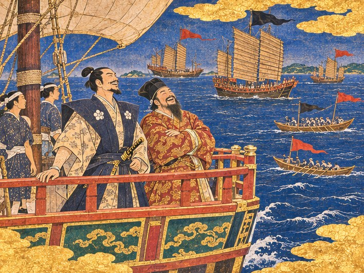
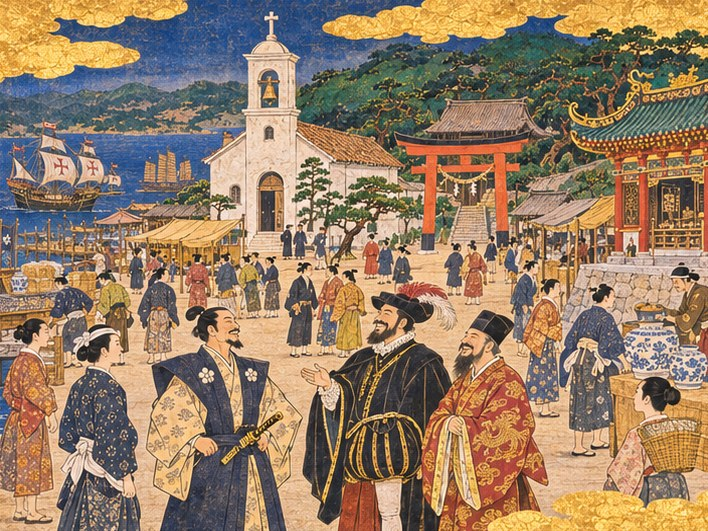
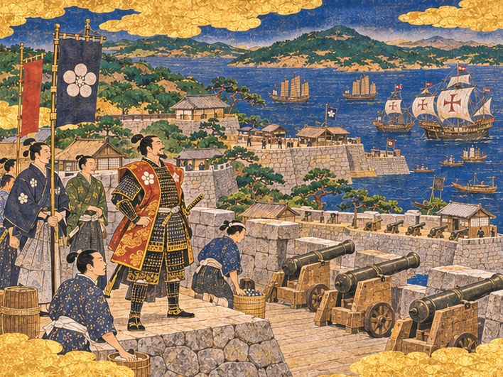
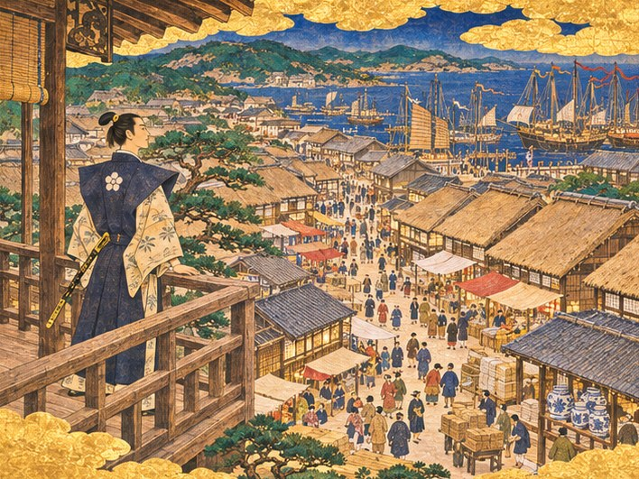
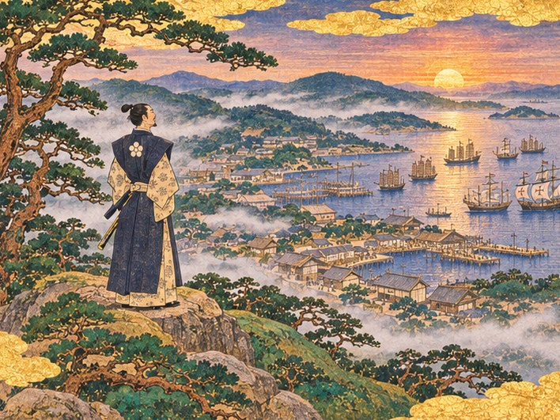

히라도가 어떤 항구가 되는지는 하야토가 무엇을 쌓아 왔느냐에 달려 있다. 아래 네 결말은 이야기가 차례로 확인하는 순서대로 적었다. 앞의 결말에 닿지 못한 포구가 다음 결말로 이어진다.

## 결말 하나 ― 해상왕의 항구

*왕직의 사람들을 끝까지 지키고 당인 거리를 크게 키운 영주라면, 히라도는 해상왕의 항구가 된다.*

축제가 끝난 이듬해 봄, 히라도의 만에는 날렵한 정크와 쾌속선이 가득했다.

당인 거리는 이제 거리가 아니라 작은 도시였다. 붉은 등이 언덕 중턱까지 이어졌다. 영파에서, 쌍서에서, 명의 바다 곳곳에서 쫓겨난 사람들이 이 포구로 모여들었다. 해금의 바다에서 갈 곳을 잃은 상인들이었다. 그들은 히라도에서 짐을 풀고, 장부를 펴고, 다시 배를 띄웠다.

왕직의 사람들은 하야토를 바다의 영주라 불렀다. 그 이름에는 존경과 함께 조금의 두려움이 섞여 있었다. 명의 관리들은 히라도를 해적의 포구라 불렀다. 하야토는 어느 쪽 이름도 고치려 하지 않았다.

임가는 새로 띄운 큰 정크의 뱃머리에 하야토와 나란히 섰다. 붉은 비단 옷자락이 바닷바람에 펄럭였다. 그 옛날 왕직이 입던 옷과 같은 색이었다.

"명의 바다는 닫혔어도, 히라도의 바다는 열려 있습니다." 임가가 만을 가르는 배들을 보며 말했다. "왕직 어른이 꿈꾸던 포구가 여기 있습니다."

"해적의 포구라 불려도 좋다." 하야토가 대답했다. "이 바다에서 쫓기는 사람이 쉴 곳이 하나쯤은 있어야 하니까."

임가가 소리 내어 웃었다. 열세 해 전 모래톱에 얹힌 정크에서 젖은 채 내리던 젊은 상인의 얼굴이, 이제는 선단을 이끄는 사람의 얼굴이 되어 있었다.

"나리, 그 장부 기억하십니까? 은혜를 장부에 적어 두겠다던 그 장부요."

"기억하오."

"다 갚으려면 아직 멀었습니다. 그러니 저는 오래 이 포구에 있겠습니다."

그해 여름에도, 그다음 해 여름에도 히라도의 바다에는 붉은 돛이 가득했다. 쫓기던 배들은 히라도에서 쉬어 갔고, 쉬어 간 배들은 언젠가 다시 짐을 싣고 돌아왔다.

---

## 결말 둘 ― 남만 국제항

*그 길에 닿지 않았더라도, 장터의 다툼을 법과 배상으로 풀고 남만 상관을 크게 키운 영주라면, 히라도는 남만 국제항이 된다.*

성당의 종탑 옆으로 사당의 도리이와 명나라 사원의 지붕이 나란히 섰다.

언덕 아래 광장에서는 아침마다 세 나라 말이 섞였다. 포르투갈 선원이 일본 아낙에게 생선 값을 묻고, 명 상인이 남만 서기에게 은 시세를 물었다. 남만 상관은 몇 해 사이 창고 거리를 통째로 품을 만큼 커졌다. 마카오에서 오는 큰 배는 이제 계절마다 들어왔다.

성당의 종이 울리면 사당의 북이 받았다. 명나라 사원의 징이 그 뒤를 이었다. 처음에는 서로 시끄럽다고 투덜거리던 사람들이 이제는 그 소리로 시간을 셌다.

주앙은 하야토와 나란히 광장을 걸었다. 그는 이제 항해사가 아니라 남만 선단 전체의 길잡이였다.

"리스본에서도 히라도의 이름을 압니다." 주앙이 말했다. "법이 같은 포구라고요. 장터에서 누가 칼을 뽑든, 히라도의 영주는 같은 저울로 단다고."

가스파르 수사가 성당 계단에서 내려와 고개를 숙였다. 처음 히라도에 왔을 때 그는 땅바닥에 금을 그어 성당 자리를 표시했다. 지금 그 자리에는 하얀 종탑이 서 있었다.

"영주님 덕분에 이 땅에서 저는 손님이 아니라 이웃이 되었습니다."

"남만의 배도 명의 배도 히라도의 법 아래 쉰다." 하야토가 말했다. "그것이면 됐다."

나가사키 쪽 포구에도 남만 배가 들었다. 그러나 가장 큰 배는 여전히 히라도로 왔다. 은이 더 많아서가 아니었다. 다친 선원 한 사람을 위해 영주관 마당을 열었던 포구라는 것을, 선장들은 잊지 않았다.

---

## 결말 셋 ― 요새 영지

*앞의 두 길에 닿지 않았더라도 성채를 크게 키워 바다를 지킨 영주라면, 히라도는 요새 영지가 된다.*

포구를 둘러싼 돌담과 포대가 바다를 내려다보았다.

곤베가 처음 쌓은 성채는 몇 해 사이 곶을 따라 길게 이어졌다. 물목 양쪽에 포대가 섰고, 돌담 위로 망루가 줄지어 올라갔다. 청동 대포가 바다를 향해 늘어섰다. 만 안의 배들은 그 돌담의 그늘 아래에서 안심하고 닻을 내렸다.

히라도를 넘보는 해적은 더는 없었다. 오도의 섬들에서는 히라도의 돌담 이야기가 겁주는 말로 쓰인다고 했다. 해적들도 아이들에게 말썽을 부리면 히라도 성채로 보낸다고 했다.

하야토는 갑옷을 입고 성채 위에 섰다. 고타로가 그 곁에 섰다. 늙은 수군 대장의 허리는 많이 굽었지만, 바다를 보는 눈은 여전히 날카로웠다.

"나리, 이 성채는 백 년을 버틸 겁니다." 고타로가 돌담을 손바닥으로 두드렸다. "늙은이는 이제 마음 놓고 은퇴하겠습니다."

"지킬 것이 있는 포구가 되었구나." 하야토가 바다를 보며 말했다. "고타로, 은퇴는 아직 이르오."

"……선대께서도 똑같이 말씀하셨을 겁니다."

"그러니 아버지 말씀이라 생각하고 들으시오."

고타로가 웃었다. 그리고 다음 날 새벽에도 성채에 올라 대포를 닦았다.

성채 아래 포구는 조용히 자랐다. 지켜 주는 돌담이 있는 곳으로 상인들은 짐을 맡겼다. 큰 소리를 내지 않는 포구였지만, 폭풍이 와도 해적이 와도 무너지지 않는 포구였다. 곤베의 말대로였다. 바다를 이기려고 쌓은 것이 아니라, 바다가 몇 번을 때려도 견디려고 쌓은 것이었다.

---

## 결말 넷 ― 동중국해의 상업 도시

*어느 한쪽으로 크게 기울지 않고 시장과 창고와 거리로 포구를 고르게 살찌운 영주라면, 히라도는 동중국해의 상업 도시가 된다.*

넓어진 장터와 창고 거리 너머로 돛대가 숲처럼 늘어섰다.

히라도는 동중국해에서 가장 바쁜 시장이 되었다. 아침이면 장터의 천막들이 줄지어 걷혔다. 명의 비단, 남만의 은, 사카이의 칼, 류큐의 유황, 조선의 무명. 바다 건너 온갖 물건이 이 포구에서 값을 매겼다. 창고는 짓는 대로 찼다. 거리는 넓히는 대로 붐볐다.

하야토는 영주관의 높은 마루에서 거리를 내려다보았다. 처음 장이 서던 날, 생선 바구니를 든 아낙 몇이 모여들던 그 빈터가 저 아래 어디쯤이었다. 지금은 어디가 그 자리인지 찾을 수도 없었다.

오린이 장부를 들고 들어왔다. 장부가 세 권이었다. 한 권으로는 더 이상 모자랐다.

"나리, 이번 달 세금이 선대의 일 년 빚보다 많아요." 오린이 주판을 내려놓았다. "이제 셈하는 게 즐거워요."

"시장이 사람을 부르고, 사람이 배를 불렀다." 하야토가 말했다. "처음 네가 한 말 그대로다."

"사람이 와야 돈이 돈다고요?" 오린이 웃었다. "그 말을 할 땐 반쯤은 허세였어요. 빚 장부 앞에서 무슨 말이라도 해야 했으니까."

"허세가 맞으면 그건 셈이 된 거다."

"그럼 저는 히라도에서 제일 셈이 빠른 사람이네요."

그해 겨울, 히라도의 장터는 눈이 와도 닫히지 않았다. 등불 아래에서 흥정 소리가 밤늦게까지 이어졌다. 칼 소리는 들리지 않았다. 흥정은 여전히 싸움처럼 들렸지만, 그것은 살아 있는 포구의 소리였다.

---

## 새벽의 언덕

어느 결말에 닿았든, 그날 새벽 하야토는 소나무 언덕에 올랐다.

해가 섬들 너머로 떠올랐다. 안개가 포구의 지붕들 사이로 낮게 흘렀다. 그 아래로 다 자란 포구가 펼쳐졌다. 부두가 몇 겹으로 뻗었고, 그 끝마다 배가 매여 있었다. 안개 사이로 배들이 하나둘 돛을 올렸다. 명의 정크가, 남만의 범선이, 히라도의 고깃배가 같은 바람을 받았다.

열아홉 살에 처음 본 포구는 반쯤 가라앉은 부두와 고깃배 몇 척뿐이었다. 비가 사흘째 그치지 않던 날이었다. 하야토는 젖은 부두 판자를 오래 내려다보았다. 그때 그는 이 포구가 무엇이 될지 몰랐다. 지금도 다 알지는 못했다.

이야기는 여기서 끝났다. 그러나 히라도의 하루는 끝나지 않았다.

영주관에는 오늘도 장부가 쌓일 것이다. 비어 있는 땅에는 새 건물이 올라갈 것이다. 이미 선 건물은 더 크고 단단하게 고쳐 지어질 것이다. 시장은 더 넓어지고, 당인 거리와 남만 상관은 더 깊어지고, 성채는 더 높아질 것이다. 달이 바뀔 때마다 세금이 들어오고, 사람이 오고, 때로는 해적이 오고, 때로는 상선이 올 것이다. 영주는 그때마다 세금을 정하고, 무엇을 지을지 고르고, 오는 이들을 맞을 것이다.

히라도가 동중국해의 국제항으로 자라는 길은 아직 끝나지 않았다. 그 길은 영주가 원하는 만큼 계속 이어진다.

하야토는 언덕을 내려갔다. 아래에서 오린이 장부를 들고 기다리고 있었다. 곤베는 새 공사장의 말뚝을 박고 있었다. 고타로는 성채에 올라 있었고, 주앙은 다음 계절풍을 기다렸다. 임가는 붉은 등을 손보고 있었다.

바다는 기다리는 자의 것이 아니다. 길을 내는 자의 것이다.

하야토는 오늘도 길을 내러 내려갔다.

---

*히라도 외전: 바다의 영주 ― 끝*
