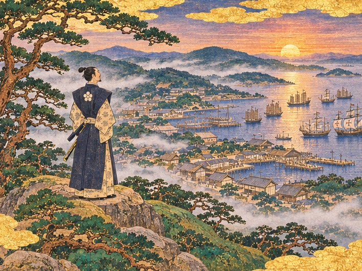

1549년 봄, 규슈 서쪽 끝의 가난한 어촌 히라도. 아버지를 잃은 열아홉 살 영주 하야토에게 남은 것은 금화 사천 냥의 빚 장부와 낡은 배 한 척, 늙은 가신 몇 사람뿐입니다. 젖누이 오린의 주판, 늙은 대목장 곤베의 목재, 수군 대장 고타로의 칼로 첫 장터를 세운 하야토는 폭풍에 밀려온 명나라 상인 임가를 구하고, 바다 위의 왕이라 불리는 해상왕 왕직과 마카오에서 온 포르투갈 항해사 주앙을 차례로 맞아들입니다. 명의 해금령과 해적의 검은 돛, 장터의 다툼과 경쟁 영지의 유혹 속에서 작은 포구를 동중국해의 국제항으로 키워 가는 이야기입니다.

:::caution[줄거리 공개]
이 소설에는 하야토 이야기의 처음부터 마지막 결말까지 모든 줄거리가 들어 있습니다. 게임을 먼저 즐기고 싶다면 다 끝낸 뒤에 읽으세요.
:::

이 소설은 게임의 이야기를 바탕으로 장면과 대화를 덧붙인 각색입니다. 3부에서 왕직의 사람들을 지키고, 4부에서 법과 배상을 고른 여정을 따라가며 결말에서는 네 갈래를 모두 소개합니다. 실제 게임에서 무엇을 짓고 어떤 선택을 하느냐에 따라 만나는 장면은 달라질 수 있습니다.

## 차례

| 차례 | 내용 |
| --- | --- |
| [서장 ― 젖은 부두](/novel/hirado/prologue/) | 1549년 봄 히라도, 반쯤 가라앉은 부두와 선대가 남긴 배 한 척 |
| [1부 ― 작은 포구](/novel/hirado/part1/) | 빚 장부, 곤베의 목재 스물, 첫 장터, 폭풍에 밀려온 명나라 정크, 포구 마을 |
| [2부 ― 해상왕의 손님](/novel/hirado/part2/) | 왕직의 대선단, 마시지 않는 차, 첫 포르투갈 배, 길가의 설교, 검은 돛의 습격 |
| [3부 ― 남만의 항구](/novel/hirado/part3/) | 남만 상관과 성당, 봉인된 칙서, 붙잡힌 왕직, 쫓기는 사람들의 문 |
| [4부 ― 불붙은 거리](/novel/hirado/part4/) | 비단값 다툼, 나가사키의 유혹, 돌을 쌓는 계절, 영주관 마당의 배상 |
| [5부 ― 바다의 영주](/novel/hirado/part5/) | 망루의 종, 해적 연합 함대와의 결전, 등불의 밤 |
| [결말 ― 네 갈래 항구](/novel/hirado/ending/) | 해상왕의 항구, 남만 국제항, 요새 영지, 동중국해의 상업 도시 |

게임에서 직접 항구를 키우는 방법은 [히라도 외전 안내](/side-story/hirado/)를 참고하세요.
