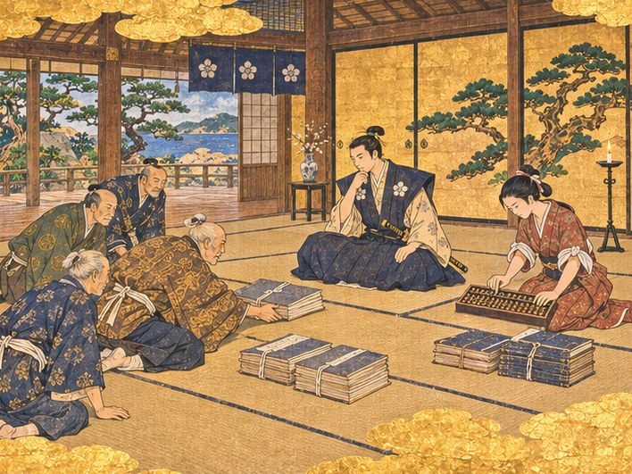
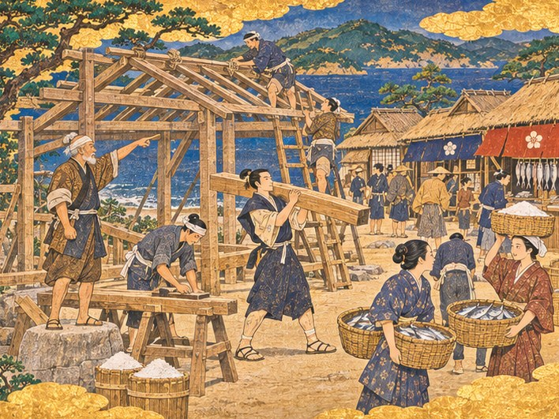
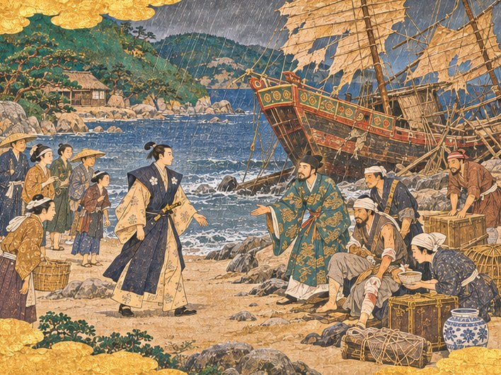

## 1. 장부 더미

영주관의 마루는 비 냄새를 머금고 있었다.

미닫이를 열어 두면 바다가 보였다. 소나무 가지 너머로 회색 물이 넓게 누워 있었다. 비는 그쳤지만 하늘은 아직 무거웠다. 처마 끝에서 물방울이 하나씩 떨어져 댓돌을 두드렸다.

방 안에는 늙은 가신 넷이 엎드려 있었다. 선대를 섬기던 사람들이었다. 하나같이 머리가 희었다. 그들 앞에 끈으로 묶은 장부가 몇 무더기 쌓여 있었다. 가장 나이 많은 가신이 무릎걸음으로 다가와 그 한 무더기를 하야토 앞으로 밀었다. 다다미 위로 종이 끌리는 소리가 났다.

"선대께서 남기신 것입니다, 나리."

남긴 것. 하야토는 그 말을 속으로 되뇌었다. 남긴 것이 배 한 척과 이 종이 더미였다.

하야토는 맨 위의 장부를 집어 들었다. 표지가 손때로 검었다. 첫 장을 넘기자 아버지의 글씨가 보였다. 숫자가 아니었다. 한 줄의 글이었다. 먹이 바래 있었지만 획은 곧았다.

그 글을 읽는 순간, 귓가에 목소리가 들렸다. 기침으로 갈라지기 전의 목소리였다. 하야토가 여섯 살이던 해, 처음 배에 태워 주던 날의 목소리.

"하야토, 바다는 기다리는 자의 것이 아니다. 길을 내는 자의 것이다."

부두에서 고타로가 말한 그 뒤였다. 아버지는 이 말을 장부 첫 장에 적어 두고, 그다음 장부터는 빚을 적었다. 길을 내지 못한 사람의 글씨가 거기 있었다.

"나리, 셈부터 하시지요."

맑은 목소리가 방 안의 무거운 공기를 갈랐다. 가신들 뒤편, 등잔 곁에 앉은 젊은 여자가 주판을 무릎에 올려놓고 있었다. 붉은 옷에 소매를 끈으로 걷어 묶었다. 일하는 사람의 차림이었다.

오린이었다. 하야토와 같은 젖을 먹고 자란 젖누이. 한 살 위였다.

"빚이 금화 사천, 곳간에는 어육 몇 섬뿐입니다."

가신 하나가 움찔했다. 그 숫자를 저렇게 소리 내어 말하는 사람이 없었던 모양이었다. 하야토는 장부를 덮었다.

"오린. 아버지 장부를 네가 맡고 있었느냐?"

"젖누이가 장부도 못 보면 쓸모가 없지요."

## 2. 주판 소리

오린은 주판알을 한 번 튕겼다. 마른 나무 소리가 또르륵 났다.

"선대께서 기침이 깊어지신 뒤로는 제가 적었어요. 처음엔 받아 적기만 했고, 나중엔 셈도 제가 했어요. 선대께서는 숫자를 보시면 한숨부터 쉬셨거든요."

오린은 장부 더미에서 몇 권을 골라 차례로 펼쳤다. 하카타 상인에게 진 빚, 본가에 갚지 못한 돈, 배를 고치느라 빌린 목재 값.

"들어오는 돈은 고깃값뿐이에요. 그것도 하카타 상인이 와서 부르는 값대로 넘겨요. 이 포구에는 고기를 사 줄 사람이 없으니, 사러 오는 사람이 값을 정해요."

"그래서 고기를 잡아도 팔 데가 없다고 요헤이가 말했구나."

"팔 데는 있어요. 제값에 팔 데가 없는 거지요."

오린은 주판을 다시 털어 알을 가지런히 했다. 그리고 하야토를 똑바로 보았다. 가신들은 영주의 눈을 피했지만 그녀는 피하지 않았다.

"결론은 하나예요. 사람이 와야 돈이 돌아요."

"사람이."

"사람이 오려면 장이 서야 하고, 장이 서려면 시장이 있어야 해요."

하야토는 그 말을 곱씹었다. 너무 단순해서 오히려 낯설었다. 아버지는 배가 오기를 기다렸다. 배를 부르는 것이 장이라는 생각은 하지 않았다.

"빚부터 갚아야 하지 않겠느냐. 본가에서도 말이 나올 텐데."

"빚은 도망가지 않아요." 오린이 말했다. "사람은 도망가요. 젊은 사람들이 하카타로 나가는 거, 나리도 보셨지요? 그 사람들이 다 떠나고 나면 빚 갚을 사람도 없어요."

"시장을 세우려면 무엇이 드느냐."

"그건 제가 셀 수 있는 게 아니에요."

그때였다.

## 3. 대목장의 목재 스물

"시장이라면 내 손으로 세우지."

문간에서 굵은 목소리가 났다.

미닫이 틀에 기대 선 노인이 있었다. 키는 작았지만 어깨가 넓었다. 흰 머리를 수건으로 동여맸고, 소매 밖으로 나온 팔뚝에 대팻밥 같은 흉터가 여럿 있었다. 맨발이었다. 마루에 올라서지 않고 문지방 밖에 섰다. 목수는 남의 집 마루를 함부로 밟지 않는다고, 그는 늘 그렇게 말했다.

대목장 곤베였다. 히라도에 선 집치고 그의 손이 닿지 않은 집이 드물었다.

"목재만 있으면 두 달이면 된다."

"곤베 어른." 하야토가 몸을 돌려 앉았다. "목재는 어디서 구합니까?"

곤베는 대답 대신 코로 짧게 웃고 곰방대를 물었다. 불은 붙이지 않았다.

"선대께서 부두를 새로 놓으신다고 하셨을 때 내가 나무를 모았지. 산에서 베어다 말리고, 비 안 맞게 덮고. 삼 년이 지났다. 부두는 안 놓였고." 곤베는 곰방대를 이로 지그시 물었다. "나무는 그대로 있다. 스물. 잘 말랐어."

"아버지께 값은……"

"받았으면 벌써 팔았겠지."

방 안이 조용해졌다. 오린도 주판을 멈췄다. 그 나무 스물이 장부 어디에도 없다는 것을 그녀가 먼저 알아차렸다. 빚도 아니고 재산도 아닌, 노인 하나가 삼 년 동안 비를 가려 가며 지켜 온 것이었다.

"첫 시장 목재는 내가 모아 둔 스물로 된다." 곤베가 말했다. "배에 실어 두지. 육지 창고는 습해서 안 돼. 히라도마루 짐칸이 낫다."

"시장을 세울 곳은 바로 여기 포구인데, 배에 싣는 겁니까?"

"공사를 시작하는 날 부리면 된다. 그때까지는 내 나무가 아니라 나리 나무다. 나리 손이 닿는 데 둬야지." 곤베는 그제야 하야토를 똑바로 보았다. "그리고 하나 일러 두지. 그 나무는 팔지 마시오. 하카타 상인이 와서 값을 쳐준다고 해도."

"팔지 않겠습니다."

"시장이 서면 그다음부턴 포구 교역소에서 목재와 석재를 사면 돼. 장이 서면 나무 장수도 오니까." 곤베가 곰방대를 빼 들고 손바닥에 탁 털었다. 재는 나오지 않았다. "문제는 금화지."

오린이 다시 주판알을 튕겼다. 이번에는 빨랐다.

"품삯은 제가 짜낼게요. 곳간의 어육을 팔고, 선대 옷가지 중에 비단 몇 벌을 내놓으면 목수들 두 달 밥값은 돼요." 그녀가 하야토를 보았다. "나리 허락이 있으면요."

하야토는 아버지의 장부를 한 번 내려다보았다. 첫 장의 그 한 줄.

"허락한다. 오린, 이제부터 장부는 네가 맡아라. 적기만 하지 말고 정해라."

"그럼 저도 배에 타요. 장부는 돈 가는 데를 따라가야 하니까요."

"곤베 어른도 함께해 주시겠습니까."

곤베는 일어서서 무릎을 털었다. "목수가 배를 타는 건 배를 고칠 때뿐인데. 이 집 일이면 뭐, 배든 집이든 같지."

그날 저녁, 곤베의 목수들이 산 밑 헛간에서 목재를 날랐다. 거적을 걷자 잘 마른 삼나무 냄새가 확 풍겼다. 스무 개의 각목이 하나씩 어깨에 실려 부두로 내려갔고, 히라도마루의 짐칸에 차곡차곡 눕혀졌다. 고타로가 뱃전에서 하나하나 세었다. 오린이 장부에 처음으로 들어온 것을 적었다.

목재 스물. 값은 적지 않았다. 적을 값이 없었다.

## 4. 빈 터 셋

이튿날 아침, 하야토는 오린과 곤베를 데리고 포구를 걸었다.

비가 그친 포구는 진흙투성이였다. 초가들 사이로 좁은 길이 구불구불 나 있었고, 길가에 그물이 널려 있었다.

포구에서 집을 지을 만한 빈 터는 셋이었다. 하나는 부두 가까운 물가의 평평한 땅, 하나는 그 뒤편 언덕 아래, 하나는 개울이 바다로 드는 어귀였다. 셋 다 오래 비어 있었다. 잡초가 무릎까지 자랐다.

"개울 어귀는 안 돼." 곤베가 맨 먼저 말했다. "큰비가 오면 물이 넘친다. 언덕 아래는 바람은 막아 주지만 부두에서 멀고."

"부두 가까운 데로 하지요." 오린이 말했다. "배에서 내린 사람이 제일 먼저 보는 게 장이어야 해요. 사람은 처음 본 것을 기억하니까."

하야토는 물가의 터에 섰다. 발밑의 흙을 신발 끝으로 밀어 보았다. 단단했다. 거기서 바다를 보니 만 입구가 한눈에 들어왔다. 배가 들어오면 여기서 먼저 보일 것이다. 배에서도 여기가 먼저 보일 것이다.

"여기다."

곤베가 쪼그리고 앉아 흙을 한 줌 쥐었다가 놓았다. 그리고 말 없이 고개를 끄덕였다. 곤베의 끄덕임은 다른 사람의 긴 대답보다 무거웠다.

그날 오후 곤베는 터에 말뚝을 박았다. 새끼줄을 띄워 네모를 그렸다. 히라도마루의 짐칸에서 목재가 다시 부려졌다. 이번에는 목수 여섯이 붙었다. 대패질 소리가 포구에 처음 울렸다. 그물을 깁던 아낙들이 손을 멈추고 그쪽을 보았다.

하야토는 날마다 터에 나갔다. 아침에 나가 기둥이 몇 개 섰는지 세고, 저녁에 나가 다시 셌다. 이레가 지나도 기둥은 넷이었다. 열흘이 지나자 다섯이 되었다.

"곤베 어른, 사람을 더 붙이면 빨라지지 않겠습니까."

곤베는 먹줄을 튕기다 말고 하야토를 올려다보았다.

"공사를 시작했으면 기다려라. 달이 바뀌면 끝난다."

"그래도……"

"나무는 서두르는 사람 말을 안 듣소. 이음매 하나 틀리면 태풍 한 번에 다 넘어가. 선대 부두가 왜 안 놓였는지 아시오? 서두르다 나무를 못 구해서 그만두셨지." 곤베는 다시 먹줄을 튕겼다. 검은 줄이 나무 위에 곧게 그어졌다. "나리가 할 일은 여기 서 있는 게 아니오. 가서 쉬시오. 주점에서 한잔하든 낮잠을 자든. 날은 알아서 간다."

오린이 하야토의 소매를 당겼다.

"곤베 어른 말이 맞아요. 나리가 지켜보시면 목수들 손이 굳어요. 영주가 서 있는데 담배 한 대 피울 수 있겠어요?"

하야토는 그제야 목수들의 얼굴을 보았다. 다들 땀을 흘리며 그를 곁눈질하고 있었다. 그는 헛기침을 하고 물러났다.

기다리는 것도 일이었다. 아버지는 그 일만 했다. 그러나 무엇을 기다리는지 아는 기다림과 모르는 기다림은 달랐다. 하야토는 그 차이를 처음 배웠다.

## 5. 첫 장

달이 바뀌었다.

초여름 햇볕이 포구를 말렸다. 진흙이 굳어 길이 생겼고, 그물 냄새에 송진 냄새가 섞였다. 시장 터에는 지붕을 받칠 기둥들이 줄지어 섰다. 기둥과 기둥 사이에 들보가 걸렸다. 남은 것은 맨 위의 대들보 하나였다.

그날은 마을 사람들이 모두 나왔다. 누가 부른 것도 아니었다. 대들보를 올리는 날이라는 소문이 저절로 돌았다.

곤베가 뼈대 아래에 서서 손을 들었다. 목수 둘이 꼭대기에 올라 기다렸다. 아래에서는 사람들이 각목을 어깨에 메고 사다리 쪽으로 날랐다. 그 가운데 하야토도 있었다. 비단 겉옷을 벗고 소매를 걷어 붙였다. 처음 각목을 멨을 때 어깨가 휘청했다. 곁에 있던 어부가 웃다가 얼른 손을 보탰다.

곤베의 손이 내려갔다. 꼭대기의 목수들이 밧줄을 당겼다. 마지막 대들보가 천천히 올라가 홈에 맞물렸다. 나무망치가 세 번 울렸다. 쿵, 쿵, 쿵. 이음매가 꽉 물리는 소리가 포구 끝까지 갔다.

누군가 먼저 손뼉을 쳤다. 그러자 모두가 쳤다. 아이들이 소리를 질렀다. 지붕은 아직 반밖에 덮이지 않았지만, 사람들은 그 아래로 들어가 서 보았다. 비를 가릴 지붕 아래 물건을 펼칠 자리가 생긴 것이었다.

그 저녁부터 마을 사람들이 생선 바구니를 들고 모여들었다. 아낙들이 대나무 바구니에 전갱이와 고등어를 담아 와 늘어놓았다. 어떤 이는 마른 미역을, 어떤 이는 삶은 조개를 가져왔다. 곤베의 목수들은 남은 나무 토막으로 좌판을 짜 주었다.

사흘째 아침, 요헤이가 숨을 몰아쉬며 영주관으로 달려 올라왔다.

"나리, 장이 섰습니다! 옆 마을 아낙들까지 소금을 들고 왔어요."

하야토는 마루 끝까지 나가 내려다보았다. 시장 지붕 아래가 사람으로 붐볐다. 낯선 옷차림도 섞여 있었다. 머리에 소금 자루를 인 여자들이 고개를 넘어 줄지어 내려오고 있었다. 소금과 생선이 서로 바뀌고, 바뀐 것이 다시 바뀌었다. 웅성거리는 소리가 여기까지 올라왔다.

"장이 서면 사람이 오고, 사람이 오면 배가 온다." 하야토는 등 뒤의 오린을 돌아보았다. "오린, 네 말이 맞았다."

"맞았는지는 월말 장부가 알려 줄 거예요."

오린은 웃지 않았다. 그러나 장부를 끌어안은 팔에 힘이 들어가 있었다.

"세금은 너무 무겁지도, 가볍지도 않게 두었어요. 처음부터 많이 걷으면 아낙들이 다음 장에 안 와요. 너무 안 걷으면 시장 지붕 고칠 돈이 안 나와요."

"네가 정했느냐?"

"나리가 정하라고 하셨잖아요."

그 여름, 이웃 고을에서 마흔 남짓한 사람이 포구로 건너와 짐을 풀었다. 장터 곁에 생선을 말릴 덕장이 섰고, 소금 장수가 아예 눌러앉았다.

월말에 오린이 장부를 들고 왔다. 시장에서 거둔 세금이 처음으로 한 줄을 이루었다. 빚 사천에 대면 보잘것없는 숫자였다. 하야토는 그 줄을 손가락으로 오래 짚었다.

"작구나."

"작아도 들어오는 숫자예요. 나가는 숫자만 적던 장부에." 오린이 그 줄 옆에 작게 점을 찍었다. "이제 이 장부는 양쪽으로 움직여요."

포구 사람들 사이에서 히라도에 장이 선다는 말이 돌았다. 그 말은 고개를 넘고 물을 건너 조금씩 멀리 갔다.

## 6. 폭풍이 지나간 새벽

늦여름, 바다가 돌아섰다.

고타로가 부두에 나와 서쪽 하늘을 보더니 무릎을 쓸었다. 해 질 녘에는 고깃배들이 모두 뭍으로 끌려 올라왔다. 곤베와 목수들은 시장 지붕에 밧줄을 두르고 돌을 매달았다.

밤이 되자 바람이 왔다. 처음에는 휘파람처럼, 나중에는 짐승처럼 울었다. 영주관의 덧문이 밤새 덜컹거렸다. 하야토는 잠들지 못하고 앉아 있었다. 바람 소리 사이로 무언가 부러지는 소리가 들릴 때마다 시장 쪽을 생각했다. 곤베의 이음매를 생각했다.

새벽녘, 바람이 거짓말처럼 잦아들었다.

하야토는 덧문을 밀었다. 하늘은 씻긴 듯 맑았다. 포구 쪽을 보았다. 시장 지붕은 그대로 있었다. 짚 몇 단이 날아갔을 뿐, 기둥 하나 기울지 않았다. 하야토는 저도 모르게 숨을 내쉬었다.

그때 요헤이의 아들이 맨발로 언덕을 뛰어 올라왔다.

"나리! 모래톱에, 모래톱에 배가!"

만 안쪽 모래톱에 돛이 찢긴 배 한 척이 얹혀 있었다.

히라도마루보다 훨씬 컸다. 붉은 칠을 한 높은 고물에 둥근 눈이 그려져 있었다. 배는 한쪽으로 기울어 모래에 박혀 있었다. 썰물이 빠지면서 배 밑이 드러났다. 부서진 짐 상자들이 물가로 떠밀려 와 있었다.

명나라의 정크였다.

하야토가 모래톱에 닿았을 때 고타로는 이미 그곳에 있었다. 노인은 창을 든 어부 몇을 뒤에 세우고 배를 노려보았다.

"나리, 해적일지도 모릅니다. 사람을 모아 두지요."

해안 마을을 털었다는 배들의 이야기는 하야토도 들었다. 그 이야기 속 배들은 대개 이런 모양이었다.

"잠깐 기다리시오, 고타로."

배에서 사람 하나가 뛰어내렸다. 허리까지 오는 물을 헤치며 비틀비틀 다가왔다. 물에 흠뻑 젖은 젊은 사내였다. 초록 비단옷이 몸에 달라붙어 무늬가 검게 번져 있었다. 그는 창끝들을 보자 두 손을 번쩍 들었다.

## 7. 장부에 적는 은혜

"해적이 아닙니다!"

사내는 일본 말을 했다. 억양이 낯설었지만 또렷했다.

"영파에서 오던 상선입니다. 다친 사람이 많습니다."

그의 등 뒤로 배에서 사람들이 하나둘 내려왔다. 서로를 부축하고 있었다. 머리에 피 묻은 천을 동인 사람, 다리를 질질 끄는 사람, 정신을 잃어 둘이 들쳐 멘 사람. 하나같이 지쳐 있었다. 칼을 든 사람은 없었다.

고타로의 창끝이 조금 내려갔다. 그러나 완전히 내려가지는 않았다.

하야토는 그 사람들을 오래 보지 않았다.

"다친 사람부터 마을로 옮겨라."

어부들이 서로를 보았다.

"들것이 모자라면 문짝을 떼어 와라. 요헤이, 마을 아낙들에게 물을 끓이라 이르시오. 깨끗한 천도." 하야토는 고개를 돌렸다. "배는 곤베 어른이 살펴 주시오."

뒤늦게 달려온 곤베가 혀를 찼다. 그러나 그의 눈은 이미 배의 용골을 따라 움직이고 있었다. 목수의 눈이었다. 부서진 것을 보면 먼저 어떻게 고칠지를 보는 눈.

아낙들이 물동이를 이고 모래톱으로 내려왔다. 처음에는 머뭇거렸다. 그러나 다친 사람을 보자 손이 먼저 움직였다. 한 아낙이 쪼그려 앉아 다리를 다친 선원에게 그릇을 내밀었다. 선원은 그릇을 받아 들고 무어라 중얼거렸다. 아낙은 그 말을 알아듣지 못했지만 고개를 끄덕였다.

젖은 사내가 그 광경을 보고 있었다. 이윽고 그는 하야토 앞으로 걸어와 손을 모으고 허리를 깊이 숙였다.

"……일본 영주가 먼저 사람을 구하는 건 처음 봅니다."

"다른 영주들은 무엇을 먼저 하오?"

"짐을 먼저 셉니다." 사내가 쓴웃음을 지었다. "그다음에 사람을 셉니다. 사람이 짐보다 적으면 남은 짐은 주인 없는 물건이 되지요."

하야토는 대답하지 않았다. 그런 셈을 하는 영주들을 그도 알았다. 바닷가에 떠밀려 온 것은 거둔 자의 것이라는 오래된 관습이 있었다. 아버지도 그 관습을 따랐을지 모른다. 따를 만한 배가 이 포구에 오지 않았을 뿐.

"저는 임가라고 합니다. 이 은혜는 장부에 적어 두겠습니다."

"장부라니, 상인다운 말씀이오."

"상인은 받은 것을 잊지 않습니다. 잊으면 다음에 아무도 우리에게 주지 않으니까요."

등 뒤에서 오린이 혀를 찼다. 그녀도 어느새 모래톱에 내려와 있었다.

"적어 두는 사람이 둘이 됐네."

그녀는 그렇게 말하고, 하야토 곁으로 바짝 다가와 목소리를 낮췄다.

"나리, 명나라 상인은 장사 길을 알아요."

하야토는 그 말의 뜻을 알았다. 오린의 눈이 정크의 부서진 짐 상자들 쪽으로 가 있었다. 상자 하나가 깨져 그 안에서 푸른 무늬의 자기 조각이 쏟아져 나와 있었다. 이 포구 사람들은 평생 한 번 만져 볼까 말까 한 물건이었다.

## 8. 바다 위의 왕

다친 선원들은 마을 집집에 나뉘어 누웠다. 열하나였다. 둘은 사흘을 넘기지 못했다. 마을 사람들은 그 둘을 언덕 아래 양지에 묻어 주었다. 임가가 무덤 앞에 향을 피우고 오래 엎드려 있었다.

곤베는 정크를 보고 와서 고개를 저었다.

"용골이 갈라졌다. 띄우는 건 고칠 수 있지만, 바다를 건너게 하려면 일 년은 걸리겠다. 그리고 그만한 나무가 이 포구엔 없어."

"그럼 저 배는……"

"뜯어서 쓸 만한 건 쓰는 거지. 돛대는 좋은 나무야. 저 붉은 판자는 시장 기둥 하나쯤은 된다."

임가는 그 말을 담담히 들었다. "배는 바다에서 죽고, 나무는 땅에서 다시 삽니다. 그것도 나쁘지 않지요."

며칠 뒤, 몸을 추스른 임가가 영주관을 찾았다. 오린이 차를 내왔다. 임가는 잔을 두 손으로 받았다.

"영주님, 여쭙고 싶은 것이 있습니다. 이 포구는 왜 이렇게 조용합니까?"

"조용한 게 아니라 빈 것이오."

"제 눈에는 조용한 것으로 보입니다." 임가는 미닫이 너머로 만을 바라보았다. "만이 깊고 입구가 좁습니다. 바람이 산에 막힙니다. 큰 배가 몇십 척은 숨을 수 있겠습니다. 그런데 관리가 없고, 세관도 없고, 다른 영주의 눈도 닿지 않지요."

"그것이 좋은 것이오?"

임가는 찻잔을 내려놓았다. 잠시 말을 고르는 듯했다.

"명의 큰 선단을 이끄는 분이 계십니다. 바다 위의 왕이라 불리지요."

방 안이 조용해졌다. 오린의 주판도 멈췄다.

"명은 바다를 닫았습니다. 사사로이 배를 띄워 외국과 장사하는 것을 금하지요. 그러나 비단과 자기를 사려는 사람은 바다 건너에 있고, 은을 가진 사람은 이 나라에 있습니다. 금한다고 길이 없어지지는 않습니다. 길이 숨을 뿐이지요." 임가의 목소리가 낮아졌다. "그분은 그 숨은 길의 주인입니다. 그리고 지금 히라도처럼 조용한 포구를 찾고 계십니다. 배를 대고, 짐을 풀고, 겨울을 날 곳을."

하야토는 창밖의 만을 보았다. 시장 지붕이 보였다. 그 너머로 썩은 말뚝의 부두가 보였다. 정크 한 척도 제대로 댈 수 없는 부두였다.

"조용한 포구라…… 지금은 조용하다 못해 텅 비었지."

"그래서 아직은 편지를 쓸 수 없습니다." 임가가 솔직하게 말했다. "그분의 배는 한두 척이 아닙니다. 사람도 수백입니다. 그 사람들이 먹고 자고 마실 곳이 없으면, 그분은 오지 않으십니다. 와도 머물지 않으시고요."

"무엇이 있으면 되겠소."

"사람이 더 있고 주점과 여관이 있다면, 제가 그분께 편지를 쓰겠습니다."

하야토는 오린을 보았다. 오린은 이미 장부를 펼치고 있었다.

"임가 님." 하야토가 말했다. "배를 잃었으니 갈 곳도 마땅치 않겠지요. 우리 배에 타지 않겠소. 명나라 말을 하는 사람이 우리에게는 없소."

임가는 한참 하야토를 보았다. 그리고 웃었다. 모래톱에서 처음 본 이후로 처음 짓는 웃음이었다.

"제 장부에 적은 은혜를 갚을 기회를 주시는군요. 상인으로서 마다할 수 없지요."

그날 정크의 선원 가운데 몇이 히라도에 남겠다고 했다. 고향에 돌아가도 빈손이라고 했다. 하나는 배 목수였고, 둘은 요리를 했고, 하나는 글을 알았다. 곤베가 배 목수를 데려가 하루 종일 무어라 손짓으로 다투더니, 저녁에는 둘이 나란히 앉아 술을 마셨다. 말은 통하지 않았지만 대패는 통했다.

부서진 정크의 붉은 판자는 시장 기둥이 되었다. 장꾼들은 그 기둥을 명나라 기둥이라 불렀다. 그 이름이 붙은 뒤로 이웃 고을 사람들이 그 기둥을 구경하러 왔다. 구경하러 왔다가 생선을 사 갔다. 그 가을, 포구에 예순 명 가까운 사람이 더 늘었다.

## 9. 주점과 여관

가을이 깊어지면서 오린의 장부가 두꺼워졌다.

"여관부터예요." 오린이 말했다. "주점은 이미 있으니 손을 보면 되고, 여관은 아예 없어요. 사람이 와서 하룻밤 잘 데가 없으면 해 지기 전에 돌아가요. 돌아간 사람은 다음에 안 와요."

"주점은 사람을 부르고, 여관은 머물게 합니다." 임가가 거들었다. "명의 큰 항구도 처음엔 그렇게 컸습니다. 상인은 술을 마시며 소문을 나누고, 잠을 자며 다음 장사를 궁리하지요."

곤베가 문지방 밖에서 곰방대를 물고 있다가 말했다. "나무가 있으면 짓지."

이번에는 곤베가 모아 둔 나무가 없었다. 오린은 시장에서 거둔 세금을 모아 포구 교역소로 갔다. 장이 선 뒤로 교역소에는 나무 장수와 석수가 드나들기 시작했다. 곤베가 말한 그대로였다. 오린은 값을 세 번 깎았다. 나무 장수는 머리를 감싸 쥐고도 다음 장에 또 왔다.

빈 터 둘 가운데 언덕 아래에 여관이 섰다. 바람이 막히는 자리라 손님이 편히 잘 수 있었다. 부두 끝의 낡은 주점은 처마를 들어 올리고 기둥을 갈았다. 주인 노파는 제 집이 새로 서는 것을 보며 내내 울었다. 울면서도 목수들에게 국밥을 퍼 주었다.

새 주점에는 명나라 선원들이 기름에 마늘을 볶는 냄새가 섞였다.

하야토가 세금을 올리자는 말을 꺼낸 것은 그 무렵이었다. 여관과 주점을 짓느라 오린의 장부가 다시 바닥을 보였기 때문이다. 빚은 여전히 사천에서 크게 줄지 않았다.

"사람이 늘었으니 조금 더 걷어도 되지 않겠느냐."

오린보다 임가가 먼저 고개를 저었다.

"세금을 너무 올리면 오던 사람도 돌아갑니다."

"명에서도 그렇소?"

"명은 그래서 바다를 닫았습니다." 임가가 담담하게 말했다. "세금을 걷기 쉬운 곳에서만 장사를 하게 하려고요. 그러자 상인들은 세금이 없는 바다로 숨었지요. 영주님이 지금 기다리시는 그 왕도 그렇게 바다로 나간 분입니다."

하야토는 오래 생각했다. 그리고 오린을 보았다.

"그대로 두어라."

"그대로 둘게요." 오린이 장부에 작게 적었다. "그 대신 저는 올겨울 새 옷은 안 지어요."

"오린."

"농담이에요. 원래 안 지으려고 했어요."

오린은 장부를 덮고 손가락을 꼽았다. 그녀가 셈하는 것은 돈이 아니었다.

"아직 어촌이에요. 사람이 삼백은 넘어야 하고, 번듯한 건물이 셋은 있어야 포구 마을이라 할 수 있어요. 지금 시장, 여관, 주점이 있으니 건물은 됐고요. 사람이 모자라요."

"얼마나."

"한 쉰. 겨울을 나면 채워질 거예요. 겨울에 오는 사람은 봄에 떠나지 않아요."

## 10. 포구 마을

겨울은 짧았다. 남쪽 바다의 겨울이 대개 그랬다.

그사이 사람들이 왔다. 고깃배를 타고 온 사람도 있었고, 산을 넘어 걸어온 사람도 있었다.

봄이 오자 부두에는 낯선 고깃배들이 줄을 섰다. 돛 모양이 달랐고, 뱃전에 그린 표시가 달랐다. 이 포구 배가 아닌 배들이었다. 그 배들이 이 포구 시장에 고기를 내렸다. 장날이면 시장 지붕 아래가 모자라 처마 밖까지 좌판이 늘어섰다.

곤베는 썩은 부두의 말뚝을 하나씩 갈기 시작했다. 정크에서 뜯어 온 나무가 말뚝이 되었다. 명나라 배 목수가 곤베 옆에서 망치를 들었다.

어느 아침 요헤이가 영주관에 올라왔다. 이번에는 숨이 차지 않았다. 대신 손에 종이 뭉치를 들고 있었다.

"나리, 오도 열도에서도 사람들이 건너왔습니다. 집터를 달라고들 합니다."

요헤이가 종이를 펼쳤다. 서툰 글씨로 이름들이 적혀 있었다. 글을 모르는 사람들은 손도장을 찍었다. 스무 집이 넘었다.

하야토는 손도장들을 하나하나 보았다. 짠물에 튼 손가락의 무늬가 종이마다 찍혀 있었다. 작년 이맘때, 그는 부두 끝에서 어부 다섯의 이름을 적었다. 이제는 남이 와서 이름을 적어 내밀었다.

"집터는 내주시오. 어디에 무엇을 지을지는 내가 정하겠소."

"예, 나리."

"요헤이."

촌장이 돌아섰다가 멈췄다.

"작년 봄에 그대가 그랬지. 아버지는 기다리기만 하셨다고."

요헤이의 얼굴이 굳었다. 무례한 말이었다는 것을 그도 알았다. 그러나 하야토의 얼굴에는 노여움이 없었다.

"그 말이 맞았소. 그 말 덕분에 기다리지 않을 수 있었소."

요헤이는 대답하지 않고 깊이 고개를 숙였다. 오래 숙이고 있었다.

그날 오후 임가가 부두에서 올라왔다. 손에 젖은 편지 한 통을 들고 있었다. 명나라 글씨가 빽빽했다. 그는 그 편지를 하야토 앞에 내려놓지 않고 제 품에 다시 넣었다.

"편지를 보냈습니다. 두 달 전에, 영파로 가는 배 편에. 이것은 그 답장입니다."

"뭐라 하셨소."

"바다 위의 왕께서 곧 히라도를 들르실 겁니다."

방 안이 조용해졌다. 오린이 들고 있던 붓에서 먹이 한 방울 떨어졌다. 그녀는 그것을 닦지 않았다.

"곧이라는 게 언제예요?" 오린이 물었다.

"바닷사람의 곧입니다. 바람이 허락하는 날이지요." 임가가 웃었다. "여름 바람이 불면 오실 겁니다."

하야토는 일어나 미닫이를 열었다. 바다가 보였다. 일 년 전 비에 잠겨 있던 그 바다였다. 그러나 포구는 같은 포구가 아니었다.

시장 지붕 아래로 사람들이 오갔다. 언덕 아래 여관 굴뚝에서 연기가 올랐다. 부두 끝 주점에서 마늘 볶는 냄새가 바람을 타고 올라왔다. 곤베의 망치 소리가 부두에서 울렸다. 새 말뚝이 하나 박힐 때마다 소리가 바다 위를 건너갔다.

히라도는 더 이상 이름 없는 어촌이 아니었다. 부두에 낯선 배들이 줄을 서고, 집터를 달라는 사람들이 바다를 건너오는 포구 마을이 되었다. 집을 올릴 터도 셋에서 다섯으로 늘었다. 곤베는 그 소식을 듣고 곰방대에 처음으로 불을 붙였다.

빚은 아직 남아 있었다. 오린의 장부에서 그 숫자는 여전히 가장 굵은 글씨였다. 그러나 그 옆에 다른 숫자들이 생겼다. 들어오는 숫자들. 장부가 양쪽으로 움직이고 있었다.

하야토는 서쪽 바다를 보았다. 아버지가 서던 자리였다. 아버지는 올 배를 본다고 했다.

그는 올 배를 보고 있지 않았다. 배가 들어올 길을 보고 있었다. 만 입구에서 부두까지, 부두에서 시장까지, 시장에서 여관과 주점까지. 그 길은 이제 거기 있었다. 그가 냈다.

"고타로."

늙은 수군 대장이 마루 끝에서 몸을 일으켰다.

"손님을 맞을 준비를 하시오. 바다 위의 왕이라면 배가 한두 척은 아닐 테니."

"한두 척이면 다행이겠습니다, 나리." 고타로가 무릎을 쓸었다. "무릎이 말하기를, 올여름은 바다가 돛으로 덮일 거랍니다."

히라도의 봄 바다가 잔잔하게 반짝였다. 그 너머 어딘가에서, 아직 보이지 않는 돛들이 바람을 기다리고 있었다.
