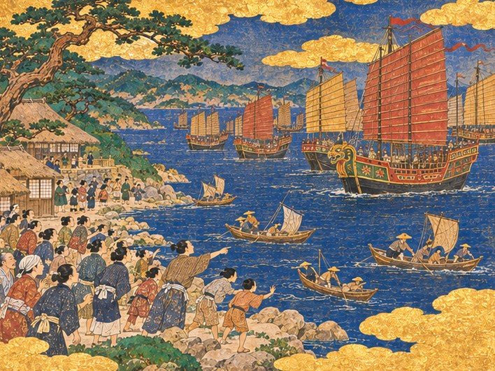
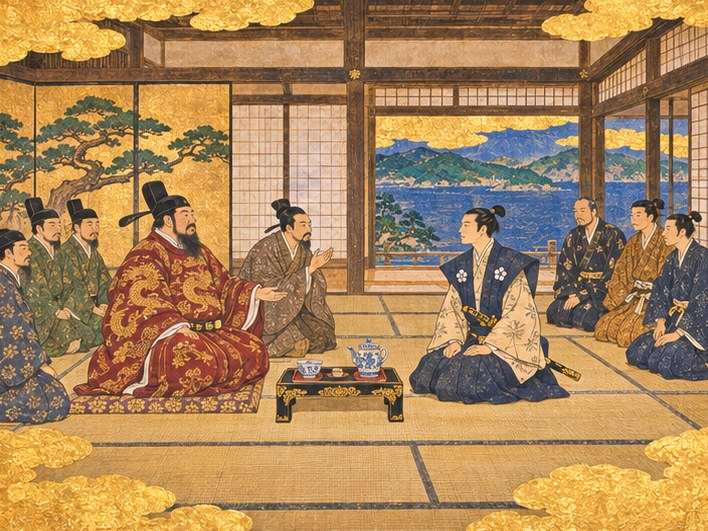
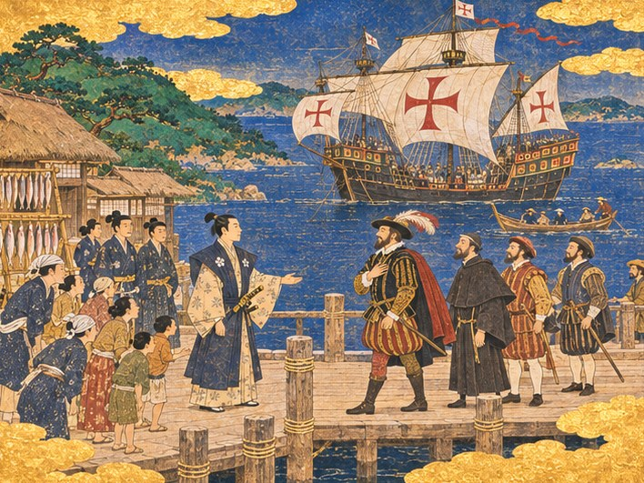
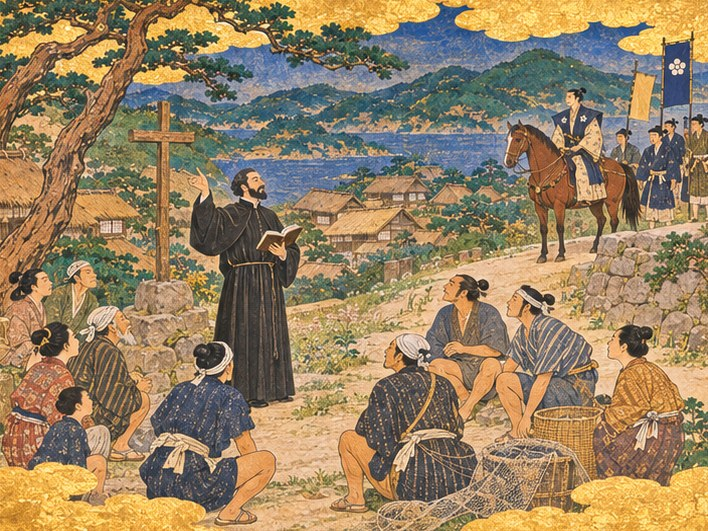
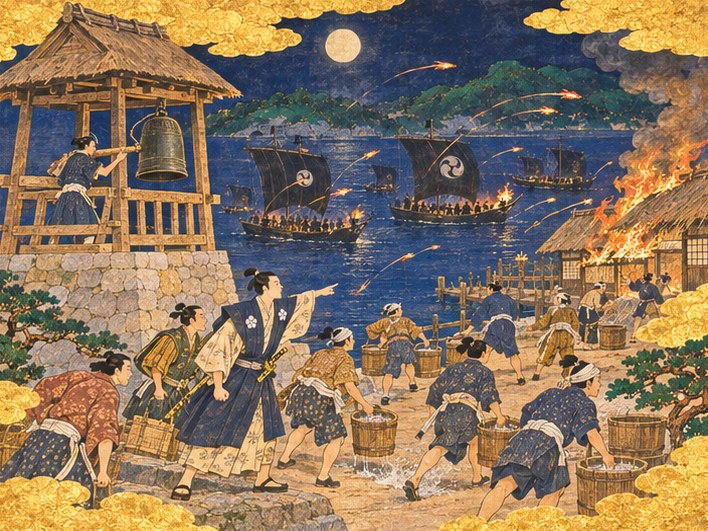

## 11. 돛으로 덮인 바다

1550년 여름, 히라도 만의 물은 아침부터 유난히 잔잔했다.

요헤이가 영주관 마당으로 뛰어든 것은 해가 소나무 가지 위로 막 올라섰을 때였다. 짚신 한 짝이 벗겨진 채였다.

"나, 나리! 저게 다 배입니까? 바다가 돛으로 덮였습니다!"

하야토는 붓을 내려놓고 툇마루로 나섰다. 언덕 아래 포구가 한눈에 내려다보였다. 만 어귀에서 돛이 하나둘 나타나고 있었다. 하나둘이 아니었다. 붉은 돛, 누런 돛, 대나무 살을 가로로 댄 커다란 돛이 겹겹이 밀려들었다. 돛대 끝마다 오색 깃발이 바람을 탔다. 섬과 섬 사이의 바다가 갑자기 좁아 보였다.

포구로 내려가는 길에 마을 사람들이 쏟아져 나와 있었다. 아낙들은 생선 바구니를 인 채 멈춰 섰고, 아이들은 바위 위로 기어올라 손가락질을 했다.

작년 이맘때만 해도 이 포구에 묶인 배는 고깃배 몇 척이 전부였다. 장터에 지붕을 올리고 주점과 여관에 등을 단 지 한 해. 히라도는 겨우 포구 마을 소리를 듣게 되었다. 그 작은 포구 앞으로 지금 바다 하나가 통째로 밀려오고 있었다.

임가는 벌써 부두 끝에 나가 있었다. 바닷바람에 소매가 부풀었다. 그는 맨 앞에 선 큰 정크의 뱃머리를 오래 바라보다가 하야토를 돌아보았다.

"왕직 어른의 선단입니다. 명에서는 해적이라 부르고, 바다에서는 왕이라 부르지요."

"해적이라." 하야토가 되뇌었다.

"명의 법으로는 그렇습니다. 명은 바다에 빗장을 걸었으니, 빗장 밖에서 장사하는 사람은 모두 해적이 됩니다. 그러나 남쪽 바다의 상인들은 저 깃발을 보면 길을 비키고, 저 깃발 아래서 값을 정합니다."

고타로가 칼자루에 손을 얹은 채 뒤따라왔다. 늙은 수군 대장은 정크의 수를 손가락으로 세다가 그만두었다.

"나리, 저 배 한 척이면 우리 포구를 통째로 살 수 있겠습니다."

농담처럼 들리지 않았다. 정크의 뱃전마다 작은 포가 걸려 있었다. 히라도마루 한 척으로는 저 가운데 한 척도 감당하기 어려웠다.

하야토는 부두 끝에 섰다. 한 해 전 비에 젖어 삐걱대던 자리였다. 이제는 곤베가 새로 깐 삼나무 판자가 발밑에서 단단했다.

"사러 온 것이 아니라 머물 곳을 찾으러 온 것이라면, 우리가 고를 수 있소."

고타로가 하야토의 옆얼굴을 보았다. 무언가 말하려다 그만두고 고개를 끄덕였다.

오린은 언덕 중턱에서 주판을 품에 안고 내려오고 있었다. 숨을 고르며 바다를 보더니 낮게 중얼거렸다.

"저 배들이 한 번씩만 장을 봐도 올해 세금은 걱정 없겠네요."

"오린, 지금 셈부터 하는 것이냐."

"셈을 안 하면 누가 해요. 나리는 지금 겁먹은 얼굴을 안 하시느라 바쁘신데."

선단은 만 안쪽까지 들어오지 않았다. 큰 배들은 물 깊은 곳에 닻을 내렸고, 삿갓을 쓴 사공들의 거룻배가 그 사이를 오가기 시작했다. 가장 큰 정크에서 붉은 비단옷을 입은 사내가 작은 배로 옮겨 탔다. 사내는 흔들리는 배 위에서도 등을 곧게 펴고 앉아 있었다.

"오십니다." 임가가 말했다. 목소리가 조금 떨렸다. "나리, 그분은 말을 아끼십니다. 그러니 한마디 한마디를 무겁게 들으셔야 합니다."

하야토는 소매를 여몄다. 아버지가 평생 기다리기만 했다는, 배가 가득 찬 포구. 그 포구가 지금 눈앞에 있었다. 다만 그 배들은 히라도의 배가 아니었다.

## 12. 마시지 않는 차

영주관 다다미 방은 하야토가 가진 방 가운데 가장 넓었다. 그래도 왕직과 그를 따라온 사람들이 앉자 방이 좁아 보였다.

왕직은 찻상 앞에 책상다리로 앉았다. 붉은 비단에 금실로 수놓은 용이 어깨에서 소맷자락까지 휘감겨 있었다. 머리에는 검은 관을 썼다. 수염은 길고 숱이 많았다. 눈은 크지 않았지만, 한번 머문 곳에서 쉽게 떠나지 않았다.

오린이 차를 내왔다. 흰 바탕에 푸른 꽃을 그린 찻잔이었다. 아버지 대부터 창고 깊숙이 넣어 두었던, 단 한 벌뿐인 명나라 자기였다. 오린이 그것을 꺼내며, 깨면 장부에서 지울 수도 없다고 중얼거리는 것을 하야토는 들었다.

왕직은 찻잔을 들었다. 그리고 마시지 않았다. 잔을 손바닥에 올린 채 바닥의 무늬를 들여다보았다.

"경덕진의 것이군." 그가 말했다. 임가가 일본 말로 옮겼다. "이제 명에서는 이 잔을 실어 내다 들키면 목이 달아나오."

하야토는 대답하지 않고 기다렸다. 임가가 미리 일러 준 대로였다.

창밖으로 만이 내려다보였다. 닻을 내린 정크들이 푸른 물 위에 붉은 점처럼 박혀 있었다.

"젊은 영주. 명의 바다는 닫혔소. 해금이라 하지. 그래서 나는 문이 열린 포구가 필요하오."

왕직의 말은 짧았다. 임가의 통역도 짧았다. 그런데 그 짧은 말 뒤에 수십 척의 배와 수천의 사람이 서 있었다.

하야토는 무릎 위에 올린 손에 힘을 주었다. 기다리는 동안 빚이 먼저 찼다던 요헤이의 쓴웃음이 떠올랐다. 이 사람에게 고개를 숙이면 빚은 하루아침에 사라질 것이다. 그리고 히라도는 이 사람의 포구가 될 것이다.

"히라도의 문은 열려 있습니다." 하야토가 말했다. "다만 히라도의 법도 함께 지켜 주셔야 합니다."

방 안이 조용해졌다. 왕직 뒤에 앉은 사내 하나가 눈썹을 치켜올렸다. 하야토 뒤에 앉은 고타로의 숨소리가 멎었다.

임가가 그 말을 옮겼다. 천천히, 한 마디도 빼지 않고.

왕직이 처음으로 웃었다. 입가가 아니라 눈가에서 먼저 시작된 웃음이었다.

"법을 말하는 영주는 오랜만이군. 좋소. 내 사람들이 머물 거리를 하나 내주시오."

"거리라 하시면……"

임가가 몸을 앞으로 기울였다. "당인 거리입니다. 명 상인들이 모여 살고, 창고를 두고, 명의 말로 흥정하는 거리지요. 명 상인들이 모이면 비단과 도자기가 이 포구를 지납니다."

"그 거리에서 일어나는 일은 누가 다스리오?"

"히라도의 영주께서." 왕직이 대답했다. 임가가 옮기기도 전에 그의 눈이 먼저 대답하고 있었다. "그대가 방금 그렇게 말하지 않았소."

하야토는 고개를 숙였다. 깊지도 얕지도 않게.

회견이 끝날 때까지 왕직은 끝내 차를 마시지 않았다. 일어서면서 그는 식은 찻잔을 상 위에 내려놓았다. 잔이 상에 닿는 소리가 나지 않을 만큼 조심스러웠다.

손님들이 물러간 뒤, 오린이 찻잔을 거두다 말고 하야토 곁에 쪼그려 앉았다. 목소리를 한껏 낮췄다.

"나리, 거리를 세울 금화는 제가 장부에서 짜내 볼게요."

"그런데 그 사람, 왜 차를 안 마셨을까요."

고타로가 대신 대답했다. "바다에서 오래 산 사람은 남의 집 물을 함부로 마시지 않소. 독이 겁나서가 아니라, 신세를 지지 않으려고."

하야토는 상 위의 찻잔을 내려다보았다. 차는 식어서 겉에 엷은 막이 앉아 있었다. 다음에 저 사람이 이 방에 앉을 때는 이 잔을 비우게 하리라. 그는 그렇게 마음먹었다.

## 13. 붉은 등

당인 거리를 세울 터는 포구 동쪽, 장터와 부두 사이의 빈 땅으로 정했다. 장터에서 가깝고, 부두에서 짐을 부리기 좋고, 무엇보다 마을의 집들과 조금 떨어져 있었다.

"너무 붙여 놓으면 처음엔 싸운다." 곤베가 말뚝을 박으며 말했다. "조금 떨어뜨려 놔야 서로 궁금해서 찾아가지."

오린은 사흘 밤을 주판 앞에서 보냈다. 나흘째 아침, 눈 밑이 거뭇해진 얼굴로 장부를 하야토 앞에 내밀었다.

"됐어요. 대신 나리 겨울옷은 올해도 작년 걸로 입으세요."

"작년 것도 아버지 것이었다."

"그럼 더 좋네요."

공사가 시작되자 곤베의 목수들과 정크에서 내린 명나라 목수들이 지붕을 두고 하루가 멀다 하고 다퉜다. 명나라 목수들은 처마 끝을 하늘로 휘어 올리자 했고, 곤베는 히라도의 바람이 그 처마를 통째로 뜯어 갈 거라고 했다. 임가는 두 말을 오가느라 목이 쉬었다.

"곤베 어른은 바람이 무섭다 하시고, 저쪽 목수들은 처마가 낮으면 복이 들어오지 않는다 합니다."

"복은 바람이 안 불어야 들어오는 거다." 곤베가 끌을 내려놓았다. "그렇게 전해."

결국 처마는 반만 휘었다. 끝만 살짝 들어 올리고, 기와 밑에 굵은 서까래를 하나 더 댔다. 곤베는 그날 저녁 주점에서 명나라 목수의 우두머리와 같은 상에 앉아 있었다.

두 달이 지나 늦여름이 되었다. 마지막 기와가 올라간 날 밤, 거리의 처마마다 붉은 비단을 씌운 둥근 등이 걸렸다.

마을 사람들은 처음에 멀찍이 서서 구경만 했다. 아이들이 먼저 거리 안으로 뛰어들었고, 그다음에는 아낙들이 들어갔다. 요헤이는 끝까지 거리 어귀에서 팔짱을 끼고 있다가, 누군가 건넨 독한 명나라 술을 한 잔 받고서야 발을 들였다.

왕직은 그 거리를 한 바퀴 걸었다. 하야토가 곁에서 걸었다. 붉은 등빛이 두 사람의 얼굴을 번갈아 물들였다.

"붉은 등이 걸렸군. 약속을 지키는 영주에게는 나도 약속을 지키지."

이튿날 아침, 왕직의 사람들이 영주관에 궤짝 하나를 내려놓았다. 오린이 뚜껑을 열고 한참을 말없이 서 있었다. 금화였다. 세어 보니 오천이었다.

"나리." 오린의 목소리가 이상하게 갈라졌다. "이거면 빚의 절반이 넘어요."

"빚을 갚으라고 준 것이 아니다." 하야토가 말했다. "이 포구를 키우라고 준 것이다. 그분은 장사꾼이다. 남는 데에만 돈을 놓는다."

"그럼 남게 해 드려야죠."

그해 가을까지 명 상인과 그 식구들 백여 명이 당인 거리에 짐을 풀었다. 비단과 도자기, 약재와 서책이 히라도 부두를 지나 사카이와 하카타로 실려 갔다. 영파와 천주의 상인들 사이에서 히라도라는 이름이 오르내리기 시작했다. 왕직의 깃발이 머무는 포구, 그리고 그 깃발 위에 제 법을 걸어 둔 젊은 영주의 포구로.

## 14. 흰 돛의 붉은 십자가

그해 가을, 흰 돛에 붉은 십자가를 단 배가 수평선에 나타났다.

마을 아이들이 먼저 보았다. 아이들은 소리를 지르며 언덕으로 달려 올라갔다. 정크와는 생김새부터 달랐다. 뱃머리와 꼬리가 성처럼 높이 솟았고, 돛은 하얗고 둥글게 부풀었다. 돛마다 붉은 십자가가 하나씩 박혀 있었다.

"저건 또 무슨 배야?" 요헤이가 이마에 손을 얹었다. "바다가 미쳤나. 올해는 별 배가 다 오네."

"남만 배다." 고타로가 말했다. "철포를 싣고 온다지."

배는 만 어귀에서 한참 물 깊이를 재다가 천천히 안으로 들어와 닻을 내렸다. 그런데 기울어 있었다. 오른쪽 뱃전이 물에 조금 더 잠겨 있었고, 돛 하나는 기운 자국이 누덕누덕했다.

거룻배가 부두에 닿았다. 줄무늬 바지에 깃털 꽂은 모자를 쓴 사내가 먼저 판자 위로 올라섰다. 검게 그은 얼굴에 수염을 짧게 다듬었다. 망토 자락이 바닷바람에 붉게 펄럭였다. 그 뒤로 검은 옷을 입은 사람과 칼을 찬 선원들이 따랐다.

부두에 몰려든 마을 사람들이 한 걸음씩 물러섰다. 키가 컸다. 눈 색이 달랐다.

하야토는 물러서지 않았다. 그는 부두 한가운데로 걸어 나가 남만 사내 앞에 섰다.

사내가 모자를 벗어 가슴에 댔다. 그리고 서툴지만 알아들을 수 있는 일본 말로 말했다.

"히라도의 영주십니까? 저는 주앙 소아레스, 이 배의 항해사입니다. 마카오에서 오는 길이지요."

"남만의 배가 히라도에 오다니. 무엇을 싣고 오셨소?"

"생사와 비단, 그리고 철포. 무엇보다 은을 찾고 있습니다."

주앙은 거기서 잠시 말을 멈추고 등 뒤의 배를 돌아보았다. 웃음기가 가셨다.

"다만 배가 많이 상했습니다. 류큐 근처에서 폭풍을 만났지요. 고칠 곳이 있을까요?"

곤베가 사람들 틈에서 나왔다. 대목장은 대답하기 전에 부두 끝까지 걸어가 남만 배를 오래 바라보았다. 기운 뱃전, 깊이 잠긴 고물, 이음매에서 새어 나오는 검은 물줄기. 그는 돌아와서 고개를 저었다.

"조선소가 없으면 저 큰 배는 못 고쳐. 배를 뭍으로 끌어 올려 바닥을 봐야 하는데, 그러려면 큰 터가 필요하다. 지금 히라도엔 그런 데가 없어."

주앙은 곤베의 말을 다 알아듣지 못했다. 그래도 고개를 젓는 뜻은 알아들었다. 그는 하야토를 보았다.

"배를 고쳐 주신다면, 다음 해에도 그다음 해에도 히라도로 오겠습니다."

"고칠 곳을 만들겠소." 하야토가 말했다. "그동안 배에서 내려 쉬시오. 여관이 있소."

"빨리 대답하지 않으면 당신 배가 먼저 가라앉을 것 같아서요."

주앙이 소리 내어 웃었다. 이가 하얗게 드러났다.

그날 저녁, 주앙은 영주관에 찾아와 함께 배를 타고 싶다고 했다. 자기 배가 고쳐질 때까지 히라도마루를 따라다니며 이 바다를 배우겠다고. 고타로는 미덥지 않은 얼굴이었다. 그러나 주앙이 펼친 해도를 보고는 말이 없어졌다. 류큐에서 마카오까지, 섬마다 물 깊이가 깨알 같은 글씨로 적혀 있었다.

"……배에 자리를 내드리지."

남만 선원 여럿이 히라도에 머물게 되었다. 그들은 생선을 날로 먹는 것을 보고 기겁했다가, 사흘째에는 젓가락을 쥐고 앉아 있었다.

## 15. 길가의 설교

며칠 뒤, 하야토는 고타로와 함께 말을 타고 포구 위쪽 언덕길을 돌았다. 새로 들어온 사람들이 어디에 자리를 잡는지 보고 싶었다.

길모퉁이에 사람들이 모여 있었다. 어부들이 그물 바구니를 옆에 내려놓고 둘러앉아 있었다. 그 가운데에 검은 옷의 남만 사람이 서 있었다. 주앙의 배에서 함께 내린 사람이었다. 그는 나무로 엮은 커다란 십자가 옆에서 책 한 권을 펼쳐 들고, 다른 손을 하늘로 들어 올리고 있었다.

낯선 말이었다. 어부들은 고개를 갸웃했다. 그래도 자리를 뜨는 사람은 없었다.

하야토는 언덕 위에서 말을 세웠다. 가까이 가지 않았다. 가까이 가면 사람들이 영주를 보느라 저 사람을 보지 않을 것 같았다.

"주앙의 배를 타고 온 신부랍니다." 고타로가 말했다. "하비에르라 하던가. 가고시마에서 한 해를 보내고 왔다더군요."

"무엇을 말하고 있소?"

"하늘의 말씀이라 합디다. 저도 모르겠습니다. 다만 저 사람은 그걸 전하러 반년 넘게 바다를 건너왔답니다. 장사도 아니고, 싸움도 아니고."

하야토는 오래 지켜보았다. 장사꾼은 이익을 찾아 바다를 건넌다. 무사는 땅을 찾아 바다를 건넌다. 저 사람은 무엇을 찾아 건너왔을까.

설교가 끝나자 신부는 하야토를 알아보았다. 그는 책을 덮고 언덕길을 올라와 말 앞에 섰다. 고개를 숙였다. 수염 사이로 웃음이 보였다.

"이 땅의 영주님께 인사드립니다. 저는 하늘의 말씀을 전하러 먼 바다를 건너왔습니다."

하야토는 말에서 내렸다. 말 위에서 대답할 일이 아니라고 생각했다.

"말씀은 자유요. 다만 히라도 사람들이 서로 다투지 않도록 해 주시오."

하비에르는 그 말을 곱씹듯 눈을 감았다가 떴다. "그것이 제가 전하려는 말씀의 처음이자 끝입니다."

신부는 히라도에 오래 머물지 않고 도읍으로 갈 거라고 했다. 하야토는 그 길이 얼마나 험한지 말해 주었다. 신부는 그래도 가겠다고 했다. 하야토는 그 고집이 어딘지 낯익다고 생각했다.

영주관으로 돌아오는 길에 요헤이가 기다리고 있었다. 촌장의 얼굴이 굳어 있었다. 그는 주위를 한번 둘러보고 목소리를 낮췄다.

"나리, 사당 어른들이 불편해합니다. 남만 신이 바다신을 노하게 한다고요. 올가을 고기가 덜 잡힌 것도 저 사람 탓이라고 수군댑니다."

그날 밤, 오린이 장부를 덮고 말했다.

"민심은 장부에 안 적히지만 세금에는 적혀요. 사당을 손보면 마을 사람들이 안심할 거예요."

"남만 신부를 쫓아내라는 말은 안 하는구나."

"쫓아내면 남만 배가 안 와요. 남만 배가 안 오면 은이 안 와요."

하야토는 이튿날 아침 요헤이를 불러, 바닷가 낡은 사당의 기둥부터 갈아 끼우라고 일렀다. 품삯은 영주관에서 대겠다고 했다.

## 16. 큰 배의 집

주앙의 배는 기다려 주지 않았다. 날이 갈수록 고물이 깊이 잠겼다. 선원들이 밤낮으로 물을 퍼냈다.

곤베는 포구 서쪽 모래톱을 골랐다. 어부들이 그물을 말리던 넓은 땅이었다. 물이 얕게 들어오다가 갑자기 깊어지는 곳이라, 배를 끌어 올렸다 내리기에 좋았다.

"여기밖에 없다. 큰 배를 올리려면 이만한 땅이 통째로 있어야 해."

어부들은 투덜대면서도 그물을 걷었다. 늙은 대목장의 말은 마을에서 영주의 말 다음으로 무거웠다. 어떤 때는 영주의 말보다 무거웠다.

왕직의 금화가 있어서 오린의 셈은 이번에는 하룻밤이면 됐다. 목재는 히라도 교역소에서 사들였다. 남만 선원들이 짐을 날랐다. 그들은 당기는 톱이 미는 톱보다 빠르다는 것을 알고는 서로 다투어 써 보려 했다.

모래톱에 굵은 통나무를 깔고, 그 위로 배를 끌어 올릴 비탈을 놓았다. 비탈 양옆에 기둥을 세우고 지붕을 얹었다. 도르래와 밧줄을 걸 들보는 곤베가 직접 골랐다. 그는 들보마다 손바닥을 대 보고, 귀를 대 보고, 망치로 한 번씩 두드려 보았다.

"소리가 맑으면 속이 찬 거다. 탁하면 썩은 거고."

겨울이 오기 전에 조선소가 섰다. 마을 사람 절반과 남만 선원들, 당인 거리의 명 상인들까지 밧줄을 잡았다. 곤베가 손을 내릴 때마다 모두 한꺼번에 당겼다. 기울어진 남만 배가 삐걱이며 모래톱 위로 끌려 올라왔다. 바닥에 조개와 해초가 수염처럼 늘어져 있었다.

주앙은 새 조선소를 한 바퀴 둘러보고 돌아서서 크게 웃었다.

"리스본의 조선소보다 작지만, 목수들의 손은 더 빠르군요!"

"작은 포구에서는 손이 빨라야 살아남지." 곤베가 웃었다. 하야토가 그 늙은이의 웃음소리를 들은 것은 처음이었다.

남만 배는 그 겨울 내내 조선소에 누워 있었다. 봄이 되자 새 널판을 대고 바닥에 역청을 먹인 배가 다시 물 위로 내려갔다. 주앙의 선장은 떠나기 전 영주관에 들러 철포 두 자루를 두고 갔다. 다음 계절풍에 다시 오겠다는 약속과 함께.

그 약속은 마카오까지 퍼졌다. 일본 서쪽 끝에, 큰 배를 고칠 수 있는 포구가 있다고.

## 17. 살찐 포구

1551년과 1552년, 히라도는 해마다 몰라보게 달라졌다.

봄이면 명의 정크가 왔다. 가을이면 남만 배가 왔다. 그 사이에는 사카이와 하카타의 상선이 비단을 사러 왔다. 부두는 두 번 더 늘렸다. 여관은 방이 모자라 마루에도 사람을 재웠다. 주점에서는 일본 말과 명나라 말과 남만 말이 한 상에서 섞였다. 셈이 안 맞으면 다들 손가락을 펴서 숫자를 세었다. 손가락 셈은 어느 나라 말로도 같았다.

오린은 장부를 두 권으로 나눴다. 한 권에는 금화를, 한 권에는 사람을 적었다. 누가 왜 왔는지를 적어 둬야 누가 왜 떠나는지도 안다고 했다.

임가는 당인 거리와 영주관 사이를 하루에도 몇 번씩 오갔다. 명 상인들의 다툼을 말리고, 일본 상인들의 불평을 옮겼다. 밤이면 영주관 구석에서 장부를 썼다. 오린의 장부와는 다른 장부였다.

"은혜 장부입니다." 하야토가 묻자 임가가 웃었다. "나리께서 다친 사람부터 옮기라 하신 날, 그 줄부터 시작했습니다. 아직 한 줄도 지우지 못했습니다."

그러나 살찐 포구에는 다른 것도 꼬였다.

고타로는 한동안 밤마다 부두를 돌았다. 그는 하야토에게 오도 열도 쪽 바다에서 낯선 배를 보았다는 어부들의 말을 전했다. 돛이 검다고 했다. 낮에는 멀리서 맴돌다 밤이 되면 사라진다고.

"고기 냄새를 맡은 갈매기입니다." 고타로가 말했다. "포구가 굶을 때는 거들떠보지도 않더니."

"막을 수 있겠소?"

"망루가 있으면 먼저 보고, 성채가 있으면 먼저 쏩니다. 지금 히라도엔 둘 다 없지요." 늙은 수군 대장은 바다 쪽을 보았다. "있는 건 히라도마루 한 척과, 고깃배 돌아올 때 치던 낡은 종 하나입니다."

하야토는 그 말을 마음에 새겼다. 그러나 그해에는 금화가 조선소와 부두로 다 들어갔다. 망루는 내년에, 하고 그는 생각했다. 그 내년이 오기 전에 검은 돛이 먼저 왔다.

## 18. 검은 돛

달이 밝은 밤이었다.

하야토는 잠들지 못하고 툇마루에 앉아 있었다. 새로 짓기 시작한 창고 공사장의 품삯이 머릿속에서 굴러다녔다. 바다 쪽에서 무언가 반짝였다. 물에 비친 달빛인 줄 알았다. 그런데 반짝임이 하늘로 솟았다. 긴 꼬리를 끌며 포구 쪽으로 떨어졌다.

불화살이었다.

두 번째, 세 번째 화살이 뒤따랐다. 공사장 지붕에 꽂혔다. 마른 짚과 대팻밥이 순식간에 불길을 토했다.

그때 종이 울렸다. 돌축대 위에 나무로 엮어 올린 종루, 고깃배가 돌아올 때나 치던 그 낡은 종이었다. 누군가 미친 듯이 당목을 밀어붙이고 있었다. 종소리가 만을 건너 섬과 섬 사이로 울려 퍼졌다.

하야토는 칼을 쥐고 언덕을 달려 내려갔다.

포구는 이미 불빛으로 붉었다. 만 안쪽으로 검은 돛을 단 배들이 미끄러져 들어오고 있었다. 돛마다 흰 소용돌이 문양이 그려져 있었다. 뱃전에서 횃불을 든 사내들이 활을 당겼다. 화살이 별똥처럼 쏟아졌다.

"물! 물을 날라라!"

요헤이가 맨발로 뛰어다니며 소리쳤다. 사내들이 물통을 날랐다. 남만 선원들과 당인 거리의 명 상인들도 그 줄에 끼었다.

고타로가 갑옷 끈도 다 매지 못한 채 달려왔다. 그는 바다를 한 번 보더니 이를 갈았다.

"나리, 오도 열도의 구로하타 패거리입니다! 포구가 커지니 냄새를 맡은 겁니다!"

"몇 척이오?"

"보이는 건 둘입니다. 빠른 관선이지요. 불을 놓고, 날이 새기 전에 빠질 셈입니다."

하야토는 불타는 공사장을 보았다. 오린이 장부 상자를 안고 영주관 쪽으로 달려가는 것이 보였다. 아이 하나가 울면서 어머니를 찾았다.

여기서 물통만 나르고 있으면 저들은 날이 새도록 화살을 쏠 것이다. 히라도가 한 해 동안 쌓은 것이 하룻밤에 재가 될 것이다.

"바다로 나가 막는다. 고타로, 히라도마루를 띄워라!"

고타로는 대답 대신 돌아서서 뱃사람들 이름을 하나하나 불렀다. 주점에서 뛰어나온 선원들이 부두로 달려갔다.

"주앙!"

"여기 있습니다!" 남만 항해사가 물통을 내던지고 달려왔다. 얼굴이 그을음으로 새까맸다. "바람은 뭍에서 바다로 붑니다. 지금 나가면 저놈들 등 뒤를 잡습니다!"

## 19. 히라도 앞바다

히라도마루는 낡은 배였다. 선대가 남긴 단 한 척의 안택선. 그러나 고타로의 손 안에서 그 배는 늙은이답지 않게 빨랐다.

뭍바람이 돛을 밀었다. 포구의 불빛이 뒤로 멀어졌다. 앞쪽 달빛 아래 검은 돛 두 장이 보였다. 해적들은 포구만 보고 있었다. 바다 쪽에서 배가 나오리라고는 생각하지 못한 모양이었다.

"왼쪽으로 꺾으시오!" 주앙이 뱃머리에서 외쳤다. "저 배의 바람을 가로채야 합니다!"

"좋소. 이 바다도 바람은 같으니." 고타로가 키를 돌렸다.

히라도마루가 해적선의 바람 위로 올라섰다. 검은 돛이 갑자기 힘을 잃고 펄럭였다. 해적선의 뱃전에서 누군가 이쪽을 가리키며 고함을 질렀다.

가장 큰 관선의 뱃머리에 사내 하나가 올라섰다. 어깨가 넓고 머리를 질끈 동여맸다. 횃불에 비친 얼굴에 칼자국이 비스듬히 그어져 있었다. 그는 칼끝으로 히라도마루를 가리켰다.

"히라도의 애송이 영주로구나! 네 포구가 살찐 만큼 내 몫도 커졌다!"

하야토는 뱃전을 붙잡고 섰다. 바닷바람이 소매를 뒤로 잡아당겼다. 등 뒤에서 포구가 타고 있었다. 그 불빛이 그의 등을 밀었다.

"히라도의 몫은 히라도 사람들 것이다. 돌아가라!"

구로하타가 웃었다. 웃음소리가 물 위로 굴러왔다. 그리고 화살이 날아왔다.

싸움은 짧고 사나웠다. 히라도마루의 뱃전에 화살이 박혔다. 선원 하나가 어깨를 맞고 쓰러졌다. 주앙의 선장이 두고 간 철포 두 자루가 불을 뿜었다. 천둥 같은 소리에 해적선의 노꾼들이 노를 놓쳤다. 고타로가 그 틈을 놓치지 않았다. 히라도마루의 묵직한 뱃머리가 작은 관선의 옆구리를 들이받았다. 나무 부서지는 소리가 비명처럼 울렸다.

갈고리가 걸렸다. 해적 몇이 히라도마루로 뛰어넘어 왔다. 하야토는 칼을 뽑았다. 바다 위에서 칼을 뽑는 것은 처음이었다. 고타로의 칼이 그 옆을 지켰다. 늙은 수군 대장은 칼을 크게 휘두르지 않았다. 짧게, 정확하게, 상대의 손목만 쳤다. 해적들의 칼이 하나둘 갑판에 떨어졌다.

부딪힌 관선이 기울기 시작하자, 큰 배 쪽에서 징이 울렸다. 물러나라는 소리였다. 해적들은 기운 배를 버리고 큰 배로 옮겨 탔다. 검은 돛이 돌아섰다. 오도 열도 쪽 어둠 속으로 빠르게 멀어졌다.

구로하타는 멀어지면서도 끝까지 히라도마루를 노려보았다.

"검은 돛이 흩어졌습니다!" 고타로가 숨을 몰아쉬며 외쳤다. 이마에 땀과 피가 섞여 흘렀다. 그는 뱃전을 손바닥으로 두드렸다. "히라도마루가 아직 쓸 만하군요!"

주앙이 철포를 내려놓고 털썩 주저앉았다. "영주님, 저는 상인 배의 항해사지, 해전을 하러 온 사람이 아닙니다."

"나도 영주지, 해전을 하러 온 사람이 아니오."

세 사람은 잠시 아무 말 없이 웃었다. 웃음 끝에 하야토의 손이 다시 떨리기 시작했다. 싸우는 동안에는 떨리지 않던 손이었다.

## 20. 횃불

히라도마루가 만으로 돌아왔을 때는 동이 트고 있었다.

부두에 사람들이 나와 있었다. 손마다 횃불을 들고 있었다. 밤새 불을 끄던 그 횃불이었다. 배가 부두에 닿자 함성이 터졌다.

"나리가 포구를 지켰다! 마을이 다 나와 횃불을 들었습니다!"

요헤이였다. 촌장의 얼굴은 그을음 투성이였고 수염 한쪽이 그슬려 있었다. 그는 하야토의 손을 잡고 몇 번이나 흔들었다. 한 해 전, 기다리기만 하다 빚이 찼다며 쓴웃음을 짓던 그 얼굴이 아니었다.

공사장은 절반이 탔다. 곤베는 타다 남은 기둥을 하나하나 두드려 보고 있었다. 탁한 소리가 나는 것은 옆으로 밀어 두고, 맑은 소리가 나는 것은 따로 쌓았다.

"반은 다시 써도 된다." 그가 말했다. "나무는 겉이 타도 속이 살아 있으면 쓸 만해. 사람도 그렇고."

오린은 장부 상자를 안고 영주관 계단에 앉아 있었다. 밤새 그러고 있었던 모양이었다. 하야토를 보자 일어나려다 다리가 저려 다시 주저앉았다.

"다친 사람은 열하나예요. 죽은 사람은 없어요." 그녀가 먼저 말했다. 목소리는 평소처럼 또박또박했다. 눈가만 붉었다. "셈은 내일 할게요. 오늘은 못 하겠어요."

그날 오후, 당인 거리의 명 상인들이 불탄 집 식구들에게 쌀가마를 날라 왔다. 사당 어른들은 바닷가에서 바다신께 감사의 제를 올렸고, 하비에르가 남기고 간 몇 안 되는 신자들은 언덕 위 십자가 앞에서 기도를 했다. 하야토는 두 곳에 모두 들렀다. 어느 쪽도 그냥 지나치지 않았다.

해 질 녘, 고타로가 하야토를 데리고 만 어귀의 바위 언덕에 올랐다. 포구 입구가 한눈에 보이는 자리였다. 바다는 다시 잔잔했다. 어젯밤 일이 꿈처럼 느껴졌다.

"여기입니다." 고타로가 발로 땅을 굴렀다. "여기 망루를 세우면 검은 돛을 한나절 먼저 봅니다. 그리고 언젠가는, 저 아래 물목에 돌로 성채를 쌓아야 합니다. 구로하타는 오늘 진 것을 잊지 않을 겁니다. 다음에는 더 많이 데려올 겁니다."

"알고 있소."

"포구가 커질수록 탐내는 놈도 커집니다. 선대께서는 그걸 알고 계셨지요. 그래서 기다리기만 하셨는지도 모릅니다."

하야토는 바위 끝에 서서 포구를 내려다보았다. 붉은 등이 하나둘 켜지는 당인 거리. 반쯤 탄 공사장 위로 벌써 새 서까래를 올리는 곤베의 목수들.

"아버지는 기다리셨소." 그가 말했다. "나는 지키겠소. 지키면서 키우겠소."

바람이 바다에서 뭍으로 돌아섰다. 저녁 바람이었다. 고타로는 그 바람 냄새를 오래 맡았다. 그리고 아주 작게 고개를 끄덕였다.
