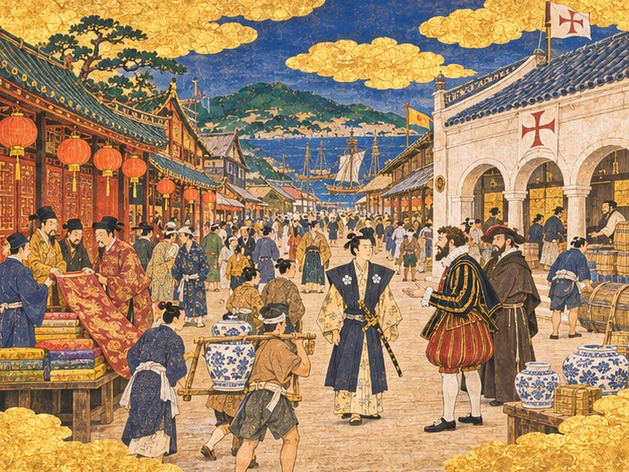
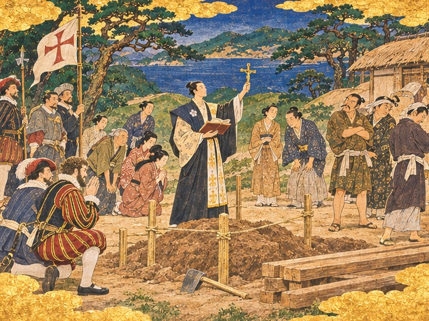
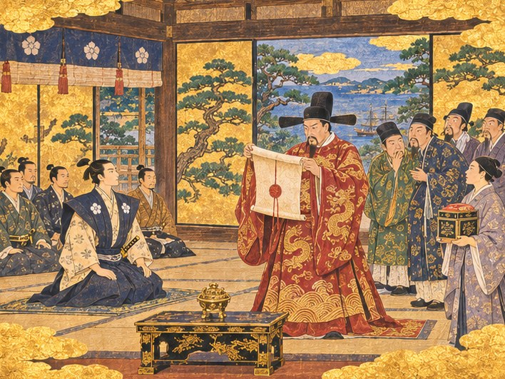
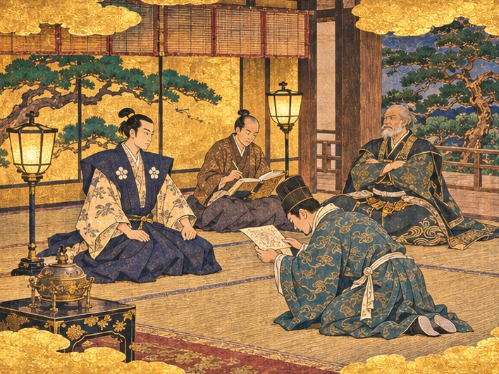

## 21. 붉은 등과 흰 벽

1553년. 히라도의 거리는 몇 해 사이 몰라보게 붐볐다.

아침이면 부두에서 장터까지 가는 길이 사람으로 막혔다. 붉은 등 아래에서는 명 상인들이 비단 필을 펼쳐 놓고 값을 불렀다. 길 건너 하얀 벽 아래에서는 남만 선원들이 술통을 굴렸다. 그 사이를 짐꾼들이 푸른 꽃무늬 항아리를 장대에 매달고 지나갔다. 어깨를 부딪쳐도 아무도 화를 내지 않았다. 화낼 틈이 없을 만큼 바빴다.

하야토는 스물넷이 되었다. 아침마다 거리를 한 바퀴 걷는 것이 버릇이 되었다. 장부로는 보이지 않는 것이 거리에서는 보였다. 어느 가게에 사람이 몰리는지, 어느 처마 밑에서 다툼이 나는지, 어느 집 아이가 남만 말을 먼저 배우는지.

그날 아침, 주앙이 거리 한복판에서 그를 붙잡았다. 줄무늬 옷에 깃 장식을 단 남만 상인 하나와 함께였다. 해마다 계절풍을 타고 들어오는 마카오의 상인이었다.

"영주님, 남만 상인들이 히라도에 상관을 열고 싶어 합니다. 은을 비단과 바꿀 창고와 환전소지요."

"지금도 배에서 바꾸고 있지 않소?"

"배에서 바꾸면 배가 떠날 때 거래도 끝납니다." 주앙이 손으로 거리를 가리켰다. "상관이 있으면 배가 없는 계절에도 거래가 이어집니다. 마카오의 비단이 여기서 겨울을 나고, 일본의 은이 여기서 배를 기다리지요. 히라도가 정거장이 아니라 창고가 되는 겁니다."

남만 상인이 무어라 덧붙였다. 주앙이 옮겼다.

"벽은 돌로 쌓아 달랍니다. 불이 나도 은이 녹지 않게요. 구로하타 이야기를 마카오에서도 들었답니다."

그날 저녁 오린은 주판을 오래 튕겼다. 이제 그녀의 장부는 세 권이었다. 금화, 사람, 그리고 자재.

"석재가 꽤 들어요. 석재는 히라도 교역소에서 팔지만 금화가 문제예요. 세금만으로는 일 년을 기다려야 해요."

"일 년이면 마카오 상인들이 다른 포구를 찾을 것이다."

"그러니까요." 오린이 장부를 덮었다. "나리가 벌어 오세요. 사카이와 하카타 상인들이 짐 실어 줄 배를 찾는다고 교역소에 방이 붙었어요. 해적 쫓아 줄 배도 찾고요. 히라도마루가 놀고 있잖아요."

고타로가 헛기침을 했다. "놀고 있다니. 이 늙은이가 날마다 닦고 있소."

"닦기만 하잖아요."

하야토는 웃었다. 그리고 창밖의 거리를 내려다보았다. 붉은 등과 하얀 벽 사이에 아직 빈 땅이 하나 남아 있었다.

"남만 상관이 서면 은이 이 포구를 지나간다. 짓자."

## 22. 은이 지나가는 집

그해 여름과 가을, 히라도마루는 거의 포구에 머물지 않았다.

사카이 상인의 칠기를 싣고 하카타로 갔다. 하카타에서 소금을 싣고 나가사키로 갔다. 오도 열도 쪽 물목에 해적이 나온다는 말이 돌면, 상선 두 척을 앞세우고 그 물목을 지나 주었다. 고타로는 투덜대면서도 그 일을 좋아했다. 바다 위에 있을 때 늙은 수군 대장의 허리는 꼿꼿했다.

주앙은 키 옆에서 새 해도를 그렸다. 히라도에서 사카이까지, 섬마다 물 깊이와 물살의 방향을 적었다.

"남만 사람이 일본 바다 해도를 그리다니." 고타로가 어깨 너머로 들여다보았다.

"일본 사람이 남만 철포를 쏘는 것과 같지요." 주앙이 웃었다. "바다는 먼저 적는 사람의 것입니다."

돌아올 때마다 오린은 금화를 받아 세고, 교역소로 사람을 보냈다. 교역소의 석재 더미가 조금씩 부두 쪽으로 옮겨졌다. 곤베는 그 돌을 하나하나 망치로 두드려 골랐다. 나무는 귀로 듣고 돌은 손으로 듣는다고 했다.

상관의 벽은 두껍게 쌓았다. 남만 상인이 그려 온 그림에는 둥근 아치가 셋 있었다. 곤베는 처음 보는 모양에 한참 이마를 찌푸렸다. 그러다 남만 선원 중에 리스본에서 석공 일을 했다는 사내를 찾아냈다. 둘은 말 한마디 통하지 않았다. 그래도 땅바닥에 막대기로 그림을 그려 가며 아치를 쌓았다. 쐐기돌을 마지막에 끼우는 날, 곤베는 받침 나무를 빼기 전에 한참 숨을 골랐다. 나무를 빼자 돌들이 서로를 붙잡고 버텼다. 곤베는 아무 말 없이 남만 석공의 어깨를 두드렸다.

겨울이 오기 전에 상관이 섰다. 흰 회칠을 한 벽, 둥근 아치 셋, 지붕 위에는 깃대. 그 깃대에 붉은 십자가가 그려진 흰 깃발이 올랐다.

"상관 지붕에 포르투갈 깃발이 올랐습니다!" 주앙이 부두에서 뛰어 올라왔다. 숨이 찼다. "마카오의 상인들이 다음 계절풍에 배를 보낸답니다. 한 척이 아니라 여러 척을요!"

상관 안쪽에는 은을 다는 큰 저울이 걸렸다. 그 옆에 명 상인과 남만 상인이 함께 쓰는 환전소가 문을 열었다. 일본 은이 저울에 올라가면 마카오 비단이 내려왔다. 명 동전이 오가고 남만 금화가 오갔다. 오린은 하루 종일 환전소 문가에 서서 저울 눈금을 지켜보았다. 저울이 기울 때마다 그녀의 입술이 소리 없이 움직였다.

"오린, 무엇을 세느냐."

"히라도가 버는 거요. 한 번 기울 때마다 세금이 한 푼씩 떨어지거든요." 그녀는 눈을 저울에서 떼지 않았다. "나리, 은이 지나가기만 해도 돈이 남아요. 이런 장사가 세상에 있었네요."

이듬해 봄, 계절풍을 타고 남만 배 세 척이 들어왔다. 배마다 선원과 상인이 내렸고, 그 가운데 몇은 내리자마자 집터를 구했다. 히라도에 이백 명 넘는 사람이 새로 들어왔다. 남만 교역의 길목, 그 이름이 마카오에서 사카이까지 퍼져 나갔다.

## 23. 언덕 아래 빈터

그해 여름, 언덕 아래 빈터에 말뚝이 박혔다.

말뚝 사이에 새끼줄이 둘러쳐졌고, 그 안의 흙이 파헤쳐져 있었다. 옆에는 다듬은 목재가 쌓여 있었다. 젊은 남만 수사가 그 앞에 섰다. 한 손에는 책을, 한 손에는 작은 금빛 십자가를 들었다. 그는 십자가를 하늘로 들어 올리고 낯선 말로 기도를 올렸다.

남만 선원들이 무릎을 꿇었다. 모자를 벗어 가슴에 댔다. 마을 사람 몇도 그 뒤에서 조용히 손을 모았다. 하비에르가 떠나기 전 세례를 받은 어부의 아내들이었다.

그러나 빈터의 다른 쪽에는 다른 사람들이 서 있었다. 그물을 어깨에 걸친 어부들, 사당을 지키는 늙은이들. 그들은 팔짱을 끼고 수사의 십자가를 바라보았다. 아무도 말하지 않았다. 말하지 않아서 더 무거웠다.

기도가 끝나자 수사가 하야토에게로 왔다. 스물을 조금 넘겼을까. 얼굴이 희고 눈이 맑았다. 일본 말은 하비에르보다 훨씬 능숙했다.

"영주님, 하비에르 신부님은 떠나셨지만 저는 히라도에 남겠습니다. 작은 성당 하나만 허락해 주십시오."

그의 이름은 가스파르였다. 하비에르가 도읍으로 떠난 뒤, 남만 배를 타고 히라도를 다시 찾아온 젊은 수사였다. 그는 두 해째 히라도의 남만 선원들과 몇 안 되는 신자들을 돌보고 있었다. 기도는 늘 길가나 여관 방에서 올렸다.

요헤이가 하야토 곁으로 다가왔다. 촌장의 얼굴이 굳어 있었다. 몇 해 전 해적의 밤에 그슬린 수염은 다시 자랐지만, 그때보다 희어졌다.

"나리, 마을의 반은 구경하고 반은 등을 돌렸습니다."

"알고 있소."

"아시면서 허락하시렵니까. 성당이 서면 그 반이 어떻게 생각하겠습니까. 영주께서 남만 신 편을 드신다고 할 겁니다."

하야토는 빈터를 둘러보았다. 무릎 꿇은 사람들과 팔짱 낀 사람들. 그 사이에 새끼줄 한 가닥이 늘어져 있었다. 저 줄 하나가 마을을 둘로 가르고 있었다.

허락하지 않으면 남만 선원들은 섭섭해할 것이다. 섭섭한 선원들은 마카오에 돌아가 말할 것이다. 히라도는 은만 받고 신은 받지 않는 포구라고. 허락하면 사당 어른들이 등을 돌릴 것이다. 고기가 덜 잡힐 때마다 저 성당을 탓할 것이다.

어느 쪽을 택해도 반은 잃는다. 하야토는 그렇게 생각했다. 그리고 그다음 생각을 했다. 반을 잃지 않으려면, 둘 다를 택해야 한다.

"성당을 세우되, 사당도 함께 고치겠다." 그가 말했다. 크지 않은 목소리였다. 그러나 빈터의 양쪽 끝까지 들렸다. "히라도에서는 어느 신도 다른 신을 내쫓지 못한다."

빈터가 조용해졌다. 가스파르가 고개를 숙였다. 팔짱 낀 어부들 가운데 하나가 팔을 풀었다. 다른 하나는 풀지 않았다.

오린이 장부를 펴 들고 하야토 곁에 섰다.

"그 말, 장부 맨 앞장에 적어 둘게요."

"금화 장부에?"

"사람 장부에요." 오린이 붓을 꺼냈다. "그게 앞으로 히라도에서 제일 비싼 말이 될 거예요."

## 24. 두 개의 지붕

성당은 남만 선원들이 세웠다. 영주관은 터만 내주었다. 선원들은 배가 머무는 동안 짬짬이 나무를 깎고 기둥을 세웠다. 배가 떠나면 다음 배의 선원들이 이어서 지었다. 곤베는 가끔 들러 기둥의 수평을 봐 주었다. 나무는 신을 가리지 않는다고 했다.

같은 해 가을, 바닷가 사당도 새 지붕을 얹었다. 이번에는 영주관이 품삯을 댔다. 곤베의 목수들이 낡은 기와를 걷어 내고, 늙은 소나무 기둥을 새것으로 갈았다. 사당 어른들은 처음에는 그것이 성당을 허락한 값이라며 시큰둥했다. 그러나 새 지붕 아래에서 첫 제를 올리던 날, 하야토가 맨 앞줄에 앉아 있는 것을 보고는 말이 없어졌다.

다음 달, 하야토는 성당의 첫 미사에도 갔다. 맨 뒷줄 문가에 서서 끝까지 지켜보았다. 가스파르가 낯선 노래를 부르는 동안 남만 선원들이 눈을 감았다. 그 사이에 어부의 아내 몇이 섞여 있었다.

그래도 마을의 마음은 쉽게 하나가 되지 않았다. 장터에서 남만 선원에게 생선을 팔지 않겠다는 아낙이 생겼다. 성당 앞길로 다니지 않으려고 언덕을 빙 돌아가는 늙은이도 생겼다. 그해 오린의 장부에는 집 몇 채가 마을을 떠났다고 적혔다. 세금도 조금 줄었다.

"민심은 장부에 안 적힌다면서." 하야토가 장부를 넘기며 말했다.

"안 적히다가 이렇게 한꺼번에 적혀요." 오린이 한숨을 쉬었다. "그래도 이 정도면 싸게 막은 거예요. 나리가 사당에 안 가셨으면 열 채는 떠났을 거예요."

요헤이는 그 겨울 내내 집집을 돌았다. 남만 신이 바다신을 내쫓는 일은 없을 거라고. 영주께서 그렇게 말씀하셨고, 사당 지붕이 그 증거라고. 어느 날 밤 그는 영주관에 들러 하야토 앞에 털썩 앉았다.

"나리, 저는 아직도 남만 신이 마뜩잖습니다. 그건 바꾸지 못하겠습니다."

"바꾸라고 한 적 없소."

"그런데 마을 사람들한테는 괜찮다고 말하고 다닙니다." 요헤이가 쓴웃음을 지었다. "촌장 노릇이 이런 건 줄 알았으면 안 했을 겁니다."

"영주 노릇도 그렇소."

두 사람은 한참 아무 말 없이 화로를 쬐었다.

## 25. 계절풍의 해들

1554년과 1555년, 히라도는 계절풍과 함께 숨을 쉬었다.

여름 남서풍이 불면 마카오의 남만 배가 들어왔다. 겨울 북동풍이 불면 명의 정크가 남쪽으로 떠났다. 그 사이사이 사카이와 하카타의 상선이 비단을 사러 왔다. 부두는 다시 늘렸고, 여관은 두 채가 되었고, 창고는 세 채가 되었다. 장터는 이제 하루도 쉬지 않았다.

당인 거리와 남만 상관은 같은 비단을 두고 다투기 시작했다. 명 상인들은 정크로 직접 실어 온 비단을 팔았다. 남만 상인들은 마카오에서 사들인 명 비단을 팔았다. 같은 비단이 두 값으로 팔렸다.

"주앙, 당신네 비단은 우리 비단보다 석 달 늦게 온 것이오." 임가가 장터 한복판에서 따졌다. "그런데 값은 왜 더 받소."

"석 달 동안 바다를 건너왔으니까요. 우리 배는 비단을 바닷물에 적시지 않습니다."

"우리 정크도 안 적시오!"

"작년에 적신 건 누구였죠?"

구경꾼들이 웃었다. 임가의 얼굴이 붉어졌다. 그날 저녁, 두 사람은 같은 주점에서 같은 술병을 놓고 앉아 있었다. 하야토가 들렀을 때 둘은 비단 값을 반씩 양보하는 셈을 하고 있었다. 오린이 그 셈을 고쳐 주었다.

그러나 좋은 소식만 온 것은 아니었다.

왕직의 깃발이 히라도에 오는 일이 줄었다. 정크들은 여전히 왔지만, 그 붉은 비단옷의 사내가 영주관 다다미 방에 앉는 일은 없어졌다. 임가가 전하는 소식은 날이 갈수록 어두워졌다. 명이 바다를 더 단단히 잠그고 있다고 했다. 해안의 관리들이 바뀌었다고 했다. 명의 해안 마을들을 노략질하는 왜구들 때문에, 바다에서 장사하는 사람은 누구든 한데 묶여 해적으로 불린다고 했다.

"어른의 이름을 빌려 노략질하는 자들도 있습니다." 임가가 이를 악물었다. "그 죄가 고스란히 어른께 돌아갑니다."

하야토는 다다미 방의 찻상을 떠올렸다. 식은 차 위에 앉아 있던 엷은 막. 명의 바다는 닫혔다던 그 낮은 목소리.

닫힌 바다는 그 문밖에 선 사람을 해적으로 만든다. 히라도는 그 문밖에 서 있었다.

## 26. 봉인된 칙서

1556년 늦봄. 붉은 관복의 명나라 사신이 영주관 마당에 섰다.

정크 한 척이 그를 싣고 왔다. 왕직의 정크와는 달랐다. 돛에 관청의 깃발이 달려 있었고, 갑판 위의 병사들은 모두 같은 옷을 입었다. 마을 사람들은 그 배를 보고도 언덕으로 달려 올라가지 않았다. 대신 문을 닫았다. 당인 거리의 명 상인들은 붉은 등을 내리고 가게 안으로 들어갔다.

사신은 대청에 오르자마자 칙서를 펼쳤다. 붉은 봉인을 뜯는 손이 거침없었다. 그의 뒤로 관리들이 늘어섰다. 하야토는 상석이 아니라 그 앞 다다미에 앉아 사신을 올려다보았다. 고타로와 가신들이 그 뒤에 무릎을 꿇었다. 임가는 맨 끝, 문가에 앉았다. 얼굴이 하얗게 질려 있었다.

"황제 폐하의 명이다."

사신의 목소리는 대청의 기둥까지 울렸다. 통역은 사신이 데려온 사람이 맡았다. 임가는 입을 다물고 있었다.

"바다에서 사사로이 장사하는 자는 모두 해적이다. 왕직을 숨기는 자도 같다."

대청이 얼어붙었다. 향로에서 오르던 연기마저 멈춘 것 같았다.

하야토는 칙서를 보았다. 붉은 봉인. 반듯한 글씨. 저 종이 한 장이 바다 건너 수천 리 해안의 문을 닫았다. 그리고 그 문밖에 선 사람들을 모두 같은 이름으로 불렀다.

그는 천천히 입을 열었다.

"히라도는 일본의 포구입니다. 히라도의 법으로 손님을 대할 뿐이오."

통역이 그 말을 옮겼다. 사신의 눈썹이 꿈틀거렸다. 그는 칙서를 다시 말았다. 서두르지 않았다. 봉인 끈을 묶는 손끝까지 천천히 움직였다.

"그 손님이 언제까지 손님일지 두고 보겠소."

차가운 목소리였다. 사신은 대접하려고 내온 차에 손도 대지 않고 일어섰다. 왕직이 마시지 않은 찻잔과는 다른 잔이었다. 그러나 하야토에게는 같은 무게로 보였다.

사신의 정크가 만을 빠져나갈 때까지 당인 거리의 등은 켜지지 않았다.

## 27. 비운 찻잔

사신이 떠난 그날 밤, 임가가 하야토의 방을 찾았다. 문을 닫고도 한참을 서 있다가 겨우 앉았다.

"나리…… 명의 관리들이 왕직 어른께 귀순을 권하고 있답니다. 함정입니다."

"귀순이라."

"죄를 묻지 않겠다, 바다의 문을 열어 주겠다, 돌아와 관직을 받으라. 그렇게 편지를 보냈답니다. 어른의 식구들까지 앞세워서요." 임가의 목소리가 떨렸다. "어른께서는 평생 그 문이 열리기를 기다리셨습니다. 그러니 흔들리실 겁니다."

하야토는 대답하지 못했다. 바다는 기다리는 자의 것이 아니다. 아버지의 목소리가 귓가에 울렸다. 그런데 바다에서 평생을 보낸 그 사람은, 결국 문이 열리기를 기다리고 있었다.

이듬해 봄, 왕직이 히라도에 왔다. 몇 해 만이었다. 선단은 예전처럼 만을 덮지 않았다. 정크 몇 척이 조용히 닻을 내렸다.

그는 다다미 방에 앉았다. 붉은 비단옷은 그대로였지만 수염에 흰 것이 섞였다. 오린이 차를 내왔다. 흰 바탕에 푸른 꽃을 그린, 그 찻잔이었다.

"명으로 돌아가오." 왕직이 말했다. 임가가 옮겼다. 목소리가 갈라졌다. "문을 열어 준다 하니, 가서 열어 보겠소."

"함정일 수 있습니다." 하야토가 말했다. "임가도, 저도 그렇게 생각합니다."

왕직은 대답하지 않았다. 그는 찻잔을 들었다. 잔 바닥의 무늬를 들여다보았다. 그리고 이번에는 차를 마셨다. 천천히, 한 모금도 남기지 않고.

"법을 말하던 젊은 영주." 그가 빈 잔을 내려놓았다. "그대의 포구에서 나는 손님이었소. 해적이 아니라. 그것으로 됐소."

"어른."

"내가 돌아오지 못하면, 내 사람들을 부탁하오." 왕직이 일어섰다. "아니, 부탁은 하지 않겠소. 그대의 법대로 하시오. 그대의 법이 무엇인지, 나는 이미 보았으니."

그는 그 말을 남기고 방을 나섰다. 하야토는 빈 찻잔을 오래 내려다보았다. 처음 만난 날 다음에는 이 잔을 비우게 하리라 마음먹었었다. 잔은 비었다. 그러나 이렇게 비기를 바란 것은 아니었다.

## 28. 젖은 편지

1557년 겨울. 히라도에 첫눈이 내린 밤이었다.

영주관의 등불 아래 임가가 무릎을 꿇었다. 손에 편지 한 장이 들려 있었다. 바닷물에 젖었다가 마른 종이였다. 먹이 번져 글씨 몇 자는 알아볼 수 없었다. 남쪽에서 온 정크가 해 질 녘에 전해 준 편지였다.

하야토는 그 편지를 받지 않았다. 임가의 얼굴만 보아도 내용을 알 수 있었다.

"왕직 어른이 명에 붙잡혔습니다."

임가의 목소리는 이상하게 차분했다. 너무 차분해서 오히려 무너질 것 같았다.

"귀순하러 들어가신 날 바로 묶이셨답니다. 문을 열어 준다던 관리들이…… 문 안에서 기다리고 있었답니다."

방 안이 조용했다. 화로의 숯이 갈라지는 소리만 났다. 오린은 장부를 펴 놓고 붓을 들었지만 한 자도 적지 못했다. 고타로는 벽에 기대 팔짱을 끼고 있었다. 늙은 얼굴이 굳어 있었다.

"남은 사람들이 있습니다." 임가가 말을 이었다. "어른의 선단에서 일하던 사람들, 그 식구들. 명으로 돌아가면 해적으로 몰려 목이 달아납니다. 남쪽 섬들을 떠돌고 있습니다. 그들이 히라도로 오고 싶어 합니다."

그는 편지를 바닥에 내려놓고 두 손을 그 위에 짚었다.

"받아 주시겠습니까?"

고타로가 팔짱을 풀었다. 그는 임가가 아니라 하야토를 보았다.

"나리, 그들을 받으면 명의 미움을 삽니다. 해적의 포구라는 말을 듣게 될 겁니다."

늙은 수군 대장의 목소리에는 망설임이 없었다. 그러나 그 눈은 임가를 보지 못하고 있었다.

"사신이 남긴 말을 잊지 마십시오. 손님이 언제까지 손님일지 두고 보겠다고 했습니다. 이제 그 손님이 쫓기는 사람이 되었습니다. 명은 바다 건너 군선을 보내지는 못해도, 히라도와 거래하는 상인들의 목줄은 죌 수 있습니다. 남만 상인들도 명 비단 없이는 장사를 못 합니다."

오린이 붓을 내려놓았다.

"받지 않으면 당인 거리의 반이 비어요. 그 거리 사람들 절반이 어른 밑에서 일하던 사람들의 친척이에요. 동생이, 사촌이 쫓기는데 내쫓는 영주 밑에 누가 남겠어요." 그녀는 장부를 덮었다. "어느 쪽도 장부가 가볍지 않아요."

## 29. 쫓기는 사람의 문

하야토는 오래 말하지 않았다.

창밖으로 눈이 내렸다. 당인 거리의 붉은 등이 눈발 사이로 번져 보였다. 그 등을 처음 건 밤이 떠올랐다. 약속을 지키는 영주에게는 나도 약속을 지키지. 그 사람은 약속을 지켰다. 금화 오천으로, 그리고 일곱 해 동안 이 포구를 지나간 수많은 정크로.

끊어 낼 수도 있었다. 고타로의 말은 옳았다. 남은 사람들에게 남쪽 바다로 가는 배를 내주고, 명에는 히라도가 해적과 손을 끊었다고 알리면 된다. 그러면 명의 사신은 다시 오지 않을 것이다. 상인들의 목줄도 조이지 않을 것이다. 히라도는 조용한 교역의 포구로 남을 것이다. 마을 사람들도 그쪽을 더 반길지 모른다. 그것은 비겁한 길이 아니었다. 영지를 지키는 영주라면 충분히 고를 수 있는 길이었다.

그러나 하야토는 다른 것을 떠올렸다.

폭풍 뒤의 새벽, 모래톱에 얹힌 정크. 물에 젖은 채 해적이 아니라고 외치던 젊은 상인. 다친 사람부터 옮기라고 했을 때, 일본 영주가 먼저 사람을 구하는 것은 처음 본다던 그 얼굴. 그 얼굴이 지금 눈앞에서 바닥에 두 손을 짚고 있었다.

그리고 빈 찻잔. 그대의 법대로 하시오.

히라도의 법이 무엇인가. 하야토는 스스로에게 물었다. 성당을 세우고 사당을 고친 법. 어느 신도 다른 신을 내쫓지 못하는 법. 그 법이 사람에게만 다를 수는 없었다.

그는 임가 앞으로 걸어가 무릎을 굽혔다. 눈높이가 같아졌다.

"히라도의 문은 쫓기는 사람에게도 열려 있소. 그들을 받아들이겠다."

임가의 어깨가 떨렸다. 그는 아무 말도 하지 못했다. 이마를 천천히 바닥에 댔다. 다다미에 닿은 이마가 오래 떨어지지 않았다.

"이 은혜는 장부가 아니라 뼈에 새기겠습니다."

고타로는 한참 하야토를 바라보았다. 그리고 낮게 숨을 내쉬었다.

"……그러실 줄 알았습니다." 그가 칼자루를 고쳐 쥐었다. "그럼 이 늙은이는 배를 손보겠습니다. 명이 히라도를 해적의 포구라 부른다면, 해적들도 그렇게 부르겠지요. 구로하타 같은 놈들이 우리를 어떻게 볼지는 모르겠습니다만, 적어도 만만히 보지는 않을 겁니다."

오린이 다시 장부를 폈다. 붓끝에 먹을 묻혔다.

"백오십 명쯤 될 거예요. 당인 거리 뒤쪽 빈집들을 고치고, 겨울 쌀은 창고에서 풀어요. 봄까지는 버틸 수 있어요." 그녀는 셈을 하다 말고 고개를 들었다. "나리, 이것도 사람 장부에 적을게요."

"무엇이라고 적을 것이냐."

"쫓기는 사람이 왔다고요. 그리고 나리가 받았다고요."

열흘 뒤부터 작은 정크들이 하나둘 히라도 만으로 숨어들었다. 돛이 찢기고 뱃전이 그을린 배들이었다. 내린 사람들은 대개 말이 없었다. 아이를 업은 여자, 다리를 저는 노인, 왕직의 선단에서 키를 잡던 사내들. 당인 거리 사람들이 눈 내리는 부두에 나와 그들을 맞았다. 서로 이름을 부르며 끌어안았다. 하야토도 부두에 나가 있었다. 배가 닿을 때마다 그는 맨 앞에서 첫 사람의 손을 잡아 판자 위로 끌어 올렸다.

그해 겨울이 지나기 전, 동중국해의 뱃사람들 사이에 한 이름이 돌았다. 해상왕의 사람들을 받아 준 포구. 상인들은 그 이름을 조심스럽게 불렀다. 해적들은 그 이름을 함부로 부르지 않았다.

## 30. 비단을 사려면

봄이 되자 히라도는 다시 숨을 쉬었다.

명은 사신을 다시 보내지 않았다. 대신 영파와 천주에서 오는 정크가 한동안 줄었다. 오린은 그 빈자리를 장부에서 메우느라 밤을 새웠다. 그러나 왕직의 남은 사람들이 그 빈자리를 다른 길로 메웠다. 그들은 명의 관청을 거치지 않는 바닷길을 알았다. 남쪽 섬들의 숨은 포구, 관리들이 눈감아 주는 물목. 비단은 다시 들어왔다. 다만 더 먼 길을 돌아서.

사람도 계속 왔다. 오도 열도에서, 고토에서, 하카타에서. 히라도에 가면 일거리가 있다는 소문을 듣고 온 사람들이었다. 마을은 언덕을 타고 올라갔다. 새 집이 지어질 때마다 오린은 사람 장부에 한 줄을 더했다.

"교역항 소리를 들으려면 사람이 천은 넘어야 해요." 그녀가 영주관 회의에서 말했다. "지금 구백 언저리예요. 세금을 조금 낮추면 사람이 빨리 와요."

"낮추면 장부가 가벼워지지 않느냐."

"올해만 가벼워요. 사람이 오면 내년에 무거워져요." 오린이 주판을 튕겼다. "나리, 셈은 길게 하는 거예요."

곤베가 그 말을 거들었다. 일흔이 가까운 대목장은 이제 지팡이를 짚었지만, 공사판에는 날마다 나왔다.

"터가 남았다. 여관이든 창고든 하나라도 더 세워라. 사람은 잘 곳이 있어야 머물고, 물건은 쌓을 곳이 있어야 머문다."

하야토는 세금을 낮췄다. 곤베의 목수들은 여관 한 채와 창고 한 채를 더 올렸다. 왕직의 사람들 가운데 목수였던 이들이 그 공사에 끼었다. 이번에는 처마를 두고 아무도 다투지 않았다. 반만 휘어 올린 처마가 이제 히라도의 처마가 되어 있었다.

그해 가을, 오린이 장부를 들고 하야토의 방에 들어왔다. 평소처럼 문을 두드리지 않았다.

"나리. 천 넘었어요."

하야토는 장부를 받아 들었다. 숫자 하나가 동그라미로 둘러쳐져 있었다. 오린이 동그라미를 친 것은 처음이었다.

히라도는 동중국해의 이름난 교역항이 되었다. 장터 뒤 비탈에도, 성당 옆 언덕에도, 조선소 너머 모래톱에도 새 집들이 들어섰다. 영주관이 새 건물을 올릴 수 있는 터도 다섯에서 여덟으로 늘었다. 그만큼 더 지을 수 있고, 그만큼 더 지켜야 했다.

마카오에서 돌아온 주앙이 부두에서 소식을 전했다. 볕에 그을린 얼굴에 웃음이 가득했다.

"마카오에서도 히라도 이야기를 합니다. 비단을 사려면 히라도로 가라고요."

"사카이가 아니라?"

"사카이는 비단을 사는 곳이고, 히라도는 비단이 오는 곳이랍니다." 주앙이 어깨를 으쓱했다. "제 말이 아니라 마카오 선장들 말입니다."

그날 밤 하야토는 혼자 만 어귀의 바위 언덕에 올랐다. 몇 해 전 고타로가 망루를 세우자던 자리였다. 아래로 포구가 펼쳐져 있었다. 붉은 등과 흰 벽, 성당의 작은 종탑과 사당의 새 지붕. 부두에는 정크와 남만 배와 일본 상선이 나란히 묶여 있었다.

배가 가득 찬 포구. 아버지가 평생 기다렸던 포구였다.

그러나 하야토는 그 포구가 마냥 기쁘지만은 않았다. 장터에서는 요즘 다툼이 잦았다. 비단 값을 두고, 자리를 두고, 말이 통하지 않아서. 칼을 찬 무사들이 남만 선원들을 곱지 않은 눈으로 보았다. 남만 선원들은 술에 취하면 목소리가 커졌다. 나가사키 쪽 영주 하나가 남만 배를 제 포구로 부르려 한다는 소문도 들려왔다. 오도 열도에서는 검은 돛이 다시 모이고 있다고 했다.

포구가 커질수록 탐내는 놈도 커진다. 고타로의 말이 바닷바람에 섞여 돌아왔다.

하야토는 오래 바다를 바라보았다. 그리고 언덕을 내려왔다. 내일 아침에도 거리를 한 바퀴 걸을 것이다. 장부로는 보이지 않는 것을 보러.
