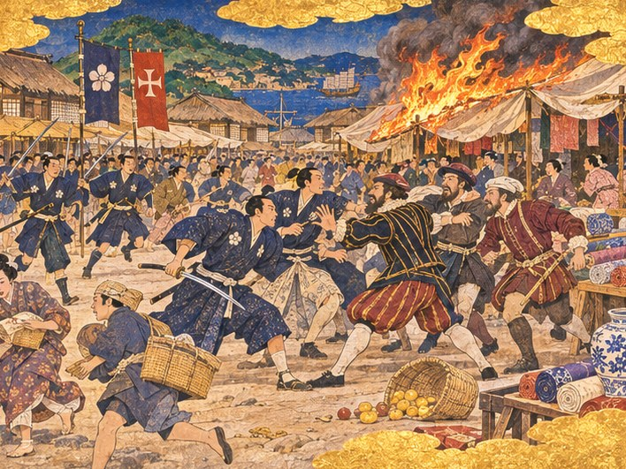
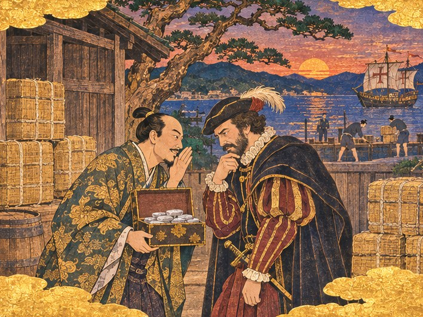
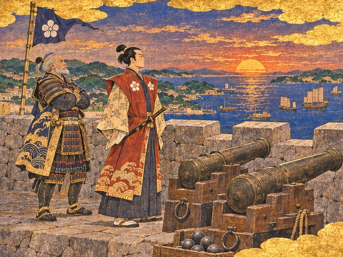
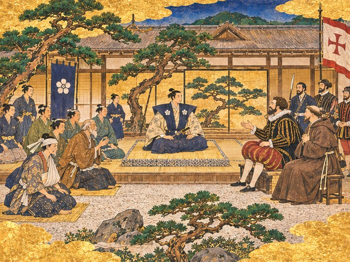

## 31. 붉은 등이 다시 걸린 거리

1558년 봄, 히라도의 당인 거리에는 붉은 등이 다시 걸렸다.

지난겨울 왕직의 남은 사람들이 히라도 만으로 들어왔다. 돛이 찢긴 정크 몇 척, 짐보다 사람이 더 많이 실린 배들이었다. 하야토는 부두에 나가 그들을 맞았다. 명의 사신이 다녀간 지 한 해도 되지 않은 때였다. 영주관의 늙은 가신 몇은 끝내 부두에 나오지 않았다.

임가는 거리 끝 빈집마다 사람을 들였다. 아이를 업은 여자, 다리를 저는 늙은 선원, 장부 상자를 끌어안고 내린 젊은 서기. 그들은 처음 며칠 동안 문밖으로 잘 나오지 않았다. 쫓기던 사람들은 열린 문을 먼저 의심했다.

"나리, 저 사람들은 해마다 문이 닫히는 걸 봤습니다." 임가가 말했다. "영파에서도, 쌍서에서도요. 히라도의 문이 열려 있다는 걸 믿는 데는 시간이 걸릴 겁니다."

"믿을 때까지 열어 두면 되지."

봄이 깊어지자 거리에 다시 소리가 돌아왔다. 주판알 소리, 비단 필을 펼치는 소리, 돼지기름에 파를 볶는 냄새. 붉은 등 아래에서 아이들이 명나라 말과 히라도 말을 섞어 떠들었다. 오린은 그 소리를 장부로 들었다.

"당인 거리 세금이 작년 이맘때보다 늘었어요. 사람을 받아서 손해 본다던 분들, 이 장부 좀 보셨으면 좋겠네요."

이듬해 겨울, 바다 건너에서 소식이 왔다. 왕직이 항주에서 세상을 떠났다고 했다. 귀순하면 바다를 열어 주겠다던 약속은 끝내 지켜지지 않았다.

그날 밤 임가는 당인 거리 끝 작은 사당에 향을 피웠다. 하야토가 문간에 서자 임가가 돌아보지 않은 채 말했다.

"어른은 늘 문이 열린 포구를 찾으셨습니다. 끝내 그 포구에서 늙지 못하셨지만요."

"그분이 찾던 포구가 되도록 하겠소. 임가, 그게 내가 할 수 있는 조문이오."

향 연기가 붉은 등 쪽으로 천천히 흘렀다. 바깥 거리에서는 누군가 낮게 명나라 노래를 불렀다. 아무도 그 노래를 말리지 않았다.

그렇게 몇 해가 흘렀다. 남만 상관의 지붕에는 포르투갈 깃발이 펄럭였고, 언덕 아래 성당의 종은 사당의 북과 번갈아 울었다. 마카오에서 오는 큰 배는 해마다 계절풍을 타고 들어왔다. 히라도는 이제 동중국해에서 이름난 교역항이었다. 사람이 많아진 만큼, 부딪는 일도 많아졌다.

## 32. 비단값

1561년 여름. 장터의 천막들이 햇볕에 하얗게 바래 있었다.

하야토는 오린과 함께 교역소 장부를 맞추러 가던 길이었다. 비단 천막 쪽에서 고함이 터졌다. 처음에는 흥정 소리인 줄 알았다. 히라도 장터에서는 흥정도 싸움처럼 들렸다. 그러나 다음 소리는 쇠가 칼집을 빠져나오는 소리였다.

인파가 갈라졌다. 가운데에 남색 옷의 무사 몇과 줄무늬 바지를 입은 남만 선원 몇이 마주 서 있었다. 비단 필이 땅에 떨어져 흙을 뒤집어썼다. 귤 바구니가 엎어져 노란 열매가 발밑으로 굴렀다. 누군가 등잔을 걷어찼고, 기름이 천막 자락에 튀었다.

불은 순식간에 번졌다. 하얀 천막이 안쪽부터 주황빛으로 부풀었다. 검은 연기가 장터 위로 솟았다.

"나리!" 요헤이가 사람들 사이를 헤치고 달려왔다. "천막에 불이 붙었습니다! 남만 선원 하나가 크게 다쳤어요!"

하야토는 대답하지 않고 앞으로 나섰다. 오린이 소매를 잡았지만 놓쳤다. 무사 하나가 칼을 높이 들고 있었다. 그 앞에 남만 선원 하나가 팔을 감싸 쥔 채 무릎을 꿇었다. 손가락 사이로 피가 흘렀다.

"칼을 거두게 하라!"

하야토의 목소리가 장터를 갈랐다. 칼을 든 무사가 멈칫했다. 영주의 얼굴을 알아본 것이었다.

"히라도 안에서 피를 보는 자는 누구든 내가 벌한다! 일본 사람이든 남만 사람이든!"

무사들이 하나둘 칼을 내렸다. 남만 선원들도 주먹을 풀었다. 그러나 눈빛은 풀리지 않았다. 양쪽 모두 상대가 먼저 칼을 뽑았다고 소리쳤다. 말이 통하지 않으니 소리만 커졌다.

곤베의 목수들이 물통을 들고 달려와 천막에 물을 끼얹었다. 불은 옆 천막 두 채를 더 삼키고서야 잦아들었다. 탄 비단 냄새가 매캐하게 남았다.

## 33. 꺼진 천막

다친 선원은 성당 옆 작은 방으로 옮겨졌다. 가스파르 수사가 소매를 걷고 상처를 씻었다. 팔이 깊게 베였지만 목숨은 건질 것이라 했다.

주앙이 숨을 몰아쉬며 들어왔다. 부두에서 소식을 듣고 뛰어온 길이었다.

"영주님." 그는 선원의 얼굴을 한 번 보고서야 하야토를 돌아보았다. "선장들이 화가 났습니다. 히라도가 남만 사람을 지켜 주지 않는다고요."

"싸움은 양쪽에서 났소."

"압니다. 하지만 선장들 눈에는 칼을 든 쪽이 일본 무사였고, 피를 흘린 쪽이 포르투갈 선원이었습니다. 그들은 그것만 기억할 겁니다."

오린이 장터에서 들은 이야기를 전했다. 비단 한 필 값을 두고 시작된 말다툼이라고 했다. 선원은 은으로 치렀다고 했고, 무사는 은이 모자랐다고 했다. 저울은 불에 탔다. 누가 옳았는지 아는 사람은 이제 아무도 없었다.

"비단 한 필 값이 천막 세 채가 됐네요." 오린이 낮게 말했다. "그리고 그보다 더 큰 게 탔어요."

그날 저녁 하야토는 거리를 걸었다. 당인 거리의 붉은 등은 평소처럼 켜졌지만, 남만 상관 앞 길은 일찍 어두워졌다. 선원들은 배로 돌아가 내리지 않았다. 장터에서는 마을 사람들이 둘러앉아 수군거렸다.

"남만 놈들이 히라도를 제 땅처럼 군다니까."

"그래도 그 사람들 은 덕에 우리가 먹고살지 않나."

"은 덕이고 뭐고, 칼을 맞으면 끝이야."

요헤이가 하야토 곁으로 와서 고개를 숙였다.

"나리, 마을 사람들 마음이 흔들립니다. 장터에서 칼부림이 난 건 히라도가 생긴 뒤 처음입니다. 늙은이들은 남만 배가 들어오고부터 이렇게 됐다고들 합니다."

"요헤이는 어떻게 생각하오?"

요헤이는 한참 말이 없었다.

"……저는 이 포구에서 칠십 년 가까이 살았습니다. 배가 안 와서 굶던 해도 기억합니다. 그래도 칼 소리는 듣고 싶지 않습니다."

하야토는 불탄 천막 터에 섰다. 검게 그을린 기둥 둘이 아직 서 있었다. 그 아래 흙에 녹은 은 조각 하나가 반짝였다. 누구의 은이었는지는 알 수 없었다.

## 34. 나가사키의 창고 뒤

다툼이 있고 보름 뒤, 하야토는 히라도마루를 몰고 나가사키로 내려갔다. 석재 값을 알아보고, 마카오에서 올 배들의 소식도 들을 참이었다. 주앙이 먼저 가 있겠다고 했다.

나가사키 부두는 히라도보다 작았지만 새 나무 냄새가 났다. 곳곳에 창고가 새로 서고 있었다. 지붕 위에는 낯선 가문의 깃발이 걸려 있었다.

교역소에 들렀지만 주앙은 없었다. 교역소 주인이 턱으로 창고 뒤편을 가리켰다.

"남만 항해사라면 아까 그 상인 양반과 저쪽으로 갔소. 히라도 분이시면 좀 서두르시는 게 좋겠구려."

창고 뒤 소나무 아래였다. 노을이 바다를 붉게 물들이고 있었다. 금실로 무늬를 놓은 값비싼 하오리를 입은 상인 하나가 주앙에게 작은 상자를 내밀고 있었다. 상자 안에서 은덩이가 노을빛을 받아 번쩍였다. 상인은 손을 입가에 대고 무언가를 속삭였다. 주앙은 턱을 괴고 듣고 있었다.

"주앙 나리, 사이고 영주님은 남만 배를 진심으로 환영하십니다. 히라도처럼 칼부림도 없지요."

하야토가 소나무 그늘에서 걸어 나왔다. 주앙이 고개를 들었다. 그의 얼굴이 하얗게 질렸다.

"영주님!" 그가 한 걸음 물러섰다. "저는 아직 아무 대답도 하지 않았습니다."

"알고 있소."

하야토는 주앙이 아니라 상인을 보았다. 상인은 상자 뚜껑을 천천히 닫았다. 놀란 기색이 없었다. 오히려 기다렸다는 듯한 얼굴이었다.

"후쿠다라 했소?"

"후쿠다 진베라 합니다. 히라도의 영주님을 이렇게 뵙는군요. 소문보다 젊으십니다."

"사이고 영주께 전하시오. 히라도는 아직 문을 닫지 않았다고."

후쿠다가 웃었다. 소리 없는, 상인다운 웃음이었다.

"문은 열려 있어도 사람이 떠나면 소용없지요. 남만 배는 은이 있는 곳으로 갑니다. 그리고 칼이 없는 곳으로요. 영주님도 장사를 아시니 그쯤은 아시겠지요."

그는 상자를 품에 안고 가볍게 고개를 숙였다. 그리고 창고 사이 좁은 길로 사라졌다. 하오리 자락의 금실이 마지막까지 번쩍였다.

경쟁 영주 사이고 노부치카. 나가사키 쪽 포구를 다스리는 그가 남만 배를 제 포구로 부르고 있었다. 히라도에서 칼이 뽑혔다는 소식은 하야토보다 먼저 이곳에 닿아 있었다.

## 35. 은이 있는 곳

돌아오는 뱃길 내내 주앙은 말이 없었다. 히라도마루의 뱃전에 기대 서쪽 바다만 보았다. 해가 지고 별이 뜬 뒤에야 그가 입을 열었다.

"영주님, 변명하지 않겠습니다. 그 상자를 열어 보라고 한 건 저였습니다. 사이고가 얼마를 내놓는지 알고 싶었습니다."

"알아서 무엇을 하려 했소?"

"선장들에게 전하려 했습니다. 사이고는 이만큼 내놓는다, 그래도 히라도에 남겠느냐고요." 주앙이 쓴웃음을 지었다. "선장들은 은으로 셈하는 사람들입니다. 저는 항해사라 바람으로 셈하고요. 바람으로 셈하면 히라도가 낫습니다. 은으로 셈하면…… 영주님도 보셨지요. 그 상자를."

"보았소. 무거워 보이더군."

"무겁습니다. 하지만 영주님, 리스본에서 마카오까지 오는 동안 저는 은보다 무거운 걸 많이 봤습니다. 항구마다 남만 사람을 받아 주겠다는 영주는 많았습니다. 다친 선원을 위해 밤새 장터를 걷는 영주는 처음입니다."

하야토는 대답 대신 키 옆의 등불을 낮췄다.

"주앙. 선장들은 무엇을 원하오?"

"두 가지입니다. 다친 선원에게 배상하는 것, 칼을 뽑은 무사를 벌하는 것. 히라도에서 남만 사람의 피가 일본 사람의 피와 같은 값이라는 걸 보고 싶어 합니다."

"그러면 남겠소?"

"그러면 남을 겁니다. 아니면 다음 계절풍에 나가사키로 가겠지요."

밤바다는 고요했다. 멀리 히라도 쪽 하늘이 희미하게 밝았다. 수백 개의 등불이 만든 빛이었다. 열두 해 전 그 하늘은 캄캄했다. 하야토는 그 빛을 오래 보았다.

"주앙, 하나만 묻겠소. 그대는 어떻게 할 거요?"

주앙이 뱃전을 손바닥으로 두드렸다. 히라도마루의 낡은 나무가 둔한 소리를 냈다.

"이 배는 선대 영주님 때부터 바다에 떠 있었다고 들었습니다. 이런 배에도 항해사는 있어야지요."

## 36. 검은 돛의 소문

히라도로 돌아오자 고타로가 부두에서 기다리고 있었다. 늙은 수군 대장의 얼굴이 평소보다 굳어 있었다.

"나리, 구로하타가 오도 열도의 패거리를 모으고 있다는 소식입니다."

영주관 다다미 방에 사람들이 모였다. 고타로가 바닥에 해도를 펼쳤다. 히라도 서쪽, 오도 열도의 섬들이 점점이 흩어져 있었다.

"섬마다 흩어져 있던 왜구들이 구로하타 밑으로 들어가고 있답니다. 어부들 말로는 섬 그늘에 정박한 배가 서른 척이 넘는답니다. 이번엔 작정하고 올 겁니다."

"서른 척." 오린이 붓을 멈추었다. "열한 해 전에는 몇 척이었죠?"

"관선 두 척이었소. 그때도 공사장 하나를 잃을 뻔했지."

"그때는 히라도에 훔칠 게 없었으니까요." 임가가 말했다. "지금은 당인 거리의 비단과 남만 상관의 은이 있습니다. 구로하타는 냄새를 맡은 겁니다."

"장터에서 칼부림이 났다는 소식도 들었을 겁니다." 주앙이 덧붙였다. "포구가 안에서 흔들릴 때를 노리는 건 어느 바다의 해적이나 같습니다."

하야토가 해도 위 히라도 만의 입구를 손가락으로 짚었다. 좁은 물목이었다. 양쪽으로 바위 곶이 튀어나와 있었다.

곤베가 그 자리를 들여다보았다. 대목장의 굵은 손가락이 하야토의 손가락 옆에 놓였다.

"포구 입구에 돌로 성채를 쌓자. 여기 곶 위에. 망루로는 종밖에 못 친다. 성채라면 대포를 걸 수 있다."

"석재가 얼마나 듭니까?"

"많이 들지. 마흔 짐은 있어야 기초를 놓는다. 그리고 넓은 터가 있어야 해. 작은 빈터에는 못 올린다."

오린이 장부를 넘겼다. 주판알이 한참 튀었다.

"석재는 교역소에서 살 수 있어요. 금화가 문제죠. 의뢰판 일을 몇 개 더 하면 모을 수 있어요. 그리고 터는…… 곶 아래 넓은 땅에는 옛 창고들이 있어요."

"창고를 헐면 짐 둘 데가 줄어듭니다." 임가가 말했다.

"창고는 다시 지으면 되지만, 포구는 불타면 다시 세우기 어렵소." 하야토가 말했다. "곤베 어른, 창고를 헐고 성채를 올립시다."

## 37. 돌을 쌓는 계절

그해 가을 내내 히라도는 돌 소리로 시끄러웠다.

하야토는 교역소에서 석재를 사들였다. 의뢰판에 붙은 일을 떼어 금화를 모았고, 모은 금화는 다시 돌이 되었다. 히라도마루의 짐칸에는 비단 대신 회색 돌덩이가 실렸다. 선원들은 투덜거리면서도 돌을 날랐다. 오린은 돌 한 짐이 들어올 때마다 장부에 줄을 그었다.

곶 아래 옛 창고들이 헐렸다. 창고지기 늙은이가 마지막 대들보가 내려오는 것을 보고 눈시울을 붉혔다. 선대 영주 때 지은 창고였다. 곤베가 그 대들보를 따로 챙겨 두었다.

"좋은 나무다. 성채 문짝에 쓰지."

돌을 쌓는 일에는 히라도의 모든 사람이 손을 보탰다. 당인 거리의 명 석공들이 돌을 다듬었다. 그들은 고향에서 성벽을 쌓아 본 솜씨를 가지고 있었다. 남만 선원들은 도르래를 걸어 큰 돌을 들어 올렸다. 배에서 돛을 올리던 솜씨였다. 마을 어부들은 바구니에 자갈을 담아 날랐다.

장터에서 칼을 겨누던 사람들이 같은 돌 하나를 함께 들었다. 그것을 보고 요헤이가 혀를 찼다.

"이상한 일입니다, 나리. 싸울 땐 말이 안 통한다더니, 돌을 들 땐 하나, 둘, 셋 소리가 다 통합니다."

"돌은 무거우니까. 혼자 들 수 없다는 건 누구나 알지."

곤베는 하루도 빠지지 않고 현장에 나왔다. 그의 허리는 예전 같지 않았다. 그래도 돌 하나가 놓일 때마다 그는 손바닥으로 돌 위를 쓸었다. 수평이 맞지 않으면 다시 들어내게 했다.

"성채는 바다를 이기려고 쌓는 게 아니다. 바다가 몇 번을 때려도 견디려고 쌓는 거지. 비뚤어진 돌 하나가 백 년 뒤에 무너진다."

어느 밤, 하야토는 영주관 등잔 아래에서 오린과 마주 앉았다. 오린의 주판 옆에는 장부가 세 권 쌓여 있었다. 하나는 세금, 하나는 공사, 하나는 아직 갚지 못한 선대의 빚이었다.

"돌 값이 생각보다 빨리 나가요." 오린이 붓끝으로 숫자를 짚었다. "이대로면 성채가 서는 날 곳간 바닥이 보일 거예요."

"세금을 올리면?"

"올리면 금화는 들어오죠. 대신 오던 사람이 덜 와요. 당인 거리 사람들은 겨우 짐을 풀었고, 장터 사람들은 칼부림 뒤로 아직 눈치를 봐요. 지금 세금을 올리면 히라도가 사람을 쫓는 포구가 돼요." 오린이 주판을 한 번 털었다. "그러니 나리가 바다에 나가서 벌어 오세요. 의뢰판에 붙은 일이 아직 많아요."

"젖누이가 영주를 부리는구나."

"영주를 부리는 젖누이가 있으니까 히라도 빚이 줄어드는 거예요." 오린이 등잔 심지를 돋우었다. "선대께서는 장부를 덮고 바다만 보셨어요. 나리는 장부를 펴고 바다로 나가시잖아요. 그 차이예요."

하야토는 다음 날 새벽 히라도마루를 띄웠다. 사카이로 가는 짐을 싣고, 천주에서 받아 올 값을 받으러. 돌아올 때마다 짐칸에는 돌이 실렸고, 오린의 장부에는 줄이 하나씩 늘었다.

겨울이 오기 전, 마카오에서 온 배가 청동 대포를 내렸다. 주앙이 선장들과 흥정해 들여온 것이었다. 남만 배에서 쓰던 대포였다. 대포가 수레에 실려 곶으로 올라가는 동안 마을 아이들이 줄줄이 따라갔다.

## 38. 포대 위에서

성채가 완성된 날, 해 질 녘이었다.

하야토와 고타로는 새로 쌓은 포대 위에 섰다. 돌은 아직 정 자국이 선명했다. 바닷바람이 마쓰라 가문의 깃발을 세게 흔들었다. 남색 바탕에 흰 꽃 문양이었다.

청동 대포 두 문이 바다를 향해 나란히 놓여 있었다. 그 아래 나무 상자에는 검은 쇠공이 쌓였다. 붉은 해가 섬들 사이로 가라앉았다. 만 안쪽에는 정크와 남만 배가 돛을 접고 쉬고 있었다.

고타로는 팔짱을 끼고 한참 바다를 보았다. 오랜만에 꺼내 입은 갑옷이 노을빛에 어둡게 빛났다. 흰 수염이 바람에 날렸다.

"선대께서 보셨다면……" 그가 말을 끊었다가 다시 이었다. "이 늙은이가 대포를 거는 날이 올 줄은 몰랐습니다."

"아버지는 무엇을 보고 싶어 하셨소?"

"배가 가득 찬 포구를요. 그리고…… 그 포구를 지킬 힘을요. 선대께서는 늘 둘 중 하나밖에 없다고 한탄하셨습니다. 배가 안 오니 지킬 것도 없고, 지킬 힘이 없으니 배도 안 온다고요."

고타로의 손이 대포의 차가운 몸통을 쓸었다.

"저는 평생 히라도마루 한 척으로 이 바다를 지켰습니다. 해적이 오면 쫓아내고, 쫓아내면 또 오고. 늘 한 발 늦었지요. 열한 해 전 그 밤에도 그랬습니다."

"그 밤에 고타로가 없었다면 공사장 하나가 아니라 포구 전체가 탔을 거요."

"나리는 위로를 잘하십니다. 선대를 닮으셨어요." 고타로가 웃었다. 주름이 깊게 패었다. "이제 이 대포가 있으면 이 늙은이도 한 발 앞설 수 있겠지요."

하야토는 대포 너머 바다를 보았다. 물목 너머 서쪽, 오도 열도의 섬들이 검게 엎드려 있었다.

"대포는 쏘지 않기 위해 거는 것이오."

고타로가 그를 돌아보았다.

"히라도를 넘보지 말라는 표시로. 구로하타가 이 성채를 보고 돌아간다면, 이 대포는 제 몫을 다한 거요."

"……구로하타는 돌아가지 않을 겁니다, 나리."

"알고 있소. 그래도 처음 거는 날만큼은 그렇게 말하고 싶었소."

해가 완전히 졌다. 만 안쪽 배들에 하나둘 등불이 켜졌다. 성채 위에서 내려다보는 히라도는 작고, 밝고, 지킬 만했다.

## 39. 영주관 마당

성채가 섰다는 소식은 바다를 타고 빨리 퍼졌다. 오도 열도 쪽에서 오던 수상한 배들이 한동안 물목에 얼씬하지 않았다. 그러나 장터의 일은 아직 끝나지 않았다.

그해 겨울 첫눈이 오기 전, 하야토는 영주관 마당에 자리를 마련했다. 판결을 내리는 자리였다.

하야토는 마루 끝 다다미 단 위에 앉았다. 등 뒤로 금빛 병풍이 펼쳐졌다. 마당 왼쪽에는 무사의 가족과 마을 원로들이 거적을 깔고 앉았다. 칼을 뽑았던 무사도 장터에서 다쳤다. 머리에 흰 천을 감은 그가 맨 앞에 무릎을 꿇었다. 오른쪽에는 붉은 십자가 깃발 아래 포르투갈 선장과 가스파르 수사가 앉았다. 선장은 걸상에 앉았고 가스파르는 갈색 수도복 차림으로 두 손을 모았다.

소나무 가지가 마당 위로 그늘을 드리웠다. 흰 자갈 위로 바람 소리만 지나갔다.

가스파르가 먼저 입을 열었다. 이 땅에 온 지 여러 해였다. 히라도 말이 제법 매끄러웠다.

"영주님, 다친 선원에게 배상하고 칼을 뽑은 무사를 벌해 주신다면, 선장들은 히라도에 남겠습니다."

원로들 쪽에서 웅성거림이 일었다. 요헤이가 일어섰다. 무릎이 떨리고 있었다.

"나리, 남만 사람 편만 드시면 마을이 등을 돌립니다. 우리 무사도 다쳤습니다. 히라도는 히라도 사람의 포구입니다."

그때 오린이 접힌 편지 한 장을 하야토에게 올렸다. 아침에 나가사키 쪽에서 온 배가 놓고 간 것이었다. 사이고 노부치카의 인장이 찍혀 있었다. 짧은 편지였다.

남만 배는 언제든 내 포구에서 쉬어 가도 좋소.

하야토는 편지를 접어 무릎 위에 놓았다. 마당의 모든 눈이 그에게 쏠렸다.

두 길이 있었다. 하나는 법이었다. 칼을 뽑은 자를 벌하고 다친 자에게 배상하는 길. 남만 배는 남을 것이다. 그러나 마을은 영주가 남만 사람 편을 들었다고 수군거릴 것이다. 곳간의 금화도 크게 줄 것이다.

다른 하나는 영지의 질서였다. 히라도 사람의 마음을 먼저 지키는 길. 무사를 감싸고, 떠나려는 배는 붙잡지 않는다. 요헤이와 원로들은 고개를 끄덕일 것이다. 장터의 수군거림도 가라앉을 것이다. 남만 배 몇 척이 나가사키로 가더라도, 히라도는 히라도 사람의 포구로 단단해질 것이다.

솔직히 그쪽 길이 더 따뜻해 보였다. 하야토는 요헤이의 떨리는 무릎을 보았다. 열두 해 전 비 오는 부두에서, 가진 것 없는 젊은 영주에게 처음 말을 건넨 사람이었다. 그 사람의 마음을 먼저 지키고 싶었다.

그러나 그는 열한 해 전 처음 왕직을 만난 날도 기억했다. 히라도의 문은 열려 있다, 다만 히라도의 법도 함께 지켜 달라. 그때 그는 손님에게 법을 말했다. 법을 말한 영주가 제 사람에게만 법을 접는다면, 그 법은 처음부터 법이 아니었다.

하야토가 일어섰다.

## 40. 같은 법

"칼을 뽑은 자는 벌하고, 다친 자에게는 배상하겠소."

마당이 조용해졌다. 하야토는 왼쪽과 오른쪽을 차례로 보았다.

"히라도의 법은 누구에게나 같다. 남만 선원이 먼저 칼을 뽑았다면 남만 선원을 벌했을 것이오. 이번에는 우리 무사였소. 그러니 우리 무사를 벌하오."

머리에 흰 천을 감은 무사가 고개를 숙였다. 그의 어깨가 굳었다.

"그대는 석 달 동안 칼을 영주관에 맡기고 성채 공사장에서 돌을 나르시오. 그리고 다친 선원이 일어서는 날, 그 앞에 가서 직접 고개를 숙이시오."

무사는 한참 말이 없다가 이마를 자갈에 댔다.

"그리고 다친 우리 무사에게도 영주관에서 약값을 내겠소. 히라도에서 다친 사람은 누구든 히라도가 돌본다."

오린이 장부를 펼쳤다. 그녀의 붓이 망설임 없이 움직였다. 남만 선원에게 줄 배상, 불탄 천막 세 채를 다시 세울 값, 다친 무사의 약값. 금화 삼천이었다. 성채를 쌓느라 비어 가던 곳간에서 나가는 돈이었다.

"장부가 가벼워졌어요." 오린이 하야토에게만 들리게 말했다. "그래도 이건 적어 둘 만한 지출이에요."

포르투갈 선장이 일어나 모자를 벗었다. 가스파르가 그의 말을 옮겼다. 주앙이 마당 끝에서 달려와 하야토 앞에 섰다. 얼굴이 환했다.

"선장들이 남겠답니다. 영주님의 법이 사이고의 은보다 무겁다고요."

마을 원로들 쪽은 조용했다. 요헤이가 천천히 자리에 앉았다. 그는 하야토를 보지 않았다. 마당을 나서는 원로들의 등이 모두 굳어 있었다. 그날 밤 장터에서는 영주가 남만 사람에게 금화를 퍼 주었다는 말이 돌았다.

하야토는 그 말을 막지 않았다.

사흘 뒤, 다친 선원이 처음으로 성당 앞에 나와 앉았다. 팔에 감은 천이 하얬다. 성채 공사장에서 먼지를 뒤집어쓴 무사가 그 앞으로 걸어왔다. 칼이 없는 허리가 어색해 보였다. 무사는 아무 말 없이 고개를 깊이 숙였다. 선원도 서툰 히라도 말로 무언가를 중얼거렸다. 둘 다 상대의 말을 다 알아듣지는 못했다. 그래도 고개를 숙이는 뜻은 어느 나라 말로도 같았다.

멀리서 그것을 지켜보던 요헤이가 하야토 곁으로 왔다.

"……나리, 아직 마을 사람들은 서운해합니다. 저도 그렇습니다."

"알고 있소."

"그래도 하나는 알겠습니다. 나리의 법이 남만 사람한테만 무거운 게 아니라는 건요. 우리 무사의 약값까지 챙기셨으니까요." 요헤이가 길게 숨을 내쉬었다. "서운한 건 서운한 거고, 믿는 건 믿는 겁니다."

이듬해 봄, 마카오에서 온 배들은 나가사키를 지나쳐 히라도로 들어왔다. 후쿠다 진베의 금실 하오리는 한동안 히라도 부두에 보이지 않았다.

그러나 오도 열도 쪽 바다는 날로 어두워졌다. 섬 그늘에 모이는 검은 돛이 늘어 간다는 소식이 어부들의 입을 타고 왔다. 고타로는 매일 새벽 성채에 올라 대포를 닦았다. 쏘지 않기 위해 건 대포였다. 그러나 이번만큼은 쏠 날이 오고 있었다.

하야토는 서른 줄에 들어서 있었다. 장터의 일로 시험받은 영주는 이제 바다에서 시험받을 차례였다.
