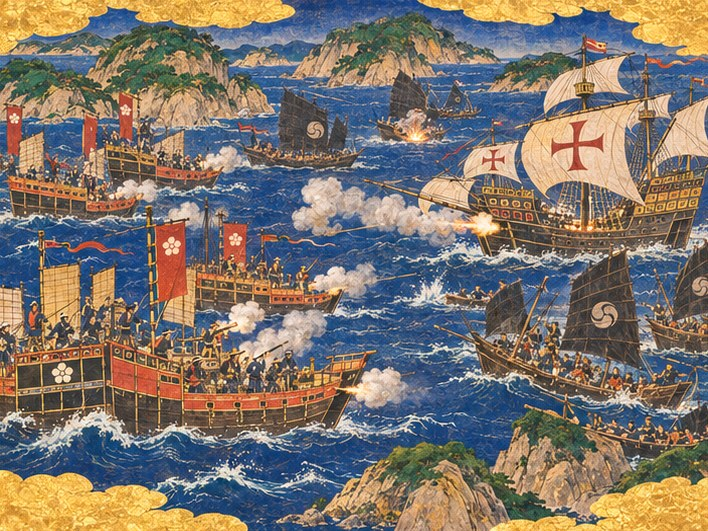
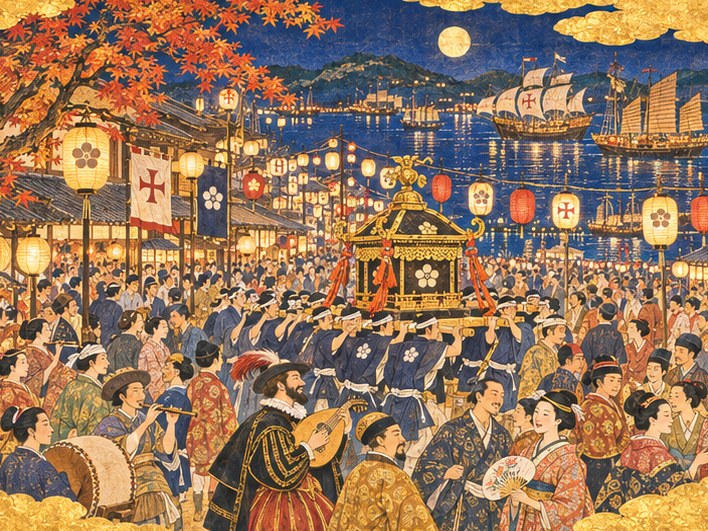

## 41. 망루의 종

1562년 봄. 새벽안개가 아직 걷히지 않았을 때였다.

망루의 종이 울렸다. 처음에는 세 번, 잠시 쉬었다가 다시 세 번. 해적을 보았다는 신호였다. 그러나 종은 거기서 멈추지 않았다. 종지기가 줄을 놓지 못하고 계속 당겼다. 땡, 땡, 땡. 종소리가 쉬지 않고 히라도 만을 건너갔다.

하야토는 겉옷도 제대로 걸치지 못하고 성채로 달려 올라갔다. 고타로가 먼저 와 있었다. 늙은 수군 대장은 포대 끝에 서서 서쪽 바다를 보고 있었다.

오도 열도 쪽 바다가 검었다.

안개가 걷히면서 그 검은 것이 돛이라는 것을 알았다. 섬과 섬 사이의 물길마다 검은 돛이 들어차 있었다. 둥근 문양이 그려진 정크의 돛, 왜구들이 즐겨 타는 날렵한 관선, 그리고 그 뒤로 몸집 큰 안택선 몇 척. 수를 세려다 하야토는 그만두었다. 세는 사이에 또 늘어났다.

"구로하타가 패거리를 모두 모았습니다." 고타로가 말했다. 목소리가 이상하게 차분했다. "오도의 섬마다 흩어져 있던 놈들이 다 왔습니다. 이번이 마지막 싸움이 될 겁니다."

"마지막이라."

"놈들에게도 마지막이라는 뜻입니다, 나리. 저만한 패거리를 모으려면 구로하타도 가진 걸 다 걸었을 겁니다. 이번에 지면 오도의 섬들이 더는 놈을 따르지 않겠지요."

아래 포구에서 사람들이 부두로 몰려나왔다. 어부들은 고깃배를 만 안쪽으로 끌어들였다. 당인 거리의 상인들은 비단 꾸러미를 창고에 밀어 넣었다. 남만 상관 앞에서는 선원들이 줄지어 부두로 달렸다. 성당의 종이 망루의 종을 따라 울리기 시작했다. 사당의 북도 울렸다.

열두 해 전 그 밤에는 망루가 없었다. 불화살이 공사장 지붕에 꽂히고서야 해적이 온 줄 알았다. 이번에는 해적이 물목에 닿기 전에 히라도가 깨어 있었다.

"고타로, 성채의 대포는 몇 번 쏠 수 있소?"

"화약은 넉넉합니다. 하지만 성채 대포는 물목만 지킵니다. 놈들이 만 밖에서 진을 치고 버티면 장사가 끊깁니다. 배가 드나들지 못하는 포구는 굶어 죽지요."

"그러면 나가야겠군."

고타로가 하야토를 돌아보았다. 그 눈에 무언가가 번쩍였다. 오래 기다린 사람의 눈이었다.

## 42. 함께 나서는 배들

부두에 내려가자 히라도마루가 이미 닻줄을 풀고 있었다.

주앙이 갑판 위에서 소리치고 있었다. 그의 지휘에 따라 남만 선원들이 청동 대포를 뱃전에 고정했다. 마카오에서 실어 온 남만 대포였다. 낡은 히라도마루의 뱃전에 대포가 걸리자 배가 한결 무거워 보였다.

"히라도마루에 남만 대포를 실었습니다." 주앙이 갑판에서 뛰어내려 하야토 앞에 섰다. 그의 이마에 땀이 흘렀다. "선장들이 내준 겁니다. 영주님, 함께 가겠습니다."

"선장들이?"

"작년 겨울 그 마당을 기억한답니다. 남만 사람의 피를 히라도 사람의 피와 같은 값으로 쳐 준 영주라면, 이번엔 자기들이 갚을 차례라고요." 주앙이 씩 웃었다. "포르투갈 선원들은 은으로 셈하지만, 빚은 잊지 않습니다."

부두 저쪽에서 임가가 달려왔다. 등 뒤로 당인 거리의 정크들이 돛을 올리고 있었다. 붉고 누런 돛이었다. 열두 해 전 히라도 만을 덮었던 바로 그 색이었다.

"명의 정크 몇 척도 따라나서겠답니다." 임가가 숨을 고르며 말했다. "히라도가 그들의 포구니까요."

"임가, 그들은 쫓겨 온 사람들이오. 이번 싸움까지 짊어질 필요는 없소."

"쫓겨 왔기 때문입니다, 나리." 임가의 눈이 젖어 있었다. "어디서도 받아 주지 않던 사람들을 이 포구가 받았습니다. 왕직 어른의 사람들은 그 은혜를 장부가 아니라 뼈에 새겼습니다. 저도 그렇고요. 이번에는 그 뼈로 갚겠다고 합니다."

곤베가 목수들을 데리고 부두 끝에 섰다. 손에는 망치와 판자가 들려 있었다.

"나는 바다엔 못 나간다. 대신 돌아오는 배는 내가 고친다. 구멍이 몇 개가 나든 다 막아 줄 테니, 가라앉지만 말고 돌아와라."

오린은 장부를 품에 안고 하야토를 보았다. 그녀는 아무 말도 하지 않았다. 대신 하야토의 소매 끝을 잠깐 잡았다가 놓았다. 어릴 때 바닷가에서 넘어지면 그녀가 늘 그렇게 했다.

"돌아오시면 장부에 적을 게 많을 거예요. 그러니까 돌아오세요."

하야토는 부두에 선 사람들을 둘러보았다. 남만 선원, 명의 상인, 히라도의 어부와 목수. 열세 해 전 이 부두에는 고깃배 몇 척과 늙은 수군 대장 하나뿐이었다.

"히라도는 혼자가 아니다." 하야토가 말했다. "나가자."

소라 나팔이 길게 울렸다. 북이 뒤를 받쳤다. 히라도마루가 부두를 밀어내고 물목으로 미끄러져 나갔다. 그 뒤로 붉은 돛의 정크들이, 마쓰라 가문의 꽃 문양을 단 배들이 줄지어 따랐다.

## 43. 물목 밖에서

성채 아래 물목을 지날 때, 포대 위에서 함성이 들렸다. 성채를 지키는 병사들과 그 곁에 모여든 마을 사람들이었다. 장터에서 칼을 뽑았던 무사도 그 사이에 있었다. 그는 다시 허리에 칼을 차고 있었다. 석 달의 돌 나르기를 마친 뒤 영주관에서 돌려받은 칼이었다.

물목을 벗어나자 바다가 넓어졌다. 서쪽에서 바람이 불어왔다. 검은 돛의 무리가 그 바람을 등지고 천천히 다가왔다. 가까워질수록 배는 더 많아 보였다.

하야토는 히라도마루의 고물에 섰다. 고타로가 키를 잡았다. 주앙은 뱃머리에서 대포를 살폈다. 임가는 정크 한 척에 올라 명의 배들을 지휘했다.

검은 돛 사이에서 유난히 큰 안택선 한 척이 앞으로 나왔다. 뱃머리에 커다란 사내 하나가 서 있었다. 머리를 질끈 동여맸고, 얼굴에는 비스듬한 칼자국이 그어져 있었다. 어깨에는 붉은 천을 둘렀다. 구로하타 도쿠베였다. 열두 해 전 불화살을 쏘고 달아나던 그 얼굴이 이제는 서른 척 넘는 배를 등에 지고 있었다.

"애송이 영주!" 그의 목소리가 바다를 건너 울렸다. "네 포구는 이제 너무 커졌다. 바다의 몫을 내놓아라!"

해적들이 일제히 뱃전을 두드렸다. 쿵, 쿵, 쿵. 그 소리가 파도에 실려 왔다.

"바다의 몫이라." 하야토가 중얼거렸다.

주앙이 뱃머리에서 돌아보았다.

"저 사내에게 대답하실 겁니까?"

"대답은 해야지. 열두 해를 기다렸으니."

하야토가 뱃전에 올라섰다. 바닷바람이 그의 남색 겉옷 자락을 크게 흔들었다.

"히라도는 바다의 몫을 빼앗지 않는다!" 그가 외쳤다. "바다를 함께 쓸 뿐이다. 명의 배도, 남만의 배도, 히라도의 고깃배도. 빼앗는 자만 빼고. 물러가라!"

구로하타가 껄껄 웃었다. 그 웃음이 신호였다. 검은 돛들이 일제히 바람을 받아 부풀었다.

"올 겁니다." 고타로가 키를 단단히 쥐었다. "나리, 늙은이 말 하나만 들으십시오. 저놈들은 수가 많지만 서로 믿지 않습니다. 섬마다 두목이 따로 있지요. 기함만 꺾으면 나머지는 제 섬으로 흩어집니다."

"기함만."

"구로하타만 꺾으면 됩니다."

## 44. 오도의 검은 돛

첫 포성은 히라도마루에서 울렸다.

주앙의 남만 대포가 불을 뿜었다. 흰 연기가 뱃전을 덮었다. 쇠공이 검은 돛 하나를 꿰뚫었다. 돛이 찢어지며 배가 옆으로 기울었다. 해적들이 고함을 질렀다.

곧 바다 전체가 포성과 연기로 덮였다. 왜구의 관선들이 날렵하게 파고들었다. 노를 젓는 해적들이 함성을 지르며 히라도의 배에 다가붙으려 했다. 남만 범선 두 척이 히라도마루 옆으로 붙었다. 선장들이 약속대로 내보낸 배였다. 붉은 십자가 돛 아래에서 포문이 차례로 열렸다.

임가의 정크들은 바람 아래쪽으로 돌았다. 명의 배는 몸이 무거웠지만 뱃전이 높았다. 해적들이 갈고리를 걸어도 쉽게 오르지 못했다. 정크 위의 명 선원들이 긴 장대로 갈고리를 밀어냈다. 임가의 목소리가 명나라 말로 높게 울렸다.

히라도마루는 곧장 기함을 향했다. 고타로는 키를 놓지 않았다. 늙은 손이 키 손잡이를 쥐었다 놓았다 할 때마다 배가 파도 사이로 비켜 갔다. 왜구의 화살이 갑판에 꽂혔다. 불화살 하나가 돛에 붙었다. 선원들이 바닷물을 퍼 올려 불을 껐다.

"나리, 머리를 숙이십시오!" 고타로가 외쳤다.

하야토는 숙이지 않았다. 고물에 서서 바다 전체를 보았다. 어디서 검은 돛이 몰리는지, 어디서 히라도의 배가 밀리는지. 그는 손짓으로 신호를 보냈다. 붉은 깃발 하나가 오르자 임가의 정크들이 왼쪽으로 돌았다. 검은 돛 몇 척이 그 뒤를 쫓느라 기함 곁을 비웠다.

"지금이오, 주앙!"

남만 대포가 다시 불을 뿜었다. 이번에는 기함 바로 옆의 관선이 맞았다. 뱃머리가 부서지며 배가 멈추었다. 기함으로 가는 물길이 열렸다.

해적선 하나가 히라도마루 옆구리로 들이받았다. 배가 크게 흔들렸다. 갈고리가 뱃전에 걸리고 해적들이 칼을 물고 기어올랐다. 하야토가 칼을 뽑았다. 아버지에게서 물려받은 칼이었다. 열두 해 전 그 밤 이후 처음으로, 그 칼이 다시 바다 위에서 빛났다.

칼날이 부딪는 소리가 갑판을 채웠다. 히라도의 선원들은 어부였고, 남만 선원들은 장사꾼이었다. 아무도 칼을 업으로 삼지 않았다. 그러나 그들 뒤에는 지킬 포구가 있었다. 해적들에게는 빼앗을 포구가 있었을 뿐이었다. 그 차이가 조금씩 갑판을 밀었다.

마지막 해적이 바다로 떨어졌을 때 하야토의 소매는 찢어져 있었다. 고타로는 여전히 키를 잡고 있었다. 그의 이마에서 피가 흘렀지만 손은 떨리지 않았다.

"앞입니다, 나리. 구로하타의 배가 바로 앞입니다."

## 45. 돛을 내린 기함

기함은 컸다. 히라도마루보다 갑절은 되어 보였다. 뱃전에 늘어선 해적들이 화승총을 겨누었다. 구로하타는 여전히 뱃머리에 서 있었다.

"애송이가 여기까지 왔구나!" 그가 외쳤다. "네 늙은 배로 내 배를 어쩔 셈이냐!"

주앙이 대포 곁에서 하야토를 돌아보았다. 마지막 장전이었다. 하야토가 고개를 끄덕였다.

남만 대포 세 문이 한꺼번에 불을 뿜었다. 연기가 히라도마루를 통째로 덮었다. 연기가 걷혔을 때 기함의 큰 돛대가 천천히 기울고 있었다. 돛대는 삐걱거리는 긴 소리를 내며 바다 쪽으로 쓰러졌다. 검은 돛이 물 위에 펼쳐졌다. 바닷물이 그 위로 넘실거렸다.

그때 성채 쪽에서 둔한 포성이 울렸다. 만 입구로 몰래 돌아들던 해적선 두 척이 물목 앞에서 멈춰 섰다. 성채의 청동 대포가 처음으로 불을 뿜은 것이었다. 쏘지 않기 위해 건 대포가, 끝내 쏘아야 할 날 제 몫을 했다.

검은 돛들이 흔들렸다. 기함의 돛대가 쓰러진 것을 본 배들이 하나둘 뱃머리를 돌렸다. 고타로의 말대로였다. 섬마다 두목이 따로 있는 패거리였다. 구로하타가 꺾이자 그들은 더 이상 함께 싸울 까닭이 없었다. 검은 돛들이 하나둘 섬 그늘로 흩어졌다.

마지막으로 구로하타의 기함이 남은 돛을 내렸다.

뱃머리의 구로하타는 한동안 히라도마루를 노려보았다. 그러고는 칼을 칼집에 넣었다. 기함은 부서진 몸으로 천천히 오도 쪽 섬 그늘을 향해 흘러갔다.

"쫓을까요, 나리?" 주앙이 물었다.

하야토는 오래 그 배를 보았다.

"돛을 내린 배는 쫓지 않소. 오늘 바다는 모두가 보았소. 히라도를 넘보면 어떻게 되는지. 그것이면 됐소."

바다가 조용해졌다. 포연이 바람에 흩어지고, 햇빛이 다시 물 위로 내려앉았다. 갈매기 몇 마리가 돌아와 히라도마루의 돛대 위를 맴돌았다.

고타로가 키를 놓았다. 그의 손이 그제야 떨리기 시작했다. 늙은 수군 대장은 키 옆에 주저앉았다. 그리고 하야토를 올려다보았다.

"끝났습니다, 나리." 그의 목소리가 갈라졌다. "선대께서 평생 못 하신 일을 나리가 하셨습니다."

"고타로가 키를 잡았으니 한 일이오."

"아닙니다. 선대께서도 이 늙은이와 함께 키를 잡으셨습니다. 그래도 오도의 검은 돛을 한 번도 꺾지 못하셨지요. 쫓아내면 다시 오고, 또 쫓아내면 또 오고." 고타로가 흐릿한 눈으로 바다를 보았다. "오늘은 다시 오지 않을 겁니다. 이 늙은이는 압니다."

## 46. 돌아온 포구

히라도마루가 물목을 지나자 성채 위에서 함성이 터졌다.

포구 전체가 부두로 나와 있었다. 어부의 아내들, 당인 거리의 상인들, 남만 상관의 서기들, 성당의 가스파르 수사, 사당을 지키는 늙은 신관. 아이들이 부두 끝까지 달려 나와 손을 흔들었다. 누군가 북을 쳤고, 누군가 명나라 징을 울렸다. 남만 선원 하나가 비우엘라를 들고 나와 줄을 튕겼다. 서로 다른 소리가 한데 섞여 이상하게 잘 어울렸다.

요헤이가 맨 앞에 서 있었다. 늙은 촌장은 지팡이를 짚고 서서 배를 맞았다. 하야토가 부두에 발을 딛자 그가 지팡이를 내려놓고 깊이 고개를 숙였다.

"나리, 마을 사람들이 다 나왔습니다. 남만 사람이 다쳤을 때 등을 돌렸던 사람들도요."

"요헤이도 나왔구려."

"저는 늘 나와 있었습니다." 요헤이가 웃었다. 이가 몇 개 빠진 웃음이었다. "서운한 것과 믿는 것은 다르다고 말씀드렸지요."

곤베는 말 대신 히라도마루의 옆구리를 손바닥으로 쓸었다. 해적선이 들이받은 자리에 판자가 깨져 있었다. 그는 그 자리를 한참 들여다보았다.

"구멍이 하나뿐이로군. 가라앉지 않고 돌아왔으니 됐다. 사흘이면 고친다."

임가의 정크들도 하나둘 만으로 들어왔다. 한 척은 돛이 반쯤 타 있었다. 그러나 잃은 배는 없었다. 남만 범선 두 척이 마지막으로 들어오며 축포를 쏘았다. 그 소리에 아이들이 귀를 막으며 깔깔 웃었다.

오린은 부두 가장자리에 서 있었다. 장부를 품에 안고 있었다. 하야토가 다가가자 그녀는 그의 찢어진 소매를 한참 보았다.

"소매가 찢어졌네요. 그것도 장부에 적어야겠어요."

"그것까지?"

"다 적어요. 나리가 돌아왔다는 것까지." 오린이 고개를 돌렸다. 목소리 끝이 떨렸다. "그건 제일 앞에 적을 거예요."

해 질 녘, 주앙과 임가가 히라도마루의 뱃전에 나란히 걸터앉았다. 하야토가 술병 하나를 들고 그 사이에 앉았다. 셋 다 옷에 화약 냄새가 배어 있었다.

"명의 정크가 그렇게 높은 줄 몰랐습니다." 주앙이 말했다. "해적들이 갈고리를 걸고도 못 올라가더군요. 리스본의 배목수들에게 보여 주고 싶었습니다."

"남만 대포가 그렇게 멀리 가는 줄은 저도 몰랐습니다." 임가가 잔을 받았다. "명에서는 남만 사람을 털이 붉은 오랑캐라 부릅니다. 오늘 보니 털 색보다 대포 소리가 더 크더군요."

주앙이 소리 내어 웃었다. 임가도 웃었다. 열두 해 전 두 사람은 서로의 말을 한 마디도 알아듣지 못했다. 이제는 히라도 말로 농담을 주고받았다.

"영주님." 주앙이 잔을 들었다. "포르투갈에서는 싸움이 끝나면 살아남은 사람끼리 잔을 듭니다."

"명에서도 그렇습니다. 먼저 간 사람 몫의 잔도 하나 채우지요." 임가가 빈 잔 하나에 술을 따라 뱃전에 놓았다. 하야토는 그 잔이 누구의 몫인지 묻지 않았다. 붉은 등이 다시 걸리던 해 겨울, 항주에서 온 소식을 그도 기억했다.

세 사람은 말없이 잔을 비웠다. 뱃전에 놓인 잔만 가득 찬 채 남아 노을을 담았다.

그날 밤 히라도는 늦게까지 잠들지 않았다. 집집마다 횃불을 밝혔다. 다친 선원들은 성당과 사당과 당인 거리의 의원에 나뉘어 누웠다. 남만 수사와 사당의 신관과 명의 의원이 한 방에서 붕대를 감았다. 아무도 그것을 이상하게 여기지 않았다.

## 47. 축제 준비

싸움이 끝나고 몇 주가 지났다. 하야토는 영주관에서 오린과 마주 앉았다.

"축제를 열고 싶소." 하야토가 말했다. "이 포구가 무엇이 되었는지, 히라도 사람들이 스스로 볼 수 있게."

오린이 장부를 펼쳤다. 그녀는 곧장 대답하지 않았다.

"축제를 열기 전에 항구부터 다시 일으켜요. 싸움 동안 장사가 멈췄어요. 상인들 몇은 짐을 싸서 나가사키로 갔고요. 교역항의 모습을 되찾아야 해요. 배가 다시 가득 차고, 창고가 다시 차고, 거리에 사람이 다시 붐벼야 축제도 축제지요."

그래서 여름 내내 히라도는 다시 일했다. 곤베의 목수들이 부서진 부두를 고쳤다. 상관의 창고는 다시 은으로 채워졌다. 당인 거리에는 새 정크들이 들어왔다. 구로하타가 꺾였다는 소문을 듣고 찾아온 배들이었다. 해적이 사라진 바다는 상인에게 가장 좋은 바다였다.

나가사키로 떠났던 상인 몇이 다시 돌아왔다. 그중 한 사람이 후쿠다 진베의 소식을 전했다. 사이고의 포구에도 남만 배가 들긴 하지만, 큰 배는 여전히 히라도로 간다고. 후쿠다는 요즘 은 상자를 들고 다니지 않는다고.

"그 사람도 셈이 빠르니까요." 오린이 말했다. "은보다 무거운 걸 알았겠죠."

축제 준비는 마을 사람들이 먼저 시작했다. 요헤이가 원로들을 모아 가마 행렬을 짰다. 사당의 가마를 꺼내 먼지를 털었다. 당인 거리의 상인들은 붉은 비단 등을 수백 개 주문했다. 남만 선원들은 배의 깃발을 모두 꺼내 거리에 걸었다. 가스파르 수사는 성당의 종을 축제 날 밤 울려도 되겠느냐고 물었다.

"사당의 북과 같이 울려 주시오." 하야토가 말했다. "어느 하나만 울리면 다른 쪽이 서운하니까."

"영주님은 늘 그 말씀을 하십니다. 어느 신도 다른 신을 내쫓지 못한다고."

"오린이 장부 맨 앞장에 적어 두었소. 이제 와서 지우면 오린이 화를 낼 거요."

가을이 왔다. 언덕의 단풍이 붉게 물들었다. 만 안에는 남만의 범선과 명의 정크가 나란히 닻을 내렸다. 사람들은 그것을 보고 이제 축제를 열 때라고 말했다. 오린도 마침내 장부를 덮으며 고개를 끄덕였다.

## 48. 등불의 밤

축제 날 밤, 히라도의 거리에는 수백 개의 종이 등이 켜졌다.

보름달이 만 위에 떴다. 달빛이 물 위에 길게 깔렸다. 그 위로 남만 범선의 흰 돛과 명나라 정크의 누런 돛이 나란히 떠 있었다. 배마다 등불을 달았다. 바다에도 거리처럼 등불의 길이 났다.

거리 한복판으로 가마 행렬이 지나갔다. 흰 머리띠를 맨 젊은이들이 금빛 가마를 어깨에 메고 소리를 맞췄다. 가마 지붕 위의 봉황 장식이 등불을 받아 번쩍였다. 가마의 휘장에는 마쓰라 가문의 꽃 문양이 수놓여 있었다.

가마 행렬 사이로 사람들이 함께 걸었다. 비우엘라를 든 남만 선원이 깃털 모자를 쓰고 줄을 튕겼다. 그 곁에서 명 상인이 비단 옷자락을 흔들며 웃었다. 부채를 든 히라도의 여인들이 그 뒤를 따랐다. 큰북을 멘 어부가 북을 울렸고, 대나무 피리 소리가 그 위에 얹혔다. 남만의 현악기와 히라도의 피리와 명의 징이 한 노래 안에서 만났다.

당인 거리의 붉은 등 아래에서는 명나라 만두를 쪘다. 남만 상관 앞에서는 선원들이 포도주 통을 열었다. 장터의 아낙들은 구운 생선과 떡을 팔았다. 세 나라 음식 냄새가 거리에서 섞였다.

하야토는 오린, 요헤이와 함께 영주관 앞 돌계단에 앉아 행렬을 보았다. 영주가 가마 행렬에 끼면 사람들이 걸음을 멈출 터였다. 그래서 오늘 밤은 멀리서 보기로 했다.

요헤이가 지팡이를 무릎 위에 올려놓았다. 그의 눈에 등불이 비쳤다.

"나리." 그가 천천히 말했다. "제가 이 포구에서 칠십 년을 살았지만 이런 밤은 처음입니다."

"요헤이가 처음이라면 정말 처음이겠군."

"제가 어릴 적에는 축제라고 해 봐야 사당 앞에 횃불 몇 개였습니다. 배가 안 오는 해에는 그것도 없었지요. 선대께서도 기다리기만 하셨습니다. 저도 그 옆에서 같이 기다렸고요."

요헤이가 그를 돌아보았다. 늙은 얼굴에 주름이 가득했다.

"열세 해 전 비 오는 부두에서 나리께 그랬지요. 기다리는 동안 빚이 먼저 찼다고. 그 말을 하고 나서 밤새 후회했습니다. 젊은 나리 마음을 아프게 했다고요."

"그 말이 없었다면 나도 기다리기만 했을지 모르오."

요헤이는 대답하지 않았다. 대신 손을 들어 눈가를 훔쳤다. 등불 때문에 눈이 시리다고 했다.

## 49. 덮은 장부

행렬이 바닷가 쪽으로 멀어지자 오린이 품에서 장부 한 권을 꺼냈다. 하야토가 처음 영지를 물려받던 날 그녀가 내밀었던 장부였다. 겉장이 닳아 부드러워져 있었다. 모서리마다 그녀의 손때가 묻어 있었다.

오린은 마지막 장을 펼쳤다. 붓으로 한 줄을 긋고, 그 아래 무언가를 적었다. 그리고 장부를 덮었다.

"빚은 다 갚았어요."

하야토가 그녀를 보았다. 오린은 덮은 장부 위에 두 손을 얹고 있었다.

"선대께서 남기신 빚, 금화 사천. 성채 쌓느라 다시 늘었던 것도요. 오늘 낮에 마지막 금화를 보냈어요." 그녀의 목소리가 조용했다. "이제 이 장부에는 히라도가 번 것만 적혀요."

"열세 해가 걸렸구나."

"열세 해 하고 일곱 달이요. 날짜도 다 적어 뒀어요." 오린이 웃었다. 어릴 때 바닷가에서 조개를 세던 그 웃음이었다. "처음 장부를 넘겨받았을 때, 이 장부를 덮는 날이 올 거라고는 생각 못 했어요. 셈이 빠르면 뭐 해요. 셈을 할수록 답이 안 나왔는데."

"그래도 넌 처음부터 답을 말했잖아. 사람이 와야 돈이 돈다고."

"그건 답이 아니라 바람이었어요." 오린이 장부를 품에 안았다. "답은 나리가 만든 거예요. 시장을 세우고, 정크를 받고, 남만 배를 고치고, 쫓겨 온 사람들을 받고, 장터에서 같은 법을 세우고. 저는 그걸 적기만 했어요."

"적어 주는 사람이 없었으면 내가 무엇을 했는지도 몰랐을 거다."

오린은 대답 대신 장부를 하야토의 무릎 위에 올려놓았다.

"이건 나리가 가지세요. 다음 장부는 제가 새로 살게요. 이번엔 빚 대신 번 것만 적는 장부로."

멀리 바닷가에서 불꽃이 하나 솟았다. 남만 배에서 쏘아 올린 것이었다. 하늘에서 붉고 노란 불꽃이 터졌다. 사람들의 환호가 거리를 따라 굽이쳐 올라왔다.

하야토는 무릎 위 장부를 펼쳐 보았다. 첫 장에는 아버지의 글씨가 있었다. 빚진 금화의 수, 갚을 날, 그리고 어느 날부터인가 끊긴 줄들. 그다음 장부터는 오린의 글씨였다. 시장 하나, 여관 하나, 정크 한 척, 당인 거리, 조선소, 남만 상관, 성당, 성채. 그리고 사람의 수. 해가 바뀔 때마다 그 수가 늘어 갔다.

맨 앞장 여백에 오린의 글씨가 한 줄 더 있었다. 히라도에서는 어느 신도 다른 신을 내쫓지 못한다. 성당을 세우던 날 그가 했던 말이었다.

## 50. 길을 낸 자

밤이 깊었다. 행렬이 끝나고, 거리의 등불이 하나둘 꺼졌다. 바닷가 쪽에서만 아직 노랫소리가 들렸다.

하야토는 혼자 영주관 뒤 마루에 앉았다. 달이 만 위로 높이 떠 있었다. 성채의 포대 위에서 보초가 바뀌는 소리가 났다. 고타로는 오늘 밤만큼은 성채에 오르지 말라는 영주의 말을 듣지 않았다. 늙은 수군 대장의 등이 포대 위에 작게 보였다.

"아버지께 보여 드리고 싶구나." 하야토가 혼잣말을 했다. "기다리기만 하던 포구에 길이 났다고."

바람이 불었다. 소나무 가지가 흔들렸다. 그 소리 사이로 아주 오래된 목소리가 들리는 듯했다.

하야토, 바다는 기다리는 자의 것이 아니다. 길을 내는 자의 것이다.

열세 해 전 장부 더미 앞에서 들었던 그 목소리였다. 그때 하야토는 그 말을 아버지의 후회로 들었다. 기다리기만 하다 빚만 남긴 사람의 뒤늦은 깨달음으로. 그러나 오늘 밤은 다르게 들렸다. 그것은 후회가 아니라 부탁이었다.

목소리가 이어졌다.

하야토, 길을 낸 자는 그 길을 지켜야 한다.

하야토는 눈을 감았다. 그는 이 포구에 길을 냈다. 명의 배가 오는 길, 남만의 배가 오는 길, 쫓겨 온 사람들이 쉬어 가는 길. 그 길을 따라 사람이 오고, 은이 오고, 칼도 왔다. 해적도 왔다. 앞으로도 올 것이다. 길을 낸 이상 그 길로 오는 모든 것을 받아 내야 했다.

장터에서 그는 같은 법으로 길을 지켰다. 바다에서는 대포와 사람으로 길을 지켰다. 다음에는 무엇으로 지켜야 할지 아직 몰랐다. 다만 혼자 지키지 않으리라는 것은 알았다. 오늘 바다에서 그의 뒤를 따른 배들이 그것을 보여 주었다.

하야토는 눈을 떴다. 달빛 아래 히라도 만이 은빛으로 빛났다. 남만 배와 명의 정크와 히라도의 고깃배가 같은 물 위에서 쉬고 있었다. 성당의 종탑과 사당의 지붕과 당인 거리의 붉은 처마가 같은 달빛을 받았다.

열세 해 전 이 포구에는 반쯤 가라앉은 부두와 고깃배 몇 척뿐이었다. 이제 이 포구는 무엇이 되었는가. 무엇이 될 것인가.

그것은 그가 무엇을 쌓아 왔느냐에 달려 있었다. 어떤 거리를 키우고, 어떤 사람을 받고, 어떤 법을 세웠느냐에. 히라도는 그가 지어 온 만큼의 항구가 될 것이었다.

하야토는 오린이 준 장부를 품에 넣고 일어섰다. 내일 아침이면 다시 영주관에 앉아야 했다. 새 장부의 첫 장을 채워야 했다.

바다의 영주. 사람들은 이제 그를 그렇게 불렀다. 하야토는 그 이름이 아직 어색했다. 바다는 누구의 것도 아니었다. 그는 다만 그 바다로 가는 길 하나를 지키는 사람일 뿐이었다.
