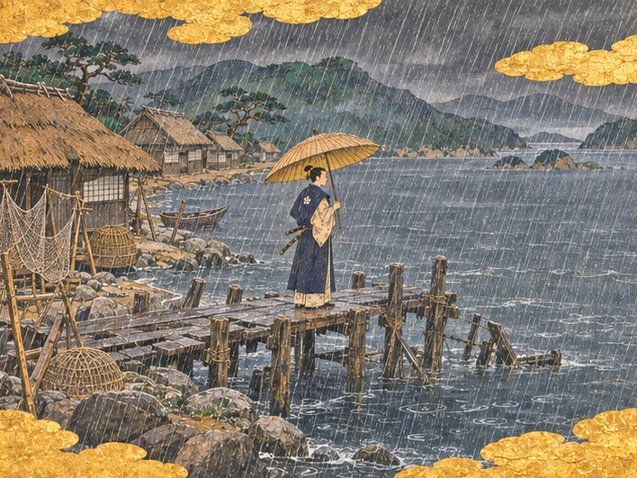

1549년 봄, 규슈 서쪽 끝 히라도.

비가 사흘째 그치지 않았다.

산은 바다에 바짝 붙어 있었고, 바다는 산 밑까지 파고들어 와 있었다. 그 사이 좁은 물가에 초가 몇십 채가 등을 웅크리고 앉았다. 지붕마다 물이 흘러내렸다. 처마 밑에 걸어 둔 그물에서도 물이 떨어졌다. 마른 데가 한 군데도 없었다.

부두는 반쯤 물에 잠겨 있었다. 말뚝 몇 개는 썩어 기울었고, 판자는 군데군데 빠져 검은 물이 들여다보였다. 그 끝에 고깃배 몇 척이 밧줄에 묶여 출렁였다. 큰 배는 한 척도 없었다. 큰 배가 댈 자리도 없었다.

하야토는 그 부두 끝에 서 있었다.

열아홉. 마쓰라 가문의 분가를 이었다. 아버지의 장례를 치른 지 이레가 지났다. 기름 먹인 우산 위로 빗방울이 쉬지 않고 두드렸다. 발밑 판자가 걸음을 옮길 때마다 삐걱 울었다.

"젊은 나리, 부두가 저 꼴이라 큰 배는 들어오지 못합니다. 고기를 잡아도 팔 데가 없지요."

등 뒤에서 촌장 요헤이가 말했다. 도롱이를 걸친 어깨에서 물이 줄줄 흘렀다. 이 포구에서 나고 이 포구에서 늙었다. 손등에 그물 자국 같은 주름이 깊었다.

"아버지는 이 포구에 배가 가득 찰 날을 기다리셨다고 들었소."

"기다리기만 하셨지요." 요헤이가 쓴웃음을 지었다. "기다리는 동안 빚이 먼저 찼습니다."

하야토는 대답하지 않았다. 젖은 부두 판자를 오래 내려다보았다. 판자 틈으로 바닷물이 들락거렸다. 들어왔다가 나가고, 다시 들어왔다. 아무것도 싣지 않은 물이었다.

아버지는 말수가 적은 사람이었다. 저녁이면 이 부두에 나와 서쪽 바다를 보았다. 무엇을 보느냐고 물으면, 올 배를 본다고 했다. 하야토는 어릴 때 그 말을 믿었다. 아버지가 보면 정말 배가 올 줄 알았다. 배는 오지 않았다. 아버지의 기침이 깊어졌고, 장부가 두꺼워졌다.

빗속에서 누군가 판자를 밟고 다가왔다. 무거운 걸음이었다. 다리 하나를 조금 끄는 소리가 섞였다.

"도련님."

늙은 수군 대장 고타로였다. 흰 상투가 비에 젖어 머리에 달라붙어 있었다. 선대보다 나이가 많았다. 선대가 어렸을 때부터 이 집의 배를 몰았다고 했다. 고타로는 거기서 말을 끊고 고쳐 불렀다.

"아니, 이제 나리시지요."

"고타로. 비가 이런데 어찌 나왔소."

"배를 보여 드리려고요." 노인이 고개를 돌려 만 안쪽을 가리켰다. "선대께서 남기신 배는 이 한 척뿐입니다."

비안개 속에 배 한 척이 떠 있었다. 고깃배들보다 몸집이 컸다. 뱃전이 높고 지붕을 얹은 집 같은 선실이 있었다. 칠은 바래 갈색 나뭇결이 드러났고, 돛은 말아 묶여 있었다.

"히라도마루입니다. 선대께서 젊으셨을 때 사카이까지 몰고 가셨던 배지요."

"아버지가 사카이까지?"

"그때는 이 포구에도 짐이 있었습니다. 짐이 줄고, 배가 줄고, 나중엔 갈 데가 줄었지요." 고타로는 뱃전을 바라보는 눈을 가늘게 떴다. "늙은이와 늙은 배지만, 나리를 바다로 모시는 일은 아직 할 수 있습니다."

하야토는 그 배를 한참 보았다. 비에 젖은 돛대가 하늘을 찌르고 있었다. 아버지가 서쪽 바다를 보던 그 자리에서, 아버지가 끝내 띄우지 못한 배가 흔들렸다.

"고타로, 바다로 나가기 전에 이 포구부터 일으켜야겠소."

노인의 눈썹이 꿈틀했다.

"배가 와야 바다도 의미가 있지. 우리 배 한 척이 나가서 무엇을 싣고 오든, 내려놓을 부두가 없으면 그만이오."

고타로는 잠시 말이 없었다. 빗소리만 들렸다. 그러다 노인은 젖은 무릎을 꿇고 판자 위에 두 주먹을 짚었다. 물이 튀었다.

"선대께서는 바다를 보셨습니다. 나리는 땅을 보시는군요." 그가 고개를 들었다. "이 늙은 몸, 오늘부터 나리 배에 묶겠습니다."

"일어나시오, 판자가 썩었소. 둘이 같이 빠지면 누가 건지겠소."

고타로가 껄껄 웃었다. 웃음소리가 빗속에서 컸다. 요헤이도 따라 웃다가 헛기침을 했다.

## 부두 끝 주점

"부두 끝 낡은 주점은 아직 문을 엽니다." 요헤이가 말했다. "뱃사람을 구하시려면 거기로 가시지요."

주점은 부두가 땅에 닿는 자리에 있었다. 처마가 내려앉아 고개를 숙여야 들어갈 수 있었다. 안에는 화로 하나가 연기를 피웠고, 젖은 옷 냄새와 마른 생선 냄새와 싸구려 술 냄새가 한데 섞여 있었다. 탁자 셋 가운데 둘이 비어 있었다.

남은 탁자에 사내 넷이 앉아 있었다. 고기잡이를 쉬는 어부들이었다. 하야토가 들어서자 넷이 한꺼번에 일어섰다.

"앉으시오. 술값은 내가 내겠소."

어부들은 서로 얼굴을 보았다. 영주가 술값을 낸다는 말을 처음 들은 얼굴이었다. 주인 노파가 질그릇 잔을 하나 더 내왔다. 하야토는 그 잔을 받아 들고 물었다. 노를 저을 줄 아는 사람이 이 포구에 몇이나 남았느냐고. 돛을 다룰 줄 아는 사람은 몇이냐고.

"노야 다들 젓지요. 돛은……" 가장 나이 많은 어부가 손가락을 꼽다 말았다. "젊은 놈들은 하카타로 나가 버렸습니다. 거기엔 일거리가 있으니까요."

"그럼 남은 사람부터 이름을 적겠소."

고타로가 품에서 젖지 않게 싸 둔 종이를 꺼냈다. 하야토는 붓을 들고 어부들의 이름을 한 사람씩 적었다. 넷이었다. 주인 노파가 부엌에서 제 아들 이름도 하나 불렀다. 다섯이 되었다.

"다섯이면 배 한 척은 겨우 뜨겠습니다." 고타로가 말했다. "멀리는 못 갑니다."

"멀리 갈 생각은 아직 없소. 나가사키 앞바다까지 오가며 소금과 목재 값을 알아 오는 것으로 시작하지."

어부 하나가 조심스럽게 물었다. "나리, 그럼 고기는 어디에 팝니까?"

하야토는 잔을 내려놓았다. 그 물음이 이 포구의 모든 것이었다. 고기는 있었다. 사람도 조금은 있었다. 사고팔 자리가 없었다.

"그건 내가 답을 찾아오겠소. 오래 걸리지 않게."

주점을 나서니 해가 지고 있었다. 비는 여전했지만 구름 밑이 조금 붉었다. 언덕 위 분가 저택에 등불이 켜져 있었다. 아버지가 살던 집이었다. 이제 영지의 일을 보는 영주관이었다.

그 집 안에는 장부가 기다리고 있었다. 하야토는 아직 그 장부를 끝까지 넘겨 보지 못했다. 넘길 때마다 숫자가 하나씩 무거워졌다.

고타로가 우산 없이 그 곁을 따라 걸었다.

"나리. 선대께서 늘 하시던 말씀이 있습니다."

"알고 있소." 하야토가 말했다. "바다는 기다리는 자의 것이 아니라고."

"그 뒤가 있습니다."

하야토는 걸음을 멈추었다. 빗물이 우산 끝에서 떨어져 발등을 적셨다. 고타로는 대답 대신 언덕 위 등불을 턱으로 가리켰다.

"그건 저 집 안에서 들으십시오. 선대께서 그 말을 저 집 어딘가에 적어 두셨으니까요."

부두 쪽에서 파도가 썩은 말뚝을 쳤다. 텅 빈 포구에 그 소리만 오래 남았다.
