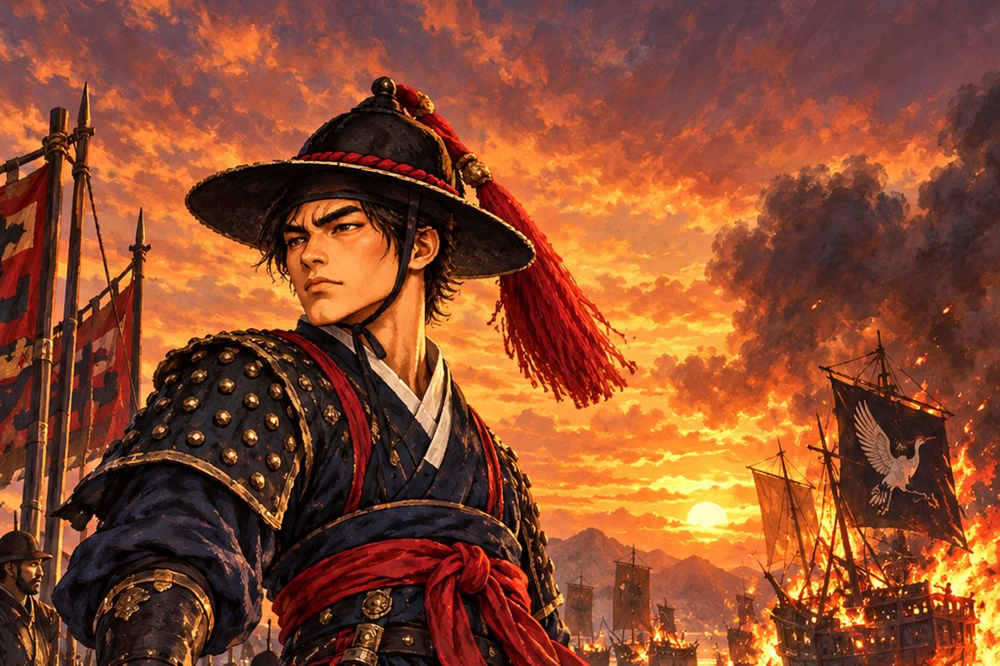

조선 외전 「검은 학을 쫓아」의 이야기를 소설로 옮겼습니다. 1522년 봄, 왜구에게 고향 다대포를 잃은 다대포 만호 **윤해강**이 좌수사의 밀명을 받고 기록에 없는 배로 왜구 두목 **구로세 도겐**을 쫓습니다. 나가사키와 사카이, 천주와 장안, 마카오와 하노이를 거쳐 대마도 앞바다의 마지막 결전까지 이어집니다.

게임의 다섯 부를 따라가며, 게임에서 짧게 지나가는 장면 사이를 소설의 문장으로 이었습니다. 인물과 사건은 지어낸 것이며 시대는 큰 틀만 따릅니다.

:::caution[줄거리 공개]
이 소설에는 조선 외전의 처음부터 마지막 결말까지 모든 줄거리가 들어 있습니다. 게임을 먼저 즐기고 싶다면 다 끝낸 뒤에 읽으세요.
:::

## 차례

| 차례 | 내용 |
| --- | --- |
| [서장 ― 붉은 새벽](/novel/prologue/) | 다대포가 불타던 새벽, 검은 학 깃발 |
| [1부 ― 불타는 다대포](/novel/part1/) | 좌수사의 밀명, 해령호와 박돌석, 첫 해전과 폭풍 |
| [2부 ― 검은 학의 깃발](/novel/part2/) | 길잡이 오린, 사카이 회합, 기리시마와의 결투, 첫 패배 |
| [3부 ― 해금의 바다](/novel/part3/) | 진소백의 장부, 여순 앞바다 해전, 척문룡과의 결투 |
| [4부 ― 붉은 십자가와 철포](/novel/part4/) | 포수 안토니우, 남쪽 섬의 남만 함대, 하노이의 밤 |
| [5부 ― 귀선](/novel/part5/) | 귀선 건조, 출정 전야, 대마도 앞바다의 마지막 결전 |
| [결말 ― 바다로, 또는 다대포에](/novel/endings/) | 마지막 선택에 따라 갈리는 두 결말 |

## 게임과 함께 읽기

- 게임에서는 마지막에 동료들과의 대화에서 **바다로 돌아간다** 또는 **다대포에 남는다**를 고릅니다. 소설에는 두 결말을 모두 실었습니다.
- 게임 진행 방법은 [조선 외전 안내](/side-story/joseon/)를 참고하세요. 조선 외전은 웹과 Android에서 즐길 수 있습니다.
- 삽화는 소설을 위해 새로 그린 그림이며, 게임 화면과 다를 수 있습니다.
