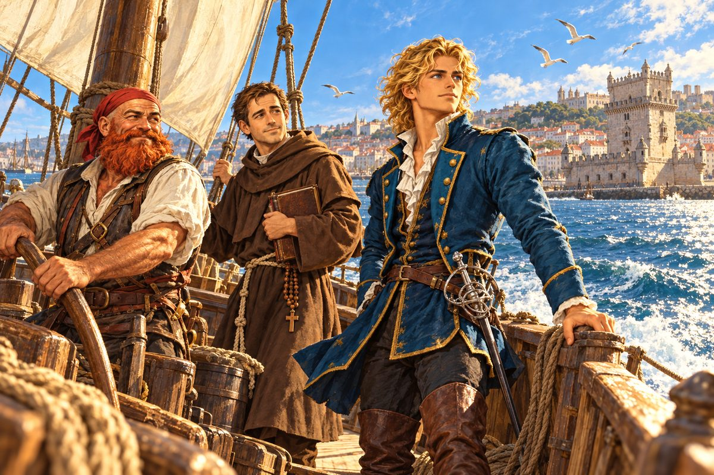

## 1. 류트와 노래

부둣가 골목 끝, 카를로타의 주점은 점심때가 지나면 조금 한가해졌다.

조안이 문을 밀고 들어서자 탁자를 훔치던 카를로타가 행주를 든 채 눈을 둥그렇게 떴다. 마흔을 넘긴 여주인은 허리에 앞치마를 질끈 동이고 있었고, 웃을 때면 눈가에 잔주름이 부채처럼 퍼졌다.

"어머, 도련님. 이 시간에 웬일이세요? 또 몰래 빠져나오셨나 보네."

대답하기도 전에 안쪽에서 발소리가 통통 울렸다. 갈색 머리를 리본으로 묶은 아가씨가 계단을 뛰어 내려왔다. 카를로타의 딸 루치아였다. 주점에서 노래를 부르는 루치아의 목소리는 부두 일꾼들 사이에서 꽤 이름이 나 있었다.

"잘 오셨어요! 마침 노래할 참이었는데, 류트 좀 타 주세요."

"루치아! 도련님께 그게 무슨 말버릇이니?"

조안은 웃으며 벽에 걸린 류트를 내렸다. "괜찮아요, 카를로타 씨. 루치아가 부탁하는데 거절할 수야 없지."

줄을 고르고 첫 화음을 짚자 루치아가 숨을 들이켰다. 바다로 떠난 연인을 기다리는 여인의 노래였다. 리스본 사람이라면 누구나 아는 곡이었다. 루치아의 목소리가 낮게 깔렸다가 후렴에서 높이 솟았고, 조안의 손가락은 그 목소리 뒤를 조용히 받쳤다. 구석에서 졸던 늙은 뱃사람 하나가 고개를 들었다. 카를로타도 행주질을 멈추었다.

노래가 끝나자 카를로타가 문득 생각난 듯 손뼉을 쳤다.

"아이고, 내 정신 좀 봐. 도련님, 아까 로코 씨가 도련님을 찾아 여기까지 왔었어요. 공작님께서 부르신다고요."

"아버님이요?" 조안은 류트를 내려놓았다. 아버지가 낮에 그를 찾는 일은 드물었다. "빨리 가 봐야겠군요."

"벌써 가세요?" 루치아가 입을 비쭉였다. "한 곡만 더 하고 가시지."

"다음에 꼭."

문을 나서며 조안은 이상한 예감을 느꼈다. 바닷바람이 평소보다 조금 더 짰다.

## 2. 아버지의 명령

저택 서재는 해도와 지구의와 낡은 항해 일지로 가득했다. 레온 페레로 공작은 창을 등지고 서 있었다. 쉰을 넘긴 나이였지만 어깨가 넓고 허리가 곧았다. 짧게 다듬은 회색 수염 아래 입매가 굳게 다물려 있었다.

"아버님, 부르셨다고 들었습니다."

"오, 조안이냐. 그래, 내가 불렀다." 공작은 아들을 위아래로 훑어보았다. "검술은 좀 늘었느냐?"

"예전보다는요. 아버님과 다섯 번 겨루면 한 번쯤은 이길 수 있지 않을까 싶습니다."

"항해술은?"

"책으로는 익혔습니다. 다만 한 번도 써 보지 못한 지식이지요."

"지리는?"

"리스본 밖으로 나가 본 적이 없으니, 그것도 책으로만 배웠습니다."

조안의 대답에 은근한 가시가 섞여 있었다. 공작은 그것을 모른 척했다.

"책을 가벼이 여기지 마라. 바다에서 궁지에 몰렸을 때 사람을 살리는 건, 먼저 간 이들이 남긴 지혜다." 그러고는 짐짓 딴소리를 했다. "그나저나 네 류트 솜씨가 제법이라는 소문이 들리더구나. 크리스 말로는 부인들 사이에서 평이 좋다던데."

"어머님이 과장하신 겁니다."

"하하! 언제 한번 들려다오."

공작은 웃음을 거두고 창가에서 몸을 돌렸다. 그 순간 서재의 공기가 달라졌다. 조안은 저도 모르게 허리를 폈다.

"너도 알다시피 네 나이 때 나는 함대를 이끌고 해적을 쫓았다. 지금껏 너를 이 항구에 붙잡아 둔 것은 네가 미숙하다고 여겼기 때문이다. 그러나 페레로 가의 사람이 언제까지나 뭍에서 지낼 수는 없지. 머리에 든 것은 충분하다. 이제 남은 건 몸으로 겪는 일뿐이다."

공작이 한 걸음 다가섰다.

"포르투갈 해군대신 겸 수상 레온 페레로가 명한다. 바다로 나가 탐험하라."

조안의 가슴이 크게 뛰었다. 그토록 기다리던 말이었다. 그런데 막상 듣고 나니 목이 메었다.

"혹시…… 예전부터 말씀하시던 사제왕 요한의 나라 말씀입니까?"

"그렇다. 요한 사제왕국을 찾아라. 가혹하다 여기겠지만, 그 나라를 찾기 전에는 이 집에 돌아올 생각을 하지 마라. 그리고 오늘부터 리스본 사람들에게 너를 귀족이 아닌 평민으로 대하라고 포고하겠다."

"평민으로……."

"배는 조선소에 맡겨 두었다. 떠날 채비를 해라." 공작은 문 쪽을 향해 목소리를 높였다. "로코! 로코는 어디 있느냐!"

"예, 여기 대기하고 있었습죠."

문가에 서 있던 늙은 뱃사람이 성큼 들어왔다. 예순이 넘은 나이에도 팔뚝이 통나무 같았다. 햇볕에 그을린 얼굴에 흰 수염이 덥수룩했고, 머리에는 빛바랜 붉은 두건을 둘렀다. 공작이 젊은 시절 바다를 누빌 때 늘 곁에 있던 항해사였다.

"로코, 너에게 이 녀석을 맡긴다. 제대로 된 뱃사람으로 길들여라. 내 아들이라고 봐줄 것 없다."

"알겠습니다, 제독님. 아니, 공작 각하." 로코는 이를 드러내며 웃었다. 누런 이 사이로 휘파람 같은 숨이 샜다. "도련님, 각오는 되셨겠지요?"

## 3. 두 사제

소문은 바람보다 빨랐다. 저택을 나서자마자 길가의 생선 장수가 조안을 붙잡았다. "도련님, 정말 평민이 되신 겁니까?" 조안이 고개를 끄덕이자 그는 어쩔 줄 몰라 하다가, 결국 머리를 긁적이며 말했다. "그럼 이제 이 생선, 제값 받아도 됩니까?"

왕궁 문지기는 더 냉정했다. 공작의 명에 따라 평민은 들일 수 없다며 창을 가로질렀다. 조안은 쓴웃음을 지었다. 어릴 적 외할아버지인 국왕의 무릎에 앉아 놀던 궁이었다.

대성당 옆 작은 교회에서는 펠리페 사제가 그를 기다리고 있었다.

"오, 조안 님. 드디어 바다로 나가신다고요. 저는 그 소식을 듣고 당신을 찾고 있었습니다." 사제는 흰 눈썹 아래로 온화하게 웃었다. "요한 사제왕국은 우리 신도들의 오랜 바람입니다. 반드시 찾아내시길 빌겠습니다. 그리고 염치없지만 부탁이 하나 있습니다."

사제가 뒤를 돌아 불렀다. "엔리코 신부, 이리 오시오."

갈색 수도복을 입은 젊은 사제가 나타났다. 서른 남짓 되었을까. 허리에 매듭 지은 밧줄을 두르고, 맨발에 낡은 샌들을 신고 있었다. 눈매가 맑고 입가에 늘 미소가 걸린 얼굴이었다.

"프란치스코회에서 파견된 선교사 엔리코입니다. 교황청이 동방 포교를 바란다는 건 아시지요? 제 부탁은 이 사람을 지팡구까지 데려다 달라는 겁니다."

"지팡구요?" 조안은 눈을 깜빡였다. 아버지가 언젠가 말해 준 적이 있었다. 동쪽 끝, 황금이 난다는 아름다운 섬. "사제님, 저는 인도는커녕 이베리아 바다도 벗어나 본 적이 없습니다."

엔리코가 한 걸음 나섰다. "그 땅에는 아직 주님의 말씀이 닿지 않았습니다. 수많은 사람이 그 말씀을 기다리고 있지요. 몇 해가 걸려도 상관없습니다. 부디 저를 그곳까지 데려가 주십시오."

그 눈빛 앞에서 거절할 말이 떠오르지 않았다.

"그렇게까지 말씀하시니…… 좋습니다. 다만 몇 년이 걸릴지 장담할 수 없다는 것만은 알아 두십시오."

교회를 나서자 로코가 투덜거렸다. "도련님, 그렇게 덥석 받아들여도 되겠습니까? 지팡구는 세상 끝이에요."

"멀긴 하지. 하지만 조금씩 가다 보면 언젠가는 닿겠지."

로코는 한참 조안을 쳐다보다가 픽 웃었다. "하긴, 공작님도 젊을 적엔 꼭 그런 식이셨지요."

펠리페 사제는 헤어질 때 금화 주머니를 내밀었다. 조안은 정중히 사양했다. 교회 살림을 덜어 받을 수는 없었다. 사제는 그를 겸손한 사람이라 칭찬했지만, 로코는 그 주머니가 사라지는 걸 아까운 눈으로 끝까지 쳐다보았다.

## 4. 헤르메스 2세

조선소에는 대팻밥과 송진 냄새가 가득했다. 늙은 조선공이 망치를 내려놓고 로코를 보더니 반색했다.

"아, 누군가 했더니 로코로군! 그래, 다 됐네. 공작님 분부대로 그분이 처음 탔던 배와 똑같이 라틴 범선으로 지었지."

선대 위에 작은 배 한 척이 앉아 있었다. 날렵한 선체에 삼각돛 하나. 뱃전에 갓 칠한 흰 글씨가 아직 마르지 않았다. 헤르메스 2세.

"돛이 작고 구조가 단순해서 처음 키를 잡는 사람도 다루기 쉬울 거요."

조안은 배 옆구리에 손바닥을 댔다. 나무가 따뜻했다. 오후 햇살을 종일 받은 탓이었다. 아버지가 처음 탔던 배와 같은 모양. 그 배를 타고 아버지는 해적을 쫓았다. 이 배를 타고 자신은 무엇을 쫓게 될까.

교역소 주인은 조안을 알아보고 넙죽 허리를 숙였다가, 평민 포고가 떠올랐는지 어색하게 헛기침을 했다. 그러고는 리스본 특산품인 돌소금을 권했다. 지중해 항구에 가져가면 꽤 값을 받는다고 했다.

도구점에서는 뜻밖의 물건이 기다리고 있었다.

"집사 마르코 씨가 다녀가셨어요. 도련님이 오시면 이걸 드리라고요. 값은 이미 치르셨답니다."

주인이 내민 것은 가느다란 레이피어였다. 은을 입힌 손잡이에 군더더기 없는 칼날. 조안은 칼을 뽑아 들어 보았다. 손에 착 감겼다. 집안에 들이지 말라는 아버지의 명을 받들면서도, 마르코는 이렇게 도련님을 챙기고 있었다.

## 5. 카를로타의 금화

해 질 무렵 다시 찾은 주점은 소문 이야기로 떠들썩했다.

"도련님, 대체 어떻게 된 일이에요? 온 동네가 난리예요."

"정말로 항해를 떠나시는 거예요?" 루치아가 탁자 너머로 몸을 내밀었다.

"응. 페레로 가의 전통이라니 어쩔 수 없지. 그런데 문제는 돈이야. 배는 있는데 선원을 모으고 식량을 살 돈이 없어."

루치아가 손뼉을 쳤다. "그럼 음유시인이 되면 되잖아요! 도련님이 류트 치고 제가 노래하고. 항구마다 돌면서요!"

"루치아, 넌 정말 엉뚱한 소리만!"

카를로타가 딸을 나무라더니, 카운터 밑에서 묵직한 주머니를 꺼내 탁자 위에 놓았다. 금화 부딪는 소리가 났다.

"금화 천 닢이에요. 자금으로 쓰세요."

로코가 휘파람을 불었다. "이야, 손님 없는 주점인 줄 알았더니 꽤 버는구먼!"

"손님 없는 주점이라 죄송하네요!"

조안은 주머니를 밀어 돌려놓았다. "받을 수 없어요. 지금의 나로선 갚을 길이 없으니까."

카를로타는 잠시 망설이다가 목소리를 낮추었다. "실은 비밀로 하라고 하셨는데…… 이건 공작님이 맡기신 돈이에요. 도련님이 들르시면 건네 달라고요."

"아버님이……!"

조안은 말을 잇지 못했다. 서재에서 그토록 엄하던 얼굴이 떠올랐다. 그 얼굴 뒤에서 아버지는 이 주점 문을 두드렸던 것이다. 젊은 시절 신세를 많이 졌다는 이 여주인에게, 아들 몫의 금화를 맡기러.

그래도 천 닢으로는 넉넉하지 않았다. 로코가 어머니에게 상의해 보라고 했지만, 조안은 고개를 저었다. 이제 집 문턱을 넘을 수 없는 몸이었다.

"제가 마님께 다녀올게요!" 루치아가 앞치마를 벗어 던지고 뛰어나갔다.

한 시간쯤 지나 숨을 몰아쉬며 돌아온 루치아가 눈을 반짝였다.

"마님께서 밤 열 시부터 자정 사이에 몰래 들어오실 수 있게 해 주신대요. 그때 오시래요."

"정말 고맙다, 루치아."

루치아는 볼이 발갛게 상기된 채 웃었다. 그 웃음이 얼마나 귀한 것이었는지, 조안은 훗날 먼 바다 위에서야 알게 된다.

## 6. 은빛 머리장식

밤 열 시를 알리는 종이 울리자 저택 뒷문이 소리 없이 열렸다.

등불 하나를 든 어머니가 서 있었다. 크리스 공작부인은 국왕의 딸이었다. 그러나 조안에게 어머니는 언제나 궁정의 우아함보다 부엌의 빵 냄새 같은 사람이었다. 그 어머니가 지금은 눈가가 붉었다.

"원, 세상에. 조안. 아버님께 이야기는 들었다. 갑자기 집을 떠나라니, 너무 가혹하구나."

"너무 걱정 마세요, 어머니. 요한 사제왕국을 찾아서 무사히 돌아오겠습니다."

뒤따라 들어온 로코가 모자를 벗어 쥐었다. "마님, 이건 바다와 모험으로 이름을 쌓은 페레로 가의 숙명입니다. 그리고 공작님께서 마르티네스 후작과 사이가 나쁘신 건 아시지요? 그 때문에 공작님은 리스본을 쉽게 비우실 수가 없습니다. 그러니 공작님 대신 바다를 맡을 제독이 필요하신 거고요."

어머니가 놀란 눈으로 로코를 보았다. "어머, 로코. 생각보다 머리가 좋네요."

"공작님 곁을 오래 지킨 몸이니까요." 로코가 헛기침을 했다. "어쨌든 사내를 단련하는 데 바다만 한 것이 없습지요."

어머니는 한숨을 쉬더니, 품에서 작은 비단 꾸러미를 꺼냈다. 풀어 보니 은으로 세공한 머리장식이 등불 아래 반짝였다. 덩굴과 작은 새가 얽힌 섬세한 무늬였다.

"갑작스러워서 금화를 마련하지 못했구나. 이건 옛날 네 아버님께 받은 선물이란다. 팔아서 자금에 보태렴. 아버님께는 비밀이다."

"어머니, 이건……."

"받아라." 어머니가 조안의 손을 감싸 쥐었다. 손이 따뜻했다. "몸조심하거라. 신의 가호가 있기를."

조안은 머리장식을 품에 넣었다. 그것을 팔게 될지 끝내 간직하게 될지, 그때는 알 수 없었다. 다만 그것이 생각보다 훨씬 무겁다는 것만은 알았다.

## 7. 일요일의 밀항자

헤르메스 2세가 테주강을 내려간 것은 맑게 갠 아침이었다.

선원 열 몇 명, 돌소금 몇 자루, 물통과 비스킷과 절인 고기. 출항 전날 밤 세 사람은 갑판에 둘러앉아 역할을 나누었다. 엔리코 신부는 교회에서 회계를 맡았던 터라 셈이 빨랐다. 리스본의 돌소금을 금화 마흔 닢에 사서 지중해 항구에 가면 예순 닢은 받는다고, 신부는 장부도 없이 머릿속으로 계산해 냈다. 로코가 그를 경리 주임으로 앉히자고 했다.

"신부님께 그런 일을 맡겨도 될지……."

"괜찮습니다, 조안 님. 일의 편하고 힘든 것을 따지는 것은 신자의 도리가 아니지요."

그리고 로코는 부선장이 되었다. 바다에 대해서라면 로코보다 많이 아는 사람은 리스본에도 드물었다.

벨렝의 탑이 뒤로 멀어졌다. 강물이 바닷물로 바뀌는 순간, 배가 크게 출렁였다. 조안은 뱃전을 붙잡았다. 바람이 얼굴을 때렸다. 짠맛이 입술에 묻었다. 책에서 수백 번 읽은 바다였다. 그런데 책 어디에도 이 냄새는 적혀 있지 않았다.

항해 사흘째 아침, 선창 쪽에서 소란이 일었다.

"도련님, 큰일 났습니다! 밀항자를 잡았어요!"

"로코, 이제부터 나를 제독이라고 불러 주지 않겠나?" 조안은 짐짓 엄하게 말하고는 선창으로 내려갔다. "그런데 내 배에 숨어들다니, 별난 사람도 다 있군."

로코가 멱살을 잡아 끌어낸 것은 스물 대여섯쯤 된 사내였다. 덥수룩한 금발에 수염이 지저분하게 자랐고, 해진 셔츠에는 소금 얼룩이 허옇게 앉아 있었다. 그런데 이상하게도 등이 꼿꼿했다.

"놔라, 이 무지막지한 영감!"

"더 험한 꼴 보기 전에 싹싹 비는 게 좋을걸!"

"그만둬, 로코." 조안이 사내 앞에 쪼그려 앉았다. "이름이 뭐지?"

사내가 숨을 고르더니 조안을 빤히 보았다. "후우. 당신은 좀 말이 통하는군. 이름이라…… 오늘이 무슨 요일이지?"

"일요일인데."

"그럼 됐어. 도밍고라고 불러 줘."

일요일이라는 뜻의 이름. 본명을 대고 싶지 않다는 뜻이었다. 조안은 피식 웃었다.

"좋아. 그렇게까지 이 배를 타고 싶다면 눈감아 주지."

"제독님, 제정신이십니까? 이런 근본도 모르는 꾀죄죄한 놈을 동료로 들이다니요!"

"동료는 많을수록 좋지 않나? 엔리코 신부님 생각은 어떻습니까?"

엔리코가 두 손을 모았다. "주님 앞에 사람은 모두 같습니다. 이 또한 주님께서 맺어 주신 인연일지 모르지요."

로코는 혀를 차더니 사내의 등짝을 철썩 쳤다. "쳇! 들었냐, 애송이. 제독님께서 너그럽게 태워 주신단다. 고맙다고 해!"

"……정말 고맙네."

"성이 없으면 불편할 테니, 하나 지어 주지. 마냐나 어때? 에스파니아 말로 내일이라는 뜻이야. 오늘은 일요일, 내일은 내일."

도밍고는 잠시 입을 다물고 있다가 고개를 끄덕였다. "좋아. 태워 준 사람이 지어 준 성이니 받아들이는 게 도리겠지."

그렇게 헤르메스 2세에는 이름도 성도 빌려 입은 선원이 하나 늘었다. 도밍고 마냐나. 그 사내가 갑판을 걸을 때 이상하게 발끝이 가지런하다는 것을, 조안은 그날 처음 눈여겨보았다.
