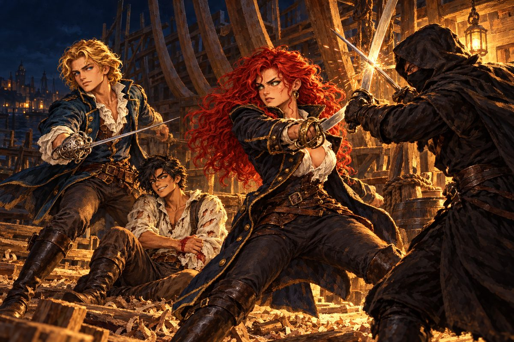

## 8. 소금과 도자기

첫 교역은 엔리코 신부의 셈대로 맞아떨어졌다.

리스본의 돌소금은 세비야를 거쳐 지중해로 들어서자 값이 훌쩍 뛰었다. 세비야에서는 하얀 유약을 바른 도자기를 실었다. 그것을 다시 리스본이나 북쪽 항구로 가져가면 또 얼마간이 남았다. 엔리코는 밤마다 등불 아래서 장부를 맞추었고, 이윤이 날 때마다 성호를 그었다.

"신부님, 돈을 벌 때마다 기도하시는 겁니까?"

"감사 기도입니다, 제독님. 그리고 다음 항구에서 바가지를 쓰지 않게 해 달라는 기도이기도 하고요."

로코는 조안을 혹독하게 가르쳤다. 해 뜨기 전에 깨워 돛줄을 감게 했고, 정오에는 태양 고도를 재게 했고, 밤에는 별을 보며 배의 위치를 짚게 했다. 책에서 배운 것과 실제 바다는 달랐다. 아스트롤라베 눈금은 배가 흔들리면 춤을 추었고, 해도 위의 해안선은 안개 속에서 엉뚱한 모양으로 나타났다. 조안은 두 번 암초 가까이 배를 몰았고, 두 번 다 로코의 고함 덕에 살았다.

"책은 길을 알려 줄 뿐입니다, 제독님. 발밑의 물은 눈으로 읽으셔야죠. 물빛이 옅어지면 바닥이 가깝다는 뜻입니다."

뜻밖에 도밍고는 쓸모 있는 선원이었다. 처음 며칠은 밧줄 매듭 하나 제대로 짓지 못해 로코에게 욕을 바가지로 먹었지만, 지중해에 들어설 무렵에는 키를 맡겨도 될 만큼 늘었다. 무엇보다 그는 항구마다 그 나라 사정을 꿰고 있었다. 제노바 총독이 누구와 사이가 나쁜지, 오스만 함대가 요즘 어디에 모이는지. 선원 따위가 알 법한 이야기가 아니었다.

"도밍고, 그런 건 어디서 들었지?"

"귀가 밝은 편이라서."

그렇게 웃어넘기는 얼굴이 어딘가 낯익었다. 조안은 그 생각을 접어 두었다.

배는 차츰 늘었다. 이스탄불과 아테네를 오가는 교역으로 돈이 모이자, 조안은 두 번째 배를 샀다. 선장 자리를 놓고 로코가 투덜거렸지만, 조안은 그 배를 도밍고에게 맡겼다. 도밍고는 처음으로 놀란 표정을 지었다.

"나를 믿는다는 건가?"

"내 배에 몰래 탄 사람이 내 배를 훔쳐 달아나진 않겠지."

조안은 항구에 닿을 때마다 근처 해안과 강을 탐사했다. 낯선 유적, 이름 모를 꽃, 책에서만 보던 동물을 기록해 리스본의 지리학자들에게 보고했다. 처음에는 아무도 그 이름에 관심을 두지 않았다. 그러다 차츰, 페레로 공작의 아들이 아니라 탐험가 조안 페레로라는 이름이 항구의 주점에서 오르내리기 시작했다.

## 9. 사라진 왕자

마르세유의 주점에서 돌아온 로코의 얼굴이 어두웠다.

"제독님, 좀 걸리는 소문을 들었습니다. 선착장 뱃사람들이 수군대는데, 포르투갈 왕자가 왕궁에서 자취를 감췄답니다."

"알베르트 전하가?" 조안은 잔을 내려놓았다. "그게 사실이면 보통 일이 아닌데."

"왕실 사정이 안팎으로 어수선하다더군요. 밖으로는 에스파니아와 오스만, 안으로는 마르티네스 후작 같은 문벌 귀족들……. 그런데 제독님은 전하를 만나 보신 적이 있으시지요?"

"아주 오래전, 어릴 적 궁에서 몇 번 본 게 전부야. 외삼촌이라지만 나이 차도 크지 않고, 나와 달리 고지식한 데가 있어서 말이 잘 통하진 않았어. 그래도 나라 장래를 진심으로 걱정하는 사람이었지."

조안은 문득 주위를 둘러보았다. "그런데 도밍고는?"

"여관에 가 있겠지요."

조안은 자리에서 일어났다. 무언가가 가슴 한쪽을 잡아당겼다. 지중해 항구마다 나라 사정을 꿰던 선원. 꼿꼿한 등과 가지런한 걸음. 고지식한 말투.

"미안하지만 먼저 여관으로 가 보겠네."

같은 날 저녁, 부두에서 술 취한 포르투갈 뱃사람 하나가 조안에게 말을 걸었다. 왕자 실종 이야기를 들었느냐고. 그리고 목소리를 낮추어, 그 배후가 페레로 공작이라는 말이 돈다고 했다. 공작이 아들에게 왕위를 물려주려고 왕자를 없앴다는 것이다.

"말도 안 되는 소리!" 조안은 사내의 멱살을 잡았다가 놓았다. "그런 헛소문은 어디 가서 함부로 떠들지 마."

사내는 겁먹은 얼굴로 굽실거리며 물러갔다. 조안의 손이 떨렸다. 누군가 이 소문을 일부러 퍼뜨리고 있었다.

## 10. 조선소의 칼날

여관 주인은 도밍고가 조금 전 어떤 사람과 함께 급히 조선소로 갔다고 했다.

조안은 달렸다. 해가 진 조선소는 텅 비어 있었다. 선대 위에 짓다 만 배의 늑골이 짐승 뼈처럼 솟아 있었고, 바닥에는 대팻밥이 수북했다. 그 사이로 그림자 둘이 엉켜 있었다.

"도밍고! 어디 있나!"

"쳇, 뭐야? 훼방꾼이……."

검은 외투를 입은 사내가 도밍고의 목에 칼을 대고 있었다. 얼굴의 반을 천으로 가렸고, 드러난 눈은 뱀처럼 가늘었다.

"제, 제독! 살려 줘!"

"멈춰라! 도밍고를 어쩔 셈이냐?"

"어쩌긴. 둘 다 저세상에 보내 줘야지."

조안은 레이피어를 뽑았다. 마르코가 챙겨 준 칼이었다. 자객이 도밍고를 밀쳐 내고 달려들었다. 첫 칼이 어깨를 스쳤다. 조안은 뒤로 물러서며 칼을 받아 냈다. 저택 마당에서 아버지와 겨루던 검술은 이런 것이 아니었다. 그건 규칙이 있는 싸움이었다. 이 사내의 칼에는 규칙이 없었다. 목, 눈, 아랫배. 오로지 죽이는 자리만 노렸다.

"제법 칼 좀 놀리는군. 하지만 다 잡은 물고기를 놔줄 바보는 없지. 너부터 죽어라!"

자객이 크게 칼을 치켜들었다. 그때였다.

"그렇게는 안 될걸!"

어둠 속에서 누군가 뛰어들었다. 짧은 칼이 자객의 칼을 쳐 냈다. 불꽃이 튀었다. 등불 빛 속에 붉은 머리칼이 불길처럼 흔들렸다. 여자였다. 몸에 꼭 맞는 짙은 남색 해군 외투, 허리에 찬 커틀러스, 바닷바람에 그을린 뺨.

"넌 뭐냐!"

"너 같은 부류. 하지만 인질을 잡고 협박할 만큼 비겁하진 않지."

"여자? 제기랄, 그 배신자 여해적이잖아. 하필 이럴 때……!"

자객은 몇 합을 더 겨루다가 이를 갈며 어둠 속으로 사라졌다. 여자가 칼을 거두며 혀를 찼다. "저런 놈들이 내뱉는 말은 왜 하나같이 똑같은지."

조안은 숨을 고르며 고개를 숙였다. "고맙소. 덕분에 살았소."

"인사는 필요 없어요. 그런데 당신들, 포르투갈 사람인가요?"

"그렇소. 나는 조안 페레로라 하오. 이 은혜를 어떻게 갚아야 할지."

여자의 얼굴이 굳었다. 등불 아래서 그녀의 눈빛이 순식간에 바뀌었다. 은인을 보던 눈이 원수를 보는 눈으로.

"……이럴 수가. 내가 페레로 가의 인간을 도왔다니."

"왜, 왜 그러시오?"

"네놈들이 죽인 에스파니아 해군 제독 미카엘 에란초를 기억하겠지. 나는 그의 누이동생 카탈리나다. 지금 여기서 오빠의 원수를 갚겠다."

"잠깐! 나는 싸울 이유를 모르겠소!"

"발뺌해도 소용없어. 칼을 뽑아!"

카탈리나의 커틀러스가 바람을 갈랐다. 자객보다 빠르고, 자객보다 무거웠다. 조안은 칼을 막을 때마다 손목이 저렸다. 세 합, 네 합. 뒤로 밀리던 발뒤꿈치가 목재 더미에 걸렸다.

그때 조선소 입구에서 쩌렁쩌렁한 목소리가 울렸다.

"여해적 카탈리나! 거기 있는 거 다 안다! 에제키엘 해군 사령부 직속 포박대다! 에스파니아에 대한 반역죄로 너를 체포한다!"

카탈리나가 이를 악물었다. "젠장, 원수를 눈앞에 두고……! 기다려라, 페레로의 애송이. 언젠가 네놈들을 반드시 지옥에 처넣어 주겠어."

그녀는 몸을 날려 선대 너머 바다로 뛰어내렸다. 물 튀는 소리가 났고, 그다음은 조용했다.

입구에서 나타난 것은 포박대가 아니라 로코 혼자였다.

"제독님, 이 틈에 빨리 도망갑시다! 서두르지 않으면 저 무서운 여자한테 목이 날아갑니다."

## 11. 왕자의 이름

여관 방에 돌아와서야 로코가 사정을 털어놓았다. 조안의 행동이 이상해 뒤를 밟았는데, 붉은 머리 여자가 제독에게 칼을 들이대고 있더라고. 그래서 그 여자가 가장 두려워할 이름을 외쳤다고.

"그 여자를 아나?"

"모를 리가요. 요즘 소문이 자자한 여해적 카탈리나입니다. 원래 에스파니아 해군이었는데, 무슨 사사로운 일 때문에 함대 주력인 최신 갤리온을 훔쳐 달아났다지요. 그 뒤로 에스파니아 해군에 쫓기며 해적질로 연명한답니다. 포르투갈 배만 골라 노린다는 말도 있고요."

"원수라고 했어. 나를 보고."

"이 바닥에선 언제 누구한테 원한을 샀는지도 모르고 사는 법입죠." 로코가 턱수염을 쓸었다. "그런데 제독님, 아까 마음에 걸린다던 일이 대체 뭡니까?"

조안은 침대 모서리에 앉아 있는 도밍고를 보았다. 도밍고는 붕대 감은 손목을 내려다보고 있었다.

"그건 도밍고에게 듣지. 아니, 알베르트 전하께."

방 안이 조용해졌다. 엔리코가 묵주를 굴리던 손을 멈추었다. 로코의 입이 반쯤 벌어졌다.

도밍고, 아니 알베르트 왕자가 천천히 고개를 들었다. 그리고 지친 듯 웃었다.

"……예전부터 느꼈지만, 정말 눈치가 보통이 아니야. 결국 들켰군."

"전하, 어쩌실 겁니까? 왕궁은 지금 난리가 났을 겁니다."

"서둘러 돌아가야겠어. 내 경솔한 짓 때문에 자네 아버님이 큰 누명을 쓴 모양이야." 왕자의 얼굴에서 웃음이 사라졌다. "어처구니없게도 페레로 공작에게 나를 죽이려 했다는 혐의가 씌워졌어. 아까 그 자객은 자네가 조선소에서 크게 다쳤다는 편지로 나를 꾀어냈지. 칼을 대기 직전에 친절하게도 다 털어놓더군. 나를 죽이고, 그 죄를 자네 집안에 덮어씌울 거라고."

로코가 벌떡 일어섰다. "이거 큰일 났군! 도련님, 아니 제독님. 어서 리스본으로 돌아갑시다!"

"머지않아 공작을 심문하는 사문회가 열릴 거야. 그 전에 돌아가야 해."

조안은 창밖을 보았다. 항구의 불빛 너머로 검은 바다가 펼쳐져 있었다. 그 바다 끝에 리스본이 있었다. 아버지가 있었다.

"오늘 밤 출항한다."

## 12. 연행

리스본 항구에 닿자마자 카를로타의 주점 아이가 달려왔다. 공작님이 반역 혐의로 왕궁에 불려 갔다고, 여기 있으면 도련님도 위험하다고.

"괜찮아. 아버님께 죄가 있을 리 없어."

왕궁 문지기는 낡은 선원 차림의 알베르트를 알아보지 못했다. 오늘은 사문회가 열리는 날이니 알현하려면 내일 다시 오라고 했다.

"이봐, 내가 누군지 모르겠나?"

"전하, 그 차림새로는 무리입니다." 조안이 왕자의 소매를 끌었다. "일단 저희 집에서 옷부터 갈아입으시지요."

저택 문을 열자 어머니가 뛰어나왔다. 집사 마르코가 그 뒤를 따랐다. 평소라면 조안을 막아섰을 마르코였지만, 오늘은 아무 말도 하지 않았다.

"조안! 마르티네스 후작을 따르는 귀족들이 네 아버님을 왕궁으로 끌고 갔단다. 여기 있으면 위험해. 어서 몸을 피하렴!"

"어머니, 무사하셨군요. 아버님은……."

"아마 지금쯤 사문을 받고 계실 거야."

"서둘러야겠습니다. 아버님의 누명을 벗겨 드려야 해요."

어머니의 시선이 조안 뒤에 선 꾀죄죄한 선원에게 닿았다. 잠시 의아해하던 눈이 이윽고 크게 벌어졌다.

"……알베르트? 너, 알베르트 아니니!"

"누님도 못 알아보신 걸 보면 제 변장이 완벽했던 모양입니다." 왕자가 머리를 긁적였다. "죄송합니다, 누님. 폐를 끼쳤습니다."

"지금 그런 이야기할 때가 아니에요, 전하. 어서 옷을 갈아입으십시오."

마르코가 옷장에서 예복을 꺼내 오는 사이였다. 정원 쪽 유리창이 깨지는 소리가 났다.

"그렇게는 안 될걸!"

조선소의 그 자객이었다. 얼굴의 천은 벗겨지고 없었다. 광대뼈 아래로 길게 그어진 흉터가 드러나 있었다.

"여기까지 쫓아오다니 집념 한번 대단하군. 대체 누가 시켰지?"

"끝장을 보자, 애송이. 이번엔 그 붉은 머리 계집도 끼어들지 않겠지."

"나야말로 바라던 바다!"

칼과 칼이 부딪쳤다. 어머니의 비명이 들렸다. 응접실의 촛대가 쓰러지고 융단 위로 촛농이 흘렀다. 자객은 조선소에서보다 더 빨랐다. 조안의 팔에 붉은 줄이 그어졌다. 이어서 허벅지에. 조안은 벽난로 쪽으로 밀려났다. 등 뒤가 막혔다.

"하하! 드디어 눈엣가시를 뽑는군. 죽어라!"

"안 돼, 조안!"

칼날이 내려오는 순간, 자객의 몸이 크게 꺾였다. 그의 등 뒤에 로코가 서 있었다. 로코의 손에 들린 단검이 자객의 등에 깊이 박혀 있었다.

"네놈 따위에게 제독님을 내줄 줄 알았냐!"

"커윽……! 뒤에서 찌르다니…… 비겁한 놈……. 내, 내가……."

자객이 융단 위에 쓰러졌다. 다시 일어나지 않았다.

엔리코가 무릎을 꿇고 성호를 그었다. "주여, 악인이었으나 이 길 잃은 양을 당신의 품으로 거두어 주소서."

로코가 단검을 닦으며 중얼거렸다. "제독님, 뒷맛이 씁쓸하군요."

"미안하다, 로코. 나 때문에……."

"사과는 나중에 받겠습니다. 자, 전하! 시간이 없습니다. 어서 왕궁으로!"

## 13. 사문회

알현실은 숨 막히게 조용했다.

옥좌 위의 국왕은 조안이 기억하는 것보다 훨씬 늙어 보였다. 그 앞에 레온 페레로 공작이 서 있었다. 손이 묶이지는 않았지만, 양옆을 근위병이 지키고 있었다. 공작은 등을 곧게 펴고 있었다. 늘 그랬듯이.

공작 맞은편에서 검은 비단옷을 입은 사내가 두루마리를 펼치고 있었다. 마르티네스 후작이었다. 쉰 줄의 나이, 뾰족하게 다듬은 턱수염, 반지를 낀 손가락이 두루마리 위를 천천히 미끄러졌다.

"폐하, 이상의 사실로 페레로 공작의 죄상은 명백합니다. 법은 신분을 가리지 않습니다. 반역은 죽음으로 다스려야 합니다. 반역자 페레로에게 마땅한 판결을 내려 주십시오."

국왕이 무겁게 입을 열었다. "후작, 경의 말에도 일리는 있소. 그러나 확실한 증거 없이 벌을 내릴 수는 없소. 공작은 짐의 사위이자 이 나라 최고의 공신이오. 짐은 공작의 말도 들어 보아야겠소."

"그럴 필요는 없습니다."

알현실 문이 열렸다. 모든 고개가 돌아갔다.

"공작은 죄가 없습니다. 가장 확실한 증인이 지금 여기 왔으니, 결론은 이미 난 셈이지요."

예복으로 갈아입은 알베르트 왕자가 걸어 들어왔다. 그 뒤에 조안이 따랐다. 팔의 상처에서 아직 피가 배어 나오고 있었다.

"이 목소리는……!" 국왕이 옥좌에서 몸을 일으켰다.

"아버님, 방금 돌아왔습니다."

"왕자! 대체 지금까지 어디에 있었느냐!"

"다 말씀드릴 수는 없으니 결론만 아뢰지요. 여러 나라를 돌며 견문을 넓히고 왔습니다."

국왕은 한동안 말을 잇지 못하다가, 이윽고 깊은 숨을 내쉬었다. "왕자를 꾸짖는 일은 나중으로 미루겠다. 그보다 먼저 공작에게 사과해야겠군."

"저는 괜찮습니다, 폐하. 고개를 드십시오."

국왕의 시선이 마르티네스에게로 향했다. 늙은 왕의 목소리가 처음으로 알현실 천장을 울렸다.

"마르티네스 후작! 물증 하나 없이 동료 대신을 모함한 죄, 반드시 따져 묻겠다. 당장 물러가라!"

후작의 얼굴이 하얗게 질렸다. 그는 허리를 굽히고 물러나면서 입속으로 무언가를 중얼거렸다. 어떻게, 어떻게 살아서. 조안은 그 입술의 움직임을 보았다. 그리고 그 눈을 보았다. 물러나는 순간 후작의 눈은 왕자가 아니라 조안을 보고 있었다.

## 14. 항구의 작별

그날 저녁, 조안은 오랜만에 저택 식탁에 앉았다.

"조안, 덕분에 위기를 넘겼다. 수고 많았다."

"아닙니다, 아버님. 아버님과 왕가를 위해 할 일을 했을 뿐입니다."

어머니가 남편의 소매를 살며시 잡았다. "여보, 조안도 이제 집안을 이을 만큼 자랐어요. 이쯤에서 위험한 항해는 그만두게 할 수 없을까요?"

공작은 포도주 잔을 내려놓고 아들을 보았다. "네 생각은 어떠냐? 이제 그만 뭍으로 돌아오겠느냐?"

조안은 식탁 위에 놓인 자기 손을 내려다보았다. 굳은살이 박이고 밧줄에 쓸린 자국이 가득한 손이었다. 떠나기 전에는 류트 줄에만 굳은살이 박였던 손.

"아버님, 저는 아직 약속한 일을 이루지 못했습니다. 요한 사제왕국을 찾지 못했어요. 그리고 아버님 뒤를 잇기에는 아직 부족한 것이 너무 많습니다."

공작의 입가가 아주 조금 움직였다. "그러하냐. 좋다. 내 걱정은 말고 네 뜻대로 나아가라."

공작은 자리에서 일어나 벽에 걸린 칼 한 자루를 내렸다. 칼집에 정교한 은 상감이 들어간 장검이었다.

"이번 공에 대한 상이다. 받아 두어라."

"감사합니다, 아버님."

이튿날 아침 알베르트 왕자가 저택을 찾았다. 비단 예복 차림이었지만, 조안의 눈에는 아직도 소금 얼룩이 앉은 셔츠가 겹쳐 보였다.

"공작, 이번 일로 큰 누를 끼쳤소. 사과하러 왔소." 왕자는 공작에게 고개를 숙이고 나서 조안에게 돌아섰다. "조안, 알다시피 나는 더 이상 항해를 계속할 수 없어. 정말 하기 싫은 부탁이지만, 내가 맡던 배에 새 선장을 정하든지 팔든지 해 주게."

"알겠습니다, 전하."

"작별이 아쉬우니 항구까지 배웅하지."

부두에는 헤르메스 2세와 도밍고가 몰던 두 번째 배가 나란히 묶여 있었다. 왕자는 배 앞에서 오래 서 있었다. 바닷바람이 그의 잘 빗은 머리칼을 헝클어뜨렸다.

"함께 떠나지 못해 아쉽지만, 자네에게도 나에게도 각자 할 일이 있지. 즐거웠던 추억으로 간직하겠네."

"전하께서도 강건하십시오."

왕자는 고개를 끄덕이고 돌아서려다 다시 바다를 보았다. 그리고 혼잣말처럼 중얼거렸다.

"……바다가 보고 싶군. 벌써부터."

로코가 헛기침을 했다. "전하, 그런 한가한 말씀 하실 때가 아닙니다. 왕궁에서 기다리십니다."

왕자가 웃었다. 도밍고 마냐나의 웃음이었다. 그리고 그는 다시 돌아보지 않고 걸어갔다.

헤르메스 2세가 다시 테주강을 내려갈 때, 조안은 고물에 서서 멀어지는 리스본을 보았다. 왕궁 탑 꼭대기에 누군가 서 있는 것 같았다. 너무 멀어서 확실하지는 않았다.
