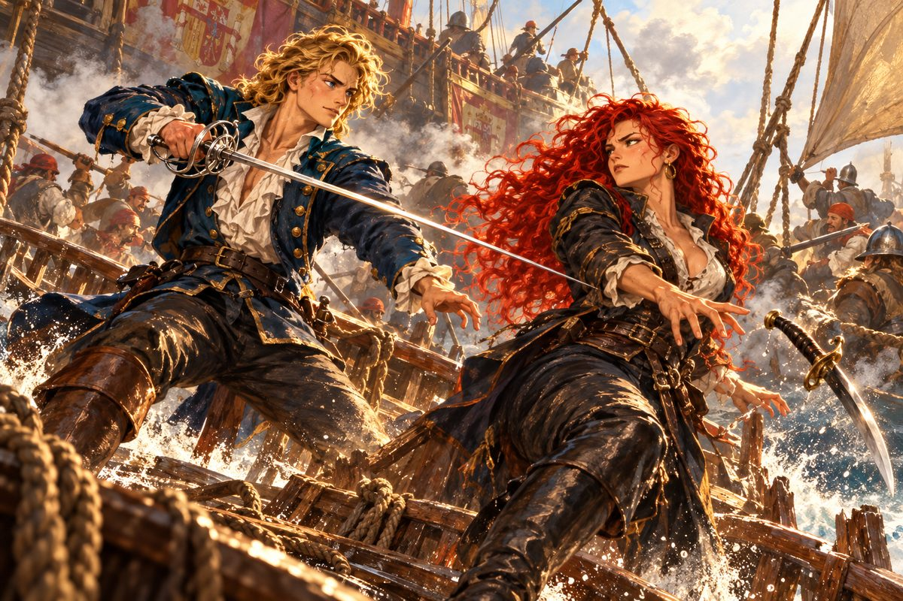

## 15. 쫓기는 항해

그 뒤 한 해 동안, 조안의 배는 아프리카 해안을 따라 남쪽으로 내려갔다.

세우타의 하얀 성벽, 카나리아 제도의 검은 화산 모래, 적도 아래의 숨 막히는 무풍지대. 엔리코는 열병에 걸린 선원들을 밤새 간호했고, 로코는 물통의 물이 줄어드는 것을 보며 날마다 혀를 찼다. 희망봉을 돌던 날은 사흘 내내 폭풍이 불었다. 돛 하나가 찢어지고 선원 둘이 파도에 쓸려 나갈 뻔했다. 조안은 키를 붙잡은 채 잠도 자지 않았다. 폭풍이 지나간 아침, 로코가 말없이 그의 어깨를 두드렸다. 그것이 로코가 처음으로 건넨 칭찬이었다.

조안은 나일강 상류까지 거슬러 올라가 폭포와 신전 터를 기록했고, 동아프리카의 항구에서는 처음 보는 짐승들을 그렸다. 리스본의 지리학자들은 이제 그의 보고를 기다렸다. 항구 주점에서 그를 알아보는 사람도 늘었다.

그리고 그를 알아보는 사람 중에는, 결코 반갑지 않은 얼굴도 있었다.

"당신, 그 유명한 항해자 조안 페레로 아니오?"

"유명한지는 모르겠지만, 조안은 나요."

"조심하는 게 좋을 거요. 조금 전까지 포르투갈 사람만 노린다는 그 여해적이 당신 행방을 묻고 다녔소."

로코가 조안의 팔을 끌었다. "거봐요, 어서 이 항구를 뜹시다."

"넓은 항구야. 쉽게 찾지는 못하겠지."

"글쎄, 과연 그럴까?"

골목 모퉁이에서 붉은 머리가 불쑥 나타났다. 카탈리나였다. 커틀러스가 이미 칼집 밖에 나와 있었다.

"드디어 결판을 낼 때가 왔군. 여기서 오빠와 약혼자의 원수를 갚겠다!"

약혼자. 조안은 그 말에 멈칫했다. 처음 듣는 이야기였다.

"제독님, 여긴 제가 맡겠습니다! 어서 배로 돌아가세요!"

로코가 두 사람 사이에 뛰어들었다. 조안은 망설였지만 엔리코가 그의 소매를 잡아끌었다. 부두에 닿아 돛을 올릴 준비를 하는 동안, 조안은 몇 번이고 골목 쪽을 돌아보았다.

한참 뒤 로코가 숨을 헐떡이며 나타났다. 소매가 찢어지고 이마에 혹이 나 있었다.

"로코, 무사했나!"

"무사할 리가요. 하마터면 죽을 뻔했습니다. 그 여자, 실력이 보통이 아니에요."

"카탈리나는?"

"하도 얌전해지질 않아서 밧줄로 묶고 재갈을 물려 교역소 창고에 넣어 뒀습니다."

엔리코가 눈을 감았다. "로코 씨답게 과격하시군요……."

그런 일이 한 번으로 끝나지 않았다. 다른 항구에서 또 한 번, 그다음 항구에서 또 한 번. 카탈리나는 어디선가 나타났고, 로코는 그때마다 몸으로 막아섰다. 두 번째에는 그녀를 쌀자루에 넣어 창고 구석에 버려두고 왔다고 했다.

"이러다간 제독님보다 제가 더 원한을 사겠수."

주점 주인들도 혀를 내둘렀다. 어떤 주인은 그 여자가 조금 전까지 가게에서 난리를 피웠다며, 아는 사이라면 어떻게 좀 해 보라고 사정했다. 조안은 할 말이 없었다. 무작정 덤벼드는 사람을 말로 달랠 방법은 없었다.

어느 밤 갑판에서 엔리코가 조용히 말했다.

"제독님, 저 여해적이 어쩐지 가엾다는 생각이 듭니다. 모든 걸 잃어버린 사람처럼 굴지 않습니까."

조안은 대답하지 않았다. 그 역시 같은 생각을 하고 있었다. 조선소에서 처음 칼을 겨눈 그녀의 눈. 분노 아래 고여 있던 것은 슬픔이었다.

## 16. 리벨리온

결국 그녀는 바다에서 왔다.

아침 안개 속에서 망루의 선원이 소리쳤다. 북서쪽에 돛. 갤리온 한 척과 그 뒤를 따르는 작은 배들. 앞장선 갤리온의 높은 고물에는 에스파니아 해군의 문장이 덧칠로 지워진 자국이 남아 있었다. 리벨리온. 에스파니아 함대에서 훔쳐 낸 최신예 갤리온이었다.

"제독님, 저건 도망칠 수 있는 배가 아닙니다."

조안은 망원경을 내렸다. 바람은 저쪽 편이었다. 갤리온의 뱃머리가 하얀 물보라를 일으키며 다가왔다.

"그럼 싸우지. 나도 도망치는 데 지쳤어."

포성이 안개를 찢었다. 첫 포탄이 헤르메스 2세의 돛대 옆을 스쳐 바다에 떨어졌다. 물기둥이 솟아 갑판을 적셨다. 조안은 배를 비스듬히 돌려 갤리온의 옆구리를 피하며 작은 배들 사이로 파고들었다. 로코가 포수들에게 고함을 질렀다. 엔리코는 부상자를 선창으로 날랐다.

리벨리온이 바짝 다가와 갈고리를 던졌다. 두 배가 맞부딪치며 뱃전이 비명을 질렀다. 붉은 머리가 가장 먼저 건너왔다.

"조안! 오늘은 도망 못 간다! 저 흉측한 영감하고 사이좋게 물귀신이 되게 해 주지!"

"원하는 대로 해 주겠어. 대신 이번엔 끝까지 상대하지!"

갑판 위에서 두 칼이 엉켰다. 조안은 그동안 바다에서 배운 것을 모두 쏟아부었다. 흔들리는 갑판에서 발을 딛는 법, 파도가 배를 들어 올리는 순간을 기다리는 법. 카탈리나의 칼은 여전히 빠르고 무거웠다. 그러나 이번에는 조안도 물러서지 않았다. 배가 크게 기울어진 순간, 조안의 칼이 그녀의 커틀러스를 쳐 냈다. 칼이 갑판을 미끄러져 바다로 떨어졌다.

카탈리나는 빈손으로 조안을 노려보았다. 숨을 몰아쉬는 어깨가 떨렸다.

"……오늘은 네가 이겼어. 하지만 언젠가 이 굴욕은 반드시 갚아 주겠다. 다음에 만나면 상어 밥으로 만들어 주지!"

그녀는 리벨리온으로 뛰어 돌아갔고, 갈고리가 풀렸다. 갤리온은 상처 입은 짐승처럼 천천히 멀어졌다.

로코가 그 뒷모습을 보며 휘파람을 불었다. "허, 우리 제독님은 해적한테 인기가 참 많으셔. 저 아가씨, 단단히 화가 났는데요."

조안은 칼을 거두지 않고 수평선을 보았다. 이겼다는 기분은 들지 않았다.

## 17. 이슬람 상인

얼마 뒤 지중해의 어느 항구 주점에서, 로코가 맥주잔을 들고 물었다.

"제독님, 그 여해적 말인데요. 이대로 포기할까요?"

"그럴 것 같진 않은데."

"당분간은 쫓아오지 않을지도 모릅니다. 에제키엘 사령관이 그 여자를 잡으려고 눈에 불을 켰다는 소문이 있으니까요."

"잠깐 실례하지."

옆자리에서 낯선 남자가 몸을 돌렸다. 하얀 터번을 두르고 짙은 수염을 단정히 다듬은 사내였다. 손가락에 낀 반지마다 다른 보석이 박혀 있었다. 그 옆에 몸집이 작고 눈이 날카로운 청년이 앉아 있었다.

"나는 교역상 알 베자스라고 한다. 방금 붉은 머리 여해적 이야기를 했나?"

"그렇소만. 설마 또 우리를 노린다는 소식은 아니겠지?"

"그런 무서운 소식은 아니야. 당신이 포르투갈의 항해자 조안 페레로 맞지? 리스본 주점에서 일하는 루치아라는 아가씨가 행방불명됐어."

조안의 손에서 잔이 미끄러질 뻔했다. "뭐라고?"

"소문으로는 그 여해적에게 납치당한 것 같다더군. 이 친구는 내 일행 살림이야. 둘이서 리스본 주점에 잠깐 들렀을 때, 카를로타라는 여주인이 사정하더군. 딸을 꼭 찾아 달라고."

로코가 주먹으로 탁자를 쳤다. "그런 짓을 할 여자로는 안 봤는데! 사람 속은 정말 모르겠군."

"중요한 걸 알려 줘서 고맙소, 알." 조안이 일어섰다.

"음? 그냥 가려고? 뭔가 잊은 듯한데."

"아직 남은 게 있나?"

알이 웃었다. "우리 이슬람 상인은 손익에 철저하지. 몰랐나?"

"금화라도 얹어 달라는 건가?"

"아니. 돈이 아니라 부탁 하나야." 알의 웃음이 옅어졌다. "사람을 찾고 있어. 어릴 때 헤어진 누이동생이야. 이름은 사파. 살아 있다면 열여섯이나 열일곱쯤 됐을 거야. 당신들은 여기저기 많이 다닌다지. 그런 아이를 보면 이스탄불 여관으로 데려와 주지 않겠나?"

"좋아. 사파를 찾으면 반드시 데려가지. 약속하오."

"고맙다. 다음에 만날 땐 사파와 함께였으면 좋겠군."

두 사람이 떠난 뒤, 로코가 이를 갈았다. "당연히 그 여해적을 찾아내서 추궁해야지요!"

엔리코가 고개를 저었다. "저는 잘 모르겠습니다."

"신부님, 내 말에 반대하시는 겁니까?"

"그게 아니라 미심쩍어서요. 그 여자는 적이긴 하지만, 그런 비겁한 짓을 할 사람 같지는 않았습니다."

조안은 엔리코의 말을 곱씹었다. 인질을 잡고 협박할 만큼 비겁하지는 않다던 그녀의 목소리가 떠올랐다.

"일단 리스본으로 돌아가자. 어떻게 할지는 그다음이야."

## 18. 빈 무대

카를로타의 주점은 불이 반쯤 꺼져 있었다. 무대 옆에 루치아의 탬버린이 걸려 있었다. 아무도 그것을 치지 않았다.

"조안 님, 와 주셨군요."

카를로타는 한 해 사이에 열 살은 늙어 보였다. 앞치마 끈이 헐겁게 풀려 있었다.

"다녀간 상인에게 들었습니다. 정말입니까?"

"네. 하지만 누가 데려갔는지는 몰라요. 다만 루치아가 사라진 그날 밤 출항한 배가 있었는데, 그게 그 악명 높은 여해적의 배였다고들 해요."

"역시 그 여자가 범인이군요! 지난번 일로 앙심을 품은 게 틀림없어요."

"로코 씨, 증거도 없이 단정하지 맙시다."

조안은 카를로타의 손을 잡았다. 루치아의 손을 닮은 손이었다. "누구 짓이든 카탈리나는 반드시 찾아내야 해. 그 여자가 열쇠를 쥐고 있는 건 분명하니까. 그리고 사파라는 아가씨 일도 끝을 내야지."

"사파라면 중동 쪽부터 가 봐야 하지 않을까요?" 엔리코가 말했다.

"카를로타 씨, 루치아는 틀림없이 무사할 겁니다. 너무 걱정하지 마세요. 내가 할 수 있는 건 다 하겠습니다."

카를로타는 고개를 끄덕였지만 울음을 참느라 아무 말도 하지 못했다.

그 뒤로 리스본에 들를 때마다 같은 대화가 되풀이되었다. 루치아를 찾았느냐는 물음과, 아직이지만 꼭 찾겠다는 대답. 저택에 들르면 마르코가 반겨 맞았고 어머니는 무리하지 말라며 성호를 그어 주었다. 그리고 주점에 들르면 카를로타가 문간에서 기다리고 있었다. 조안은 그 얼굴을 볼 때마다, 처음 바다로 나가던 날 루치아가 뛰어나가던 뒷모습을 떠올렸다.

## 19. 바스라의 사파

사파를 찾는 일은 바늘을 찾는 일 같았다.

중동의 항구마다 주점 주인을 붙잡고 물었다. 혹시 사파라는 아가씨가 일하지 않느냐고. 대부분은 고개를 저었다. 어떤 항구에서는 늙은 뱃사람이 이마를 짚으며 기억을 더듬었다.

"사파? 어디서 들어 본 이름인데…… 아! 페르시아 만 안쪽, 허름한 항구 주점의 여급이었어. 고아였다지, 아마."

바스라는 페르시아 만의 가장 깊숙한 곳에 있었다. 대추야자 숲 사이로 흙벽 집들이 늘어섰고, 강 하구의 물은 진흙빛이었다. 주점 주인은 그 이름을 듣자 웃었다.

"사파? 우리 가게 간판 아가씨지요. 어이, 사파! 널 찾는 손님들이 오셨다!"

나타난 소녀는 까만 머리를 천으로 감싸고 있었다. 커다란 눈이 경계심으로 가늘어졌다.

"제게 무슨 용건이죠?"

"네 가족에 대해 묻고 싶어서 왔어."

"가족 같은 건 없어요. 저는 천애 고아인걸요."

"네 오빠라는 사람을 만났어. 너를 꼭 만나고 싶어 하더구나."

소녀의 손이 앞치마 끝을 쥐었다. 그러나 목소리는 더 차가워졌다.

"……당신들을 어떻게 믿죠? 달콤한 말로 꾀어서 다른 항구에 팔아넘기려는 건 아니고요?"

"아가씨! 맹세코 그런 짓은 안 합니다!" 로코가 펄쩍 뛰었다.

"에휴. 혼자 자란 아이들은 다 이렇습니다." 로코가 조안에게 속삭였다. "이래서야 이야기가 안 되겠는데요."

조안은 소녀의 눈을 보았다. 의심이 아니라 두려움이었다. 믿었다가 다시 버림받을까 봐 미리 문을 닫아거는 눈.

"이스탄불로 가자. 알에게 알려야겠어. 결국 당사자끼리 만나야 풀릴 일이야."

이스탄불의 주점에서는 살림이 그들을 알아보았다. 알은 여관에 묵고 있었다.

"조안 아닌가! 오랜만이야. 사파는 어떻게 됐나?"

"사파라는 아가씨를 찾긴 찾았어. 그런데 네 누이동생이 맞는지는 모르겠어. 자기는 고아라고 하더군. 낯선 사람이라 못 믿었는지 자기 이야기를 하려 하지 않았어."

알은 한참 말이 없었다. 그러다 천천히 웃었다. 상인의 웃음이 아니었다.

"그래? 그럼 내가 직접 가 볼 수밖에. 어려운 부탁이었을 텐데 정말 고맙다. 어디지?"

"바스라. 페르시아 만 가장 안쪽 항구야. 그곳 주점에 가면 만날 수 있어."

"그럼 바로 떠나야겠군."

"꼭 다시 만나길 빌게."

"너도 몸조심해라, 조안."

알이 떠난 뒤 조안은 오랫동안 여관 창가에 앉아 있었다. 십 년 넘게 누이를 찾아 헤맨 사내가 있었다. 그리고 리스본에는 딸을 잃은 어머니가 있었다. 바다는 넓었다. 그 넓은 바다 어딘가에서, 루치아도 누군가를 기다리고 있을 것이었다.
