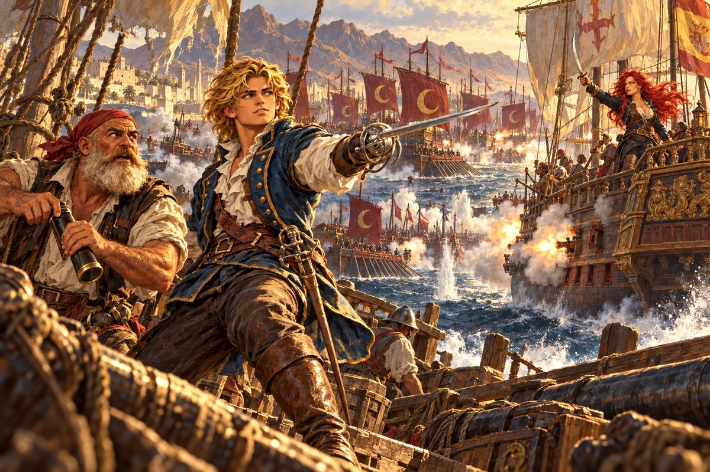

## 20. 상인의 셈법

인도양의 계절풍은 정직했다. 여름이면 동쪽으로, 겨울이면 서쪽으로. 조안은 그 바람을 타고 고아와 캘리컷을 지나 말라카 해협을 넘었고, 비단과 도자기가 넘치는 장안의 거리에도 발을 디뎠다. 엔리코는 가는 곳마다 교회를 찾았고, 교회가 없는 곳에서는 사람들의 얼굴을 오래 들여다보았다. 언젠가 자신이 설 땅을 미리 보아 두려는 것처럼.

그 사이 조안은 세 번째 배를 들였다. 헤르메스 2세는 이제 함대의 막내였다. 그래도 조안은 늘 그 작은 배에 기를 올렸다.

알과 다시 마주친 것은 홍해 입구의 항구에서였다.

"조안 아닌가! 이렇게 만나다니 다행이야. 꼭 고맙다는 말을 하고 싶었어. 덕분에 누이를 만났다."

"정말 잘됐군! 찾아다닌 보람이 있었어."

"리스본의 그 아가씨는 어떻게 됐나?"

조안은 고개를 저었다. "오리무중이야. 카를로타 씨에게는 걱정 말라고 했지만…… 솔직히 반은 포기한 심정이야."

"그 뒤로 여해적 소문도 끊긴 걸 보면, 어디서 난파라도 당한 게 아닌지 모르겠습니다." 엔리코가 덧붙였다.

"희망의 끈을 놓지 마. 나도 사파를 찾는 데 십 년이 넘게 걸렸어." 알이 조안의 어깨를 잡았다. "그리고 나는 아직 빚을 갚지 않았지. 우리 이슬람 상인은 금화 한 닢의 손익도 허투루 넘기지 않는다고 했던 말, 기억하나?"

"참 묘한 자존심이군요." 로코가 중얼거렸다.

"기독교도는 이해 못 하겠지." 알이 웃더니 목소리를 낮추었다. "너, 요한 사제왕국을 찾고 있다며? 피에트로라는 유능한 모험가에게서 들었어. 마사와라는 곳을 아나? 홍해의 아프리카 쪽에 붙은 항구야. 사파가 그러는데, 그 항구에는 오래전부터 이교도들과 그들이 섬기는 왕이 살았대. 놀랍게도 너희와 같은 신을 믿는다더군."

조안은 숨을 멈추었다.

"그리고 이건 반드시 비밀로 해 줘. 내가 이교도를 도왔다는 게 알려지면 술레이만 대제의 노여움을 살 테니까."

"알았어. 정말 고마운 정보야."

알이 떠난 뒤 조안은 로코를 보았다. "어떻게 생각하나?"

"글쎄요. 잘은 모르겠지만, 가 볼 만한 가치는 있을 것 같습니다."

## 21. 환상

마사와는 하얀 항구였다. 햇볕에 바랜 산호석 벽, 하얀 옷을 입은 사람들, 하얀 모래. 바다만 짙푸르게 빛났다. 항구 북쪽 언덕 위에 둥근 지붕을 얹은 사원이 서 있었다. 이슬람 사원처럼 보였다.

"이런 일은 그 방면의 전문가에게 묻는 게 빠르지요." 엔리코가 말했다. "성직자 말입니다."

사원 안은 서늘하고 어두웠다. 햇볕에 그을린 늙은 승려 하나가 나타났다. 흰 수염이 길었고, 눈동자가 이 땅 사람들보다 옅었다.

"무슨 일로 오셨소? 보아하니 이베리아에서 오신 분들 같은데."

"그렇습니다. 여쭐 것이 있어 먼 길을 왔습니다. 요한 사제왕국에 대해 아십니까?"

승려는 피곤한 듯 웃었다. "그 질문을 하는 사람이 대체 몇 번째인지. 다 환상이오. 요한 사제왕국도, 전설 속의 크리스트교 나라도."

"환상이라고요? 이곳엔 없다는 말씀입니까?"

"없다고 보는 게 맞겠지요. 다만……." 승려가 잠시 망설였다. "원래는 알려 드리면 안 되지만, 그렇게 먼 데서 오셨다니 특별히 말씀드리지요. 이 항구 남서쪽 저택에 가 보시오. 거기라면 당신의 의문이 풀릴지도 모르오."

## 22. 왕관 없는 왕

남서쪽 저택의 문은 굳게 닫혀 있었다. 아무리 두드려도 대답이 없었다.

"아무도 없나 봅니다."

"아니, 분명히 안에서 인기척이 났어."

문이 삐걱 열렸다. 키가 크고 마른 흑인 사내가 창을 비껴 들고 서 있었다. 흰 천을 어깨에 두른 차림이었다. 그는 자신을 메콘베라고 했다.

"주인님께서는 병석에 계시오. 먼 길 오셨으니 대접하고 싶지만, 돌아가 주시오."

"잠깐만요. 꼭 여쭐 것이 있습니다. 요한 사제왕국이 정말 있습니까?"

메콘베가 코웃음을 쳤다. "요한 사제왕국이라. 다들 지나간 그림자를 쫓고 있소. 게다가 이미 너무 늦었고. 자, 어서 이 항구를 떠나시오."

"기다려라, 메콘베."

안쪽에서 낮은 목소리가 울렸다. 지팡이를 짚은 노인이 천천히 걸어 나왔다. 백발이 성성했고 몸은 야위었지만, 걸음 하나하나에 위엄이 배어 있었다.

"이분들에게 진실을 말해 주자꾸나."

"주인님, 그건 너무……."

"모든 걸 비밀로 묻어 두기엔 너무 잔혹하지 않으냐. 우리에게도, 이분들에게도." 노인이 조안을 보았다. "나는 타파리라 하오. 요한 사제왕국이라…… 있다고도 없다고도 할 수 있지. 아니, 있었다고 하는 게 맞겠소. 그런 나라가 정말 있었다면, 그와 가장 닮은 나라는 바로 여기였소."

로코가 조안의 귀에 속삭였다. "제독님, 이 영감님이 무슨 소리를 하는 겁니까?"

"쉿, 조용히 해."

"이 나라 사람들은 아주 오래전에 크리스트교를 받아들였소. 당신들이 아까 만난 승려는 서른 해 전에 이곳에 온 포르투갈 사람이오. 이 나라는 옛날 악숨이라 불렸지. 그러나 내란으로 작은 왕국들로 쪼개졌고, 힘은 약해지고 민심은 흩어졌소."

타파리가 창밖의 둥근 지붕을 가리켰다.

"우리가 왜 이슬람 사원을 세워 놓고 사람들 눈을 속이며 사는지 아시겠소? 강대한 오스만을 적으로 돌리지 않으려고. 그러나 그것도 이제 소용이 없게 되었소. 저들이 우리 속내를 눈치챘소. 이웃 왕국들은 이미 무너졌고, 머지않아 수만의 오스만 군대가 이곳으로 몰려올 거요."

"이 땅을 지킬 방법은 없습니까?"

메콘베가 대신 대답했다. "전혀 없지는 않소. 흩어진 왕국의 사람들을 모아 새 악숨 왕국을 세운다면 맞설 수 있소."

"그만두어라. 말해 봐야 소용없다. 그 지팡이를 찾지 못하는 한."

"지팡이요?"

"성자의 지팡이. 악숨의 왕위를 상징하는 보물이오. 내란 중에 잃어버렸지."

조안은 엔리코와 로코를 돌아보았다. 두 사람의 얼굴에 같은 대답이 쓰여 있었다.

"좋습니다. 그 지팡이, 우리가 찾아 드리겠습니다."

타파리의 손이 지팡이 위에서 떨렸다. "……뭐라 하셨소?"

"같은 신을 믿는 사람들을 버려두고 떠날 수는 없습니다. 신부님도 로코도 이의 없겠지?"

"물론입니다. 형제들이 위험에 처했는데 모른 척한다면 주님께서 용서하지 않으실 겁니다."

"옳으신 말씀. 여기서 도망칠 수는 없지요."

## 23. 보물 사냥꾼

저택을 나서자마자 로코가 물었다. "그런데 제독님, 그 지팡이를 찾을 단서라도 있으십니까?"

"그게…… 말은 그렇게 해 놨는데, 고민이군."

"단서라고 할 순 없지만, 이런 일에 귀신같은 녀석을 하나 압니다. 피에트로 콘티라는 이탈리아 놈인데, 보물 찾기의 명수로 통하지요. 실은 마님이 제독님을 도우라고 직접 돈을 대서 고용한 모험가입니다."

"어머니가?"

조안은 웃음이 나왔다. 아버지는 카를로타에게 금화를 맡겼고, 어머니는 모험가를 고용했다. 평민이 된 아들의 뒤에서, 두 사람은 각자 몰래 손을 쓰고 있었다.

리스본 저택에서 어머니는 아들의 부탁을 듣자마자 고개를 끄덕였다. "알았다. 피에트로 씨에게 연락해 보마. 그런데 그 사람도 지금쯤은 아마……."

"마님! 피에트로 콘티, 지금 막 여행을 마치고 돌아왔습니다!"

현관에서 쾌활한 목소리가 울렸다. 깃털 꽂은 넓은 모자를 쓴 사내가 성큼 들어섰다. 서른 안팎에, 햇볕에 그을린 얼굴, 장난기 가득한 갈색 눈. 허리에는 칼 대신 지도 통과 밧줄 뭉치가 매달려 있었다.

"어머나, 마침 잘 왔어요! 이렇게 절묘할 수가. 피에트로, 내 아들이 할 얘기가 있대요."

"부탁? 페레로 가 사람의 부탁이라면 당연히 들어야지! 돈 빌려 달라는 것만 빼고 뭐든 말해 봐."

"성자의 지팡이에 대해 아시는 게 있습니까?"

"아, 십 세기에 망한 악숨 왕국의 보물 말이로군. 아프리카 북동쪽 어딘가에 있었다던." 피에트로가 모자를 벗어 손가락으로 돌렸다. "그런데 당신, 모험가에 대해 잘 모르는군. 보물 찾기는 찾아가는 길이 제일 재미있는 거야. 쉽게 찾는 보물은 값어치가 없지."

"저는 그걸 꼭 찾아야 할 이유가 있습니다."

피에트로가 모자 돌리기를 멈추었다. 조안의 얼굴을 한참 보더니 어깨를 으쓱했다.

"페레로 가에는 신세를 많이 졌지. 좋아, 내가 찾아보지. 찾으면 당신에게 넘기겠어. 대신 못 찾아도 원망은 하지 마. 그런데 어디로 가져가면 되지? 당신은 한곳에 붙어 있지 않는다던데."

"수고스럽겠지만 마사와 항구로 와 주십시오."

"헛 참, 멀기도 하군. 그 정도야 아무것도 아니지. 좋은 소식 들고 갈 테니 몸 성히 기다리라고."

피에트로가 떠난 뒤 로코가 턱수염을 쓸었다. "능글맞아 보여도 믿을 만한 놈입니다. 마사와에서 기다려 보지요."

## 24. 홍해의 돛

기다림은 길었다.

마사와와 리스본을 몇 번 오가는 동안 피에트로에게서는 아무 소식도 없었다. 마르코는 그 사람이 일하는 도중에 소식을 전하는 성격이 아니라고 했다. 타파리 왕은 볼 때마다 야위어 갔다.

"조안 공…… 지팡이는?"

"아직입니다. 조금만 더 기다려 주십시오."

"오스만의 침공이 시작되려 하오. 염치없지만, 될 수 있는 한 빨리……."

다음에 찾았을 때 왕은 더 이상 재촉하지 않았다. 그것이 더 무서웠다.

"이제 여한은 없소. 조안 공도 우리를 위해 최선을 다했소. 그래도 이 땅이 쓰러진다면, 그 또한 신의 뜻이겠지."

"폐하, 체념하지 마십시오. 오스만과 싸웁시다. 저희도 힘껏 돕겠습니다."

메콘베가 고개를 저었다. "적은 강하오. 뭍에서만이라면 모를까, 바다에서까지 협공당하면 승산이 없소."

"그렇다면 바다는 저희가 맡겠습니다. 여러분은 흩어진 병사들을 모아 최대한 시간을 벌어 주십시오."

타파리 왕이 조안의 손을 잡았다. 메마르고 가벼운 손이었다. "우리를 위해 여기까지……. 무슨 말로 감사해야 할지 모르겠소."

"시간이 없습니다. 싸우러 갑시다."

부두로 내려가는 길목에서 붉은 머리가 그를 막아섰다.

"찾았다, 조안. 오랜만이군."

로코가 비명을 질렀다. "으악, 하필 이렇게 바쁠 때!"

조안은 칼에 손을 얹지 않았다. "카탈리나. 루치아를 어떻게 했소?"

"루치아? 아, 그 리스본 주점 아가씨. 그 아이한테는 미안한 일을 했다고 생각해."

"그럼 정말 당신이 데려간 거요?"

"결과적으로는. 당신들이 죽인 그 자객 놈의 잔당한테 속아서." 카탈리나가 입술을 깨물었다. "하지만 당신들이 저지른 짓에 비하면 아무것도 아니야."

"루치아는 지금 어디 있소? 무사하오?"

"몰라. 그놈들을 다 베어 버리고 선실을 샅샅이 뒤졌는데, 어디에도 없었어." 카탈리나가 커틀러스를 뽑았다. "잡담은 그만. 칼을 뽑아."

"카탈리나, 미안하지만 지금은 당신을 상대할 수 없소. 오스만 함대와 싸워야 하오."

"……설마 홍해 입구에 깔린 그 함대 말이야? 아덴 앞바다에 수평선까지 빼곡하던 그 배들을? 그걸 상대하겠다고?"

"그렇소. 길을 비켜 주시오. 왜 나를 노리는지는 모르겠지만, 이 싸움이 끝나면 더는 피하지 않겠소. 약속하지."

카탈리나는 오래 조안을 노려보았다. 그리고 칼을 거두었다.

"좋아. 오늘은 물러나 주지. 하지만 약속은 지켜야 할 거야."

다음 날 새벽, 오스만 함대가 홍해의 수평선을 덮었다.

갤리선의 노가 일제히 물을 쳤다. 수십, 아니 백을 헤아리는 돛이 아침 해를 가렸다. 초승달 깃발이 바람에 펄럭였다. 북소리가 물 위를 건너왔다.

"놈들을 마사와 항구 안으로 들일 수는 없다. 전원 전투 준비!"

"하지만 제독님, 적이 너무 많습니다!"

엔리코가 갑판 한가운데서 외쳤다. "주님께서 함께하십니다! 우리는 최선을 다하고, 결과는 그분께 맡기는 겁니다!"

포성이 바다를 갈랐다. 조안의 함대는 좁은 수로를 등지고 섰다. 적의 갤리선들이 한꺼번에 몰려들지 못하도록 암초 사이 물길을 막았다. 첫 번째 물결을 막았고, 두 번째 물결도 막았다. 그러나 세 번째, 네 번째 물결이 끝없이 밀려왔다. 돛이 찢기고 뱃전이 깨졌다. 화약 연기가 눈을 찔렀다.

"대체 몇 척이야! 셀 수도 없군요!"

"피에트로를 믿고 지팡이가 올 때까지 버틴다! 절대 물러서지 마라!"

"제독님! 또 다른 함대가 접근합니다!"

조안은 연기 너머를 보았다. 북쪽에서 새로운 돛들이 다가오고 있었다. 오스만의 원군이라면 끝이었다.

"젠장, 이번엔 또 뭐야!"

로코가 망원경을 들었다가 눈을 크게 떴다. "잠깐만요……. 저건 에스파니아 최신예함, 리벨리온입니다! 그 붉은 머리가 모는 배 아닙니까?"

리벨리온이 오스만 함대의 옆구리로 파고들었다. 갤리온의 뱃전에서 일제히 포화가 터졌다. 오스만 갤리선 두 척이 한꺼번에 기울었다. 연기 속에서 고물 위에 선 붉은 머리가 보였다.

"조안! 너무 위태롭게 싸우는군!"

"카탈리나, 당신……!"

"착각하지 마. 당신을 용서한 게 아니야. 내 먹잇감을 잡어들한테 넘겨줄 수 없을 뿐이지. 나머지 배들은 내가 맡을 테니, 당신은 저 기함만 노려!"

조안은 키를 꺾었다. 오스만 기함의 거대한 초승달 깃발이 연기 너머에서 흔들리고 있었다.

## 25. 성자의 지팡이

해가 기울 무렵 오스만 기함이 불길에 휩싸였다. 남은 배들이 하나둘 뱃머리를 돌렸다. 리벨리온은 어느새 보이지 않았다.

"제독님, 바다 쪽은 겨우 매듭을 지은 것 같습니다."

마사와 왕궁의 문 앞에서 메콘베가 그들을 맞았다. 그의 어깨에 피 묻은 천이 감겨 있었다.

"조안 공, 무사하셨군요."

"뭍은 어떻습니까?"

"가까스로 막고 있지만 사기가 떨어져 시간문제입니다. 역시 사람들을 하나로 모을 힘이 없으면……."

"여어, 조안! 오래 기다렸지? 내가 왔어."

피에트로였다. 먼지투성이 외투에 모자 깃털은 반쯤 부러져 있었지만, 얼굴은 여전히 웃고 있었다.

"피에트로 씨! 지팡이는 찾으셨습니까?"

"그게 말이야." 피에트로가 짐짓 침통한 얼굴을 했다. "십 세기 내란 때 왕궁과 함께 불타 없어졌다더군."

조안의 다리에서 힘이 빠졌다. "그럼…… 새 악숨 왕국은 끝내 불가능하단 말이군요. 그토록 싸웠는데……."

"응? 하하, 농담이야! 이런, 내가 좀 지나쳤나?" 피에트로가 등 뒤에서 기다란 꾸러미를 꺼냈다. 천을 풀자 검게 윤이 나는 지팡이가 나타났다. 끝에 상아로 깎은 십자가가 달려 있었다. "자, 이게 바로 전설의 지팡이야. 절대 가짜 아니라고."

로코가 가슴을 쓸어내렸다. "농담할 걸 해야지! 심장이 멎는 줄 알았잖수."

"미안, 미안. 분위기 파악을 못 했군. 그래도 이 세상에 내가 못 찾는 보물은 없다는 것만은 잊지 말라고."

피에트로는 수고비로 조안의 짐 가운데 귀한 물건 하나를 달라고 했다. 조안은 두말없이 내주었다. 그 정도로는 갚을 수 없는 빚이었다.

타파리 왕은 지팡이를 받아 들고 한참 말이 없었다. 마른 손가락이 상아 십자가를 더듬었다.

"……성자의 지팡이. 왕가에 전해 오는 이야기와 똑같구나. 이제 이것을 앞세워 이웃 나라들을 하나로 모을 수 있겠소." 늙은 왕이 고개를 숙였다. "조안 공, 정말 고맙소. 정말로."

"폐하, 고개를 드십시오."

"사례로 우리 왕가에 대대로 전해 온 왕관을 드리겠소. 그대의 공에 비하면 하찮은 물건이지만. 크게 잔치를 열어야 마땅하나 사정이 이러하니 용서하시오. 전쟁이 잦아들면 꼭 다시 찾아 주시오."

"그날을 손꼽아 기다리겠습니다. 저는 지켜야 할 약속이 하나 있어 이만 물러갑니다. 새 악숨 왕국의 통일과 이 땅의 평안을 빕니다."

항구에는 카탈리나가 기다리고 있었다. 노을이 그녀의 머리칼을 더 붉게 물들였다.

"기다리고 있었어, 조안."

"지난번엔 고마웠소, 카탈리나. 그럼 약속대로 결판을 내 볼까?"

엔리코가 두 사람 사이에 섰다. "카탈리나 양, 하나만 여쭤도 되겠습니까? 무슨 이유로 제독님을 원수라고 여기십니까?"

"정말 몰라서 묻는 거야?" 카탈리나의 목소리가 갈라졌다. "목격자가 있었어. 당신 집안이 저지른 비열한 짓을 눈앞에서 본 사람이. 1522년 5월 10일, 보급을 위해 산토도밍고에 머물던 에스파니아 왕립함대가 포르투갈 사설 함대의 화공을 받고 몰살당했어. 그 습격을 지휘한 게 페레로 함대였어. 기함의 돛에는 당신 가문의 문장, 마르타 기사단의 붉은 십자가가 그려져 있었다고."

"그거 좀 이상한데?"

"넌 누구야?"

피에트로가 모자를 들어 보였다. "아, 소개가 늦었군. 피에트로 콘티, 제노바 출신 모험가지. 이상하다는 건 페레로 가의 사설 함대라는 대목이야. 조안, 설명해 주는 게 어때?"

조안은 카탈리나의 눈을 마주 보았다.

"믿기 어렵겠지만 그해 오월, 페레로 가에는 함대는커녕 대서양을 건널 배 한 척도 없었소. 아버지가 젊은 시절 강한 함대를 거느렸던 건 사실이오. 그러나 어머니와 혼인한 뒤로 바다에 나가지 않으셨고, 그 배들은 모두 왕실에 바치셨소. 지금 내가 이 함대를 꾸리기 전까지 페레로 함대라는 건 없었소."

카탈리나의 손에서 힘이 빠졌다. "……그럼 대체 누가. 누가 오빠를, 에르난을……."

"모르겠소. 그 습격을 한 자들이 정말 포르투갈인이었는지도. 다만 확실한 건, 페레로 가와 당신의 불행은 아무 관계가 없다는 거요."

"모른다…… 그래, 모르겠지." 카탈리나는 고개를 돌렸다. "알았어. 가도 좋아."

"나도 기회가 닿는 대로 알아보겠소. 페레로의 이름을 훔쳐 무고한 사람들을 죽인 자들이니."

"됐으니까 어서 가 버려. 포르투갈 사람의 동정 따위는 받지 않아."

조안은 돌아섰다. 몇 걸음 걷다 뒤를 보았을 때, 카탈리나는 부두 끝에 서서 바다를 보고 있었다. 어깨가 떨리고 있었다. 조안은 다시 앞을 보았다. 그녀가 우는 모습을 보았다는 것을, 그녀는 결코 원하지 않을 것이었다.
