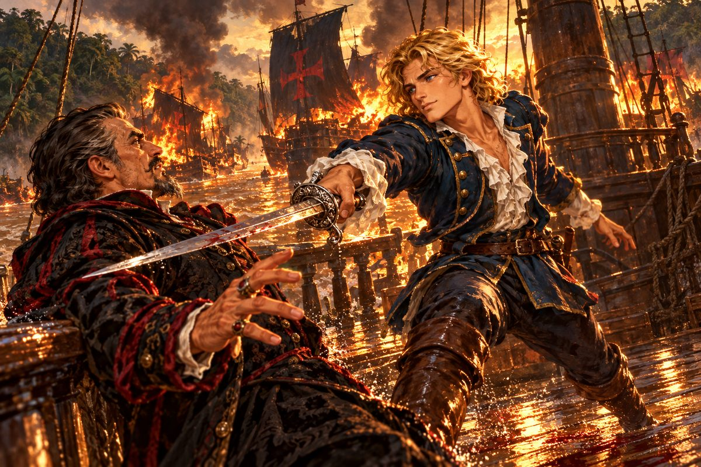

## 30. 대서양을 건너

리스본의 겨울비가 저택 창문을 두드렸다.

"엔리코 신부님은 잘 지내고 계셨네. 자네에게도 안부를 전해 달라더군."

"그 먼 곳에서……. 정말 다행입니다." 마르코가 눈가를 훔쳤다.

"이번엔 신대륙으로 가네. 거기서 요한 사제왕국의 실마리를 찾을 수 있을 것 같아."

"신대륙이요? 근사하긴 하지만…… 조금 뜻밖이군요."

카를로타의 주점은 문을 반쯤 닫아 둔 채였다. 조안이 들어서자 카를로타가 행주를 든 채 일어났다.

"아, 조안 님. 엔리코 신부님은 뭐라고 하시던가요?"

조안은 잠시 말을 고르다 사실대로 말했다. "……안타깝게도 루치아 소식은 없었습니다."

"그런가요……."

"왜 그러시오. 당신답지 않게 기운 없이. 힘을 내시오."

카를로타의 어깨가 무너졌다. 행주가 바닥에 떨어졌다. 그녀는 탁자에 엎드려 소리 죽여 울었다.

"이제 그만…… 포기하는 게 나을 것 같아요……."

조안은 아무 말도 하지 못했다. 그 대신 벽에 걸린 루치아의 탬버린을 오래 바라보았다. 먼지가 앉아 있었다. 그는 손바닥으로 그 먼지를 쓸어 냈다.

대서양 횡단은 순조로웠다. 순조로웠기에 오히려 길게 느껴졌다. 남쪽 신대륙의 해안이 보였을 때, 로코가 뱃전에 기대 중얼거렸다.

"겨우 남미에 닿았군요. 그런데 이제 어떻게 하지요?"

"모르겠어. 일단 뭍에 올라 여기저기 물어보자."

남쪽 대륙 북쪽 해안의 작은 항구 마을이었다. 흙길 양옆으로 회칠한 집들이 늘어섰고, 사탕수수 냄새가 진하게 풍겼다. 조안은 사흘 동안 교회와 교역소와 상점을 돌며 큰 강 상류에 대해 물었다. 다들 고개를 저었다. 어떤 이는 그 이야기를 꺼내자마자 문을 닫아걸었다.

나흘째 오후, 골목 저편에서 비명이 들렸다.

"누가 쫓기고 있습니다! 싸움이라도 난 걸까요?"

치맛자락을 휘날리며 달려가는 여자의 뒷모습, 그리고 그 뒤를 쫓는 사내들의 그림자가 골목 끝으로 꺾여 사라졌다.

"주점 쪽으로 갔어. 로코, 가 보자!"

그러나 그림자들이 들어간 곳은 주점이 아니었다. 마을 변두리의 버려진 창고였다.

"제독님, 여긴 주점이 아닌데요."

"알아. 우리가 뒤쫓는 걸 눈치챈 모양이야. 조용히 따라가야 해."

## 31. 죽음의 신

창고 안은 어두웠다. 지붕 틈새로 들어온 햇빛이 먼지 속에 기둥처럼 박혀 있었다. 그 빛 한가운데에 여자 하나가 벽에 몰려 있었다. 헝클어진 갈색 머리, 찢어진 소매, 맨발.

"오지 마! 더 다가오면 혀를 깨물고 죽어 버릴 거야!"

그 앞에 비쩍 마른 사내가 서 있었다. 해골처럼 퀭한 눈, 창백한 얼굴, 손에 든 가느다란 칼. 사내는 낄낄 웃었다.

"히히, 재밌는 계집이네. 어디 해 봐. 어차피 널 죽이라는 명령을 받았거든. 혀를 깨물든 목을 매달든 나야 상관없어."

로코가 조안의 팔을 움켜쥐었다. "제독님! 저건, 저건 루치아 아닙니까?"

몇 해 동안 꿈에서도 찾던 얼굴이었다. 야위고 그을렸지만, 틀림없었다.

"로코! 구하자!"

조안은 칼을 뽑으며 뛰어들었다. 사내가 고개를 돌렸다. 퀭한 눈에 이상한 기쁨이 떠올랐다.

"오호, 손님이네. 사람들은 나를 죽음의 신이라 부르지. 루돌프라는 이름보다 그쪽이 더 마음에 들어."

루돌프의 칼은 뱀의 혀 같았다. 소리도 없이 날아와 목덜미를 핥고 사라졌다. 조안은 두 번 세 번 칼끝을 피했다. 몇 해 동안 바다에서 단련된 몸이었다. 네 번째 칼을 받아 흘리고 그대로 파고들자, 루돌프가 비틀거리며 물러섰다.

"하, 제법인데? 그런데 어쩌나. 너무 신나 하진 말라고."

등 뒤에서 로코의 고함이 들렸다.

"제독님, 죄송합니다! 루치아가 한 놈에게 붙잡혔습니다!"

돌아보니 기둥 뒤에 숨어 있던 사내 하나가 루치아의 목에 칼을 대고 있었다. 루치아가 울부짖었다.

"조안 님! 안 돼요! 저는 버리고 어서 도망치세요!"

"도망? 우리 얼굴을 본 이상 살아서는 못 나가." 루돌프가 입꼬리를 올렸다. "칼을 버리고 벽에 나란히 서라. 그럼 계집 목숨은 살려 주지."

조안은 이를 악물었다. 루치아의 목에 닿은 칼날이 빛을 받아 번득였다.

"……할 수 없군."

칼이 바닥에 떨어졌다. 조안과 로코는 벽 앞에 섰다. 루돌프가 천천히 다가왔다.

"하하하! 적의 말을 믿다니, 바보 같은 놈!"

칼이 치켜올라간 순간, 루치아를 붙잡고 있던 사내가 짐승 같은 소리를 냈다.

"크악……! 커, 커헉……! 이건, 뭐……!"

사내가 무너졌다. 그 뒤에 붉은 머리가 서 있었다. 커틀러스 끝에서 피가 떨어졌다.

"조안! 여긴 나한테 맡기고 어서 그 아가씨를 데리고 도망쳐!"

"……카탈리나? 당신이 어떻게……. 이 은혜는 꼭 갚겠소!"

조안은 칼을 주워 들고 루치아의 손을 잡았다. 차가운 손이었다. 등 뒤에서 칼날 부딪치는 소리와 루돌프의 욕설이 뒤엉켰다. 조안은 돌아보지 않고 달렸다.

## 32. 루치아의 이야기

여관 방에 들어서 문을 걸어 잠그고서야 조안은 숨을 돌렸다.

"후우, 여기까지 오면 괜찮을 겁니다." 로코가 창문 덧문을 닫았다.

"루치아, 오래 찾았어. 다친 데는 없어?"

루치아가 고개를 저었다. 그러다 갑자기 울음을 터뜨렸다. 조안은 그녀가 다 울 때까지 기다렸다. 로코는 창가에 등을 돌리고 서서 헛기침만 했다.

"……고마워요, 조안 님."

"그런데 루치아 양, 대체 어쩌다 이런 곳까지?"

루치아는 손등으로 눈물을 닦고 천천히 이야기를 시작했다.

"오래전 일이에요. 저는 아까 그 붉은 머리 여자한테 속아서 배를 탔어요. 어느 귀족이 저를 만나고 싶어 한다길래…… 바보같이 그게 조안 님인 줄 알았어요. 아무 의심도 없이 따라갔죠."

조안은 주먹을 쥐었다.

"그 여자도 누군가의 의뢰를 받고 한 일 같았어요. 아무튼 제가 끌려간 곳은 마르티네스 후작의 거처였어요. 우연히 후작이 부하들에게 명령하는 걸 엿듣게 됐는데…… 후작은 자기가 신성왕국의 첫 번째 교주라고 했어요. 그 비밀을 알아 버렸다고, 저를 가두고 입을 막으려 한 거예요."

"신성왕국……."

"끔찍한 일을 하고 있어요. 불쌍한 원주민들을 노예로 부려서 깊은 밀림 속에 요새를 쌓고 있어요. 그곳을 성지라고 속여서 수많은 신자들을 끌어모으고, 광신도 군대를 만들어서 이슬람 땅을 넘어 온 세상을 다스리겠대요."

"마르티네스 후작이? 무슨 헛된 꿈을. 제2의 십자군이라도 만들 셈인가." 조안의 목소리가 낮아졌다. "어떤 이유로도 용서할 수 없는 자로군."

로코가 이를 갈았다. "그놈, 공작님을 모함할 때부터 알아봤어야 했는데! 제독님, 그런 미치광이가 나라를 흔들게 둘 순 없습니다."

"그런데 루치아, 너는 어떻게 빠져나왔지?"

"요새 감옥에 갇혀 있었는데, 어느 날 모르는 할아버지가 저를 꺼내 주셨어요. 그 할아버지도 붙잡혀 있던 분 같았어요. 같이 도망치다가 신성왕국 무리에게 들켜서…… 그때 할아버지 손을 놓쳤어요. 저 혼자 이 마을까지 도망쳐 왔는데, 결국 이렇게."

"그랬구나. 권력에 눈먼 자가 망상에 취해 죄 없는 사람들까지……." 조안은 잠시 말을 끊었다. "루치아, 힘든 일을 자꾸 물어 미안하지만, 후작이 있는 곳을 알 수 있을까?"

"그 요새에 있을 거예요. 그런데 도망치느라 정신이 없어서 길을 기억하지 못했어요. 미안해요."

"괜찮아. 근거지는 찾아내면 돼. 무엇보다 카를로타 씨가 너를 너무 보고 싶어 하셔. 한시라도 빨리 리스본에 데려다주고 싶어. 하지만 그 전에 마르티네스 후작을 찾아 이 모든 일을 따지고 벌을 받게 해야 해."

"아니. 미안하지만 그건 내 일이야."

문간에 카탈리나가 서 있었다. 외투 자락에 피가 튀어 있었지만 다친 데는 없어 보였다.

"카탈리나! 무사했군요!"

"그깟 칼잡이 나부랭이들이 몇이 덤벼도 나한텐 소용없어." 카탈리나가 방 안으로 들어와 벽에 등을 기댔다. "중요한 건 따로 있어. 내 오빠를 죽인 원수가 바로 마르티네스 후작이라는 거야."

"후작이? 정말이오?"

"오빠는 사령부의 명으로 신대륙을 탐험하다가 포르투갈 쪽의 신성왕국 음모를 알아냈어. 그 요새가 서경 46도 서쪽에 있다는 것까지. 그 선 서쪽은 토르데시야스 조약으로 에스파니아 땅이야. 명백한 조약 위반이지."

"그래서 본국에 보고하기 전에 기습해 입을 막았다는 거로군요." 로코가 신음했다.

"산토도밍고에서 오빠의 함대를 불태운 놈들이 단 붉은 십자가 돛…… 당신 집안 문장을 훔쳐 단 거였어." 카탈리나는 조안을 보지 않고 말했다. "마르티네스가 어디 있는지는 알아. 하지만 그곳은 요새가 되어 있어서 보통 수로는 어림도 없어. 게다가 나한텐 그놈 말고도 성가신 상대가 하나 더 있고."

"에제키엘 사령관의 무적함대에 아직 쫓기고 있소?"

"그래. 지금도 이 근방을 샅샅이 뒤지고 있을 거야."

조안은 잠시 생각했다. "정면으로 싸워서는 이길 수 없겠군요. 그러나 당신이 이 궁지를 벗어날 방법이 하나 있소. 우리가 에제키엘 사령관에게 신성왕국 이야기를 하고, 그의 함대에 힘을 빌려 달라고 하는 거요."

카탈리나가 코웃음을 쳤다. "무슨 말을 하나 했더니. 불가능해. 나는 에스파니아 해군에 쫓기는 몸이고, 당신은 외국인이잖아."

"해 보지 않고는 모르는 일이오. 어쨌든 다른 방법은 없는 것 같소."

카탈리나는 한동안 창밖을 보았다. 덧문 틈으로 저녁 바다가 보였다.

"……틀린 말은 아니야. 나도 이제 내 나라 해군과 싸우는 데 지쳤어. 무적함대에 투항하지."

"그럼 출항은 내일 아침으로 합시다. 루치아도 지쳤을 테니."

"좋아."

## 33. 기사의 예

이튿날 정오, 수평선 위로 에스파니아 함대가 나타났다.

갤리온 십여 척이 횡대로 늘어서 있었다. 돛마다 카스티야의 성과 레온의 사자가 그려진 문장이 펄럭였다. 기함의 뱃전에서 깃발 신호가 올랐고, 이어 확성 나팔 소리가 바다를 건너왔다.

"거기 있는 함대는 멈춰라! 따르지 않으면 공격하겠다!"

"잠깐! 공격하지 마라! 에제키엘 사령관과 할 이야기가 있다!"

거룻배 한 척이 다가와 조안 일행을 기함으로 실어 갔다. 갑판 위에 은빛 흉갑을 입은 장교가 서 있었다. 마흔 남짓, 짧게 깎은 검은 머리와 칼날처럼 곧은 콧날. 눈빛이 차고 맑았다.

"내가 에스파니아 함대 사령관 에제키엘이다."

"나는 조안 페레로, 포르투갈 함대의 제독이오. 우리는 싸울 뜻이 없소. 부탁할 것이 있어 당신을 찾아왔소."

"우리도 싸울 뜻은 없다. 다만 급히 수행할 임무가 있을 뿐이다. 그쪽 함대에 있는 여해적을 토벌하는 일이지. 그대의 이야기는 임무를 마친 뒤에 듣겠다."

"기다려 주십시오, 사령관."

카탈리나가 앞으로 나섰다. 그녀는 커틀러스를 칼집째 풀어 갑판 위에 내려놓았다.

"카탈리나입니다. 투항하겠습니다."

에제키엘의 눈썹이 움직였다. "……뭐라고?"

"모든 저항을 그만두고 사령관의 처분에 따르겠습니다. 그러니 부디, 이 포르투갈 제독의 이야기를 들어 주십시오."

갑판 위가 조용해졌다. 에제키엘은 오래 카탈리나를 내려다보았다.

"카탈리나. 이것이 너의 술책이 아니기를 바란다. 그렇다면 기사로서 예를 갖추어 듣겠다. 말해 보라."

카탈리나는 포르투갈 궁정의 두 파벌부터 이야기했다. 자유로운 개혁을 꿈꾸는 페레로 가와 문벌 귀족을 대표하는 마르티네스 후작. 하급 귀족 출신이면서도 왕실의 신임과 백성의 지지를 받는 페레로 가를 시기한 후작이 남미의 밀림에 거짓 왕국을 세운 일. 신자들을 꾀어 광신도 군대를 만들고 혼란을 일으켜 세상을 손에 넣으려는 계획. 아마존강 상류에 쌓은 강철 같은 요새. 그리고 그 요새를 찾아낸 왕립함대 제독 미카엘이 본국으로 돌아가던 길에 살해당한 일까지.

에제키엘은 끝까지 말없이 들었다. 이야기가 끝나자 그는 부관에게서 지도를 받아 펼쳤다.

"우리 정찰대에서도 아마존강 상류에 수상한 요새가 있다는 보고가 올라왔다. 그것이 아마 너희가 말하는 신성왕국이겠지." 그가 지도를 접었다. "잘 알았다. 결코 그냥 넘길 수 없는 일이다. 같은 이베리아 사람으로서 힘을 합쳐 싸우자."

"고맙습니다, 사령관. 길은 저희가 압니다. 안내하겠습니다."

## 34. 마지막 칼

아마존강 하구의 물은 흙빛이었다. 끝없이 넓어서 강이라기보다 바다 같았다. 양쪽 기슭의 밀림에서 새 울음과 짐승 울음이 쉬지 않고 들려왔다. 습기가 돛을 무겁게 적셨다.

사흘째 아침, 강 위에 함대가 나타났다. 검은 돛, 그리고 돛마다 그려진 붉은 십자가. 조안은 그 십자가를 보고 숨을 삼켰다. 마르타 기사단의 붉은 십자가. 페레로 가의 문장이었다. 훔친 깃발이 아직 펄럭이고 있었다.

기함의 고물에 검은 비단옷의 사내가 서 있었다. 마르티네스 후작이었다. 그의 웃음소리가 물 위로 건너왔다.

"후후후! 언제까지 도망 다닐 셈이냐!"

"나를 없애려던 건 당신 아니었나? 마르티네스 후작, 네 음모는 드러났다!"

"훗, 그래서 어쨌다는 거냐! 지금 여기서 네놈들을 모조리 강물에 처넣으면 달라질 건 아무것도 없지!"

에제키엘의 신호기가 올랐다. 에스파니아 함대는 요새를 총공격할 테니 이쪽 해전은 맡긴다는 뜻이었다. 갤리온들이 대열을 지어 강 상류로 올라갔다.

리벨리온이 조안의 배 옆으로 바짝 붙었다. 카탈리나가 뱃전에서 소리쳤다.

"후작은 당신한테 넘기겠어. 나머지 함대는 내가 전부 끌고 가서 처리할 테니, 그 틈에 마르티네스를 쳐부숴! 내가 양보하는 거야. 잊지 마. 대신 후작이 죽었다는 소식만 듣겠어!"

리벨리온이 뱃머리를 돌려 적 함대의 한가운데로 파고들었다. 포화가 터졌다. 검은 돛의 배들이 우르르 그 뒤를 쫓았다. 강 위에 길이 열렸다. 그 길 끝에 마르티네스의 기함이 있었다.

"로코, 저 배에 붙인다!"

"예, 제독님!"

포탄이 오가고, 뱃전이 부딪혔다. 갈고리가 날았다. 조안은 아버지가 내린 장검을 뽑아 들고 가장 먼저 적의 갑판으로 뛰어올랐다.

마르티네스는 도망치지 않았다. 그는 비단 외투를 벗어 던지고 칼을 뽑았다. 쉰을 넘긴 나이였지만 칼끝이 흔들리지 않았다.

"페레로의 애송이. 네 아비를 꺾지 못한 게 한이었는데, 그 아들 목이라도 가져가야겠다."

두 칼이 맞부딪쳤다. 마르티네스의 칼은 궁정 검술의 정석을 따랐다. 깔끔하고 빈틈이 없었다. 그러나 이곳은 궁정이 아니었다. 강물이 배를 흔들었고, 갑판은 피와 물로 미끄러웠다. 조안은 몇 해 동안 흔들리는 갑판 위에서 싸워 왔다. 파도가 배를 들어 올리는 순간을 기다리는 법을, 로코에게서 그리고 카탈리나에게서 배웠다.

배가 크게 기울었다. 마르티네스의 발이 미끄러졌다. 조안의 칼이 그 틈으로 파고들었다.

후작이 뒤로 비틀거렸다. 가슴을 움켜쥔 손가락 사이로 붉은 것이 번졌다. 그의 눈이 불타는 자신의 함대를 향했다.

"으아……! 내 함대가……! 내 꿈이……! 네놈 때문에……."

"네 더러운 야망은 이미 무너졌다. 지옥불 속에서 네가 저지른 짓을 속죄해라."

마르티네스가 뱃전 너머로 넘어갔다. 흙빛 강물이 그를 삼켰다. 물결이 한 번 크게 일고, 잔잔해졌다.

조안은 칼을 내렸다. 손이 떨렸다. 강바람이 땀에 젖은 이마를 식혔다.

"……제독님."

"왜 그러나, 로코."

로코가 눈을 비볐다. "아, 죄송합니다. 꼭 젊었을 적 공작님을 뵙는 것 같아서 그만……."

조안은 대답 대신 로코의 어깨를 두드렸다. 처음 바다에 나가던 날, 폭풍을 넘긴 아침 로코가 그에게 해 준 것처럼.

리벨리온이 연기를 헤치고 다가왔다. 돛 한 장이 찢겨 있었지만 카탈리나는 뱃전에 꼿꼿이 서 있었다.

"조안."

"카탈리나, 그쪽은 어떻게 됐소?"

"마르티네스가 죽었으니 오합지졸이지. 싸울 마음도 없이 달아나고 있어. 에제키엘 사령관도 요새를 무너뜨렸다더군."

카탈리나는 강 상류를 보았다. 검은 연기가 밀림 위로 높이 솟고 있었다. 그녀는 아무 말도 덧붙이지 않았다. 다만 그 연기가 하늘로 흩어질 때까지 오래 바라보았다. 그 연기 너머에 오빠와 에르난이 있기라도 한 것처럼.

"제독님, 에제키엘 사령관의 기함이 보입니다. 신호기를 올렸습니다."

"뭐라고 하나?"

"귀하의 승리를 축하하며, 다시 만나 다시 겨룰 날을 기약한다. 이상입니다."

조안은 웃었다. "다시 겨룰 날이라. 다음엔 같은 편으로 만나고 싶은데."

"답신은 어떻게 할까요?"

"……그만두자. 그보다 루치아를 어머니께 빨리 데려다 드려야지." 조안은 키를 잡았다. "리스본으로 간다!"
