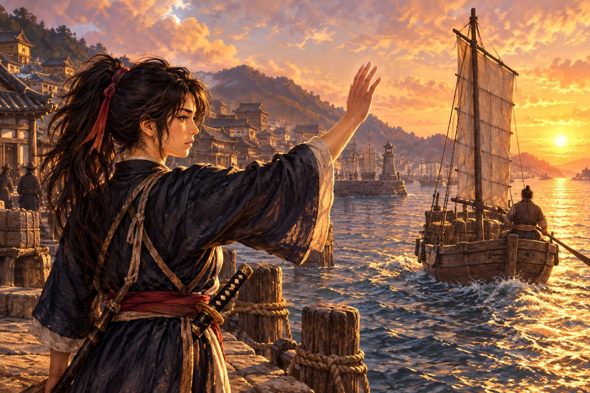
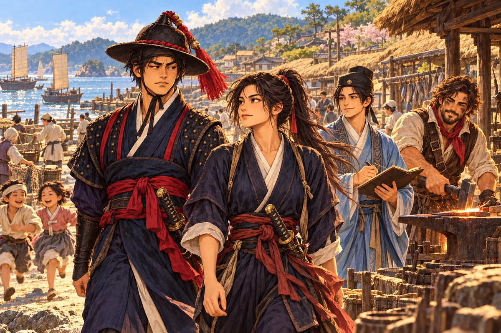

## 결말 하나 ― 바다로

"바다로 돌아가겠소."

해강이 말했다. 주막의 소란 속에서 그 말은 작았지만, 구석 자리의 네 사람에게는 또렷이 들렸다.

"구로세는 쓰러졌지만, 이 바다에는 또 다른 구로세가 나올 거요. 남만의 철포는 여전히 들어오고, 해금의 바다는 여전히 막혀 있고, 왜관의 장삿길은 여전히 칼을 부르오. 수영의 배는 조선의 바다 끝까지만 갈 수 있소. 그러나 기록에 없는 배는 어디든 갈 수 있지." 해강이 오린을 보았다. "누군가는 바다를 지켜야 하니까."

오린은 웃었다. 그 웃음이 조금 흔들렸다.

"……그럴 줄 알았어. 고집 센 무관 나리."

떠나는 날 아침, 부산포 앞바다는 맑았다.

해강은 해령호를 택했다. 귀선은 수영에 남겼다. 거북은 집을 지키는 짐승이라고, 돌석이 그렇게 말했다. 해령호의 돛대에는 여전히 아무 깃발도 걸리지 않았다.

다대포 젊은이 몇이 따라나섰다. 막동이가 그중에 있었다. 어깨의 흉터를 자랑스럽게 드러낸 채.

부두에 짐 꾸러미를 멘 돌석이 나타났다. 해강은 그를 보고 놀랐다. 돌석은 귀선과 함께 남을 줄 알았다.

"어딜 가든 노 젓는 늙은이 하나는 필요할 거다." 돌석이 꾸러미를 해령호에 던져 올렸다. "그리고 네 아버지한테 진 빚, 아직 다 못 갚았다. 네가 장가갈 때까지는 따라다닐 거다."

"아저씨……."

"울지 마라. 뱃사람이 출항 날 울면 재수 없다."

소백은 부산포에 남았다. 그는 좌수사의 부탁으로 왜관의 장부를 맡게 되었다. 조선과 왜와 명나라 사이를 오가는 은의 길을 지켜보는 일이었다. "이번엔 정직한 장부를 보겠습니다. 그리고 해령호에 돈이 떨어지면 언제든 편지하십시오. 이자는 받겠지만." 그가 웃으며 주판을 흔들었다.

안토니우는 귀선과 함께 남았다. 수영의 포수들을 가르치기로 했다. "언젠가 이 거북이 다시 바다에 나갈 날이 올 거요. 그때 포를 쏠 줄 아는 사람이 있어야지." 그는 해강의 손을 오래 잡았다. "빚은 다 갚았소, 선장. 이제 내가 당신 덕을 볼 차례요."

오린은 부두 끝에 서 있었다.

해강이 다가가자 오린은 바다를 보았다. 해강을 보지 않았다. 해강은 목에 건 작은 주머니를 풀려 했다. 약속이었다. 돌려줄 때까지 잘 지니겠다고.

오린이 고개를 저었다.

"……부적은 돌려받지 않을게."

해강의 손이 멈추었다.

"다음에 돌아올 때 가져와." 오린이 그제야 해강을 보았다. 그녀의 눈이 젖어 있었지만, 그녀는 웃었다. 사카이의 회합에서, 나가사키의 길드 앞에서 보았던 그 꾸밈없는 웃음. "그래야 네가 돌아오잖아. 살아서 돌아올 이유. 내가 말했지?"

해강은 주머니를 다시 목에 걸었다. 그리고 오래 오린을 보았다. 할 말이 많았다. 그러나 무엇 하나 입 밖으로 나오지 않았다. 마침내 그가 한 말은 하나뿐이었다.

"반드시 돌아오겠소."

해령호가 부산포를 떠났다. 돌석이 고물에서 노를 저었다. 오린은 부두 끝에 서서 한 손을 들었다. 배가 수평선 아래로 가라앉을 때까지 그 손을 내리지 않았다.

그 뒤로 부산포 앞바다에 왜구가 나타날 때마다, 이름 없는 배 한 척이 어디선가 나타났다고 한다. 어느 나라의 깃발도 달지 않은 배. 그 배가 지나간 바다에서는 마을이 불타지 않았다.

그 배가 어디서 왔는지, 누가 모는지는 아무도 몰랐다. 기록에 없는 배였으니까.

다만 부산포 왜관의 한 통사는, 그 배가 돌아오는 날이면 언제나 부두 끝에 나가 서 있었다고 한다.

---

## 결말 둘 ― 다대포에

"다대포에 남겠소."

해강이 말했다. 오린의 눈이 커졌다.

"바다는 넓고, 지킬 곳은 많소. 그러나 나는 바다를 지키러 나간 게 아니었소. 다대포를 지키지 못해서 나간 거였지." 해강이 창밖, 언덕 너머를 보았다. "이제 다대포를 지키겠소. 처음부터 다시."

돌석이 껄껄 웃었다. 그 웃음이 조금 젖어 있었다.

"네 아버지가 들었으면 뭐라 했을까. 바다가 지켜 주는 마을이 있으면, 누군가는 그 마을을 다시 지어야지."

그해 봄, 다대포에 다시 집들이 세워졌다.

수영의 목수들이 왔다. 귀선을 지은 손들이었다. 그들은 이번에는 배 대신 집을 지었다. 서까래를 올리고, 지붕을 이었다. 다대포 사람들이 흙을 이겨 벽을 바르고, 돌을 날라 담을 쌓았다. 부산포의 상인들이 쌀과 소금을 실어 보냈다. 좌수사가 마지막으로 준 은이 그렇게 쓰였다.

소백은 마을 장부를 맡았다. 누구 집에 무엇이 모자라는지, 어느 배를 먼저 새로 지어야 하는지, 모두 그의 주판 위에 있었다. "이번엔 정직한 장부로." 그가 웃으며 말했다. "할아버지가 보시면 기뻐하실 겁니다. 처음으로 바다에서 번 돈을 바다 사람에게 쓰는 장부니까요."

안토니우는 포구 옆에 대장간을 열었다. 귀선의 쇠못을 박던 손으로 이제 낫과 호미와 고기잡이 작살을 두드렸다. "화포 대신 대장간 망치를 들게 될 줄은 몰랐소." 그러나 그의 망치 소리는 언제나 즐거웠다. 마을 아이들이 그 소리를 듣고 몰려와 불똥이 튀는 것을 구경했다. 안토니우는 아이들에게 남만 말로 숫자 세는 법을 가르쳤다.

돌석은 포구에 작은 조선소를 차렸다. 다대포의 고깃배를 다시 짓는 일이었다. 그는 가끔 귀선의 그림을 꺼내 보며 혼자 웃었다. 다음엔 더 좋은 거북을 지을 수 있을 것 같다고.

해강은 다대포 만호로 돌아갔다. 비워 두었던 자리였다. 그는 날마다 포구의 망루에 올라 바다를 보았다. 수평선에 낯선 돛이 보이면 봉화를 올리게 했고, 마을 젊은이들에게 노 젓는 법과 활 쏘는 법을 가르쳤다. 다시는 고갯마루에서 불타는 마을을 내려다보지 않기 위해.

오린은 부산포 왜관의 통사가 되었다. 대마도와 부산포 사이를 오가는 장사꾼들의 말을 옮기는 일이었다. 왜구의 딸이 조선과 왜 사이의 다리가 된 것이다.

어느 저녁, 해강과 오린은 다대포 바닷가를 함께 걸었다. 새로 지은 초가지붕들 위로 저녁연기가 올랐다. 이번에는 불길이 아니라 밥 짓는 연기였다. 아이들이 모래사장을 뛰어다녔다. 멀리서 안토니우의 망치 소리가 들렸다.

"통사 일은 어떻소?" 해강이 물었다.

"재미있어. 왜인들은 조선 사람을 무서워하고, 조선 사람들은 왜인을 무서워해. 둘 다 서로를 모르니까. 내가 그 가운데서 말을 옮기면, 조금씩 덜 무서워해." 오린이 바다를 보았다. "아버지는 바다를 털면서 살았지만, 나는 바다를 이으면서 살 거야."

해강은 품 안의 작은 주머니를 꺼냈다. 오린의 아버지가 삼십 년을 지닌 부적. 그는 그것을 오린에게 내밀었다.

"돌려주겠다고 약속했소."

오린은 주머니를 내려다보았다. 그리고 받지 않았다. 대신 해강의 손을, 주머니를 쥔 해강의 손을 두 손으로 감쌌다.

"나는 대마도와 부산포 사이를 잇는 거야." 그녀가 말했다. 그리고 조금 뒤에, 파도 소리에 묻힐 만큼 작은 목소리로 덧붙였다.

"……네 곁에서."

해강은 대답 대신 바다를 보았다. 오린의 손이 따뜻했다.

다대포 앞바다는 오랜만에 고요했다. 수평선 위로 해가 지고 있었다. 하늘이 붉게 물들었다. 그러나 그 빛은 더 이상 아무도 두렵게 하지 않았다.

---

*조선 외전: 검은 학을 쫓아 ― 끝*
