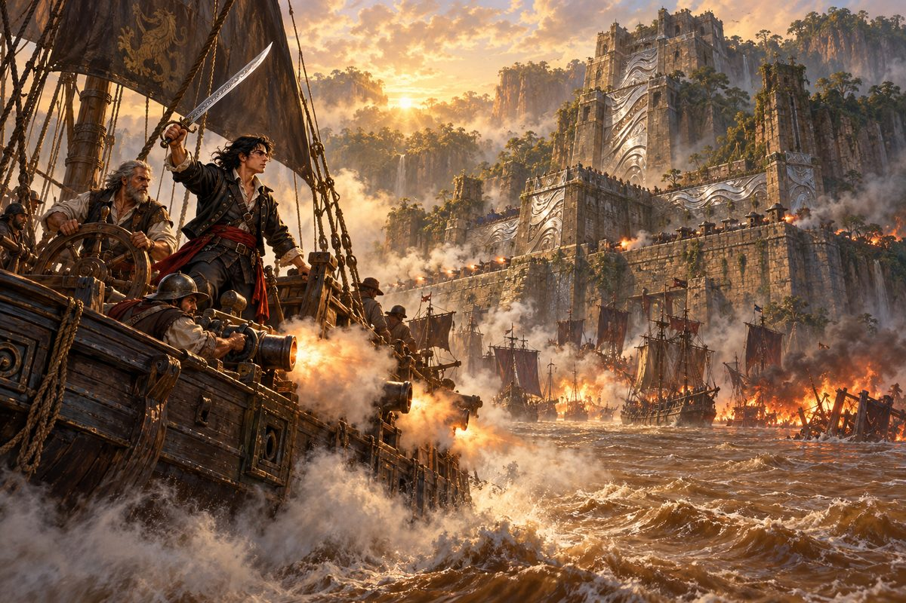

## 43. 큰 강의 요새

카옌에서 마지막 보급을 마치고 남쪽의 큰 강을 거슬러 올랐다. 강물은 흙빛이었고, 양쪽 기슭의 밀림이 하늘을 반쯤 가렸다. 사흘째 되는 날 아침, 안개가 걷히자 그것이 나타났다.

요새라기보다 산이었다. 전설의 나라가 남긴 거대한 돌 구조물이 강을 가로막고 서 있었다. 무너져 가던 돌벽마다 은회색 금속판이 덧대어져 아침 햇살에 물결무늬를 번뜩였다. 그와상이었다. 층층이 뚫린 포문이 강을 내려다보았고, 그 아래 정박한 해적선들의 돛대가 숲처럼 빽빽했다.

가장 높은 성벽 위에 조커 다 실버가 서 있었다.

"왔구나, 살바도르. 하지만 늦었다. 이미 일은 시작됐어. 나는 하이레딘을 넘어선다. 그자 손에 있었다면 이 요새는 방패에 불과했겠지. 나는 검으로 쓴다. 땅 위에서 편히 사는 놈들에게 내미는 신의 검이다. 이번엔 우리가 몰아낼 차례다. 우리가 무슨 일을 당해 왔는지 놈들에게 똑똑히 알게 해 주마!"

"조커……."

첫 공격은 실패였다. 요새의 포는 강 전체를 덮었고, 가나돌은 하루 종일 포탄 속을 헤집고 다녔다. 해가 기울 무렵 호레스가 피투성이 얼굴로 소리쳤다. 선원들이 한계입니다, 일단 물러납시다. 살바도르는 이를 악물고 전 함대 이탈을 명했다.

강 하구에 다다랐을 때, 그들을 기다리는 함대가 있었다. 낯익은 웃음소리가 물 위를 건너왔다.

"하하하, 늦지 않았군. 오랜만입니다, 살바도르 씨." 로드리게스 비골이었다. "오늘은 상납금 대신 당신 목숨을 받으러 왔습니다. 어디로 도망가든 반드시 찾아간다고 했지요?"

"너를 상대할 여유 없다. 키를 오른쪽으로 끝까지!"

"그렇게는 안 되지요. 여기가 당신 무덤입니다."

사방에서 포성이 터졌다. 회피할 길이 없었다. 큭, 여기까지인가. 살바도르가 중얼거린 순간, 그의 손이 허리의 그람에 닿았다. 아버지의 손이 마지막으로 닿았던 칼자루였다.

"아니. 여기서 끝낼 순 없다. 캐러네이드, 좌현 전부 장전! 바짝 붙는다!"

가나돌이 포위망 한가운데로 돌진했다. 짧은 포신의 캐러네이드가 지척에서 불을 뿜자 비골의 기함 뱃전이 통째로 날아갔다. 그 틈으로 가나돌이 빠져나갔다. 등 뒤에서 비골의 비명 섞인 고함이 멀어졌다.

카옌에서 그들은 사흘을 쉬었다. 대포를 손보고, 다친 선원을 돌보고, 물과 식량을 배에 가득 실었다. 몇 번을 싸워야 할지 모르니 넉넉히, 하고 호레스가 말했다. 두목의 원수를 갚읍시다.

두 번째 공격은 새벽이었다. 안개를 틈타 가나돌은 요새의 포문 바로 아래까지 숨어들었다. 멀리서 쏘는 대포는 그와상 벽에 튕겼지만, 지척에서 쏘는 캐러네이드는 달랐다. 포문 하나가 무너지고, 둘이 무너지고, 요새 아래의 해적선들이 불길에 휩싸였다. 해적들이 우왕좌왕하는 사이 가나돌은 조커의 기함에 뱃전을 붙였다.

조커는 갑판 위에서 칼을 뽑았다.

"하이레딘의 칼을 들고 왔구나. 그 칼은 내 것이었어야 했다."

"이건 아버지가 준 거다. 네가 등을 찔러 빼앗으려던 것이 아니라."

두 칼이 부딪쳤다. 그람의 날이 조커의 칼을 받을 때마다 물결무늬가 번쩍였다. 조커는 빨랐고, 집요했고, 웃고 있었다. 그러나 그 웃음이 어느 순간 굳었다. 살바도르의 칼은 더 이상 흔들리지 않았다. 마지막 일격이 조커의 칼을 두 동강 냈다. 조커는 뒷걸음질 치다 불타는 돛대 아래로 쓰러졌다. 기함이 크게 기울었다. 연기가 갑판을 덮었다.

연기가 걷혔을 때, 조커는 보이지 않았다. 불타는 기함만이 흙빛 강물 위를 천천히 떠내려가고 있었다.

요새의 포성이 멎었다. 성벽 위의 해적들이 하나둘 칼을 내려놓았다. 그들 대부분은 큰 나라들의 싸움에 고향을 잃은 사람들이었다. 살바도르는 뱃머리에 서서 그들을 둘러보았다.

"가고 싶은 곳으로 가라. 바다는 넓다. 남의 땅을 빼앗지 않아도 살 곳은 있다."

## 44. 바다로

요새는 다시 무너져 가는 돌산이 되었다. 그와상 판들은 강바닥에 가라앉았다. 살바도르는 그것을 건져 올리지 않았다.

강을 내려와 바다에 나서자, 하늘이 끝없이 열렸다. 호레스가 고물에서 키를 잡고 있었다.

"제독, 이제 어디로 가실 겁니까?"

"……글쎄. 알제에는 돌아갈 수 없고, 현상금은 붙어 있고."

"게다가 빚도 있지요. 그 붉은 머리 아가씨한테."

살바도르는 쓴웃음을 지었다. 갚을 빚이 남아 있다는 것도 나쁘지 않았다. 갚으러 갈 곳이 있다는 뜻이었으니까.

그때 망대에서 외침이 들렸다. 배가 다가온다고. 제노바 깃발이라고.

수평선 너머에서 날렵한 슬루프 한 척이 나타났다. 그 곁을 낡은 라티나 배 한 척이 나란히 달리고 있었다. 리베치오였다. 고물 높은 곳에서 밤색 머리를 하나로 묶은 여인이 망원경을 내리고 이쪽을 향해 손을 크게 흔들었다. 그 옆의 턱수염 난 사내가 무언가 투덜거리자, 그녀가 사내의 옆구리를 팔꿈치로 찔렀다. 바람이 웃음소리를 실어 왔다.

소문은 들었다. 제노바의 여자 모험가가 피에트로 콘티와 함께 신대륙의 바닷가를 지키고 다닌다고. 그 대답이 무엇이었는지, 살바도르는 묻지 않아도 알 것 같았다.

그는 이번에는 굳지 않았다. 뱃전에 서서, 손을 들어 마주 흔들었다.

"호레스, 신호기를 올려라."

돛대 꼭대기로 깃발이 올라갔다. 아버지의 바다에서, 카탈리나에게서, 그리고 이제는 그 자신에게서 나온 말이었다.

행운을 빈다.

리베치오의 돛대에도 깃발이 올라갔다. 무슨 뜻인지는 알 수 없었다. 아마 그녀가 마음대로 만든 신호일 것이다. 살바도르는 그것이 마음에 들었다.

두 배는 잠시 나란히 달리다가, 각자의 바람을 따라 갈라졌다. 하나는 남서풍을 타고, 하나는 아직 이름 없는 바람을 타고.

바다는 넓었다. 누구에게나.
